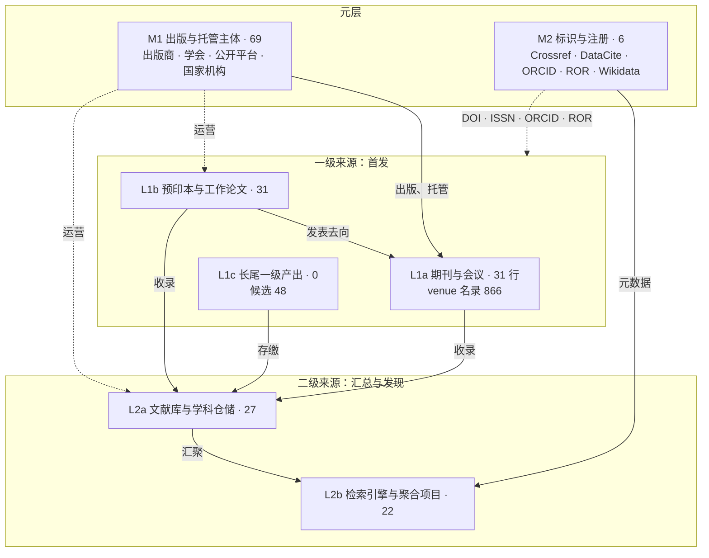

# 来源分层与收集现状

> 本文回答三个问题：论文来源怎么分层，每一层现在收了什么、到了什么状态，哪里还缺。来源分七类：两个元层（M1 出版与托管主体、M2 标识与注册）、三类一级来源（L1a 期刊与会议、L1b 预印本与工作论文、L1c 长尾一级产出）、两类二级来源（L2a 文献库与学科仓储、L2b 检索引擎与聚合项目）。[支持名录](source-directory.md)的 187 行已按七类重分；本轮另调研候选来源 156 个（[候选来源](source-candidates.md)），按学科整理期刊会议 866 个并标注评级（[venue 名录](venues/README.md)、[评级体系](venue-rankings.md)）。

## 要点

- **七类取代旧的 L1/L2 七种类型**：旧类型按平台形态分（出版商、期刊平台、会议平台……），新类按来源在检索链上的位置分：谁出版托管（M1）、谁发标识（M2）、论文首发在哪（L1）、谁汇总与发现（L2）。Source 与 Venue 仍分开建模，venue 就是 L1a。见 D-072 草案。
- **现状**：M1 69、M2 6、L1a 31（另有 venue 名录 866 个）、L1b 31、L1c 0、L2a 27、L2b 22，盗版源合并行不属任何层级。首批 P0 的 36 行集中在 M1、L1b 与 L2a。
- **最大缺口**：L1c 全空（企业技术报告、政府与智库报告、学位论文、JMP、标准）；M2 只有 6 行，ISSN 国际中心与日中韩 DOI 注册机构不在名录；国家与公共机构平台只有 4 个；地学、材料、中文区域在各层都偏薄。
- **本轮候选**：M1 29、M2 21、L1b 1、L1c 48、L2a 28、L2b 29。最值得先补的是 Copernicus（EGU 期刊，OAI-PMH 已核）、FEDS Notes、NASA NTRS、NIST 与 USGS 报告、World Bank OKR、theses.fr、大学机构库 ETD、IETF RFC 与 ccfddl。
- **支持分级（2026-09-29，D-073 草案）**：在七类之上加一层"支持 / 登记 / 不接入"，把维护投入集中到核心。L2a、L2b 与 M2 的非排除行全部支持，它们天然汇总了大量一级内容，是降低收集成本的主干；M1、L1a、L1b 只支持 P0/P1 与承接核心 venue 的行。venue 名录的 141 个子领域归并为 66 个（中文刊另各成一组），866 个 venue 中核心 304 个优先支持，长尾 562 个登记，靠问卷与用户需求逐步升级。全表见 [支持名录 Excel](source-support-catalog.xlsx)。
- **评级**：收 45 个体系；CS 用 CCF 2026 等，经管用 UTD24、FT50、ABDC、VHB、FMS，理工医用科协分级目录与 Nature Index，中文刊用 CSSCI、CSCD、北大核心等。中科院分区表 2025 年版为最终版、已停更，与 JCR 一样不做逐刊标注。

## 支持分级

七类回答"来源在检索链上的哪个位置"，支持分级回答"要不要为它投入维护"。两者正交，与决定"何时接入"的 v2 状态（P0/P1/P2）也正交。

| 层级 | 含义 | 来源（名录行） | venue |
|---|---|---|---|
| **支持** | 纳入维护承诺：按 v2 状态排期，通道与证据按期复核，进验收 | M2、L2a、L2b 的非排除行全部支持；M1、L1a、L1b 为 P0/P1 或承接核心 venue 时支持 | 核心 venue：逐刊核验标识与通道，进首批验收与默认推荐池 |
| **登记** | 保留条目与已有证据，不排期、不复核、不进验收 | 其余 M1、L1a、L1b 行；L1c 与候选来源全部登记 | 长尾 venue：用户关注时照常经 Crossref 或 OpenAlex 自动建 `auto` venue 收元数据 |
| **不接入** | 平台零自动化 | `excluded`、`link-only`、`user-import-only` | —（只能用户导入的中文刊属于登记） |

各类计数（名录 187 行）：

| 类别 | 支持 | 登记 | 不接入 | 登记行 |
|---|---:|---:|---:|---|
| M1 | 54 | 15 | 0 | `hogrefe` `ucpress_online` `world_scientific` `emerald_insight` `pm_research` `now_publishers` `peerj` `f1000_platforms` `spie_dl` `episciences` `ceur_ws` `pos_sissa` `jstage` `scielo` `redalyc` |
| M2 | 6 | 0 | 0 | — |
| L1a | 20 | 8 | 3 | `mit_smr` `ccs_chemistry` `quantum_journal` `rss_proceedings` `mlsys_proceedings` `aamas_ifaamas` `psb_proceedings` `sed_meetings` |
| L1b | 19 | 12 | 0 | `authorea` `ess_open_archive` `eartharxiv` `optica_open` `eccc` `chinaxiv` `paper_edu_cn` `cepr_dp` `hbs_wp` `mpra` `cesifo_wp` `other_cb_wp` |
| L1c | 0 | 0 | 0 | 候选 48 个全部登记 |
| L2a | 21 | 0 | 6 | — |
| L2b | 14 | 0 | 8 | — |
| 无层级 | 0 | 0 | 1 | — |
| **合计** | **134** | **35** | **18** | |

登记的 L1b 与 L1a 多数仍能经已支持的 L2 间接覆盖：CEPR、MPRA、CESifo 与其他央行 WP 经 RePEc，ESS Open Archive、EarthArXiv 经 Crossref 与 OpenAlex，PSB 经 PubMed。登记不等于看不到，只是不为它单独维护通道。

**升级与降级**（初值为草案，V1 用真实数据校准）：

- **问卷与调研**：每季度随用户问卷收集"缺少的期刊、会议与来源"，并由学科负责人做一次缺口调研。
- **登记 → 支持 / 核心**：满足任一条即进入候选，核验标识、通道与条款后升级：季度问卷中至少 5 名用户列为"必需"；至少 10 名活跃用户的频道或订阅引用它；学科负责人调研认定为核心并写明理由；核心 venue 迁到该平台。
- **支持 / 核心 → 登记**：连续两个季度零关注且不在评级顶档，或通道失效且无替代，由维护者降级并留记录。
- **L2 候选**：[候选来源](source-candidates.md)里的 L2a、L2b 入名录后直接按支持处理，不走问卷门槛。

venue 的核心判定规则见 [venue 名录](venues/README.md#支持分级)。

## 七类定义

| 代码 | 名称 | 是什么 | 在检索链上的作用 | 例子 |
|---|---|---|---|---|
| M1 | 出版与托管主体 | 出版或托管多个 L1 venue 的主体及其平台，分出版商、学会协会、公开托管平台、国家与公共机构四个子类 | 元数据与全文从哪来、条款由谁定；一个 M1 下挂多本刊或多个会议 | Elsevier、ACM、OUP、OpenReview、J-STAGE |
| M2 | 标识与注册 | 跨文献的统一注册、标识与身份机构，以及跨文献的政策登记 | 提供 DOI、ORCID、ISSN、ROR 等主键，是去重与关联的锚 | Crossref、DataCite、ORCID、ROR、ISSN、Wikidata |
| L1a | 期刊与会议 | 具体 venue：期刊、会议、论文集系列 | 正式版（VoR）的出处；评级标签挂在这里 | AER、NeurIPS、PRL、Cell |
| L1b | 预印本与工作论文 | 预印本服务器，正式编号的 WP 平台与系列 | 最早出现的版本；经管 WP 是一等来源 | arXiv、bioRxiv、SSRN、NBER WP、ECB WP |
| L1c | 长尾一级产出 | 机构、组织、企业的技术报告、白皮书与政策报告，学位论文，JMP 等个人首发 | 补齐不进期刊、也不进预印本的一手内容 | 企业研究院技术报告、NASA NTRS、学位论文库、JMP |
| L2a | 文献库与学科仓储 | 基于 L1 的有界语料库：学科书目库、区域与国家文献库、存缴仓储、过刊档案 | 按学科或区域系统收录，补摘要、分类与全文副本 | PubMed、INSPIRE、zbMATH、dblp、RePEc、CNKI、PMC、Zenodo |
| L2b | 检索引擎与聚合项目 | 跨语料的检索引擎、引文图谱、OA 定位、社区信号与开源聚合项目 | 跨学科发现、引用关系、OA 位置与热度信号 | OpenAlex、S2、Google Scholar、Unpaywall、HF Papers |

## 判定规则

按顺序判定，命中即停：

1. 主要职能是分配或管理跨文献标识、身份（DOI、ORCID、ISSN、ROR 等）→ M2。
2. 是具体期刊、会议或论文集系列，含只服务一个 venue 的自有站点 → L1a。
3. 首发预印本或正式编号的 WP → L1b；首发技术报告、学位论文、JMP 等长尾内容 → L1c。
4. 出版或托管两个以上 L1 venue 的主体或平台 → M1；国家或公共机构运营的，记 M1-nat。
5. 系统收录某个有界语料（学科、区域、存缴、过刊）的库 → L2a。
6. 跨语料检索、引文图谱、OA 定位、信号或聚合 → L2b。

每个来源只有一个主类，可以带兼角色（`roles`）：

- Crossref：M2（DOI 注册机构），兼 L2b（元数据 API，期刊元数据主干）。
- CNKI：L2a（中文文献库），兼 M1（网络首发）。
- OSTI.GOV：L2a（国家仓储），兼 L1c（DOE 技术报告首发）。
- ACM DL：M1（学会平台），兼 L2a（ACM Guide 书目）。
- Zenodo：L2a（存缴仓储），兼 L1b、L1c 的托管。

国家机构本身（NLM、JST、中国科学院等）在关系图里是 M1-nat 节点，下挂它运营的来源，不一定单独占名录一行。

边界判例：

- DOAJ 归 L2b（OA 期刊目录，服务 OA 判定），CORE 归 L2b（聚合各地仓储），都不归 L2a。
- 单刊站点（JMLR、eLife、PNAS）归 L1a；多刊平台（AEA、INFORMS、PMLR、ACL Anthology）归 M1。
- 央行与国际组织的正式 WP 系列归 L1b；系列之外的报告与博客式研究归 L1c。
- 中国科技论文在线原为仓储行，按"首发论文"职能改归 L1b；JSTOR 原为期刊平台行，按"过刊档案"职能改归 L2a。

## 现状一览

名录 187 行按新类统计。"外链/导入/排除"合计 `link-only`、`user-import-only` 与 `excluded`；"本轮候选"是[候选来源](source-candidates.md)里尚未入名录的数目。

| 类别 | 子类（名录行数） | 名录 | P0 | P1 | P2 | 仅元数据 | 外链/导入/排除 | 本轮候选 | 现状 |
|---|---|---:|---:|---:|---:|---:|---:|---:|---|
| **M1** 出版与托管主体 | 出版商 28、学会 26、公开平台 11、国家机构 4 | 69 | 15 | 28 | 13 | 13 | 0 | 29 | 五大出版商与主要学会都在；国家机构平台只有 4 个，地学平台 Copernicus、AMS 缺 |
| **M2** 标识与注册 | DOI 注册机构 2、人 1、机构 1、枢纽 1、政策 1 | 6 | 1 | 3 | 2 | 0 | 0 | 21 | Crossref、DataCite、ORCID、ROR 齐全；ISSN 国际中心、日中韩 DOI 注册机构、会议标识未入名录 |
| **L1a** 期刊与会议 | 期刊 13、会议 10、经管会议事件 8 | 31 | 5 | 9 | 10 | 4 | 3 | — | 只列有自有站点的 venue；其余期刊会议经 M1 平台或 Crossref 委托接入，venue 名录列 866 个 |
| **L1b** 预印本与工作论文 | 预印本 19、WP 系列 12 | 31 | 6 | 11 | 9 | 5 | 0 | 1 | 覆盖好：arXiv、bioRxiv、medRxiv、ChemRxiv、PsyArXiv、SSRN、NBER 与央行 WP；地学只有 P2 |
| **L1c** 长尾一级产出 | — | 0 | 0 | 0 | 0 | 0 | 0 | 48 | 空白 |
| **L2a** 文献库与学科仓储 | 学科库 13、区域库 4、仓储 8、档案 2 | 27 | 7 | 4 | 8 | 2 | 6 | 28 | 生命、物理、数学、经济、CS 有权威学科库；地学、材料、心理没有开放学科库；中文库只能用户导入 |
| **L2b** 检索引擎与聚合项目 | 引擎 11、OA 层 3、引文与派生 3、社区信号 5 | 22 | 2 | 8 | 2 | 2 | 8 | 29 | OpenAlex、S2、Unpaywall、OpenCitations 可用；商业索引与 Google Scholar 排除；AI 工具只作竞品参照 |
| 无层级 | 盗版源合并行 | 1 | 0 | 0 | 0 | 0 | 1 | — | 永不接入 |
| **合计** | | **187** | **36** | **63** | **44** | **26** | **18** | **156** | |

## 学科 × 类别

名录行按学科计数，一个来源可标多个学科；标"全"的来源只计入"跨学科"。M2 全部是跨学科来源，不单列。venue 名录的数目取自各学科文件，"中文与区域"一行的 venue 数是中文刊 121 加中国主办英文刊 44，核心 venue 数是 23 加 19。

| 学科组 | M1 | L1a 名录行 / 核心 venue / venue | L1b | L1c 候选 | L2a | L2b | 其中 P0 | 现状 |
|---|---:|---:|---:|---:|---:|---:|---:|---|
| 数学 | 19 | 1 / 20 / 63 | 1 | 0 | 3 | 0 | 6 | 主干好：zbMATH Open、arXiv、EMS、Numdam；MathSciNet 只外链 |
| 物理与天文 | 19 | 2 / 22 / 61 | 2 | 3 | 4 | 1 | 8 | 通道最丰富：arXiv、APS、INSPIRE、SCOAP3、ADS |
| 化学 | 9 | 1 / 17 / 47 | 1 | 2 | 3 | 0 | 5 | 最弱的理科：ACS 只取元数据，CAS 只外链，没有本学科的科协目录 |
| 地学与材料 | 6 | 0 / 28 / 88 | 4 | 5 | 2 | 0 | 5 | 最薄：Copernicus、AMS 平台不在名录，没有开放学科库 |
| 生命科学与医学 | 14 | 2 / 37 / 104 | 5 | 1 | 4 | 2 | 11 | L2 最完整：Europe PMC、PubMed、PMC |
| 心理与认知 | 15 | 1 / 21 / 57 | 3 | 0 | 3 | 0 | 9 | 依赖 Crossref，APA 期刊摘要覆盖为 0；PsycInfo 是订阅库 |
| 经济 | 12 | 3 / 27 / 98 | 14 | 19 | 5 | 0 | 9 | 最强之一：AEA、ECMA、NBER、RePEc、央行 WP；政策报告是 L1c 大块 |
| 金融 | 9 | 5 / 16 / 45 | 10 | 11 | 1 | 0 | 7 | Top3 在 Wiley、Elsevier、OUP；WP 经 SSRN、NBER |
| 商业与管理 | 15 | 5 / 37 / 124 | 4 | 7 | 3 | 0 | 6 | UTD24 刊多在 Atypon、Silverchair；INFORMS、AOM 为 P0 |
| 计算机与 AI | 18 | 12 / 69 / 154 | 4 | 28 | 1 | 5 | 14 | P0 最多；企业技术报告是 L1c 最大一块 |
| 跨学科 | 6 | 1 / 10 / 25 | 5 | 1 | 7 | 15 | 3 | M2 与 L2b 的主干都在这里 |
| 中文与区域 | 4 | 2 / 42 / 165 | 2 | — | 4 | 0 | 0 | 没有 P0、P1；知网、万方、维普只能用户导入 |

## 各类清单

名录现有的 187 行按子类列出 `source_id`，逐行的通道与状态见[支持名录](source-directory.md)。

- **M1 出版商（28）**：`elsevier_sd` `wiley` `springer_link` `nature_portfolio` `oup_academic` `cambridge_core` `tandf_online` `sage_journals` `annual_reviews` `mdpi` `frontiers` `plos` `cshl_press` `hogrefe` `ucpress_online` `edp_sciences` `world_scientific` `degruyter_brill` `msp` `intl_press` `uchicago_journals` `mit_press_direct` `emerald_insight` `pm_research` `iospress_faia` `now_publishers` `peerj` `f1000_platforms`
- **M1 学会与协会（26）**：`aaas_science` `royal_society` `apa_psycnet` `aps` `iop` `aip` `optica` `acs` `rsc` `ams` `siam` `ems_press` `acm_dl` `ieee_xplore` `informs_pubsonline` `aom_journals` `aea_journals` `econsoc_journals` `aaa_pubs` `sfn_journals` `acl_anthology` `aaai_ojs` `usenix` `isca_archive` `spie_dl` `ais_icis`
- **M1 公开托管平台（11）**：`scipost` `project_euclid` `centre_mersenne_numdam` `episciences` `geoscienceworld` `openreview` `pmlr` `cvf_open_access` `lipics_drops` `ceur_ws` `pos_sissa`
- **M1 国家与公共机构（4）**：`sciengine` `jstage` `scielo` `redalyc`
- **M2（6）**：DOI 注册机构 `crossref` `datacite`；人 `orcid`；机构 `ror`；标识枢纽 `wikidata`；政策登记 `open_policy_finder`
- **L1a 期刊（13）**：`pnas` `hbp_hbr` `mit_smr` `ccs_chemistry` `misq` `quantum_journal` `annals_math` `elife` `jmlr` `tmlr` `jair` `wulixb` `pvldb`
- **L1a 会议与论文集（10）**：`neurips_proceedings` `ecva` `ijcai_proceedings` `ndss` `rss_proceedings` `mlsys_proceedings` `aamas_ifaamas` `cogsci_proceedings` `psb_proceedings` `conf_virtual_sites`
- **L1a 经管会议事件（8）**：`assa_meetings` `nber_conferences` `wfa_meeting` `sfs_cavalcade` `efa_meeting` `aom_proceedings` `sed_meetings` `informs_annual`
- **L1b 预印本（19）**：`arxiv` `chemrxiv` `biorxiv` `medrxiv` `psyarxiv` `osf_preprints` `socarxiv` `research_square` `preprints_org` `authorea` `ess_open_archive` `eartharxiv` `optica_open` `techrxiv` `iacr_eprint` `eccc` `ssrn` `chinaxiv` `paper_edu_cn`
- **L1b 工作论文系列（12）**：`nber_wp` `cepr_dp` `iza_dp` `fed_board_wp` `ecb_wp` `bis_wp` `imf_wp` `worldbank_prwp` `hbs_wp` `mpra` `cesifo_wp` `other_cb_wp`
- **L1c（0）**：候选 48 个，见[候选来源](source-candidates.md)。
- **L2a 学科库（13）**：`europe_pmc` `pubmed` `inspire_hep` `nasa_ads_scix` `zbmath_open` `pubchem` `eudml` `repec` `econbiz` `dblp` `mathscinet` `cas_scifinder` `econlit`
- **L2a 区域与国家库（4）**：`cinii_research` `cnki` `wanfang` `cqvip`
- **L2a 仓储（8）**：`zenodo` `hal` `pmc` `psycharchives` `scoap3_repo` `osti_gov` `econstor` `ssoar`
- **L2a 过刊与历史档案（2）**：`jstor` `fraser`
- **L2b 检索引擎与图谱（11）**：`openalex` `s2` `openaire` `lens` `dimensions` `scopus` `web_of_science` `base` `microsoft_academic` `google_scholar` `core`
- **L2b OA 定位与 OA 期刊目录（3）**：`unpaywall` `doaj` `fatcat_ia_scholar`
- **L2b 引文与派生服务（3）**：`pubtator3` `icite` `opencitations`
- **L2b 社区信号与聚合项目（5）**：`scirate` `paper_copilot` `hf_papers` `pwc_archive` `alphaxiv`
- **无层级（1）**：`pirate_sources`

## 关系图

七类之间的上下级与关联。实线是内容流向，虚线是运营或标识关系；每个学科的"学科 → 子领域 → venue"关系见各学科 venue 文件开头的局部图，跨学科的汇总见 [venue 名录](venues/README.md)的关联总图。

同一篇论文在各类之间的典型链路：

| 学科 | 首发（L1b） | 正式版（L1a） | 出版托管（M1） | 学科库（L2a） | 跨学科层（L2b） | 标识（M2） |
|---|---|---|---|---|---|---|
| 计算机与 AI | arXiv cs.LG | NeurIPS | OpenReview（评审）、NeurIPS Proceedings | dblp | Semantic Scholar、HF Papers | Crossref DOI（2022 年起）、ORCID |
| 经济 | NBER WP、SSRN | AER | AEA | RePEc、EconBiz | OpenAlex | Crossref DOI |
| 金融 | SSRN | Journal of Finance | Wiley（AFA） | RePEc | OpenAlex | Crossref DOI |
| 商业与管理 | SSRN | Management Science | INFORMS | EconBiz | OpenAlex | Crossref DOI |
| 生命科学与医学 | bioRxiv | Cell | Elsevier（Cell Press） | PubMed、Europe PMC、PMC | OpenAlex、iCite | Crossref DOI、PMID |
| 心理与认知 | PsyArXiv | Psychological Science | SAGE（APS） | PubMed、PsycInfo（订阅） | OpenAlex | Crossref DOI |
| 物理与天文 | arXiv hep-th | JHEP | Springer Nature（SCOAP3 开放） | INSPIRE、SCOAP3 | OpenAlex | Crossref DOI |
| 数学 | arXiv math | Annals of Mathematics | Princeton（自营） | zbMATH Open、MathSciNet（外链） | OpenAlex | Crossref DOI |
| 化学 | ChemRxiv | JACS | ACS | CAS SciFinder（外链）、PubChem | OpenAlex | Crossref DOI |
| 地学 | ESS Open Archive | GRL | AGU（Wiley 托管） | ADS、GeoRef（订阅） | OpenAlex | Crossref DOI |
| 中文刊 | ChinaXiv | 经济研究 | 中国社会科学院经济研究所 | CNKI（用户导入） | — | CNKI DOI 或中文 DOI |

## 与旧分类的对应

旧名录按平台形态分七种类型，新类按来源在检索链上的位置分。187 行逐行改判，行内容不变：

| 旧类型 | 行数 | 新类去向 |
|---|---:|---|
| L1 `publisher` | 44 | M1 40；L1a 4（`pnas`、`hbp_hbr`、`mit_smr`、`ccs_chemistry`，均为单刊） |
| L1 `preprint` | 30 | L1b 30 |
| L1 `journal_platform` | 24 | M1 15；L1a 8（`misq`、`quantum_journal`、`annals_math`、`elife`、`jmlr`、`tmlr`、`jair`、`wulixb`）；L2a 1（`jstor`） |
| L1 `conference_platform` | 31 | M1 12（OpenReview、PMLR、CVF、ACL Anthology 等多会议平台）；L1a 19（单会议站点与经管会议事件） |
| L2 `aggregator`（含 Europe PMC 与盗版源合并行） | 44 | L2b 21（含 `doaj`）；L2a 17；M2 3（`crossref`、`wikidata`、`open_policy_finder`）；M1 2（`scielo`、`redalyc`）；无层级 1 |
| L2 `repository` | 11 | L2a 9；L2b 1（`core`）；L1b 1（`paper_edu_cn`） |
| L2 `registry` | 3 | M2 3 |

## 怎么维护

- **注册表字段**：实现期每个来源在 `registry/sources/<source_id>.yaml` 声明 `class`（七类之一）、`subclass`、`roles`（兼角色）与 `operator`（运营主体，指向 M1 节点）；名录各节、本文的统计与清单都由生成器产出，数字不许手改。首版按本文与名录导入。
- **判类在先**：新增来源先按上面的判定规则定主类，再走名录的维护流程（调研短文 → 注册表条目 → 复核），初始状态为 `v2-P2` 或 `metadata-only`。[候选来源](source-candidates.md)就是这一步的调研索引。
- **改主类视同状态变更**：须附理由与证据，由主 agent 审批。
- **venue 与评级**：期刊会议登记在 [venue 名录](venues/README.md)，评级按[评级体系](venue-rankings.md)的许可结论使用。
- **复核节奏**：与名录一致，快变事实按季度复核，出版商条款与评级名录按年复读。
