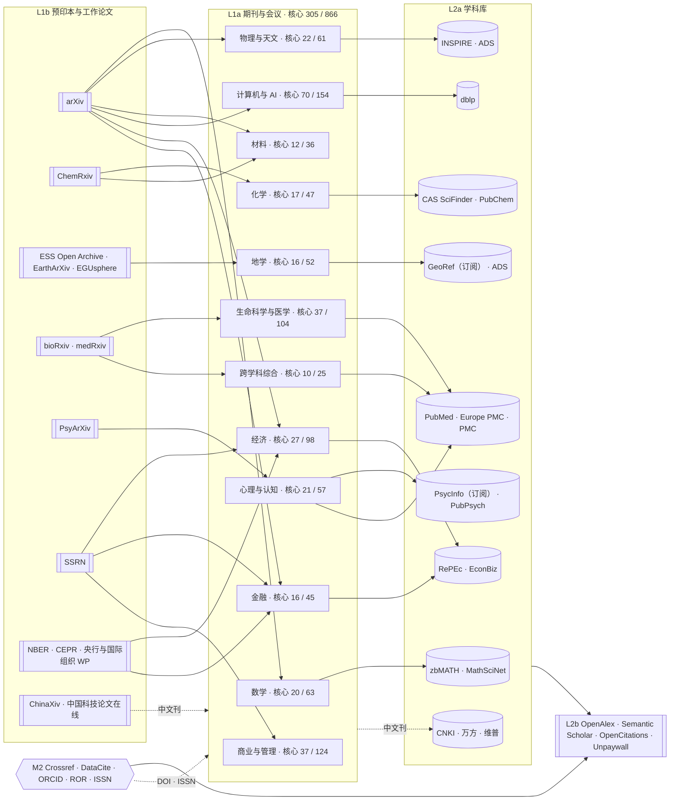

# venue 名录（按学科）

> 本目录按 12 个学科组列出 L1a 期刊与会议，共 866 个，其中核心 305 个优先支持、长尾 561 个登记：期刊 719、会议 135、期刊化会议论文集 12，其中中国主办英文刊 44 个、中文刊 121 个，746 个带评级标签。每个 venue 标出出版托管主体（M1）、评级、收录它的学科库（L2a）、对应的预印本或 WP 通道（L1b），以及 Confluo 的接入方式。评级体系见[评级体系](../venue-rankings.md)，七类分层见[来源分层](../source-taxonomy.md)。

## 要点

- **学科**：覆盖数学、物理与天文、化学、地学、材料、生命科学与医学、心理与认知、经济、金融、商业与管理、计算机与 AI，外加跨学科综合；中文刊按主属学科分进各文件末尾的"中文刊"一节。
- **接入**：600 个经 Crossref 按 ISSN 委托收元数据；139 个经名录里已有的来源行（`现有:`、`平台:`）；95 个中文刊只接受用户导入；28 个待勘察，主要是经管会议；4 个经 dblp 快照。
- **评级覆盖**：CS 最完整（CCF 128、ICORE 83、THCPL 79、CAAI 70）；经管有 FMS、ABDC、VHB、FT50、UTD24；理科主要靠科协 T 级与 Nature Index。物理、化学、心理没有本学科的科协目录，T 标签来自相邻学会，括号里写明学会。
- **支持分级（2026-09-29）**：866 个 venue 分成核心 305 个（优先支持）与登记 561 个（长尾，暂不专门支持）；原 141 个细分子领域归并为 66 个，另各学科中文刊一组。核心逐刊核验、进首批验收；登记的只保留条目，靠问卷与用户关注逐步升级。规则见下文[支持分级](#支持分级)。
- **规模**：名录是"核心 + 名录覆盖"，不是全集。CCF-B/C、ABDC-A 以下与各学科长尾刊没有收；用户关注任意期刊时，由 Crossref 或 OpenAlex 自动建 venue（策展等级 `auto`，见 03）。
- **许可**：ABDC、FT50、VHB 的标注只作内部设计参考，产品里在许可确认前只接受用户导入；中科院分区与 JCR 不标。

## 数字概览

| 学科组 | venue | 核心 | 登记 | 子领域（原 → 现） | 期刊 | 会议 | 中国主办英文刊 | 中文刊 | 带评级 | 主要评级（venue 数） |
|---|---:|---:|---:|---:|---:|---:|---:|---:|---:|---|
| [数学](math.md) | 63 | 20 | 43 | 12 → 4 | 61 | 2 | 3 | 10 | 61 | 科协 T 60、ABDC 11、北大核心 10、FMS 10、科技核心 9 |
| [物理与天文](physics-astronomy.md) | 61 | 22 | 39 | 14 → 6 | 55 | 6 | 9 | 7 | 39 | 科协 T 29、NI 13、卓越 11、北大核心 7、科技核心 6 |
| [化学](chemistry.md) | 47 | 17 | 30 | 14 → 5 | 47 | 0 | 5 | 8 | 27 | 科协 T 14、NI 13、卓越 10、科技核心 8、CSCD 8 |
| [地学](earth-sciences.md) | 52 | 16 | 36 | 10 → 4 | 52 | 0 | 2 | 13 | 51 | 科协 T 51、科技核心 13、CSCD 13、北大核心 13、卓越 10 |
| [材料](materials.md) | 36 | 12 | 24 | 8 → 4 | 36 | 0 | 5 | 6 | 35 | 科协 T 35、卓越 8、NI 7、科技核心 6、CSCD 6 |
| [生命科学与医学](life-sciences-medicine.md) | 104 | 37 | 67 | 14 → 7 | 98 | 6 | 8 | 12 | 92 | 科协 T 63、NI 50、卓越 14、科技核心 12、CSCD 12 |
| [心理与认知](psychology-cognition.md) | 57 | 21 | 36 | 10 → 5 | 52 | 5 | 1 | 6 | 35 | 科协 T 16、ABDC 14、FMS 9、CSSCI 6、北大核心 6 |
| [经济](economics.md) | 98 | 27 | 71 | 16 → 6 | 89 | 9 | 0 | 15 | 88 | FMS 82、ABDC 73、CSSCI 15、科技核心 14、AMI 14 |
| [金融](finance.md) | 45 | 16 | 29 | 8 → 5 | 37 | 8 | 1 | 4 | 42 | ABDC 33、FMS 28、FT50 5、科协 T 5、惯例 5 |
| [商业与管理](business-management.md) | 124 | 37 | 87 | 15 → 8 | 106 | 18 | 0 | 18 | 111 | FMS 104、ABDC 89、VHB 87、FT50 39、UTD24 21 |
| [计算机与 AI](computer-science-ai.md) | 154 | 70 | 84 | 16 → 9 | 61 | 93 | 5 | 16 | 150 | CCF 128、ICORE 83、THCPL 79、CAAI 70、CSR 62 |
| [跨学科综合](multidisciplinary.md) | 25 | 10 | 15 | 4 → 3 | 25 | 0 | 5 | 6 | 15 | 科协 T 9、卓越 8、科技核心 6、北大核心 6、CSCD 5 |
| **合计** | **866** | **305** | **561** | **141 → 66** | **719** | **147** | **44** | **121** | **746** | |

"会议"一列含期刊化会议论文集（PVLDB、PACM 系列等）。一刊有多个同类标签时只计一次。

## 关联总图

学科之间怎样经由预印本、学科库与跨学科层串起来。实线箭头读作"流向"：预印本发表到期刊（L1b → L1a），期刊被学科库收录（L1a → L2a），学科库汇入跨学科引擎（L2a → L2b）；M2 给所有 L1 分配 DOI 与 ISSN。每个学科文件开头另有一张"学科 → 子领域 → 代表 venue"的局部图。

## 支持分级

维护每一个期刊会议的通道与证据成本很高，而用户关注高度集中在少数顶级 venue。因此名录只对核心 venue 做逐刊承诺，长尾先登记、再按需求升级（D-073 草案）。

| 层级 | 做什么 | 不做什么 |
|---|---|---|
| **核心**（优先支持） | 核验 ISSN 或 dblp key、M1 平台与通道；注册表写 `curated` 条目；进首批验收、默认推荐池与学科冷启动频道 | — |
| **登记**（长尾） | 保留标识、托管、评级与备注；用户关注时照常经 Crossref 或 OpenAlex 自动建 `auto` venue 收元数据 | 不逐刊核验通道，不进验收，不写专门的 SourceSpec |

**核心判定**（按顺序，命中即核心）：

1. **硬性入选**：带 `惯例-顶级`、`Top5`、`Top3` 或 `UTD24` 标签；或本身是名录里 P0/P1 的 L1a 来源行（如 NeurIPS Proceedings、JMLR、TMLR、PVLDB、ASSA、NBER 会议）。
2. **按组配额**：每个归并后的子领域按评级分取前 30%（计算机与 AI 取前 40%），向上取整、至少 1 个；评级分为 0 或只接受用户导入的不入选。评级分是标签权重之和：惯例顶级、Top5/Top3 10 分，UTD24 9 分，NI、CCF-A、卓越-领军 7 分，T1、FT50、FMS-T1、AMI-顶级 6 分，其余标签 1–5 分。
3. **中文刊**：每个学科最多 3 个，只从有自动通道（Crossref 等）的刊里按评级分选；只接受用户导入或通道待勘察的中文刊一律登记，核实自动通道后再参与评选。
4. **人工补选**：评级标签缺失或不反映学科地位的公认核心（如 Science、Reviews of Modern Physics、USENIX Security、FOCS、NAACL），名单写在各学科文件的"出处与说明"。

规则只作初选，学科负责人可以调整，调整写进该学科的"出处与说明"。

**升级与降级**：登记 venue 满足任一条即进入升级候选，核验后升为核心：季度问卷中至少 5 名用户列为"必需"；至少 10 名活跃用户的频道或订阅引用它；学科负责人调研认定为核心并写明理由。核心 venue 连续两个季度零关注且不在评级顶档，或通道失效且无替代，降为登记；按硬性入选（第 1 条）进入核心的不自动降级，须先显式修改其评级标签或名录中的来源优先级与状态，并在"出处与说明"写明理由。阈值是草案初值，V1 用真实关注数据校准；来源层面的同类规则见[来源分层](../source-taxonomy.md#支持分级)。

**完整表**：各学科的 M1、M2、L1a、L1b、L2a、L2b 与支持层级汇总在 [支持名录 Excel](../source-support-catalog.xlsx)，学科、层级与子领域用合并单元格标出隶属关系。

## 表格怎么读

每个学科文件先列核心 venue，再列登记 venue，都按归并后的子领域分表；合并组内先按原方向、再按评级强弱排序，原方向写在备注开头：

- **标识**：期刊写印刷版 / 电子版 ISSN，会议写 dblp key；ISSN 经旧稿、Crossref、ABDC 或 CSCD 名单核过，未核的在备注里写明。
- **出版托管（M1）**：出版或托管主体，后附它在[支持名录](../source-directory.md)里的 `source_id`；没有 `source_id` 的平台尚未勘察。
- **评级**：[评级体系](../venue-rankings.md)词表里的标签。科协 T 级按等级合并学会，如 `T1(中国地质学会、中国地理学会)`。
- **学科库（L2a）、预印本（L1b）**：收录它的主要学科库与对应的首发通道，多数按子领域惯例填写，没有逐刊核验。
- **接入**：`Crossref:ISSN` 指由 Crossref 委托按 ISSN 收元数据；`现有:`、`平台:` 指经名录里已有的来源行；`用户导入` 指只接受用户导出的题录；`待勘察` 指通道未核。
- **备注**：主办方、更名、Crossref 登记异常与区域（中国主办英文刊写"中国(英文)"）。

## 怎么维护

- **单一事实来源**：现阶段以这些表为准；V0 建注册表后，venue 落为 `registry/venues/<学科>/*.yaml`，表格改由生成器产出，本目录的数字与表格不再手改。
- **新增 venue**：用户关注的任意期刊先由 Crossref 或 OpenAlex 自动建为 `auto`；要进本名录的 venue 须核实 ISSN（或 dblp key）、M1 平台与评级出处。
- **评级更新**：随[评级体系](../venue-rankings.md)的复读节奏整表替换，替换后重新生成各学科文件。
- **跨学科 venue 只挂一个主属学科**，其他学科在备注里提及。

## 已知缺口

- **评级**：AJG 未标（须登录）；ICORE 有 38 个标签取自 ccfddl，版本可能混有 CORE2023；物理、化学、心理、经济没有本学科的科协目录；非 CS 会议多数没有可引用的分档出处。
- **接入**：121 个中文刊里 95 个只能用户导入，经 ISTIC 中文 DOI 收元数据的通道待勘察；28 个 venue（主要是经管会议）的通道待勘察。
- **平台**：Copernicus（EGU）、美国气象学会、清华社 SciOpen、Project MUSE、SMF、上海有机所期刊站等托管平台不在名录，候选见[候选来源](../source-candidates.md)。
- **数据异常**：各学科文件的"出处与说明"列出 Crossref 登记异常（错误 ISSN、新旧 ISSN 未合并等），接入前须处理。
