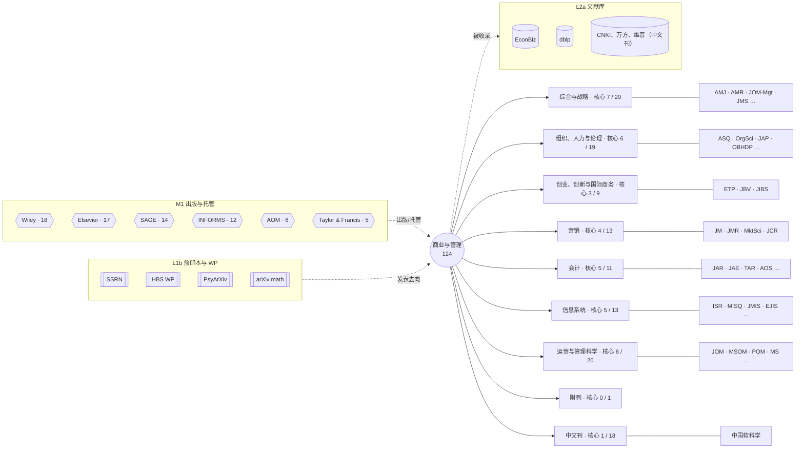

# 商业与管理 venue 名录

> 商业与管理共 124 个 venue（期刊 106、会议 18），归并为 8 个子领域（原 15 个），另有中文刊 18 个。其中核心 37 个优先支持，其余 87 个登记在册、暂不专门支持，规则见[支持分级](README.md#支持分级)。主要学科库：EconBiz、dblp、CNKI、万方、维普（中文刊）；主要预印本与 WP 通道：SSRN、HBS WP、PsyArXiv、arXiv math。评级标签的体系、版本与许可见[评级体系](../venue-rankings.md)，七类分层见[来源分层](../source-taxonomy.md)。

## 关联图

## 核心 venue（优先支持）

每个子领域内按评级强弱排序，评级相同按名称。`接入` 一列：`Crossref:ISSN` 指由 Crossref 委托按 ISSN 收元数据，`现有:`/`平台:` 指经名录里已有的来源行，`用户导入` 指只接受用户导出的题录。

本节只列核心 venue：逐刊核验标识与通道，进入首批验收与默认推荐池。其余 venue 见下文"登记 venue"。子领域由原来的细分方向归并而成：合并组先按原方向、再按评级排列，备注以"方向："开头标出原方向。

### 综合与战略（核心 7 · 登记 13）

含原方向：综合管理、战略。

| venue | 类型 | ISSN（印/电）或 dblp | 出版托管（M1） | 评级 | 学科库（L2a） | 预印本（L1b） | 接入 | 备注 |
|---|---|---|---|---|---|---|---|---|
| Academy of Management Journal（AMJ） | J | 0001-4273 / 1948-0989 | Academy of Management `aom_journals` | UTD24; FT50; NI; ABDC-A*; VHB-A+; FMS-A | EconBiz | SSRN; HBS WP | Crossref:ISSN | 方向：综合管理；VHB领域STRAT |
| Academy of Management Review（AMR） | J | 0363-7425 / 1930-3807 | Academy of Management `aom_journals` | UTD24; FT50; ABDC-A*; VHB-A+; FMS-A | EconBiz | SSRN; HBS WP | Crossref:ISSN | 方向：综合管理；VHB领域STRAT |
| Journal of Management（JOM-Mgt） | J | 0149-2063 / 1557-1211 | SAGE `sage_journals` | FT50; ABDC-A*; VHB-A; FMS-A | EconBiz | SSRN; HBS WP | Crossref:ISSN | 方向：综合管理；VHB领域STRAT |
| Journal of Management Studies（JMS） | J | 0022-2380 / 1467-6486 | Wiley `wiley` | FT50; ABDC-A*; VHB-A; FMS-A | EconBiz | SSRN; HBS WP | Crossref:ISSN | 方向：综合管理；VHB领域STRAT |
| Academy of Management Annals（AMAnn） | J | 1941-6520 / 1941-6067 | Academy of Management `aom_journals` | FT50; ABDC-A*; VHB-A; FMS-B | EconBiz | SSRN; HBS WP | Crossref:ISSN | 方向：综合管理；VHB领域STRAT; 2026-04新入FT50 |
| Academy of Management Annual Meeting（AOM） | C | 0065-0668 / — | Academy of Management `aom_proceedings` | 惯例-顶级 | EconBiz | SSRN | Crossref:ISSN | 方向：综合管理；Proceedings摘要级;Crossref摘要0% |
| Strategic Management Journal（SMJ） | J | 0143-2095 / 1097-0266 | Wiley（SMS） `wiley` | UTD24; FT50; ABDC-A*; VHB-A+; FMS-A | EconBiz | SSRN; HBS WP | Crossref:ISSN | 方向：战略；VHB领域STRAT |

### 组织、人力与伦理（核心 6 · 登记 13）

含原方向：组织理论与行为、人力资源、商业伦理与社会责任、公共管理。

| venue | 类型 | ISSN（印/电）或 dblp | 出版托管（M1） | 评级 | 学科库（L2a） | 预印本（L1b） | 接入 | 备注 |
|---|---|---|---|---|---|---|---|---|
| Administrative Science Quarterly（ASQ） | J | 0001-8392 / 1930-3815 | SAGE `sage_journals` | UTD24; FT50; ABDC-A*; VHB-A+; FMS-A | EconBiz | SSRN; PsyArXiv | Crossref:ISSN | 方向：组织理论与行为；VHB领域ORG |
| Organization Science（OrgSci） | J | 1047-7039 / 1526-5455 | INFORMS `informs_pubsonline` | UTD24; FT50; ABDC-A*; VHB-A+; FMS-A | EconBiz | SSRN; PsyArXiv | Crossref:ISSN | 方向：组织理论与行为；VHB领域ORG |
| Journal of Applied Psychology（JAP） | J | 0021-9010 / 1939-1854 | APA `apa_psycnet` | FT50; ABDC-A*; VHB-A+; FMS-A | EconBiz | SSRN; PsyArXiv | Crossref:ISSN | 方向：组织理论与行为；VHB领域PERS; 兼心理与认知 |
| Organizational Behavior and Human Decision Processes（OBHDP） | J | 0749-5978 / 1095-9920 | Elsevier `elsevier_sd` | FT50; ABDC-A*; VHB-A; FMS-A | EconBiz | SSRN; PsyArXiv | Crossref:ISSN | 方向：组织理论与行为；VHB领域ORG; 兼心理与认知 |
| Journal of Organizational Behavior（JOB） | J | 0894-3796 / 1099-1379 | Wiley `wiley` | ABDC-A*; VHB-A; FMS-A | EconBiz | SSRN; PsyArXiv | Crossref:ISSN | 方向：组织理论与行为；VHB领域ORG |
| Human Resource Management（HRM） | J | 0090-4848 / 1099-050X | Wiley `wiley` | FT50; ABDC-A*; VHB-A; FMS-A | EconBiz | SSRN; PsyArXiv | Crossref:ISSN | 方向：人力资源；VHB领域PERS |

### 创业、创新与国际商务（核心 3 · 登记 6）

含原方向：创业与创新、国际商务。

| venue | 类型 | ISSN（印/电）或 dblp | 出版托管（M1） | 评级 | 学科库（L2a） | 预印本（L1b） | 接入 | 备注 |
|---|---|---|---|---|---|---|---|---|
| Entrepreneurship Theory and Practice（ETP） | J | 1042-2587 / 1540-6520 | SAGE `sage_journals` | FT50; ABDC-A*; VHB-A; FMS-A | EconBiz | SSRN; HBS WP | Crossref:ISSN | 方向：创业与创新；VHB领域TIE |
| Journal of Business Venturing（JBV） | J | 0883-9026 / 1873-2003 | Elsevier `elsevier_sd` | FT50; ABDC-A*; VHB-A; FMS-A | EconBiz | SSRN; HBS WP | Crossref:ISSN | 方向：创业与创新；VHB领域TIE |
| Journal of International Business Studies（JIBS） | J | 0047-2506 / 1478-6990 | Springer Nature `springer_link` | UTD24; FT50; ABDC-A*; VHB-A; FMS-A | EconBiz | SSRN | Crossref:ISSN | 方向：国际商务；VHB领域INT |

### 营销（核心 4 · 登记 9）

含原方向：营销、消费者研究。

| venue | 类型 | ISSN（印/电）或 dblp | 出版托管（M1） | 评级 | 学科库（L2a） | 预印本（L1b） | 接入 | 备注 |
|---|---|---|---|---|---|---|---|---|
| Journal of Marketing（JM） | J | 0022-2429 / 1547-7185 | SAGE（AMA） `sage_journals` | UTD24; FT50; ABDC-A*; VHB-A+; FMS-A | EconBiz | SSRN | Crossref:ISSN | 方向：营销；VHB领域MARK |
| Journal of Marketing Research（JMR） | J | 0022-2437 / 1547-7193 | SAGE（AMA） `sage_journals` | UTD24; FT50; ABDC-A*; VHB-A+; FMS-A | EconBiz | SSRN | Crossref:ISSN | 方向：营销；VHB领域MARK |
| Marketing Science（MktSci） | J | 0732-2399 / 1526-548X | INFORMS `informs_pubsonline` | UTD24; FT50; ABDC-A*; VHB-A+; FMS-A | EconBiz | SSRN | Crossref:ISSN | 方向：营销；VHB领域MARK |
| Journal of Consumer Research（JCR） | J | 0093-5301 / 1537-5277 | OUP `oup_academic` | UTD24; FT50; ABDC-A*; VHB-A+; FMS-A | EconBiz | SSRN; PsyArXiv | Crossref:ISSN | 方向：消费者研究；VHB领域MARK |

### 会计（核心 5 · 登记 6）

| venue | 类型 | ISSN（印/电）或 dblp | 出版托管（M1） | 评级 | 学科库（L2a） | 预印本（L1b） | 接入 | 备注 |
|---|---|---|---|---|---|---|---|---|
| Journal of Accounting Research（JAR） | J | 0021-8456 / 1475-679X | Wiley `wiley` | UTD24; FT50; ABDC-A*; VHB-A+; FMS-A | EconBiz | SSRN | Crossref:ISSN | VHB领域RECH |
| Journal of Accounting and Economics（JAE） | J | 0165-4101 / — | Elsevier `elsevier_sd` | UTD24; FT50; ABDC-A*; VHB-A+; FMS-A | EconBiz | SSRN | Crossref:ISSN | VHB领域RECH |
| The Accounting Review（TAR） | J | 0001-4826 / 1558-7967 | AAA `aaa_pubs` | UTD24; FT50; ABDC-A*; VHB-A+; FMS-A | EconBiz | SSRN | Crossref:ISSN | VHB领域RECH |
| Accounting, Organizations and Society（AOS） | J | 0361-3682 / 1873-6289 | Elsevier `elsevier_sd` | FT50; ABDC-A*; VHB-A+; FMS-A | EconBiz | SSRN | Crossref:ISSN | VHB领域RECH |
| AAA Annual Meeting（AAA AM） | C | — | American Accounting Association | 惯例-顶级 | — | SSRN | 待勘察 | 2026起名AAA Global Connect |

### 信息系统（核心 5 · 登记 8）

| venue | 类型 | ISSN（印/电）或 dblp | 出版托管（M1） | 评级 | 学科库（L2a） | 预印本（L1b） | 接入 | 备注 |
|---|---|---|---|---|---|---|---|---|
| Information Systems Research（ISR） | J | 1047-7047 / 1526-5536 | INFORMS `informs_pubsonline` | UTD24; FT50; ABDC-A*; VHB-A+; FMS-A | EconBiz | SSRN | Crossref:ISSN | VHB领域WI |
| MIS Quarterly（MISQ） | J | 0276-7783 / 2162-9730 | MIS Quarterly（U Minnesota·Silverchair） `misq` | UTD24; FT50; ABDC-A*; VHB-A+; FMS-A | EconBiz | SSRN | Crossref:ISSN | VHB领域WI |
| Journal of Management Information Systems（JMIS） | J | 0742-1222 / 1557-928X | Taylor & Francis `tandf_online` | FT50; ABDC-A*; VHB-A; FMS-A | EconBiz | SSRN | Crossref:ISSN | VHB领域WI |
| European Journal of Information Systems（EJIS） | J | 0960-085X / 1476-9344；dblp `journals/ejis` | Taylor & Francis `tandf_online` | CCF-B; ABDC-A*; VHB-A; FMS-B | EconBiz; dblp | SSRN | Crossref:ISSN | VHB领域WI |
| International Conference on Information Systems（ICIS） | C | — | AIS（AIS eLibrary） `ais_icis` | 惯例-顶级 | — | SSRN | 平台:ais_icis | AIS旗舰会议;OAI被robots禁 |

### 运营与管理科学（核心 6 · 登记 14）

含原方向：运营管理、管理科学与运筹。

| venue | 类型 | ISSN（印/电）或 dblp | 出版托管（M1） | 评级 | 学科库（L2a） | 预印本（L1b） | 接入 | 备注 |
|---|---|---|---|---|---|---|---|---|
| Journal of Operations Management（JOM） | J | 0272-6963 / 1873-1317 | Wiley `wiley` | UTD24; FT50; ABDC-A*; VHB-A; FMS-A | EconBiz | SSRN | Crossref:ISSN | 方向：运营管理；VHB领域PROD |
| Manufacturing & Service Operations Management（MSOM） | J | 1523-4614 / 1526-5498 | INFORMS `informs_pubsonline` | UTD24; FT50; ABDC-A*; VHB-A; FMS-A | EconBiz | SSRN | Crossref:ISSN | 方向：运营管理；VHB领域PROD |
| Production and Operations Management（POM） | J | 1059-1478 / 1937-5956 | SAGE（POMS） `sage_journals` | UTD24; FT50; ABDC-A*; VHB-A; FMS-A | EconBiz | SSRN | Crossref:ISSN | 方向：运营管理；VHB领域PROD |
| Management Science（MS） | J | 0025-1909 / 1526-5501 | INFORMS `informs_pubsonline` | UTD24; FT50; NI; ABDC-A*; VHB-A+; FMS-A | EconBiz | SSRN; arXiv:math.OC | Crossref:ISSN | 方向：管理科学与运筹；VHB领域OR |
| Operations Research（OR） | J | 0030-364X / 1526-5463 | INFORMS `informs_pubsonline` | UTD24; FT50; ABDC-A*; VHB-A+; FMS-A | EconBiz | SSRN; arXiv:math.OC | Crossref:ISSN | 方向：管理科学与运筹；VHB领域OR |
| INFORMS Journal on Computing（IJOC） | J | 1091-9856 / 1526-5528；dblp `journals/informs` | INFORMS `informs_pubsonline` | UTD24; CCF-B; ABDC-A; VHB-A; FMS-A | EconBiz; dblp | SSRN; arXiv:math.OC | Crossref:ISSN | 方向：管理科学与运筹；VHB领域OR |

### 附列（核心 0 · 登记 1）

本组暂无核心 venue，全部登记。

### 中文刊（核心 1 · 登记 17）

子领域写在备注里。知网、万方、维普只接受用户导入题录；在 Crossref 注册了 DOI 的中文刊可经 Crossref 收元数据。只接受用户导入的中文刊不列为核心。

| venue | 类型 | ISSN（印/电）或 dblp | 出版托管（M1） | 评级 | 学科库（L2a） | 预印本（L1b） | 接入 | 备注 |
|---|---|---|---|---|---|---|---|---|
| 中国软科学（China Soft Science） | J | 1005-0566 / — | 中国软科学研究会 | CSSCI; CSCD核心; 北大核心; 科技核心; AMI-权威; NSFC管理-A; FMS-T1 | CNKI; 万方; CSCD | — | Crossref:ISSN | 科技与创新管理；Crossref前缀10.3724 |

## 登记 venue（长尾，暂不支持）

以下 venue 登记在册，保留标识、托管与评级，但暂不逐刊核验通道、不进首批验收。用户关注其中任意一个时，照常经 Crossref 或 OpenAlex 自动建 venue（`auto`）收元数据；问卷、调研与关注数达到[升级条件](README.md#支持分级)后升为核心。

### 综合与战略（登记 13）

| venue | 类型 | ISSN（印/电）或 dblp | 出版托管（M1） | 评级 | 学科库（L2a） | 预印本（L1b） | 接入 | 备注 |
|---|---|---|---|---|---|---|---|---|
| Academy of Management Learning and Education（AMLE） | J | 1537-260X / 1944-9585 | Academy of Management `aom_journals` | ABDC-A*; VHB-B; FMS-A | EconBiz | SSRN; HBS WP | Crossref:ISSN | 方向：综合管理；VHB领域ORG |
| Harvard Business Review（HBR） | J | 0017-8012 / — | Harvard Business Publishing `hbp_hbr` | FT50; ABDC-A; VHB-B; FMS-B | EconBiz | — | 用户导入 | 方向：综合管理；VHB领域STRAT; Crossref无记录;实务刊 |
| MIT Sloan Management Review（MIT SMR） | J | 1532-9194 / 1532-8937 | MIT Sloan School of Management `mit_smr` | FT50; ABDC-A; VHB-B; FMS-B | EconBiz | — | Crossref:ISSN | 方向：综合管理；VHB领域STRAT; 2026冬转纯数字版 |
| Academy of Management Discoveries（AMD） | J | 2168-1007 / — | Academy of Management `aom_journals` | ABDC-A*; VHB-B; FMS-B | EconBiz | SSRN; HBS WP | Crossref:ISSN | 方向：综合管理；VHB领域STRAT |
| British Journal of Management（BJM） | J | 1045-3172 / 1467-8551 | Wiley `wiley` | ABDC-A*; VHB-B; FMS-B | EconBiz | SSRN; HBS WP | Crossref:ISSN | 方向：综合管理；VHB领域STRAT |
| Academy of Management Perspectives（AMP） | J | 1558-9080 / 1943-4529 | Academy of Management `aom_journals` | ABDC-A; VHB-B; FMS-B | EconBiz | SSRN; HBS WP | Crossref:ISSN | 方向：综合管理；VHB领域STRAT |
| California Management Review（CMR） | J | 0008-1256 / 2162-8564 | SAGE `sage_journals` | ABDC-A; VHB-B; FMS-B | EconBiz | — | Crossref:ISSN | 方向：综合管理；VHB领域STRAT |
| EURAM Annual Conference | C | — | European Academy of Management | — | — | SSRN | 待勘察 | 方向：综合管理；站点超时 |
| Long Range Planning（LRP） | J | 0024-6301 / 1873-1872 | Elsevier `elsevier_sd` | ABDC-A*; VHB-B; FMS-B | EconBiz | SSRN; HBS WP | Crossref:ISSN | 方向：战略；VHB领域STRAT |
| Global Strategy Journal（GSJ） | J | 2042-5791 / 2042-5805 | Wiley（SMS） `wiley` | ABDC-A; VHB-A; FMS-B | EconBiz | SSRN; HBS WP | Crossref:ISSN | 方向：战略；VHB领域STRAT |
| SMS Annual Conference | C | — | Strategic Management Society | — | — | SSRN | 待勘察 | 方向：战略；站点403;无论文集⚠ |
| Strategic Organization（SO） | J | 1476-1270 / 1741-315X | SAGE `sage_journals` | ABDC-A; VHB-B; FMS-B | EconBiz | SSRN; HBS WP | Crossref:ISSN | 方向：战略；VHB领域STRAT |
| Strategy Science（StratSci） | J | 2333-2050 / 2333-2077 | INFORMS `informs_pubsonline` | ABDC-A; VHB-B; FMS-B | EconBiz | SSRN; HBS WP | Crossref:ISSN | 方向：战略；VHB领域STRAT |

### 组织、人力与伦理（登记 13）

| venue | 类型 | ISSN（印/电）或 dblp | 出版托管（M1） | 评级 | 学科库（L2a） | 预印本（L1b） | 接入 | 备注 |
|---|---|---|---|---|---|---|---|---|
| Organization Studies（OS） | J | 0170-8406 / 1741-3044 | SAGE `sage_journals` | ABDC-A*; VHB-A; FMS-A | EconBiz | SSRN; PsyArXiv | Crossref:ISSN | 方向：组织理论与行为；VHB领域ORG; 2026-04移出FT50 |
| Annual Review of Organizational Psychology and Organizational Behavior（AROPOB） | J | 2327-0616 / — | Annual Reviews `annual_reviews` | ABDC-A*; VHB-A | EconBiz | SSRN; PsyArXiv | Crossref:ISSN | 方向：组织理论与行为；VHB领域ORG |
| Human Relations（HR） | J | 0018-7267 / 1741-282X | SAGE `sage_journals` | ABDC-A*; VHB-A; FMS-B | EconBiz | SSRN; PsyArXiv | Crossref:ISSN | 方向：组织理论与行为；VHB领域ORG; 2026-04移出FT50 |
| Leadership Quarterly（LQ） | J | 1048-9843 / 1873-3409 | Elsevier `elsevier_sd` | ABDC-A*; VHB-A; FMS-B | EconBiz | SSRN; PsyArXiv | Crossref:ISSN | 方向：组织理论与行为；VHB领域ORG |
| Organizational Research Methods（ORM） | J | 1094-4281 / 1552-7425 | SAGE `sage_journals` | ABDC-A*; VHB-A; FMS-B | EconBiz | SSRN; PsyArXiv | Crossref:ISSN | 方向：组织理论与行为；VHB领域ORG |
| Human Resource Management Journal（HRMJ） | J | 0954-5395 / 1748-8583 | Wiley `wiley` | ABDC-A*; VHB-A; FMS-A | EconBiz | SSRN; PsyArXiv | Crossref:ISSN | 方向：人力资源；VHB领域PERS |
| Personnel Psychology（PPsych） | J | 0031-5826 / 1744-6570 | Wiley `wiley` | ABDC-A*; VHB-A; FMS-A | EconBiz | SSRN; PsyArXiv | Crossref:ISSN | 方向：人力资源；VHB领域PERS |
| International Journal of Human Resource Management（IJHRM） | J | 0958-5192 / 1466-4399 | Taylor & Francis `tandf_online` | ABDC-A; VHB-A; FMS-B | EconBiz | SSRN; PsyArXiv | Crossref:ISSN | 方向：人力资源；VHB领域PERS |
| Business Ethics Quarterly（BEQ） | J | 1052-150X / 2153-3326 | Cambridge UP `cambridge_core` | ABDC-A; VHB-A; FMS-B | EconBiz | SSRN | Crossref:ISSN | 方向：商业伦理与社会责任；VHB领域WEW |
| Business and Society（B&S） | J | 0007-6503 / 1552-4205 | SAGE `sage_journals` | ABDC-A; VHB-A; FMS-B | EconBiz | SSRN | Crossref:ISSN | 方向：商业伦理与社会责任；VHB领域WEW |
| Journal of Business Ethics（JBE） | J | 0167-4544 / 1573-0697 | Springer Nature `springer_link` | ABDC-A; VHB-A; FMS-B | EconBiz | SSRN | Crossref:ISSN | 方向：商业伦理与社会责任；VHB领域WEW; 2026-04移出FT50 |
| Journal of Public Administration Research and Theory（JPART） | J | 1053-1858 / 1477-9803 | OUP `oup_academic` | ABDC-A; VHB-A; FMS-A | EconBiz | SSRN | Crossref:ISSN | 方向：公共管理；VHB领域OEBWL |
| Public Administration Review（PAR） | J | 0033-3352 / 1540-6210 | Wiley `wiley` | ABDC-A; VHB-A; FMS-A | EconBiz | SSRN | Crossref:ISSN | 方向：公共管理；VHB领域OEBWL |

### 创业、创新与国际商务（登记 6）

| venue | 类型 | ISSN（印/电）或 dblp | 出版托管（M1） | 评级 | 学科库（L2a） | 预印本（L1b） | 接入 | 备注 |
|---|---|---|---|---|---|---|---|---|
| Research Policy（RP） | J | 0048-7333 / 1873-7625 | Elsevier `elsevier_sd` | FT50; ABDC-A*; VHB-A; FMS-A | EconBiz | SSRN; HBS WP | Crossref:ISSN | 方向：创业与创新；VHB领域TIE |
| Strategic Entrepreneurship Journal（SEJ） | J | 1932-4391 / 1932-443X | Wiley（SMS） `wiley` | FT50; ABDC-A; VHB-A; FMS-A | EconBiz | SSRN; HBS WP | Crossref:ISSN | 方向：创业与创新；VHB领域TIE |
| Journal of Product Innovation Management（JPIM） | J | 0737-6782 / 1540-5885 | Wiley `wiley` | ABDC-A*; VHB-A; FMS-A | EconBiz | SSRN; HBS WP | Crossref:ISSN | 方向：创业与创新；VHB领域TIE |
| Journal of World Business（JWB） | J | 1090-9516 / 1878-5573 | Elsevier `elsevier_sd` | ABDC-A*; VHB-B; FMS-A | EconBiz | SSRN | Crossref:ISSN | 方向：国际商务；VHB领域INT |
| AIB Annual Meeting | C | — | Academy of International Business | — | — | SSRN | 待勘察 | 方向：国际商务；站点403 |
| Journal of International Management（JIM） | J | 1075-4253 / 1873-0620 | Elsevier `elsevier_sd` | ABDC-A; VHB-B; FMS-B | EconBiz | SSRN | Crossref:ISSN | 方向：国际商务；VHB领域INT |

### 营销（登记 9）

| venue | 类型 | ISSN（印/电）或 dblp | 出版托管（M1） | 评级 | 学科库（L2a） | 预印本（L1b） | 接入 | 备注 |
|---|---|---|---|---|---|---|---|---|
| Journal of the Academy of Marketing Science（JAMS） | J | 0092-0703 / 1552-7824 | Springer Nature `springer_link` | FT50; ABDC-A*; VHB-A; FMS-B | EconBiz | SSRN | Crossref:ISSN | 方向：营销；VHB领域MARK |
| International Journal of Research in Marketing（IJRM） | J | 0167-8116 / 1873-8001 | Elsevier `elsevier_sd` | ABDC-A*; VHB-A; FMS-B | EconBiz | SSRN | Crossref:ISSN | 方向：营销；VHB领域MARK |
| Journal of Retailing（JR） | J | 0022-4359 / 1873-3271 | Elsevier `elsevier_sd` | ABDC-A*; VHB-A; FMS-B | EconBiz | SSRN | Crossref:ISSN | 方向：营销；VHB领域MARK |
| AMA Summer Academic Conference | C | — | American Marketing Association | — | — | SSRN | 待勘察 | 方向：营销 |
| AMA Winter Academic Conference | C | — | American Marketing Association | — | — | SSRN | 待勘察 | 方向：营销 |
| ISMS Marketing Science Conference | C | — | INFORMS Society for Marketing Science | — | — | SSRN | 待勘察 | 方向：营销；informs.org有挑战页 |
| Quantitative Marketing and Economics（QME） | J | 1570-7156 / 1573-711X | Springer Nature `springer_link` | ABDC-A; VHB-A; FMS-B | EconBiz | SSRN | Crossref:ISSN | 方向：营销；VHB领域MARK |
| Journal of Consumer Psychology（JCP） | J | 1057-7408 / 1532-7663 | Wiley（SCP） `wiley` | FT50; ABDC-A*; VHB-A; FMS-B | EconBiz | SSRN; PsyArXiv | Crossref:ISSN | 方向：消费者研究；VHB领域MARK |
| ACR Annual Conference | C | 0098-9258 / — | Association for Consumer Research | ABDC-B | — | SSRN | 待勘察 | 方向：消费者研究；ABDC评的是Advances in Consumer Research;站点403 |

### 会计（登记 6）

| venue | 类型 | ISSN（印/电）或 dblp | 出版托管（M1） | 评级 | 学科库（L2a） | 预印本（L1b） | 接入 | 备注 |
|---|---|---|---|---|---|---|---|---|
| Contemporary Accounting Research（CAR） | J | 0823-9150 / 1911-3846 | Wiley `wiley` | FT50; ABDC-A*; VHB-A+; FMS-A | EconBiz | SSRN | Crossref:ISSN | VHB领域RECH |
| Review of Accounting Studies（RAST） | J | 1380-6653 / 1573-7136 | Springer Nature `springer_link` | FT50; ABDC-A*; VHB-A; FMS-A | EconBiz | SSRN | Crossref:ISSN | VHB领域RECH |
| Auditing: A Journal of Practice and Theory（AJPT） | J | 0278-0380 / 1558-7991 | AAA `aaa_pubs` | ABDC-A*; VHB-A; FMS-B | EconBiz | SSRN | Crossref:ISSN | VHB领域RECH |
| European Accounting Review（EAR） | J | 0963-8180 / 1468-4497 | Taylor & Francis `tandf_online` | ABDC-A*; VHB-A; FMS-B | EconBiz | SSRN | Crossref:ISSN | VHB领域RECH |
| Management Accounting Research（MAR） | J | 1044-5005 / 1096-1224 | Elsevier `elsevier_sd` | ABDC-A*; VHB-A; FMS-B | EconBiz | SSRN | Crossref:ISSN | VHB领域RECH |
| EAA Annual Congress | C | — | European Accounting Association | — | — | SSRN | 待勘察 |  |

### 信息系统（登记 8）

| venue | 类型 | ISSN（印/电）或 dblp | 出版托管（M1） | 评级 | 学科库（L2a） | 预印本（L1b） | 接入 | 备注 |
|---|---|---|---|---|---|---|---|---|
| Journal of the Association for Information Systems（JAIS） | J | 1536-9323 / 1558-3457 | AIS（AIS eLibrary） `ais_icis` | ABDC-A*; VHB-A; FMS-A | EconBiz | SSRN | Crossref:ISSN | VHB领域WI |
| Information Systems Journal（ISJ） | J | 1350-1917 / 1365-2575 | Wiley `wiley` | ABDC-A*; VHB-A; FMS-B | EconBiz | SSRN | Crossref:ISSN | VHB领域WI |
| Journal of Information Technology（JIT） | J | 0268-3962 / 1466-4437 | SAGE `sage_journals` | ABDC-A*; VHB-A; FMS-B | EconBiz | SSRN | Crossref:ISSN | VHB领域WI |
| Journal of Strategic Information Systems（JSIS） | J | 0963-8687 / 1873-1198；dblp `journals/jsis` | Elsevier `elsevier_sd` | CCF-C; ABDC-A*; VHB-A; FMS-B | EconBiz; dblp | SSRN | Crossref:ISSN | VHB领域WI |
| Hawaii International Conference on System Sciences（HICSS） | C | dblp `hicss` | U Hawaii ScholarSpace | ICORE-A | dblp | — | dblp快照 | ICORE版本⚠;CCF未收 |
| Americas Conference on Information Systems（AMCIS） | C | — | AIS（AIS eLibrary） `ais_icis` | — | — | SSRN | 平台:ais_icis | AIS区域会议 |
| European Conference on Information Systems（ECIS） | C | — | AIS（AIS eLibrary） `ais_icis` | — | — | SSRN | 平台:ais_icis | AIS区域会议 |
| Pacific Asia Conference on Information Systems（PACIS） | C | — | AIS（AIS eLibrary） `ais_icis` | — | — | SSRN | 平台:ais_icis | AIS区域会议 |

### 运营与管理科学（登记 14）

| venue | 类型 | ISSN（印/电）或 dblp | 出版托管（M1） | 评级 | 学科库（L2a） | 预印本（L1b） | 接入 | 备注 |
|---|---|---|---|---|---|---|---|---|
| Journal of Supply Chain Management（JSCM） | J | 1523-2409 / 1745-493X | Wiley `wiley` | ABDC-A*; VHB-B; FMS-B | EconBiz | SSRN | Crossref:ISSN | 方向：运营管理；VHB领域PROD |
| International Journal of Operations and Production Management（IJOPM） | J | 0144-3577 / 1758-6593 | Emerald `emerald_insight` | ABDC-A; VHB-B; FMS-B | EconBiz | SSRN | Crossref:ISSN | 方向：运营管理；VHB领域PROD |
| International Journal of Production Economics（IJPE） | J | 0925-5273 / 1873-7579 | Elsevier `elsevier_sd` | ABDC-A; VHB-B; FMS-B | EconBiz | SSRN | Crossref:ISSN | 方向：运营管理；VHB领域PROD |
| MSOM Conference | C | — | INFORMS MSOM Society | — | — | SSRN | 待勘察 | 方向：运营管理；informs.org有挑战页 |
| POMS Annual Conference | C | — | Production and Operations Management Society | — | — | SSRN | 待勘察 | 方向：运营管理 |
| European Journal of Operational Research（EJOR） | J | 0377-2217 / 1872-6860 | Elsevier `elsevier_sd` | ABDC-A*; VHB-A; FMS-A | EconBiz | SSRN; arXiv:math.OC | Crossref:ISSN | 方向：管理科学与运筹；VHB领域OR |
| Transportation Research Part B: Methodological（TR-B） | J | 0191-2615 / 1879-2367 | Elsevier `elsevier_sd` | ABDC-A*; VHB-A; FMS-A | EconBiz | SSRN; arXiv:math.OC | Crossref:ISSN | 方向：管理科学与运筹；VHB领域OR |
| Transportation Science（TS） | J | 0041-1655 / 1526-5447 | INFORMS `informs_pubsonline` | ABDC-A*; VHB-A; FMS-A | EconBiz | SSRN; arXiv:math.OC | Crossref:ISSN | 方向：管理科学与运筹；VHB领域OR |
| Mathematics of Operations Research（MOR） | J | 0364-765X / 1526-5471 | INFORMS `informs_pubsonline` | ABDC-A; VHB-A; FMS-A; T1(中国数学会) | EconBiz | SSRN; arXiv:math.OC | Crossref:ISSN | 方向：管理科学与运筹；VHB领域OR; 兼数学 |
| Decision Sciences（DSJ） | J | 0011-7315 / 1540-5915 | Wiley `wiley` | ABDC-A*; VHB-B; FMS-B | EconBiz | SSRN; arXiv:math.OC | Crossref:ISSN | 方向：管理科学与运筹；VHB领域OR |
| IISE Transactions（IISE-T） | J | 0740-817X / 1545-8830 | Taylor & Francis `tandf_online` | ABDC-A; VHB-A; FMS-A | EconBiz | SSRN; arXiv:math.OC | Crossref:ISSN | 方向：管理科学与运筹；VHB领域OR |
| Decision Analysis（DA） | J | 1545-8490 / 1545-8504 | INFORMS `informs_pubsonline` | ABDC-A; VHB-B; FMS-B | EconBiz | SSRN; arXiv:math.OC | Crossref:ISSN | 方向：管理科学与运筹；VHB领域OR |
| INFORMS Annual Meeting（INFORMS AM） | C | — | INFORMS `informs_annual` | — | — | — | 现有:informs_annual | 方向：管理科学与运筹；已排除:仅摘要程序 |
| Omega | J | 0305-0483 / 1873-5274 | Elsevier `elsevier_sd` | ABDC-A; VHB-B; FMS-B | EconBiz | SSRN; arXiv:math.OC | Crossref:ISSN | 方向：管理科学与运筹；VHB领域OR |

### 附列（登记 1）

| venue | 类型 | ISSN（印/电）或 dblp | 出版托管（M1） | 评级 | 学科库（L2a） | 预印本（L1b） | 接入 | 备注 |
|---|---|---|---|---|---|---|---|---|
| American Sociological Review（ASR） | J | 0003-1224 / 1939-8271 | SAGE（ASA） `sage_journals` | FT50; NI; ABDC-A* | — | SocArXiv | Crossref:ISSN | 范围外（社会学）;2026-04新入FT50 |

### 中文刊（登记 17）

| venue | 类型 | ISSN（印/电）或 dblp | 出版托管（M1） | 评级 | 学科库（L2a） | 预印本（L1b） | 接入 | 备注 |
|---|---|---|---|---|---|---|---|---|
| 中国管理科学（Chinese Journal of Management Science） | J | 1003-207X / — | 中国优选法统筹法与经济数学研究会 | CSSCI; CSCD核心; 北大核心; 科技核心; AMI-核心; NSFC管理-A; FMS-T1 | CNKI; 万方; CSCD | — | 用户导入 | 管理科学与工程；Crossref无该ISSN记录 |
| 科学学研究（Studies in Science of Science） | J | 1003-2053 / — | 科技政策与管理科学研究所; 清华大学(⚠AMI表截断) | CSSCI; CSCD核心; 北大核心; 科技核心; AMI-核心; NSFC管理-A; FMS-T1 | CNKI; 万方; CSCD | — | 用户导入 | 科技与创新管理；Crossref仅13条第三方前缀10.65967⚠ |
| 科研管理（Science Research Management） | J | 1000-2995 / — | 中国科学院科技战略咨询研究院 | CSSCI; CSCD核心; 北大核心; 科技核心; AMI-核心; NSFC管理-A; FMS-T1 | CNKI; 万方; CSCD | — | 用户导入 | 科技与创新管理；Crossref无该ISSN记录 |
| 管理工程学报（Journal of Industrial Engineering and Engineering Management） | J | 1004-6062 / — | 浙江大学 | CSSCI; CSCD核心; 北大核心; 科技核心; AMI-核心; NSFC管理-A; FMS-T1 | CNKI; 万方; CSCD | — | 用户导入 | 管理科学与工程；Crossref无该ISSN记录 |
| 管理科学学报（Journal of Management Sciences in China） | J | 1007-9807 / — | 国家自然科学基金委员会管理科学部 | CSSCI; CSCD核心; 北大核心; 科技核心; AMI-核心; NSFC管理-A; FMS-T1 | CNKI; 万方; CSCD | — | 用户导入 | 管理科学与工程；Crossref无该ISSN记录 |
| 系统工程理论与实践（Systems Engineering — Theory & Practice） | J | 1000-6788 / — | 中国系统工程学会 | 卓越-梯队; CSSCI; CSCD核心; 北大核心; 科技核心; AMI-核心; NSFC管理-A; FMS-T1 | CNKI; 万方; CSCD | — | 用户导入 | 管理科学与工程；Crossref无该ISSN记录；一期梯队 |
| 会计研究（Accounting Research Journal） | J | 1003-2886 / — | 中国会计学会 | CSSCI; 北大核心; 科技核心; AMI-核心; NSFC管理-A; FMS-T1 | CNKI; 万方; 维普 | — | 用户导入 | 会计与审计；Crossref无该ISSN记录 |
| 南开管理评论（Nankai Business Review） | J | 1008-3448 / — | 南开大学 | 卓越-梯队; CSSCI; 北大核心; 科技核心; AMI-权威; NSFC管理-A; FMS-T1 | CNKI; 万方; 维普 | — | 用户导入 | 综合管理；Crossref无该ISSN记录 |
| 情报学报（Journal of the China Society for Scientific and Technical Information） | J | 1000-0135 / — | 中国科学技术情报学会 | CSSCI; CSCD扩展; 北大核心; 科技核心; AMI-核心; NSFC管理-A; FMS-T1 | CNKI; 万方; CSCD | — | 用户导入 | 信息管理；Crossref无该ISSN记录 |
| 管理世界（Journal of Management World） | J | 1002-5502 / — | 国务院发展研究中心 | CSSCI; 北大核心; 科技核心; AMI-顶级; NSFC管理-A; FMS-T1 | CNKI; 万方; 维普 | — | 用户导入 | 综合管理；Crossref无该ISSN记录 |
| 管理学报（Chinese Journal of Management） | J | 1672-884X / — | 华中科技大学 | CSSCI; 北大核心; 科技核心; AMI-核心; NSFC管理-B; FMS-T1 | CNKI; 万方; 维普 | — | 用户导入 | 综合管理；Crossref无该ISSN记录 |
| 管理科学（Journal of Management Science） | J | 1672-0334 / — | 哈尔滨工业大学管理学院 | CSSCI; 北大核心; 科技核心; AMI-核心; NSFC管理-A; FMS-T1 | CNKI; 万方; 维普 | — | 用户导入 | 综合管理；Crossref无该ISSN记录 |
| 管理评论（Management Review） | J | 1003-1952 / — | 中国科学院大学 | CSSCI; 北大核心; 科技核心; AMI-核心; NSFC管理-A; FMS-T1 | CNKI; 万方; 维普 | — | 用户导入 | 综合管理；Crossref无该ISSN记录 |
| 审计研究（Auditing Research） | J | 1002-4239 / — | 中国审计学会 | CSSCI; 北大核心; 科技核心; AMI-核心; FMS-T2 | CNKI; 万方; 维普 | — | 用户导入 | 会计与审计；Crossref无该ISSN记录 |
| 系统工程学报（Journal of Systems Engineering） | J | 1000-5781 / — | 中国系统工程学会 | CSCD核心; 北大核心; 科技核心; NSFC管理-A; FMS-T2 | CNKI; 万方; CSCD | — | 用户导入 | 管理科学与工程；Crossref无该ISSN记录 |
| 运筹与管理（Operations Research and Management Science） | J | 1007-3221 / — | 中国运筹学会 | CSSCI扩展; CSCD扩展; 北大核心; 科技核心; AMI-核心; NSFC管理-A; FMS-T2 | CNKI; 万方; CSCD | — | 用户导入 | 运营与OR；Crossref无该ISSN记录 |
| 营销科学学报（Journal of Marketing Science） | J | 2097-0099 / — | 清华大学 | CSSCI扩展; FMS-T2 | CNKI; 万方; 维普 | — | 用户导入 | 营销；Crossref无该ISSN记录 |

## 出处与说明

- **名录**：`UTD24`（非金融 21 刊在本组）；`FT50`（2026 修订版的 38 个商管刊全部在表，ASR 列在附列）；`ABDC-*`；`VHB-*`（VHB-Rating 2024 分领域 PDF，按子领域取对应领域的评级，领域代码写在备注）；`FMS-A/B`（FMS 2025 外文刊表，C、D 两档不显示）；`NI`（AMJ、Management Science）。`NSFC管理` 只有中文刊，英文刊不适用。不标 `AJG-*`，原因同经济组。
- **会议**：AOM、ICIS、AAA 年会按主办方的官方表述标 `惯例-顶级`；HICSS 的 `ICORE-A` 取自 ccfddl，版本待核；其余会议没有可引用的出处。informs.org 与 hicss.hawaii.edu 疑似返回挑战页，已停用。
- **支持分级**：核心按[支持分级](README.md#支持分级)的规则初选，2026-09-29 定稿。本学科没有人工补选。
