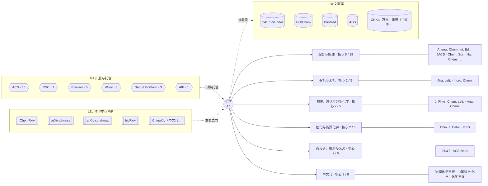

# 化学 venue 名录

> 化学共 47 个 venue（期刊 47、会议 0），归并为 5 个子领域（原 14 个），另有中文刊 8 个。其中核心 17 个优先支持，其余 30 个登记在册、暂不专门支持，规则见[支持分级](README.md#支持分级)。主要学科库：CAS SciFinder、PubChem、PubMed、ADS、CNKI、万方、维普（中文刊）；主要预印本与 WP 通道：ChemRxiv、arXiv physics、arXiv cond-mat、bioRxiv、ChinaXiv（中文刊）。评级标签的体系、版本与许可见[评级体系](../venue-rankings.md)，七类分层见[来源分层](../source-taxonomy.md)。

## 关联图

## 核心 venue（优先支持）

每个子领域内按评级强弱排序，评级相同按名称。`接入` 一列：`Crossref:ISSN` 指由 Crossref 委托按 ISSN 收元数据，`现有:`/`平台:` 指经名录里已有的来源行，`用户导入` 指只接受用户导出的题录。

本节只列核心 venue：逐刊核验标识与通道，进入首批验收与默认推荐池。其余 venue 见下文"登记 venue"。子领域由原来的细分方向归并而成：合并组先按原方向、再按评级排列，备注以"方向："开头标出原方向。

### 综合与综述（核心 6 · 登记 12）

含原方向：综合顶刊、综合、综述刊。

| venue | 类型 | ISSN（印/电）或 dblp | 出版托管（M1） | 评级 | 学科库（L2a） | 预印本（L1b） | 接入 | 备注 |
|---|---|---|---|---|---|---|---|---|
| Angewandte Chemie International Edition（Angew. Chem. Int. Ed.） | J | 1433-7851 / 1521-3773 | Wiley-VCH（GDCh） `wiley` | NI; T1(中国材料研究学会) | CAS SciFinder（仅外链）; PubChem | ChemRxiv | Crossref:ISSN | 方向：综合顶刊 |
| Journal of the American Chemical Society（JACS） | J | 0002-7863 / 1520-5126 | ACS `acs` | NI; T1(中国材料研究学会) | CAS SciFinder（仅外链）; PubChem | ChemRxiv | Crossref:ISSN | 方向：综合顶刊 |
| Chemical Science（Chem. Sci.） | J | 2041-6520 / 2041-6539 | RSC `rsc` | NI | CAS SciFinder（仅外链）; PubChem | ChemRxiv | Crossref:ISSN | 方向：综合顶刊；RSC 旗舰，DOAJ |
| Nature Chemistry（Nat. Chem.） | J | 1755-4330 / 1755-4349 | Springer Nature `nature_portfolio` | NI | CAS SciFinder（仅外链）; PubChem | ChemRxiv | Crossref:ISSN | 方向：综合顶刊 |
| Chemical Communications（Chem. Commun.） | J | 1359-7345 / 1364-548X | RSC `rsc` | NI | CAS SciFinder（仅外链）; PubChem | ChemRxiv | Crossref:ISSN | 方向：综合 |
| Chinese Chemical Letters（Chin. Chem. Lett.） | J | 1001-8417 / — | Elsevier（中国化学会） `elsevier_sd` | T3(中国环境科学学会); 卓越-领军 | CAS SciFinder（仅外链）; PubChem | ChemRxiv | Crossref:ISSN | 方向：综合；中国(英文) |

### 有机与无机（核心 2 · 登记 3）

含原方向：有机、无机与配位。

| venue | 类型 | ISSN（印/电）或 dblp | 出版托管（M1） | 评级 | 学科库（L2a） | 预印本（L1b） | 接入 | 备注 |
|---|---|---|---|---|---|---|---|---|
| Organic Letters（Org. Lett.） | J | 1523-7060 / 1523-7052 | ACS `acs` | NI | CAS SciFinder（仅外链）; PubChem | ChemRxiv | Crossref:ISSN | 方向：有机；旧稿 2026-09-26 已核 |
| Inorganic Chemistry（Inorg. Chem.） | J | 0020-1669 / 1520-510X | ACS `acs` | NI | CAS SciFinder（仅外链）; PubChem | ChemRxiv | Crossref:ISSN | 方向：无机与配位；旧稿 2026-09-26 已核 |

### 物理、理论与分析化学（核心 2 · 登记 3）

含原方向：物理化学、理论与计算化学、分析。

| venue | 类型 | ISSN（印/电）或 dblp | 出版托管（M1） | 评级 | 学科库（L2a） | 预印本（L1b） | 接入 | 备注 |
|---|---|---|---|---|---|---|---|---|
| The Journal of Physical Chemistry Letters（J. Phys. Chem. Lett.） | J | 1948-7185 / 1948-7185 | ACS `acs` | NI; T2(中国材料研究学会) | CAS SciFinder（仅外链）; PubChem | ChemRxiv | Crossref:ISSN | 方向：物理化学 |
| Analytical Chemistry（Anal. Chem.） | J | 0003-2700 / 1520-6882 | ACS `acs` | NI; T2(中国环境科学学会) | CAS SciFinder（仅外链）; PubChem; PubMed | ChemRxiv | Crossref:ISSN | 方向：分析；旧稿 2026-09-26 已核 |

### 催化与能源化学（核心 2 · 登记 4）

含原方向：催化、电化学与能源化学。

| venue | 类型 | ISSN（印/电）或 dblp | 出版托管（M1） | 评级 | 学科库（L2a） | 预印本（L1b） | 接入 | 备注 |
|---|---|---|---|---|---|---|---|---|
| Chinese Journal of Catalysis（Chin. J. Catal.） | J | 0253-9837 / 1872-2067 | Elsevier（中科院大连化物所/中国化学会） `elsevier_sd` | 卓越-领军 | CAS SciFinder（仅外链）; PubChem | ChemRxiv | Crossref:ISSN | 方向：催化；中国(英文)；英文版用 1872-2067；0253-9837 为旧中文版 |
| Energy & Environmental Science（EES） | J | 1754-5692 / 1754-5706 | RSC `rsc` | NI; T1(中国核学会、中国环境科学学会、中国硅酸盐学会) | CAS SciFinder（仅外链）; PubChem | ChemRxiv | Crossref:ISSN | 方向：电化学与能源化学；兼材料-能源 |

### 高分子、纳米与交叉（核心 2 · 登记 3）

含原方向：高分子、纳米化学、化学生物学、绿色与环境化学。

| venue | 类型 | ISSN（印/电）或 dblp | 出版托管（M1） | 评级 | 学科库（L2a） | 预印本（L1b） | 接入 | 备注 |
|---|---|---|---|---|---|---|---|---|
| Environmental Science & Technology（ES&T） | J | 0013-936X / 1520-5851 | ACS `acs` | NI; T1(中国地理学会、中国环境科学学会) | CAS SciFinder（仅外链）; PubChem; PubMed | ChemRxiv | Crossref:ISSN | 方向：绿色与环境化学；兼地学-环境 |
| ACS Nano | J | 1936-0851 / 1936-086X | ACS `acs` | NI; T1(中国材料研究学会) | CAS SciFinder（仅外链）; PubChem; PubMed | arXiv:cond-mat.mtrl-sci; ChemRxiv | Crossref:ISSN | 方向：纳米化学；兼材料-纳米 |

### 中文刊（核心 3 · 登记 5）

子领域写在备注里。知网、万方、维普只接受用户导入题录；在 Crossref 注册了 DOI 的中文刊可经 Crossref 收元数据。只接受用户导入的中文刊不列为核心。

| venue | 类型 | ISSN（印/电）或 dblp | 出版托管（M1） | 评级 | 学科库（L2a） | 预印本（L1b） | 接入 | 备注 |
|---|---|---|---|---|---|---|---|---|
| 物理化学学报（Acta Physico-Chimica Sinica） | J | 1000-6818 / — | 中国化学会 | 卓越-领军; CSCD核心; 北大核心; 科技核心 | CNKI; 万方; CSCD | ChinaXiv | Crossref:ISSN | 物理化学；Crossref前缀10.1016；现由Elsevier出版 |
| 中国科学:化学（Scientia Sinica Chimica） | J | 1674-7224 / — | 中国科学杂志社 `sciengine` | 卓越-梯队; CSCD核心; 北大核心; 科技核心 | CNKI; 万方; CSCD | ChinaXiv | Crossref:ISSN | 综合化学；Crossref前缀10.1360 |
| 化学学报（Acta Chim. Sinica） | J | 0567-7351 / — | 上海有机化学研究所（中国化学会） | T3(中国腐蚀与防护学会); 卓越-梯队(一期); CSCD核心; 北大核心; 科技核心 | CAS SciFinder（仅外链）; PubChem; CNKI | ChemRxiv | Crossref:ISSN | 综合；落地 sioc-journal.cn；M1 不在 187 |

## 登记 venue（长尾，暂不支持）

以下 venue 登记在册，保留标识、托管与评级，但暂不逐刊核验通道、不进首批验收。用户关注其中任意一个时，照常经 Crossref 或 OpenAlex 自动建 venue（`auto`）收元数据；问卷、调研与关注数达到[升级条件](README.md#支持分级)后升为核心。

### 综合与综述（登记 12）

| venue | 类型 | ISSN（印/电）或 dblp | 出版托管（M1） | 评级 | 学科库（L2a） | 预印本（L1b） | 接入 | 备注 |
|---|---|---|---|---|---|---|---|---|
| Chem | J | 2451-9294 / — | Cell Press（Elsevier） `elsevier_sd` | — | CAS SciFinder（仅外链）; PubChem | ChemRxiv | Crossref:ISSN | 方向：综合顶刊；Crossref 摘要 0.00 |
| ACS Central Science（ACS Cent. Sci.） | J | 2374-7943 / 2374-7951 | ACS `acs` | — | CAS SciFinder（仅外链）; PubChem | ChemRxiv | Crossref:ISSN | 方向：综合；DOAJ，APC 0 |
| CCS Chemistry（CCS Chem.） | J | 2096-5745 / 2096-5745 | 中国化学会 `ccs_chemistry` | 卓越-梯队 | CAS SciFinder（仅外链）; PubChem | ChemRxiv | Crossref:ISSN | 方向：综合；中国(英文)；自有平台 Atypon 模板 |
| Chemistry – A European Journal（Chem. Eur. J.） | J | 0947-6539 / 1521-3765 | Wiley-VCH（ChemPubSoc Europe） `wiley` | — | CAS SciFinder（仅外链）; PubChem | ChemRxiv | Crossref:ISSN | 方向：综合 |
| Chinese Journal of Chemistry（Chin. J. Chem.） | J | 1001-604X / 1614-7065 | Wiley（中国化学会/上海有机所） `wiley` | — | CAS SciFinder（仅外链）; PubChem | ChemRxiv | Crossref:ISSN | 方向：综合；中国(英文) |
| JACS Au | J | 2691-3704 / 2691-3704 | ACS `acs` | — | CAS SciFinder（仅外链）; PubChem | ChemRxiv | Crossref:ISSN | 方向：综合；旧稿 2026-09-26 已核 |
| Pure and Applied Chemistry（Pure Appl. Chem.） | J | 0033-4545 / 1365-3075 | De Gruyter Brill（IUPAC） `degruyter_brill` | — | CAS SciFinder（仅外链）; PubChem | — | Crossref:ISSN | 方向：综合 |
| Science China Chemistry（Sci. China Chem.） | J | 1674-7291 / 1869-1870 | Springer / 中国科学杂志社 `springer_link` | 卓越-梯队 | CAS SciFinder（仅外链）; PubChem | ChemRxiv | Crossref:ISSN | 方向：综合；中国(英文)；SciEngine 同刊，robots 禁 AI UA |
| Accounts of Chemical Research（Acc. Chem. Res.） | J | 0001-4842 / 1520-4898 | ACS `acs` | — | CAS SciFinder（仅外链）; PubChem | — | Crossref:ISSN | 方向：综述刊 |
| Chemical Reviews（Chem. Rev.） | J | 0009-2665 / 1520-6890 | ACS `acs` | — | CAS SciFinder（仅外链）; PubChem | — | Crossref:ISSN | 方向：综述刊 |
| Chemical Society Reviews（Chem. Soc. Rev.） | J | 0306-0012 / 1460-4744 | RSC `rsc` | — | CAS SciFinder（仅外链）; PubChem | — | Crossref:ISSN | 方向：综述刊 |
| Nature Reviews Chemistry（Nat. Rev. Chem.） | J | — / 2397-3358 | Springer Nature `nature_portfolio` | — | CAS SciFinder（仅外链）; PubChem | — | Crossref:ISSN | 方向：综述刊 |

### 有机与无机（登记 3）

| venue | 类型 | ISSN（印/电）或 dblp | 出版托管（M1） | 评级 | 学科库（L2a） | 预印本（L1b） | 接入 | 备注 |
|---|---|---|---|---|---|---|---|---|
| The Journal of Organic Chemistry（J. Org. Chem.） | J | 0022-3263 / 1520-6904 | ACS `acs` | — | CAS SciFinder（仅外链）; PubChem | ChemRxiv | Crossref:ISSN | 方向：有机 |
| Coordination Chemistry Reviews（Coord. Chem. Rev.） | J | 0010-8545 / 0010-8545 | Elsevier `elsevier_sd` | — | CAS SciFinder（仅外链）; PubChem | — | Crossref:ISSN | 方向：无机与配位；综述刊；摘要 0.00 |
| Dalton Transactions（Dalton Trans.） | J | 1477-9226 / 1477-9234 | RSC `rsc` | — | CAS SciFinder（仅外链）; PubChem | ChemRxiv | Crossref:ISSN | 方向：无机与配位 |

### 物理、理论与分析化学（登记 3）

| venue | 类型 | ISSN（印/电）或 dblp | 出版托管（M1） | 评级 | 学科库（L2a） | 预印本（L1b） | 接入 | 备注 |
|---|---|---|---|---|---|---|---|---|
| Physical Chemistry Chemical Physics（PCCP） | J | 1463-9076 / 1463-9084 | RSC `rsc` | — | CAS SciFinder（仅外链）; PubChem | ChemRxiv; arXiv:physics.chem-ph | Crossref:ISSN | 方向：物理化学；旧稿 2026-09-26 已核 |
| The Journal of Chemical Physics（J. Chem. Phys.） | J | 0021-9606 / 1089-7690 | AIP Publishing `aip` | — | CAS SciFinder（仅外链）; PubChem; ADS | ChemRxiv; arXiv:physics.chem-ph | Crossref:ISSN | 方向：物理化学 |
| Journal of Chemical Theory and Computation（JCTC） | J | 1549-9618 / 1549-9626 | ACS `acs` | — | CAS SciFinder（仅外链）; PubChem | ChemRxiv; arXiv:physics.chem-ph | Crossref:ISSN | 方向：理论与计算化学；旧稿 2026-09-26 已核 |

### 催化与能源化学（登记 4）

| venue | 类型 | ISSN（印/电）或 dblp | 出版托管（M1） | 评级 | 学科库（L2a） | 预印本（L1b） | 接入 | 备注 |
|---|---|---|---|---|---|---|---|---|
| ACS Catalysis（ACS Catal.） | J | 2155-5435 / 2155-5435 | ACS `acs` | — | CAS SciFinder（仅外链）; PubChem | ChemRxiv | Crossref:ISSN | 方向：催化 |
| Journal of Catalysis（J. Catal.） | J | 0021-9517 / 1090-2694 | Elsevier `elsevier_sd` | — | CAS SciFinder（仅外链）; PubChem | ChemRxiv | Crossref:ISSN | 方向：催化；旧稿 2026-09-26 已核 |
| Nature Catalysis（Nat. Catal.） | J | — / 2520-1158 | Springer Nature `nature_portfolio` | — | CAS SciFinder（仅外链）; PubChem | ChemRxiv | Crossref:ISSN | 方向：催化 |
| Journal of The Electrochemical Society（J. Electrochem. Soc.） | J | 0013-4651 / 1945-7111 | The Electrochemical Society（IOP 托管） `iop` | T1(中国腐蚀与防护学会) | CAS SciFinder（仅外链）; PubChem; OSTI | ChemRxiv | Crossref:ISSN | 方向：电化学与能源化学；Crossref 落地 iopscience |

### 高分子、纳米与交叉（登记 3）

| venue | 类型 | ISSN（印/电）或 dblp | 出版托管（M1） | 评级 | 学科库（L2a） | 预印本（L1b） | 接入 | 备注 |
|---|---|---|---|---|---|---|---|---|
| Macromolecules | J | 0024-9297 / 1520-5835 | ACS `acs` | NI | CAS SciFinder（仅外链）; PubChem | ChemRxiv | Crossref:ISSN | 方向：高分子；兼材料-高分子 |
| ACS Chemical Biology（ACS Chem. Biol.） | J | 1554-8929 / 1554-8937 | ACS `acs` | — | PubMed; CAS SciFinder（仅外链）; PubChem | ChemRxiv; bioRxiv | Crossref:ISSN | 方向：化学生物学 |
| Green Chemistry（Green Chem.） | J | 1463-9262 / 1463-9270 | RSC `rsc` | T3(中国环境科学学会) | CAS SciFinder（仅外链）; PubChem | ChemRxiv | Crossref:ISSN | 方向：绿色与环境化学；旧稿 2026-09-26 已核 |

### 中文刊（登记 5）

| venue | 类型 | ISSN（印/电）或 dblp | 出版托管（M1） | 评级 | 学科库（L2a） | 预印本（L1b） | 接入 | 备注 |
|---|---|---|---|---|---|---|---|---|
| 化工学报（CIESC Journal） | J | 0438-1157 / — | 中国化工学会 | T1(中国化工学会); 卓越-领军; CSCD核心; 北大核心; 科技核心 | CNKI; 万方; CSCD | ChinaXiv | 用户导入 | 化工；Crossref无该ISSN记录；一期梯队 |
| 高分子学报（Acta Polymerica Sinica） | J | 1000-3304 / — | 中国化学会 | T1(中国化工学会); T2(中国材料研究学会); T3(中国腐蚀与防护学会); CSCD核心; 北大核心; 科技核心 | CNKI; 万方; CSCD | ChinaXiv | 用户导入 | 高分子；Crossref仅至2014(10.3724) |
| 分析化学（Chinese Journal of Analytical Chemistry） | J | 0253-3820 / — | 中国科学院长春应用化学研究所 | 卓越-梯队; CSCD核心; 北大核心; 科技核心 | CNKI; 万方; CSCD | ChinaXiv | 用户导入 | 分析化学；Crossref仅至2014(10.3724) |
| 高等学校化学学报（Chemical Journal of Chinese Universities） | J | 0251-0790 / — | 吉林大学 | 卓越-梯队(一期); CSCD核心; 北大核心; 科技核心 | CNKI; 万方; CSCD | ChinaXiv | 用户导入 | 综合化学；Crossref无该ISSN记录 |
| 有机化学（Chinese Journal of Organic Chemistry） | J | 0253-2786 / — | 中国化学会 | T3(中国腐蚀与防护学会); CSCD扩展; 北大核心; 科技核心 | CNKI; 万方; CSCD | ChinaXiv | Crossref:ISSN | 有机化学；Crossref前缀10.6023 |

## 出处与说明

- **T 级**：科协总汇第五版没有中国化学会编制的化学领域目录。化学刊的 T 标签来自材料、环境、硅酸盐、腐蚀、化工等相邻学会的目录（括号里写学会），只说明入选该学会目录，不代表化学学科内的分级。
- **NI**：14 刊。
- **平台**：化学学报在上海有机所自有站，不在名录；化学生物学刊另挂 PubMed。
- **待核**：新增传统出版商刊的 OA 列按出版模式写"混合"，未逐刊核 DOAJ。
- **支持分级**：核心按[支持分级](README.md#支持分级)的规则初选，2026-09-29 定稿。本学科没有人工补选。
