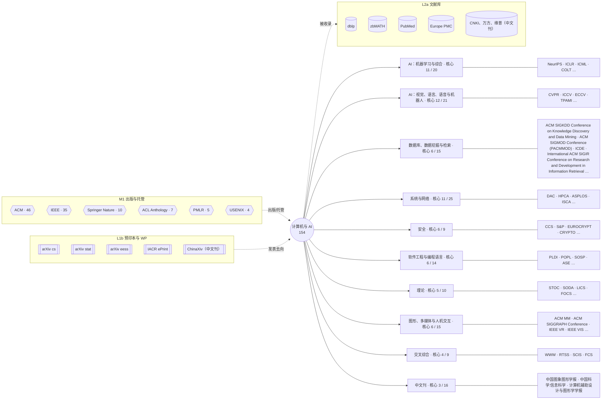

# 计算机与AI venue 名录

> 计算机与 AI共 154 个 venue（期刊 73、会议 81），归并为 9 个子领域（原 16 个），另有中文刊 16 个。其中核心 70 个优先支持，其余 84 个登记在册、暂不专门支持，规则见[支持分级](README.md#支持分级)。主要学科库：dblp、zbMATH、PubMed、Europe PMC、CNKI、万方、维普（中文刊）；主要预印本与 WP 通道：arXiv cs、arXiv stat、arXiv eess、IACR ePrint、ChinaXiv（中文刊）。评级标签的体系、版本与许可见[评级体系](../venue-rankings.md)，七类分层见[来源分层](../source-taxonomy.md)。

## 关联图

## 核心 venue（优先支持）

每个子领域内按评级强弱排序，评级相同按名称。`接入` 一列：`Crossref:ISSN` 指由 Crossref 委托按 ISSN 收元数据，`现有:`/`平台:` 指经名录里已有的来源行，`用户导入` 指只接受用户导出的题录。

本节只列核心 venue：逐刊核验标识与通道，进入首批验收与默认推荐池。其余 venue 见下文"登记 venue"。子领域由原来的细分方向归并而成：合并组先按原方向、再按评级排列，备注以"方向："开头标出原方向。

### AI：机器学习与综合（核心 11 · 登记 9）

含原方向：AI-机器学习、AI-综合、AI-知识表示与规划。

| venue | 类型 | ISSN（印/电）或 dblp | 出版托管（M1） | 评级 | 学科库（L2a） | 预印本（L1b） | 接入 | 备注 |
|---|---|---|---|---|---|---|---|---|
| Conference on Neural Information Processing Systems（NeurIPS） | C | dblp `conf/nips` | NeurIPS Foundation `neurips_proceedings` | CCF-A; ICORE-A*; THCPL-A; CAAI-A; CSR | dblp | arXiv:cs.LG; stat.ML | 现有:neurips_proceedings | 方向：AI-机器学习；评审在 OpenReview |
| International Conference on Learning Representations（ICLR） | C | dblp `conf/iclr` | OpenReview `openreview` | CCF-A; ICORE-A*; THCPL-A; CAAI-A; CSR | dblp | arXiv:cs.LG; stat.ML | 现有:openreview | 方向：AI-机器学习；2026 新入 CCF-A |
| International Conference on Machine Learning（ICML） | C | dblp `conf/icml` | PMLR `pmlr` | CCF-A; ICORE-A*; THCPL-A; CAAI-A; CSR | dblp | arXiv:cs.LG; stat.ML | 现有:pmlr | 方向：AI-机器学习；接收列表在 OpenReview |
| Annual Conference on Learning Theory（COLT） | C | dblp `conf/colt` | PMLR `pmlr` | CCF-B; ICORE-A*; THCPL-A; CAAI-A | dblp | arXiv:cs.LG; stat.ML | 现有:pmlr | 方向：AI-机器学习 |
| Journal of Machine Learning Research（JMLR） | J | — / 1533-7928；dblp `journals/jmlr` | JMLR (MIT Press 名义) `jmlr` | CCF-A; CAAI-A | dblp | arXiv:cs.LG; stat.ML | 现有:jmlr | 方向：AI-机器学习；CC BY 4.0，无 DOI |
| Transactions on Machine Learning Research（TMLR） | J | — / 2835-8856；dblp `journals/tmlr` | OpenReview `openreview` | CAAI-C | dblp | arXiv:cs.LG; stat.ML | Crossref:ISSN | 方向：AI-机器学习；ISSN 取自长稿 CS §2.3；三份名录均未收 |
| International Conference on Principles of Knowledge Representation and Reasoning（KR） | C | dblp `conf/kr` | KR Inc. (IJCAI 平台) `ijcai_proceedings` | CCF-B; ICORE-A*; CAAI-B | dblp | arXiv:cs.AI; cs.MA | 现有:ijcai_proceedings | 方向：AI-知识表示与规划；DOI 前缀与 IJCAI 共用 |
| AAAI Conference on Artificial Intelligence | C | dblp `conf/aaai` | AAAI `aaai_ojs` | CCF-A; ICORE-A*; THCPL-A; CAAI-A; CSR | dblp | arXiv:cs.AI | 现有:aaai_ojs | 方向：AI-综合 |
| International Joint Conference on Artificial Intelligence（IJCAI） | C | dblp `conf/ijcai` | IJCAI `ijcai_proceedings` | CCF-B; ICORE-A*; THCPL-B; CAAI-A; CSR | dblp | arXiv:cs.AI | 现有:ijcai_proceedings | 方向：AI-综合；2026 由 CCF-A 降 B |
| Artificial Intelligence（AIJ） | J | 0004-3702 / —；dblp `journals/ai` | Elsevier `elsevier_sd` | CCF-A; CAAI-A | dblp | arXiv:cs.AI | Crossref:ISSN | 方向：AI-综合 |
| Journal of Artificial Intelligence Research（JAIR） | J | 1076-9757 / —；dblp `journals/jair` | AI Access Foundation `jair` | CCF-B; CAAI-B | dblp | arXiv:cs.AI | 现有:jair | 方向：AI-综合；ISSN 取自长稿 CS §2.3 |

### AI：视觉、语言、语音与机器人（核心 12 · 登记 9）

含原方向：AI-计算机视觉、AI-自然语言处理、AI-语音、AI-机器人。

| venue | 类型 | ISSN（印/电）或 dblp | 出版托管（M1） | 评级 | 学科库（L2a） | 预印本（L1b） | 接入 | 备注 |
|---|---|---|---|---|---|---|---|---|
| IEEE/CVF Conference on Computer Vision and Pattern Recognition（CVPR） | C | dblp `conf/cvpr` | CVF/IEEE `cvf_open_access` | CCF-A; ICORE-A*; THCPL-A; CAAI-A; CSR | dblp | arXiv:cs.CV | 现有:cvf_open_access | 方向：AI-计算机视觉 |
| IEEE/CVF International Conference on Computer Vision（ICCV） | C | dblp `conf/iccv` | CVF/IEEE `cvf_open_access` | CCF-A; ICORE-A*; THCPL-A; CAAI-A; CSR | dblp | arXiv:cs.CV | 现有:cvf_open_access | 方向：AI-计算机视觉 |
| European Conference on Computer Vision（ECCV） | C | dblp `conf/eccv` | Springer (OA 版 ECVA) `springer_link` | CCF-B; ICORE-A*; THCPL-A; CAAI-A; CSR | dblp | arXiv:cs.CV | 现有:springer_link | 方向：AI-计算机视觉；ECVA 免费阅读 |
| IEEE Transactions on Pattern Analysis and Machine Intelligence（TPAMI） | J | 0162-8828 / 1939-3539；dblp `journals/pami` | IEEE `ieee_xplore` | CCF-A; CAAI-A | dblp | arXiv:cs.CV | Crossref:ISSN | 方向：AI-计算机视觉 |
| International Journal of Computer Vision（IJCV） | J | 0920-5691 / 1573-1405；dblp `journals/ijcv` | Springer `springer_link` | CCF-A; CAAI-A | dblp | arXiv:cs.CV | Crossref:ISSN | 方向：AI-计算机视觉 |
| Annual Meeting of the Association for Computational Linguistics（ACL） | C | dblp `conf/acl` | ACL `acl_anthology` | CCF-A; ICORE-A*; THCPL-A; CAAI-A; CSR | dblp | arXiv:cs.CL | 现有:acl_anthology | 方向：AI-自然语言处理；CC BY 4.0 |
| Conference on Empirical Methods in Natural Language Processing（EMNLP） | C | dblp `conf/emnlp` | ACL `acl_anthology` | CCF-B; ICORE-A*; THCPL-A; CAAI-A; CSR | dblp | arXiv:cs.CL | 现有:acl_anthology | 方向：AI-自然语言处理 |
| Annual Conference of the North American Chapter of the ACL（NAACL） | C | dblp `conf/naacl` | ACL `acl_anthology` | CCF-B; ICORE-A; THCPL-B; CAAI-B; CSR | dblp | arXiv:cs.CL | 现有:acl_anthology | 方向：AI-自然语言处理 |
| Transactions of the Association for Computational Linguistics（TACL） | J | — / 2307-387X；dblp `journals/tacl` | MIT Press/ACL `acl_anthology` | CCF-B; CAAI-B | dblp | arXiv:cs.CL | 现有:acl_anthology | 方向：AI-自然语言处理；亦在 mit_press_direct |
| IEEE International Conference on Robotics and Automation（ICRA） | C | dblp `conf/icra` | IEEE `ieee_xplore` | CCF-B; ICORE-A*; THCPL-A; CAAI-A; CSR | dblp | arXiv:cs.RO | 现有:ieee_xplore | 方向：AI-机器人 |
| IEEE/RSJ International Conference on Intelligent Robots and Systems（IROS） | C | dblp `conf/iros` | IEEE `ieee_xplore` | CCF-C; ICORE-A; THCPL-B; CAAI-B; CSR; NI | dblp | arXiv:cs.RO | 现有:ieee_xplore | 方向：AI-机器人；Nature Index 收录 |
| Conference on Robot Learning（CoRL） | C | dblp `conf/corl` | PMLR `pmlr` | CAAI-C | dblp | arXiv:cs.RO | 现有:pmlr | 方向：AI-机器人；评审在 OpenReview |

### 数据库、数据挖掘与检索（核心 6 · 登记 9）

| venue | 类型 | ISSN（印/电）或 dblp | 出版托管（M1） | 评级 | 学科库（L2a） | 预印本（L1b） | 接入 | 备注 |
|---|---|---|---|---|---|---|---|---|
| ACM SIGKDD Conference on Knowledge Discovery and Data Mining | C | dblp `conf/kdd` | ACM `acm_dl` | CCF-A; ICORE-A*; THCPL-A; CAAI-A; CSR | dblp | arXiv:cs.DB; cs.IR | 现有:acm_dl |  |
| ACM SIGMOD Conference (PACMMOD) | J+C | — / 2836-6573；dblp `conf/sigmod` | ACM `acm_dl` | CCF-A; ICORE-A*; THCPL-A; CAAI-A; CSR | dblp | arXiv:cs.DB; cs.IR | 现有:acm_dl | 论文刊于 PACMMOD |
| IEEE International Conference on Data Engineering（ICDE） | C | dblp `conf/icde` | IEEE `ieee_xplore` | CCF-A; ICORE-A*; THCPL-A; CAAI-A; CSR | dblp | arXiv:cs.DB; cs.IR | 现有:ieee_xplore |  |
| International ACM SIGIR Conference on Research and Development in Information Retrieval | C | dblp `conf/sigir` | ACM `acm_dl` | CCF-A; ICORE-A*; THCPL-A; CAAI-A; CSR | dblp | arXiv:cs.DB; cs.IR | 现有:acm_dl |  |
| International Conference on Very Large Data Bases (PVLDB) | J+C | 2150-8097 / —；dblp `conf/vldb` | VLDB Endowment `pvldb` | CCF-A; ICORE-A*; THCPL-A; CAAI-A; CSR | dblp | arXiv:cs.DB; cs.IR | 现有:pvldb | PVLDB CC BY-NC-ND |
| ACM Transactions on Information Systems（TOIS） | J | 1046-8188 / 1558-2868；dblp `journals/tois` | ACM `acm_dl` | CCF-A; CAAI-A; FMS-B | dblp | arXiv:cs.DB; cs.IR | Crossref:ISSN |  |

### 系统与网络（核心 11 · 登记 14）

含原方向：体系结构与并行、网络。

| venue | 类型 | ISSN（印/电）或 dblp | 出版托管（M1） | 评级 | 学科库（L2a） | 预印本（L1b） | 接入 | 备注 |
|---|---|---|---|---|---|---|---|---|
| Design Automation Conference（DAC） | C | dblp `conf/dac` | ACM/IEEE `acm_dl` | CCF-A; ICORE-A*; THCPL-A; CSR | dblp | arXiv:cs.AR | 现有:acm_dl | 方向：体系结构与并行；ICORE据ccfddl |
| IEEE International Symposium on High Performance Computer Architecture（HPCA） | C | dblp `conf/hpca` | IEEE `ieee_xplore` | CCF-A; ICORE-A*; THCPL-A; CAAI-C; CSR | dblp | arXiv:cs.AR; cs.DC | 现有:ieee_xplore | 方向：体系结构与并行；ICORE据ccfddl |
| International Conference on Architectural Support for Programming Languages and Operating Systems（ASPLOS） | C | dblp `conf/asplos` | ACM `acm_dl` | CCF-A; ICORE-A*; THCPL-A; CSR | dblp | arXiv:cs.AR; cs.DC | 现有:acm_dl | 方向：体系结构与并行；ICORE据ccfddl |
| International Symposium on Computer Architecture（ISCA） | C | dblp `conf/isca` | IEEE/ACM `acm_dl` | CCF-A; ICORE-A*; THCPL-A; CAAI-A; CSR | dblp | arXiv:cs.AR; cs.DC | 现有:acm_dl | 方向：体系结构与并行；ICORE据ccfddl |
| ACM SIGOPS Annual Technical Conference（SIGOPS ATC） | C | dblp `conf/usenix` | ACM（原 USENIX） `acm_dl` | CCF-A; ICORE-A; THCPL-A; CSR | dblp | arXiv:cs.OS; cs.DC | 现有:acm_dl | 方向：体系结构与并行；原 USENIX ATC，2026 目录更名 |
| European Conference on Computer Systems（EuroSys） | C | dblp `conf/eurosys` | ACM `acm_dl` | CCF-A; ICORE-A; THCPL-A; CSR | dblp | arXiv:cs.OS; cs.DC | 现有:acm_dl | 方向：体系结构与并行 |
| IEEE/ACM International Symposium on Microarchitecture（MICRO） | C | dblp `conf/micro` | IEEE/ACM `acm_dl` | CCF-A; ICORE-A; THCPL-A; CAAI-A; CSR | dblp | arXiv:cs.AR; cs.DC | 现有:acm_dl | 方向：体系结构与并行；ICORE据ccfddl |
| ACM International Conference on Mobile Computing and Networking（MobiCom） | C | dblp `conf/mobicom` | ACM `acm_dl` | CCF-A; ICORE-A*; THCPL-A; CSR | dblp | arXiv:cs.NI | 现有:acm_dl | 方向：网络；ICORE据ccfddl |
| ACM SIGCOMM Conference | C | dblp `conf/sigcomm` | ACM `acm_dl` | CCF-A; ICORE-A*; THCPL-A; CSR | dblp | arXiv:cs.NI | 现有:acm_dl | 方向：网络；ICORE据ccfddl |
| IEEE International Conference on Computer Communications（INFOCOM） | C | dblp `conf/infocom` | IEEE `ieee_xplore` | CCF-A; ICORE-A*; THCPL-A | dblp | arXiv:cs.NI | 现有:ieee_xplore | 方向：网络；ICORE据ccfddl |
| USENIX Symposium on Networked Systems Design and Implementation（NSDI） | C | dblp `conf/nsdi` | USENIX `usenix` | CCF-A; THCPL-A; CSR | dblp | arXiv:cs.NI | 现有:usenix | 方向：网络；ICORE 标 National: USA |

### 安全（核心 6 · 登记 3）

| venue | 类型 | ISSN（印/电）或 dblp | 出版托管（M1） | 评级 | 学科库（L2a） | 预印本（L1b） | 接入 | 备注 |
|---|---|---|---|---|---|---|---|---|
| ACM Conference on Computer and Communications Security（CCS） | C | dblp `conf/ccs` | ACM `acm_dl` | CCF-A; ICORE-A*; THCPL-A; CSR | dblp | arXiv:cs.CR | 现有:acm_dl |  |
| IEEE Symposium on Security and Privacy（S&P） | C | dblp `conf/sp` | IEEE `ieee_xplore` | CCF-A; ICORE-A*; THCPL-A; CSR | dblp | arXiv:cs.CR | 现有:ieee_xplore |  |
| International Conference on the Theory and Applications of Cryptographic Techniques（EUROCRYPT） | C | dblp `conf/eurocrypt` | Springer (IACR) `springer_link` | CCF-A; ICORE-A*; THCPL-A; CSR | dblp | IACR ePrint; arXiv:cs.CR | 现有:springer_link | ICORE据ccfddl |
| International Cryptology Conference（CRYPTO） | C | dblp `conf/crypto` | Springer (IACR) `springer_link` | CCF-A; ICORE-A*; THCPL-A; CSR | dblp | IACR ePrint; arXiv:cs.CR | 现有:springer_link | ICORE据ccfddl |
| Network and Distributed System Security Symposium（NDSS） | C | dblp `conf/ndss` | ISOC `ndss` | CCF-A; ICORE-A*; THCPL-A; CSR | dblp | arXiv:cs.CR | 现有:ndss |  |
| USENIX Security Symposium | C | dblp `conf/uss` | USENIX `usenix` | CCF-A; ICORE-A*; THCPL-A; CSR | dblp | arXiv:cs.CR | 现有:usenix |  |

### 软件工程与编程语言（核心 6 · 登记 8）

| venue | 类型 | ISSN（印/电）或 dblp | 出版托管（M1） | 评级 | 学科库（L2a） | 预印本（L1b） | 接入 | 备注 |
|---|---|---|---|---|---|---|---|---|
| ACM SIGPLAN Conference on Programming Language Design and Implementation（PLDI） | J+C | dblp `conf/pldi` | ACM `acm_dl` | CCF-A; ICORE-A*; THCPL-A; CSR | dblp | arXiv:cs.SE; cs.PL | 现有:acm_dl | 论文刊于 PACMPL；ICORE据ccfddl |
| ACM SIGPLAN-SIGACT Symposium on Principles of Programming Languages（POPL） | J+C | dblp `conf/popl` | ACM `acm_dl` | CCF-A; ICORE-A*; THCPL-A; CSR | dblp | arXiv:cs.SE; cs.PL | 现有:acm_dl | 论文刊于 PACMPL；ICORE据ccfddl |
| ACM Symposium on Operating Systems Principles（SOSP） | C | dblp `conf/sosp` | ACM `acm_dl` | CCF-A; ICORE-A*; THCPL-A; CSR | dblp | arXiv:cs.OS; cs.DC | 现有:acm_dl |  |
| IEEE/ACM International Conference on Automated Software Engineering（ASE） | C | dblp `conf/kbse` | IEEE/ACM `ieee_xplore` | CCF-A; ICORE-A*; THCPL-A; CSR | dblp | arXiv:cs.SE; cs.PL | 现有:ieee_xplore | ICORE据ccfddl |
| International Conference on Software Engineering（ICSE） | C | dblp `conf/icse` | IEEE/ACM `acm_dl` | CCF-A; ICORE-A*; THCPL-A; CSR | dblp | arXiv:cs.SE; cs.PL | 现有:acm_dl |  |
| USENIX Symposium on Operating Systems Design and Implementation（OSDI） | C | dblp `conf/osdi` | USENIX `usenix` | CCF-A; ICORE-A*; THCPL-A; CSR | dblp | arXiv:cs.OS; cs.DC | 现有:usenix |  |

### 理论（核心 5 · 登记 5）

| venue | 类型 | ISSN（印/电）或 dblp | 出版托管（M1） | 评级 | 学科库（L2a） | 预印本（L1b） | 接入 | 备注 |
|---|---|---|---|---|---|---|---|---|
| ACM Symposium on Theory of Computing（STOC） | C | dblp `conf/stoc` | ACM `acm_dl` | CCF-A; ICORE-A*; THCPL-A; CSR | dblp; zbMATH | arXiv:cs.DS; cs.CC; ECCC | 现有:acm_dl | ICORE据ccfddl |
| ACM-SIAM Symposium on Discrete Algorithms（SODA） | C | dblp `conf/soda` | SIAM `siam` | CCF-A; ICORE-A*; THCPL-A; CSR | dblp; zbMATH | arXiv:cs.DS; cs.CC | 现有:siam | ICORE据ccfddl |
| ACM/IEEE Symposium on Logic in Computer Science（LICS） | C | dblp `conf/lics` | IEEE/ACM `ieee_xplore` | CCF-A; ICORE-A*; THCPL-A; CSR | dblp; zbMATH | arXiv:cs.LO | 现有:ieee_xplore | ICORE据ccfddl |
| IEEE Annual Symposium on Foundations of Computer Science（FOCS） | C | dblp `conf/focs` | IEEE `ieee_xplore` | CCF-A; ICORE-A*; THCPL-A; CSR | dblp; zbMATH | arXiv:cs.DS; cs.CC; ECCC | 现有:ieee_xplore | ICORE据ccfddl |
| SIAM Journal on Computing（SICOMP） | J | 0097-5397 / 1095-7111；dblp `journals/siamcomp` | SIAM `siam` | CCF-A; FMS-B; T2(中国数学会) | dblp; zbMATH | arXiv:cs.DS; cs.CC; ECCC | Crossref:ISSN |  |

### 图形、多媒体与人机交互（核心 6 · 登记 9）

含原方向：图形与多媒体、人机交互与普适。

| venue | 类型 | ISSN（印/电）或 dblp | 出版托管（M1） | 评级 | 学科库（L2a） | 预印本（L1b） | 接入 | 备注 |
|---|---|---|---|---|---|---|---|---|
| ACM International Conference on Multimedia（ACM MM） | C | dblp `conf/mm` | ACM `acm_dl` | CCF-A; ICORE-A*; THCPL-A; CAAI-A | dblp | arXiv:cs.GR; cs.MM | 现有:acm_dl | 方向：图形与多媒体；评审在 OpenReview |
| ACM SIGGRAPH Conference | C | dblp `conf/siggraph` | ACM `acm_dl` | CCF-A; ICORE-A*; THCPL-A; CAAI-A; CSR | dblp | arXiv:cs.GR; cs.MM | 现有:acm_dl | 方向：图形与多媒体；ICORE据ccfddl |
| IEEE Conference on Virtual Reality and 3D User Interfaces（IEEE VR） | C | dblp `conf/vr` | IEEE `ieee_xplore` | CCF-A; ICORE-A*; THCPL-A; CAAI-A; CSR | dblp | arXiv:cs.GR; cs.MM | 现有:ieee_xplore | 方向：图形与多媒体；原 IEEE VR 会议；ICORE据ccfddl |
| IEEE Visualization Conference（IEEE VIS） | C | dblp `conf/visualization` | IEEE `ieee_xplore` | CCF-A; ICORE-A; THCPL-A; CAAI-A; CSR | dblp | arXiv:cs.GR; cs.MM | 现有:ieee_xplore | 方向：图形与多媒体；ICORE据ccfddl |
| IEEE Transactions on Visualization and Computer Graphics（TVCG） | J | 1077-2626 / 1941-0506；dblp `journals/tvcg` | IEEE `ieee_xplore` | CCF-A; CAAI-A; T2(中国地理学会) | dblp | arXiv:cs.GR; cs.MM | Crossref:ISSN | 方向：图形与多媒体；IEEE VIS/VR 论文刊于此 |
| ACM Conference on Human Factors in Computing Systems（CHI） | C | dblp `conf/chi` | ACM `acm_dl` | CCF-A; ICORE-A*; THCPL-A; CAAI-A; CSR | dblp | arXiv:cs.HC | 现有:acm_dl | 方向：人机交互与普适 |

### 交叉综合（核心 4 · 登记 5）

| venue | 类型 | ISSN（印/电）或 dblp | 出版托管（M1） | 评级 | 学科库（L2a） | 预印本（L1b） | 接入 | 备注 |
|---|---|---|---|---|---|---|---|---|
| The Web Conference（WWW） | C | dblp `conf/www` | ACM `acm_dl` | CCF-A; ICORE-A*; THCPL-A; CAAI-A; CSR | dblp | arXiv:cs.IR; cs.SI | 现有:acm_dl | 原名 WWW Conference |
| IEEE Real-Time Systems Symposium（RTSS） | C | dblp `conf/rtss` | IEEE `ieee_xplore` | CCF-A; ICORE-A*; THCPL-B; CSR | dblp | arXiv:cs.OS; eess.SY | 现有:ieee_xplore | ICORE据ccfddl |
| Science China Information Sciences（SCIS） | J | 1674-733X / 1869-1919；dblp `journals/chinaf` | Science China Press/Springer `sciengine` | CCF-A; 卓越-领军 | dblp | arXiv:cs.* | Crossref:ISSN | 中国(英文)；中国主办英文刊 |
| Frontiers of Computer Science（FCS） | J | 2095-2228 / 2095-2236；dblp `journals/fcsc` | Higher Education Press/Springer `springer_link` | CCF-B; 卓越-领军 | dblp | arXiv:cs.* | Crossref:ISSN | 中国(英文)；中国主办英文刊 |

### 中文刊（核心 3 · 登记 13）

子领域写在备注里。知网、万方、维普只接受用户导入题录；在 Crossref 注册了 DOI 的中文刊可经 Crossref 收元数据。只接受用户导入的中文刊不列为核心。

| venue | 类型 | ISSN（印/电）或 dblp | 出版托管（M1） | 评级 | 学科库（L2a） | 预印本（L1b） | 接入 | 备注 |
|---|---|---|---|---|---|---|---|---|
| 中国图象图形学报（Journal of Image and Graphics） | J | 1006-8961 / — | 中国图象图形学学会 | T1(中国遥感应用协会); T2(中国计算机学会); CSCD核心; 北大核心; 科技核心; CCF中文-B | CNKI; 万方; CSCD | ChinaXiv | Crossref:ISSN | 图形与视觉；Crossref前缀10.11834 |
| 中国科学:信息科学（Scientia Sinica Informationis） | J | 1674-7267 / — | 中国科学杂志社 `sciengine` | T1(中国计算机学会); CSCD核心; 北大核心; 科技核心; CCF中文-A | CNKI; 万方; CSCD | ChinaXiv | Crossref:ISSN | 综合计算机；Crossref前缀10.1360 |
| 计算机辅助设计与图形学学报（Journal of Computer-Aided Design & Computer Graphics） | J | 1003-9775 / — | 中国计算机学会 | T1(中国计算机学会); CSCD核心; 北大核心; 科技核心; CCF中文-A | CNKI; 万方; CSCD | ChinaXiv | Crossref:ISSN | 图形与视觉；Crossref前缀10.3724 |

## 登记 venue（长尾，暂不支持）

以下 venue 登记在册，保留标识、托管与评级，但暂不逐刊核验通道、不进首批验收。用户关注其中任意一个时，照常经 Crossref 或 OpenAlex 自动建 venue（`auto`）收元数据；问卷、调研与关注数达到[升级条件](README.md#支持分级)后升为核心。

### AI：机器学习与综合（登记 9）

| venue | 类型 | ISSN（印/电）或 dblp | 出版托管（M1） | 评级 | 学科库（L2a） | 预印本（L1b） | 接入 | 备注 |
|---|---|---|---|---|---|---|---|---|
| Conference on Uncertainty in Artificial Intelligence（UAI） | C | dblp `conf/uai` | PMLR `pmlr` | CCF-B; ICORE-A; THCPL-B; CAAI-A | dblp | arXiv:cs.LG; stat.ML | 现有:pmlr | 方向：AI-机器学习 |
| IEEE Transactions on Neural Networks and Learning Systems（TNNLS） | J | 2162-237X / 2162-2388；dblp `journals/tnn` | IEEE `ieee_xplore` | CCF-B; CAAI-A | dblp | arXiv:cs.LG; stat.ML | Crossref:ISSN | 方向：AI-机器学习 |
| International Conference on Artificial Intelligence and Statistics（AISTATS） | C | dblp `conf/aistats` | PMLR `pmlr` | CCF-C; ICORE-A; THCPL-B; CAAI-B | dblp | arXiv:cs.LG; stat.ML | 现有:pmlr | 方向：AI-机器学习 |
| Conference on Machine Learning and Systems（MLSys） | C | dblp `conf/mlsys` | MLSys `mlsys_proceedings` | — | dblp | arXiv:cs.LG; stat.ML | 现有:mlsys_proceedings | 方向：AI-机器学习；平台 ⚠ 待复勘 |
| International Conference on Automated Planning and Scheduling（ICAPS） | C | dblp `conf/icaps` | AAAI `aaai_ojs` | CCF-B; ICORE-A*; THCPL-B | dblp | arXiv:cs.AI; cs.MA | 现有:aaai_ojs | 方向：AI-知识表示与规划 |
| International Conference on Autonomous Agents and Multiagent Systems（AAMAS） | C | dblp `conf/ifaamas` | IFAAMAS `aamas_ifaamas` | CCF-B; ICORE-A; THCPL-B | dblp | arXiv:cs.AI; cs.MA | 现有:aamas_ifaamas | 方向：AI-知识表示与规划；Crossref 前缀 10.65109 |
| European Conference on Artificial Intelligence（ECAI） | C | dblp `conf/ecai` | IOS Press FAIA `iospress_faia` | CCF-B; ICORE-A; CAAI-B | dblp | arXiv:cs.AI | 现有:iospress_faia | 方向：AI-综合；CC BY-NC |
| AAAI/ACM Conference on AI, Ethics, and Society（AIES） | C | dblp `conf/aies` | AAAI `aaai_ojs` | CAAI-C | dblp | arXiv:cs.CY | 现有:aaai_ojs | 方向：AI-综合 |
| ACM Conference on Fairness, Accountability, and Transparency（FAccT） | C | dblp `conf/fat` | ACM `acm_dl` | — | dblp | arXiv:cs.CY | 现有:acm_dl | 方向：AI-综合 |

### AI：视觉、语言、语音与机器人（登记 9）

| venue | 类型 | ISSN（印/电）或 dblp | 出版托管（M1） | 评级 | 学科库（L2a） | 预印本（L1b） | 接入 | 备注 |
|---|---|---|---|---|---|---|---|---|
| IEEE/CVF Winter Conference on Applications of Computer Vision（WACV） | C | dblp `conf/wacv` | CVF/IEEE `cvf_open_access` | ICORE-A; CAAI-B | dblp | arXiv:cs.CV | 现有:cvf_open_access | 方向：AI-计算机视觉 |
| Conference of the European Chapter of the ACL（EACL） | C | dblp `conf/eacl` | ACL `acl_anthology` | ICORE-A; CAAI-C | dblp | arXiv:cs.CL | 现有:acl_anthology | 方向：AI-自然语言处理 |
| International Conference on Computational Linguistics（COLING） | C | dblp `conf/coling` | ICCL/ACL Anthology `acl_anthology` | CCF-B; ICORE-B; THCPL-B; CAAI-B | dblp | arXiv:cs.CL | 现有:acl_anthology | 方向：AI-自然语言处理 |
| Conference on Language Modeling（COLM） | C | dblp `conf/colm` | OpenReview `openreview` | — | dblp | arXiv:cs.CL | 现有:openreview | 方向：AI-自然语言处理 |
| Findings of the Association for Computational Linguistics | C | — | ACL `acl_anthology` | — | dblp | arXiv:cs.CL | 现有:acl_anthology | 方向：AI-自然语言处理；随 ACL/EMNLP/NAACL 出版；dblp 键 ⚠ |
| Robotics: Science and Systems（RSS） | C | dblp `conf/rss` | RSS Foundation `rss_proceedings` | THCPL-A; CAAI-A; CSR | dblp | arXiv:cs.RO | 现有:rss_proceedings | 方向：AI-机器人 |
| Annual Conference of the International Speech Communication Association（Interspeech） | C | dblp `conf/interspeech` | ISCA `isca_archive` | CCF-B; ICORE-A; CAAI-B | dblp | arXiv:eess.AS; cs.SD | 现有:isca_archive | 方向：AI-语音；2026 由 CCF-C 升 B |
| IEEE International Conference on Acoustics, Speech and Signal Processing（ICASSP） | C | dblp `conf/icassp` | IEEE `ieee_xplore` | CCF-B; ICORE-B; THCPL-B; CAAI-B | dblp | arXiv:eess.AS; eess.SP | 现有:ieee_xplore | 方向：AI-语音；ICORE据ccfddl |
| IEEE Transactions on Audio, Speech and Language Processing（TASLP） | J | 2329-9290 / 2998-4173；dblp `journals/taslp` | IEEE `ieee_xplore` | CCF-B; CAAI-A | dblp | arXiv:eess.AS; cs.CL | Crossref:ISSN | 方向：AI-语音；2026 更名，旧 e-ISSN 2329-9304 |

### 数据库、数据挖掘与检索（登记 9）

| venue | 类型 | ISSN（印/电）或 dblp | 出版托管（M1） | 评级 | 学科库（L2a） | 预印本（L1b） | 接入 | 备注 |
|---|---|---|---|---|---|---|---|---|
| ACM Symposium on Principles of Database Systems（PODS） | J+C | dblp `conf/pods` | ACM `acm_dl` | CCF-B; ICORE-A*; THCPL-A; CAAI-B; CSR | dblp | arXiv:cs.DB; cs.IR | 现有:acm_dl | 论文刊于 PACMMOD（⚠）；ICORE据ccfddl |
| IEEE International Conference on Data Mining（ICDM） | C | dblp `conf/icdm` | IEEE `ieee_xplore` | CCF-B; ICORE-A*; THCPL-B; CAAI-B | dblp | arXiv:cs.DB; cs.IR | 现有:ieee_xplore | ICORE据ccfddl |
| ACM International Conference on Web Search and Data Mining（WSDM） | C | dblp `conf/wsdm` | ACM `acm_dl` | CCF-B; ICORE-A; THCPL-A; CAAI-B | dblp | arXiv:cs.DB; cs.IR | 现有:acm_dl |  |
| ACM Transactions on Database Systems（TODS） | J | 0362-5915 / 1557-4644；dblp `journals/tods` | ACM `acm_dl` | CCF-A; CAAI-A | dblp | arXiv:cs.DB; cs.IR | Crossref:ISSN |  |
| IEEE Transactions on Knowledge and Data Engineering（TKDE） | J | 1041-4347 / 1558-2191；dblp `journals/tkde` | IEEE `ieee_xplore` | CCF-A; CAAI-A; FMS-B | dblp | arXiv:cs.DB; cs.IR | Crossref:ISSN |  |
| The VLDB Journal（VLDBJ） | J | 1066-8888 / 0949-877X；dblp `journals/vldb` | Springer `springer_link` | CCF-A; CAAI-A | dblp | arXiv:cs.DB; cs.IR | Crossref:ISSN |  |
| ACM Conference on Recommender Systems（RecSys） | C | dblp `conf/recsys` | ACM `acm_dl` | CCF-B; ICORE-A; THCPL-B; CAAI-B | dblp | arXiv:cs.DB; cs.IR | 现有:acm_dl |  |
| ACM International Conference on Information and Knowledge Management（CIKM） | C | dblp `conf/cikm` | ACM `acm_dl` | CCF-B; ICORE-A; THCPL-B; CAAI-B | dblp | arXiv:cs.DB; cs.IR | 现有:acm_dl |  |
| International AAAI Conference on Web and Social Media（ICWSM） | C | dblp `conf/icwsm` | AAAI `aaai_ojs` | CCF-B; ICORE-A; CAAI-B | dblp | arXiv:cs.SI | 现有:aaai_ojs |  |

### 系统与网络（登记 14）

| venue | 类型 | ISSN（印/电）或 dblp | 出版托管（M1） | 评级 | 学科库（L2a） | 预印本（L1b） | 接入 | 备注 |
|---|---|---|---|---|---|---|---|---|
| International Conference for High Performance Computing, Networking, Storage, and Analysis（SC） | C | dblp `conf/sc` | IEEE/ACM `ieee_xplore` | CCF-A; ICORE-A; THCPL-A; CSR | dblp | arXiv:cs.AR; cs.DC | 现有:ieee_xplore | 方向：体系结构与并行；ICORE据ccfddl |
| USENIX Conference on File and Storage Technologies（FAST） | C | dblp `conf/fast` | USENIX `usenix` | CCF-A; ICORE-A; THCPL-A; CSR | dblp | arXiv:cs.AR; cs.DC | 现有:usenix | 方向：体系结构与并行；ICORE据ccfddl |
| International ACM Symposium on High-Performance Parallel and Distributed Computing（HPDC） | C | dblp `conf/hpdc` | ACM `acm_dl` | CCF-A; ICORE-A; THCPL-B; CSR | dblp | arXiv:cs.AR; cs.DC | 现有:acm_dl | 方向：体系结构与并行；2026 由 CCF-B 升 A；ICORE据ccfddl |
| ACM SIGPLAN Symposium on Principles & Practice of Parallel Programming（PPoPP） | C | dblp `conf/ppopp` | ACM `acm_dl` | CCF-A; ICORE-B; THCPL-A | dblp | arXiv:cs.AR; cs.DC | 现有:acm_dl | 方向：体系结构与并行；ICORE据ccfddl |
| ACM Transactions on Architecture and Code Optimization（TACO） | J | 1544-3566 / 1544-3973；dblp `journals/taco` | ACM `acm_dl` | CCF-A | dblp | arXiv:cs.AR; cs.DC | Crossref:ISSN | 方向：体系结构与并行 |
| ACM Transactions on Computer Systems（TOCS） | J | 0734-2071 / 1557-7333；dblp `journals/tocs` | ACM `acm_dl` | CCF-A | dblp | arXiv:cs.AR; cs.DC | Crossref:ISSN | 方向：体系结构与并行 |
| ACM Transactions on Storage（TOS） | J | 1553-3077 / 1553-3093；dblp `journals/tos` | ACM `acm_dl` | CCF-A | dblp | arXiv:cs.AR; cs.DC | Crossref:ISSN | 方向：体系结构与并行 |
| IEEE Transactions on Computer-Aided Design of Integrated Circuits and Systems（TCAD） | J | 0278-0070 / 1937-4151；dblp `journals/tcad` | IEEE `ieee_xplore` | CCF-A | dblp | arXiv:cs.AR | Crossref:ISSN | 方向：体系结构与并行 |
| IEEE Transactions on Computers（TC） | J | 0018-9340 / 1557-9956；dblp `journals/tc` | IEEE `ieee_xplore` | CCF-A | dblp | arXiv:cs.AR; cs.DC | Crossref:ISSN | 方向：体系结构与并行 |
| IEEE Transactions on Parallel and Distributed Systems（TPDS） | J | 1045-9219 / 1558-2183；dblp `journals/tpds` | IEEE `ieee_xplore` | CCF-A | dblp | arXiv:cs.AR; cs.DC | Crossref:ISSN | 方向：体系结构与并行 |
| ACM SIGMETRICS Conference | J+C | dblp `conf/sigmetrics` | ACM `acm_dl` | CCF-B; ICORE-A*; THCPL-A; CSR | dblp | arXiv:cs.PF; cs.NI | 现有:acm_dl | 方向：网络；论文刊于 POMACS（⚠）；ICORE据ccfddl |
| IEEE Journal on Selected Areas in Communications（JSAC） | J | 0733-8716 / 1558-0008；dblp `journals/jsac` | IEEE `ieee_xplore` | CCF-A | dblp | arXiv:cs.NI | Crossref:ISSN | 方向：网络 |
| IEEE Transactions on Mobile Computing（TMC） | J | 1536-1233 / 1558-0660；dblp `journals/tmc` | IEEE `ieee_xplore` | CCF-A | dblp | arXiv:cs.NI | Crossref:ISSN | 方向：网络 |
| IEEE Transactions on Networking（TON） | J | 1063-6692 / 1558-2566；dblp `journals/ton` | IEEE `ieee_xplore` | CCF-A | dblp | arXiv:cs.NI | Crossref:ISSN | 方向：网络；原 IEEE/ACM ToN（CCF 2026 更名） |

### 安全（登记 3）

| venue | 类型 | ISSN（印/电）或 dblp | 出版托管（M1） | 评级 | 学科库（L2a） | 预印本（L1b） | 接入 | 备注 |
|---|---|---|---|---|---|---|---|---|
| IEEE Transactions on Dependable and Secure Computing（TDSC） | J | 1545-5971 / 1941-0018；dblp `journals/tdsc` | IEEE `ieee_xplore` | CCF-A; CAAI-A | dblp | arXiv:cs.CR | Crossref:ISSN |  |
| IEEE Transactions on Information Forensics and Security（TIFS） | J | 1556-6013 / 1556-6021；dblp `journals/tifs` | IEEE `ieee_xplore` | CCF-A; CAAI-A | dblp | arXiv:cs.CR | Crossref:ISSN |  |
| Journal of Cryptology（JoC） | J | 0933-2790 / 1432-1378；dblp `journals/joc` | Springer `springer_link` | CCF-A; T3(中国数学会) | dblp | IACR ePrint; arXiv:cs.CR | Crossref:ISSN |  |

### 软件工程与编程语言（登记 8）

| venue | 类型 | ISSN（印/电）或 dblp | 出版托管（M1） | 评级 | 学科库（L2a） | 预印本（L1b） | 接入 | 备注 |
|---|---|---|---|---|---|---|---|---|
| ACM International Conference on the Foundations of Software Engineering（FSE） | J+C | — / 2994-970X；dblp `conf/sigsoft` | ACM `acm_dl` | CCF-A; ICORE-A*; CSR | dblp | arXiv:cs.SE; cs.PL | 现有:acm_dl | 论文刊于 PACMSE；勿与 IACR FSE 混 |
| Conference on Object-Oriented Programming Systems, Languages, and Applications（OOPSLA） | J+C | dblp `conf/oopsla` | ACM `acm_dl` | CCF-A; ICORE-A; THCPL-A; CSR | dblp | arXiv:cs.SE; cs.PL | 现有:acm_dl | 论文刊于 PACMPL；ICORE据ccfddl |
| International Symposium on Software Testing and Analysis（ISSTA） | J+C | dblp `conf/issta` | ACM `acm_dl` | CCF-A; ICORE-A; THCPL-A; CSR | dblp | arXiv:cs.SE; cs.PL | 现有:acm_dl | 论文刊于 PACMSE（⚠）；ICORE据ccfddl |
| International Symposium on Formal Methods（FM） | C | dblp `conf/fm` | Springer (FME) `springer_link` | CCF-A; ICORE-A; THCPL-B | dblp | arXiv:cs.LO; cs.SE | 现有:springer_link | ICORE据ccfddl |
| ACM Transactions on Programming Languages and Systems（TOPLAS） | J | 0164-0925 / 1558-4593；dblp `journals/toplas` | ACM `acm_dl` | CCF-A | dblp | arXiv:cs.SE; cs.PL | Crossref:ISSN |  |
| ACM Transactions on Software Engineering and Methodology（TOSEM） | J | 1049-331X / 1557-7392；dblp `journals/tosem` | ACM `acm_dl` | CCF-A | dblp | arXiv:cs.SE; cs.PL | Crossref:ISSN |  |
| IEEE Transactions on Services Computing（TSC） | J | 1939-1374 / 2372-0204；dblp `journals/tsc` | IEEE `ieee_xplore` | CCF-A | dblp | arXiv:cs.SE; cs.PL | Crossref:ISSN |  |
| IEEE Transactions on Software Engineering（TSE） | J | 0098-5589 / 1939-3520；dblp `journals/tse` | IEEE `ieee_xplore` | CCF-A; FMS-B | dblp | arXiv:cs.SE; cs.PL | Crossref:ISSN |  |

### 理论（登记 5）

| venue | 类型 | ISSN（印/电）或 dblp | 出版托管（M1） | 评级 | 学科库（L2a） | 预印本（L1b） | 接入 | 备注 |
|---|---|---|---|---|---|---|---|---|
| International Conference on Computer Aided Verification（CAV） | C | dblp `conf/cav` | Springer `springer_link` | CCF-A; ICORE-A*; THCPL-A; CSR | dblp; zbMATH | arXiv:cs.LO | 现有:springer_link | ICORE据ccfddl |
| International Colloquium on Automata, Languages, and Programming（ICALP） | C | dblp `conf/icalp` | Dagstuhl LIPIcs `lipics_drops` | CCF-B; ICORE-A*; THCPL-A | dblp; zbMATH | arXiv:cs.DS; cs.CC | 现有:lipics_drops | ICORE据ccfddl |
| ACM Symposium on Principles of Distributed Computing（PODC） | C | dblp `conf/podc` | ACM `acm_dl` | CCF-B; ICORE-A*; THCPL-B | dblp; zbMATH | arXiv:cs.DC | 现有:acm_dl | ICORE据ccfddl |
| IEEE Transactions on Information Theory（TIT） | J | 0018-9448 / 1557-9654；dblp `journals/tit` | IEEE `ieee_xplore` | CCF-A | dblp; zbMATH | arXiv:cs.IT | Crossref:ISSN |  |
| Information and Computation（IANDC） | J | 0890-5401 / 1090-2651；dblp `journals/iandc` | Elsevier `elsevier_sd` | CCF-A | dblp; zbMATH | arXiv:cs.DS; cs.CC | Crossref:ISSN |  |

### 图形、多媒体与人机交互（登记 9）

| venue | 类型 | ISSN（印/电）或 dblp | 出版托管（M1） | 评级 | 学科库（L2a） | 预印本（L1b） | 接入 | 备注 |
|---|---|---|---|---|---|---|---|---|
| ACM Transactions on Graphics（TOG） | J+C | 0730-0301 / 1557-7368；dblp `journals/tog` | ACM `acm_dl` | CCF-A; CAAI-A | dblp | arXiv:cs.GR; cs.MM | 现有:acm_dl | 方向：图形与多媒体；SIGGRAPH 期刊轨刊于此 |
| IEEE Transactions on Image Processing（TIP） | J | 1057-7149 / 1941-0042；dblp `journals/tip` | IEEE `ieee_xplore` | CCF-A; CAAI-A | dblp | arXiv:eess.IV; cs.CV | Crossref:ISSN | 方向：图形与多媒体 |
| IEEE Transactions on Multimedia（TMM） | J | 1520-9210 / 1941-0077；dblp `journals/tmm` | IEEE `ieee_xplore` | CCF-A; CAAI-A | dblp | arXiv:cs.GR; cs.MM | Crossref:ISSN | 方向：图形与多媒体 |
| Computational Visual Media（CVMJ） | J | 2096-0433 / 2096-0662；dblp `journals/cvm` | 清华大学出版社/IEEE | CCF-B; CAAI-C; 卓越-领军 | dblp | arXiv:cs.GR; cs.MM | Crossref:ISSN | 方向：图形与多媒体；中国(英文)；中国主办英文刊 |
| ACM Symposium on User Interface Software and Technology（UIST） | C | dblp `conf/uist` | ACM `acm_dl` | CCF-A; ICORE-A*; THCPL-A; CSR | dblp | arXiv:cs.HC | 现有:acm_dl | 方向：人机交互与普适；ICORE据ccfddl |
| ACM Conference on Computer-Supported Cooperative Work and Social Computing（CSCW） | J+C | dblp `conf/cscw` | ACM `acm_dl` | CCF-A; ICORE-A; THCPL-A | dblp | arXiv:cs.HC | 现有:acm_dl | 方向：人机交互与普适；论文刊于 PACMHCI（⚠）；ICORE据ccfddl |
| ACM International Joint Conference on Pervasive and Ubiquitous Computing（UbiComp） | J+C | dblp `conf/huc` | ACM `acm_dl` | CCF-A; THCPL-A; CSR | dblp | arXiv:cs.HC | 现有:acm_dl | 方向：人机交互与普适；论文刊于 IMWUT（⚠） |
| ACM Transactions on Computer-Human Interaction（TOCHI） | J | 1073-0516 / 1557-7325；dblp `journals/tochi` | ACM `acm_dl` | CCF-A; CAAI-A; FMS-B | dblp | arXiv:cs.HC | Crossref:ISSN | 方向：人机交互与普适 |
| International Journal of Human-Computer Studies（IJHCS） | J | 1071-5819 / 1095-9300；dblp `journals/ijmms` | Elsevier `elsevier_sd` | CCF-A; CAAI-A | dblp | arXiv:cs.HC | Crossref:ISSN | 方向：人机交互与普适；ABDC-B 另见商管 |

### 交叉综合（登记 5）

| venue | 类型 | ISSN（印/电）或 dblp | 出版托管（M1） | 评级 | 学科库（L2a） | 预印本（L1b） | 接入 | 备注 |
|---|---|---|---|---|---|---|---|---|
| Journal of the ACM（JACM） | J | 0004-5411 / 1557-735X；dblp `journals/jacm` | ACM `acm_dl` | CCF-A; CAAI-C | dblp | arXiv:cs.* | Crossref:ISSN |  |
| Proceedings of the IEEE（Proc. IEEE） | J | 0018-9219 / 1558-2256；dblp `journals/pieee` | IEEE `ieee_xplore` | CCF-A; CAAI-A | dblp | arXiv:cs.* | Crossref:ISSN |  |
| IEEE/ACM Transactions on Computational Biology and Bioinformatics（TCBB） | J | 1545-5963 / 1557-9964；dblp `journals/tcbb` | IEEE/ACM `ieee_xplore` | CCF-B | PubMed; Europe PMC; PMC | bioRxiv; arXiv:q-bio | Crossref:ISSN |  |
| Journal of Computer Science and Technology（JCST） | J | 1000-9000 / 1860-4749；dblp `journals/jcst` | Science Press/Springer `springer_link` | CCF-B; 卓越-梯队 | dblp | arXiv:cs.* | Crossref:ISSN | 中国(英文)；中国主办英文刊 |
| ENGINEERING Information Technology & Electronic Engineering（EITEE） | J | 2095-9184 / 2095-9230 | 浙江大学出版社/Elsevier | CCF-C | dblp | arXiv:cs.* | Crossref:ISSN | 中国(英文)；原 FITEE；ISSN 为旧名下所核 ⚠ |

### 中文刊（登记 13）

| venue | 类型 | ISSN（印/电）或 dblp | 出版托管（M1） | 评级 | 学科库（L2a） | 预印本（L1b） | 接入 | 备注 |
|---|---|---|---|---|---|---|---|---|
| 电子与信息学报（Journal of Electronics & Information Technology） | J | 1009-5896 / — | 中国科学院空天信息创新研究院 | T1(中国计算机学会); 卓越-领军; CSCD核心; 北大核心; 科技核心 | CNKI; 万方; CSCD | ChinaXiv | 用户导入 | 电子与通信；Crossref仅至2014(10.3724) |
| 自动化学报（Acta Automatica Sinica） | J | 0254-4156 / — | 中国科学院自动化研究所 | T1(中国计算机学会); 卓越-领军; CSCD核心; 北大核心; 科技核心; CCF中文-A | CNKI; 万方; CSCD | ChinaXiv | 用户导入 | 自动化与AI；Crossref仅至2014(10.3724)；一期梯队 |
| 软件学报（Journal of Software） | J | 1000-9825 / — | 中国科学院软件研究所 | T1(中国计算机学会); 卓越-领军; CSCD核心; 北大核心; 科技核心; CCF中文-A | CNKI; 万方; CSCD | ChinaXiv | 用户导入 | 综合计算机；Crossref仅至2014(10.3724) |
| 通信学报（Journal on Communications） | J | 1000-436X / — | 中国通信学会 | T1(中国计算机学会); 卓越-领军; CSCD核心; 北大核心; 科技核心; CCF中文-B | CNKI; 万方; CSCD | ChinaXiv | 用户导入 | 电子与通信；Crossref无该ISSN记录；一期梯队 |
| 中文信息学报（Journal of Chinese Information Processing） | J | 1003-0077 / — | 中国中文信息学会 | T1(中国计算机学会); CSCD核心; 北大核心; 科技核心; CCF中文-B | CNKI; 万方; CSCD | ChinaXiv | 用户导入 | 自然语言处理；Crossref无该ISSN记录 |
| 电子学报（Acta Electronica Sinica） | J | 0372-2112 / — | 中国电子学会 | T1(中国计算机学会); 卓越-梯队; CSCD核心; 北大核心; 科技核心; CCF中文-A | CNKI; 万方; CSCD | ChinaXiv | 用户导入 | 电子与通信；Crossref无该ISSN记录 |
| 计算机学报（Chinese Journal of Computers） | J | 0254-4164 / — | 中国科学院计算技术研究所 | T1(中国计算机学会); 卓越-梯队; CSCD核心; 北大核心; 科技核心; CCF中文-A | CNKI; 万方; CSCD | ChinaXiv | 用户导入 | 综合计算机；Crossref仅至2014(10.3724)；一期梯队 |
| 计算机研究与发展（Journal of Computer Research and Development） | J | 1000-1239 / — | 中国科学院计算技术研究所 | T1(中国计算机学会); CSCD核心; 北大核心; 科技核心; CCF中文-A | CNKI; 万方; CSCD | ChinaXiv | 用户导入 | 综合计算机；Crossref仅至2007(10.1360) |
| 密码学报（中英文）（Journal of Cryptologic Research） | J | 2097-4116 / — | 中国密码学会 | T2(中国计算机学会); CSCD核心; 北大核心; 科技核心; CCF中文-B | CNKI; 万方; CSCD | ChinaXiv | 用户导入 | 信息安全；Crossref无该ISSN记录 |
| 智能系统学报（CAAI Transactions on Intelligent Systems） | J | 1673-4785 / — | 中国人工智能学会 | T2(中国计算机学会); CSCD核心; 北大核心; 科技核心 | CNKI; 万方; CSCD | ChinaXiv | 用户导入 | 自动化与AI；Crossref无该ISSN记录 |
| 模式识别与人工智能（Pattern Recognition and Artificial Intelligence） | J | 1003-6059 / — | 中国自动化学会 | T2(中国计算机学会); CSCD核心; 北大核心; 科技核心; CCF中文-B | CNKI; 万方; CSCD | ChinaXiv | 用户导入 | 自动化与AI；Crossref无该ISSN记录 |
| 计算机科学（Computer Science） | J | 1002-137X / — | 重庆西南信息有限公司 | T2(中国计算机学会); CSCD核心; 北大核心; 科技核心; CCF中文-B | CNKI; 万方; CSCD | ChinaXiv | 用户导入 | 综合计算机；Crossref无该ISSN记录 |
| 信息安全学报（Journal of Cyber Security） | J | 2096-1146 / — | 中国科学院信息工程研究所 | T2(中国计算机学会); CSCD核心; 科技核心; CCF中文-B | CNKI; 万方; CSCD | ChinaXiv | 用户导入 | 信息安全；Crossref无该ISSN记录 |

## 出处与说明

- **名录**：`CCF-*`（第七版，2026-03-31；本地 PDF 文本按 dblp key 查表）；`ICORE-*`（优先用旧稿核验的 ICORE2026；旧稿未列的 38 个取 ccfddl，备注写"ICORE据ccfddl"，可能混有 CORE2023；抽查 49 个一致，AAMAS、RSS 按旧稿修正）；`THCPL-*`（ccfddl，只有会议，2019 版）；`CAAI-*`（中国人工智能学会 2024-08-24 目录）；`CSR`（CSRankings parentMap，只作事实标签）；`NI`（只有 IROS）。
- **CCF 2026 相对 2022**：ICLR 新入 A；IJCAI 由 A 降 B；HPDC 由 B 升 A；WINE 由 A 降 B；Interspeech、FMCAD、ISCAS 由 C 升 B。USENIX ATC 更名 ACM SIGOPS ATC，WWW 会议更名 The Web Conference，TASLP 换新 e-ISSN 2998-4173。
- **待核**：SIGOPS ATC 更名后的托管平台；CSCW、UbiComp、PODS、SIGMETRICS、ISSTA 是否已期刊化（PACM 系列）按常识判断；MLSys、Findings、COLM、FAccT 不在任何名录里。
- **支持分级**：核心按[支持分级](README.md#支持分级)的规则初选，2026-09-29 定稿。人工补选 NAACL、TACL、CoRL、NSDI、USENIX Security Symposium、FOCS（评级标签缺失或不反映学科地位）。
