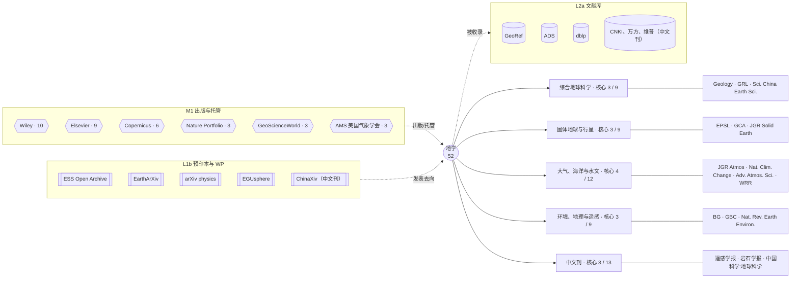

# 地学 venue 名录

> 地学共 52 个 venue（期刊 52、会议 0），归并为 4 个子领域（原 10 个），另有中文刊 13 个。其中核心 16 个优先支持，其余 36 个登记在册、暂不专门支持，规则见[支持分级](README.md#支持分级)。主要学科库：GeoRef、ADS、dblp、CNKI、万方、维普（中文刊）；主要预印本与 WP 通道：ESS Open Archive、EarthArXiv、arXiv physics、EGUsphere、ChinaXiv（中文刊）。评级标签的体系、版本与许可见[评级体系](../venue-rankings.md)，七类分层见[来源分层](../source-taxonomy.md)。

## 关联图

## 核心 venue（优先支持）

每个子领域内按评级强弱排序，评级相同按名称。`接入` 一列：`Crossref:ISSN` 指由 Crossref 委托按 ISSN 收元数据，`现有:`/`平台:` 指经名录里已有的来源行，`用户导入` 指只接受用户导出的题录。

本节只列核心 venue：逐刊核验标识与通道，进入首批验收与默认推荐池。其余 venue 见下文"登记 venue"。子领域由原来的细分方向归并而成：合并组先按原方向、再按评级排列，备注以"方向："开头标出原方向。

### 综合地球科学（核心 3 · 登记 6）

| venue | 类型 | ISSN（印/电）或 dblp | 出版托管（M1） | 评级 | 学科库（L2a） | 预印本（L1b） | 接入 | 备注 |
|---|---|---|---|---|---|---|---|---|
| Geology | J | 0091-7613 / 0091-7613 | GSA（GeoScienceWorld 托管） `geoscienceworld` | NI; T1(中国地球物理学会、中国地质学会) | GeoRef（订阅） | ESS Open Archive; EarthArXiv | Crossref:ISSN | GSW 挑战页 |
| Geophysical Research Letters（GRL） | J | 0094-8276 / 1944-8007 | AGU（Wiley 托管） `wiley` | NI; T1(中国地球物理学会、中国地质学会) | GeoRef（订阅）; ADS | ESS Open Archive; EarthArXiv | Crossref:ISSN | p/e 颠倒；落地 agupubs(Wiley) |
| Science China Earth Sciences（Sci. China Earth Sci.） | J | 1674-7313 / 1869-1897 | Springer / 中国科学杂志社 `springer_link` | T1(中国地球物理学会、中国地理学会、中国地质学会); T2(中国岩石力学与工程学会); 卓越-领军 | GeoRef（订阅）; CNKI | ESS Open Archive; EarthArXiv | Crossref:ISSN | 中国(英文)；SciEngine 同刊 |

### 固体地球与行星（核心 3 · 登记 6）

含原方向：地球化学、地球物理与地震、古生物与地层、行星科学。

| venue | 类型 | ISSN（印/电）或 dblp | 出版托管（M1） | 评级 | 学科库（L2a） | 预印本（L1b） | 接入 | 备注 |
|---|---|---|---|---|---|---|---|---|
| Earth and Planetary Science Letters（EPSL） | J | 0012-821X / 1385-013X | Elsevier `elsevier_sd` | NI; T1(中国地球物理学会、中国地理学会、中国地质学会) | GeoRef（订阅）; ADS | ESS Open Archive; EarthArXiv | Crossref:ISSN | 方向：地球化学 |
| Geochimica et Cosmochimica Acta（GCA） | J | 0016-7037 / 0016-7037 | Elsevier `elsevier_sd` | NI; T1(中国地质学会) | GeoRef（订阅）; ADS | ESS Open Archive; EarthArXiv | Crossref:ISSN | 方向：地球化学；地球化学会与陨石学会合办 |
| Journal of Geophysical Research: Solid Earth（JGR Solid Earth） | J | 2169-9313 / 2169-9356 | AGU（Wiley 托管） `wiley` | NI; T1(中国地球物理学会、中国地质学会、中国岩石力学与工程学会) | GeoRef（订阅）; ADS | ESS Open Archive; EarthArXiv; arXiv:physics.geo-ph | Crossref:ISSN | 方向：地球物理与地震 |

### 大气、海洋与水文（核心 4 · 登记 8）

含原方向：大气与气候、海洋、水文。

| venue | 类型 | ISSN（印/电）或 dblp | 出版托管（M1） | 评级 | 学科库（L2a） | 预印本（L1b） | 接入 | 备注 |
|---|---|---|---|---|---|---|---|---|
| Journal of Geophysical Research: Atmospheres（JGR Atmos） | J | 2169-897X / 2169-8996 | AGU（Wiley 托管） `wiley` | NI; T1(中国地质学会); T2(中国地理学会); T3(中国环境科学学会) | GeoRef（订阅）; ADS | ESS Open Archive; EarthArXiv; arXiv:physics.ao-ph | Crossref:ISSN | 方向：大气与气候 |
| Nature Climate Change（Nat. Clim. Change） | J | 1758-678X / 1758-6798 | Springer Nature `nature_portfolio` | NI; T1(中国地理学会、中国地质学会、中国环境科学学会) | GeoRef（订阅） | ESS Open Archive; EarthArXiv | Crossref:ISSN | 方向：大气与气候 |
| Advances in Atmospheric Sciences（Adv. Atmos. Sci.） | J | 0256-1530 / 1861-9533 | Springer / 中科院大气所 `springer_link` | T1(中国地质学会); T2(中国地球物理学会); 卓越-领军 | GeoRef（订阅）; ADS | ESS Open Archive; EarthArXiv | Crossref:ISSN | 方向：大气与气候；中国(英文) |
| Water Resources Research（WRR） | J | 0043-1397 / 1944-7973 | AGU（Wiley 托管） `wiley` | FMS-B; T1(中国岩石力学与工程学会); T2(中国地理学会、中国环境科学学会) | GeoRef（订阅） | ESS Open Archive; EarthArXiv | Crossref:ISSN | 方向：水文 |

### 环境、地理与遥感（核心 3 · 登记 6）

含原方向：环境与地球系统、遥感与地理信息。

| venue | 类型 | ISSN（印/电）或 dblp | 出版托管（M1） | 评级 | 学科库（L2a） | 预印本（L1b） | 接入 | 备注 |
|---|---|---|---|---|---|---|---|---|
| Biogeosciences（BG） | J | — / 1726-4189 | Copernicus（EGU） | T1(中国地质学会、中国生态学学会); T2(中国土壤学会、中国地理学会) | GeoRef（订阅） | EGUsphere; ESS Open Archive | Crossref:ISSN; OAI-PMH 候选 | 方向：环境与地球系统；M1 候选：copernicus |
| Global Biogeochemical Cycles（GBC） | J | 0886-6236 / 1944-9224 | AGU（Wiley 托管） `wiley` | T1(中国地质学会); T2(中国地理学会) | GeoRef（订阅） | ESS Open Archive; EarthArXiv | Crossref:ISSN | 方向：环境与地球系统 |
| Nature Reviews Earth & Environment（Nat. Rev. Earth Environ.） | J | — / 2662-138X | Springer Nature `nature_portfolio` | T1(中国地理学会、中国地质学会); T2(中国环境科学学会) | GeoRef（订阅） | — | Crossref:ISSN | 方向：环境与地球系统；综述刊 |

### 中文刊（核心 3 · 登记 10）

子领域写在备注里。知网、万方、维普只接受用户导入题录；在 Crossref 注册了 DOI 的中文刊可经 Crossref 收元数据。只接受用户导入的中文刊不列为核心。

| venue | 类型 | ISSN（印/电）或 dblp | 出版托管（M1） | 评级 | 学科库（L2a） | 预印本（L1b） | 接入 | 备注 |
|---|---|---|---|---|---|---|---|---|
| 岩石学报（Acta Petrologica Sinica） | J | 1000-0569 / — | 中国矿物岩石地球化学学会 | T1(中国地球物理学会、中国地质学会); 卓越-领军; CSCD核心; 北大核心; 科技核心 | CNKI; 万方; CSCD | ChinaXiv | Crossref:ISSN | 地质学；Crossref前缀10.18654 |
| 遥感学报（National Remote Sensing Bulletin） | J | 1007-4619 / — | 中国科学院空天信息创新研究院 | T1(中国地理学会、中国遥感应用协会); T2(中国地球物理学会); T3(中国环境科学学会); 卓越-领军; CSCD核心; 北大核心; 科技核心 | CNKI; 万方; CSCD | ChinaXiv | Crossref:ISSN | 测绘遥感；Crossref前缀10.11834 |
| 中国科学:地球科学（Scientia Sinica Terrae） | J | 1674-7240 / — | 中国科学杂志社 `sciengine` | T1(中国地球物理学会、中国地理学会、中国地质学会 等 4 家); T2(中国环境科学学会); 卓越-梯队; CSCD核心; 北大核心; 科技核心 | CNKI; 万方; CSCD | ChinaXiv | Crossref:ISSN | 综合地学；Crossref前缀10.1360 |

## 登记 venue（长尾，暂不支持）

以下 venue 登记在册，保留标识、托管与评级，但暂不逐刊核验通道、不进首批验收。用户关注其中任意一个时，照常经 Crossref 或 OpenAlex 自动建 venue（`auto`）收元数据；问卷、调研与关注数达到[升级条件](README.md#支持分级)后升为核心。

### 综合地球科学（登记 6）

| venue | 类型 | ISSN（印/电）或 dblp | 出版托管（M1） | 评级 | 学科库（L2a） | 预印本（L1b） | 接入 | 备注 |
|---|---|---|---|---|---|---|---|---|
| Nature Geoscience（Nat. Geosci.） | J | 1752-0894 / 1752-0908 | Springer Nature `nature_portfolio` | NI; T1(中国地球物理学会、中国地理学会、中国地质学会) | GeoRef（订阅）; ADS | ESS Open Archive; EarthArXiv | Crossref:ISSN |  |
| AGU Advances（AGU Adv.） | J | 2576-604X / 2576-604X | AGU（Wiley 托管） `wiley` | T1(中国地质学会) | GeoRef（订阅）; ADS | ESS Open Archive; EarthArXiv | Crossref:ISSN | 全 OA 旗舰 |
| Annual Review of Earth and Planetary Sciences（AREPS） | J | 0084-6597 / 1545-4495 | Annual Reviews `annual_reviews` | T1(中国地球物理学会、中国地质学会) | GeoRef（订阅）; ADS | — | Crossref:ISSN | 综述刊；S2O 年度不同 |
| Earth-Science Reviews（ESR） | J | 0012-8252 / — | Elsevier `elsevier_sd` | T1(中国地球物理学会、中国地质学会) | GeoRef（订阅） | — | Crossref:ISSN | 综述刊 |
| Geological Society of America Bulletin（GSA Bull.） | J | 0016-7606 / 1943-2674 | GSA（GeoScienceWorld 托管） `geoscienceworld` | T1(中国地质学会) | GeoRef（订阅） | ESS Open Archive; EarthArXiv | Crossref:ISSN |  |
| Reviews of Geophysics（Rev. Geophys.） | J | 8755-1209 / 1944-9208 | AGU（Wiley 托管） `wiley` | T1(中国地球物理学会、中国地质学会) | GeoRef（订阅）; ADS | — | Crossref:ISSN | 综述刊 |

### 固体地球与行星（登记 6）

| venue | 类型 | ISSN（印/电）或 dblp | 出版托管（M1） | 评级 | 学科库（L2a） | 预印本（L1b） | 接入 | 备注 |
|---|---|---|---|---|---|---|---|---|
| Bulletin of the Seismological Society of America（BSSA） | J | 0037-1106 / 1943-3573 | SSA（GeoScienceWorld 托管） `geoscienceworld` | T1(中国地质学会); T2(中国地球物理学会) | GeoRef（订阅）; ADS | ESS Open Archive; EarthArXiv; arXiv:physics.geo-ph | Crossref:ISSN | 方向：地球物理与地震；Crossref 落地 GSW；GSW 挑战页 |
| Geophysical Journal International（GJI） | J | 0956-540X / 1365-246X | OUP（RAS/DGG） `oup_academic` | T2(中国地球物理学会、中国地质学会、中国岩石力学与工程学会) | GeoRef（订阅）; ADS | ESS Open Archive; EarthArXiv; arXiv:physics.geo-ph | Crossref:ISSN | 方向：地球物理与地震；2024 起转 OA ⚠ 未核 |
| Journal of Geophysical Research: Planets（JGR Planets） | J | 2169-9097 / 2169-9100 | AGU（Wiley 托管） `wiley` | T1(中国地球物理学会、中国地质学会) | ADS; GeoRef（订阅） | ESS Open Archive; EarthArXiv; arXiv:astro-ph.EP | Crossref:ISSN | 方向：行星科学 |
| Icarus | J | 0019-1035 / 1090-2643 | Elsevier `elsevier_sd` | — | ADS; GeoRef（订阅） | arXiv:astro-ph.EP | Crossref:ISSN | 方向：行星科学；兼物理与天文 |
| Palaeogeography, Palaeoclimatology, Palaeoecology（Palaeo3） | J | 0031-0182 / — | Elsevier `elsevier_sd` | T1(中国地质学会); T2(中国地理学会) | GeoRef（订阅） | ESS Open Archive; EarthArXiv | Crossref:ISSN | 方向：古生物与地层 |
| Quaternary Science Reviews（QSR） | J | 0277-3791 / — | Elsevier `elsevier_sd` | T1(中国地理学会、中国地质学会) | GeoRef（订阅） | ESS Open Archive; EarthArXiv | Crossref:ISSN | 方向：古生物与地层；第四纪 |

### 大气、海洋与水文（登记 8）

| venue | 类型 | ISSN（印/电）或 dblp | 出版托管（M1） | 评级 | 学科库（L2a） | 预印本（L1b） | 接入 | 备注 |
|---|---|---|---|---|---|---|---|---|
| Atmospheric Chemistry and Physics（ACP） | J | — / 1680-7324 | Copernicus（EGU） | T1(中国地质学会); T2(中国地理学会); T3(中国环境科学学会) | GeoRef（订阅）; ADS | EGUsphere; ESS Open Archive | Crossref:ISSN; OAI-PMH 候选 | 方向：大气与气候；M1 候选：copernicus |
| Bulletin of the American Meteorological Society（BAMS） | J | 0003-0007 / 1520-0477 | AMS 美国气象学会 | T1(中国地质学会) | GeoRef（订阅） | ESS Open Archive; EarthArXiv | Crossref:ISSN | 方向：大气与气候；M1 候选：ametsoc |
| Journal of Climate（J. Climate） | J | 0894-8755 / 1520-0442 | AMS 美国气象学会 | T1(中国地理学会、中国地质学会) | GeoRef（订阅）; ADS | ESS Open Archive; EarthArXiv; arXiv:physics.ao-ph | Crossref:ISSN | 方向：大气与气候；落地 journals.ametsoc.org；M1 候选 |
| Journal of Geophysical Research: Oceans（JGR Oceans） | J | 2169-9275 / 2169-9291 | AGU（Wiley 托管） `wiley` | T1(中国地质学会) | GeoRef（订阅）; ADS | ESS Open Archive; EarthArXiv; arXiv:physics.ao-ph | Crossref:ISSN | 方向：海洋 |
| Journal of Physical Oceanography（JPO） | J | 0022-3670 / 1520-0485 | AMS 美国气象学会 | T1(中国地质学会) | GeoRef（订阅）; ADS | ESS Open Archive; EarthArXiv; arXiv:physics.ao-ph | Crossref:ISSN | 方向：海洋；M1 候选：ametsoc |
| Hydrology and Earth System Sciences（HESS） | J | — / 1607-7938 | Copernicus（EGU） | T1(中国土壤学会、中国地球物理学会、中国地理学会 等 4 家) | GeoRef（订阅） | EGUsphere; ESS Open Archive | Crossref:ISSN; OAI-PMH 候选 | 方向：水文；M1 候选：copernicus |
| Journal of Hydrology（J. Hydrol.） | J | 0022-1694 / — | Elsevier `elsevier_sd` | T1(中国土壤学会、中国地理学会、中国地质学会 等 4 家); T2(中国环境科学学会) | GeoRef（订阅） | ESS Open Archive; EarthArXiv | Crossref:ISSN | 方向：水文 |
| The Cryosphere（TC） | J | — / 1994-0424 | Copernicus（EGU） | T1(中国地理学会、中国地质学会) | GeoRef（订阅） | EGUsphere; ESS Open Archive | Crossref:ISSN; OAI-PMH 候选 | 方向：水文；冰冻圈；M1 候选 |

### 环境、地理与遥感（登记 6）

| venue | 类型 | ISSN（印/电）或 dblp | 出版托管（M1） | 评级 | 学科库（L2a） | 预印本（L1b） | 接入 | 备注 |
|---|---|---|---|---|---|---|---|---|
| Earth System Science Data（ESSD） | J | — / 1866-3516 | Copernicus（EGU） | T1(中国地理学会、中国地质学会) | GeoRef（订阅） | EGUsphere; ESS Open Archive | Crossref:ISSN; OAI-PMH 候选 | 方向：环境与地球系统；数据论文；M1 候选 |
| Earth's Future（Earths Future） | J | 2328-4277 / 2328-4277 | AGU（Wiley 托管） `wiley` | T1(中国地理学会、中国地质学会); T3(中国环境科学学会) | GeoRef（订阅） | ESS Open Archive; EarthArXiv | Crossref:ISSN | 方向：环境与地球系统；全 OA |
| Geoscientific Model Development（GMD） | J | — / 1991-9603 | Copernicus（EGU） | T1(中国地质学会) | GeoRef（订阅） | EGUsphere; ESS Open Archive | Crossref:ISSN; OAI-PMH 候选 | 方向：环境与地球系统；模式开发；M1 候选 |
| IEEE Transactions on Geoscience and Remote Sensing（TGRS） | J | 0196-2892 / 1558-0644；dblp `journals/tgrs` | IEEE `ieee_xplore` | T1(中国地理学会、中国地质学会、中国遥感应用协会) | GeoRef（订阅）; dblp | arXiv:eess.IV; arXiv:cs.CV | Crossref:ISSN | 方向：遥感与地理信息；dblp 收录 |
| ISPRS Journal of Photogrammetry and Remote Sensing（ISPRS J.） | J | 0924-2716 / — | Elsevier（ISPRS） `elsevier_sd` | T1(中国地球物理学会、中国地理学会、中国地质学会 等 4 家) | GeoRef（订阅） | arXiv:cs.CV; ESS Open Archive; EarthArXiv | Crossref:ISSN | 方向：遥感与地理信息 |
| Remote Sensing of Environment（RSE） | J | 0034-4257 / 1879-0704 | Elsevier `elsevier_sd` | T1(中国地理学会、中国遥感应用协会); T2(中国环境科学学会) | GeoRef（订阅） | ESS Open Archive; EarthArXiv | Crossref:ISSN | 方向：遥感与地理信息 |

### 中文刊（登记 10）

| venue | 类型 | ISSN（印/电）或 dblp | 出版托管（M1） | 评级 | 学科库（L2a） | 预印本（L1b） | 接入 | 备注 |
|---|---|---|---|---|---|---|---|---|
| 地理学报（Acta Geogr. Sin.） | J | 0375-5444 / — | 中国地理学会 / 中科院地理所 | T1(中国地理学会、中国遥感应用协会); 卓越-领军; CSCD核心; 北大核心; 科技核心; AMI-顶级 | CNKI | ChinaXiv | 待勘察 | 遥感与地理信息；Crossref 404；Crossref 无记录 |
| 地质学报（Acta Geologica Sinica） | J | 0001-5717 / — | 中国地质学会 | T1(中国地质学会); 卓越-领军; CSCD核心; 北大核心; 科技核心 | CNKI; 万方; CSCD | ChinaXiv | 用户导入 | 地质学；Crossref该ISSN仅英文版旧记录；一期梯队 |
| 测绘学报（Acta Geodaetica et Cartographica Sinica） | J | 1001-1595 / — | 中国测绘学会 | T1(中国地理学会、中国遥感应用协会); T2(中国地球物理学会); 卓越-领军; CSCD核心; 北大核心; 科技核心 | CNKI; 万方; CSCD | ChinaXiv | 用户导入 | 测绘遥感；Crossref无该ISSN记录；一期梯队 |
| 地理研究（Geographical Research） | J | 1000-0585 / — | 中国地理学会 | T1(中国地理学会、中国遥感应用协会); T2(中国地理学会); CSSCI; CSCD核心; 北大核心; 科技核心; AMI-核心 | CNKI; 万方; CSCD | ChinaXiv | 用户导入 | 地理学；Crossref无该ISSN记录 |
| 地理科学（Scientia Geographica Sinica） | J | 1000-0690 / — | 中国科学院东北地理与农业生态研究所 | T1(中国地理学会、中国遥感应用协会); T2(中国地理学会); CSSCI; CSCD核心; 北大核心; 科技核心; AMI-核心 | CNKI; 万方; CSCD | ChinaXiv | 用户导入 | 地理学；Crossref无该ISSN记录 |
| 地球化学（Geochimica） | J | 0379-1726 / — | 中国科学院广州地球化学研究所 | T1(中国地质学会); CSCD核心; 北大核心; 科技核心 | CNKI; 万方; CSCD | ChinaXiv | 用户导入 | 地球化学；Crossref无该ISSN记录 |
| 地球物理学报（Chin. J. Geophys.） | J | 0001-5733 / — | 中国科学出版传媒（中国地球物理学会） `sciengine` | T1(中国地球物理学会、中国地质学会、中国岩石力学与工程学会); 卓越-梯队; CSCD核心; 北大核心; 科技核心 | GeoRef（订阅）; CNKI | ChinaXiv | Crossref:ISSN | 地球物理与地震；落地 SciEngine；robots 禁 AI UA |
| 地质论评（Geological Review） | J | 0371-5736 / — | 中国地质学会 | T1(中国地质学会); T2(中国地球物理学会); CSCD核心; 北大核心; 科技核心 | CNKI; 万方; CSCD | ChinaXiv | 用户导入 | 地质学；Crossref无该ISSN记录 |
| 大气科学（Chinese Journal of Atmospheric Sciences） | J | 1006-9895 / — | 中国科学院大气物理研究所 | T1(中国地球物理学会、中国地质学会); T3(中国环境科学学会); CSCD核心; 北大核心; 科技核心 | CNKI; 万方; CSCD | ChinaXiv | 用户导入 | 大气科学；Crossref无该ISSN记录 |
| 海洋学报（Acta Oceanologica Sinica (Chinese)） | J | 0253-4193 / — | 中国海洋学会 | T1(中国地质学会、中国遥感应用协会); T2(中国地球物理学会); 卓越-梯队; CSCD核心; 北大核心; 科技核心 | CNKI; 万方; CSCD | ChinaXiv | 用户导入 | 海洋科学；Crossref无该ISSN记录；一期梯队 |

## 出处与说明

- **T 级**：取自科协总汇第五版的地球科学（中国地质学会，2023 修订）、地理资源（中国地理学会，2025）、地球物理（2025）、遥感（2024）、岩土（2022，原 CT/ET 分级折算为 T1–T3）、土壤（2024）、环境（2025）等目录。PDF 为中国地质大学（北京）的转载件，未与科协官方附件比对。
- **平台**：AGU 刊由 Wiley 托管，GSA 与 SSA 刊由 GeoScienceWorld 托管，都经 Crossref 落地 URL 核实。agupubs 与 GeoScienceWorld 站点有 Cloudflare 挑战，journals.ametsoc.org 返回 403，这三站只走 Crossref。Copernicus（EGU 全部 OA 刊）的 OAI-PMH 已证实可用（`egu` set，记录带 eISSN），列为 M1 候选，见[候选来源](../source-candidates.md)。
- **缺口**：GeoRef 是订阅库；GSL Lyell Collection、SEG、MSA、PANGAEA 等未调研。《地理学报》在 Crossref 返回 404，通道待勘察，按中文刊规则暂列登记，核实自动通道后再升核心；中文刊核心由评级分次高且有 Crossref 通道的《中国科学:地球科学》补入。
- **支持分级**：核心按[支持分级](README.md#支持分级)的规则初选，2026-09-29 定稿。本学科没有人工补选。
