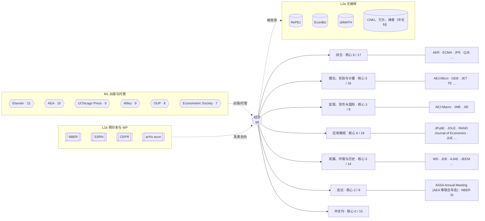

# 经济 venue 名录

> 经济共 98 个 venue（期刊 89、会议 9），归并为 6 个子领域（原 16 个），另有中文刊 15 个。其中核心 27 个优先支持，其余 71 个登记在册、暂不专门支持，规则见[支持分级](README.md#支持分级)。主要学科库：RePEc、EconBiz、zbMATH、CNKI、万方、维普（中文刊）；主要预印本与 WP 通道：NBER、SSRN、CEPR、arXiv econ。评级标签的体系、版本与许可见[评级体系](../venue-rankings.md)，七类分层见[来源分层](../source-taxonomy.md)。

## 关联图

## 核心 venue（优先支持）

每个子领域内按评级强弱排序，评级相同按名称。`接入` 一列：`Crossref:ISSN` 指由 Crossref 委托按 ISSN 收元数据，`现有:`/`平台:` 指经名录里已有的来源行，`用户导入` 指只接受用户导出的题录。

本节只列核心 venue：逐刊核验标识与通道，进入首批验收与默认推荐池。其余 venue 见下文"登记 venue"。子领域由原来的细分方向归并而成：合并组先按原方向、再按评级排列，备注以"方向："开头标出原方向。

### 综合（核心 6 · 登记 11）

| venue | 类型 | ISSN（印/电）或 dblp | 出版托管（M1） | 评级 | 学科库（L2a） | 预印本（L1b） | 接入 | 备注 |
|---|---|---|---|---|---|---|---|---|
| American Economic Review（AER） | J | 0002-8282 / 1944-7981 | AEA（Atypon） `aea_journals` | Top5; FT50; NI; ABDC-A*; VHB-A+; FMS-A | RePEc; EconBiz | NBER; CEPR; SSRN | Crossref:ISSN |  |
| Econometrica（ECMA） | J | 0012-9682 / 1468-0262 | Econometric Society（自营） `econsoc_journals` | Top5; FT50; NI; ABDC-A*; VHB-A+; FMS-A | RePEc; EconBiz | NBER; CEPR; SSRN | Crossref:ISSN |  |
| Journal of Political Economy（JPE） | J | 0022-3808 / 1537-534X | UChicago Press（Atypon） `uchicago_journals` | Top5; FT50; NI; ABDC-A*; VHB-A+; FMS-A | RePEc; EconBiz | NBER; CEPR; SSRN | Crossref:ISSN |  |
| Quarterly Journal of Economics（QJE） | J | 0033-5533 / 1531-4650 | Oxford Academic `oup_academic` | Top5; FT50; NI; ABDC-A*; FMS-A | RePEc; EconBiz | NBER; CEPR; SSRN | Crossref:ISSN |  |
| Review of Economic Studies（REStud） | J | 0034-6527 / 1467-937X | Oxford Academic `oup_academic` | Top5; FT50; NI; ABDC-A*; FMS-A | RePEc; EconBiz | NBER; CEPR; SSRN | Crossref:ISSN |  |
| American Economic Journal: Applied Economics（AEJ:Applied） | J | 1945-7782 / 1945-7790 | AEA `aea_journals` | ABDC-A*; FMS-A | RePEc; EconBiz | NBER; CEPR; SSRN | Crossref:ISSN |  |

### 理论、实验与计量（核心 5 · 登记 11）

含原方向：理论与博弈、实验与行为、计量。

| venue | 类型 | ISSN（印/电）或 dblp | 出版托管（M1） | 评级 | 学科库（L2a） | 预印本（L1b） | 接入 | 备注 |
|---|---|---|---|---|---|---|---|---|
| American Economic Journal: Microeconomics（AEJ:Micro） | J | 1945-7669 / 1945-7685 | American Economic Association `aea_journals` | ABDC-A*; FMS-A | RePEc; EconBiz | SSRN; arXiv:econ.TH | Crossref:ISSN | 方向：理论与博弈 |
| Games and Economic Behavior（GEB） | J | 0899-8256 / 1090-2473 | Elsevier `elsevier_sd` | ABDC-A*; FMS-A | RePEc; EconBiz; zbMATH | SSRN; arXiv:econ.TH | Crossref:ISSN | 方向：理论与博弈 |
| Journal of Economic Theory（JET） | J | 0022-0531 / 1095-7235 | ScienceDirect `elsevier_sd` | ABDC-A*; FMS-A | RePEc; EconBiz; zbMATH | SSRN; arXiv:econ.TH | Crossref:ISSN | 方向：理论与博弈 |
| Theoretical Economics（TE） | J | 1933-6837 / 1555-7561 | Econometric Society（OJS） `econsoc_journals` | ABDC-A*; FMS-A | RePEc; EconBiz; zbMATH | SSRN; arXiv:econ.TH | Crossref:ISSN | 方向：理论与博弈 |
| Econometric Theory（ETheory） | J | 0266-4666 / 1469-4360 | Cambridge University Press `cambridge_core` | ABDC-A*; FMS-A | RePEc; EconBiz | arXiv:econ.EM; SSRN | Crossref:ISSN | 方向：计量 |

### 宏观、货币与国际（核心 3 · 登记 6）

含原方向：宏观与货币、国际。

| venue | 类型 | ISSN（印/电）或 dblp | 出版托管（M1） | 评级 | 学科库（L2a） | 预印本（L1b） | 接入 | 备注 |
|---|---|---|---|---|---|---|---|---|
| American Economic Journal: Macroeconomics（AEJ:Macro） | J | 1945-7707 / 1945-7715 | AEA `aea_journals` | ABDC-A*; FMS-A | RePEc; EconBiz | NBER; CEPR; 央行WP | Crossref:ISSN | 方向：宏观与货币 |
| Journal of Monetary Economics（JME） | J | 0304-3932 / — | ScienceDirect `elsevier_sd` | ABDC-A*; FMS-A | RePEc; EconBiz | NBER; CEPR; 央行WP | Crossref:ISSN | 方向：宏观与货币 |
| Journal of International Economics（JIE） | J | 0022-1996 / — | Elsevier `elsevier_sd` | ABDC-A*; FMS-A | RePEc; EconBiz | NBER; CEPR; IMF WP | Crossref:ISSN | 方向：国际 |

### 应用微观（核心 6 · 登记 12）

含原方向：公共、劳动、健康、产业组织、城市与区域。

| venue | 类型 | ISSN（印/电）或 dblp | 出版托管（M1） | 评级 | 学科库（L2a） | 预印本（L1b） | 接入 | 备注 |
|---|---|---|---|---|---|---|---|---|
| Journal of Public Economics（JPubE） | J | 0047-2727 / — | Elsevier `elsevier_sd` | ABDC-A*; FMS-A | RePEc; EconBiz | NBER; CEPR | Crossref:ISSN | 方向：公共 |
| Journal of Labor Economics（JOLE） | J | 0734-306X / 1537-5307 | The University of Chicago Press `uchicago_journals` | ABDC-A*; FMS-A | RePEc; EconBiz | NBER; IZA DP | Crossref:ISSN | 方向：劳动 |
| RAND Journal of Economics | J | 0741-6261 / 1756-2171 | Wiley `wiley` | ABDC-A*; FMS-A | RePEc; EconBiz | NBER; CEPR; SSRN | Crossref:ISSN | 方向：产业组织 |
| Journal of Urban Economics（JUE） | J | 0094-1190 / 1095-9068 | Elsevier `elsevier_sd` | ABDC-A*; FMS-A; T1(中国地理学会) | RePEc; EconBiz | NBER; CEPR; SSRN | Crossref:ISSN | 方向：城市与区域 |
| Journal of Economic Geography（JEcGeo） | J | 1468-2702 / 1468-2710 | Oxford University Press `oup_academic` | ABDC-A; FMS-B; T1(中国地理学会) | RePEc; EconBiz | NBER; CEPR; SSRN | Crossref:ISSN | 方向：城市与区域 |
| Health Economics（HEcon） | J | 1057-9230 / 1099-1050 | Wiley (John Wiley & Sons) `wiley` | ABDC-A*; FMS-A | RePEc; EconBiz | NBER; CEPR; SSRN | Crossref:ISSN | 方向：健康 |

### 发展、环境与历史（核心 5 · 登记 9）

含原方向：发展、环境与资源、经济史、政治经济与法经济。

| venue | 类型 | ISSN（印/电）或 dblp | 出版托管（M1） | 评级 | 学科库（L2a） | 预印本（L1b） | 接入 | 备注 |
|---|---|---|---|---|---|---|---|---|
| World Development（WD） | J | 0305-750X / — | Elsevier `elsevier_sd` | ABDC-A*; FMS-B; T1(中国地理学会) | RePEc; EconBiz | NBER; World Bank PRWP | Crossref:ISSN | 方向：发展 |
| Journal of Development Economics（JDE） | J | 0304-3878 / — | Elsevier `elsevier_sd` | ABDC-A*; FMS-A | RePEc; EconBiz | NBER; World Bank PRWP | Crossref:ISSN | 方向：发展 |
| American Journal of Agricultural Economics（AJAE） | J | 0002-9092 / 1467-8276 | Wiley (Blackwell Publishing) `wiley` | ABDC-A*; FMS-A | RePEc; EconBiz | NBER; CEPR; SSRN | Crossref:ISSN | 方向：环境与资源 |
| Journal of Environmental Economics and Management（JEEM） | J | 0095-0696 / 1096-0449 | Elsevier `elsevier_sd` | ABDC-A*; FMS-A; T3(中国环境科学学会) | RePEc; EconBiz | NBER; CEPR; SSRN | Crossref:ISSN | 方向：环境与资源 |
| Journal of Economic History（JEH） | J | 0022-0507 / 1471-6372 | Cambridge University Press `cambridge_core` | ABDC-A*; FMS-A | RePEc; EconBiz | NBER; CEPR; SSRN | Crossref:ISSN | 方向：经济史 |

### 会议（核心 2 · 登记 7）

| venue | 类型 | ISSN（印/电）或 dblp | 出版托管（M1） | 评级 | 学科库（L2a） | 预印本（L1b） | 接入 | 备注 |
|---|---|---|---|---|---|---|---|---|
| ASSA Annual Meeting (AEA 等联合年会) | C | — | AEA/ASSA `assa_meetings` | — | RePEc | NBER; CEPR; SSRN | 现有:assa_meetings | 程序含JEL与摘要，部分PDF |
| NBER Summer Institute（NBER SI） | C | — | NBER `nber_conferences` | — | RePEc | NBER; CEPR; SSRN | 现有:nber_conferences | 论文多链NBER WP |

### 中文刊（核心 0 · 登记 15）

子领域写在备注里。知网、万方、维普只接受用户导入题录；在 Crossref 注册了 DOI 的中文刊可经 Crossref 收元数据。只接受用户导入的中文刊不列为核心。

本组暂无核心 venue，全部登记。

## 登记 venue（长尾，暂不支持）

以下 venue 登记在册，保留标识、托管与评级，但暂不逐刊核验通道、不进首批验收。用户关注其中任意一个时，照常经 Crossref 或 OpenAlex 自动建 venue（`auto`）收元数据；问卷、调研与关注数达到[升级条件](README.md#支持分级)后升为核心。

### 综合（登记 11）

| venue | 类型 | ISSN（印/电）或 dblp | 出版托管（M1） | 评级 | 学科库（L2a） | 预印本（L1b） | 接入 | 备注 |
|---|---|---|---|---|---|---|---|---|
| International Economic Review（IER） | J | 0020-6598 / 1468-2354 | Wiley `wiley` | ABDC-A*; FMS-A | RePEc; EconBiz | NBER; CEPR; SSRN | Crossref:ISSN |  |
| Journal of Economic Literature（JEL） | J | 0022-0515 / 2328-8175 | AEA `aea_journals` | ABDC-A*; FMS-A | RePEc; EconBiz | NBER; CEPR; SSRN | Crossref:ISSN |  |
| Journal of Economic Perspectives（JEP） | J | 0895-3309 / — | AEA `aea_journals` | ABDC-A*; FMS-A | RePEc; EconBiz | NBER; CEPR; SSRN | Crossref:ISSN |  |
| Journal of the European Economic Association（JEEA） | J | 1542-4766 / 1542-4774 | Oxford Academic `oup_academic` | ABDC-A*; FMS-A | RePEc; EconBiz | NBER; CEPR; SSRN | Crossref:ISSN |  |
| Review of Economics and Statistics（REStat） | J | 0034-6535 / 1530-9142 | MIT Press Direct `mit_press_direct` | ABDC-A*; FMS-A | RePEc; EconBiz | NBER; CEPR; SSRN | Crossref:ISSN |  |
| The Economic Journal（EJ） | J | 0013-0133 / 1468-0297 | Oxford Academic `oup_academic` | ABDC-A*; FMS-A | RePEc; EconBiz | NBER; CEPR; SSRN | Crossref:ISSN |  |
| American Economic Review: Insights（AERI） | J | 2640-205X / — | AEA `aea_journals` | ABDC-A*; FMS-B | RePEc; EconBiz | NBER; CEPR; SSRN | Crossref:ISSN |  |
| European Economic Review（EER） | J | 0014-2921 / — | Elsevier `elsevier_sd` | ABDC-A*; FMS-B | RePEc; EconBiz | NBER; CEPR; SSRN | Crossref:ISSN |  |
| AEA Papers and Proceedings（AEA P&P） | J | 2574-0768 / 2574-0776 | American Economic Association `aea_journals` | — | RePEc; EconBiz | NBER; CEPR; SSRN | Crossref:ISSN | 会议论文集性质(ASSA 选文) |
| Journal of Political Economy Macroeconomics（JPE Macro） | J | 2832-9341 / 2832-935X | The University of Chicago Press `uchicago_journals` | ABDC-A | RePEc; EconBiz | NBER; CEPR; SSRN | Crossref:ISSN |  |
| Journal of Political Economy Microeconomics（JPE Micro） | J | 2832-9368 / 2832-9376 | The University of Chicago Press `uchicago_journals` | ABDC-A | RePEc; EconBiz | NBER; CEPR; SSRN | Crossref:ISSN |  |

### 理论、实验与计量（登记 11）

| venue | 类型 | ISSN（印/电）或 dblp | 出版托管（M1） | 评级 | 学科库（L2a） | 预印本（L1b） | 接入 | 备注 |
|---|---|---|---|---|---|---|---|---|
| Economic Theory（ET） | J | 0938-2259 / 1432-0479 | Springer-Verlag `springer_link` | ABDC-A*; FMS-B | RePEc; EconBiz; zbMATH | SSRN; arXiv:econ.TH | Crossref:ISSN | 方向：理论与博弈 |
| International Journal of Game Theory（IJGT） | J | 0020-7276 / 1432-1270 | Springer-Verlag `springer_link` | ABDC-A | RePEc; EconBiz; zbMATH | SSRN; arXiv:econ.TH | Crossref:ISSN | 方向：理论与博弈 |
| Journal of Mathematical Economics（JMathE） | J | 0304-4068 / — | Elsevier `elsevier_sd` | ABDC-A; FMS-B; T3(中国数学会) | RePEc; EconBiz; zbMATH | SSRN; arXiv:econ.TH | Crossref:ISSN | 方向：理论与博弈 |
| Journal of Business & Economic Statistics（JBES） | J | 0735-0015 / 1537-2707 | Informa UK (American Statistical Association) `tandf_online` | ABDC-A*; FMS-A | RePEc; EconBiz | arXiv:econ.EM; SSRN | Crossref:ISSN | 方向：计量 |
| Journal of Econometrics（JoE） | J | 0304-4076 / 1872-6895 | ScienceDirect `elsevier_sd` | ABDC-A*; FMS-A | RePEc; EconBiz | arXiv:econ.EM; SSRN | Crossref:ISSN | 方向：计量 |
| Journal of Applied Econometrics（JAE） | J | 0883-7252 / 1099-1255 | Wiley (John Wiley & Sons) `wiley` | ABDC-A*; FMS-B | RePEc; EconBiz | arXiv:econ.EM; SSRN | Crossref:ISSN | 方向：计量 |
| Quantitative Economics（QE） | J | 1759-7323 / 1759-7331 | Econometric Society（OJS） `econsoc_journals` | ABDC-A*; FMS-B | RePEc; EconBiz | arXiv:econ.EM; SSRN | Crossref:ISSN | 方向：计量 |
| The Econometrics Journal（EctJ） | J | 1368-4221 / 1368-423X | Oxford University Press `oup_academic` | ABDC-A*; FMS-B | RePEc; EconBiz | arXiv:econ.EM; SSRN | Crossref:ISSN | 方向：计量 |
| Experimental Economics（ExpEc） | J | 1386-4157 / 1573-6938 | Cambridge University Press `cambridge_core` | ABDC-A*; FMS-B | RePEc; EconBiz | SSRN; OSF Preprints | Crossref:ISSN | 方向：实验与行为；2024年起迁 CUP |
| Journal of Economic Behavior & Organization（JEBO） | J | 0167-2681 / — | Elsevier `elsevier_sd` | ABDC-A*; FMS-B | RePEc; EconBiz | SSRN; OSF Preprints | Crossref:ISSN | 方向：实验与行为 |
| Journal of Risk and Uncertainty（JRU） | J | 0895-5646 / 1573-0476 | Springer-Verlag `springer_link` | ABDC-A*; FMS-B | RePEc; EconBiz | SSRN; OSF Preprints | Crossref:ISSN | 方向：实验与行为 |

### 宏观、货币与国际（登记 6）

| venue | 类型 | ISSN（印/电）或 dblp | 出版托管（M1） | 评级 | 学科库（L2a） | 预印本（L1b） | 接入 | 备注 |
|---|---|---|---|---|---|---|---|---|
| Journal of Economic Dynamics and Control（JEDC） | J | 0165-1889 / — | Elsevier `elsevier_sd` | ABDC-A*; FMS-B | RePEc; EconBiz | NBER; CEPR; 央行WP | Crossref:ISSN | 方向：宏观与货币 |
| Journal of Economic Growth（JEG） | J | 1381-4338 / 1573-7020 | Springer-Verlag `springer_link` | ABDC-A*; FMS-B | RePEc; EconBiz | NBER; CEPR; 央行WP | Crossref:ISSN | 方向：宏观与货币 |
| Journal of Money, Credit and Banking（JMCB） | J | 0022-2879 / 1538-4616 | Wiley (Blackwell Publishing) `wiley` | ABDC-A*; FMS-B | RePEc; EconBiz | NBER; CEPR; 央行WP | Crossref:ISSN | 方向：宏观与货币 |
| Review of Economic Dynamics（RED） | J | 1094-2025 / — | Elsevier `elsevier_sd` | ABDC-A*; FMS-B | RePEc; EconBiz | NBER; CEPR; 央行WP | Crossref:ISSN | 方向：宏观与货币 |
| Brookings Papers on Economic Activity（BPEA） | J | 0007-2303 / 1533-4465 | Brookings Institution（Crossref 登记为 Project MUSE） | ABDC-A; FMS-B | RePEc; EconBiz | NBER; CEPR; 央行WP | Crossref:ISSN | 方向：宏观与货币；Crossref 仅至1999，新刊待勘察 |
| IMF Economic Review（IMFER） | J | 2041-4161 / 2041-417X | Springer Science and Business Media LLC `springer_link` | ABDC-A; FMS-B | RePEc; EconBiz | NBER; CEPR; IMF WP | Crossref:ISSN | 方向：国际 |

### 应用微观（登记 12）

| venue | 类型 | ISSN（印/电）或 dblp | 出版托管（M1） | 评级 | 学科库（L2a） | 预印本（L1b） | 接入 | 备注 |
|---|---|---|---|---|---|---|---|---|
| American Economic Journal: Economic Policy（AEJ:Policy） | J | 1945-774X / 1945-7731 | American Economic Association `aea_journals` | ABDC-A*; FMS-B | RePEc; EconBiz | NBER; CEPR | Crossref:ISSN | 方向：公共；种子外；Crossref 印刷/电子 ISSN 与常用号互换 |
| International Tax and Public Finance（ITAX） | J | 0927-5940 / 1573-6970 | Springer-Verlag `springer_link` | ABDC-A | RePEc; EconBiz | NBER; CEPR | Crossref:ISSN | 方向：公共 |
| National Tax Journal（NTJ） | J | 0028-0283 / 1944-7477 | The University of Chicago Press `uchicago_journals` | ABDC-A | RePEc; EconBiz | NBER; CEPR | Crossref:ISSN | 方向：公共 |
| ILR Review（ILRR） | J | 0019-7939 / 2162-271X | SAGE Publications `sage_journals` | ABDC-A*; FMS-B | RePEc; EconBiz | NBER; IZA DP | Crossref:ISSN | 方向：劳动 |
| Journal of Human Resources（JHR） | J | 0022-166X / 1548-8004 | University of Wisconsin Press | ABDC-A*; FMS-B | RePEc; EconBiz | NBER; IZA DP | Crossref:ISSN | 方向：劳动；UW Press 自营，无 source_id |
| Labour Economics（LabEc） | J | 0927-5371 / — | Elsevier `elsevier_sd` | ABDC-A*; FMS-B | RePEc; EconBiz | NBER; IZA DP | Crossref:ISSN | 方向：劳动 |
| International Journal of Industrial Organization（IJIO） | J | 0167-7187 / — | Elsevier `elsevier_sd` | ABDC-A*; FMS-B | RePEc; EconBiz | NBER; CEPR; SSRN | Crossref:ISSN | 方向：产业组织 |
| Journal of Industrial Economics（JIndE） | J | 0022-1821 / 1467-6451 | Wiley (Blackwell Publishing) `wiley` | ABDC-A*; FMS-B | RePEc; EconBiz | NBER; CEPR; SSRN | Crossref:ISSN | 方向：产业组织 |
| Journal of Economics & Management Strategy（JEMS） | J | 1058-6407 / 1530-9134 | Wiley (Blackwell Publishing) `wiley` | ABDC-A; FMS-B | RePEc; EconBiz | NBER; CEPR; SSRN | Crossref:ISSN | 方向：产业组织 |
| Regional Science and Urban Economics（RSUE） | J | 0166-0462 / — | Elsevier `elsevier_sd` | ABDC-A; FMS-B | RePEc; EconBiz | NBER; CEPR; SSRN | Crossref:ISSN | 方向：城市与区域 |
| Journal of Health Economics（JHE） | J | 0167-6296 / — | Elsevier `elsevier_sd` | ABDC-A*; FMS-A | RePEc; EconBiz | NBER; CEPR; SSRN | Crossref:ISSN | 方向：健康 |
| American Journal of Health Economics（AJHE） | J | 2332-3493 / 2332-3507 | The University of Chicago Press `uchicago_journals` | ABDC-A*; FMS-B | RePEc; EconBiz | NBER; CEPR; SSRN | Crossref:ISSN | 方向：健康 |

### 发展、环境与历史（登记 9）

| venue | 类型 | ISSN（印/电）或 dblp | 出版托管（M1） | 评级 | 学科库（L2a） | 预印本（L1b） | 接入 | 备注 |
|---|---|---|---|---|---|---|---|---|
| Economic Development and Cultural Change（EDCC） | J | 0013-0079 / 1539-2988 | The University of Chicago Press `uchicago_journals` | ABDC-A; FMS-B | RePEc; EconBiz | NBER; World Bank PRWP | Crossref:ISSN | 方向：发展 |
| World Bank Economic Review（WBER） | J | 0258-6770 / 1564-698X | Oxford University Press `oup_academic` | ABDC-A; FMS-B | RePEc; EconBiz | NBER; World Bank PRWP | Crossref:ISSN | 方向：发展 |
| Energy Economics（EnEco） | J | 0140-9883 / — | Elsevier `elsevier_sd` | ABDC-A*; FMS-B | RePEc; EconBiz | NBER; CEPR; SSRN | Crossref:ISSN | 方向：环境与资源 |
| Journal of the Association of Environmental and Resource Economists（JAERE） | J | 2333-5955 / 2333-5963 | The University of Chicago Press `uchicago_journals` | ABDC-A*; FMS-B | RePEc; EconBiz | NBER; CEPR; SSRN | Crossref:ISSN | 方向：环境与资源 |
| Economic History Review（EHR） | J | 0013-0117 / 1468-0289 | Wiley (Blackwell Publishing) `wiley` | ABDC-A*; FMS-B | RePEc; EconBiz | NBER; CEPR; SSRN | Crossref:ISSN | 方向：经济史 |
| Explorations in Economic History（EEH） | J | 0014-4983 / 1090-2457 | Elsevier `elsevier_sd` | ABDC-A; FMS-B | RePEc; EconBiz | NBER; CEPR; SSRN | Crossref:ISSN | 方向：经济史 |
| Journal of Law and Economics（JLE） | J | 0022-2186 / 1537-5285 | The University of Chicago Press `uchicago_journals` | ABDC-A*; FMS-B | RePEc; EconBiz | SSRN; NBER | Crossref:ISSN | 方向：政治经济与法经济 |
| Journal of Law, Economics, and Organization（JLEO） | J | 8756-6222 / 1465-7341 | Oxford University Press `oup_academic` | ABDC-A; FMS-B | RePEc; EconBiz | SSRN; NBER | Crossref:ISSN | 方向：政治经济与法经济 |
| Public Choice（PubCh） | J | 0048-5829 / 1573-7101 | Springer-Verlag `springer_link` | ABDC-A | RePEc; EconBiz | SSRN; NBER | Crossref:ISSN | 方向：政治经济与法经济 |

### 会议（登记 7）

| venue | 类型 | ISSN（印/电）或 dblp | 出版托管（M1） | 评级 | 学科库（L2a） | 预印本（L1b） | 接入 | 备注 |
|---|---|---|---|---|---|---|---|---|
| Asian Meetings of the Econometric Society（AMES） | C | — | Econometric Society | — | RePEc | NBER; CEPR; SSRN | 待勘察 | 东亚/南亚/中国等分会 |
| EEA Annual Congress | C | — | European Economic Association | — | RePEc | NBER; CEPR; SSRN | 待勘察 | 与ESEM联合举办 |
| Econometric Society World Congress（ESWC） | C | — | Econometric Society | — | RePEc | NBER; CEPR; SSRN | 待勘察 | 每5年一届 |
| European Meeting of the Econometric Society（ESEM） | C | — | Econometric Society | — | RePEc | NBER; CEPR; SSRN | 待勘察 | 与EEA年会联合举办 |
| North American Summer Meeting of the Econometric Society（NASM） | C | — | Econometric Society | — | RePEc | NBER; CEPR; SSRN | 待勘察 |  |
| Royal Economic Society Annual Conference（RES） | C | — | Royal Economic Society | — | RePEc | NBER; CEPR; SSRN | 待勘察 |  |
| SED Annual Meeting | C | — | Society for Economic Dynamics `sed_meetings` | — | RePEc | NBER; CEPR; SSRN | 现有:sed_meetings | 论文在RePEc sed系列(待核) |

### 中文刊（登记 15）

| venue | 类型 | ISSN（印/电）或 dblp | 出版托管（M1） | 评级 | 学科库（L2a） | 预印本（L1b） | 接入 | 备注 |
|---|---|---|---|---|---|---|---|---|
| 中国人口·资源与环境（China Population, Resources and Environment） | J | 1002-2104 / — | 中国可持续发展研究会 | T1(中国地理学会); T2(中国环境科学学会); CSSCI; CSCD核心; 科技核心; AMI-权威; NSFC管理-B; FMS-T2 | CNKI; 万方; CSCD | — | 用户导入 | 资源环境经济；Crossref无该ISSN记录 |
| 数量经济技术经济研究（Journal of Quantitative & Technological Economics） | J | 1000-3894 / — | 中国社会科学院数量经济与技术经济研究所 | CSSCI; CSCD核心; 北大核心; 科技核心; AMI-权威; NSFC管理-A; FMS-T1 | CNKI; 万方; CSCD | — | 用户导入 | 数量经济与计量；Crossref无该ISSN记录 |
| 世界经济（The Journal of World Economy） | J | 1002-9621 / — | 中国世界经济学会 | CSSCI; 北大核心; 科技核心; AMI-顶级; FMS-T1 | CNKI; 万方; 维普 | — | 用户导入 | 国际经济；Crossref无该ISSN记录 |
| 中国农村经济（Chinese Rural Economy） | J | 1002-8870 / — | 中国社会科学院农村发展研究所 | CSSCI; 北大核心; 科技核心; AMI-权威; NSFC管理-B; FMS-T1 | CNKI; 万方; 维普 | — | 用户导入 | 农业经济；Crossref无该ISSN记录 |
| 中国工业经济（China Industrial Economics） | J | 1006-480X / — | 中国社会科学院工业经济研究所 | CSSCI; 北大核心; 科技核心; AMI-顶级; NSFC管理-A; FMS-T1 | CNKI; 万方; 维普 | — | 用户导入 | 产业经济；Crossref无该ISSN记录 |
| 经济研究（Economic Research Journal） | J | 0577-9154 / — | 中国社会科学院经济研究所 | CSSCI; 北大核心; 科技核心; AMI-顶级; FMS-T1 | CNKI; 万方; 维普 | — | 用户导入 | 综合经济；Crossref无该ISSN记录 |
| 统计研究（Statistical Research） | J | 1002-4565 / — | 中国统计学会; 国家统计局统计科学研究所 | CSSCI; 北大核心; 科技核心; AMI-权威; FMS-T1 | CNKI; 万方; 维普 | — | 用户导入 | 数量经济与计量；Crossref无该ISSN记录 |
| 经济学(季刊)（China Economic Quarterly） | J | 2095-1086 / — | 北京大学 | CSSCI; AMI-权威; FMS-T1 | CNKI; 万方; 维普 | — | 用户导入 | 综合经济；Crossref无该ISSN记录 |
| 计量经济学报（China Journal of Econometrics） | J | 2096-9732 / — | 中国科学院数学与系统科学研究院 | CSSCI扩展; CSCD核心; 科技核心; FMS-T1 | CNKI; 万方; CSCD | — | 用户导入 | 数量经济与计量；Crossref无该ISSN记录 |
| 农业经济问题（Issues in Agricultural Economy） | J | 1000-6389 / — | 中国农业经济学会 | CSSCI; 北大核心; 科技核心; AMI-核心; NSFC管理-A; FMS-T2 | CNKI; 万方; 维普 | — | 用户导入 | 农业经济；Crossref无该ISSN记录 |
| 南开经济研究（Nankai Economic Studies） | J | 1001-4691 / — | 南开大学经济学院 | CSSCI; 北大核心; 科技核心; AMI-核心; FMS-T2 | CNKI; 万方; 维普 | — | 用户导入 | 综合经济；Crossref无该ISSN记录 |
| 经济学动态（Economic Perspectives） | J | 1002-8390 / — | 中国社会科学院经济研究所 | CSSCI; 北大核心; 科技核心; AMI-权威; FMS-T2 | CNKI; 万方; 维普 | — | 用户导入 | 综合经济；Crossref无该ISSN记录 |
| 经济科学（Economic Science） | J | 1002-5839 / — | 北京大学 | CSSCI; 北大核心; 科技核心; AMI-核心; FMS-T2 | CNKI; 万方; 维普 | — | 用户导入 | 综合经济；Crossref无该ISSN记录 |
| 财经研究（Journal of Finance and Economics） | J | 1001-9952 / — | 上海财经大学 | CSSCI; 北大核心; 科技核心; AMI-核心; FMS-T2 | CNKI; 万方; 维普 | — | 用户导入 | 综合经济；Crossref无该ISSN记录 |
| 财贸经济（Finance & Trade Economics） | J | 1002-8102 / — | 中国社会科学院财经战略研究院 | CSSCI; 北大核心; 科技核心; AMI-权威; FMS-T2 | CNKI; 万方; 维普 | — | 用户导入 | 贸易与财政；Crossref无该ISSN记录 |

## 出处与说明

- **名录**：`Top5`（学界约定）；`FT50`（2026-04-29 修订版，经 McMaster 图书馆转载核对，FT 原页不可达）；`ABDC-*`（ABDC JQL 2025 本地文件按 ISSN 匹配，108 刊命中 107）；`NI`（AER、Econometrica、JPE、QJE、REStud）；`FMS-A/B`（FMS 2025）。
- **不标**：`TI-*`——Tinbergen 现行章程（2025–2028）改为按 JCR AIS 收刊，没有 AA/A/B 分级；`AJG-*`——AJG 2024 需要登录，没找到可访问的全表转载。
- **会议**：经济学会议没有正式或研究型的分档出处，不标评级。
- **其他**：BPEA（Brookings）在 Crossref 只到 1999 年；JHR（UW Press）没有对应的 source_id。
- **支持分级**：核心按[支持分级](README.md#支持分级)的规则初选，2026-09-29 定稿。人工补选 NBER SI（评级标签缺失或不反映学科地位）。
