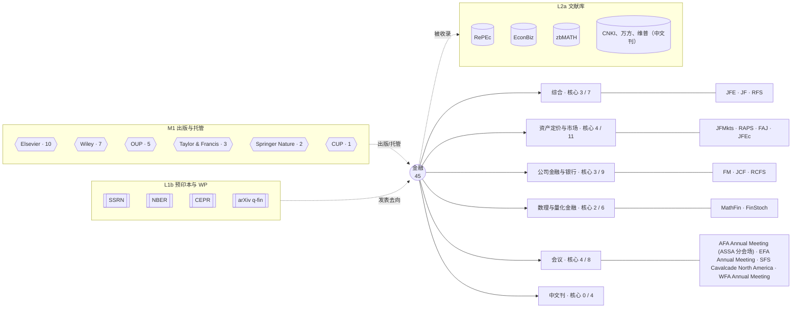

# 金融 venue 名录

> 金融共 45 个 venue（期刊 37、会议 8），归并为 5 个子领域（原 8 个），另有中文刊 4 个。其中核心 16 个优先支持，其余 29 个登记在册、暂不专门支持，规则见[支持分级](README.md#支持分级)。主要学科库：RePEc、EconBiz、zbMATH、CNKI、万方、维普（中文刊）；主要预印本与 WP 通道：SSRN、NBER、CEPR、arXiv q-fin。评级标签的体系、版本与许可见[评级体系](../venue-rankings.md)，七类分层见[来源分层](../source-taxonomy.md)。

## 关联图

## 核心 venue（优先支持）

每个子领域内按评级强弱排序，评级相同按名称。`接入` 一列：`Crossref:ISSN` 指由 Crossref 委托按 ISSN 收元数据，`现有:`/`平台:` 指经名录里已有的来源行，`用户导入` 指只接受用户导出的题录。

本节只列核心 venue：逐刊核验标识与通道，进入首批验收与默认推荐池。其余 venue 见下文"登记 venue"。子领域由原来的细分方向归并而成：合并组先按原方向、再按评级排列，备注以"方向："开头标出原方向。

### 综合（核心 3 · 登记 4）

| venue | 类型 | ISSN（印/电）或 dblp | 出版托管（M1） | 评级 | 学科库（L2a） | 预印本（L1b） | 接入 | 备注 |
|---|---|---|---|---|---|---|---|---|
| Journal of Financial Economics（JFE） | J | 0304-405X / — | ScienceDirect `elsevier_sd` | Top3; UTD24; FT50; NI; ABDC-A*; FMS-A | RePEc; EconBiz | SSRN; NBER; CEPR | Crossref:ISSN |  |
| Journal of Finance（JF） | J | 0022-1082 / 1540-6261 | Wiley `wiley` | Top3; UTD24; FT50; ABDC-A*; FMS-A | RePEc; EconBiz | SSRN; NBER; CEPR | Crossref:ISSN |  |
| Review of Financial Studies（RFS） | J | 0893-9454 / 1465-7368 | Oxford Academic `oup_academic` | Top3; UTD24; FT50; ABDC-A*; FMS-A | RePEc; EconBiz | SSRN; NBER; CEPR | Crossref:ISSN |  |

### 资产定价与市场（核心 4 · 登记 7）

含原方向：资产定价与市场、金融计量、国际金融。

| venue | 类型 | ISSN（印/电）或 dblp | 出版托管（M1） | 评级 | 学科库（L2a） | 预印本（L1b） | 接入 | 备注 |
|---|---|---|---|---|---|---|---|---|
| Journal of Financial Markets（JFMkts） | J | 1386-4181 / — | ScienceDirect `elsevier_sd` | ABDC-A*; FMS-B | RePEc; EconBiz | SSRN; NBER; CEPR | Crossref:ISSN | 方向：资产定价与市场 |
| Review of Asset Pricing Studies（RAPS） | J | 2045-9920 / 2045-9939 | Oxford Academic `oup_academic` | ABDC-A*; FMS-B | RePEc; EconBiz | SSRN; NBER; CEPR | Crossref:ISSN | 方向：资产定价与市场 |
| Financial Analysts Journal（FAJ） | J | 0015-198X / 1938-3312 | Informa UK (Taylor & Francis) `tandf_online` | ABDC-A; FMS-B | RePEc; EconBiz | SSRN; NBER; CEPR | Crossref:ISSN | 方向：资产定价与市场 |
| Journal of Financial Econometrics（JFEc） | J | 1479-8409 / 1479-8417 | Oxford Academic `oup_academic` | ABDC-A*; FMS-B | RePEc; EconBiz | arXiv:q-fin.ST; SSRN | Crossref:ISSN | 方向：金融计量 |

### 公司金融与银行（核心 3 · 登记 6）

含原方向：公司金融与治理、银行与金融中介。

| venue | 类型 | ISSN（印/电）或 dblp | 出版托管（M1） | 评级 | 学科库（L2a） | 预印本（L1b） | 接入 | 备注 |
|---|---|---|---|---|---|---|---|---|
| Financial Management（FM） | J | 0046-3892 / 1755-053X | Wiley (Blackwell Publishing) `wiley` | ABDC-A*; FMS-B | RePEc; EconBiz | SSRN; NBER; CEPR | Crossref:ISSN | 方向：公司金融与治理 |
| Journal of Corporate Finance（JCF） | J | 0929-1199 / — | ScienceDirect `elsevier_sd` | ABDC-A*; FMS-B | RePEc; EconBiz | SSRN; NBER; CEPR | Crossref:ISSN | 方向：公司金融与治理 |
| Review of Corporate Finance Studies（RCFS） | J | 2046-9128 / 2046-9136 | Oxford Academic `oup_academic` | ABDC-A*; FMS-B | RePEc; EconBiz | SSRN; NBER; CEPR | Crossref:ISSN | 方向：公司金融与治理 |

### 数理与量化金融（核心 2 · 登记 4）

| venue | 类型 | ISSN（印/电）或 dblp | 出版托管（M1） | 评级 | 学科库（L2a） | 预印本（L1b） | 接入 | 备注 |
|---|---|---|---|---|---|---|---|---|
| Mathematical Finance（MathFin） | J | 0960-1627 / 1467-9965 | Wiley `wiley` | ABDC-A; FMS-B; T1(中国数学会) | RePEc; EconBiz; zbMATH | arXiv:q-fin.MF; arXiv:q-fin.PR; SSRN | Crossref:ISSN |  |
| Finance and Stochastics（FinStoch） | J | 0949-2984 / 1432-1122 | Springer Nature Link `springer_link` | ABDC-A; FMS-B; T2(中国数学会) | RePEc; EconBiz; zbMATH | arXiv:q-fin.MF; arXiv:q-fin.PR; SSRN | Crossref:ISSN |  |

### 会议（核心 4 · 登记 4）

| venue | 类型 | ISSN（印/电）或 dblp | 出版托管（M1） | 评级 | 学科库（L2a） | 预印本（L1b） | 接入 | 备注 |
|---|---|---|---|---|---|---|---|---|
| AFA Annual Meeting (ASSA 分会场) | C | — | American Finance Association `assa_meetings` | 惯例-顶级 | — | SSRN; NBER | 现有:assa_meetings | 在ASSA程序内按主办学会区分 |
| EFA Annual Meeting | C | — | European Finance Association `efa_meeting` | 惯例-顶级 | — | SSRN; NBER | 现有:efa_meeting |  |
| SFS Cavalcade North America | C | — | Society for Financial Studies `sfs_cavalcade` | 惯例-顶级 | — | SSRN; NBER | 现有:sfs_cavalcade | robots禁论文路径 |
| WFA Annual Meeting | C | — | Western Finance Association `wfa_meeting` | 惯例-顶级 | — | SSRN; NBER | 现有:wfa_meeting | 程序需会员登录 |

### 中文刊（核心 0 · 登记 4）

子领域写在备注里。知网、万方、维普只接受用户导入题录；在 Crossref 注册了 DOI 的中文刊可经 Crossref 收元数据。只接受用户导入的中文刊不列为核心。

本组暂无核心 venue，全部登记。

## 登记 venue（长尾，暂不支持）

以下 venue 登记在册，保留标识、托管与评级，但暂不逐刊核验通道、不进首批验收。用户关注其中任意一个时，照常经 Crossref 或 OpenAlex 自动建 venue（`auto`）收元数据；问卷、调研与关注数达到[升级条件](README.md#支持分级)后升为核心。

### 综合（登记 4）

| venue | 类型 | ISSN（印/电）或 dblp | 出版托管（M1） | 评级 | 学科库（L2a） | 预印本（L1b） | 接入 | 备注 |
|---|---|---|---|---|---|---|---|---|
| Journal of Financial and Quantitative Analysis（JFQA） | J | 0022-1090 / 1756-6916 | Cambridge Core `cambridge_core` | FT50; ABDC-A*; FMS-A; T2(中国数学会) | RePEc; EconBiz | SSRN; NBER; CEPR | Crossref:ISSN |  |
| Review of Finance（RF） | J | 1572-3097 / 1573-692X | Oxford Academic `oup_academic` | FT50; ABDC-A*; FMS-A | RePEc; EconBiz | SSRN; NBER; CEPR | Crossref:ISSN |  |
| Critical Finance Review（CFR） | J | 2164-5744 / — | Emerald（原 now publishers） `emerald_insight` | ABDC-A* | RePEc; EconBiz | SSRN; NBER; CEPR | Crossref:ISSN | now→Emerald(2025)→Wiley收购Emerald(2026) |
| Annual Review of Financial Economics（ARFE） | J | 1941-1367 / 1941-1375 | Annual Reviews `annual_reviews` | ABDC-B | RePEc; EconBiz | SSRN; NBER; CEPR | Crossref:ISSN | OA 状态种子表标⚠ |

### 资产定价与市场（登记 7）

| venue | 类型 | ISSN（印/电）或 dblp | 出版托管（M1） | 评级 | 学科库（L2a） | 预印本（L1b） | 接入 | 备注 |
|---|---|---|---|---|---|---|---|---|
| Journal of Futures Markets（JFutM） | J | 0270-7314 / 1096-9934 | Wiley (John Wiley & Sons) `wiley` | ABDC-A; FMS-B | RePEc; EconBiz | SSRN; NBER; CEPR | Crossref:ISSN | 方向：资产定价与市场 |
| Journal of Portfolio Management（JPM） | J | 0095-4918 / — | PM Research（With Intelligence） `pm_research` | ABDC-A; FMS-B | RePEc; EconBiz | SSRN; NBER; CEPR | Crossref:ISSN | 方向：资产定价与市场；出版者现为 With Intelligence |
| Real Estate Economics（REE） | J | 1080-8620 / 1540-6229 | Wiley (Blackwell Publishing) `wiley` | ABDC-A; FMS-B | RePEc; EconBiz | SSRN; NBER; CEPR | Crossref:ISSN | 方向：资产定价与市场 |
| Journal of Empirical Finance（JEF） | J | 0927-5398 / — | ScienceDirect `elsevier_sd` | ABDC-A; FMS-B | RePEc; EconBiz | arXiv:q-fin.ST; SSRN | Crossref:ISSN | 方向：金融计量 |
| Journal of International Financial Markets, Institutions and Money（JIFMIM） | J | 1042-4431 / — | Elsevier `elsevier_sd` | ABDC-A | RePEc; EconBiz | SSRN; NBER; IMF WP | Crossref:ISSN | 方向：国际金融 |
| Journal of International Money and Finance（JIMF） | J | 0261-5606 / — | Elsevier `elsevier_sd` | ABDC-A; FMS-B | RePEc; EconBiz | SSRN; NBER; IMF WP | Crossref:ISSN | 方向：国际金融 |
| Pacific-Basin Finance Journal（PBFJ） | J | 0927-538X / — | Elsevier `elsevier_sd` | ABDC-A | RePEc; EconBiz | SSRN; NBER; IMF WP | Crossref:ISSN | 方向：国际金融 |

### 公司金融与银行（登记 6）

| venue | 类型 | ISSN（印/电）或 dblp | 出版托管（M1） | 评级 | 学科库（L2a） | 预印本（L1b） | 接入 | 备注 |
|---|---|---|---|---|---|---|---|---|
| Corporate Governance: An International Review（CGIR） | J | 0964-8410 / 1467-8683 | Wiley (Blackwell Publishing) `wiley` | ABDC-A; FMS-B | RePEc; EconBiz | SSRN; NBER; CEPR | Crossref:ISSN | 方向：公司金融与治理 |
| European Financial Management（EFM） | J | 1354-7798 / 1468-036X | Wiley (Blackwell Publishing) `wiley` | ABDC-A; FMS-B | RePEc; EconBiz | SSRN; NBER; CEPR | Crossref:ISSN | 方向：公司金融与治理 |
| Journal of Banking & Finance（JBF） | J | 0378-4266 / — | ScienceDirect `elsevier_sd` | ABDC-A*; FMS-B | RePEc; EconBiz | SSRN; NBER; 央行WP(fed_board_wp/ecb_wp/bis_wp) | Crossref:ISSN | 方向：银行与金融中介 |
| Journal of Financial Intermediation（JFI） | J | 1042-9573 / 1096-0473 | ScienceDirect `elsevier_sd` | ABDC-A*; FMS-B | RePEc; EconBiz | SSRN; NBER; 央行WP(fed_board_wp/ecb_wp/bis_wp) | Crossref:ISSN | 方向：银行与金融中介 |
| Journal of Financial Stability（JFStab） | J | 1572-3089 / 1878-0962 | Elsevier `elsevier_sd` | ABDC-A*; FMS-B | RePEc; EconBiz | SSRN; NBER; 央行WP(fed_board_wp/ecb_wp/bis_wp) | Crossref:ISSN | 方向：银行与金融中介 |
| Journal of Financial Services Research（JFSR） | J | 0920-8550 / 1573-0735 | Springer-Verlag `springer_link` | ABDC-A | RePEc; EconBiz | SSRN; NBER; 央行WP(fed_board_wp/ecb_wp/bis_wp) | Crossref:ISSN | 方向：银行与金融中介 |

### 数理与量化金融（登记 4）

| venue | 类型 | ISSN（印/电）或 dblp | 出版托管（M1） | 评级 | 学科库（L2a） | 预印本（L1b） | 接入 | 备注 |
|---|---|---|---|---|---|---|---|---|
| Applied Mathematical Finance（AMF） | J | 1350-486X / 1466-4313 | Informa UK (Taylor & Francis) `tandf_online` | ABDC-B | RePEc; EconBiz; zbMATH | arXiv:q-fin.MF; arXiv:q-fin.PR; SSRN | Crossref:ISSN |  |
| Journal of Computational Finance（JCompF） | J | 1460-1559 / 1755-2850 | Infopro Digital | ABDC-C | RePEc; EconBiz; zbMATH | arXiv:q-fin.MF; arXiv:q-fin.PR; SSRN | Crossref:ISSN | Infopro Digital(Risk.net)，无 source_id |
| Quantitative Finance（QF） | J | 1469-7688 / 1469-7696 | Taylor & Francis `tandf_online` | ABDC-A; FMS-B; T3(中国数学会) | RePEc; EconBiz; zbMATH | arXiv:q-fin.MF; arXiv:q-fin.PR; SSRN | Crossref:ISSN |  |
| SIAM Journal on Financial Mathematics（SIFIN） | J | 1945-497X / — | SIAM `siam` | ABDC-B; T2(中国数学会) | RePEc; EconBiz; zbMATH | arXiv:q-fin.MF; arXiv:q-fin.PR; SSRN | Crossref:ISSN |  |

### 会议（登记 4）

| venue | 类型 | ISSN（印/电）或 dblp | 出版托管（M1） | 评级 | 学科库（L2a） | 预印本（L1b） | 接入 | 备注 |
|---|---|---|---|---|---|---|---|---|
| FIRS Conference | C | — | Financial Intermediation Research Society | 惯例-一流 | — | SSRN; NBER | 待勘察 |  |
| China International Conference in Finance（CICF） | C | — | CICF 组委会 | — | — | SSRN; NBER | 待勘察 | 中国(英文)；中国举办的英文国际会议 |
| Midwest Finance Association Annual Meeting（MFA） | C | — | Midwest Finance Association | — | — | SSRN; NBER | 待勘察 |  |
| Northern Finance Association Conference（NFA） | C | — | Northern Finance Association | — | — | SSRN; NBER | 待勘察 |  |

### 中文刊（登记 4）

| venue | 类型 | ISSN（印/电）或 dblp | 出版托管（M1） | 评级 | 学科库（L2a） | 预印本（L1b） | 接入 | 备注 |
|---|---|---|---|---|---|---|---|---|
| 金融研究（Journal of Financial Research） | J | 1002-7246 / — | 中国金融学会 | CSSCI; 北大核心; 科技核心; AMI-权威; NSFC管理-A; FMS-T1 | CNKI; 万方; 维普 | — | 用户导入 | 综合金融；Crossref无该ISSN记录 |
| 保险研究（Insurance Studies） | J | 1004-3306 / — | 中国保险学会 | CSSCI; 北大核心; AMI-核心; FMS-T2 | CNKI; 万方; 维普 | — | 用户导入 | 保险；Crossref无该ISSN记录 |
| 国际金融研究（Studies of International Finance） | J | 1006-1029 / — | 中国银行股份有限公司; 中国国际金融学会 | CSSCI; 北大核心; 科技核心; AMI-核心; FMS-T2 | CNKI; 万方; 维普 | — | 用户导入 | 国际金融；Crossref无该ISSN记录 |
| 证券市场导报（Securities Market Herald） | J | 1005-1589 / — | 深圳证券交易所研究所 | CSSCI; 科技核心; AMI-核心 | CNKI; 万方; 维普 | — | 用户导入 | 证券与资本市场；Crossref无该ISSN记录；Crossref 无记录 |

## 出处与说明

- **名录**：`Top3`、`UTD24`（JF、JFE、RFS）、`FT50`（JF、JFQA、JFE、RoF、RFS）、`ABDC-*`、`NI`（只有 JFE）、`FMS-A/B`。
- **会议**：`惯例-*` 依据三篇会议排名研究：Reinartz & Urban（JEF 2017）、Smajlbegovic & Urban（JEF 2025）、Kerl 等（JBF 2018）。AFA、WFA、EFA、SFS Cavalcade 为 `惯例-顶级`，FIRS 为 `惯例-一流`，NFA、MFA、CICF 留空。各会议的顶刊发表率来自检索摘要（二手）。
- **路径**：金融以 SSRN 为主要首发通道，数理金融走 arXiv q-fin。
- **支持分级**：核心按[支持分级](README.md#支持分级)的规则初选，2026-09-29 定稿。本学科没有人工补选。
