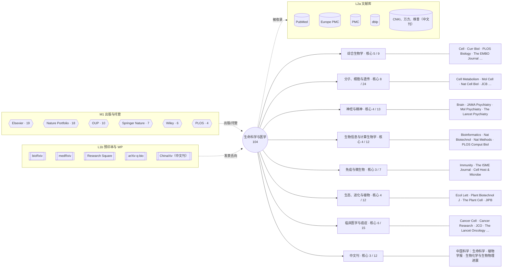

# 生命科学与医学 venue 名录

> 生命科学与医学共 104 个 venue（期刊 98、会议 6），归并为 7 个子领域（原 14 个），另有中文刊 12 个。其中核心 37 个优先支持，其余 67 个登记在册、暂不专门支持，规则见[支持分级](README.md#支持分级)。主要学科库：PubMed、Europe PMC、PMC、dblp、CNKI、万方、维普（中文刊）；主要预印本与 WP 通道：bioRxiv、medRxiv、Research Square、arXiv q-bio、ChinaXiv（中文刊）。评级标签的体系、版本与许可见[评级体系](../venue-rankings.md)，七类分层见[来源分层](../source-taxonomy.md)。

## 关联图

## 核心 venue（优先支持）

每个子领域内按评级强弱排序，评级相同按名称。`接入` 一列：`Crossref:ISSN` 指由 Crossref 委托按 ISSN 收元数据，`现有:`/`平台:` 指经名录里已有的来源行，`用户导入` 指只接受用户导出的题录。

本节只列核心 venue：逐刊核验标识与通道，进入首批验收与默认推荐池。其余 venue 见下文"登记 venue"。子领域由原来的细分方向归并而成：合并组先按原方向、再按评级排列，备注以"方向："开头标出原方向。

### 综合生物学（核心 5 · 登记 4）

| venue | 类型 | ISSN（印/电）或 dblp | 出版托管（M1） | 评级 | 学科库（L2a） | 预印本（L1b） | 接入 | 备注 |
|---|---|---|---|---|---|---|---|---|
| Cell | J | 0092-8674 / — | Elsevier（Cell Press） `elsevier_sd` | NI; T1(中国细胞生物学学会) | PubMed; Europe PMC; PMC | bioRxiv | Crossref:ISSN |  |
| Current Biology（Curr Biol） | J | 0960-9822 / — | Elsevier（Cell Press） `elsevier_sd` | NI | PubMed; Europe PMC; PMC | bioRxiv | Crossref:ISSN |  |
| PLOS Biology | J | 1544-9173 / 1545-7885 | PLOS `plos` | NI | PubMed; Europe PMC; PMC | bioRxiv | Crossref:ISSN | 须用 eISSN 查 Crossref |
| The EMBO Journal | J | 0261-4189 / 1460-2075 | Springer Nature（EMBO Press） `springer_link` | NI; T2(中国细胞生物学学会) | PubMed; Europe PMC; PMC | bioRxiv | Crossref:ISSN | 须用 eISSN |
| eLife | J | 2050-084X / — | eLife `elife` | — | PubMed; Europe PMC; PMC | bioRxiv | Crossref:ISSN | 新发表模式（评审后 VOR） |

### 分子、细胞与遗传（核心 8 · 登记 16）

含原方向：细胞与分子、遗传与基因组、结构生物学与生化、发育与干细胞。

| venue | 类型 | ISSN（印/电）或 dblp | 出版托管（M1） | 评级 | 学科库（L2a） | 预印本（L1b） | 接入 | 备注 |
|---|---|---|---|---|---|---|---|---|
| Cell Metabolism | J | 1550-4131 / — | Elsevier（Cell Press） `elsevier_sd` | NI; T1(中华医学会、中国细胞生物学学会) | PubMed; Europe PMC; PMC | bioRxiv | Crossref:ISSN | 方向：细胞与分子 |
| Molecular Cell（Mol Cell） | J | 1097-2765 / — | Elsevier（Cell Press） `elsevier_sd` | NI; T1(中国细胞生物学学会) | PubMed; Europe PMC; PMC | bioRxiv | Crossref:ISSN | 方向：细胞与分子 |
| Nature Cell Biology（Nat Cell Biol） | J | 1465-7392 / 1476-4679 | Nature Portfolio `nature_portfolio` | NI; T1(中国细胞生物学学会) | PubMed; Europe PMC; PMC | bioRxiv | Crossref:ISSN | 方向：细胞与分子 |
| Journal of Cell Biology（JCB） | J | 0021-9525 / 1540-8140 | Rockefeller University Press | NI; T2(中国细胞生物学学会) | PubMed; Europe PMC; PMC | bioRxiv | Crossref:ISSN | 方向：细胞与分子 |
| Genes & Development（Genes Dev） | J | 0890-9369 / 1549-5477 | CSHL Press `cshl_press` | NI; T2(中国细胞生物学学会) | PubMed; Europe PMC; PMC | bioRxiv; medRxiv | Crossref:ISSN | 方向：遗传与基因组 |
| Nature Chemical Biology（Nat Chem Biol） | J | 1552-4450 / 1552-4469 | Nature Portfolio `nature_portfolio` | NI; T2(中国细胞生物学学会) | PubMed; Europe PMC; PMC | bioRxiv | Crossref:ISSN | 方向：结构生物学与生化 |
| Cell Stem Cell | J | 1934-5909 / — | Elsevier（Cell Press） `elsevier_sd` | NI; T1(中国细胞生物学学会) | PubMed; Europe PMC; PMC | bioRxiv | Crossref:ISSN | 方向：发育与干细胞 |
| Developmental Cell（Dev Cell） | J | 1534-5807 / — | Elsevier（Cell Press） `elsevier_sd` | NI; T1(中国细胞生物学学会) | PubMed; Europe PMC; PMC | bioRxiv | Crossref:ISSN | 方向：发育与干细胞 |

### 神经与精神（核心 4 · 登记 9）

含原方向：神经科学、精神医学。

| venue | 类型 | ISSN（印/电）或 dblp | 出版托管（M1） | 评级 | 学科库（L2a） | 预印本（L1b） | 接入 | 备注 |
|---|---|---|---|---|---|---|---|---|
| Brain | J | 0006-8950 / 1460-2156 | Oxford University Press `oup_academic` | NI; T1(中华医学会) | PubMed; Europe PMC; PMC | bioRxiv | Crossref:ISSN | 方向：神经科学 |
| JAMA Psychiatry | J | 2168-622X / 2168-6238 | American Medical Association | NI; T1(中华医学会) | PubMed; PsycInfo（订阅） | PsyArXiv; medRxiv | Crossref:ISSN | 方向：精神医学 |
| Molecular Psychiatry（Mol Psychiatry） | J | 1359-4184 / 1476-5578 | Nature Portfolio `nature_portfolio` | NI; T1(中华医学会) | PubMed; PsycInfo（订阅） | PsyArXiv; medRxiv | Crossref:ISSN | 方向：精神医学 |
| The Lancet Psychiatry | J | 2215-0366 / — | Elsevier（Lancet） `elsevier_sd` | NI; T1(中华医学会) | PubMed; PsycInfo（订阅） | PsyArXiv; medRxiv | Crossref:ISSN | 方向：精神医学 |

### 生物信息与计算生物学（核心 4 · 登记 8）

| venue | 类型 | ISSN（印/电）或 dblp | 出版托管（M1） | 评级 | 学科库（L2a） | 预印本（L1b） | 接入 | 备注 |
|---|---|---|---|---|---|---|---|---|
| Bioinformatics | J | 1367-4803 / 1367-4811；dblp `journals/bioinformatics` | Oxford University Press `oup_academic` | CCF-A; CAAI-B; ABDC-A; T1(中国数学会) | PubMed; Europe PMC; PMC | bioRxiv; arXiv:q-bio | Crossref:ISSN | 含 ISMB 论文集 |
| Nature Biotechnology（Nat Biotechnol） | J | 1087-0156 / 1546-1696 | Nature Portfolio `nature_portfolio` | NI | PubMed; Europe PMC; PMC | bioRxiv; arXiv:q-bio | Crossref:ISSN |  |
| Nature Methods（Nat Methods） | J | 1548-7091 / 1548-7105 | Nature Portfolio `nature_portfolio` | NI | PubMed; Europe PMC; PMC | bioRxiv; arXiv:q-bio | Crossref:ISSN | Crossref 刊记录错挂 |
| PLOS Computational Biology（PLOS Comput Biol） | J | 1553-734X / 1553-7358；dblp `journals/ploscb` | PLOS `plos` | CCF-B; T2(中国数学会) | PubMed; Europe PMC; PMC | bioRxiv; arXiv:q-bio | Crossref:ISSN | 须用 eISSN |

### 免疫与微生物（核心 3 · 登记 4）

含原方向：免疫、微生物。

| venue | 类型 | ISSN（印/电）或 dblp | 出版托管（M1） | 评级 | 学科库（L2a） | 预印本（L1b） | 接入 | 备注 |
|---|---|---|---|---|---|---|---|---|
| Immunity | J | 1074-7613 / — | Elsevier（Cell Press） `elsevier_sd` | NI | PubMed; Europe PMC; PMC | bioRxiv | Crossref:ISSN | 方向：免疫 |
| The ISME Journal | J | 1751-7362 / 1751-7370 | Oxford University Press `oup_academic` | NI; T1(中国环境科学学会、中国生态学学会); T3(中华医学会) | PubMed; Europe PMC; PMC | bioRxiv | Crossref:ISSN | 方向：微生物 |
| Cell Host & Microbe | J | 1931-3128 / — | Elsevier（Cell Press） `elsevier_sd` | NI; T2(中华医学会) | PubMed; Europe PMC; PMC | bioRxiv | Crossref:ISSN | 方向：微生物 |

### 生态、进化与植物（核心 4 · 登记 8）

含原方向：生态与进化、植物。

| venue | 类型 | ISSN（印/电）或 dblp | 出版托管（M1） | 评级 | 学科库（L2a） | 预印本（L1b） | 接入 | 备注 |
|---|---|---|---|---|---|---|---|---|
| Ecology Letters（Ecol Lett） | J | 1461-023X / 1461-0248 | Wiley `wiley` | NI; T1(中国地理学会、中国植物学会、中国生态学学会) | PubMed; Europe PMC; PMC | bioRxiv | Crossref:ISSN | 方向：生态与进化 |
| Plant Biotechnology Journal（Plant Biotechnol J） | J | 1467-7644 / 1467-7652 | Wiley `wiley` | NI; T1(中国植物学会) | PubMed; Europe PMC; PMC | bioRxiv | Crossref:ISSN | 方向：植物 |
| The Plant Cell | J | 1040-4651 / 1532-298X | Oxford University Press（ASPB） `oup_academic` | NI; T1(中国植物学会) | PubMed; Europe PMC; PMC | bioRxiv | Crossref:ISSN | 方向：植物 |
| Journal of Integrative Plant Biology（JIPB） | J | 1672-9072 / 1744-7909 | Wiley `wiley` | T1(中国植物学会); 卓越-领军 | PubMed; Europe PMC; PMC | bioRxiv | Crossref:ISSN | 方向：植物；中国(英文)；中科院植物所主办 |

### 临床医学与癌症（核心 6 · 登记 9）

含原方向：临床医学综合、癌症。

| venue | 类型 | ISSN（印/电）或 dblp | 出版托管（M1） | 评级 | 学科库（L2a） | 预印本（L1b） | 接入 | 备注 |
|---|---|---|---|---|---|---|---|---|
| Cancer Cell | J | 1535-6108 / — | Elsevier（Cell Press） `elsevier_sd` | NI; T1(中华医学会) | PubMed; Europe PMC; PMC | medRxiv; Research Square | Crossref:ISSN | 方向：癌症 |
| Cancer Research | J | 0008-5472 / 1538-7445 | AACR | NI; T1(中华医学会) | PubMed; Europe PMC; PMC | medRxiv; Research Square | Crossref:ISSN | 方向：癌症 |
| Journal of Clinical Oncology（JCO） | J | 0732-183X / 1527-7755 | ASCO（Wolters Kluwer） | NI; T1(中华医学会) | PubMed; Europe PMC; PMC | medRxiv; Research Square | Crossref:ISSN | 方向：癌症 |
| The Lancet Oncology | J | 1470-2045 / — | Elsevier（Lancet） `elsevier_sd` | NI; T1(中华医学会) | PubMed; Europe PMC; PMC | medRxiv; Research Square | Crossref:ISSN | 方向：癌症 |
| Annals of Internal Medicine（Ann Intern Med） | J | 0003-4819 / 1539-3704 | American College of Physicians | NI; T1(中华医学会) | PubMed; Europe PMC; PMC | medRxiv; Research Square | Crossref:ISSN | 方向：临床医学综合 |
| Science Translational Medicine（Sci Transl Med） | J | 1946-6234 / 1946-6242 | AAAS `aaas_science` | NI; T1(中国生物医学工程学会) | PubMed; Europe PMC; PMC | medRxiv; Research Square | Crossref:ISSN | 方向：临床医学综合 |

### 中文刊（核心 3 · 登记 9）

子领域写在备注里。知网、万方、维普只接受用户导入题录；在 Crossref 注册了 DOI 的中文刊可经 Crossref 收元数据。只接受用户导入的中文刊不列为核心。

| venue | 类型 | ISSN（印/电）或 dblp | 出版托管（M1） | 评级 | 学科库（L2a） | 预印本（L1b） | 接入 | 备注 |
|---|---|---|---|---|---|---|---|---|
| 中国科学：生命科学（Scientia Sinica Vitae） | J | 1674-7232 / — | 中国科学杂志社 `sciengine` | T3(中国植物学会、中国细胞生物学学会); 卓越-领军; CSCD核心; 北大核心; 科技核心 | CNKI; 万方 | ChinaXiv | Crossref:ISSN | 细胞与分子；Crossref前缀10.1360 |
| 植物学报（Chinese Bulletin of Botany） | J | 1674-3466 / — | 中国植物学会 | T3(中国植物学会); CSCD核心; 北大核心; 科技核心 | CNKI; 万方; CSCD | ChinaXiv | Crossref:ISSN | 植物学；Crossref前缀10.3724 |
| 生物化学与生物物理进展（Progress in Biochemistry and Biophysics） | J | 1000-3282 / — | 中国科学院生物物理研究所 | CSCD扩展; 北大核心; 科技核心 | CNKI; 万方; CSCD | ChinaXiv | Crossref:ISSN | 生物物理；Crossref前缀10.3724 |

## 登记 venue（长尾，暂不支持）

以下 venue 登记在册，保留标识、托管与评级，但暂不逐刊核验通道、不进首批验收。用户关注其中任意一个时，照常经 Crossref 或 OpenAlex 自动建 venue（`auto`）收元数据；问卷、调研与关注数达到[升级条件](README.md#支持分级)后升为核心。

### 综合生物学（登记 4）

| venue | 类型 | ISSN（印/电）或 dblp | 出版托管（M1） | 评级 | 学科库（L2a） | 预印本（L1b） | 接入 | 备注 |
|---|---|---|---|---|---|---|---|---|
| Proceedings of the Royal Society B（Proc R Soc B） | J | 0962-8452 / 1471-2954 | Royal Society `royal_society` | NI | PubMed; Europe PMC; PMC | bioRxiv | Crossref:ISSN | Crossref 拆两条记录，须 p/e 双查 |
| Cell Reports | J | 2211-1247 / — | Elsevier（Cell Press） `elsevier_sd` | T2(中国细胞生物学学会) | PubMed; Europe PMC; PMC | bioRxiv | Crossref:ISSN |  |
| International Journal of Molecular Sciences（IJMS） | J | 1422-0067 / — | MDPI `mdpi` | — | PubMed; Europe PMC; PMC | bioRxiv | Crossref:ISSN | 大体量 OA |
| PeerJ | J | 2167-8359 / — | PeerJ `peerj` | — | PubMed; Europe PMC; PMC | bioRxiv | Crossref:ISSN |  |

### 分子、细胞与遗传（登记 16）

| venue | 类型 | ISSN（印/电）或 dblp | 出版托管（M1） | 评级 | 学科库（L2a） | 预印本（L1b） | 接入 | 备注 |
|---|---|---|---|---|---|---|---|---|
| Cell Research | J | 1001-0602 / 1748-7838 | Springer Nature `nature_portfolio` | T1(中国细胞生物学学会); 卓越-梯队 | PubMed; Europe PMC; PMC | bioRxiv | Crossref:ISSN | 方向：细胞与分子；中国(英文)；中科院上海生化细胞所主办 |
| Science China Life Sciences（Sci China Life Sci） | J | 1674-7305 / 1869-1889 | 中国科学杂志社/Springer `sciengine` | 卓越-领军 | PubMed; Europe PMC; PMC | bioRxiv | Crossref:ISSN | 方向：细胞与分子；中国(英文) |
| Signal Transduction and Targeted Therapy（STTT） | J | — / 2059-3635 | Springer Nature `nature_portfolio` | 卓越-领军 | PubMed; Europe PMC; PMC | bioRxiv | Crossref:ISSN | 方向：细胞与分子；中国(英文)；四川大学主办 |
| Cell Discovery | J | 2056-5968 / — | Springer Nature `nature_portfolio` | T2(中国细胞生物学学会) | PubMed; Europe PMC; PMC | bioRxiv | Crossref:ISSN | 方向：细胞与分子；中国(英文) |
| Molecular Systems Biology（Mol Syst Biol） | J | 1744-4292 / — | Springer Nature（EMBO Press） `springer_link` | — | PubMed; Europe PMC; PMC | bioRxiv | Crossref:ISSN | 方向：细胞与分子；系统生物学 |
| Protein & Cell | J | 1674-800X / 1674-8018 | Oxford University Press `oup_academic` | T2(中国细胞生物学学会); 卓越-梯队 | PubMed; Europe PMC; PMC | bioRxiv | Crossref:ISSN | 方向：细胞与分子；中国(英文)；高教社主办 |
| American Journal of Human Genetics（AJHG） | J | 0002-9297 / 1537-6605 | Elsevier（Cell Press） `elsevier_sd` | NI | PubMed; Europe PMC; PMC | bioRxiv; medRxiv | Crossref:ISSN | 方向：遗传与基因组 |
| Genome Research | J | 1088-9051 / 1549-5469 | CSHL Press `cshl_press` | NI | PubMed; Europe PMC; PMC | bioRxiv; medRxiv | Crossref:ISSN | 方向：遗传与基因组；延迟开放 ⚠ |
| Nature Genetics（Nat Genet） | J | 1061-4036 / 1546-1718 | Nature Portfolio `nature_portfolio` | NI | PubMed; Europe PMC; PMC | bioRxiv; medRxiv | Crossref:ISSN | 方向：遗传与基因组 |
| PLOS Genetics | J | 1553-7390 / 1553-7404 | PLOS `plos` | NI | PubMed; Europe PMC; PMC | bioRxiv; medRxiv | Crossref:ISSN | 方向：遗传与基因组 |
| Genome Biology | J | 1474-760X / — | Springer Nature（BMC） `springer_link` | — | PubMed; Europe PMC; PMC | bioRxiv; medRxiv | Crossref:ISSN | 方向：遗传与基因组；Crossref 另记 1465-6906 |
| Nucleic Acids Research（NAR） | J | 0305-1048 / 1362-4962 | Oxford University Press `oup_academic` | — | PubMed; Europe PMC; PMC | bioRxiv; medRxiv | Crossref:ISSN | 方向：遗传与基因组 |
| Journal of Biological Chemistry（JBC） | J | 0021-9258 / 1083-351X | Elsevier（ASBMB） `elsevier_sd` | NI; T3(中国细胞生物学学会) | PubMed; Europe PMC; PMC | bioRxiv | Crossref:ISSN | 方向：结构生物学与生化 |
| Nature Structural & Molecular Biology（NSMB） | J | 1545-9993 / 1545-9985 | Nature Portfolio `nature_portfolio` | NI; T2(中国细胞生物学学会) | PubMed; Europe PMC; PMC | bioRxiv | Crossref:ISSN | 方向：结构生物学与生化 |
| Annual Review of Biochemistry（Annu Rev Biochem） | J | 0066-4154 / 1545-4509 | Annual Reviews `annual_reviews` | — | PubMed; Europe PMC; PMC | bioRxiv | Crossref:ISSN | 方向：结构生物学与生化；S2O |
| Development | J | 0950-1991 / 1477-9129 | The Company of Biologists | T2(中国细胞生物学学会) | PubMed; Europe PMC; PMC | bioRxiv | Crossref:ISSN | 方向：发育与干细胞 |

### 神经与精神（登记 9）

| venue | 类型 | ISSN（印/电）或 dblp | 出版托管（M1） | 评级 | 学科库（L2a） | 预印本（L1b） | 接入 | 备注 |
|---|---|---|---|---|---|---|---|---|
| Journal of Neuroscience（J Neurosci） | J | 0270-6474 / 1529-2401 | Society for Neuroscience `sfn_journals` | NI; T2(中华医学会) | PubMed; Europe PMC; PMC | bioRxiv | Crossref:ISSN | 方向：神经科学；约 6 个月后开放 |
| Nature Neuroscience（Nat Neurosci） | J | 1097-6256 / 1546-1726 | Nature Portfolio `nature_portfolio` | NI | PubMed; Europe PMC; PMC | bioRxiv | Crossref:ISSN | 方向：神经科学 |
| Neuron | J | 0896-6273 / — | Elsevier（Cell Press） `elsevier_sd` | NI | PubMed; Europe PMC; PMC | bioRxiv | Crossref:ISSN | 方向：神经科学 |
| Nature Reviews Neuroscience（Nat Rev Neurosci） | J | 1471-003X / 1471-0048 | Nature Portfolio `nature_portfolio` | T1(中华医学会) | PubMed; Europe PMC; PMC | bioRxiv | Crossref:ISSN | 方向：神经科学；综述刊 |
| Frontiers in Neuroscience（Front Neurosci） | J | 1662-4548 / 1662-453X | Frontiers `frontiers` | — | PubMed; Europe PMC; PMC | bioRxiv | Crossref:ISSN | 方向：神经科学 |
| Neuroscience Bulletin（Neurosci Bull） | J | 1673-7067 / 1995-8218 | Springer Nature `springer_link` | T2(中华医学会); 卓越-梯队 | PubMed; Europe PMC; PMC | bioRxiv | Crossref:ISSN | 方向：神经科学；中国(英文)；中国神经科学学会主办 |
| SfN Annual Meeting (Neuroscience) | C | — | Society for Neuroscience | — | — | — | 待勘察 | 方向：神经科学；只有摘要集；待勘察 |
| eNeuro | J | 2373-2822 / — | Society for Neuroscience `sfn_journals` | — | PubMed; Europe PMC; PMC | bioRxiv | Crossref:ISSN | 方向：神经科学 |
| Journal of the American Academy of Child and Adolescent Psychiatry（JAACAP） | J | 0890-8567 / — | Elsevier `elsevier_sd` | NI | PubMed; PsycInfo（订阅） | PsyArXiv; medRxiv | Crossref:ISSN | 方向：精神医学 |

### 生物信息与计算生物学（登记 8）

| venue | 类型 | ISSN（印/电）或 dblp | 出版托管（M1） | 评级 | 学科库（L2a） | 预印本（L1b） | 接入 | 备注 |
|---|---|---|---|---|---|---|---|---|
| Research in Computational Molecular Biology（RECOMB） | C | dblp `conf/recomb` | Springer（LNCS/LNBI） `springer_link` | CCF-B; ICORE-B; THCPL-A | dblp | bioRxiv; arXiv:q-bio | dblp快照 |  |
| Briefings in Bioinformatics（Brief Bioinform） | J | 1467-5463 / 1477-4054；dblp `journals/bib` | Oxford University Press `oup_academic` | CCF-B; T3(中国数学会) | PubMed; Europe PMC; PMC | bioRxiv; arXiv:q-bio | Crossref:ISSN |  |
| IEEE International Conference on Bioinformatics and Biomedicine（BIBM） | C | dblp `conf/bibm` | IEEE `ieee_xplore` | CCF-B | dblp | bioRxiv; arXiv:q-bio | dblp快照 |  |
| Intelligent Systems for Molecular Biology（ISMB） | C | dblp `conf/ismb` | Oxford University Press（Bioinformatics 专刊） `oup_academic` | CCF-B | PubMed; dblp | bioRxiv; arXiv:q-bio | Crossref:ISSN | 经 Bioinformatics ISSN 枚举 |
| Asia Pacific Bioinformatics Conference（APBC） | C | dblp `conf/apbc` | BioMed Central `springer_link` | CCF-C; ICORE-B | dblp | bioRxiv; arXiv:q-bio | dblp快照 |  |
| BMC Bioinformatics | J | 1471-2105 / —；dblp `journals/bmcbi` | Springer Nature（BMC） `springer_link` | CCF-C; T3(中国数学会) | PubMed; Europe PMC; PMC | bioRxiv; arXiv:q-bio | Crossref:ISSN |  |
| Cell Systems | J | 2405-4712 / — | Elsevier（Cell Press） `elsevier_sd` | T3(中国细胞生物学学会) | PubMed; Europe PMC; PMC | bioRxiv; arXiv:q-bio | Crossref:ISSN |  |
| Pacific Symposium on Biocomputing（PSB） | C | 2335-6936 / 2335-6928 | World Scientific / PSB `psb_proceedings` | — | PubMed | bioRxiv; arXiv:q-bio | 现有:psb_proceedings | Crossref 无记录 |

### 免疫与微生物（登记 4）

| venue | 类型 | ISSN（印/电）或 dblp | 出版托管（M1） | 评级 | 学科库（L2a） | 预印本（L1b） | 接入 | 备注 |
|---|---|---|---|---|---|---|---|---|
| Nature Immunology（Nat Immunol） | J | 1529-2908 / 1529-2916 | Nature Portfolio `nature_portfolio` | NI | PubMed; Europe PMC; PMC | bioRxiv | Crossref:ISSN | 方向：免疫 |
| Science Immunology（Sci Immunol） | J | 2470-9468 / — | AAAS `aaas_science` | — | PubMed; Europe PMC; PMC | bioRxiv | Crossref:ISSN | 方向：免疫 |
| Nature Microbiology（Nat Microbiol） | J | 2058-5276 / — | Nature Portfolio `nature_portfolio` | T2(中华医学会) | PubMed; Europe PMC; PMC | bioRxiv | Crossref:ISSN | 方向：微生物 |
| mBio | J | 2150-7511 / — | American Society for Microbiology | T2(中国环境科学学会) | PubMed; Europe PMC; PMC | bioRxiv | Crossref:ISSN | 方向：微生物 |

### 生态、进化与植物（登记 8）

| venue | 类型 | ISSN（印/电）或 dblp | 出版托管（M1） | 评级 | 学科库（L2a） | 预印本（L1b） | 接入 | 备注 |
|---|---|---|---|---|---|---|---|---|
| Ecology | J | 0012-9658 / 1939-9170 | Wiley（ESA） `wiley` | ABDC-A; T1(中国植物学会、中国生态学学会) | PubMed; Europe PMC; PMC | bioRxiv | Crossref:ISSN | 方向：生态与进化 |
| Evolution | J | 0014-3820 / 1558-5646 | Oxford University Press `oup_academic` | T1(中国植物学会); T2(中国生态学学会) | PubMed; Europe PMC; PMC | bioRxiv | Crossref:ISSN | 方向：生态与进化 |
| Global Change Biology（Glob Change Biol） | J | 1354-1013 / 1365-2486 | Wiley `wiley` | T1(中国土壤学会、中国地理学会、中国植物学会 等 5 家) | PubMed; Europe PMC; PMC | bioRxiv | Crossref:ISSN | 方向：生态与进化 |
| Molecular Biology and Evolution（MBE） | J | 0737-4038 / 1537-1719 | Oxford University Press `oup_academic` | T1(中国植物学会) | PubMed; Europe PMC; PMC | bioRxiv | Crossref:ISSN | 方向：生态与进化 |
| Nature Ecology & Evolution（Nat Ecol Evol） | J | 2397-334X / — | Nature Portfolio `nature_portfolio` | T1(中国植物学会、中国生态学学会) | PubMed; Europe PMC; PMC | bioRxiv | Crossref:ISSN | 方向：生态与进化 |
| Molecular Plant（Mol Plant） | J | 1674-2052 / 1752-9867 | Elsevier（Cell Press） `elsevier_sd` | T1(中国植物学会); 卓越-领军 | PubMed; Europe PMC; PMC | bioRxiv | Crossref:ISSN | 方向：植物；中国(英文)；中科院分子植物卓越中心主办 |
| Nature Plants（Nat Plants） | J | 2055-026X / 2055-0278 | Nature Portfolio `nature_portfolio` | T1(中国植物学会) | PubMed; Europe PMC; PMC | bioRxiv | Crossref:ISSN | 方向：植物 |
| New Phytologist | J | 0028-646X / 1469-8137 | Wiley `wiley` | T1(中国植物学会) | PubMed; Europe PMC; PMC | bioRxiv | Crossref:ISSN | 方向：植物 |

### 临床医学与癌症（登记 9）

| venue | 类型 | ISSN（印/电）或 dblp | 出版托管（M1） | 评级 | 学科库（L2a） | 预印本（L1b） | 接入 | 备注 |
|---|---|---|---|---|---|---|---|---|
| Nature Cancer（Nat Cancer） | J | 2662-1347 / — | Nature Portfolio `nature_portfolio` | T2(中国细胞生物学学会) | PubMed; Europe PMC; PMC | medRxiv; Research Square | Crossref:ISSN | 方向：癌症 |
| JAMA | J | 0098-7484 / 1538-3598 | American Medical Association | NI; T1(中华医学会) | PubMed; Europe PMC; PMC | medRxiv; Research Square | Crossref:ISSN | 方向：临床医学综合 |
| The Lancet | J | 0140-6736 / 1474-547X | Elsevier（Lancet） `elsevier_sd` | NI; T1(中华医学会) | PubMed; Europe PMC; PMC | medRxiv; Research Square | Crossref:ISSN | 方向：临床医学综合 |
| The New England Journal of Medicine（NEJM） | J | 0028-4793 / 1533-4406 | NEJM Group（MMS） | NI; T1(中华医学会) | PubMed; Europe PMC; PMC | medRxiv; Research Square | Crossref:ISSN | 方向：临床医学综合 |
| Journal of Clinical Investigation（JCI） | J | 0021-9738 / 1558-8238 | ASCI | NI | PubMed; Europe PMC; PMC | medRxiv; Research Square | Crossref:ISSN | 方向：临床医学综合 |
| Journal of Experimental Medicine（JEM） | J | 0022-1007 / 1540-9538 | Rockefeller University Press | NI | PubMed; Europe PMC; PMC | medRxiv; Research Square | Crossref:ISSN | 方向：临床医学综合 |
| Nature Medicine（Nat Med） | J | 1078-8956 / 1546-170X | Nature Portfolio `nature_portfolio` | NI | PubMed; Europe PMC; PMC | medRxiv; Research Square | Crossref:ISSN | 方向：临床医学综合 |
| PLOS Medicine | J | 1549-1277 / 1549-1676 | PLOS `plos` | NI; T2(中华医学会) | PubMed; Europe PMC; PMC | medRxiv; Research Square | Crossref:ISSN | 方向：临床医学综合 |
| The BMJ | J | 0959-8138 / 1756-1833 | BMJ Publishing Group | NI | PubMed; Europe PMC; PMC | medRxiv; Research Square | Crossref:ISSN | 方向：临床医学综合 |

### 中文刊（登记 9）

| venue | 类型 | ISSN（印/电）或 dblp | 出版托管（M1） | 评级 | 学科库（L2a） | 预印本（L1b） | 接入 | 备注 |
|---|---|---|---|---|---|---|---|---|
| 中华内科杂志（Chinese Journal of Internal Medicine） | J | 0578-1426 / — | 中华医学会 | T1(中华医学会); 卓越-领军; CSCD核心; 北大核心; 科技核心 | CNKI; 万方; CSCD | ChinaXiv | 用户导入 | 临床医学；DOI经ISTIC(10.3760)；一期梯队 |
| 中华医学杂志（National Medical Journal of China） | J | 0376-2491 / — | 中华医学会 | T1(中华医学会); 卓越-领军; CSCD核心; 北大核心; 科技核心 | CNKI; 万方; CSCD | ChinaXiv | 用户导入 | 综合医学；DOI经ISTIC(10.3760) |
| 中华流行病学杂志（Chinese Journal of Epidemiology） | J | 0254-6450 / — | 中华医学会 | T1(中华预防医学会); 卓越-领军; CSCD核心; 北大核心; 科技核心 | CNKI; 万方; CSCD | ChinaXiv | 用户导入 | 公共卫生；DOI经ISTIC(10.3760)；一期梯队 |
| 生态学报（Acta Ecologica Sinica） | J | 1000-0933 / — | 中国生态学学会 | T1(中国地理学会、中国环境科学学会、中国生态学学会 等 4 家); 卓越-领军; CSCD核心; 北大核心; 科技核心; AMI-核心 | CNKI; 万方; CSCD | ChinaXiv | 用户导入 | 生态学；Crossref仅至2023(10.5846)；一期梯队 |
| 药学学报（Acta Pharmaceutica Sinica） | J | 0513-4870 / — | 中国药学会 | T1(中国药学会); 卓越-领军; CSCD核心; 北大核心; 科技核心 | CNKI; 万方; CSCD | ChinaXiv | 用户导入 | 药学；Crossref无该ISSN记录 |
| 微生物学报（Acta Microbiologica Sinica） | J | 0001-6209 / — | 中国微生物学会 | CSCD核心; 北大核心; 科技核心 | CNKI; 万方; CSCD | ChinaXiv | 用户导入 | 微生物学；Crossref无该ISSN记录 |
| 生物工程学报（Chinese Journal of Biotechnology） | J | 1000-3061 / — | 中国科学院微生物研究所 | 卓越-梯队; CSCD核心; 北大核心; 科技核心 | CNKI; 万方; CSCD | ChinaXiv | 用户导入 | 生物技术；Crossref无该ISSN记录；一期梯队 |
| 遗传（Hereditas (Beijing)） | J | 0253-9772 / — | 中国遗传学会 | CSCD核心; 北大核心; 科技核心; FMS-T2 | CNKI; 万方; CSCD | ChinaXiv | 用户导入 | 遗传学；Crossref仅至2014(10.3724) |
| 中国生物化学与分子生物学报（Chinese Journal of Biochemistry and Molecular Biology） | J | 1007-7626 / — | 中国生物化学与分子生物学会 | CSCD扩展; 北大核心; 科技核心 | CNKI; 万方; CSCD | ChinaXiv | 用户导入 | 生化与分子；Crossref无该ISSN记录 |

## 出处与说明

- **NI**：覆盖最广，约一半的刊在名单里。
- **T 级**：取自科协总汇第五版的临床医学（中华医学会 2024，1,160 种，23 个专科子目录取最高级）、预防医学、药学、细胞生物学、植物科学、生态学、生物医学工程；总汇没有遗传、神经、生化、微生物领域的目录。
- **CS 名录**：`CCF-*` 来自 CCF 交叉领域（Bioinformatics 为 A）；会议的 ICORE、THCPL 取自 ccfddl，版本未核。
- **待核**：中华医学会目录为双栏排版，按两栏同级解析，建议抽查；PSB 在 Crossref 无记录；STTT 印本 ISSN 在 Crossref 返回 404。精神医学 4 刊由心理组移入。
- **支持分级**：核心按[支持分级](README.md#支持分级)的规则初选，2026-09-29 定稿。人工补选 PLOS Biology、eLife、Sci Transl Med（评级标签缺失或不反映学科地位）。
