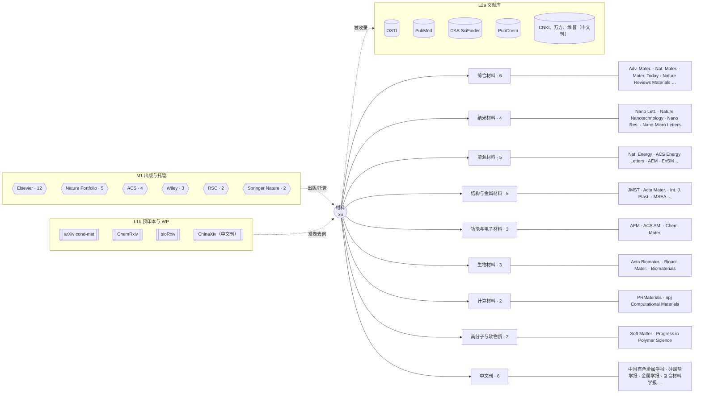

# 材料 venue 名录

> 材料共 36 个 venue（期刊 36、会议 0），分 8 个子领域，另有中文刊 6 个。主要学科库：OSTI、PubMed、CAS SciFinder、PubChem、CNKI、万方、维普（中文刊）；主要预印本与 WP 通道：arXiv cond-mat、ChemRxiv、bioRxiv、ChinaXiv（中文刊）。评级标签的体系、版本与许可见[评级体系](../venue-rankings.md)，七类分层见[来源分层](../source-taxonomy.md)。

## 关联图

## 名录

每个子领域内按评级强弱排序，评级相同按名称。`接入` 一列：`Crossref:ISSN` 指由 Crossref 委托按 ISSN 收元数据，`现有:`/`平台:` 指经名录里已有的来源行，`用户导入` 指只接受用户导出的题录。

### 综合材料（6）

| venue | 类型 | ISSN（印/电）或 dblp | 出版托管（M1） | 评级 | 学科库（L2a） | 预印本（L1b） | 接入 | 备注 |
|---|---|---|---|---|---|---|---|---|
| Advanced Materials（Adv. Mater.） | J | 0935-9648 / 1521-4095 | Wiley-VCH `wiley` | NI; T1(中国材料研究学会、中国硅酸盐学会) | OSTI | arXiv:cond-mat.mtrl-sci; ChemRxiv | Crossref:ISSN |  |
| Nature Materials（Nat. Mater.） | J | 1476-1122 / 1476-4660 | Springer Nature `nature_portfolio` | NI; T1(中国材料研究学会) | OSTI | arXiv:cond-mat.mtrl-sci; ChemRxiv | Crossref:ISSN |  |
| Materials Today（Mater. Today） | J | 1369-7021 / — | Elsevier `elsevier_sd` | T1(中国材料研究学会) | OSTI | arXiv:cond-mat.mtrl-sci; ChemRxiv | Crossref:ISSN |  |
| Nature Reviews Materials（Nat. Rev. Mater.） | J | — / 2058-8437 | Springer Nature `nature_portfolio` | T1(中国材料研究学会) | OSTI | — | Crossref:ISSN | 综述刊 |
| Progress in Materials Science（Prog. Mater. Sci.） | J | 0079-6425 / 1873-2208 | Elsevier `elsevier_sd` | T1(中国材料研究学会) | OSTI | — | Crossref:ISSN | 综述刊 |
| Science China Materials（Sci. China Mater.） | J | 2095-8226 / 2199-4501 | Springer / 中国科学杂志社 `springer_link` | T1(中国材料研究学会、中国金属学会); 卓越-梯队 | OSTI | arXiv:cond-mat.mtrl-sci; ChemRxiv | Crossref:ISSN | 中国(英文)；SciEngine 同刊 |

### 纳米材料（4）

| venue | 类型 | ISSN（印/电）或 dblp | 出版托管（M1） | 评级 | 学科库（L2a） | 预印本（L1b） | 接入 | 备注 |
|---|---|---|---|---|---|---|---|---|
| Nano Letters（Nano Lett.） | J | 1530-6984 / 1530-6992 | ACS `acs` | NI; T1(中国材料研究学会) | OSTI; PubMed | arXiv:cond-mat.mtrl-sci; ChemRxiv | Crossref:ISSN | 旧稿 2026-09-26 已核 |
| Nature Nanotechnology（Nat. Nanotechnol.） | J | 1748-3387 / 1748-3395 | Springer Nature `nature_portfolio` | NI; T1(中国材料研究学会) | OSTI | arXiv:cond-mat.mtrl-sci; ChemRxiv | Crossref:ISSN |  |
| Nano Research（Nano Res.） | J | 1998-0124 / 1998-0000 | 清华大学出版社（SciOpen） | T1(中国材料研究学会); 卓越-领军 | OSTI | arXiv:cond-mat.mtrl-sci; ChemRxiv | Crossref:ISSN | 中国(英文)；落地 SciOpen；e-ISSN 1998-0000 疑误 |
| Nano-Micro Letters（Nano-Micro Lett.） | J | 2311-6706 / 2150-5551 | Springer（上海交大） `springer_link` | T1(中国材料研究学会); 卓越-梯队 | OSTI | arXiv:cond-mat.mtrl-sci; ChemRxiv | Crossref:ISSN | 中国(英文) |

### 能源材料（5）

| venue | 类型 | ISSN（印/电）或 dblp | 出版托管（M1） | 评级 | 学科库（L2a） | 预印本（L1b） | 接入 | 备注 |
|---|---|---|---|---|---|---|---|---|
| Nature Energy（Nat. Energy） | J | — / 2058-7546 | Springer Nature `nature_portfolio` | NI; T1(中国地理学会、中国材料研究学会) | OSTI | arXiv:cond-mat.mtrl-sci; ChemRxiv | Crossref:ISSN |  |
| ACS Energy Letters（ACS Energy Lett.） | J | 2380-8195 / 2380-8195 | ACS `acs` | T1(中国材料研究学会); T2(中国硅酸盐学会) | OSTI | arXiv:cond-mat.mtrl-sci; ChemRxiv | Crossref:ISSN |  |
| Advanced Energy Materials（AEM） | J | 1614-6832 / 1614-6840 | Wiley-VCH `wiley` | T1(中国材料研究学会、中国硅酸盐学会) | OSTI | arXiv:cond-mat.mtrl-sci; ChemRxiv | Crossref:ISSN |  |
| Energy Storage Materials（EnSM） | J | 2405-8297 / — | Elsevier `elsevier_sd` | T1(中国材料研究学会、中国硅酸盐学会) | OSTI | arXiv:cond-mat.mtrl-sci; ChemRxiv | Crossref:ISSN |  |
| Journal of Materials Chemistry A（J. Mater. Chem. A） | J | 2050-7488 / 2050-7496 | RSC `rsc` | T1(中国材料研究学会、中国腐蚀与防护学会) | OSTI | arXiv:cond-mat.mtrl-sci; ChemRxiv | Crossref:ISSN | 旧稿 2026-09-26 已核 |

### 结构与金属材料（5）

| venue | 类型 | ISSN（印/电）或 dblp | 出版托管（M1） | 评级 | 学科库（L2a） | 预印本（L1b） | 接入 | 备注 |
|---|---|---|---|---|---|---|---|---|
| Journal of Materials Science & Technology（JMST） | J | 1005-0302 / — | Elsevier（中国金属学会等） `elsevier_sd` | T1(中国有色金属学会、中国材料研究学会、中国金属学会); T2(中国腐蚀与防护学会); 卓越-领军 | OSTI | arXiv:cond-mat.mtrl-sci; ChemRxiv | Crossref:ISSN | 中国(英文) |
| Acta Materialia（Acta Mater.） | J | 1359-6454 / — | Elsevier（Acta Materialia Inc.） `elsevier_sd` | T1(中国有色金属学会、中国材料研究学会、中国金属学会) | OSTI | arXiv:cond-mat.mtrl-sci; ChemRxiv | Crossref:ISSN |  |
| International Journal of Plasticity（Int. J. Plast.） | J | 0749-6419 / — | Elsevier `elsevier_sd` | T1(中国岩石力学与工程学会); T2(中国材料研究学会) | OSTI | arXiv:cond-mat.mtrl-sci; ChemRxiv | Crossref:ISSN |  |
| Materials Science and Engineering: A（MSEA） | J | 0921-5093 / — | Elsevier `elsevier_sd` | T1(中国有色金属学会、中国金属学会); T2(中国材料研究学会) | OSTI | arXiv:cond-mat.mtrl-sci; ChemRxiv | Crossref:ISSN |  |
| Scripta Materialia（Scripta Mater.） | J | 1359-6462 / — | Elsevier `elsevier_sd` | T1(中国材料研究学会、中国金属学会); T2(中国有色金属学会) | OSTI | arXiv:cond-mat.mtrl-sci; ChemRxiv | Crossref:ISSN |  |

### 功能与电子材料（3）

| venue | 类型 | ISSN（印/电）或 dblp | 出版托管（M1） | 评级 | 学科库（L2a） | 预印本（L1b） | 接入 | 备注 |
|---|---|---|---|---|---|---|---|---|
| Advanced Functional Materials（AFM） | J | 1616-301X / 1616-3028 | Wiley-VCH `wiley` | NI; T1(中国材料研究学会、中国硅酸盐学会) | OSTI | arXiv:cond-mat.mtrl-sci; ChemRxiv | Crossref:ISSN |  |
| ACS Applied Materials & Interfaces（ACS AMI） | J | 1944-8244 / 1944-8252 | ACS `acs` | T1(中国材料研究学会、中国核学会、中国硅酸盐学会 等 4 家) | OSTI | arXiv:cond-mat.mtrl-sci; ChemRxiv | Crossref:ISSN |  |
| Chemistry of Materials（Chem. Mater.） | J | 0897-4756 / 1520-5002 | ACS `acs` | T1(中国材料研究学会) | OSTI; CAS SciFinder（仅外链）; PubChem | arXiv:cond-mat.mtrl-sci; ChemRxiv | Crossref:ISSN |  |

### 生物材料（3）

| venue | 类型 | ISSN（印/电）或 dblp | 出版托管（M1） | 评级 | 学科库（L2a） | 预印本（L1b） | 接入 | 备注 |
|---|---|---|---|---|---|---|---|---|
| Acta Biomaterialia（Acta Biomater.） | J | 1742-7061 / — | Elsevier `elsevier_sd` | NI; T1(中国生物医学工程学会) | PubMed; OSTI | arXiv:cond-mat.mtrl-sci; ChemRxiv; bioRxiv | Crossref:ISSN |  |
| Bioactive Materials（Bioact. Mater.） | J | 2097-1192 / 2452-199X | KeAi（Elsevier 托管） `elsevier_sd` | T1(中国材料研究学会); T2(中国生物医学工程学会) | PubMed; PMC | bioRxiv; ChemRxiv | Crossref:ISSN | 中国(英文)；Crossref 登记 print 2097-1192 |
| Biomaterials | J | 0142-9612 / — | Elsevier `elsevier_sd` | T1(中国生物医学工程学会); T3(中华医学会) | PubMed; OSTI | arXiv:cond-mat.mtrl-sci; ChemRxiv; bioRxiv | Crossref:ISSN |  |

### 计算材料（2）

| venue | 类型 | ISSN（印/电）或 dblp | 出版托管（M1） | 评级 | 学科库（L2a） | 预印本（L1b） | 接入 | 备注 |
|---|---|---|---|---|---|---|---|---|
| Physical Review Materials（PRMaterials） | J | — / 2475-9953 | APS `aps` | T1(中国材料研究学会) | OSTI; INSPIRE ⚠ | arXiv:cond-mat.mtrl-sci | Crossref:ISSN | 兼物理 |
| npj Computational Materials（npj Comput. Mater.） | J | — / 2057-3960 | Springer Nature `nature_portfolio` | T1(中国材料研究学会、中国金属学会) | OSTI | arXiv:cond-mat.mtrl-sci | Crossref:ISSN |  |

### 高分子与软物质（2）

| venue | 类型 | ISSN（印/电）或 dblp | 出版托管（M1） | 评级 | 学科库（L2a） | 预印本（L1b） | 接入 | 备注 |
|---|---|---|---|---|---|---|---|---|
| Soft Matter | J | 1744-683X / 1744-6848 | RSC `rsc` | T1(中国材料研究学会) | OSTI | arXiv:cond-mat.soft; ChemRxiv | Crossref:ISSN |  |
| Progress in Polymer Science（Prog. Polym. Sci.） | J | 0079-6700 / — | Elsevier `elsevier_sd` | — | CAS SciFinder（仅外链）; PubChem | ChemRxiv | Crossref:ISSN | 综述刊 |

### 中文刊（6）

子领域写在备注里。知网、万方、维普只接受用户导入题录；在 Crossref 注册了 DOI 的中文刊可经 Crossref 收元数据。

| venue | 类型 | ISSN（印/电）或 dblp | 出版托管（M1） | 评级 | 学科库（L2a） | 预印本（L1b） | 接入 | 备注 |
|---|---|---|---|---|---|---|---|---|
| 中国有色金属学报（The Chinese Journal of Nonferrous Metals） | J | 1004-0609 / — | 中国有色金属学会 | T1(中国有色金属学会、中国金属学会); T2(中国岩石力学与工程学会、中国材料研究学会); 卓越-领军; CSCD核心; 北大核心; 科技核心 | CNKI; 万方; CSCD | ChinaXiv | 用户导入 | 金属材料；一期梯队 |
| 硅酸盐学报（Journal of the Chinese Ceramic Society） | J | 0454-5648 / — | 中国硅酸盐学会 | T1(中国材料研究学会、中国硅酸盐学会); T3(中国腐蚀与防护学会); 卓越-领军; CSCD核心; 北大核心; 科技核心 | CNKI; 万方; CSCD | ChinaXiv | 用户导入 | 无机非金属；Crossref无该ISSN记录；一期梯队 |
| 金属学报（Acta Metallurgica Sinica） | J | 0412-1961 / — | 中国金属学会 | T1(中国有色金属学会、中国材料研究学会、中国金属学会); T3(中国腐蚀与防护学会); 卓越-领军; CSCD核心; 北大核心; 科技核心 | CNKI; 万方; CSCD | ChinaXiv | 用户导入 | 金属材料；Crossref仅至2013(10.3724)；一期梯队 |
| 复合材料学报（Acta Materiae Compositae Sinica） | J | 1000-3851 / — | 北京航空航天大学 | T2(中国材料研究学会); T3(中国腐蚀与防护学会); 卓越-领军; CSCD核心; 北大核心; 科技核心 | CNKI; 万方; CSCD | ChinaXiv | 用户导入 | 复合材料；Crossref无该ISSN记录；一期梯队 |
| 无机材料学报（Journal of Inorganic Materials） | J | 1000-324X / — | 中国科学院上海硅酸盐研究所 | T1(中国硅酸盐学会); T2(中国材料研究学会); T3(中国腐蚀与防护学会); CSCD核心; 北大核心; 科技核心 | CNKI; 万方; CSCD | ChinaXiv | Crossref:ISSN | 无机非金属；Crossref前缀10.3724 |
| 材料研究学报（Chinese Journal of Materials Research） | J | 1005-3093 / — | 中国材料研究学会 | T1(中国有色金属学会); T2(中国材料研究学会、中国金属学会); T3(中国腐蚀与防护学会); CSCD核心; 北大核心; 科技核心 | CNKI; 万方; CSCD | ChinaXiv | 用户导入 | 综合材料；Crossref无该ISSN记录 |

## 出处与说明

- **T 级**：材料-综合（中国材料研究学会，2025）、无机非金属（中国硅酸盐学会，2025）、冶金与金属材料（中国金属学会，2024）、有色金属（2024）、材料失效与保护（2021）。
- **平台**：Nano Research 在清华社 SciOpen（不在名录），Crossref 给它登记的 e-ISSN 1998-0000 疑似错误。
- **缺口**：没有开放的材料学科书目库；Materials Project、NOMAD 等是数据库，可作信号候选；TMS、ASM 等学会平台未列。
