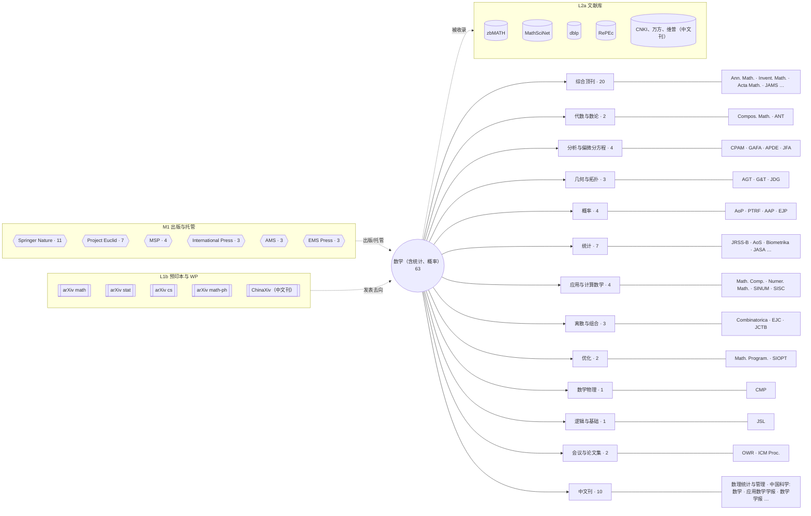

# 数学 venue 名录

> 数学（含统计、概率）共 63 个 venue（期刊 61、会议 2），分 12 个子领域，另有中文刊 10 个。主要学科库：zbMATH、MathSciNet、dblp、RePEc、CNKI、万方、维普（中文刊）；主要预印本与 WP 通道：arXiv math、arXiv stat、arXiv cs、arXiv math-ph、ChinaXiv（中文刊）。评级标签的体系、版本与许可见[评级体系](../venue-rankings.md)，七类分层见[来源分层](../source-taxonomy.md)。

## 关联图

## 名录

每个子领域内按评级强弱排序，评级相同按名称。`接入` 一列：`Crossref:ISSN` 指由 Crossref 委托按 ISSN 收元数据，`现有:`/`平台:` 指经名录里已有的来源行，`用户导入` 指只接受用户导出的题录。

### 综合顶刊（20）

| venue | 类型 | ISSN（印/电）或 dblp | 出版托管（M1） | 评级 | 学科库（L2a） | 预印本（L1b） | 接入 | 备注 |
|---|---|---|---|---|---|---|---|---|
| Annals of Mathematics（Ann. Math.） | J | 0003-486X / 1939-8980 | Princeton Univ./IAS（自营） `annals_math` | 惯例-顶级; NI; T1(中国数学会) | zbMATH; MathSciNet | arXiv:math | Crossref:ISSN | 数学四大；摘要覆盖 0.11 |
| Inventiones Mathematicae（Invent. Math.） | J | 0020-9910 / 1432-1297 | Springer Nature `springer_link` | 惯例-顶级; NI; T1(中国数学会) | zbMATH; MathSciNet | arXiv:math | Crossref:ISSN | 数学四大 |
| Acta Mathematica（Acta Math.） | J | 0001-5962 / 1871-2509 | International Press（Mittag-Leffler） `intl_press` | 惯例-顶级; T1(中国数学会) | zbMATH; MathSciNet | arXiv:math | Crossref:ISSN | 数学四大；期刊级 OA 不在 DOAJ |
| Journal of the American Mathematical Society（JAMS） | J | 0894-0347 / 1088-6834 | American Mathematical Society `ams` | 惯例-顶级; T1(中国数学会) | zbMATH; MathSciNet | arXiv:math | Crossref:ISSN | 数学四大；5 年后免费 ⚠ |
| Acta Mathematica Sinica, English Series（Acta Math. Sin. Engl.） | J | 1439-8516 / 1439-7617 | 中国数学会 / Springer Nature `springer_link` | T1(中国数学会); 卓越-梯队 | zbMATH; MathSciNet | arXiv:math | Crossref:ISSN | 中国(英文)；数学学报英文版 |
| Advances in Mathematics（Adv. Math.） | J | 0001-8708 / 1090-2082 | Elsevier `elsevier_sd` | T1(中国数学会) | zbMATH; MathSciNet | arXiv:math | Crossref:ISSN | Crossref 摘要 0.00 |
| American Journal of Mathematics（Amer. J. Math.） | J | 0002-9327 / 1080-6377 | Johns Hopkins Univ. Press（Project MUSE） | T1(中国数学会) | zbMATH; MathSciNet | arXiv:math | Crossref:ISSN | Project MUSE 未在 187 行 |
| Annales scientifiques de l'École normale supérieure（Ann. Sci. ENS） | J | 0012-9593 / 1873-2151 | Société Mathématique de France | T1(中国数学会) | zbMATH; MathSciNet | arXiv:math | Crossref:ISSN | SMF 平台未勘察 |
| Cambridge Journal of Mathematics（CJM） | J | 2168-0930 / 2168-0949 | International Press `intl_press` | T1(中国数学会) | zbMATH; MathSciNet | arXiv:math | Crossref:ISSN |  |
| Duke Mathematical Journal（Duke Math. J.） | J | 0012-7094 / 1547-7398 | Duke Univ. Press / Project Euclid `project_euclid` | T1(中国数学会) | zbMATH; MathSciNet | arXiv:math | Crossref:ISSN | 摘要 0.09，arXiv/zbMATH 补 |
| Journal für die reine und angewandte Mathematik（Crelle） | J | 0075-4102 / 1435-5345 | De Gruyter Brill `degruyter_brill` | T1(中国数学会) | zbMATH; MathSciNet | arXiv:math | Crossref:ISSN |  |
| Journal of the European Mathematical Society（JEMS） | J | 1435-9855 / 1435-9863 | EMS Press `ems_press` | T1(中国数学会) | zbMATH; MathSciNet | arXiv:math | Crossref:ISSN | S2O 2024–26 |
| Mathematische Annalen（Math. Ann.） | J | 0025-5831 / 1432-1807 | Springer Nature `springer_link` | T1(中国数学会) | zbMATH; MathSciNet | arXiv:math | Crossref:ISSN |  |
| Peking Mathematical Journal（PMJ） | J | 2096-6075 / 2524-7182 | 北京大学 / Springer Nature `springer_link` | T1(中国数学会) | zbMATH; MathSciNet | arXiv:math | Crossref:ISSN | 中国(英文)；北京数学杂志（英文） |
| Proceedings of the London Mathematical Society（Proc. LMS） | J | 0024-6115 / — | Wiley（LMS） `wiley` | T1(中国数学会) | zbMATH; MathSciNet | arXiv:math | Crossref:ISSN | Crossref 电子 ISSN 误登 1234-5678 |
| Publications Mathématiques de l'IHÉS（Publ. Math. IHÉS） | J | 0073-8301 / 1618-1913 | Centre Mersenne（MathDoc） `centre_mersenne_numdam` | T1(中国数学会) | zbMATH; MathSciNet | arXiv:math | Crossref:ISSN | 已迁出 Springer（10.5802）；OA ⚠ |
| Science China Mathematics（Sci. China Math.） | J | 1674-7283 / 1869-1862 | Science China Press / Springer Nature `springer_link` | T1(中国数学会); 卓越-梯队 | zbMATH; MathSciNet | arXiv:math | Crossref:ISSN | 中国(英文)；中国科学：数学（英文版） |
| Forum of Mathematics, Pi（Forum Math. Pi） | J | — / 2050-5086 | Cambridge University Press `cambridge_core` | T2(中国数学会) | zbMATH; MathSciNet | arXiv:math | Crossref:ISSN | DOAJ |
| International Mathematics Research Notices（IMRN） | J | 1073-7928 / 1687-0247 | Oxford University Press `oup_academic` | T2(中国数学会) | zbMATH; MathSciNet | arXiv:math | Crossref:ISSN |  |
| Transactions of the AMS（Trans. AMS） | J | 0002-9947 / 1088-6850 | American Mathematical Society `ams` | T2(中国数学会) | zbMATH; MathSciNet | arXiv:math | Crossref:ISSN |  |

### 代数与数论（2）

| venue | 类型 | ISSN（印/电）或 dblp | 出版托管（M1） | 评级 | 学科库（L2a） | 预印本（L1b） | 接入 | 备注 |
|---|---|---|---|---|---|---|---|---|
| Compositio Mathematica（Compos. Math.） | J | 0010-437X / 1570-5846 | Cambridge University Press（Foundation Compositio） `cambridge_core` | T1(中国数学会) | zbMATH; MathSciNet | arXiv:math.AG; math.NT | Crossref:ISSN |  |
| Algebra & Number Theory（ANT） | J | 1937-0652 / 1944-7833 | Mathematical Sciences Publishers `msp` | T2(中国数学会) | zbMATH; MathSciNet | arXiv:math.NT; math.AG | Crossref:ISSN | S2O ⚠；Crossref 摘要 0.00 |

### 分析与偏微分方程（4）

| venue | 类型 | ISSN（印/电）或 dblp | 出版托管（M1） | 评级 | 学科库（L2a） | 预印本（L1b） | 接入 | 备注 |
|---|---|---|---|---|---|---|---|---|
| Communications on Pure and Applied Mathematics（CPAM） | J | 0010-3640 / 1097-0312 | Wiley `wiley` | T1(中国数学会) | zbMATH; MathSciNet | arXiv:math.AP | Crossref:ISSN |  |
| Geometric and Functional Analysis（GAFA） | J | 1016-443X / 1420-8970 | Springer Nature（Birkhäuser） `springer_link` | T1(中国数学会) | zbMATH; MathSciNet | arXiv:math.FA; math.DG | Crossref:ISSN |  |
| Analysis & PDE（APDE） | J | 2157-5045 / 1948-206X | Mathematical Sciences Publishers `msp` | T2(中国数学会) | zbMATH; MathSciNet | arXiv:math.AP | Crossref:ISSN | S2O ⚠ |
| Journal of Functional Analysis（JFA） | J | 0022-1236 / 1096-0783 | Elsevier `elsevier_sd` | T2(中国数学会) | zbMATH; MathSciNet | arXiv:math.FA | Crossref:ISSN |  |

### 几何与拓扑（3）

| venue | 类型 | ISSN（印/电）或 dblp | 出版托管（M1） | 评级 | 学科库（L2a） | 预印本（L1b） | 接入 | 备注 |
|---|---|---|---|---|---|---|---|---|
| Algebraic & Geometric Topology（AGT） | J | 1472-2747 / 1472-2739 | Mathematical Sciences Publishers `msp` | T2(中国数学会) | zbMATH; MathSciNet | arXiv:math.GT | Crossref:ISSN |  |
| Geometry & Topology（G&T） | J | 1465-3060 / 1364-0380 | Mathematical Sciences Publishers `msp` | T2(中国数学会) | zbMATH; MathSciNet | arXiv:math.GT | Crossref:ISSN | S2O ⚠ |
| Journal of Differential Geometry（JDG） | J | 0022-040X / 1945-743X | International Press（Lehigh Univ.） `intl_press` | T2(中国数学会) | zbMATH; MathSciNet | arXiv:math.DG | Crossref:ISSN | Project Euclid 亦收录 ⚠ |

### 概率（4）

| venue | 类型 | ISSN（印/电）或 dblp | 出版托管（M1） | 评级 | 学科库（L2a） | 预印本（L1b） | 接入 | 备注 |
|---|---|---|---|---|---|---|---|---|
| Annals of Probability（AoP） | J | 0091-1798 / 2168-894X | Institute of Mathematical Statistics `project_euclid` | ABDC-A*; T1(中国数学会) | zbMATH; MathSciNet | arXiv:math.PR | Crossref:ISSN | IMS 托管关系 ⚠ |
| Probability Theory and Related Fields（PTRF） | J | 0178-8051 / 1432-2064 | Springer Nature `springer_link` | ABDC-A*; T1(中国数学会) | zbMATH; MathSciNet | arXiv:math.PR | Crossref:ISSN |  |
| Annals of Applied Probability（AAP） | J | 1050-5164 / 2168-8737 | Institute of Mathematical Statistics `project_euclid` | ABDC-A; T2(中国数学会) | zbMATH; MathSciNet | arXiv:math.PR | Crossref:ISSN | IMS 托管关系 ⚠ |
| Electronic Journal of Probability（EJP） | J | — / 1083-6489 | Institute of Mathematical Statistics / Bernoulli Society `project_euclid` | ABDC-A; T2(中国数学会) | zbMATH; MathSciNet | arXiv:math.PR | Crossref:ISSN | OA 按刊名口径 ⚠ |

### 统计（7）

| venue | 类型 | ISSN（印/电）或 dblp | 出版托管（M1） | 评级 | 学科库（L2a） | 预印本（L1b） | 接入 | 备注 |
|---|---|---|---|---|---|---|---|---|
| Journal of the Royal Statistical Society Series B（JRSS-B） | J | 1369-7412 / 1467-9868 | Oxford University Press（RSS） `oup_academic` | 惯例-顶级; NI; ABDC-A*; FMS-A; T1(中国数学会) | zbMATH; MathSciNet; RePEc | arXiv:stat.ME | Crossref:ISSN | 统计四大 |
| Annals of Statistics（AoS） | J | 0090-5364 / 2168-8966 | Institute of Mathematical Statistics `project_euclid` | 惯例-顶级; ABDC-A*; FMS-A; T1(中国数学会) | zbMATH; MathSciNet; RePEc | arXiv:math.ST; stat.ME | Crossref:ISSN | 统计四大；托管平台 ⚠ |
| Biometrika | J | 0006-3444 / 1464-3510 | Oxford University Press `oup_academic` | 惯例-顶级; ABDC-A*; FMS-A; T1(中国数学会) | zbMATH; MathSciNet; RePEc | arXiv:stat.ME | Crossref:ISSN | 统计四大 |
| Journal of the American Statistical Association（JASA） | J | 0162-1459 / 1537-274X | Taylor & Francis（ASA） `tandf_online` | 惯例-顶级; ABDC-A*; FMS-A; T1(中国数学会) | zbMATH; MathSciNet; RePEc | arXiv:stat.ME | Crossref:ISSN | 统计四大；Crossref 摘要 0% |
| Annals of Applied Statistics（AoAS） | J | 1932-6157 / 1941-7330 | Institute of Mathematical Statistics `project_euclid` | ABDC-A; FMS-B; T1(中国数学会) | zbMATH; MathSciNet | arXiv:stat.AP | Crossref:ISSN | 电子 ISSN 取自 ABDC |
| Bernoulli | J | 1350-7265 / — | Bernoulli Society（Project Euclid 托管 ⚠） `project_euclid` | ABDC-A; T1(中国数学会) | zbMATH; MathSciNet | arXiv:math.ST; math.PR | Crossref:ISSN |  |
| Statistica Sinica（Stat. Sin.） | J | 1017-0405 / 1017-0405 | Institute of Statistical Science, Academia Sinica | ABDC-A; FMS-B; T2(中国数学会) | zbMATH; MathSciNet | arXiv:stat.ME | Crossref:ISSN | 其他；台湾 Academia Sinica 主办；自营站 |

### 应用与计算数学（4）

| venue | 类型 | ISSN（印/电）或 dblp | 出版托管（M1） | 评级 | 学科库（L2a） | 预印本（L1b） | 接入 | 备注 |
|---|---|---|---|---|---|---|---|---|
| Mathematics of Computation（Math. Comp.） | J | 0025-5718 / 1088-6842 | American Mathematical Society `ams` | T1(中国数学会) | zbMATH; MathSciNet | arXiv:math.NA | Crossref:ISSN | 5 年后免费 ⚠ |
| Numerische Mathematik（Numer. Math.） | J | 0029-599X / 0945-3245 | Springer Nature `springer_link` | T1(中国数学会) | zbMATH; MathSciNet | arXiv:math.NA | Crossref:ISSN |  |
| SIAM Journal on Numerical Analysis（SINUM） | J | 0036-1429 / 1095-7170 | SIAM `siam` | T1(中国数学会) | zbMATH; MathSciNet | arXiv:math.NA | Crossref:ISSN |  |
| SIAM Journal on Scientific Computing（SISC） | J | 1064-8275 / 1095-7197 | SIAM `siam` | T1(中国数学会) | zbMATH; MathSciNet | arXiv:math.NA; cs.NA | Crossref:ISSN |  |

### 离散与组合（3）

| venue | 类型 | ISSN（印/电）或 dblp | 出版托管（M1） | 评级 | 学科库（L2a） | 预印本（L1b） | 接入 | 备注 |
|---|---|---|---|---|---|---|---|---|
| Combinatorica | J | 0209-9683 / 1439-6912 | Springer Nature `springer_link` | T2(中国数学会) | zbMATH; MathSciNet; dblp | arXiv:math.CO | Crossref:ISSN |  |
| Electronic Journal of Combinatorics（EJC） | J | — / 1077-8926 | Electronic Journal of Combinatorics（自营） | T3(中国数学会) | zbMATH; MathSciNet; dblp | arXiv:math.CO | Crossref:ISSN | 钻石 OA 口径 ⚠ |
| Journal of Combinatorial Theory, Series B（JCTB） | J | 0095-8956 / 1096-0902 | Elsevier `elsevier_sd` | T2(中国数学会) | zbMATH; MathSciNet; dblp | arXiv:math.CO | Crossref:ISSN |  |

### 优化（2）

| venue | 类型 | ISSN（印/电）或 dblp | 出版托管（M1） | 评级 | 学科库（L2a） | 预印本（L1b） | 接入 | 备注 |
|---|---|---|---|---|---|---|---|---|
| Mathematical Programming（Math. Program.） | J | 0025-5610 / 1436-4646 | Springer Nature（MOS） `springer_link` | FMS-A; T1(中国数学会) | zbMATH; MathSciNet; dblp | arXiv:math.OC | Crossref:ISSN |  |
| SIAM Journal on Optimization（SIOPT） | J | 1052-6234 / 1095-7189 | SIAM `siam` | FMS-B; T1(中国数学会) | zbMATH; MathSciNet; dblp | arXiv:math.OC | Crossref:ISSN |  |

### 数学物理（1）

| venue | 类型 | ISSN（印/电）或 dblp | 出版托管（M1） | 评级 | 学科库（L2a） | 预印本（L1b） | 接入 | 备注 |
|---|---|---|---|---|---|---|---|---|
| Communications in Mathematical Physics（CMP） | J | 0010-3616 / 1432-0916 | Springer Nature `springer_link` | T1(中国数学会) | zbMATH; MathSciNet; INSPIRE | arXiv:math-ph; hep-th | Crossref:ISSN |  |

### 逻辑与基础（1）

| venue | 类型 | ISSN（印/电）或 dblp | 出版托管（M1） | 评级 | 学科库（L2a） | 预印本（L1b） | 接入 | 备注 |
|---|---|---|---|---|---|---|---|---|
| Journal of Symbolic Logic（JSL） | J | 0022-4812 / 1943-5886；dblp `journals/jsyml` | Cambridge University Press（ASL） `cambridge_core` | CCF-C; T2(中国数学会) | zbMATH; MathSciNet; dblp | arXiv:math.LO | Crossref:ISSN |  |

### 会议与论文集（2）

| venue | 类型 | ISSN（印/电）或 dblp | 出版托管（M1） | 评级 | 学科库（L2a） | 预印本（L1b） | 接入 | 备注 |
|---|---|---|---|---|---|---|---|---|
| Oberwolfach Reports（OWR） | C | 1660-8933 / 1660-8941 | EMS Press（MFO） `ems_press` | — | zbMATH; MathSciNet | — | 平台:ems_press | 研讨会报告，非同行评审 ⚠；M1 平台型 |
| Proceedings of the International Congress of Mathematicians（ICM Proc.） | C | — | EMS Press `ems_press` | — | zbMATH; MathSciNet | arXiv:math | 平台:ems_press | 2022 届 DOI 10.4171/icm2022-N；book 级 venue |

### 中文刊（10）

子领域写在备注里。知网、万方、维普只接受用户导入题录；在 Crossref 注册了 DOI 的中文刊可经 Crossref 收元数据。

| venue | 类型 | ISSN（印/电）或 dblp | 出版托管（M1） | 评级 | 学科库（L2a） | 预印本（L1b） | 接入 | 备注 |
|---|---|---|---|---|---|---|---|---|
| 数理统计与管理（Journal of Applied Statistics and Management） | J | 1002-1566 / — | 中国现场统计研究会 | CSSCI; 北大核心; 科技核心; AMI-核心; NSFC管理-B; FMS-T2 | CNKI; 万方; 维普 | ChinaXiv | 用户导入 | 统计与概率；Crossref无该ISSN记录 |
| 中国科学:数学（Scientia Sinica Mathematica） | J | 1674-7216 / — | 中国科学杂志社 `sciengine` | T3(中国数学会); 卓越-梯队; CSCD核心; 北大核心; 科技核心 | CNKI; 万方; CSCD | ChinaXiv | Crossref:ISSN | 纯数学；Crossref前缀10.1360 |
| 应用数学学报（Acta Mathematicae Applicatae Sinica） | J | 0254-3079 / — | 中国数学会 | T3(中国数学会); CSCD核心; 北大核心; 科技核心 | CNKI; 万方; CSCD | ChinaXiv | 用户导入 | 应用数学；Crossref无该ISSN记录 |
| 数学学报（Acta Mathematica Sinica (Chinese Series)） | J | 0583-1431 / — | 中国科学院数学与系统科学研究院 | T3(中国数学会); CSCD核心; 北大核心; 科技核心 | CNKI; 万方; CSCD | ChinaXiv | 用户导入 | 纯数学；Crossref无该ISSN记录 |
| 数学物理学报（Acta Mathematica Scientia (Chinese)） | J | 1003-3998 / — | 中国科学院精密测量科学与技术创新研究院 | T3(中国数学会); CSCD核心; 北大核心; 科技核心 | CNKI; 万方; CSCD | ChinaXiv | 用户导入 | 应用数学；Crossref无该ISSN记录 |
| 系统科学与数学（Journal of Systems Science and Mathematical Sciences） | J | 1000-0577 / — | 中国科学院数学与系统科学研究院 | T3(中国数学会); 卓越-梯队; CSCD核心; 北大核心; 科技核心; FMS-T2 | CNKI; 万方; CSCD | ChinaXiv | 用户导入 | 系统科学与运筹；Crossref无该ISSN记录 |
| 计算数学（Mathematica Numerica Sinica） | J | 0254-7791 / — | 中国科学院数学与系统科学研究院 | T3(中国数学会); CSCD核心; 北大核心; 科技核心 | CNKI; 万方; CSCD | ChinaXiv | 用户导入 | 计算数学；Crossref无该ISSN记录 |
| 应用概率统计（Chinese Journal of Applied Probability and Statistics） | J | 1001-4268 / — | 中国数学会 | T3(中国数学会); CSCD扩展; 北大核心; 科技核心 | CNKI; 万方; CSCD | ChinaXiv | 用户导入 | 统计与概率；Crossref无该ISSN记录 |
| 数学年刊A辑（Chinese Annals of Mathematics, Ser. A） | J | 1000-8314 / — | 复旦大学 | T3(中国数学会); CSCD扩展; 北大核心 | CNKI; 万方; CSCD | ChinaXiv | 用户导入 | 纯数学；Crossref无该ISSN记录 |
| 数学进展（Advances in Mathematics (China)） | J | 1000-0917 / — | 中国数学会 | T3(中国数学会); CSCD扩展; 北大核心; 科技核心 | CNKI; 万方; CSCD | ChinaXiv | 用户导入 | 纯数学；Crossref无该ISSN记录 |

## 出处与说明

- **T 级**：`T1/T2/T3(中国数学会)` 取自中国数学会《数学领域高质量科技期刊分级目录（2024 年版）》，449 种，分数学、概率统计、应用数学、跨学科应用数学四类（[PDF](https://www.cms.org.cn/ueditor/php/upload/file/20250214/1739494838285535.pdf)，2026-09-27 访问）。
- **惯例**：`惯例-顶级` 指数学四大（Annals、Acta、Inventiones、JAMS）与统计四大（AoS、JASA、JRSS-B、Biometrika），只有二手出处（新闻报道、中国人民大学统计与大数据研究院页面）。ICM Proceedings 没有名录出处，不标。
- **其他**：`NI` 当前只有 Annals、Inventiones、JRSS-B；`ABDC-*` 只覆盖统计与运筹刊。
- **待核**：IMS 刊的托管平台（Project Euclid 还是 IMS 自有站）按旧稿推断；Proc. LMS 在 Crossref 登记的电子 ISSN 是错误值 1234-5678，已留空；Algebraic Geometry、数学学报在 Crossref 无刊级记录；dblp key 只填了经 CCF 名单核实的 JSL。
