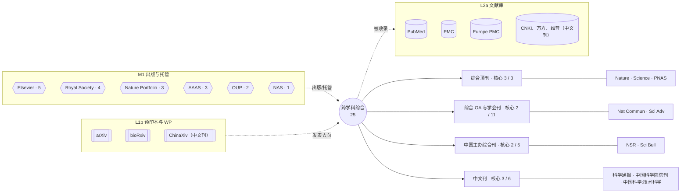

# 跨学科综合 venue 名录

> 跨学科综合共 25 个 venue（期刊 25、会议 0），归并为 3 个子领域（原 4 个），另有中文刊 6 个。其中核心 10 个优先支持，其余 15 个登记在册、暂不专门支持，规则见[支持分级](README.md#支持分级)。主要学科库：PubMed、PMC、Europe PMC、CNKI、万方、维普（中文刊）；主要预印本与 WP 通道：arXiv、bioRxiv、ChinaXiv（中文刊）。评级标签的体系、版本与许可见[评级体系](../venue-rankings.md)，七类分层见[来源分层](../source-taxonomy.md)。

## 关联图

## 核心 venue（优先支持）

每个子领域内按评级强弱排序，评级相同按名称。`接入` 一列：`Crossref:ISSN` 指由 Crossref 委托按 ISSN 收元数据，`现有:`/`平台:` 指经名录里已有的来源行，`用户导入` 指只接受用户导出的题录。

本节只列核心 venue：逐刊核验标识与通道，进入首批验收与默认推荐池。其余 venue 见下文"登记 venue"。子领域由原来的细分方向归并而成：合并组先按原方向、再按评级排列，备注以"方向："开头标出原方向。

### 综合顶刊（核心 3 · 登记 0）

| venue | 类型 | ISSN（印/电）或 dblp | 出版托管（M1） | 评级 | 学科库（L2a） | 预印本（L1b） | 接入 | 备注 |
|---|---|---|---|---|---|---|---|---|
| Nature | J | 0028-0836 / 1476-4687 | Springer Nature（Nature Portfolio） `nature_portfolio` | NI; T1(中国地理学会、中国细胞生物学学会) | PubMed; Europe PMC | arXiv; bioRxiv | 平台:nature_portfolio |  |
| Science | J | 0036-8075 / 1095-9203 | AAAS `aaas_science` | NI; T1(中国地理学会、中国细胞生物学学会) | PubMed; Europe PMC | arXiv; bioRxiv | 平台:aaas_science |  |
| Proceedings of the National Academy of Sciences（PNAS） | J | 0027-8424 / 1091-6490 | NAS `pnas` | NI; T2(中国细胞生物学学会) | PubMed; PMC | arXiv; bioRxiv | 现有:pnas | 6 个月后经 PMC 开放 |

### 综合 OA 与学会刊（核心 2 · 登记 9）

含原方向：综合 OA 大刊、学会综合刊。

| venue | 类型 | ISSN（印/电）或 dblp | 出版托管（M1） | 评级 | 学科库（L2a） | 预印本（L1b） | 接入 | 备注 |
|---|---|---|---|---|---|---|---|---|
| Nature Communications（Nat Commun） | J | 2041-1723 / 2041-1723 | Springer Nature（Nature Portfolio） `nature_portfolio` | NI; T1(中国光学工程学会、中国地理学会); T2(中国细胞生物学学会) | PubMed; PMC | bioRxiv | 平台:nature_portfolio | 方向：综合 OA 大刊 |
| Science Advances（Sci Adv） | J | 2375-2548 / 2375-2548 | AAAS `aaas_science` | NI; T1(中国光学工程学会、中国地理学会); T2(中国细胞生物学学会) | PubMed; PMC | bioRxiv | 平台:aaas_science | 方向：综合 OA 大刊 |

### 中国主办综合刊（核心 2 · 登记 3）

| venue | 类型 | ISSN（印/电）或 dblp | 出版托管（M1） | 评级 | 学科库（L2a） | 预印本（L1b） | 接入 | 备注 |
|---|---|---|---|---|---|---|---|---|
| National Science Review（NSR） | J | 2095-5138 / 2053-714X | OUP（中国科学杂志社主办） `oup_academic` | T1(中国地理学会); 卓越-领军 | PubMed; PMC | — | Crossref:ISSN | 中国(英文) |
| Science Bulletin（Sci Bull） | J | 2095-9273 / 2095-9281 | Elsevier（中国科学杂志社主办） `elsevier_sd` | T1(中国光学工程学会、中国地理学会); 卓越-领军 | — | — | Crossref:ISSN | 中国(英文)；中文版为《科学通报》 |

### 中文刊（核心 3 · 登记 3）

子领域写在备注里。知网、万方、维普只接受用户导入题录；在 Crossref 注册了 DOI 的中文刊可经 Crossref 收元数据。只接受用户导入的中文刊不列为核心。

| venue | 类型 | ISSN（印/电）或 dblp | 出版托管（M1） | 评级 | 学科库（L2a） | 预印本（L1b） | 接入 | 备注 |
|---|---|---|---|---|---|---|---|---|
| 科学通报（Chinese Science Bulletin） | J | 0023-074X / — | 中国科学杂志社 `sciengine` | T1(中国地理学会、中国计算机学会); T3(中国植物学会、中国细胞生物学学会); 卓越-领军; CSCD核心; 北大核心; 科技核心; CCF中文-B | CNKI; 万方; CSCD | ChinaXiv | Crossref:ISSN | 综合；Crossref前缀10.1360；一期梯队 |
| 中国科学院院刊（Bulletin of Chinese Academy of Sciences） | J | 1000-3045 / — | 中国科学院科技战略咨询研究院 | T1(中国地理学会); T2(中国地理学会); 卓越-梯队; CSSCI; CSCD核心; 北大核心; 科技核心; AMI-核心 | CNKI; 万方; CSCD | ChinaXiv | Crossref:ISSN | 综合；Crossref前缀10.3724；一期梯队 |
| 中国科学:技术科学（Scientia Sinica Technologica） | J | 1674-7259 / — | 中国科学杂志社 `sciengine` | CSCD核心; 北大核心; 科技核心 | CNKI; 万方; CSCD | ChinaXiv | Crossref:ISSN | 综合；Crossref前缀10.1360 |

## 登记 venue（长尾，暂不支持）

以下 venue 登记在册，保留标识、托管与评级，但暂不逐刊核验通道、不进首批验收。用户关注其中任意一个时，照常经 Crossref 或 OpenAlex 自动建 venue（`auto`）收元数据；问卷、调研与关注数达到[升级条件](README.md#支持分级)后升为核心。

### 综合 OA 与学会刊（登记 9）

| venue | 类型 | ISSN（印/电）或 dblp | 出版托管（M1） | 评级 | 学科库（L2a） | 预印本（L1b） | 接入 | 备注 |
|---|---|---|---|---|---|---|---|---|
| Nexus | J | 2950-1601 / — | Elsevier（Cell Press） `elsevier_sd` | — | — | — | Crossref:ISSN | 方向：综合 OA 大刊；2024 年创刊 |
| PLOS ONE | J | — / 1932-6203 | PLOS `plos` | — | PubMed; PMC | — | 平台:plos | 方向：综合 OA 大刊；发文量极大，默认不进推荐首批 |
| PNAS Nexus | J | — / 2752-6542 | OUP（NAS 主办） `oup_academic` | — | PubMed; PMC | — | Crossref:ISSN | 方向：综合 OA 大刊 |
| Scientific Reports（Sci Rep） | J | — / 2045-2322 | Springer Nature（Nature Portfolio） `nature_portfolio` | — | PubMed; PMC | — | Crossref:ISSN | 方向：综合 OA 大刊；发文量极大，默认不进推荐首批 |
| iScience | J | 2589-0042 / — | Elsevier（Cell Press） `elsevier_sd` | — | PubMed; PMC | — | Crossref:ISSN | 方向：综合 OA 大刊 |
| Journal of the Royal Society Interface（J R Soc Interface） | J | 1742-5689 / 1742-5662 | Royal Society `royal_society` | — | PubMed | arXiv; bioRxiv | 平台:royal_society | 方向：学会综合刊 |
| Philosophical Transactions of the Royal Society A（Phil Trans A） | J | 1364-503X / 1471-2962 | Royal Society `royal_society` | — | — | arXiv | 平台:royal_society | 方向：学会综合刊；2026 年 S2O 转 OA |
| Proceedings of the Royal Society A（Proc R Soc A） | J | 1364-5021 / 1471-2946 | Royal Society `royal_society` | — | — | arXiv | 平台:royal_society | 方向：学会综合刊；2026 年 S2O 转 OA |
| Royal Society Open Science（RSOS） | J | 2054-5703 / 2054-5703 | Royal Society `royal_society` | — | PubMed; PMC | — | 平台:royal_society | 方向：学会综合刊 |

### 中国主办综合刊（登记 3）

| venue | 类型 | ISSN（印/电）或 dblp | 出版托管（M1） | 评级 | 学科库（L2a） | 预印本（L1b） | 接入 | 备注 |
|---|---|---|---|---|---|---|---|---|
| Fundamental Research | J | 2667-3258 / — | Elsevier（NSFC 主办） `elsevier_sd` | FMS-B; 卓越-梯队 | PubMed | — | Crossref:ISSN | 中国(英文) |
| Research | J | 2639-5274 / 2639-5274 | AAAS（中国科协主办的 Science Partner Journal） `aaas_science` | 卓越-梯队 | PubMed; PMC | — | Crossref:ISSN | 中国(英文) |
| The Innovation | J | 2666-6758 / — | Elsevier（Cell Press 合作） `elsevier_sd` | — | PubMed | — | Crossref:ISSN | 中国(英文) |

### 中文刊（登记 3）

| venue | 类型 | ISSN（印/电）或 dblp | 出版托管（M1） | 评级 | 学科库（L2a） | 预印本（L1b） | 接入 | 备注 |
|---|---|---|---|---|---|---|---|---|
| 中国社会科学（Social Sciences in China） | J | 1002-4921 / — | 中国社会科学院 | CSSCI; 北大核心; 科技核心; AMI-顶级; FMS-T1 | CNKI; 万方; 维普 | — | 用户导入 | 综合；Crossref无该ISSN记录 |
| 北京大学学报(自然科学版)（Acta Scientiarum Naturalium Universitatis Pekinensis） | J | 0479-8023 / — | 北京大学 | 卓越-领军; CSCD核心; 北大核心; 科技核心 | CNKI; 万方; CSCD | ChinaXiv | 用户导入 | 高校学报；Crossref无该ISSN记录 |
| 清华大学学报(自然科学版)（Journal of Tsinghua University (Science and Technology)） | J | 1000-0054 / — | 清华大学 | 卓越-领军; CSCD核心; 北大核心; 科技核心 | CNKI; 万方; CSCD | ChinaXiv | 用户导入 | 高校学报；Crossref无该ISSN记录 |

## 出处与说明

- **名录**：`NI`（Nature、Science、PNAS、Science Advances、Nature Communications）；`卓越-*`（中国科技期刊卓越行动计划二期，2024）；中文综合刊（中国科学各辑、科学通报、中国社会科学等）标中文体系。
- **说明**：Scientific Reports、PLOS ONE 发文量极大，列出只为登记，默认不进推荐首批。
- **支持分级**：核心按[支持分级](README.md#支持分级)的规则初选，2026-09-29 定稿。人工补选 Science、PNAS（评级标签缺失或不反映学科地位）。
