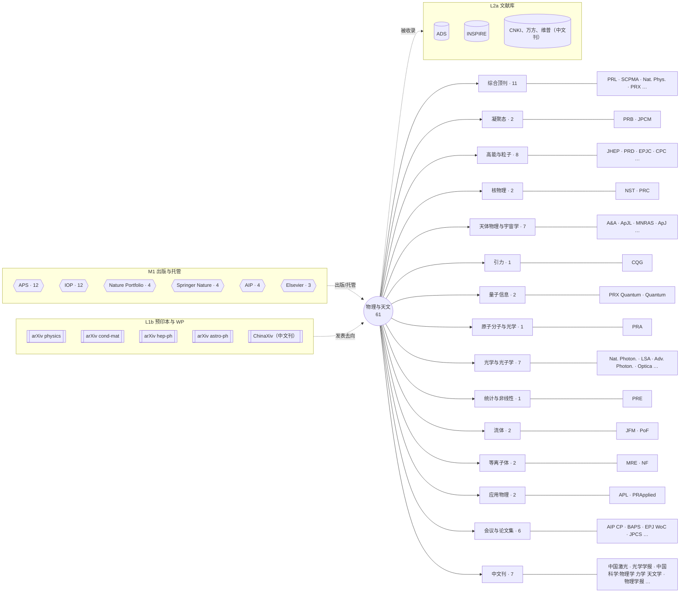

# 物理与天文 venue 名录

> 物理与天文共 61 个 venue（期刊 55、会议 6），分 14 个子领域，另有中文刊 7 个。主要学科库：ADS、INSPIRE、CNKI、万方、维普（中文刊）；主要预印本与 WP 通道：arXiv physics、arXiv cond-mat、arXiv hep-ph、arXiv astro-ph、ChinaXiv（中文刊）。评级标签的体系、版本与许可见[评级体系](../venue-rankings.md)，七类分层见[来源分层](../source-taxonomy.md)。

## 关联图

## 名录

每个子领域内按评级强弱排序，评级相同按名称。`接入` 一列：`Crossref:ISSN` 指由 Crossref 委托按 ISSN 收元数据，`现有:`/`平台:` 指经名录里已有的来源行，`用户导入` 指只接受用户导出的题录。

### 综合顶刊（11）

| venue | 类型 | ISSN（印/电）或 dblp | 出版托管（M1） | 评级 | 学科库（L2a） | 预印本（L1b） | 接入 | 备注 |
|---|---|---|---|---|---|---|---|---|
| Physical Review Letters（PRL） | J | 0031-9007 / 1079-7114 | American Physical Society `aps` | NI; T1(中国光学工程学会) | INSPIRE; ADS | arXiv:physics; cond-mat; hep | 现有:aps | 单篇 CC BY；Harvest OA 集 |
| Science China Physics, Mechanics & Astronomy（SCPMA） | J | 1674-7348 / 1869-1927 | Science China Press / Springer Nature `springer_link` | T1(中国核学会); 卓越-领军 | INSPIRE; ADS | arXiv:physics | Crossref:ISSN | 中国(英文) |
| Nature Physics（Nat. Phys.） | J | 1745-2473 / 1745-2481 | Nature Portfolio `nature_portfolio` | NI | ADS | arXiv:physics; cond-mat | Crossref:ISSN |  |
| Physical Review X（PRX） | J | — / 2160-3308 | American Physical Society `aps` | NI | INSPIRE; ADS | arXiv:cond-mat; quant-ph | 现有:aps |  |
| Chinese Physics Letters（CPL） | J | 0256-307X / 1741-3540 | 中国物理学会 / IOP Publishing `iop` | 卓越-梯队 | INSPIRE; ADS | arXiv:physics; cond-mat | Crossref:ISSN | 中国(英文)；长稿 115 刊实测 |
| New Journal of Physics（NJP） | J | — / 1367-2630 | IOP Publishing（DPG） `iop` | — | ADS | arXiv:physics | Crossref:ISSN |  |
| Physical Review Research（PRResearch） | J | — / 2643-1564 | American Physical Society `aps` | — | INSPIRE; ADS | arXiv:physics | 现有:aps |  |
| Physics Reports（Phys. Rep.） | J | 0370-1573 / — | Elsevier `elsevier_sd` | — | INSPIRE; ADS | arXiv:physics | Crossref:ISSN | 综述刊 |
| Reports on Progress in Physics（Rep. Prog. Phys.） | J | 0034-4885 / 1361-6633 | IOP Publishing `iop` | — | INSPIRE; ADS | arXiv:physics | Crossref:ISSN | 长稿 115 刊实测 |
| Reviews of Modern Physics（RMP） | J | 0034-6861 / 1539-0756 | American Physical Society `aps` | — | INSPIRE; ADS | arXiv:physics | 现有:aps | Crossref 摘要 0.00 |
| SciPost Physics（SciPost Phys.） | J | 2542-4653 / 2542-4653 | SciPost `scipost` | — | INSPIRE; ADS | arXiv:cond-mat; hep-th | 平台:scipost | overlay 式；DOAJ |

### 凝聚态（2）

| venue | 类型 | ISSN（印/电）或 dblp | 出版托管（M1） | 评级 | 学科库（L2a） | 预印本（L1b） | 接入 | 备注 |
|---|---|---|---|---|---|---|---|---|
| Physical Review B（PRB） | J | 2469-9950 / — | American Physical Society `aps` | NI; T1(中国材料研究学会) | ADS | arXiv:cond-mat | 现有:aps | 刊记录挂旧 ISSN 1098-0121/1550-235X，须合并 |
| Journal of Physics: Condensed Matter（JPCM） | J | 0953-8984 / 1361-648X | IOP Publishing `iop` | T3(中国核学会) | ADS | arXiv:cond-mat | Crossref:ISSN |  |

### 高能与粒子（8）

| venue | 类型 | ISSN（印/电）或 dblp | 出版托管（M1） | 评级 | 学科库（L2a） | 预印本（L1b） | 接入 | 备注 |
|---|---|---|---|---|---|---|---|---|
| Journal of High Energy Physics（JHEP） | J | 1126-6708 / 1029-8479 | Springer Nature（SISSA） `springer_link` | NI; T1(中国核学会) | INSPIRE; ADS | arXiv:hep-th; hep-ph | Crossref:ISSN | SCOAP3，APC 0 |
| Physical Review D（PRD） | J | 2470-0010 / — | American Physical Society `aps` | NI; T1(中国核学会) | INSPIRE; ADS | arXiv:hep-th; hep-ph; hep-ex | 现有:aps | 刊记录挂 1550-7998/1089-4918；SCOAP3 |
| European Physical Journal C（EPJC） | J | 1434-6044 / 1434-6052 | Springer Nature `springer_link` | NI | INSPIRE; ADS | arXiv:hep-ph; hep-ex | Crossref:ISSN | SCOAP3 |
| Chinese Physics C（CPC） | J | 1674-1137 / 2058-6132 | 中国物理学会等 / IOP Publishing `iop` | T1(中国核学会); 卓越-梯队 | INSPIRE; ADS | arXiv:hep-ph; nucl-th | Crossref:ISSN | 中国(英文)；SCOAP3 ⚠ |
| Physics Letters B（PLB） | J | 0370-2693 / — | Elsevier `elsevier_sd` | T1(中国核学会) | INSPIRE; ADS | arXiv:hep-ph; nucl-th | Crossref:ISSN | SCOAP3，APC 0；Crossref 摘要 0.00 |
| International Journal of Modern Physics A（IJMPA） | J | 0217-751X / 1793-656X | World Scientific `world_scientific` | T3(中国核学会) | INSPIRE; ADS | arXiv:hep-th | Crossref:ISSN | 长稿 115 刊实测 |
| Nuclear Physics B（NPB） | J | 0550-3213 / 0550-3213 | Elsevier `elsevier_sd` | T2(中国核学会) | INSPIRE; ADS | arXiv:hep-th | Crossref:ISSN | SCOAP3，APC 0 |
| Progress of Theoretical and Experimental Physics（PTEP） | J | — / 2050-3911 | Oxford University Press（日本物理学会） `oup_academic` | — | INSPIRE; ADS | arXiv:hep-th; hep-ph | Crossref:ISSN | 日本；OA/SCOAP3 口径 ⚠ |

### 核物理（2）

| venue | 类型 | ISSN（印/电）或 dblp | 出版托管（M1） | 评级 | 学科库（L2a） | 预印本（L1b） | 接入 | 备注 |
|---|---|---|---|---|---|---|---|---|
| Nuclear Science and Techniques（NST） | J | 1001-8042 / 2210-3147 | 中国核学会等 / Springer Nature `springer_link` | T1(中国核学会) | INSPIRE; ADS | arXiv:nucl-ex; physics.ins-det | Crossref:ISSN | 中国(英文) |
| Physical Review C（PRC） | J | 2469-9985 / — | American Physical Society `aps` | T1(中国核学会) | INSPIRE; ADS | arXiv:nucl-th; nucl-ex | 现有:aps | 刊记录挂旧 ISSN 0556-2813/1089-490X |

### 天体物理与宇宙学（7）

| venue | 类型 | ISSN（印/电）或 dblp | 出版托管（M1） | 评级 | 学科库（L2a） | 预印本（L1b） | 接入 | 备注 |
|---|---|---|---|---|---|---|---|---|
| Astronomy & Astrophysics（A&A） | J | 0004-6361 / 1432-0746 | EDP Sciences `edp_sciences` | NI | ADS | arXiv:astro-ph | Crossref:ISSN |  |
| Astrophysical Journal Letters（ApJL） | J | 2041-8205 / 2041-8213 | AAS / IOP Publishing `iop` | NI | ADS | arXiv:astro-ph | Crossref:ISSN | OA 按 AAS 2022 全 OA 推断 ⚠ |
| Monthly Notices of the Royal Astronomical Society（MNRAS） | J | 0035-8711 / 1365-2966 | Oxford University Press（RAS） `oup_academic` | NI | ADS | arXiv:astro-ph | Crossref:ISSN | 刊级记录误登 1365-8711 |
| Astrophysical Journal（ApJ） | J | 0004-637X / 1538-4357 | AAS / IOP Publishing `iop` | T1(中国地质学会) | ADS | arXiv:astro-ph | Crossref:ISSN | 10.3847；不在 NI 当前名单 |
| Research in Astronomy and Astrophysics（RAA） | J | 1674-4527 / 2397-6209 | 国家天文台 / IOP Publishing `iop` | T1(中国地质学会); 卓越-梯队 | ADS | arXiv:astro-ph | Crossref:ISSN | 中国(英文) |
| Journal of Cosmology and Astroparticle Physics（JCAP） | J | 1475-7508 / 1475-7516 | IOP Publishing（SISSA） `iop` | — | INSPIRE; ADS | arXiv:astro-ph.CO; hep-ph | Crossref:ISSN |  |
| Nature Astronomy（Nat. Astron.） | J | — / 2397-3366 | Nature Portfolio `nature_portfolio` | — | ADS | arXiv:astro-ph | Crossref:ISSN | OA 口径 ⚠ |

### 引力（1）

| venue | 类型 | ISSN（印/电）或 dblp | 出版托管（M1） | 评级 | 学科库（L2a） | 预印本（L1b） | 接入 | 备注 |
|---|---|---|---|---|---|---|---|---|
| Classical and Quantum Gravity（CQG） | J | 0264-9381 / 1361-6382 | IOP Publishing `iop` | — | INSPIRE; ADS | arXiv:gr-qc | Crossref:ISSN |  |

### 量子信息（2）

| venue | 类型 | ISSN（印/电）或 dblp | 出版托管（M1） | 评级 | 学科库（L2a） | 预印本（L1b） | 接入 | 备注 |
|---|---|---|---|---|---|---|---|---|
| PRX Quantum | J | — / 2691-3399 | American Physical Society `aps` | — | ADS | arXiv:quant-ph | 现有:aps |  |
| Quantum | J | — / 2521-327X | Verein Quantum（自营） `quantum_journal` | — | ADS | arXiv:quant-ph | 现有:quantum_journal | arXiv overlay；DOAJ |

### 原子分子与光学（1）

| venue | 类型 | ISSN（印/电）或 dblp | 出版托管（M1） | 评级 | 学科库（L2a） | 预印本（L1b） | 接入 | 备注 |
|---|---|---|---|---|---|---|---|---|
| Physical Review A（PRA） | J | 2469-9926 / — | American Physical Society `aps` | NI; T2(中国光学工程学会) | ADS | arXiv:physics.atom-ph; quant-ph | 现有:aps | 刊记录挂旧 ISSN 1050-2947/1094-1622 |

### 光学与光子学（7）

| venue | 类型 | ISSN（印/电）或 dblp | 出版托管（M1） | 评级 | 学科库（L2a） | 预印本（L1b） | 接入 | 备注 |
|---|---|---|---|---|---|---|---|---|
| Nature Photonics（Nat. Photon.） | J | 1749-4885 / 1749-4893 | Nature Portfolio `nature_portfolio` | NI; T1(中国光学工程学会) | ADS | arXiv:physics.optics | Crossref:ISSN |  |
| Light: Science & Applications（LSA） | J | — / 2047-7538 | 长春光机所 / Nature Portfolio `nature_portfolio` | T1(中国光学工程学会、中国遥感应用协会); 卓越-领军 | ADS | arXiv:physics.optics | Crossref:ISSN | 中国(英文)；DOAJ |
| Advanced Photonics（Adv. Photon.） | J | 2577-5421 / 2577-5421 | SPIE / 中国激光杂志社 `spie_dl` | T1(中国光学工程学会); 卓越-梯队 | ADS | arXiv:physics.optics | Crossref:ISSN | 中国(英文)；SPIE 与 CLP 合办 ⚠；OA 口径 ⚠ |
| Optica | J | — / 2334-2536 | Optica Publishing Group `optica` | T1(中国光学工程学会); T2(中国硅酸盐学会) | ADS | arXiv:physics.optics; Optica Open | Crossref:ISSN |  |
| Chinese Optics Letters（COL） | J | 1671-7694 / — | 上海光机所 / 中国激光杂志社 | T2(中国光学工程学会); T3(中国硅酸盐学会); 卓越-梯队 | ADS | arXiv:physics.optics | Crossref:ISSN | 中国(英文)；Crossref 出版方为上海光机所 |
| Optics Express（Opt. Express） | J | — / 1094-4087 | Optica Publishing Group `optica` | T2(中国光学工程学会) | ADS | arXiv:physics.optics; Optica Open | Crossref:ISSN | 长稿 115 刊实测 |
| Optics Letters（Opt. Lett.） | J | 0146-9592 / 1539-4794 | Optica Publishing Group `optica` | T2(中国光学工程学会、中国硅酸盐学会) | ADS | arXiv:physics.optics; Optica Open | Crossref:ISSN |  |

### 统计与非线性（1）

| venue | 类型 | ISSN（印/电）或 dblp | 出版托管（M1） | 评级 | 学科库（L2a） | 预印本（L1b） | 接入 | 备注 |
|---|---|---|---|---|---|---|---|---|
| Physical Review E（PRE） | J | 2470-0045 / — | American Physical Society `aps` | — | ADS | arXiv:cond-mat.stat-mech; nlin | 现有:aps | 刊记录挂旧 ISSN 1539-3755/1550-2376 |

### 流体（2）

| venue | 类型 | ISSN（印/电）或 dblp | 出版托管（M1） | 评级 | 学科库（L2a） | 预印本（L1b） | 接入 | 备注 |
|---|---|---|---|---|---|---|---|---|
| Journal of Fluid Mechanics（JFM） | J | 0022-1120 / 1469-7645 | Cambridge University Press `cambridge_core` | — | ADS | arXiv:physics.flu-dyn | Crossref:ISSN | 长稿 115 刊实测 |
| Physics of Fluids（PoF） | J | 1070-6631 / 1089-7666 | AIP Publishing `aip` | — | ADS | arXiv:physics.flu-dyn | Crossref:ISSN | 长稿 115 刊实测 |

### 等离子体（2）

| venue | 类型 | ISSN（印/电）或 dblp | 出版托管（M1） | 评级 | 学科库（L2a） | 预印本（L1b） | 接入 | 备注 |
|---|---|---|---|---|---|---|---|---|
| Matter and Radiation at Extremes（MRE） | J | 2468-2047 / 2468-080X | 中物院 / AIP Publishing `aip` | T1(中国核学会) | ADS | arXiv:physics.plasm-ph | Crossref:ISSN | 中国(英文)；OA 口径 ⚠ |
| Nuclear Fusion（NF） | J | 0029-5515 / 1741-4326 | IOP Publishing（IAEA） `iop` | T1(中国核学会) | ADS | arXiv:physics.plasm-ph | Crossref:ISSN |  |

### 应用物理（2）

| venue | 类型 | ISSN（印/电）或 dblp | 出版托管（M1） | 评级 | 学科库（L2a） | 预印本（L1b） | 接入 | 备注 |
|---|---|---|---|---|---|---|---|---|
| Applied Physics Letters（APL） | J | 0003-6951 / 1077-3118 | AIP Publishing `aip` | NI; T2(中国光学工程学会、中国材料研究学会) | ADS | arXiv:physics.app-ph; cond-mat | Crossref:ISSN |  |
| Physical Review Applied（PRApplied） | J | — / 2331-7019 | American Physical Society `aps` | — | ADS | arXiv:physics.app-ph | 现有:aps |  |

### 会议与论文集（6）

| venue | 类型 | ISSN（印/电）或 dblp | 出版托管（M1） | 评级 | 学科库（L2a） | 预印本（L1b） | 接入 | 备注 |
|---|---|---|---|---|---|---|---|---|
| AIP Conference Proceedings（AIP CP） | C | 0094-243X / 1551-7616 | AIP Publishing `aip` | — | ADS | — | 平台:aip | M1 平台型；刊级 ISSN 查询 404/429 |
| APS March Meeting（Bulletin of the APS）（BAPS） | C | 0003-0503 / — | American Physical Society `aps` | — | ADS | — | 待勘察 | Crossref 按 ISSN 404；只做外链；事件型 venue |
| EPJ Web of Conferences（EPJ WoC） | C | 2100-014X / — | EDP Sciences `edp_sciences` | — | INSPIRE; ADS | — | Crossref:ISSN | M1 平台型；OA ⚠ |
| Journal of Physics: Conference Series（JPCS） | C | 1742-6588 / 1742-6596 | IOP Publishing `iop` | — | ADS | — | Crossref:ISSN | M1 平台型；按卷=会议；OA ⚠ |
| Proceedings of SPIE（Proc. SPIE） | C | 0277-786X / — | SPIE `spie_dl` | — | ADS | — | 平台:spie_dl | M1 平台型；光学会议一等成果；ISSN 404 |
| Proceedings of Science（PoS） | C | 1824-8039 / — | SISSA `pos_sissa` | — | INSPIRE; ADS | arXiv:hep-ph; astro-ph | 平台:pos_sissa | M1 平台型；按前缀 10.22323；刊级 ISSN 404 |

### 中文刊（7）

子领域写在备注里。知网、万方、维普只接受用户导入题录；在 Crossref 注册了 DOI 的中文刊可经 Crossref 收元数据。

| venue | 类型 | ISSN（印/电）或 dblp | 出版托管（M1） | 评级 | 学科库（L2a） | 预印本（L1b） | 接入 | 备注 |
|---|---|---|---|---|---|---|---|---|
| 中国激光（Chinese Journal of Lasers） | J | 0258-7025 / — | 中国科学院上海光学精密机械研究所 | T1(中国光学工程学会); 卓越-领军; CSCD核心; 北大核心; 科技核心 | CNKI; 万方; CSCD | ChinaXiv | Crossref:ISSN | 光学；Crossref前缀10.3788；一期梯队 |
| 光学学报（Acta Optica Sinica） | J | 0253-2239 / — | 中国科学院上海光学精密机械研究所 | T1(中国光学工程学会); 卓越-领军; CSCD核心; 北大核心; 科技核心 | CNKI; 万方; CSCD | ChinaXiv | Crossref:ISSN | 光学；Crossref前缀10.3788；一期梯队 |
| 中国科学:物理学 力学 天文学（Scientia Sinica Physica, Mechanica & Astronomica） | J | 1674-7275 / — | 中国科学杂志社 `sciengine` | 卓越-领军; CSCD核心; 北大核心; 科技核心 | CNKI; 万方; CSCD | ChinaXiv | Crossref:ISSN | 综合物理；Crossref前缀10.1360；Crossref按ISSN查无,前缀10.1360有3041条 |
| 物理学报（Acta Physica Sinica） | J | 1000-3290 / 1000-3290 | 中国科学院物理研究所 `wulixb` | T2(中国光学工程学会); 卓越-领军; CSCD核心; 北大核心; 科技核心 | CNKI; 万方; CSCD | ChinaXiv | 现有:wulixb | 综合物理；Crossref前缀10.7498；一期梯队 |
| 力学学报（Chinese Journal of Theoretical and Applied Mechanics） | J | 0459-1879 / — | 中国力学学会 | CSCD核心; 北大核心; 科技核心 | CNKI; 万方; CSCD | ChinaXiv | 用户导入 | 力学；Crossref无该ISSN记录 |
| 天文学报（Acta Astronomica Sinica） | J | 0001-5245 / — | 中国天文学会 | T2(中国地质学会); CSCD核心; 北大核心; 科技核心 | CNKI; 万方; CSCD | ChinaXiv | 用户导入 | 天文；Crossref无该ISSN记录 |
| 物理（Physics） | J | 0379-4148 / — | 中国物理学会 | 北大核心 | CNKI; 万方; 维普 | ChinaXiv | 用户导入 | 综合物理；Crossref无该ISSN记录；Crossref 无记录 |

## 出处与说明

- **T 级**：中国科协《高质量科技期刊分级目录总汇》第五版（2025-12）没有物理学、天文学领域目录，中国物理学会与中国天文学会也没有公开名单。物理刊的 T 标签只来自核领域（中国核学会 2024 版，112 种）与光学工程和光学领域（中国光学工程学会 2022 版，88 种，无 ISSN，按刊名匹配），凝聚态与天体刊基本没有 T 标签。
- **NI**：13 刊；ApJ 正刊、PRR、Optica 不在当前名单。
- **待核**：PRA、PRB、PRC、PRD、PRE 的 Crossref 刊记录挂旧 ISSN，接入时须合并新旧 ISSN；BAPS、PoS、AIP Conf. Proc.、Proc. SPIE 没有刊级 Crossref 记录；部分刊的 OA 口径未查 DOAJ。论文集系列（PoS、JPCS、AIP CP、EPJ WoC、Proc. SPIE）属 M1 平台型，列在这里便于检索。
