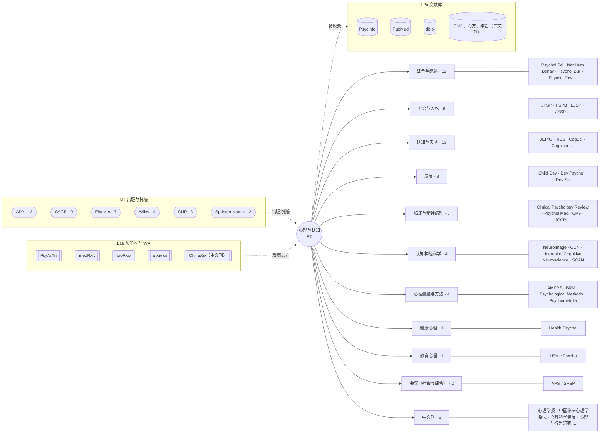

# 心理与认知 venue 名录

> 心理与认知共 57 个 venue（期刊 52、会议 5），分 10 个子领域，另有中文刊 6 个。主要学科库：PsycInfo、PubMed、dblp、CNKI、万方、维普（中文刊）；主要预印本与 WP 通道：PsyArXiv、medRxiv、bioRxiv、arXiv cs、ChinaXiv（中文刊）。评级标签的体系、版本与许可见[评级体系](../venue-rankings.md)，七类分层见[来源分层](../source-taxonomy.md)。

## 关联图

## 名录

每个子领域内按评级强弱排序，评级相同按名称。`接入` 一列：`Crossref:ISSN` 指由 Crossref 委托按 ISSN 收元数据，`现有:`/`平台:` 指经名录里已有的来源行，`用户导入` 指只接受用户导出的题录。

### 综合与综述（12）

| venue | 类型 | ISSN（印/电）或 dblp | 出版托管（M1） | 评级 | 学科库（L2a） | 预印本（L1b） | 接入 | 备注 |
|---|---|---|---|---|---|---|---|---|
| Psychological Science（Psychol Sci） | J | 0956-7976 / 1467-9280 | SAGE（APS） `sage_journals` | FT50; ABDC-A*; VHB-A+; FMS-A | PubMed; PsycInfo（订阅） | PsyArXiv | Crossref:ISSN |  |
| Nature Human Behaviour（Nat Hum Behav） | J | 2397-3374 / — | Nature Portfolio `nature_portfolio` | NI; T1(中国地理学会) | PubMed; PsycInfo（订阅） | PsyArXiv | Crossref:ISSN |  |
| Psychological Bulletin（Psychol Bull） | J | 0033-2909 / 1939-1455 | APA `apa_psycnet` | ABDC-A*; FMS-B; T1(中华医学会) | PubMed; PsycInfo（订阅） | PsyArXiv | Crossref:ISSN |  |
| Psychological Review（Psychol Rev） | J | 0033-295X / 1939-1471 | APA `apa_psycnet` | ABDC-A*; T1(中华医学会) | PubMed; PsycInfo（订阅） | PsyArXiv | Crossref:ISSN |  |
| American Psychologist（Am Psychol） | J | 0003-066X / 1935-990X | APA `apa_psycnet` | ABDC-A* | PubMed; PsycInfo（订阅） | PsyArXiv | Crossref:ISSN |  |
| Annual Review of Psychology（Annu Rev Psychol） | J | 0066-4308 / 1545-2085 | Annual Reviews `annual_reviews` | ABDC-A*; FMS-B | PubMed; PsycInfo（订阅） | PsyArXiv | Crossref:ISSN | S2O |
| Behavioral and Brain Sciences（BBS） | J | 0140-525X / 1469-1825 | Cambridge University Press `cambridge_core` | T1(中华医学会) | PubMed; PsycInfo（订阅） | PsyArXiv | Crossref:ISSN |  |
| Collabra: Psychology | J | 2474-7394 / — | UC Press `ucpress_online` | — | PubMed; PsycInfo（订阅） | PsyArXiv | Crossref:ISSN |  |
| Current Directions in Psychological Science（CDPS） | J | 0963-7214 / 1467-8721 | SAGE（APS） `sage_journals` | FMS-B | PubMed; PsycInfo（订阅） | PsyArXiv | Crossref:ISSN |  |
| Frontiers in Psychology（Front Psychol） | J | 1664-1078 / — | Frontiers `frontiers` | — | PubMed; PsycInfo（订阅） | PsyArXiv | Crossref:ISSN |  |
| Perspectives on Psychological Science（PPS） | J | 1745-6916 / 1745-6924 | SAGE（APS） `sage_journals` | — | PubMed; PsycInfo（订阅） | PsyArXiv | Crossref:ISSN |  |
| PsyCh Journal | J | 2046-0252 / 2046-0260 | Wiley `wiley` | — | PubMed; PsycInfo（订阅） | PsyArXiv | Crossref:ISSN | 中国(英文)；中科院心理所主办 |

### 社会与人格（6）

| venue | 类型 | ISSN（印/电）或 dblp | 出版托管（M1） | 评级 | 学科库（L2a） | 预印本（L1b） | 接入 | 备注 |
|---|---|---|---|---|---|---|---|---|
| Journal of Personality and Social Psychology（JPSP） | J | 0022-3514 / 1939-1315 | APA `apa_psycnet` | ABDC-A*; FMS-B | PubMed; PsycInfo（订阅） | PsyArXiv | Crossref:ISSN |  |
| Personality and Social Psychology Bulletin（PSPB） | J | 0146-1672 / 1552-7433 | SAGE `sage_journals` | ABDC-A*; FMS-B | PubMed; PsycInfo（订阅） | PsyArXiv | Crossref:ISSN |  |
| European Journal of Social Psychology（EJSP） | J | 0046-2772 / 1099-0992 | Wiley `wiley` | ABDC-A; FMS-B | PubMed; PsycInfo（订阅） | PsyArXiv | Crossref:ISSN |  |
| Journal of Experimental Social Psychology（JESP） | J | 0022-1031 / 1096-0465 | Elsevier `elsevier_sd` | ABDC-A; FMS-B | PubMed; PsycInfo（订阅） | PsyArXiv | Crossref:ISSN |  |
| Personality and Social Psychology Review（PSPR） | J | 1088-8683 / 1532-7957 | SAGE `sage_journals` | — | PubMed; PsycInfo（订阅） | PsyArXiv | Crossref:ISSN |  |
| Social Psychological and Personality Science（SPPS） | J | 1948-5506 / 1948-5514 | SAGE `sage_journals` | ABDC-B | PubMed; PsycInfo（订阅） | PsyArXiv | Crossref:ISSN |  |

### 认知与实验（13）

| venue | 类型 | ISSN（印/电）或 dblp | 出版托管（M1） | 评级 | 学科库（L2a） | 预印本（L1b） | 接入 | 备注 |
|---|---|---|---|---|---|---|---|---|
| Journal of Experimental Psychology: General（JEP:G） | J | 0096-3445 / 1939-2222 | APA `apa_psycnet` | ABDC-A* | PubMed; PsycInfo（订阅） | PsyArXiv | Crossref:ISSN |  |
| Trends in Cognitive Sciences（TiCS） | J | 1364-6613 / — | Elsevier（Cell Press） `elsevier_sd` | T1(中华医学会) | PubMed; PsycInfo（订阅） | PsyArXiv | Crossref:ISSN | 综述刊 |
| Annual Meeting of the Cognitive Science Society（CogSci） | C | 1069-7977 / —；dblp `conf/cogsci` | eScholarship（UC） `cogsci_proceedings` | CCF-B; ICORE-B; CAAI-B | dblp | PsyArXiv; arXiv:cs | 现有:cogsci_proceedings | OAI-PMH 全量 |
| Cognition | J | 0010-0277 / — | Elsevier `elsevier_sd` | CCF-B | PubMed; PsycInfo（订阅） | PsyArXiv | Crossref:ISSN |  |
| Cognition and Emotion（Cogn Emot） | J | 0269-9931 / 1464-0600 | Taylor & Francis `tandf_online` | — | PubMed; PsycInfo（订阅） | PsyArXiv | Crossref:ISSN | 情绪 |
| Cognitive Psychology（Cogn Psychol） | J | 0010-0285 / 1095-5623 | Elsevier `elsevier_sd` | — | PubMed; PsycInfo（订阅） | PsyArXiv | Crossref:ISSN | 科协管理外文-C |
| Cognitive Science（Cogn Sci） | J | 0364-0213 / 1551-6709 | Wiley `wiley` | — | PubMed; PsycInfo（订阅） | PsyArXiv | Crossref:ISSN |  |
| Journal of Experimental Psychology: Human Perception and Performance（JEP:HPP） | J | 0096-1523 / 1939-1277 | APA `apa_psycnet` | — | PubMed; PsycInfo（订阅） | PsyArXiv | Crossref:ISSN |  |
| Journal of Experimental Psychology: Learning, Memory, and Cognition（JEP:LMC） | J | 0278-7393 / 1939-1285 | APA `apa_psycnet` | ABDC-A | PubMed; PsycInfo（订阅） | PsyArXiv | Crossref:ISSN |  |
| Journal of Memory and Language（JML） | J | 0749-596X / 1096-0821 | Elsevier `elsevier_sd` | T3(中华医学会) | PubMed; PsycInfo（订阅） | PsyArXiv | Crossref:ISSN |  |
| Psychonomic Bulletin & Review（PB&R） | J | 1069-9384 / 1531-5320 | Springer Nature `springer_link` | — | PubMed; PsycInfo（订阅） | PsyArXiv | Crossref:ISSN |  |
| Psychonomic Society Annual Meeting（Psychonomics） | C | — | Psychonomic Society | — | — | — | 待勘察 | 只有摘要集；待勘察 |
| Quarterly Journal of Experimental Psychology（QJEP） | J | 1747-0218 / 1747-0226 | SAGE `sage_journals` | ABDC-A | PubMed; PsycInfo（订阅） | PsyArXiv | Crossref:ISSN | 科协管理外文-C |

### 发展（3）

| venue | 类型 | ISSN（印/电）或 dblp | 出版托管（M1） | 评级 | 学科库（L2a） | 预印本（L1b） | 接入 | 备注 |
|---|---|---|---|---|---|---|---|---|
| Child Development | J | 0009-3920 / 1467-8624 | Oxford University Press（SRCD） `oup_academic` | — | PubMed; PsycInfo（订阅） | PsyArXiv | Crossref:ISSN | 须用 eISSN |
| Developmental Psychology（Dev Psychol） | J | 0012-1649 / 1939-0599 | APA `apa_psycnet` | — | PubMed; PsycInfo（订阅） | PsyArXiv | Crossref:ISSN |  |
| Developmental Science（Dev Sci） | J | 1363-755X / 1467-7687 | Wiley `wiley` | — | PubMed; PsycInfo（订阅） | PsyArXiv | Crossref:ISSN |  |

### 临床与精神病理（5）

| venue | 类型 | ISSN（印/电）或 dblp | 出版托管（M1） | 评级 | 学科库（L2a） | 预印本（L1b） | 接入 | 备注 |
|---|---|---|---|---|---|---|---|---|
| Clinical Psychology Review（Clin Psychol Rev） | J | 0272-7358 / — | Elsevier `elsevier_sd` | T1(中华医学会) | PubMed; PsycInfo（订阅） | PsyArXiv; medRxiv | Crossref:ISSN |  |
| Psychological Medicine（Psychol Med） | J | 0033-2917 / 1469-8978 | Cambridge University Press `cambridge_core` | T1(中华医学会) | PubMed; PsycInfo（订阅） | PsyArXiv; medRxiv | Crossref:ISSN |  |
| Clinical Psychological Science（CPS） | J | 2167-7026 / 2167-7034 | SAGE（APS） `sage_journals` | T3(中华医学会) | PubMed; PsycInfo（订阅） | PsyArXiv; medRxiv | Crossref:ISSN |  |
| Journal of Consulting and Clinical Psychology（JCCP） | J | 0022-006X / 1939-2117 | APA `apa_psycnet` | T3(中华医学会) | PubMed; PsycInfo（订阅） | PsyArXiv; medRxiv | Crossref:ISSN |  |
| Journal of Psychopathology and Clinical Science（JPCS） | J | 2769-7541 / 2769-755X | APA `apa_psycnet` | — | PubMed; PsycInfo（订阅） | PsyArXiv; medRxiv | Crossref:ISSN | 原 J Abnormal Psychology |

### 认知神经科学（4）

| venue | 类型 | ISSN（印/电）或 dblp | 出版托管（M1） | 评级 | 学科库（L2a） | 预印本（L1b） | 接入 | 备注 |
|---|---|---|---|---|---|---|---|---|
| NeuroImage | J | 1053-8119 / 1095-9572 | Elsevier `elsevier_sd` | T1(中华医学会) | PubMed; PsycInfo（订阅） | bioRxiv; PsyArXiv | Crossref:ISSN | OA 模式待核 ⚠ |
| Cognitive Computational Neuroscience（CCN） | C | — | CCN（ccneuro.org） | — | — | — | 待勘察 | 扩展摘要；待勘察 |
| Journal of Cognitive Neuroscience（J Cogn Neurosci） | J | 0898-929X / 1530-8898 | MIT Press `mit_press_direct` | — | PubMed; PsycInfo（订阅） | bioRxiv; PsyArXiv | Crossref:ISSN |  |
| Social Cognitive and Affective Neuroscience（SCAN） | J | 1749-5016 / 1749-5024 | Oxford University Press `oup_academic` | T3(中华医学会) | PubMed; PsycInfo（订阅） | bioRxiv; PsyArXiv | Crossref:ISSN |  |

### 心理测量与方法（4）

| venue | 类型 | ISSN（印/电）或 dblp | 出版托管（M1） | 评级 | 学科库（L2a） | 预印本（L1b） | 接入 | 备注 |
|---|---|---|---|---|---|---|---|---|
| Advances in Methods and Practices in Psychological Science（AMPPS） | J | 2515-2459 / 2515-2467 | SAGE（APS） `sage_journals` | T1(中华医学会) | PsycInfo（订阅） | PsyArXiv | Crossref:ISSN | PubMed/PMC 为 0 |
| Behavior Research Methods（BRM） | J | 1554-351X / 1554-3528 | Springer Nature `springer_link` | — | PubMed; PsycInfo（订阅） | PsyArXiv | Crossref:ISSN | 须用 eISSN |
| Psychological Methods（Psychol Methods） | J | 1082-989X / 1939-1463 | APA `apa_psycnet` | ABDC-B | PubMed; PsycInfo（订阅） | PsyArXiv | Crossref:ISSN |  |
| Psychometrika | J | 0033-3123 / 1860-0980 | Cambridge University Press `cambridge_core` | — | PubMed; PsycInfo（订阅） | PsyArXiv | Crossref:ISSN | Crossref 出版方为 CUP；科协管理外文-C |

### 健康心理（1）

| venue | 类型 | ISSN（印/电）或 dblp | 出版托管（M1） | 评级 | 学科库（L2a） | 预印本（L1b） | 接入 | 备注 |
|---|---|---|---|---|---|---|---|---|
| Health Psychology | J | 0278-6133 / 1930-7810 | APA `apa_psycnet` | T3(中华医学会) | PubMed; PsycInfo（订阅） | PsyArXiv | Crossref:ISSN |  |

### 教育心理（1）

| venue | 类型 | ISSN（印/电）或 dblp | 出版托管（M1） | 评级 | 学科库（L2a） | 预印本（L1b） | 接入 | 备注 |
|---|---|---|---|---|---|---|---|---|
| Journal of Educational Psychology（J Educ Psychol） | J | 0022-0663 / 1939-2176 | APA `apa_psycnet` | — | PubMed; PsycInfo（订阅） | PsyArXiv | Crossref:ISSN | 教育学范围外，附带 |

### 会议（社会与综合）（2）

| venue | 类型 | ISSN（印/电）或 dblp | 出版托管（M1） | 评级 | 学科库（L2a） | 预印本（L1b） | 接入 | 备注 |
|---|---|---|---|---|---|---|---|---|
| APS Annual Convention | C | — | Association for Psychological Science | — | — | — | 待勘察 | 无论文集；待勘察 |
| SPSP Annual Convention | C | — | Society for Personality and Social Psychology | — | — | — | 待勘察 | 只有摘要/海报；待勘察 |

### 中文刊（6）

子领域写在备注里。知网、万方、维普只接受用户导入题录；在 Crossref 注册了 DOI 的中文刊可经 Crossref 收元数据。

| venue | 类型 | ISSN（印/电）或 dblp | 出版托管（M1） | 评级 | 学科库（L2a） | 预印本（L1b） | 接入 | 备注 |
|---|---|---|---|---|---|---|---|---|
| 心理学报（Acta Psychologica Sinica） | J | 0439-755X / — | 中国心理学会/中科院心理所 | T1(中国优选法统筹法与经济数学研究会/管理科学与工程学会/中国系统工程学会、管理科学三学会); CSSCI; CSCD核心; 北大核心; 科技核心; AMI-权威; FMS-T1 | CNKI; 万方 | ChinaXiv | Crossref:ISSN | 综合与综述；Crossref前缀10.3724 |
| 中国临床心理学杂志（Chinese Journal of Clinical Psychology） | J | 1005-3611 / — | 中国心理卫生协会; 中南大学 | T3(中华医学会); CSSCI; CSCD核心; 北大核心; 科技核心 | CNKI; 万方; CSCD | ChinaXiv | 用户导入 | 临床心理；Crossref无该ISSN记录 |
| 心理科学进展（Advances in Psychological Science） | J | 1671-3710 / — | 中科院心理所 | CSSCI; CSCD核心; 北大核心; 科技核心; AMI-核心 | CNKI; 万方 | ChinaXiv | Crossref:ISSN | 综合与综述；Crossref前缀10.3724 |
| 心理与行为研究（Studies of Psychology and Behavior） | J | 1672-0628 / — | 天津师范大学 | CSSCI; 北大核心 | CNKI; 万方; 维普 | ChinaXiv | 用户导入 | 实验与行为；Crossref无该ISSN记录；Crossref 无记录 |
| 心理发展与教育（Psychological Development and Education） | J | 1001-4918 / — | 北京师范大学 | CSSCI; 北大核心; 科技核心; AMI-核心 | CNKI; 万方; 维普 | ChinaXiv | 用户导入 | 发展与教育；Crossref无该ISSN记录；Crossref 无记录 |
| 心理科学（Journal of Psychological Science） | J | 1671-6981 / — | 中国心理学会 | CSSCI; CSCD扩展; 北大核心; 科技核心; AMI-核心 | CNKI; 万方; CSCD | ChinaXiv | 用户导入 | 综合心理；Crossref无该ISSN记录 |

## 出处与说明

- **T 级**：科协总汇没有心理学领域目录。心理刊的 T 标签来自中华医学会"精神病学"子目录（如 Psychological Bulletin、Psychological Review 为 `T1(中华医学会)`）与管理科学三学会的中文刊目录。
- **FMS**：`FMS-A/B` 取自 FMS 2025 外文刊表的心理学子类（FMS 即科协总汇的管理科学领域目录）。
- **FT50**：含 2026 年新增的 Psychological Science；JAP、OBHDP、Personnel Psychology 主属商业与管理。
- **会议**：Psychonomics、SPSP、APS、CCN 没有可引用的分档出处，不标评级。
- **待核**：PubMed 对心理刊覆盖不全（AMPPS 为 0），PsycInfo 是 APA 订阅库。
