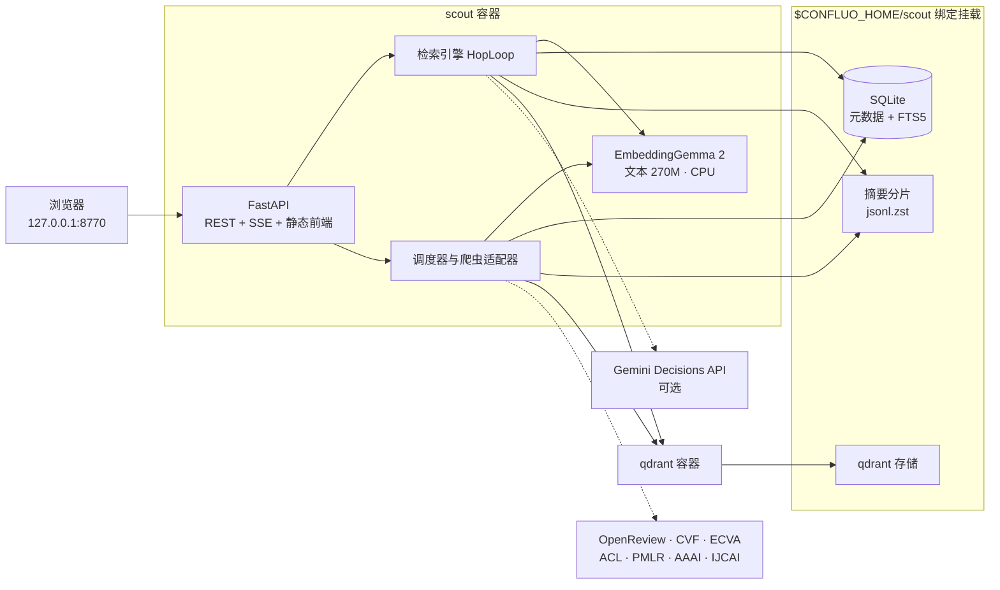

# Confluo Scout 总览与架构

> 本篇回答：Scout 是什么、由哪些部件组成、怎么部署在 Mac mini 上、数据放在哪、怎么验收。来源与爬虫见 [sources.md](sources.md)，检索与排序算法见 [retrieval.md](retrieval.md)。Scout 是 Confluo 仓库里的单用户本地服务，只覆盖 AI 会议与期刊，不改变 v2 平台设计。`yhyfhgs` 于 2026-11-19 要求直接实现、不停下等评审，所以本篇以 draft 状态同时作为实现依据（见 [D-077 草案](../decision-log.md)）。

## 要点

- **一个本地小服务**：浏览器 → `scout` 容器（FastAPI：API、检索引擎、爬虫与索引调度、嵌入模型、静态前端）+ `qdrant` 容器（向量库）。Docker 运行时用 Colima。
- **数据都在 Confluo 里**：`$CONFLUO_HOME/scout/`，默认是仓库根的 `.confluo/scout/`，位于内置盘的 Data 卷，整目录被 Git 忽略。正在使用的 SQLite 库和 Qdrant 存储放在虚拟机内的 Docker 卷里（宿主机碰不到），它们的一致性副本（每 6 小时、停机时的库备份，每天的向量快照）写回这个目录；卷为空时自动从最新副本恢复。
- **存储三件套**：元数据与 BM25 倒排在 SQLite（FTS5）；摘要按届次分片、zstd 压缩；向量在 Qdrant。
- **嵌入模型**：EmbeddingGemma 2（`google/embeddinggemma-2`，2026-10-06 发布，Apache-2.0）。下载完整的 740M 版本；摘要是文本，编码时只加载 270M 文本子模型，两者共用同一个 768 维向量空间。
- **决策模型**：Gemini Decision 1（`gemini-decision-1`，Decisions API，2026-11-11 发布）。它和 TypeSafe 的 Jev 同属 "System One" 判别模型：一次前向给出 yes/no、多选和分级评分的校准概率，不生成文本。它负责相关度分级、多关键词覆盖与逻辑延伸判断；没配 key 时退回本地评分，界面标明。
- **检索核心**：多跳收敛检索（HopLoop）。依次是关键词抽取、BM25 精确 / 同义模糊 / 向量三路召回、"相关度 + 论文质量 + 决策模型"排序；再从前几篇抽新关键词召回、增量重排，直到前 n 名不变。
- **爬虫按平台分适配器**：OpenReview（用户本人账号）、CVF、ECVA、ACL Anthology、PMLR、AAAI OJS、IJCAI。每个适配器都有限速、断点续爬、结构校验和原始响应缓存。

## 需求对照

| # | 需求 | 落点 | 怎么验收 |
|---|---|---|---|
| 1 | 动态可选的会议与期刊列表（先做 AI） | `scout/registry/venues.yaml` + 运行态表 `edition`；自动发现新届次；"来源"页开关 | 新届次出现在列表；开关后检索范围随之变化 |
| 2 | 按平台与主页设计的鲁棒爬虫 | [sources.md](sources.md) 的 7 个适配器与公共抓取层 | 离线 fixture 测试全过；真实抓取计数落在期望区间 |
| 3 | 开放审稿届次爬分数与置信度 | OpenReview 适配器取 Official_Review 的数值字段 | ICLR 2027 等在审届次的论文带逐条审稿分 |
| 4 | 已结束届次爬 oral、highlight、spotlight、poster | OpenReview `venue` 字段、CVF AcceptedPapers 页 | 结果卡显示录用等级，可按等级排序 |
| 5 | 全部论文的链接、标题、作者、领域 | SQLite `paper` 表 | 字段完整率报告 ≥95% |
| 6 | 摘要分片存储并压缩 | `abstracts/<edition>/g<gen>/part-*.jsonl.zst` | 校验和通过；随机抽样能还原原文 |
| 7 | 美观、按钮精简、中心突出的前端 | `scout/web`（React + Vite） | 浏览器实测截图 |
| 8 | Google 最新开源嵌入模型（最大版本）做向量库 | EmbeddingGemma 2 → Qdrant `papers` | 已嵌入数 = 有摘要的论文数 |
| 9 | 关键词 + BM25 + 同义模糊 + 向量 + 决策模型 + 多跳收敛 | [retrieval.md](retrieval.md) 的 HopLoop | 返回收敛轮数与原因；评测集上不低于单路 |
| 10 | 统一搜索框、排序按钮、精确匹配高亮 | 搜索框加"智能 / 精确"切换、排序菜单、两级 `<mark>` | 两种模式走同一接口，命中词高亮 |

## 与 Confluo v2 的关系

- Scout 是单用户、本机运行的检索工具，与 v2 多用户平台互不依赖。v2 的 PostgreSQL、出站网关、连接器契约与推荐都不在 Scout 范围内，v2 的设计文档不因 Scout 改动。
- **复用**：v1 适配器经验（OpenReview 届表与 2018、2019 届的录用判定、CVF、PMLR、ACL、AAAI OAI），v2 调研的上游事实（2026-09-30 连接器卡片），以及 [计算机与 AI venue 名录](../../catalog/venues/computer-science-ai.md) 的评级标签。
- **OpenReview 口径**：匿名 `/notes` 返回 403 `ChallengeRequiredError`，条款要求一人一号、不得授权第三方代用。Scout 只在本机用用户本人的账号查询，token 不离开本机，结果只留在本机。这与 v2 "用户侧本人查询"的口径一致（[site-special.md 的 openreview_api 卡片](../v2/connectors/families/site-special.md#openreview_api)）。
- **存储不同于 v2**：Scout 用 SQLite + Qdrant，不用 PG。理由是单用户、零运维、整个目录可直接备份；v2 的 D-042 只约束平台服务端。
- v2 落地时，Scout 的适配器与检索算法可作 V1、V2 的参考实现。Scout 不占用 V0 将确定的 `server/`、`web/`、`registry/` 等顶层目录，自己的一切都在 `scout/` 下。

## 架构



| 部件 | 技术 | 职责 |
|---|---|---|
| API 与静态前端 | FastAPI、uvicorn | REST、检索事件流（SSE）、静态网页；只监听容器内 8000，宿主只绑 127.0.0.1:8770 |
| 检索引擎 | Python | HopLoop：查询解析、三路召回、融合、决策模型评审、收敛判断、高亮 |
| 调度器与爬虫 | httpx、lxml | 按届次排程；按主机限速与熔断；断点续爬；原始响应缓存；结构校验 |
| 嵌入 | sentence-transformers ≥6.3、torch 2.14 CPU | 论文与概念向量；交互检索与后台编码各用一个模型实例，检索进行时后台编码让路 |
| 元数据与倒排 | SQLite 3.46+（WAL、FTS5 contentless） | 论文、审稿分、届次、任务、概念、缓存；BM25 |
| 摘要存储 | zstandard | 每届次一代分片，原子切换；LRU 解压缓存 |
| 向量库 | Qdrant（Apache-2.0） | `papers`、`concepts` 两个集合；payload 过滤 |
| 决策模型 | google-genai ≥3.2 | `client.decisions.create`；结果缓存；限流与降级 |

单进程承载 API、调度与爬虫，SQLite 只被这一个进程写，避免跨进程文件锁依赖 virtiofs 的锁语义；CPU 密集的嵌入在独立线程里运行。

容器里的 PyTorch 用不上 Apple 芯片的矩阵加速单元，CPU 编码约每秒 4–6 篇（2026-11-19 实测，512 tokens）。宿主机上可选运行一个只算向量的加速服务（`make embed-serve`，MPS，只监听 127.0.0.1:8790）；容器经 `host.docker.internal` 调用它，实测后台编码升到每秒约 16 篇。服务不在时，容器自动退回本机 CPU。加速服务不读写任何数据。

**事故与对策（2026-11-19）**：库文件最初放在 virtiofs 绑定挂载上。容器写库期间，宿主机用 `sqlite3` 只读查询了同一个文件；宿主机连接关闭时把自己当作最后一个连接，做了 WAL 检查点并删除了 WAL，库文件头被清零。处理：从 02:11 的在线备份恢复，按断点续爬，对齐摘要指针与向量。对策：在用的库移入 Docker 卷，宿主机无法再碰到它；备份频率提到每 6 小时，并在停机时补一份；容器启动时如果卷为空，就从最新备份恢复并自动对账。

## 部署

- **运行时**：Colima 0.10（VZ 虚拟化、virtiofs 挂载、10 核 CPU、16 GB 内存），只挂载 Confluo 仓库目录并可写；Docker CLI 29、Compose 5。
- **编排**：`scout/compose.yaml` 有两个服务。`scout` 由 `scout/Dockerfile` 多阶段构建：Node 构建前端，Python 3.13-slim 运行。`qdrant` 用官方镜像。两者都设 `restart: unless-stopped`。
- **挂载**：`.confluo/scout` → `/data`；`.confluo/config.toml` → `/secrets/config.toml`（只读）。
- **凭证**：OpenReview 沿用 `config.toml` 的 `[auth.openreview]`；Gemini 读 `[auth.gemini] api_key` 或环境变量 `GEMINI_API_KEY`。凭证只在内存中使用，不写日志，不进数据库。
- **端口**：只绑 `127.0.0.1:8770`；qdrant 不对宿主暴露。
- **开机自启**：`brew services start colima`，再由 compose 的重启策略拉起服务。
- **命令**：在 `scout/` 下执行 `make up`、`make down`、`make logs`、`make check`、`make backup`、`make embed-serve`。
- **规则**：不要从宿主机打开在用的库；要查看数据，用网页、API，或复制一份 `db/backups/` 里的备份。

## 数据布局

```text
docker volume scout-db          # 在用的 SQLite（容器内 /var/lib/scout/scout.sqlite）
docker volume qdrant-storage    # Qdrant 在用存储
$CONFLUO_HOME/scout/            # 默认 <repo>/.confluo/scout，Git 忽略
├── db/backups/scout-*.sqlite   # 库的一致性副本：每 6 小时与停机时，保留最近 4 份
├── db/scout-host.sqlite        # 仅宿主机开发时使用的私有副本（从最新备份生成）
├── abstracts/<edition>/        # 例：iclr-2026/
│   ├── manifest.json           # 当前代号、分片清单、条数、sha256
│   └── g0003/part-00000.jsonl.zst
├── qdrant/                     # qdrant 存储
├── models/embeddinggemma-2/    # 完整 740M 权重，约 1.5 GB
├── cache/http/<host>/          # 原始响应（gzip），供重解析与离线回放
├── logs/                       # 结构化 JSON 日志，按天滚动
└── state/                      # 运行标记，如嵌入断点
```

规模估计：默认范围（2024–2027 年的核心 AI 会议）约 11 万篇。摘要压缩后约 60 MB；向量 11 万 × 768 × 4 B ≈ 0.34 GB；SQLite 约 0.5 GB。

## 数据模型

- `series`：会议或期刊系列，含简称、类型、评级标签（CCF、ICORE，取自 venue 名录）、平台。
- `edition`：届次（`iclr-2027`），含年份、阶段（`in_review`、`decided`、`published`）、启用开关、来源、上次抓取、计数。
- `paper`：一篇论文一行。字段包括主键 `uid`、届次、标题与规范化标题、作者、关键词、原生领域、统一领域、TL;DR、状态（`accepted`、`under_review`、`rejected`、`withdrawn`）、录用标签（Oral、Spotlight、Highlight、Poster、Findings 等）与等级数值、链接（forum、PDF、正式版、DOI）、来源键、摘要指针（代号、分片、行号）、内容哈希、嵌入哈希、审稿统计、质量分。
- **领域划分**：原生领域保留在 `area_native`（OpenReview 的 primary area、AAAI 的技术分轨、IJCAI 的 section）；所有论文另有统一领域 `area_unified`，取自 23 类 AI 领域（大模型、视觉、生成模型、强化学习、可解释性、安全与对齐、AI for Science 等）。归类方法是零样本：论文文档向量与各领域描述向量取余弦最近者，嵌入时顺带完成，已有向量的论文由维护线程回填。检索语法 `area:可解释性` 与 `area:interpretability` 都会匹配。
- `review`：一条审稿一行，只存数值：总分原值与数值、置信度、子分（soundness、presentation 等）和更新时间。不存审稿正文。
- `paper_fts`：FTS5 contentless 表（`porter unicode61`），列为 title、keywords、abstract、authors、area，rowid 对齐 `paper.rowid`。
- `concept`：概念词表（作者关键词、领域、标题短语、缩写全称），含文档频率与别名；向量在 qdrant `concepts`。
- `crawl_job`、`crawl_cursor`、`decision_cache`、`setting`：任务、断点、决策缓存与可调参数。

## API

| 方法与路径 | 作用 |
|---|---|
| `GET /api/health` | 组件健康：DB、qdrant、模型、决策模型 |
| `GET /api/search` | 一次性返回最终结果；参数 `q`、`mode=smart\|exact`、`sort`、`venues`、`years`、`status`、`topn`、`seeds`、`rounds` |
| `GET /api/search/stream` | 同上，以 SSE 逐轮推送 `round`、`result`、`done` 事件 |
| `GET /api/papers/{uid}` | 论文详情：摘要、审稿分、链接、领域、来源 |
| `GET /api/venues`、`PATCH /api/venues/{edition}` | venue 列表与开关 |
| `POST /api/venues/{edition}/crawl`、`POST /api/discover` | 立即抓取、刷新届次发现 |
| `GET /api/jobs`、`GET /api/stats` | 任务进度与语料统计 |

## 前端

- **布局**：首页只有居中的标题和一个大搜索框；框内右侧是"智能 / 精确"二段切换，框下一行是范围选择（venue 与年份）。结果页把搜索框收到顶部，主栏居中、最宽约 760 px；右侧一条窄栏显示检索过程（轮次、新增关键词、收敛原因），默认收起。
- **结果卡**：标题、作者、venue 与年份、录用等级标记、审稿分条（均分、置信度、审稿数）、带高亮的摘要片段、命中关键词。精确命中用实色底 `<mark>`，同义与模糊命中用下划线，两者一眼可分。点击卡片打开详情抽屉，显示完整摘要、逐条审稿分、链接和 BibTeX。
- **按钮精简**：顶栏只有"检索"和"来源"两个入口；排序是一个下拉（综合、相关度、审稿分、录用等级、最新）；没有其他浮动按钮。
- **视觉**：白底、近黑正文、一个深靛蓝强调色；录用等级用低饱和色块并附文字；圆角 8 px，不用胶囊按钮、斜体强调、等宽标签或编号小标题；系统字体；跟随系统的暗色模式。

## 合规与礼貌

- 每个主机先查 robots.txt，遵守 Disallow 与 Crawl-delay；UA 固定为 `ConfluoScout/<ver> (+local research tool; mailto:...)`，被拦截时不更换 UA。
- 会议官网的 `/static`（virtual 站点的 JSON 数据所在路径）与带 `page=` 的分页 URL 被 robots 禁止，不访问；只读 robots 允许的 AcceptedPapers 页。
- OpenReview：登录后限额为每小时 500 次（2026-11-19 实测响应头 `ratelimit-policy: 500;w=3600`），Scout 取 80%，即每小时 400 次。遇到 403 `ChallengeRequiredError` 立即停用该主机，不访问 `challengeUrl`、`/profiles*`，不带 `email` 参数（robots 唯一禁则）。
- 只存元数据、摘要与审稿数值，不下载 PDF，不存审稿正文；数据只在本机，不对外提供服务。

## 测试与验收

- **离线**：解析器用 `scout/server/tests/fixtures` 下截短的真实页面回放；限速、重试、熔断、断点用桩服务器测试；检索算法用小语料测收敛与排序性质。命令是 `make check`（ruff、pytest、前端类型检查与构建）。
- **在线**：每个适配器跑一届真实抓取，计数与官方录用数的偏差 ≤2%；字段完整率 ≥95%（标题、作者、链接、摘要）。
- **检索**：用 30 条中英文查询的小评测集比较单路 BM25、单路向量与 HopLoop 的 nDCG@10；HopLoop 不低于最佳单路，记录收敛轮数分布。
- **体验**：首轮结果 p95 ≤1.5 s；收敛（带决策模型）通常 ≤10 s；容器重启后服务自动恢复。

## 实施顺序

1. 工程底座：目录、依赖、配置、SQLite 模式、抓取层、compose。
2. 适配器：OpenReview（含审稿与录用标签）→ CVF 与 AcceptedPapers → ACL → PMLR → AAAI → ECVA → IJCAI。
3. 摘要分片、嵌入与 qdrant 索引、概念词表。
4. HopLoop 检索与决策模型接入，精确模式。
5. 前端与 SSE。
6. 首轮全量抓取与索引；评测、修正、文档收尾。

## 实现状态（2026-11-19）

- 代码在 `scout/`：后端 `server/src/confluo_scout/`（抓取层、7 个适配器、存储、嵌入、HopLoop、API、调度），前端 `web/`，venue 列表 `registry/venues.yaml`（19 个系列，默认开启 13 个、36 届）。
- `make check`：ruff 通过；pytest 30 项全部通过（解析器回放、抓取层、存储合并、检索单元、内存 qdrant 上的端到端 HopLoop）；前端类型检查与构建通过。
- 服务在 Colima 上以两个容器运行（`scout`、`qdrant`），网页 <http://127.0.0.1:8770>。首轮全量抓取由容器里的调度器执行，进度在"来源"页。

## 未决事项

1. Gemini API key 未配置，决策模型暂以本地评分代替；在 `.confluo/config.toml` 填 `[auth.gemini] api_key` 后生效。
2. 质量分权重与 HopLoop 参数是设计初值，待评测校准。
3. CVPR 2026 的 AcceptedPapers 页暂时 404，2026 届的 Highlight 标记暂缺；ECCV 2026 尚未上 ECVA。
4. IJCAI 的 robots 要求 10 s 间隔，摘要补全较慢；先用年页元数据，摘要后台慢补。
5. 推送分支与开 PR 需要 `yhyfhgs` 授权。
