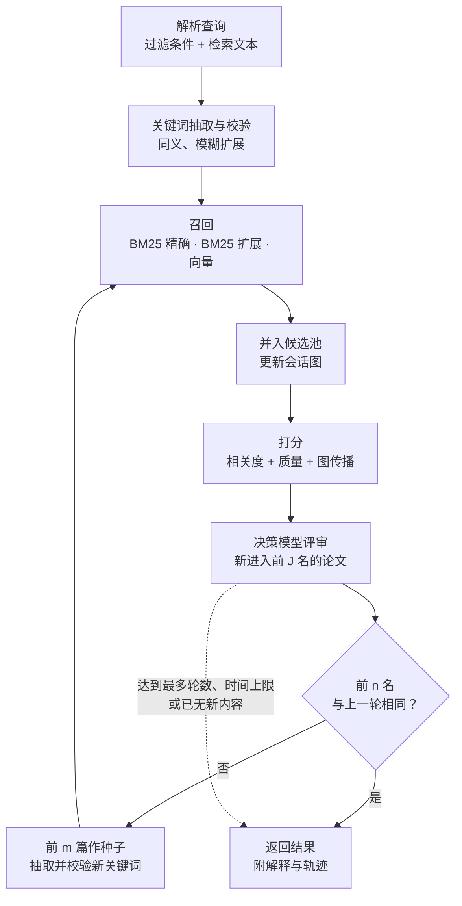

# Confluo Scout 检索与排序（HopLoop）

> 本篇回答：一个查询怎样变成一份排好序的论文列表。Scout 不让大模型生成答案，而是围绕查询建一张会话级的动态图（查询、关键词、论文三类节点），在图上反复召回、排序、扩展，直到前 n 名稳定。公式中的系数是设计初值，待 [README.md](README.md#测试与验收) 的评测校准。

## 要点

- **一个入口、两种模式**：智能模式跑完整的 HopLoop；精确模式只做一轮词法检索（布尔、短语、前缀、字段），不做同义扩展和向量召回。两种模式走同一个接口，使用同一套过滤、排序与高亮。
- **三路召回**：BM25 精确命中、BM25 同义与模糊命中、向量匹配（整句查询与逐个关键词）；从第 2 轮起，再加"种子论文相似"一路。
- **四类分数**：相关度（融合排名、语义相似、关键词覆盖、图传播）、论文质量（审稿分、录用等级、venue 评级）、决策模型评审（相关度分级、逐关键词覆盖、逻辑延伸）、排序方式。
- **多跳**：每轮取前 m 篇作为种子，从中抽取新关键词，再召回新文档；候选池跨轮累积，决策评审结果缓存复用，全池增量重排。
- **收敛**：前 n 名的集合与顺序和上一轮完全相同时停止；另设最多轮数、时间上限，以及"没有新关键词也没有新候选进入评审区"三个兜底条件。

## 查询解析

- **语法**（两种模式都支持）：`"..."` 表示短语；`-词` 表示排除；`venue:iclr`、`year:2025..2027`、`author:"Yoshua Bengio"`、`status:oral`、`area:"reinforcement learning"` 是字段过滤；精确模式另外支持 `AND`、`OR`、`NOT` 和 `词*` 前缀。
- 字段过滤直接下推到 SQLite 与 qdrant 的 payload 过滤，作为硬条件；其余文本才是检索文本。
- **语言**：CJK 字符占比 ≥30% 视为中文查询。语料是英文，所以中文查询的向量召回直接跨语言进行（EmbeddingGemma 2 支持 140 多种语言），BM25 则先映射成英文关键词（见下一节）。

## 关键词抽取与扩展（智能模式）

1. **候选**：引号短语原样保留；缩写（2–6 个大写字母，可带数字或复数 s）原样保留；其余文本按停用词与标点切成 ≤4 词的块，与概念词表做最长匹配。中文先按标点和虚词（的、和、与、在、如何、基于……）切块，再把每块与整句的向量各自映射到最近的英文概念（每块取前 3 个，余弦 ≥0.6；整句取前 8 个，余弦 ≥0.5）。
2. **打分与筛选**：候选分 = IDF ×（在词表中则 ×1.5）× 与整句的余弦。决策模型可用时，逐个问"`c` 是否是这个查询的关键概念"，保留概率 ≥0.5 的；不可用时按分数取前 6 个。
3. **同义**：来源有三个。一是缩写与全称对照：从摘要中按 Schwartz–Hearst 规则挖出，再加一份内置种子表（LLM ↔ large language model 等）。二是概念向量近邻，规则见下。三是词形变化：由 Porter 词干处理。
	- 短词之间的余弦被压缩在 0.75–0.95 的窄区间里，而且主要反映字面重合：实测 "camera calibration" 与查询的余弦是 0.871，反而高于相关的 "uncertainty quantification"（0.840）。因此 Scout 用约 500 个随机概念向量作背景，把相似度换算成 z 分数。
	- 没有决策模型时，近邻要同时满足"与关键词余弦 ≥0.93"和"与整句查询的 z ≥3"；有决策模型时，余弦门槛放宽到 0.85，再逐个问"`c'` 与 `c` 是否同义、缩写或等价说法"。
	- 中文块映射英文概念时，每块只取 z ≥3 的最佳 1–2 个；相似度相差不到 0.012 的近似并列按全库频率优先；作者关键词里有错拼（如 "reinforcment learning"），候选与某个频率高 10 倍以上的词条字形相似度 ≥90 时换成那个规范写法，相似度 ≥85 的变体只留一个。整句近邻要求 z ≥3.5，并去掉只是在已选关键词上加词的扩展（如 "llm fine-tuning"）。中文查询最多保留 8 个关键词。
4. **模糊**：对长度 ≥6 的单词关键词，在 FTS 词汇表中找编辑距离 ≤2、文档频率 ≥3 的词，用来纠正拼写错误。

概念词表来自语料：OpenReview 作者关键词与 `primary_area`、AAAI 的 `dc:subject`、标题中的高频 2–4 词短语（文档频率 ≥5），以及挖到的缩写全称。每个词条都有向量（qdrant `concepts` 集合），每次抓取后增量更新。

## 召回

| 通道 | 输入 | 实现 | 每路上限 |
|---|---|---|---|
| `bm25_exact` | 关键词（多词关键词作为短语） | FTS5 `MATCH`；列权重：title 4、keywords 2.5、authors 1.5、area 1、abstract 1 | 200 |
| `bm25_expand` | 同义词与模糊词 | 同上，在融合中降权 | 200 |
| `dense_query` | 整句查询向量 | qdrant `papers`，余弦，带过滤 | 200 |
| `dense_kw` | 每个关键词的向量 | 同上 | 每词 50 |
| `dense_seed` | 种子论文的文档向量（第 2 轮起） | 同上，相当于"找相似的论文" | 每种子 50 |

- 查询向量使用 EmbeddingGemma 2 的检索查询提示，文档向量使用文档提示（"title + keywords + area + abstract"）；venue、年份、状态只放 payload，不进向量文本。
- 每一路都先过滤再取前 k，避免过滤之后结果被掏空。

## 会话图

每个查询维护一张小图 $G=(V,E)$：

- **节点**：查询 $q$、关键词 $k$（记录它产生于哪一轮）、论文 $d$。
- **边与权重**：
	- $q\to k$：关键词权重 $\omega_k$。原始关键词为 1，第 $t$ 轮新增的关键词为 $\delta^{t}$，$\delta=0.7$。
	- $k\to d$：BM25 命中时，取该关键词结果列表内按最大值归一的 BM25 分；向量命中时，取余弦。
	- $q\to d$：整句向量命中时的余弦。
	- $s\to k$：种子论文 $s$ 抽出关键词 $k$ 时，取显著度（见"迭代"一节）。
	- $s\to d$：种子相似召回时的余弦。
- **图传播**：在行归一化的转移矩阵 $\mathbf P$ 上，从 $q$ 出发做个性化 PageRank：

$$\boldsymbol\pi^{(t+1)}=\alpha\,\mathbf e_q+(1-\alpha)\,\mathbf P^{\top}\boldsymbol\pi^{(t)},\qquad \alpha=0.2,\ 30\ \text{次迭代}$$

$s_{\text{ppr}}(d)=\pi_d$。被多条路径（多个关键词、多个种子）同时指向的论文得分更高，这正是"多跳深度关联"的度量。图只有几千个节点，一次计算在毫秒级。

## 打分

记 $\hat x$ 为归一化后的值（规则见相关度公式下方）。

**相关度**：

$$\text{rel}(d)=0.30\,\hat s_{\text{rrf}}(d)+0.40\,\hat s_{\text{vec}}(d)+0.20\,s_{\text{kw}}(d)+0.10\,\hat s_{\text{ppr}}(d)$$

- 初稿的系数是 0.35、0.30、0.20、0.15。实测时多跳关键词会把主题带偏，所以提高查询向量余弦（最直接贴合原始查询的信号）的权重，降低图传播的权重。
- 归一化常数在第 1 轮之后冻结：余弦按第 1 轮候选池的第 10 百分位到"前 50 名均值 + 1 个标准差"线性映射，RRF 除以第 1 轮的最大值，图传播除以当轮最大值。这样已有论文的分数只在出现新证据时变化，不会因为候选池变大而整体漂移。

- $s_{\text{rrf}}(d)=\sum_{(c,t)}\frac{w_c\,g_t}{60+\text{rank}_{c,t}(d)}$，对所有轮次 $t$ 的所有召回列表 $c$ 求和；第 1 轮 $g_1=1$，扩展轮 $g_t=0.25\,\delta^{\,t-1}$。通道权重：`bm25_exact` 1.0、`dense_query` 1.0、`dense_kw` 0.7、`dense_seed` 0.6、`bm25_expand` 0.5。
- $s_{\text{vec}}(d)=\cos(\mathbf e_q,\mathbf e_d)$。
- $s_{\text{kw}}(d)=\frac{\sum_{k\in K_1} \omega_k\,m_k(d)}{\sum_{k\in K_1}\omega_k}$，只对原始查询的关键词 $K_1$ 求和；$m_k(d)$ 在精确命中、同义命中、模糊命中、未命中时分别取 1、0.6、0.3、0。
- 原则是：扩展轮负责多召回，不改写排序依据；多跳关联通过图传播 $s_{\text{ppr}}$ 计入。初版让扩展轮的列表与扩展关键词按 $\delta^{t-1}$ 全额计入，已知论文评测的第 1 名命中率从 0.85 降到 0.70，因此改为现行规则（见下文"实测"）。

**决策模型评审**（只对当前前 $J$ 名，见下一节）：

$$\text{dec}(d)=0.6\,\frac{S_{\text{rel}}(d)}{4}+0.25\,\overline{P}_{\text{kw}}(d)+0.15\,P_{\text{ext}}(d),\qquad \text{dec}^{*}(d)=\kappa_d\,\text{dec}(d)+(1-\kappa_d)\,\text{rel}(d)$$

$\kappa_d$ 是这些回答置信度的均值；没评审过的论文取 $\text{dec}^{*}=\text{rel}$。

**论文质量** $Q(d)\in[0,1]$：

- **审稿分**：把每条总分 $x_i$ 在本届次内标准化，$z_i=(x_i-\mu_e)/\sigma_e$。各会议分制不同（ICLR 为 1–10，NeurIPS 为 1–6，ICML 为 1–5），所以只在届次内比较。按置信度 $c_i$ 加权（缺省 3）：$\bar z=\sum_i c_i z_i/\sum_i c_i$；按审稿数 $n$ 收缩：$\tilde z=\frac{n}{n+2}\bar z$；最后 $R(d)=\Phi(\tilde z)$。
- **录用等级** $T(d)$：oral 1.0；spotlight、highlight 0.85；poster、regular、accept 0.65；findings 0.5；rejected 0.2；在审论文没有这一项。
- **venue 评级** $V(d)$：CCF-A 或 ICORE-A* 取 1.0；CCF-B 或 ICORE-A 取 0.8；其他评级 0.6；无评级 0.5。
- $Q(d)$ 是 $0.5R+0.35T+0.15V$ 在可得项上的加权平均（缺项时，权重在其余项之间重新归一）。

**总分**：

$$\text{score}(d)=(1-\beta)\big[(1-\gamma)\,\text{rel}(d)+\gamma\,\text{dec}^{*}(d)\big]+\beta\,Q(d)$$

默认 $\beta=0.15$；决策模型可用时 $\gamma=0.5$，否则 $\gamma=0$。

**排序方式**（结果页的排序菜单）：

- **综合**：按上式排序。
- **相关度**：取 $\beta=0$。
- **审稿分**、**录用等级**、**最新**：先按综合分取前 $N=50$ 篇作为相关集合，再分别按 $R$、（$T$, score）、（年份, score）重排。这样换排序方式不会把不相关的高分论文排到前面。

## 决策模型

- **接口**：Gemini Decisions API，模型 `gemini-decision-1`，`api_version=v1beta`，`google-genai` ≥3.2 的 `client.decisions.create(model, input, questions)`。三种问题类型：`noul`（yes/no，概率 0.01–0.99）、`choice`、`score`（分级评分，返回概率加权期望与逐级概率）；每次请求 1–1,000 个问题，上下文 262,144 tokens；价格为每百万输入 token 0.10 美元，输出不计费；不支持 Batch API 和上下文缓存（Google AI Studio 文档，核实 2026-11-19）。
- **每篇论文一次请求**：`input` 是查询加论文卡片（标题、venue、年份、录用标签、关键词、摘要），同一次请求里带下列问题：
	- `relevance`（score，5 级）：0 不相关；1 只是同一大领域；2 涉及查询的一个重要方面；3 回答查询的核心主题；4 直接回答查询，或是该问题的核心文献。
	- `kw_i`（noul，每个原始关键词一题，最多 6 题）："这篇论文是否实质性地讨论了概念 `k_i`（不只是提到）？"
	- `extension`（noul）："研究这个查询的人，是否会把这篇论文当作它的逻辑延伸（方法、设定、评测或结论上直接承接或引出该主题）而需要读它，哪怕措辞不同？"
- **关键词校验**：每个查询一次请求，`input` 是查询，每个候选概念一个 noul 题。种子扩展词的校验同样每轮一次。
- **并发与缓存**：并发 8；缓存键是"模型 + 规范化查询 + 关键词集 + 论文 uid + 内容哈希"，同一查询的后续轮次与重复查询都不再付费。
- **预算**：每轮最多评审 $J=40$ 篇，只评审新进入前 $J$ 名的论文。一次查询通常评审 60–90 篇，约 3–4 万输入 token，不到 0.005 美元。
- **降级**：没有 key、429 或 5xx 时，切换到本地评分：$S_{\text{rel}}$ 用余弦与关键词覆盖换算，$P_{\text{kw}}$ 用 $m_k(d)$ 近似，$P_{\text{ext}}$ 用 $\hat s_{\text{ppr}}$ 近似，置信度固定为 0.5。界面标明"本地评分"。

## 迭代与收敛

- **种子**：第 $r$ 轮排序后的前 $m$ 篇（默认 5 篇；已经当过种子的论文跳过）。
- **新关键词**：候选来自种子的作者关键词、标题与摘要中命中概念词表的短语，以及缩写全称。单个标题词只用于中文映射，不参与扩展。按相关反馈（relevance model）的思路筛选：
	- **支持**：在当前前 30 名中至少 2 篇包含它；
	- **提升**：包含它的论文平均分比候选池均值高出 0.03 以上，即 $\text{lift}(c)=\overline{\text{score}}(M_c)-\overline{\text{score}}(\text{pool})>0.03$；
	- **不泛化**：全库文档频率 ≤5%（按 FTS 词频取短语中各词的最小值）；
	- 按 $\text{lift}(c)\cdot\log(1+\text{support})\cdot\text{idf}(c)$ 排序，决策模型可用时再做一次 noul 校验，每轮最多新增 $a=4$ 个；新词权重为 $\delta^{r}\cdot\min(1,0.5+\text{lift}/0.2)$。
	- 初稿用"与查询余弦 ≥0.35"筛选，实测所有候选都能过，"training"、"risk" 这类泛词会把主题带偏，所以改为上述规则。
- **下一轮召回**：只针对新增关键词跑 `bm25_exact`、`bm25_expand`、`dense_kw`，再加 `dense_seed`；新文档并入候选池，所有分数在全池上重新计算（归一化和图传播都依赖全池）。
- **收敛判据**：第 $r$ 轮的前 $n$ 名与第 $r-1$ 轮是同样的论文、同样的顺序，即停止并返回，原因为 `stable`。分差小于 0.01 的相邻两篇互换位置视为并列，不算变化，因为这低于分数的分辨率。
- **兜底条件**：轮数达到 $R_{\max}=5$（`max_rounds`）；用时超过 25 s（`time_budget`）；没有新关键词，也没有新论文进入前 $J$ 名（`exhausted`）。
- **增量**：候选池、会话图、召回列表与决策缓存都跨轮保留；每轮只对新内容计算向量和评审，所以第 2 轮起每轮的耗时主要花在召回上。

## 精确模式

- 把查询编译成 FTS5 表达式，只跑一轮：短语、布尔、前缀、字段限定原样保留。不做同义扩展，不做向量召回，不调用决策模型。
- 排序：综合方式用 $(1-\beta)\,\widehat{\text{bm25}}+\beta\,Q$；其余排序方式与智能模式相同。
- 高亮只标精确命中。

## 高亮与解释

- **高亮**：分词规则与 FTS 一致（`unicode61`，Porter 词干）。精确命中的词和短语包成 `<mark class="hit">`（实色底）；同义与模糊命中包成 `<mark class="near">`（下划线）。摘要片段取命中密度最高的约 60 词窗口；标题全部高亮。
- **逐条解释**：结果最早在哪一轮被召回、经由哪些通道和关键词命中、精确命中与同义命中的词、决策模型的逐题概率、质量分的构成。
- **轨迹**：每轮记录新增关键词、新候选数、前 n 名的进出变化、用时与评审次数，最后给出收敛原因。前端检索过程栏直接展示这份轨迹。

## 参数

| 参数 | 默认 | 含义 |
|---|---|---|
| `topn` | 10 | 收敛判据看的前 $n$ 名 |
| `seeds` | 5 | 每轮种子数 $m$ |
| `new_keywords` | 4 | 每轮最多新增关键词数 $a$ |
| `judge_top` | 40 | 每轮评审区大小 $J$ |
| `max_rounds` | 5 | 最多轮数 |
| `time_budget_s` | 25 | 时间上限 |
| `beta` | 0.15 | 质量分权重 |
| `gamma` | 0.5 | 决策模型权重（不可用时为 0） |
| `hop_decay` | 0.7 | 跨轮折扣 $\delta$ |

所有参数都可以通过 `/api/search` 的查询参数逐次调整；默认值存在 `setting` 表中，"来源"页底部可以修改。

## 怎么验收

- **单元测试**：同一语料下，增大 `topn` 不会让收敛轮数变少；轨迹里的前 n 名与返回结果一致；候选池只增不减；缓存命中时不发生 API 调用。
- **评测**：30 条中英文查询，人工标注每条查询前 20 名的相关性。比较纯 BM25、纯向量、HopLoop（本地评分）、HopLoop（决策模型）四种配置的 nDCG@10 与 recall@20。HopLoop 不低于最佳单路，并记录收敛原因的分布。
- **性能**：11 万篇规模下，首轮 p95 ≤1.5 s，单轮增量 p95 ≤2 s（不含决策模型的网络时间）。

## 已知论文评测（2026-11-19）

`scout eval --n 40`：随机取 40 篇带作者 TL;DR 的已录用论文，以 TL;DR 为查询、该论文为目标，语料约 10 万篇，本地评分。它只衡量"找到那一篇"，不衡量相关集合的完整度。

| 配置 | 第 1 名命中 | 前 10 命中 | MRR@10 | 中位耗时 |
|---|---|---|---|---|
| 纯 BM25（TL;DR 各词 OR） | 0.85 | 0.925 | 0.883 | 0.21 s |
| 单轮混合（BM25 + 向量，不扩展） | 0.85 | 0.975 | 0.887 | 3.3 s |
| HopLoop 初版（扩展轮全额计入） | 0.70 | 0.95 | 0.777 | 9.1 s |
| HopLoop 现行 | 0.85 | 0.975 | 0.899 | 5.5 s |

耗时为容器内测得，与后台抓取、编码同时运行。

## 实测（2026-11-19，开发语料约 3 万篇，本地评分）

- "calibrating verbalized confidence of large language models" 与它的中文说法"如何让大语言模型更准确地报告自己的置信度"，第一名都是 *Calibrating Verbalized Confidence with Self-Generated Distractors*（ICLR 2026）。
- "图神经网络在分子性质预测中的应用" 3 轮收敛，前 6 名都是分子性质与几何图网络论文；"sparse autoencoders for interpretability" 扩展出 sae、sparse dictionary learning、superposition、linear representation hypothesis。
- 宿主机（MPS）上一次智能检索 4–7 s，其中每轮召回和打分 0.2–0.3 s，其余时间花在嵌入和关键词规划上；精确模式约 50 ms。

## 未决事项

1. 系数（相关度四项权重、`beta`、`gamma`、`hop_decay`）需要用评测集网格搜索校准。
2. 中文查询的切块规则较粗，可视评测结果改用分词器。
3. Decisions API 的速率限额未公布，实际限额要等配置 key 后实测。
