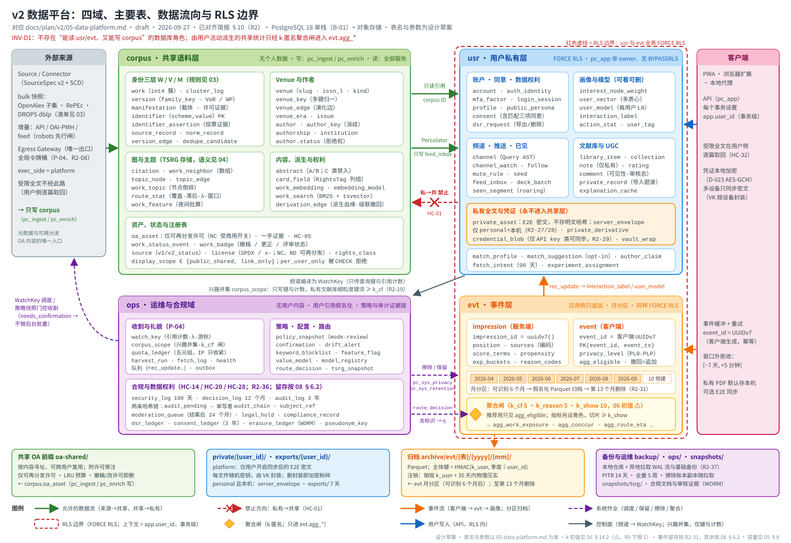

# 05 · 多用户数据平台与数据库设计

> **定位**：本文承接用户需求 R2 中"多用户平台的后台数据库，维护每个人的自定义检索与偏好"，并落地多用户化带来的数据合规要求。按[简报](00-design-brief.md) §9 的分工，本文是 DDL（设计伪代码）、RLS、事件表、存储分层、凭证库与迁移的**定义方**，03、04、06 引用本文。
>
> **上游约束**：[v2 设计决策简报](00-design-brief.md)（B-01…B-06、P-01…P-09、§6.3），以及简报 §10 的第 2 轮裁决（R2-01…R2-50，优先于简报前文与本文原有表述）。本文对简报只做"细化"，细化项与备选集中列在 §15，没有静默偏离；本文承接的 R2 条目逐条列在 §1.5。
>
> **同批对齐**：同批起草的 [01](01-vision-and-requirements.md)、[02](02-architecture.md)、[03](03-sources-and-corpus-pipeline.md)、[04](04-retrieval-and-routing.md)、[06](06-recommendation-and-matching.md)、[07](07-frontend-interaction.md)、[08](08-compliance-security-privacy.md) 已提出落表需求或约束，本文逐项承接（依据 2026-09-27 读取的各文档当前稿），对照表见 §3.3.6 与 §14.4。承接的内容包括：
> - 03 的身份存储契约：版本边词表、第三方断言表、方案粒度、版本系、源记录来历、NormRecord 与 `input_basis`；
> - 04 的 TSRG 存储增补：`route_stat` 窗口维、覆盖素描、快照登记、私有切块、引文近邻表；
> - 06 的事件契约、k 阈值名称与 §19.1、§25 的对齐清单；
> - 08 的 RightsTag、许可码（SPDX 加 `x-` 前缀）、核定后的留存矩阵、端到端私有资产、确认登记、关键词过滤库与审计哈希链；
> - 02 的角色名、对象前缀与 outbox relay 的归属；
> - 01 的 FR/NFR 编号与 §14.4 的命名消歧；
> - 07 的"重置可撤销"、搜索查询存放要求与"从 v1 导入"收藏夹。
>
> **证据口径**：
> - 事实性断言引用 `docs/survey/` 调研（2026-09-26 核验）的具体章节。
> - 本文另于 2026-09-27 直读了少量一手来源（PostgreSQL 18 文档、pgvector README、若干 GitHub 仓库的许可与状态），见 §18.2。
> - 调研中标 ⚠ 的事项，本文继续标 ⚠。
> - `[估算]` 表示按明示假设推算；`[设计值]` 表示本文提出、待实现期校准的参数。
>
> **写法约定**：
> - SQL 块均为"设计伪代码 DDL"，不是 schema 冻结；Python 块均为"设计伪代码"。
> - 本文内的编号（INV-D、RC、ETL-R、AC-V?）只在本文有效，AC 最终编号由 09 统一。
>
> **配图**：[v2-06-data-domains.svg](../../diagrams/v2-06-data-domains.svg)（四域、主要表、数据流向与 RLS 边界）。

---

## 0. 结论速览

1. **四个 PostgreSQL schema 就是四个数据域**。
   - `corpus`：共享语料，不含个人数据。
   - `usr`：用户私有数据，全表 `FORCE ROW LEVEL SECURITY`。
   - `evt`：事件；应用侧只追加，按月分区，同样启用 RLS。06 所说的"聚合区"落在 `evt.agg_*`（答复 06 的 Q-06-8）。
   - `ops`：运维与合规证据链。

   另设 `app` schema，只放函数与类型，不放数据。
2. **单向流由三道机制强制执行**。
   - 权限：任何数据库角色都不能同时"读 `usr`/`evt`"和"写 `corpus`"（INV-D1，与 02 的 INV-01 同义）。
   - 约束：`corpus` 的 CHECK 与触发器拒绝三类数据——私有作用域、C 类摘要、白名单外的许可；派生物记录血缘。
   - 测试：私有"金丝雀"数据流测试。

   由用户活动派生的数据进入任何共享统计，只有一个合法出口：k 匿名聚合闸（HC-30）。它的产物只进 `evt.agg_*`，不进 `corpus`；路由的检索有效率 η 也照此处理（§3.1.7）。唯一的控制面例外是兴趣并集：聚合作业只把键与计数写入 `ops.corpus_scope`，其中由私有文献库派生的细粒度键须有 ≥`k_cf` 个不同用户才并入平台收割（R2-19，§3.4 ①）。

   RLS 策略分六类：私有（P）、可共享 UGC（S）、事件（E）、系统作业（X）、TTL 清理（T）、数据主体请求（D）。跨用户的后台作业只拿到列级、谓词级的最小权限，例如 Percolator 只能插入收件箱、不能读；TTL 清理与 DSR 分属两个角色，推荐用聚合与平台指标也分属两个角色（§4.1、§4.4）。
3. **身份三层**：`work` / `version` / `manifestation`。
   - `work_id` 取 `integer`，以兼容 Roaring 位图；06 所说的 `cluster_id` 就是本文的 `work_id`。
   - union-find 的结果物化在 `version.work_id` 上，合并与拆分记入 `cluster_log`，可以回滚。
   - 版本边用 03 的词表：`version_of` 表示并入同一 Work；`preprint_of` 加 `link_class = wp_to_publication` 表示 WP 与发表版只建关系、不合并（SI-16、D-007）。
   - OpenAlex W 等第三方 work 级断言只进 `identifier_assertion` 作投票证据，不进作为强合并锚点的 `identifier`（03 §9.7）。
4. **字段级权利**。08 §3.2 的 RightsTag 以"列组"方式物理落地：
   - 内容型字段（摘要、共享 AI 派生、资产）逐行携带整组列；
   - 事实型字段（题名、作者、年份）经 `field_src` 指向来源注册表中的缺省 RightsTag，其 `license_code` 为空、`rights_basis` 为 `fact`（08 §3.2）。
   - 许可码由本文的 `corpus.license` 定义（03 §11.9 同用）：带版本的 SPDX 标识（如 `CC-BY-4.0`），非 SPDX 许可用 `x-` 前缀（如 `x-arxiv-nonexclusive`）；上游与各文档的其他拼写经别名表映射。08 §3.4 当前稿所列的大写码（`CC-BY`、`ARXIV-NONEXCL` 等）对应本表的 `family` 列，`FACT` 对应"`rights_basis = 'fact'` 且 `license_code` 为空"（§3.1.1）。NC、ND 许可属可再分发，限制由 `nc`、`nd` 表达（R2-24）。
5. **事件**。
   - 曝光由服务端用 `uuidv7()` 生成，即 06 的 `serve` 记录；表名统一为 `evt.impression`（R2-07、R2-32）。
   - 客户端事件的 id 由客户端生成 UUIDv7，作为幂等键；分区安全窗口为 [now−7 天, now+5 分钟]（R2-32）。
   - 分区键 `event_ts` 从 UUID 内嵌的时间戳推导（PG18 `uuid_extract_timestamp`），因此重试必然落在同一分区。
   - 06 信封中的服务端补全字段（`privacy_level`、`train_eligible`、`agg_eligible`、`is_organic` 等）逐列落表。
6. **保留**（事件按 R2-31；其余按 08 §6.2 当前核定值，差异见 §16）。
   - 事件与曝光：可识别形态在 PG 按月分区保存 6 个月，之后转为假名化 Parquet 归档，保存至第 13 个月删除（R2-31）。
   - 日志：安全日志 190 天；决策日志（策略与许可闸判定、共享发布、LLM 调用元数据）12 个月；审计日志（特权操作、DSR、审核、配置变更、确认函、用户控制）3 年，其中在线 13 个月、其余归档；两条链都是只追加的哈希链，由单一写入者串行链接，主体以 HMAC 假名 `subject_ref` 表示（R2-36），锚点永久；影响评估 ≥3 年。
   - 聚合：k 匿名聚合 24 个月（08 核定为"长期"，本文取更严的上限）。
   - 注销：7 天宽限，30 天内完成删除；备份 35 天滚动淘汰。
7. **凭证与私有内容**（与 08 §5 对齐）。
   - 部署级上游 API key 由 Egress Gateway 独占读取（docker secrets 或权限 0600 的文件，KMS 可选），不入库；ORCID 登录用的 OAuth 客户端密钥归认证服务（R2-30）。
   - 用户级凭证只以端到端密文存在 `usr.credential_blob`：由 VK 分别封装给各设备与恢复码，服务端无解密能力（HC-04）。只有 API key 类条目可同步，会话 cookie 与 `storage_state` 一律不同步，由 `item_kind` 的 CHECK 拒收（R2-29）。
   - platform 部署的私有 PDF 默认留在用户设备上；用户可选择端到端同步，每个文件用随机密钥加密。服务端不存明文哈希，默认不做私有派生。服务端托管模式 `server_envelope`（含 `dek_ref`）与 `processor = 'api:<vendor>'` 只在 personal 部署且 `deployment.host_is_user_device = true` 时可用，由触发器强制（R2-27、R2-28）。
8. **对象存储前缀**（与 02 §2.6.3 对齐）：`oa-shared/`、`private/{user_id}/`、`exports/{user_id}/`、`snapshots/`、`archive/`、`backup/`、`ops/`。MinIO 仓库已归档且为 AGPL-3.0，不采用（§6.5）。
9. **容量**（均为估算，§8）。
   - 库体积：T1 典型负载（1,000 DAU、300 万 work）约 85 GB；设计容量（1 万 DAU × 50 张/日、1,000 万 work）约 330 GB，单台 PG 18 可承载。事件可识别期按 R2-31 为 6 个月，是 02 §2.11 所假设 90 天热存的两倍。
   - 事件量：设计容量下约 7.3 亿行/年，低于 ClickHouse 的 10⁹ 行/年触发线；T1 目标档（1,000 DAU）不引入 ClickHouse（R2-31）。按 RT 上界（200 张/日，已超出 R2-42 的每日 60 张上限，只作压力口径）约 29 亿行/年，会触发。迁出后 PG 只留近 30 天事件，库体积约 300 GB，与 02 §2.11 的上界（约 270 GB）同一量级。
10. **备份与迁移**。
    - 备份：pgBackRest（MIT），基础备份加 WAL 归档；PITR 窗口 14 天，全量保留 5 周。异地副本默认由备份主机拉取：WAL 以流复制协议持续拉取，基础备份按周期拉取，平台不主动外连（R2-37，02 INV-03）。
    - 目标：RPO ≤5 分钟，RTO ≤4 小时（NFR-27）；整站损毁时的 RPO 由持续拉取的 WAL 保证（§9.1）。
    - 恢复之后必须先重放擦除账本，才能对外服务。
    - 迁移器沿用 v1"顺序编号 SQL"范式的 PG 版：整文件提交、校验和、advisory lock、expand/contract。
11. **v1 ETL**。
    - 规模：v1 实库有 179 篇论文（2026-09-27 只读计数），逐表逐列映射。
    - 摘要按来源划分权利：127 篇推断为 A 类，待复核；49 篇为 B 类；3 篇进入私有侧。
    - v1 的 PDF、全文与凭证不进入共享层。platform 部署，以及 `host_is_user_device = false` 的 personal 部署，都不上传这些私有文件；只有运行在用户本人设备上的 personal 部署才放入本人私有空间（R2-27、R2-28）。
    - 179 篇全部成为迁移用户的文献库条目、"从 v1 导入"收藏夹与种子（06 §23.2；07）。

---

## 1. 功能说明

### 1.1 目标

1. 把简报 P-02 的"合规数据三域 + ops"落成可执行、可验证的数据库结构（§2–§4）。
2. 为多用户平台提供每个人的数据空间，并保证用户之间严格隔离。空间内包括：
   - 账户、同意、画像、模型、频道；
   - 文献库、笔记、评分、评论；
   - 已见集合、私有资产密文、凭证密文；
   - 取回回执、实验分桶、数据权利请求。
3. 为推荐与评测提供可重放的事件底座：曝光必记，反馈绑定曝光，撤销以追加事件实现（P-08、SI-45、06 §5）。
4. 把保留期、删除权、导出权、法定留存做成作业与约束（HC-14、HC-20、P-06）。
5. 给出容量、备份、迁移与 v1 ETL 的方案。personal 与 platform 两种部署共用同一 schema（B-02、B-03）。

### 1.2 范围边界

| 内容 | 定义方 | 本文的承接 |
|---|---|---|
| SourceSpec v2、SCD、ConnectorFamily、身份判定规则（union-find、版本投票、MinHash/Splink）、版本边词表、enrich 流程 | [03](03-sources-and-corpus-pipeline.md) | 提供 `source`、`source_record`、`norm_record`、`identifier`、`identifier_assertion`、`version_edge`、`cluster_log`、`dedupe_candidate`、`abstract`、`card_field` 等表（03 §9.7、§19 第 14 条） |
| Query AST、TSRG 结构与算法、WatchKey 语义与调度、检索参数、私有层检索 | [04](04-retrieval-and-routing.md) | 提供 `topic_node`/`topic_edge`、`work_topic`、`route_stat`、`watch_key`、`work_search`、`work_embedding`、`work_neighbor`、`ops.coverage_sketch`、`ops.tsrg_snapshot`、`usr.private_chunk` 的存储与索引（04 §5.4、§9.7、§9.8） |
| 事件契约（必选与扩展事件、信封、隐私级别）、ValueModel、k 阈值、推荐管线 | [06](06-recommendation-and-matching.md) §5、§14、§19 | 定义 `evt` 的存储、幂等、分区与保留；落 06 §19.1 列出的全部表（对照见 §3.3.6） |
| RightsTag 逻辑结构、许可码、许可闸、留存矩阵、同意清单、E2E 凭证与私有全文方案、审计日志结构 | [08](08-compliance-security-privacy.md) §3、§5、§6、§11.3 | 定义物理落点、约束、保留作业与删除作业 |
| 服务拓扑、API 面、部署、KMS 选型、角色原则 | [02](02-architecture.md) §2.6 | 给出角色与权限矩阵、连接池约束、对象前缀的实现 |
| FR/NFR 编号 | [01](01-vision-and-requirements.md) §6–§7 | 映射见 §1.4 |
| 前端交互 | [07](07-frontend-interaction.md) | 提供导出、删除、标签管理、重置撤销、搜索历史的存储 |
| 里程碑、AC 编号、ADR 定稿 | 09（路线图） | 提供 AC-V? 占位（§13）与 ADR 候选（§14.3） |

### 1.3 承接的设计输入与硬约束

| 编号 | 内容（摘要） | 本文落点 |
|---|---|---|
| SI-15 | 本地底座按全体用户兴趣的并集导入子集 | `ops.corpus_scope`；§8 |
| SI-16、SI-29 | Work/Version/Manifestation；union-find 物化；保留回滚日志；弱信号不自动合并 | §3.1.2 |
| SI-27、SI-28 | PG18 单栈与升级触发条件；图数据放 PG 邻接表 | §3.1.5、§8.4 |
| SI-30 | 已见集合用 Roaring 位图 | `usr.seen_segment` |
| SI-33、SI-34 | Pool 多租户 + RLS；PG 原生队列 | §4；`ops` |
| SI-35、SI-36 | 新 schema + ETL；每用户凭证与私有全文按用户命名空间存放 | §10；§3.2.7–§3.2.8；§6 |
| SI-45、SI-64 | 反馈绑定 impression；事件契约先行 | §3.3 |
| SI-59 | 内容寻址缓存键 | `corpus.card_field.cache_key` |
| SI-66 | 数据可导出，不锁定单一上游 | §7.2 |
| HC-01、HC-02、HC-30 | 两域单向流；不做跨用户复用；小样本隐私门槛 | §2.2、§2.5；INV-D1/D2/D6/D7 |
| HC-04、HC-32 | 不收机构口令、凭证只存端到端密文；受限全文只由用户显式触发、逐篇取回 | §3.2.7–§3.2.8 |
| HC-05、HC-07、HC-08 | 逐篇许可白名单；字段级权利；摘要分级 | §2.3；§3.1.9–§3.1.10 |
| HC-13 | 标签可看可删；非个性化模式 | §7.4 |
| HC-14、HC-20、HC-28 | 日志 ≥6 个月；影响评估 ≥3 年；留存矩阵；注销删除私域全文；可审计 | §5；§7.3；`ops.audit_log` 哈希链 |
| HC-16、HC-18、HC-19、HC-22、HC-23 | 不做公共全文上传；匹配单独同意；最低年龄；数据驻留；商用开关 | §3.2 各表约束 |
| HC-03、HC-06 | 受限全文只在用户侧取回；arXiv e-print（非 CC）不存储、不提供 | `private_asset` 的部署模式触发器（§3.2.7）；`oa_asset` 许可触发器拒收 `x-arxiv-nonexclusive`（§3.1.10） |
| HC-10、SI-37 | 上游一个平台身份、全局调度；限速账本按源 × 主机 × 请求类 × 凭证主体（× 出口 IP） | `ops.quota_ledger`，出口 IP 维度只收紧、不叠加（§3.4 ①） |
| HC-11 | LLM TL;DR 的输入闸与 AI 标识 | `card_field` 的 `input_rights_max` CHECK 与 `generator`；`ops.decision_log`（`llm_call`）（§3.1.9、§3.4 ⑤） |
| HC-29、HC-31 | robots 先行与挑战检测；`needs_confirmation` 通道 | `fetch_log.gate_decision`、`robots_exception_ref`；`policy_snapshot.robots_basis`；`policy_confirmation`（§3.4 ①②） |

HC 编号与 [08](08-compliance-security-privacy.md) §2.2 的全库登记表一致：HC-01…HC-28 沿用 CP §3.1，HC-29…HC-32 由 08 新增。

### 1.4 与 01 登记的需求对应

| 01 编号 | 内容 | 本文落点 | 本文验收草案 |
|---|---|---|---|
| FR-45 | 多用户账号隔离（Pool + RLS） | §4 | AC-V3.5、AC-V0.21 |
| FR-46 | 每用户数据与偏好 | §3.2 | AC-V3.12（导出覆盖） |
| FR-47 | v1→v2 迁移 | §10 | AC-V3.29 |
| FR-77 | 账号与身份（ORCID OAuth、年龄声明） | §3.2.1 | AC-V3.5 |
| FR-79 | 凭证分级管理 | §3.2.8、§6.2 | AC-V3.15 |
| FR-80 | 字段级权利标注与派生继承最严 | §2.3、§2.4、§3.1.9 | AC-V3.7、AC-V1.36 |
| FR-81 | 数据导出与删除 | §7 | AC-V3.13、AC-V3.12 |
| FR-85 | 私有资产（LQ-15 前默认关闭） | §3.2.7 | AC-V3.7 |
| FR-28 | 用户级来源偏好 | `usr.follow`、`usr.mute_rule`：两表的目标类型都含 `source`，因此来源级关注与屏蔽无需另建表（答复 01 §17 第 23 项） | 由 04/06 主承接 |
| FR-30 | 用户导入题录只进本人私有库 | `usr.private_record` | AC-V3.5（RLS） |
| FR-40 | 频道与 WatchKey | `usr.channel`、`ops.watch_key` | 由 04 主承接 |
| FR-54 | 私有评分与笔记 | `usr.rating`、`usr.note` | AC-V3.5 |
| NFR-11 | 容量与规模；分区与保留策略 | §5、§8 | AC-V3.6 |
| NFR-15、NFR-16 | 隐私、安全 | §2、§4、§6 | AC-V3.7、AC-V4.25、AC-V3.15 |
| NFR-24 | 可移植、不锁定 | §6.5、§7.2 | AC-V3.12 |
| NFR-25 | 可审计与留存；审计日志防篡改 | §3.4、§5 | AC-V3.14、AC-V1.41 |
| NFR-26 | 幂等与一致性 | §3.3 | AC-V3.9 |
| NFR-27 | 可恢复（RPO ≤5 分钟，RTO ≤4 小时） | §9 | AC-V3.27 |

### 1.5 承接第 2 轮裁决（简报 §10）

| 裁决 | 内容（摘要） | 本文落点 |
|---|---|---|
| R2-01 | 许可门禁四级；psycopg 3 放行（评审级） | 依赖选型（§6.5、§9.1、§9.3）；`embedding_model.license_code` |
| R2-02、R2-03 | SourceSpec 内的通道称 SourceChannel；展示级别写作 DL0–DL4 | 列名 `source_channel`（§3.1.2、§3.4 ②）；`app.display_level` 注释与 CHECK 说明（§2.3、§3.1.9） |
| R2-04、R2-05 | `k_cf` / `k_reason` / `k_show`，R0 下限 5；`np_time` / `np_source` | `platform_setting` 键与触发器；`agg_*` 的 `k_applied ≥ 5`（§2.5、§3.3.5）；`profile.personalization_mode` |
| R2-06、R2-07 | 事件名以 06 为准；近线队列 `rec_update`；曝光表 `evt.impression`；出箱主题 `corpus.change` | §3.3、§3.1.2、§3.4 ③ |
| R2-08 | Egress Gateway 为唯一出口；令牌桶键为五元组 | `pc_sys_egress`；`ops.quota_ledger`（§3.4 ①、§4.1） |
| R2-09 | 策略模式以 03 §6.2 的五档全序为准 | `policy_snapshot.mode`（§3.4 ②） |
| R2-10、R2-11 | 名录状态拆为 `v1_status` / `v2_status`；新增 `bulk_snapshot` 家族与 L2 子类型 `registry` | `corpus.source`（§3.1.1）；`source_record.provenance = 'snapshot'`（§3.1.2） |
| R2-15、R2-16 | 漂移分级处置；证据复核逾期 `review_overdue` 宽限 30 天 | `ops.drift_alert`、`policy_snapshot.review_state`、`policy_confirmation` 回退规则（§3.4 ②） |
| R2-18、R2-48 | 具名 AI-UA 禁令站点只"打开后一键保存"；personal 部署可批量取回许可允许的 OA 全文 | `private_asset.origin` 的 `tab_save`、`oa_batch`（§3.2.7） |
| R2-19 | 由私有文献库派生的细粒度收割键须 ≥`k_cf` 个不同用户 | `ops.corpus_scope` 的 CHECK 与聚合作业（§3.4 ①、§4.1） |
| R2-21、R2-22、R2-24 | B 类摘要默认进内部索引、可逆重建；MSC2020 默认不加载；NC、ND 属可再分发 | §3.1.8、§3.1.6、§3.1.1、§3.1.10 |
| R2-27、R2-28、R2-29、R2-30 | 私有 PDF 与服务端托管模式；`host_is_user_device`；设备绑定凭证不同步；密钥归属 | §3.2.7、§3.2.8、§3.4 ④、§6.2 |
| R2-31、R2-32、R2-33 | 事件留存；ID 生成与分区安全窗口；强负反馈同步写抑制表 | §5.2、§3.3.3、§3.3.4、§3.2.4 |
| R2-34、R2-35 | WatchKey 算法归 04、由调度器执行；Percolator 输入含新 Version 与匹配字段变更 | `ops.watch_key`（§3.4 ①）；`corpus.change` 载荷（§3.1.2） |
| R2-36、R2-37 | 审计日志 `subject_ref`、哈希链、单写者串行；异地备份拉取式 | §3.4 ⑤、§9.1 |
| R2-42、R2-43、R2-44、R2-47 | 批大小 15/25/35、每日上限 60；评论与笔记只作主题参与；北极星与 VR-strict；关注与 `source_impression_id` | `profile`、`usr.daily_quota`（§3.2.2、§3.2.5）；`interaction_label` 注释；`agg_metric_daily`（§3.3.5）；`usr.follow`、`library_item`（§3.2.4、§3.2.6） |

---

## 2. 实现方案总览：四域与单向流

### 2.1 四域定义

| 域 | 内容 | 写入方 | 读取方 | 行级隔离 | 典型保留 |
|---|---|---|---|---|---|
| `corpus` | 公开元数据、许可允许再分发的 OA 内容及其派生物、来源/许可/权利注册表、路由统计 | `pc_ingest`、`pc_enrich` | 全部服务（只读） | 无（不含个人数据） | 永久，随上游更新（RC-C0） |
| `usr` | 账户、同意、画像、模型、频道、文献库、UGC、已见集合、私有资产与私有派生、凭证密文、取回回执、实验分桶、DSR | `pc_app`（在用户上下文中）、`pc_auth`、系统作业角色（由策略限定范围） | 本人；系统作业按策略读取 | 全表 FORCE RLS | 账户存续期（RC-U*） |
| `evt` | 曝光、客户端事件、检索日志、k 匿名聚合（聚合区） | `pc_app`（只追加）、`pc_sys_aggregator`（只写 `agg_*`） | 本人事件；聚合结果供推荐与分析只读 | 原始表 FORCE RLS；聚合表不需要 | 可识别形态 6 个月，假名化归档至第 13 个月（RC-E1，R2-31）；聚合 24 个月（RC-E2） |
| `ops` | 收割调度与兴趣并集、健康、配额、策略快照、漂移告警、确认函、队列、FetchLog、决策日志与审计日志（两条哈希链）及锚点、审核、DSR 与擦除账本、保留作业、迁移版本、模型与 ValueModel 登记 | 各服务按表授权 | 运维与审计 | 不需要；用户引用一律用假名化主体键，少数执行表除外（§3.4） | 按 RC-O*（§5） |

`app` schema 只放函数（`app.uid()`、`app.dsr_subject()`、`app.audit()` 等）与 domain 类型。

### 2.2 单向流规则与不变式

**允许的数据流**（对应配图中的绿色、蓝色、橙色、灰色箭头）：

1. 来源 → `corpus`：收割、归一、识别、enrich，由 `pc_ingest` 与 `pc_enrich` 执行。
2. `corpus` → `usr`：`usr` 以外键引用 `corpus` 的 id，只读。Percolator 与反向路由只向 `feed_inbox` 写入，不读取。
3. 客户端 → `usr`、`evt`：经 API，在用户上下文中执行，角色为 `pc_app`。
4. `evt` → `usr`：标签处理器在本人上下文中更新 `interaction_label`、`user_model`、`seen_segment` 等。
5. `usr` → `ops`（控制面）：
   - 频道编译为 WatchKey，只传查询键与引用计数（`pc_sys_scheduler`）；
   - 兴趣并集只传键与不同用户数（`pc_sys_aggregator` 写 `ops.corpus_scope`）。粗粒度键（venue、主题、类目、前缀）直接并入；由私有文献库派生的细粒度键（引文邻域、作者）须 ≥`k_cf` 个不同用户，且不计已关闭"参与匿名协同统计"的用户，否则只做该用户的按需查询（R2-19；03 §10.5）。
6. `evt` → `evt.agg_*`：经 k 匿名聚合闸。推荐用聚合（06 的 G1–G3）由 `pc_sys_aggregator` 执行，只取 `agg_eligible` 事件；平台指标（北极星、VR-strict 与护栏，R2-44）由独立角色 `pc_sys_metrics` 执行，可读 PL1、PL3 的指标事件，但只产出平台级计数，任何切片的不同用户数 ≥`k_show`，且不按作品拆分（06 §5.6–§5.7；08 §5.1.4）。
7. 用户显式提交的公共纠错：例如"这是同一篇"的报告（03 §9.4）。API 按用户限频后写入 `ops.dedupe_report`，只含作品对与日期、不含用户标识；`pc_ingest` 汇总后转为 `dedupe_candidate(method = 'user_report')`，人工裁决前不影响任何共享数据。复核台（`pc_admin`）可以按 `evt.agg_*` 的聚合信号排序，裁决仍经 `pc_ingest` 写入 `corpus`。这是用户有意提交的公开纠错，不是私有行为数据。

**禁止的数据流**（HC-01）：任何私有内容或个体级数据都不得进入 `corpus` 或 `oa-shared/`，包括索引、嵌入、TL;DR、特征、分享卡片、日志样本。另有一条**"不晋升"规则**：用户的私有副本永不转为共享资产。即使它的许可是 CC BY，共享层也必须从开放来源重新取得。

**不变式**（逐条测试见 §11）：

| 编号 | 不变式 | 强制手段 |
|---|---|---|
| INV-D1 | 没有任何数据库角色同时拥有 `usr`/`evt` 任一表的 SELECT 权限和 `corpus` 任一表的写权限（即 02 的 INV-01） | 授权设计（§4.2）+ 目录断言 |
| INV-D2 | 能读私有内容表的角色不得写 `corpus`、`evt.agg_*`、`ops.corpus_scope`，也不得写 `oa-shared/` 与 `archive/train/`；它们对 `ops` 只能写只含 id 的队列与 outbox、去标识的 `route_decision`，以及经 `app.audit()` 的审计暂存；`pc_sys_privacy` 另可写 DSR 与擦除台账。私有内容表指 `private_asset`、`private_derivative`、`private_chunk`、`private_record`、`note`、`search_history`、`explanation_cache`、`credential_blob`、`fetch_intent`，以及私有可见性的 `comment` | 授权设计（§4.2）+ 目录断言 |
| INV-D3 | `usr`、`evt` 的原始表全部 ENABLE 并 FORCE RLS，且至少有一条策略；`pc_*` 角色都没有 BYPASSRLS；应用角色不是任何表的属主 | 迁移模板 + 目录断言 |
| INV-D4 | `corpus` 中不存在引用 `usr`/`evt` 的外键、触发器、函数或视图 | 目录断言 |
| INV-D5 | `corpus` 只收可共享输入：`display_scope` 不能是 `per_user_only`；没有 C 类摘要；`oa_asset` 的许可在白名单内且证据为一手；AI 派生物的 `input_rights_max = 'A'`（LQ-05 有结论前） | CHECK + 触发器 + 日审计查询 |
| INV-D6 | `evt.agg_*` 中的推荐用聚合只由 `pc_sys_aggregator` 写入，平台指标 `agg_metric_daily` 只由 `pc_sys_metrics` 写入，两个角色互不能写对方的表。推荐用聚合的输入只取 `agg_eligible = true` 的事件（06 §5.6）；展示型（G1）、解释型（G3）、协同型（G2 中的共现与读者向量）单元分别满足 `k_show`、`k_reason`、`k_cf`，且 `k_applied ≥ 5`（R2-04 的 R0 下限）。分级曝光后验按 06 §5.6 不设 k（新论文的早期曝光必然人数少），但不展示、不作解释；路由 η（`agg_route_eta`）按 `k_cf`。平台指标（`agg_metric_daily`）是唯一可读非 `agg_eligible` 事件的产物：`pc_sys_metrics` 只见 `event_type.metric_input` 为真的事件类型（06 §5.7），每个切片 `n_users ≥ k_show`，维度不含作品与用户标识。`open_fulltext` 因此在结构上到不了任何推荐用聚合（HC-02；02 INV-06） | 授权 + RLS 策略 + 表级 CHECK + 审计查询 |
| INV-D7 | 私有对象不按内容寻址，任何表都没有跨用户的唯一约束；服务端不保存私有文件的明文哈希（02 INV-08、08 §5.4） | DDL + 对象键规则 + 测试 |
| INV-D8 | `usr`/`evt` 上的视图都设 `security_invoker = true`；SECURITY DEFINER 函数必须在白名单内，固定 `search_path` 并写审计（08 §10.4-5） | 迁移 lint + 目录断言 |

### 2.3 RightsTag 的物理落点（HC-07、FR-80）

08 §3.2 定义了 RightsTag 的逻辑字段，并说明物理存储"可按字段存，也可按字段组存"，由本文决定。本文采用两层落点：

| 字段性质 | 例子 | 落点 | 由此得到完整 RightsTag 的方式 |
|---|---|---|---|
| 事实型（M1 书目、M2 引文、M3 作者标识） | 题名、作者、venue、年份、DOI、引文边 | `version.field_src`（`{字段: source_id}`）→ `corpus.source.default_rights_*` | 由 `(field_src, source)` 确定性地还原；`rights_basis = 'fact'`，`license_code` 为空（08 §3.2：事实字段不做许可判定） |
| 内容型（M4、M5、M7、M8、M11、M13、M14） | 摘要、S2 TLDR、共享 TL;DR/翻译/要点、OA 全文、关键图 | 行内完整的 **RightsTag 列组**（见下） | 行本身即元组 |
| 私有（M6、M9、M10、M12、M16–M20、M23–M25） | 私有速读、私有派生、凭证、画像 | 只存在 `usr`；`display_scope` 恒为 `per_user_only`；`owner_user_id` 即行的 `user_id` | 不需要跨用户解析 |

**RightsTag 列组**（设计伪代码 DDL 片段；凡内容型表都整组携带）：

```sql
  rights_source     text NOT NULL REFERENCES corpus.source,                 -- 08 RightsTag.source：取得该字段的来源
  rights_class      text NOT NULL REFERENCES corpus.rights_class,          -- M1…M25
  rights_basis      text NOT NULL CHECK (rights_basis IN ('fact','license','policy')),   -- 放行依据（08 §3.3）
  display_scope     app.display_scope NOT NULL CHECK (display_scope <> 'per_user_only'),   -- corpus 内只允许两值
  display_level_max app.display_level NOT NULL,                             -- 0..4，对应 DL0..DL4（R2-03；即 CP 的 V0..V4）
  license_code      text REFERENCES corpus.license,                         -- 08 §3.4 的码；rights_basis = 'fact' 时可空
  license_conflict  boolean NOT NULL DEFAULT false,
  evidence          jsonb NOT NULL,                                         -- [{source, url, verified_at, grade}]
  evidence_grade    char(1) NOT NULL CHECK (evidence_grade IN ('A','B')),   -- A = 一手
  signals           jsonb NOT NULL DEFAULT '{}',                            -- search / ai_input / ai_train / tdm 保留信号
  commercial_ok     boolean NOT NULL,
  obligations       text[] NOT NULL DEFAULT '{}',                           -- attribution / indicate_changes / share_alike …
  attribution_text  text,
  ai_generated      boolean NOT NULL DEFAULT false,
  derived_from      jsonb,                                                  -- 派生来源；同时写入 corpus.derivation_edge
  fetched_at        timestamptz NOT NULL,
  policy_version    text NOT NULL,                                          -- 许可闸规则版本；规则变更时按此批量重算
  CHECK (rights_basis <> 'license' OR license_code IS NOT NULL)
```

08 RightsTag 中的 `owner_user_id` 只对 `per_user_only` 有意义，`corpus` 内不存在这种行，所以列组不含它；`shareable` 是派生别名，等于 `display_scope = 'public_shared'`（08 §3.2），不单独存列。

`display_scope` 与展示级别的映射按 08 §3.3（合规调研的 V0–V4 在 v2 文档中写作 DL0–DL4，R2-03）：
- DL4、DL3、DL2 对应 `public_shared`；
- DL1 对应 `link_only`；
- DL0 对应 `per_user_only` 或不入库。

`link_only` 的对象只存链接，不存内容，因此只出现在 `manifestation` 中，不会出现在内容型表里。

### 2.4 派生血缘与"派生继承最严"

- 共享派生物（`card_field`、`work_embedding`、`work_search`、裁剪图）都写 `derived_from`，并在 `corpus.derivation_edge` 中登记反向边。
- 当输入变严（许可变更、撤稿下架、政策开关翻转、LQ 结论为否）时，沿反向边级联重算或撤下全部派生物。08 §3.6 性质 4 要求 24 小时内完成 ⚠。
- 共享派生物还记录输入构成，以便定点清除：
  - `input_basis`：03 §11.3 的存储契约字段，记录输入由什么组成，如 `title`、`title+abstract:open`、`title+abstract:publisher_copyright`；
  - `input_rights_max`：输入中最严的摘要权利类（A 或 B），由 `input_basis` 推出，供 CHECK 与索引使用；
  - LQ-05 有结论前，`card_field` 中凡 `ai_generated` 的行必须 `input_rights_max = 'A'`（简报 P-02）；
  - B 类摘要默认纳入词法索引与嵌入（不展示，展示上限 DL3），并可逆（R2-21）：若 LQ-02 判定 B 类摘要不得进入内部索引，或 03 的总开关 `policy.index_b_abstracts` 被关闭，按 `input_rights_max = 'B'` 定位 `work_embedding` 与 `work_search` 的受影响行，重算即可，不必全库重建（03 AC-V2.20）。C 类摘要永不进入共享层。
- "私有输入 → 私有产物"由计算位置保证：共享派生只由 `pc_enrich` 生成，这个角色读不到 `usr`；私有派生只写入 `usr.private_derivative`。

### 2.5 k 匿名聚合闸（HC-30）

1. **准入**：只有 `evt.event.agg_eligible = true` 的事件进入聚合。按 06 §5.6，这要求同时满足：
   - 隐私级别为 PL2；
   - 有机曝光，且确属下发给该用户的曝光；
   - 未被撤回；
   - 用户未关闭"参与匿名协同统计"；
   - 账号满 7 天、决策数 ≥20；
   - 非作者本人，也非利益冲突账号；
   - 速率正常。

   `agg_eligible` 在写入时由服务端按 06 的规则计算并落列。
2. **永不进入**（06 §14.3）：`open_fulltext`、`note`、`block`、私有评分、匹配事件、导入种子、私有上传、取回回执。
3. **k 初值**：取 06 §14.2 的设计假设 ⚠，写入 `ops.platform_setting`（键名即参数名）并做版本管理，最终由 08 与法务确认。

   | 参数（`platform_setting` 键） | 初值 | 用途 |
   |---|---|---|
   | `k_cf` | 5 | 共现、读者向量；GBDT 叶子另要求样本 ≥100 |
   | `k_reason`、`k_reason_cohort_min` | 5；cohort ≥30 人 | COHORT_TRENDING 理由 |
   | `k_show` | 10，分桶 10+/50+/100+/500+，按 7 天窗口更新 | V6 起的公开计数 |

   - 命名：按 R2-04 统一为这三个名字（06 §14.2、08 §7.2 同）。01 §14.4 与 02 INV-09 早期稿中的 `k_feature`、`k_display` 是本文初稿的旧名，分别对应 `k_cf`、`k_show`，已随 R2-04 改名；08 早期稿的统称 `k_min` 已废止（一致性审计 2026-09-27）。
   - 约束：R0 阶段三者都不低于 5（R2-04；08 §7.2）。这条下限写成两处硬约束：`platform_setting` 的触发器拒绝 k 值低于 5 的写入；每张 `agg_*` 表另有 `CHECK (k_applied >= 5)`，防止聚合作业以错误的 k 写入。取值变更须经隐私评审，由触发器经 `app.audit()` 记一条 `config_change`（`ops.audit_log`）。
   - 差分隐私的启用决策点见 06 §14.5（DP-0…DP-3）。
4. **执行者限定**：能跨用户读原始事件的只有两个角色，各自只见一部分行（§4.4 的 `ev_agg`、`ev_metric`）：
   - `pc_sys_aggregator`：只见 `agg_eligible` 事件；输出只写推荐用的 `evt.agg_*`、`archive/train/`，以及控制面的 `ops.corpus_scope`（兴趣并集的键与计数，R2-19）与 `ops.route_eta_carry`；
   - `pc_sys_metrics`：只见 `event_type.metric_input` 为真的事件类型；输出只写 `evt.agg_metric_daily`。

   每个 `agg_*` 表都有 `n_users ≥ k_applied` 与 `k_applied ≥ 5` 的 CHECK。凡低于阈值的单元不写入，而不是写入 0。

### 2.6 标识符与键

| 键 | 类型 | 理由 |
|---|---|---|
| `corpus.work.work_id` | `integer`（identity） | 是事件、位图与外键里的热键。Roaring 位图按 32 位整数组织（RT §7.2）。2³¹ ≈ 21 亿，高于 OpenAlex 全量 works 的数量级（core 3.2 亿 + expansion 约 1.9 亿，RT §2.2）。06、03 伪代码中的 `cluster_id` 即本列（06 §19.1；03 §9.7） |
| `version_id`、`manifestation_id`、`record_id` | `bigint` | 行数多，但不是热键 |
| `corpus.work.public_id` | `uuid`，由 `uuidv7()` 生成 | 对外 id（06 信封中的 `work_id: PublicId`）；PG18 原生支持（RT §10.7） |
| `usr.account.user_id` | `uuid`，由 `uuidv7()` 生成 | uuidv7 内含创建时间，不宜外露；对外展示一律用 `public_persona.public_handle` |
| `evt.event.event_id` | 客户端生成的 UUIDv7 | 幂等键；分区键由它推导（§3.3.3） |
| `corpus.citation.ref_key` | `bigint` | 被引文献规范标识符（DOI 优先）的 63 位哈希，用于文献耦合，被引文献不在库内也能计算。以 3×10⁸ 条引用计，期望碰撞数约 n²/2⁶⁴ ≈ 0.005 `[估算]` |
| 主题标签 | `smallint[]` | 存 OpenAlex 原生编号（subfield ≤3616、topic ≤14521），不存 `node_id`，可作 pgvectorscale 的标签过滤（RT §5.4、V07；04 §5.4） |
| `ops` 中的用户引用 | `subject_ref bytea`，值为 HMAC(k_audit(u), user_id)，k_audit(u) 为每用户的审计假名密钥（`ops.pseudonym_key`，`purpose = 'audit'`） | 02 §2.6.1 要求 ops 日志中的用户引用假名化；R2-36 与 08 §11.3 要求审计主体只写 HMAC 假名，删除该用户的密钥即可解除关联，行内容与哈希链不变。密钥在该用户最后一条法定留存记录到期后销毁（§6.2）。例外是 `dsr_job`、`erasure_ledger`、`support_grant`、`pseudonym_key`，它们需要 user_id 才能执行（§3.4） |

### 2.7 配图



---

## 3. 实现方案：表设计（设计伪代码 DDL）

### 3.0 约定

1. **类型**：时间一律用 `timestamptz`（UTC）；日期用 `date` 加精度列；弹性字段用 `jsonb`；向量用 pgvector 的 `halfvec`。
2. **枚举**：用 `text` 加 CHECK。跨文档权威的枚举用查找表，由属主文档登记取值，包括权利类、许可码、事件类型、召回源与理由码的编码。
3. **外键方向**：
   - 允许 `usr → corpus` 的外键与各域内部外键；
   - `evt`、`ops` 对其他域只做逻辑引用，由对账作业检出孤儿行；
   - `corpus` 不得引用 `usr` 或 `evt`（INV-D4）。
4. **删除**：个人数据一律物理删除，不做软删除；`corpus` 用状态列与墓碑行保持引用稳定。
5. **建表顺序**：迁移文件按依赖排序；下文为了便于阅读，按主题分组。

设计伪代码 DDL：schema、公共类型与上下文函数

```sql
CREATE SCHEMA app;  CREATE SCHEMA corpus;  CREATE SCHEMA usr;  CREATE SCHEMA evt;  CREATE SCHEMA ops;

CREATE DOMAIN app.display_scope AS text     CHECK (VALUE IN ('public_shared','per_user_only','link_only'));
CREATE DOMAIN app.display_level AS smallint CHECK (VALUE BETWEEN 0 AND 4);                 -- DL0..DL4（R2-03；08 §3.2 的 V0..V4）
CREATE DOMAIN app.privacy_level AS text     CHECK (VALUE IN ('PL0','PL1','PL2','PL3','PLP'));   -- 06 §5.7

-- 用户上下文：未设置时返回 NULL；user_id = NULL 恒为假，于是零行（fail-closed，08 §10.4-3）
CREATE FUNCTION app.uid() RETURNS uuid LANGUAGE sql STABLE PARALLEL SAFE
  AS $$ SELECT nullif(current_setting('app.user_id', true), '')::uuid $$;

-- 隐私作业的主体：只返回"执行中"的 DSR 对应的用户
CREATE FUNCTION app.dsr_subject() RETURNS uuid LANGUAGE sql STABLE
  SECURITY DEFINER SET search_path = pg_catalog, pg_temp          -- 属主为 pc_fn_owner（§4.1）
  AS $$ SELECT j.user_id FROM ops.dsr_job j
        WHERE j.request_id = nullif(current_setting('app.dsr_request_id', true), '')::uuid
          AND j.state = 'executing' $$;
```

### 3.1 corpus 域

#### 3.1.1 注册表：权利类、许可、来源、标识符方案

设计伪代码 DDL

```sql
CREATE TABLE corpus.rights_class (            -- M1–M25（CP §2.7）；取值与规则由 08 §3.3 登记
  code              text PRIMARY KEY,
  label             text NOT NULL,
  default_scope     app.display_scope NOT NULL,
  display_level_cap app.display_level NOT NULL,
  shareable         text NOT NULL CHECK (shareable IN ('yes','conditional','no')),   -- 类别级默认值，对应 08 §3.3 表中的 ✓ / ⚠ / ✗
  rules             jsonb NOT NULL,           -- 08 的 RIGHTS_CLASS_RULES：各操作允许与否、依据（fact / license / policy）
  owner_doc         text NOT NULL DEFAULT '08'
);

CREATE TABLE corpus.license (                 -- 许可参照表（08 §3.4）；许可闸读属性，不按字符串判断
  license_code    text PRIMARY KEY,           -- 带版本的 SPDX 标识：CC0-1.0 / CC-BY-4.0 / CC-BY-SA-4.0 / CC-BY-NC-4.0 / CC-BY-NC-SA-4.0 /
                                              --   CC-BY-ND-4.0 / CC-BY-NC-ND-4.0 …；非 SPDX 用 x- 前缀：x-public-domain / x-other-oa /
                                              --   x-arxiv-nonexclusive / x-free-to-read / x-no-reuse / x-pmc-tdm / x-publisher-tdm /
                                              --   x-subscription / x-unknown
  is_spdx         boolean NOT NULL,
  family          text NOT NULL,              -- 不带版本的族名，取 08 §3.4 当前稿的大写码：PD / CC0 / CC-BY / CC-BY-SA / CC-BY-NC /
                                              --   CC-BY-NC-SA / CC-BY-ND / CC-BY-NC-ND / OTHER-OA / ARXIV-NONEXCL / FREE-TO-READ / NO-REUSE /
                                              --   PMC-TDM / PUBLISHER-TDM / SUBSCRIPTION / UNKNOWN；便于按族统计与商用开关批量处置
  redistributable boolean NOT NULL,           -- 公有领域、CC0 与 CC 全族（含 NC、ND）为 true，限制由 nc / nd 表达（R2-24）；
                                              --   x-other-oa 等其余 x- 码为 false
  nc boolean NOT NULL, nd boolean NOT NULL, sa boolean NOT NULL,
  attribution_required boolean NOT NULL,
  url             text,
  CHECK (is_spdx = (license_code NOT LIKE 'x-%'))
);
CREATE TABLE corpus.license_alias (           -- 03 §10.6 的归一拼写（如 arxiv-nonexclusive-1.0、publisher-tdm、unknown）
  alias        text PRIMARY KEY,              -- 与上游原始写法 → 08 的码
  license_code text NOT NULL REFERENCES corpus.license
);
-- 判定口径（08 §3.4 引用）：shareable(l, commercial) = l.redistributable AND (NOT l.nc OR NOT commercial)；
-- 另加 ND 限制：l.nd 为 true 时只允许原样使用，不做共享派生（08 §3.5）。实现为 app.license_shareable(code, commercial)。
-- 码形态：主键是本表的规范码（带版本的 SPDX 加 x- 前缀，03 §11.9 同用）。08 §3.4 当前稿把 family 列的大写族名当作码，
--   二者一一对应（家族与属性相同，只差版本号），许可闸只读属性，不受码形态影响；08 的 "FACT" 对应
--   rights_basis = 'fact' 且 license_code 为空。存储与跨文档引用一律用规范码；族名只用于统计与说明，
--   不作为 license_code 写入（不带版本的族名无法生成 TASL 所需的许可链接）。

CREATE TABLE corpus.source (
  source_id        text PRIMARY KEY,          -- 与 registry/sources/*.yaml 的 id 一致（简报 §6.1-7）
  level            text NOT NULL CHECK (level IN ('L1','L2')),
  kind             text NOT NULL CHECK (kind IN ('publisher','preprint','journal_platform','conference_platform',
                                                 'repository','aggregator','registry')),   -- registry 为 L2 子类型（R2-11）
  display_name     text NOT NULL,
  attribution_text text,                      -- NLM 致谢、"Semantic Scholar" 等（HC-24）
  default_rights_class text NOT NULL REFERENCES corpus.rights_class,   -- 事实字段的缺省 RightsTag（§2.3）
  default_evidence jsonb NOT NULL,
  commercial_ok    boolean NOT NULL,          -- HC-23 门控的输入
  v1_status        text NOT NULL CHECK (v1_status IN ('v1-implemented','v1-partial','v1-designed-only','—')),   -- R2-10
  v2_status        text NOT NULL,             -- 简报 §6.1-7 的枚举：v2-P0 / v2-P1 / v2-P2 / metadata-only / link-only /
                                              --   user-import-only / excluded，可带优先级后缀如 'metadata-only（P1）'（R2-10）
  CHECK ((level = 'L1') = (kind IN ('publisher','preprint','journal_platform','conference_platform'))),
  spec_path text, spec_sha256 bytea, spec_verified_at date,   -- SourceSpec v2 快照（03 为单一事实来源）
  storage_policy   jsonb NOT NULL DEFAULT '{}', -- SourceSpec 的 storage_policy 副本（03 §3.2）：raw_payload_retention、
                                              --   currency_rule、delete_on_upstream_delete；载荷清除作业据此执行
  updated_at       timestamptz NOT NULL DEFAULT now()
);

CREATE TABLE corpus.id_scheme (               -- 标识符方案（SI-16）
  scheme      text PRIMARY KEY,               -- doi / arxiv / pmid / pmcid / dblp / ads / zbmath / repec / ssrn / openreview / isbn /
                                              --   doi_family（版本系 DOI，如 bioRxiv/medRxiv、arXiv DataCite DOI；03 §9.1）/
                                              --   openalex_w / s2_corpus / inspire_recid / mag …
  normalizer  text NOT NULL,                  -- 规范化规则名（03 §10.6 定义）
  granularity text NOT NULL CHECK (granularity IN ('version','version_family','work_assertion','manifestation'))
    -- 粒度是方案的属性（03 §9.7）。work_assertion 类（OpenAlex W、S2 corpusId、INSPIRE recid、MAG）
    -- 不进 corpus.identifier，只进 corpus.identifier_assertion 作投票证据，从而不会直接驱动合并（D-007）
);
```

#### 3.1.2 身份三层：work / version / manifestation

设计伪代码 DDL

```sql
CREATE TABLE corpus.work (                    -- 一篇作品 = union-find 的一个簇（06 称 cluster）
  work_id              integer GENERATED ALWAYS AS IDENTITY PRIMARY KEY,
  public_id            uuid NOT NULL UNIQUE DEFAULT uuidv7(),
  status               text NOT NULL DEFAULT 'active' CHECK (status IN ('active','merged','withdrawn','suppressed')),
  merged_into          integer REFERENCES corpus.work,     -- 墓碑重定向
  canonical_version_id bigint,
  title                text NOT NULL,                       -- 按字段优先级由各版本收敛（沿用 v1 D-035 的思路，由 03 定义）
  pub_year smallint, first_pub_date date,
  primary_venue_id     integer,
  work_type            text,
  lang                 text,
  review_status        text,                                -- preprint / reviewed_preprint / peer_reviewed / published
  oa_state             text CHECK (oa_state IN ('oa_shared','oa_link','closed','unknown')),
                                                            -- OA 四态中"用你的凭证"一态按用户私有计算，不落 corpus（08 §5.1.6）
  is_retracted         boolean NOT NULL DEFAULT false,
  primary_subfield     smallint,
  topic_labels         smallint[],
  version_count        smallint NOT NULL DEFAULT 1,
  first_seen_at        timestamptz NOT NULL DEFAULT now(),
  updated_at           timestamptz NOT NULL DEFAULT now(),
  CHECK ((status = 'merged') = (merged_into IS NOT NULL))
);
CREATE INDEX work_year_venue ON corpus.work (pub_year, primary_venue_id);
CREATE INDEX work_labels ON corpus.work USING gin (topic_labels);

CREATE TABLE corpus.version (                 -- 预印本 v1…vN、接收稿、正式版、WP 的某一期
  version_id         bigint GENERATED ALWAYS AS IDENTITY PRIMARY KEY,
  work_id            integer NOT NULL REFERENCES corpus.work,  -- union-find 的物化结果
  version_kind       text NOT NULL CHECK (version_kind IN ('preprint','accepted','vor','wp','proceedings','dataset','other')),
  version_label      text,                                      -- 'arXiv v3'、'NBER w35506'、'VoR'
  title text NOT NULL, title_norm text NOT NULL,
  pub_date date, pub_date_precision char(1) CHECK (pub_date_precision IN ('y','m','d')),
  venue_id integer, volume text, issue_no text, pages text, lang text,
  meta               jsonb NOT NULL DEFAULT '{}',
  field_src          jsonb NOT NULL DEFAULT '{}',                -- {字段: source_id}，事实字段的权利入口（§2.3）
  family_key         text,                                       -- 版本系：arXiv 基础 id、bioRxiv DOI、OSF guid（03 §9.7）
  legacy_v1_id       text UNIQUE,                                -- v1 paper.id（ULID）
  first_seen_at timestamptz NOT NULL DEFAULT now(), updated_at timestamptz NOT NULL DEFAULT now()
);
CREATE INDEX version_work ON corpus.version (work_id);
CREATE INDEX version_family ON corpus.version (family_key) WHERE family_key IS NOT NULL;
CREATE INDEX version_title_trgm ON corpus.version USING gin (title_norm gin_trgm_ops);   -- RT §6.3
ALTER TABLE corpus.work ADD FOREIGN KEY (canonical_version_id) REFERENCES corpus.version;

CREATE TABLE corpus.manifestation (           -- 具体载体；link_only 内容只以本表的链接形态存在
  manifestation_id bigint GENERATED ALWAYS AS IDENTITY PRIMARY KEY,
  version_id       bigint NOT NULL REFERENCES corpus.version,
  kind             text NOT NULL CHECK (kind IN ('landing','pdf','html','jats_xml','tei','epub','supplement')),
  url              text NOT NULL,
  host_type        text CHECK (host_type IN ('publisher','repository','preprint_server','aggregator','author_site','other')),
  access           text NOT NULL CHECK (access IN ('open','free_to_read','auth_gated','unknown')),   -- 从不记录"谁有权限"
  oa_status        text CHECK (oa_status IN ('gold','diamond','hybrid','green','bronze','closed','unknown')),
  license_code     text NOT NULL DEFAULT 'x-unknown' REFERENCES corpus.license,
  license_conflict boolean NOT NULL DEFAULT false,
  evidence         jsonb NOT NULL DEFAULT '[]',        -- 多源许可证据；按版本与 start 生效（08 §3.4）
  evidence_grade   char(1) CHECK (evidence_grade IN ('A','B')),
  signals          jsonb NOT NULL DEFAULT '{}',
  source_id        text REFERENCES corpus.source,
  status           text NOT NULL DEFAULT 'live' CHECK (status IN ('live','gone','blocked')),
  verified_at      timestamptz,
  UNIQUE (version_id, kind, url)
);

CREATE TABLE corpus.identifier (
  scheme text NOT NULL REFERENCES corpus.id_scheme,
  value  text NOT NULL,                       -- 规范化之后的值
  version_id bigint NOT NULL REFERENCES corpus.version,
  role   text NOT NULL DEFAULT 'self' CHECK (role IN ('self','alias')),   -- 指向其他版本的线索进 version_edge
  source_id text REFERENCES corpus.source,
  is_primary boolean NOT NULL DEFAULT false,
  first_seen_at timestamptz NOT NULL DEFAULT now(),
  PRIMARY KEY (scheme, value)                 -- 全局唯一的强合并锚点（D-007）；只收 granularity 为 version / version_family / manifestation 的方案
);
CREATE INDEX identifier_version ON corpus.identifier (version_id);   -- v1 迁移 0006 的教训：按 version 反查须有索引

CREATE TABLE corpus.identifier_assertion (    -- 第三方 work 级断言：只作 version_of 的投票证据，不构成合并（03 §9.7）
  scheme      text NOT NULL REFERENCES corpus.id_scheme,   -- 触发器校验 granularity = 'work_assertion'
  value       text NOT NULL,
  version_id  bigint NOT NULL REFERENCES corpus.version,
  source_id   text NOT NULL REFERENCES corpus.source,
  observed_at timestamptz NOT NULL,
  PRIMARY KEY (scheme, value, version_id)     -- 同一断言可以挂在多个 version 上
);
CREATE INDEX identifier_assertion_version ON corpus.identifier_assertion (version_id);

CREATE TABLE corpus.source_record (           -- 每源每键只保留最新一版原始记录
  record_id bigint GENERATED ALWAYS AS IDENTITY PRIMARY KEY,
  source_id text NOT NULL REFERENCES corpus.source, source_key text NOT NULL,
  version_id bigint REFERENCES corpus.version,
  source_channel text NOT NULL CHECK (source_channel IN ('metadata','latest')),   -- SourceChannel（R2-02）；fulltext 通道不产生源记录
  provenance text NOT NULL CHECK (provenance IN ('harvest','snapshot','federated')),   -- 来历（03 §19 第 14 条④）；
                                              --   bulk 快照（ConnectorFamily bulk_snapshot，R2-11）记 metadata 通道 + snapshot 来历
  payload jsonb, payload_ref text,            -- 大体量源外置到 archive/src/（§8.4）
  payload_sha256 bytea NOT NULL,              -- harvest 段的幂等键之一：(source_id, source_key, payload_sha256)（03 §10.2）
  payload_purged_at timestamptz,              -- 按 SourceSpec 的 storage_policy.raw_payload_retention 清除载荷后置位（03 §3.2），哈希保留
  harvest_run_id bigint,                      -- → ops.harvest_run（逻辑引用）
  interest_union_version text,                -- 触发快照导入的兴趣并集版本；不记是哪位用户、哪项兴趣（03 §10.5）
  fetched_at timestamptz NOT NULL,
  deleted_upstream boolean NOT NULL DEFAULT false,   -- 如 OpenAlex 删除日志（RT §2.2）
  UNIQUE (source_id, source_key),
  CHECK (payload IS NOT NULL OR payload_ref IS NOT NULL OR payload_purged_at IS NOT NULL)
);

CREATE TABLE corpus.norm_record (             -- normalize 段的持久化输出 NormRecord（03 §10.2）；纯函数产物，可由 source_record 重算
  record_id      bigint PRIMARY KEY REFERENCES corpus.source_record ON DELETE CASCADE,
  mapper_version text NOT NULL,               -- 幂等键 (record_id, mapper_version)；只保留最新一版
  norm           jsonb NOT NULL,              -- 标识符与粒度、版本与关系声明、venue 解析、分语义日期、摘要变体、许可与分类声明
  identified_at  timestamptz,                 -- identify 段提交后置位；置位 7 天后回收 [设计值]
  created_at     timestamptz NOT NULL DEFAULT now()
);

CREATE TABLE corpus.version_edge (            -- 词表与语义由 03 §9.3 定义
  from_version bigint NOT NULL REFERENCES corpus.version, to_version bigint NOT NULL REFERENCES corpus.version,
  kind text NOT NULL CHECK (kind IN ('revision_of','version_of','preprint_of','same_as','erratum_of','retraction_of',
                                     'supplement_of','dataset_of')),
    -- version_of：投票通过，两端并入同一 Work；revision_of：同一版本系内的修订
    -- preprint_of：只建关系、不合并，与 v1 D-007 同义；WP 与发表版用 link_class = 'wp_to_publication'（SI-16）
  link_class text CHECK (link_class IN ('preprint_server','wp_to_publication','registry_relation','manual')),
  state text NOT NULL DEFAULT 'candidate' CHECK (state IN ('accepted','candidate','rejected','revoked')),
  confidence real,
  evidence jsonb NOT NULL,                    -- 每一票：来源、第一方或第三方、健全检查结果（03 §9.7）
  decided_by text, decided_at timestamptz,
  PRIMARY KEY (from_version, to_version, kind)
);

CREATE TABLE corpus.cluster_log (             -- union-find 合并与拆分的可回滚日志（SI-29）
  log_id bigint GENERATED ALWAYS AS IDENTITY PRIMARY KEY,
  op text NOT NULL CHECK (op IN ('create','merge','split','move_version')),
  work_ids integer[] NOT NULL, survivor integer,   -- merge 时幸存者取最早创建的（即最小的）work_id（03 §9.7），外部引用因此稳定
  version_ids bigint[],
  op_id uuid NOT NULL UNIQUE,                 -- identify 段的幂等键（03 §10.2）
  reason text NOT NULL CHECK (reason IN ('shared_identifier','revision_edge','version_vote','manual','v1_same_as','rollback')),
  evidence jsonb, rule_version text NOT NULL, actor text NOT NULL,
  created_at timestamptz NOT NULL DEFAULT now(),
  reverted_by bigint REFERENCES corpus.cluster_log
);

CREATE TABLE corpus.dedupe_candidate (        -- 弱信号候审，按无序对存（v1 D-031）
  version_a bigint NOT NULL REFERENCES corpus.version, version_b bigint NOT NULL REFERENCES corpus.version,
  method text NOT NULL CHECK (method IN ('weak_key','minhash_lsh','splink','v1_import','user_report')),
    -- user_report：用户在界面报告"这是同一篇"，经 ops.dedupe_report 汇总后导入，不带用户标识（03 §9.4）
  score real, evidence jsonb NOT NULL,
  state text NOT NULL DEFAULT 'pending' CHECK (state IN ('pending','accepted','rejected')),
  decided_by text, decided_at timestamptz,
  PRIMARY KEY (version_a, version_b), CHECK (version_a < version_b)
);
```

**合并语义**：
- 被吸收的 `work` 保留为墓碑（`status = 'merged'`），`usr` 中指向它的外键依然有效。
- 读取路径用 `app.canonical_work(work_id)` 沿 `merged_into` 链解析。
- 已见过滤采用"求值时映射"：候选与位图中的 id 都先映射到存活作品，再做差。04 §9.6 让 05 在"求值时映射"与"合并时改写位图"之间二选一，本文选前者。`corpus` 另维护"被吸收 id → 幸存 id"的小映射表，它是全局数据，不涉及个人。

这样合并时不必跨用户改写 `usr` 数据（包括位图），也就不需要任何带跨用户写权限的角色。

**出箱事件**：identify 段在同一事务写 `ops.outbox`，主题 `corpus.change`（R2-07 统一的主题名；02 §2.3.8 旧称 `work.ingested`），载荷为 `{work_id, reason(new | update | merge | split | retraction), changed_fields[], version_ids[], topic_ids[], venue_ids[], first_seen_at}`（03 §10.7）。索引器（04）与 Percolator（04、06）订阅这些事件。Percolator 的输入包括新 Work，以及新增 Version 或匹配字段发生变更的已有 Work（R2-35），即 `reason ∈ {new, update}` 且 `version_ids` 非空或 `changed_fields` 与频道谓词可引用的字段相交。

#### 3.1.3 Venue 与演化边

设计伪代码 DDL

```sql
CREATE TABLE corpus.venue (                   -- 独立于 Source（简报 §5、FR-19）
  venue_id integer GENERATED ALWAYS AS IDENTITY PRIMARY KEY,
  slug text NOT NULL UNIQUE,                  -- 与 VenueSpec id 一致（v1 venue.id）
  kind text NOT NULL CHECK (kind IN ('journal','conference','preprint_server','wp_series','book_series','repository')),
  name text NOT NULL, name_abbrev text, publisher text,
  disciplines text[], tier text, issn_l text,
  status text NOT NULL DEFAULT 'active' CHECK (status IN ('active','ceased','renamed','merged')),
  spec_ref text, spec_snapshot jsonb, updated_at timestamptz NOT NULL DEFAULT now()
);
ALTER TABLE corpus.work    ADD FOREIGN KEY (primary_venue_id) REFERENCES corpus.venue;
ALTER TABLE corpus.version ADD FOREIGN KEY (venue_id) REFERENCES corpus.venue;

CREATE TABLE corpus.venue_key (               -- 多键归一；含历史 ISSN（SI-03）；scheme 取值由 03 定义
  scheme text NOT NULL, value text NOT NULL, venue_id integer NOT NULL REFERENCES corpus.venue,
  valid_from date, valid_to date, PRIMARY KEY (scheme, value));
CREATE TABLE corpus.venue_edge (
  from_venue integer NOT NULL REFERENCES corpus.venue, to_venue integer NOT NULL REFERENCES corpus.venue,
  kind text NOT NULL CHECK (kind IN ('renamed_to','journalized_as','co_hosted_on','merged_into','split_from','proceedings_of')),
  valid_from date, evidence jsonb NOT NULL, PRIMARY KEY (from_venue, to_venue, kind));
CREATE TABLE corpus.venue_era (               -- 沿用 v1 D-012
  era_id integer GENERATED ALWAYS AS IDENTITY PRIMARY KEY, venue_id integer NOT NULL REFERENCES corpus.venue,
  year smallint, label text, official_site text, proceedings_url text, metadata_source text,
  verified_at date, status text CHECK (status IN ('active','dead','wayback_only')), UNIQUE (venue_id, year, label));
CREATE TABLE corpus.issue (                   -- 期刊卷期与会议届次；预印本不再使用 v1 的"虚拟月度桶"
  issue_id integer GENERATED ALWAYS AS IDENTITY PRIMARY KEY, venue_id integer NOT NULL REFERENCES corpus.venue,
  era_id integer REFERENCES corpus.venue_era, volume text, number text, year smallint, label text, pub_date date,
  source_id text REFERENCES corpus.source, paper_count_claimed integer,
  UNIQUE (venue_id, volume, number, label));
CREATE TABLE corpus.version_issue (version_id bigint REFERENCES corpus.version, issue_id integer REFERENCES corpus.issue,
  PRIMARY KEY (version_id, issue_id));
CREATE TABLE corpus.channel_template (        -- 公开预置频道（v1 subscriptions/presets 的 v2 形态）
  template_id integer GENERATED ALWAYS AS IDENTITY PRIMARY KEY, name text NOT NULL UNIQUE,
  ast jsonb NOT NULL, legacy_dsl jsonb, description text);
```

#### 3.1.4 作者、机构与消歧

设计伪代码 DDL

```sql
CREATE TABLE corpus.author (
  author_id integer GENERATED ALWAYS AS IDENTITY PRIMARY KEY,
  display_name text NOT NULL, name_variants text[],
  orcid text UNIQUE,                          -- M3：个人信息，受隐私权与拒绝权约束
  status text NOT NULL DEFAULT 'active' CHECK (status IN ('active','merged','suppressed')),
                                              -- suppressed：作者行使拒绝权，不做画像与匹配特征（HC-18）
  merged_into integer REFERENCES corpus.author, disambig_method text,
  updated_at timestamptz NOT NULL DEFAULT now());
CREATE TABLE corpus.author_key (scheme text, value text, author_id integer NOT NULL REFERENCES corpus.author,
  source_id text REFERENCES corpus.source, PRIMARY KEY (scheme, value));
CREATE TABLE corpus.institution (institution_id integer GENERATED ALWAYS AS IDENTITY PRIMARY KEY,
  ror text UNIQUE, name text NOT NULL, country text);
CREATE TABLE corpus.authorship (
  version_id bigint NOT NULL REFERENCES corpus.version, position smallint NOT NULL,
  author_id integer REFERENCES corpus.author, raw_name text NOT NULL, raw_affiliation text,
  institution_ids integer[], orcid_asserted text, PRIMARY KEY (version_id, position));
CREATE INDEX authorship_author ON corpus.authorship (author_id);
CREATE TABLE corpus.author_cluster_log (LIKE corpus.cluster_log INCLUDING ALL);
```

06 §11.4 规定，研究者匹配只使用已加入者本人选择公开的资料，从不为未加入的人生成画像。因此 `author.status = 'suppressed'` 作用于 08 §6.3"作者拒绝权"列出的范围：不生成作者页或作者聚合资料；不以作者为粒度做推荐特征或探索臂；why-this 不出现以该作者为理由的文案；不向他人推荐"关注此作者"。08 §6.3 已裁定署名不随拒绝权隐藏：署名属于书目事实（M1），隐藏会造成错误归属；用户本人建立的"关注某作者"频道照常可用。状态变更经 `app.audit()` 记一条审计（08 AC-V4.23）。

#### 3.1.5 引文与图特征

设计伪代码 DDL

```sql
CREATE TABLE corpus.citation (                -- PG 邻接表；在线查询 ≤2 跳，夜间导出 CSR 做批算（SI-28、RT §6.4）
  citing_work integer NOT NULL REFERENCES corpus.work,
  ref_key     bigint  NOT NULL,               -- §2.6；新论文也能做文献耦合（SR §0-6）
  cited_work  integer REFERENCES corpus.work,
  sources     smallint NOT NULL,              -- 来源位掩码；四源覆盖差异 ⚠ 未量化（G-15）
  PRIMARY KEY (citing_work, ref_key));
CREATE INDEX citation_cited  ON corpus.citation (cited_work) WHERE cited_work IS NOT NULL;
CREATE INDEX citation_refkey ON corpus.citation (ref_key);
CREATE TABLE corpus.work_feature (work_id integer PRIMARY KEY REFERENCES corpus.work,
  features jsonb NOT NULL, feature_version text NOT NULL, computed_at timestamptz NOT NULL);   -- PageRank、引用速度等，只基于共享数据
CREATE TABLE corpus.work_neighbor (           -- 夜间 CSR 批算的近邻（04 §9.7 请 05 定表名）；老论文的 EXPAND 直接读此表
  work_id integer NOT NULL REFERENCES corpus.work,
  kind text NOT NULL CHECK (kind IN ('cocitation','coupling')),
  neighbor_ids integer[] NOT NULL, scores real[] NOT NULL,   -- top-50，按分数降序；数组形态的理由见 §8.2
  graph_version text NOT NULL, computed_at timestamptz NOT NULL,
  PRIMARY KEY (work_id, kind),
  CHECK (cardinality(neighbor_ids) = cardinality(scores) AND cardinality(neighbor_ids) <= 50));
```

边表是规范形态。若边表超过 20 GB，或文献耦合查询的 p95 超出预算，改为每个 work 一行、存 `ref_keys bigint[]` 与 `cited_works integer[]` 并建 GIN。这只是存储形态的优化，语义不变。

#### 3.1.6 主题树与跨体系对照（TSRG 存储）

设计伪代码 DDL

```sql
CREATE TABLE corpus.topic_node (              -- TopicNode；树与路由语义由 04 定义
  node_id integer GENERATED ALWAYS AS IDENTITY PRIMARY KEY,
  scheme text NOT NULL CHECK (scheme IN ('oa_domain','oa_field','oa_subfield','oa_topic','arxiv','jel',
                                         'msc2020','physh','mesh','acm_ccs','s2_fos')),
  code text NOT NULL, level smallint, name text NOT NULL, name_zh text, description text,
  license_code text REFERENCES corpus.license,   -- 分类体系自身的许可；MSC2020 为 CC BY-NC-SA
  commercial_ok boolean NOT NULL,
  plugin    text,                             -- 非空表示该节点来自可选插件；'msc2020' 插件默认不加载，非商业部署也不加载，
                                              --   数学子树用 arXiv math 分类 + OpenAlex topics（R2-22；08 §10.6 的可选级）
  centroid halfvec, centroid_model smallint,
  status text NOT NULL DEFAULT 'active', UNIQUE (scheme, code));
CREATE TABLE corpus.topic_edge (              -- DAG：is_a（允许多父）与 crosswalk（跨体系对照）
  child_id integer NOT NULL REFERENCES corpus.topic_node, parent_id integer NOT NULL REFERENCES corpus.topic_node,
  kind text NOT NULL CHECK (kind IN ('is_a','crosswalk')), weight real,
  method text NOT NULL CHECK (method IN ('official','embedding','manual')), reviewed boolean NOT NULL DEFAULT false,
  evidence jsonb, PRIMARY KEY (child_id, parent_id, kind));
CREATE TABLE corpus.work_topic (
  work_id integer NOT NULL REFERENCES corpus.work, node_id integer NOT NULL REFERENCES corpus.topic_node,
  score real NOT NULL, rank smallint,
  origin text NOT NULL CHECK (origin IN ('openalex','arxiv','jel_repec','mesh','msc_zbmath','local_clf','llm_fallback')),
  model_version text, PRIMARY KEY (work_id, node_id, origin));
CREATE INDEX work_topic_node ON corpus.work_topic (node_id, score DESC);   -- 节点倒排，供 Percolator 与路由统计
```

用户自定义标签属于私有数据，放在 `usr.user_tag`，只通过锚点挂到 `topic_node`，不进入 `corpus`，也不进入路由（R2-40：路由不使用个人画像）。MSC 插件未加载时，不存在 `scheme = 'msc2020'` 的节点，也不写 `origin = 'msc_zbmath'` 的 `work_topic` 行（R2-22）。

#### 3.1.7 路由统计

设计伪代码 DDL

```sql
CREATE TABLE corpus.route_stat (              -- TopicNode × 源端点 × 窗口；更新算法由 04 定义（RT §3.5.1；04 §5.3–§5.5）
  node_id integer NOT NULL REFERENCES corpus.topic_node, source_id text NOT NULL REFERENCES corpus.source,
  endpoint text NOT NULL,                     -- 03 SCD 的端点 id
  win text NOT NULL CHECK (win IN ('recent90','all')),   -- 窗口维（04 §5.4 增补①）
  coverage real, unique_contrib real, lag_days_p50 real, lag_days_p90 real,
  lambda_alpha real, lambda_beta real,        -- 到达率的 Gamma 后验
  ts_alpha real, ts_beta real,                -- 源探索用的 Beta 后验（04 的 η 后验）
  fidelity jsonb,                             -- 下推保真度（04 §5.4 增补②、§7.4）
  sample_n integer,
  stat_origin text NOT NULL CHECK (stat_origin IN ('openalex_groupby','snapshot','ingest_log','prior')),
  computed_at timestamptz NOT NULL, PRIMARY KEY (node_id, source_id, endpoint, win));
```

`route_stat` 只从非个人数据计算：入库日志、OpenAlex 统计与快照。凡由用户活动派生的路由信号都不写入本表，包括：
- 04 §6.8 的检索有效率 η：它由用户发起的联邦查询的结果算出；
- 收藏、打开等后验信号。

这些信号经聚合闸写入 `evt.agg_route_eta`（§3.3.5）。`ts_alpha`、`ts_beta` 两列只存非个人先验，例如 04 §6.10 的 LLM 零样本先验。检索服务每日把 `evt.agg_route_eta` 载入内存，路由时与快照合并，与健康度、余量等快变量的处理方式相同（04 §5.4）。04 早期稿把 η 后验记在本表，当前稿已按本文调整；理由见 §15 第 10 项。

覆盖素描与 TSRG 内存快照登记是运维产物，放在 `ops`（§3.4 ⑨）。

#### 3.1.8 嵌入

设计伪代码 DDL

```sql
CREATE TABLE corpus.embedding_model (         -- 03 §11.3 存储契约中的 (model_id, model_rev, dim) 即 (name, version, dims)
  model_key smallint PRIMARY KEY, name text NOT NULL, version text NOT NULL, dims smallint NOT NULL,
  purpose text NOT NULL CHECK (purpose IN ('rec','retrieval','both')),   -- 02 §2.11 A-6：检索用 1024 维，推荐用 256 维（待 Q7）
  license_code text NOT NULL, input_spec text NOT NULL,   -- 模型许可按 B-06 取码（非商用许可不进默认路径）
  status text NOT NULL CHECK (status IN ('shadow','active','retired')),   -- 换模型时双写（RT §12-10；06 §8.5）
  created_at timestamptz NOT NULL DEFAULT now(), UNIQUE (name, version));
CREATE TABLE corpus.work_embedding (
  work_id integer NOT NULL REFERENCES corpus.work, model_key smallint NOT NULL REFERENCES corpus.embedding_model,
  vec halfvec NOT NULL,                       -- 同一列存不同维度，按模型建部分表达式索引（pgvector README）
  input_basis text NOT NULL,                  -- 03 §11.3：title / title+abstract:open / title+abstract:publisher_copyright …
  input_rights_max char(1) NOT NULL CHECK (input_rights_max IN ('A','B')),   -- 由 input_basis 推出（§2.4）
  input_hash bytea NOT NULL, derived_from jsonb NOT NULL, policy_version text NOT NULL,
  computed_at timestamptz NOT NULL, PRIMARY KEY (work_id, model_key));
CREATE INDEX work_emb_b ON corpus.work_embedding (model_key) WHERE input_rights_max = 'B';   -- 定点重建用
CREATE INDEX work_emb_m3 ON corpus.work_embedding
  USING hnsw ((vec::halfvec(256)) halfvec_cosine_ops) WHERE model_key = 3;   -- 每个 active 或 shadow 模型各建一个
```

B 类摘要能否作为嵌入输入，按 R2-21 与 08 §3.7 的"保留感知"默认处理：
- 默认允许（R2-21：默认纳入词法索引与嵌入，不展示，可逆重建）；
- 但出版方有机器可读的 TDM 保留、明示的 DSM 第 4(3) 条保留，或来源通道带 `search`/`ai-input` 保留信号时，不作为输入；
- 部署法域为 `cn` 时默认关闭。

执行位置是 enrich 作业，依据是 `abstract.signals`。03 另设总开关 `policy.index_b_abstracts`（03 §19 第 8 条），存于 `ops.platform_setting`；关闭后按 `input_rights_max = 'B'` 重建。

#### 3.1.9 摘要、共享派生内容与派生血缘

设计伪代码 DDL

```sql
CREATE TABLE corpus.abstract (
  abstract_id bigint GENERATED ALWAYS AS IDENTITY PRIMARY KEY,
  version_id bigint NOT NULL REFERENCES corpus.version,
  source_id text NOT NULL REFERENCES corpus.source,   -- abstract_source（简报 §6.1-3）
  lang text NOT NULL, body text NOT NULL, body_sha256 bytea NOT NULL,
  abstract_rights char(1) NOT NULL CHECK (abstract_rights IN ('A','B')),   -- C 类不得进入 corpus（HC-08）
  is_display_choice boolean NOT NULL DEFAULT false,   -- 优先使用 arXiv 版（HC-08）
  /* RightsTag 列组（§2.3）；rights_source 即上面的 source_id，不重复存 */
  rights_class text NOT NULL REFERENCES corpus.rights_class,
  rights_basis text NOT NULL CHECK (rights_basis IN ('license','policy')),   -- 摘要不是事实字段
  display_scope app.display_scope NOT NULL CHECK (display_scope <> 'per_user_only'),
  display_level_max app.display_level NOT NULL,
  license_code text REFERENCES corpus.license, license_conflict boolean NOT NULL DEFAULT false,
  evidence jsonb NOT NULL, evidence_grade char(1) NOT NULL CHECK (evidence_grade IN ('A','B')),
  signals jsonb NOT NULL DEFAULT '{}', commercial_ok boolean NOT NULL, obligations text[] NOT NULL DEFAULT '{}',
  attribution_text text, ai_generated boolean NOT NULL DEFAULT false, derived_from jsonb,
  fetched_at timestamptz NOT NULL, policy_version text NOT NULL,
  UNIQUE (version_id, source_id, lang),
  CHECK (abstract_rights = 'B' OR license_code IS NOT NULL),      -- A 类须有开放许可证据（如 arXiv 元数据的 CC0-1.0）
  CHECK (abstract_rights = 'A' OR display_level_max <= 3),        -- B 类上限 DL3，展示时摘录 ≤200 字符（08 §3.7 占位值）
  CHECK (display_level_max < 4 OR evidence_grade = 'A'),          -- DL4 须有一手证据（08 §3.5）
  CHECK (NOT ai_generated)                                        -- 摘要是原文，不是生成物
);
-- 权利类只收 A、B（03 §9.7、§8.1）：C 类存 usr（private_derivative 的 abstract_private），
-- unknown 不入表，完成分类前只留在 source_record 的载荷中

CREATE TABLE corpus.card_field (              -- 共享卡片字段与内容寻址缓存（PU §2.6.7、§3-16/17；SI-59）
  field_id bigint GENERATED ALWAYS AS IDENTITY PRIMARY KEY,
  work_id integer NOT NULL REFERENCES corpus.work, version_id bigint REFERENCES corpus.version,
  field text NOT NULL,                        -- tldr_en / tldr_zh / title_zh / keywords / highlights / key_figure …（03、07 定义）
  lang text, value jsonb NOT NULL,
  origin text NOT NULL CHECK (origin IN ('source','generated_batch','generated_on_demand')),   -- 私有生成不在此表
  input_rights_max char(1) NOT NULL CHECK (input_rights_max IN ('A','B')),
  generator jsonb,                            -- 生成方、模型、内容编号：隐式 AI 标识所需的元数据（HC-11d）
  model_id text, prompt_version text,
  source_text_hash bytea NOT NULL,
  cache_key bytea NOT NULL UNIQUE,            -- sha256(field ∥ lang ∥ 源文本哈希 ∥ 源版本 ∥ 模型 ∥ prompt ∥ 策略)
  gate_results jsonb,                         -- 规则闸与 NLI 闸的结论（SI-61）
  /* RightsTag 列组（§2.3），与 abstract 相同，略 */
  created_at timestamptz NOT NULL DEFAULT now(), superseded_at timestamptz,
  CHECK (NOT ai_generated OR input_rights_max = 'A')   -- 简报 P-02：LQ-05 有结论前，B 类不得作为 AI 派生物的输入
);
CREATE INDEX card_field_live ON corpus.card_field (work_id, field, lang) WHERE superseded_at IS NULL;

CREATE TABLE corpus.derivation_edge (         -- 派生血缘的反向图：输入变严时沿此级联撤回（08 §3.6）
  parent_kind text NOT NULL, parent_ref text NOT NULL,   -- abstract:123 / oa_asset:45 / version:67 …
  child_kind  text NOT NULL, child_ref  text NOT NULL,   -- card_field:… / work_embedding:{work_id}:{model_key} / work_search:{work_id} …
  created_at timestamptz NOT NULL DEFAULT now(),
  PRIMARY KEY (parent_kind, parent_ref, child_kind, child_ref));
CREATE INDEX derivation_child ON corpus.derivation_edge (child_kind, child_ref);

CREATE TABLE corpus.work_search (             -- 本地 BM25 检索文本；刻意不分区（pg_textsearch 在分区表上按分区局部计算 IDF，RT V39）
  work_id integer PRIMARY KEY REFERENCES corpus.work,
  search_text text NOT NULL,                  -- 题名 + 展示选用的摘要（B 类按保留感知规则）+ 关键词
  input_basis text NOT NULL,                  -- 同 work_embedding.input_basis（03 §11.3）
  input_rights_max char(1) NOT NULL CHECK (input_rights_max IN ('A','B')),
  doc_hash bytea NOT NULL, index_version text NOT NULL,   -- index 段幂等键 (work_id, index_version, doc_hash)（03 §10.2）
  index_seq bigint NOT NULL,                  -- index 段每次写入或改写该行时取自序列 corpus.work_search_seq，单调递增；
                                              --   Percolator 近线档按它的水位取批，位图增量同步按它补查尾部（04 §9.4、§12.1；R2-35）
  derived_from jsonb NOT NULL, policy_version text NOT NULL,
  title_text text NOT NULL,                   -- 单独保存标题：供标题 BM25 列表与 ti: 谓词（04 §9.2 增补）
  abstract_text text,                         -- 只放通过 04 §9.1 权利闸的摘要，否则为 NULL：供 abs: 谓词
  tsv tsvector GENERATED ALWAYS AS (
      setweight(to_tsvector('english', coalesce(title_text, '')), 'A') ||
      setweight(to_tsvector('english', coalesce(abstract_text, '')), 'B')) STORED,
  lang text, pub_year smallint, venue_id integer, topic_labels smallint[], oa_state text, work_type text,
                                              -- 过滤列冗余存放，便于按选择率规划查询（RT §6.3）
  updated_at timestamptz NOT NULL DEFAULT now());
CREATE INDEX work_search_tsv ON corpus.work_search USING gin (tsv);
CREATE INDEX work_search_seq ON corpus.work_search (index_seq);   -- 一致性审计 2026-09-27 按 04 §20 第 20 项增补
-- 谓词层：PG 原生 tsvector + GIN 常设，负责布尔、短语与邻近谓词（04 §9.2；v1 D-034 决策 6 的 PG 形态）
-- 排序层：pg_textsearch BM25（PostgreSQL 许可，只支持 PG 17/18，RT §5.4），search_text 与 title_text 各建一个索引，
--   语法以实现期版本为准 ⚠；两者分词是否一致 ⚠ 须实测，不一致时以 tsvector 为匹配语义的权威
-- 降级（P-09）：pg_textsearch 不可用时，排序改用 ts_rank_cd，谓词层不变
```

#### 3.1.10 共享 OA 资产

设计伪代码 DDL

```sql
CREATE TABLE corpus.oa_asset (                -- 只收许可允许再分发的内容（HC-05）
  asset_id bigint GENERATED ALWAYS AS IDENTITY PRIMARY KEY,
  manifestation_id bigint NOT NULL REFERENCES corpus.manifestation,
  version_id bigint NOT NULL REFERENCES corpus.version,   -- 冗余自 manifestation，供幂等键使用
  kind text NOT NULL CHECK (kind IN ('pdf','jats_xml','html','tei','fulltext_text','figure')),
  object_key text NOT NULL UNIQUE,            -- oa-shared/ 下按内容寻址；共享层允许去重
  sha256 bytea NOT NULL, bytes bigint NOT NULL,
  derived_from_asset bigint REFERENCES corpus.oa_asset,   -- 图、文本的派生来源
  modification_note text,                     -- CC BY 修改须注明（如"已裁剪"）
  evict_after timestamptz,                    -- LRU 预算
  /* RightsTag 列组（§2.3），license_code 在本表必填 */
  UNIQUE (version_id, license_code, sha256),  -- enrich 段的 OA 资产幂等键（03 §10.2）
  CHECK (license_code IS NOT NULL AND rights_basis = 'license'),
  CHECK (evidence_grade = 'A')                -- 共享全文与图须有一手证据（08 §3.5）
);
-- 触发器 corpus.trg_oa_asset_license（BEFORE INSERT OR UPDATE）；它要读其他表，所以不能写成 CHECK：
--   1) app.license_shareable(license_code, ops.platform_setting('commercial')) 为 true，
--      即 redistributable AND (NOT nc OR NOT commercial)（08 §3.4；HC-05、HC-23）；
--      由此所有 redistributable = false 的 x- 码（x-other-oa、x-arxiv-nonexclusive、x-free-to-read、x-no-reuse、
--      x-pmc-tdm、x-publisher-tdm、x-subscription、x-unknown）一律被拒，"免费阅读但未声明开放许可"的全文不进共享缓存
--      （R2-12）；NC、ND 许可可以通过本条（R2-24），限制由下一条与商用开关表达；
--   2) ND 与派生继承：本行许可为 ND 时 derived_from_asset 须为空；derived_from_asset 非空时，父资产的许可不得为 ND，
--      且本行 license_code 须等于父资产的 license_code（派生物继承父许可，不得借改标许可绕过 ND；HC-09；08 §3.5）；
--      只检查本行的许可会漏掉"从 ND 全文裁出的图被标成 CC BY"一类写入。
-- 另有日审计查询兜底，结果须为 0（AC-V1.36；08 AC-0.7）。
```

商用开关由 `false` 切到 `true` 时，按 08 §3.8 的流程执行：商用预检、两人批准、撤下 NC 资产、沿 `derivation_edge` 级联撤回派生物、写审计。

#### 3.1.11 撤稿、更正与质量徽章

设计伪代码 DDL

```sql
CREATE TABLE corpus.work_status_event (
  event_id bigint GENERATED ALWAYS AS IDENTITY PRIMARY KEY,
  work_id integer NOT NULL REFERENCES corpus.work, version_id bigint REFERENCES corpus.version,
  kind text NOT NULL CHECK (kind IN ('retraction','expression_of_concern','correction','withdrawal',
                                     'peer_review_status','reviewed_preprint','assessment','data_availability')),
  value jsonb, notice_id text,
  source_id text NOT NULL REFERENCES corpus.source,   -- Crossref update-to、Retraction Watch（经 Crossref）、EPMC 标记（SI-18）
  effective_date date, observed_at timestamptz NOT NULL,
  UNIQUE (work_id, kind, source_id, notice_id));
CREATE TABLE corpus.work_badge (              -- 当前徽章，由事件表物化；供卡片展示与可见性过滤
  work_id integer NOT NULL REFERENCES corpus.work, badge text NOT NULL, value jsonb,
  source_id text REFERENCES corpus.source, updated_at timestamptz NOT NULL, PRIMARY KEY (work_id, badge));
```

一篇论文被撤稿时，同时发生三件事：
- 改写 `work.is_retracted`；
- 使 `card_field` 失效（PU §3-17）；
- 触发 06 的可见性过滤（06 §7.5）。

### 3.2 usr 域

所有 `usr` 表都有 `user_id uuid NOT NULL REFERENCES usr.account ON DELETE CASCADE`（例外在表注释中注明），都启用并 FORCE RLS，策略模板见 §4.4。下文 DDL 省略这些重复部分，每张表的策略类别见 §3.5。

#### 3.2.1 账户、身份与会话

设计伪代码 DDL

```sql
CREATE TABLE usr.account (
  user_id uuid PRIMARY KEY DEFAULT uuidv7(),
  status text NOT NULL DEFAULT 'active' CHECK (status IN ('active','suspended','pending_deletion')),
  residency_region text NOT NULL CHECK (residency_region IN ('global','cn')),   -- 地区单元（08 §6.5）；触发器校验与本部署单元一致
  age_attested_at timestamptz NOT NULL,       -- 中性年龄声明（HC-19，最低 16 岁，08 §6.6）；不存生日
  created_at timestamptz NOT NULL DEFAULT now(), last_active_at timestamptz,
  deletion_requested_at timestamptz);
CREATE TABLE usr.auth_identity (              -- 只有 pc_auth 可跨用户访问
  identity_id uuid PRIMARY KEY DEFAULT uuidv7(), user_id uuid NOT NULL,
  provider text NOT NULL CHECK (provider IN ('password','orcid')),
  subject text NOT NULL,                      -- 规范化邮箱，或 ORCID iD
  secret_hash text,                           -- 只存 Argon2id 哈希（08 §5.6）
  verified_at timestamptz, created_at timestamptz NOT NULL DEFAULT now(), last_used_at timestamptz,
  UNIQUE (provider, subject));
-- ORCID 的 OAuth 令牌导入完成即丢弃；用户开启定期同步时，才以 KMS 信封加密存储并设过期（08 §6.3"ORCID 导入"）
CREATE TABLE usr.mfa_factor (                 -- 通行密钥与 TOTP（08 §5.6）
  factor_id uuid PRIMARY KEY DEFAULT uuidv7(), user_id uuid NOT NULL,
  kind text NOT NULL CHECK (kind IN ('passkey','totp')),
  public_material bytea,                      -- passkey 公钥
  secret_enc bytea,                           -- TOTP 种子，KMS 信封加密
  created_at timestamptz NOT NULL DEFAULT now(), last_used_at timestamptz);
CREATE TABLE usr.login_session (session_id uuid PRIMARY KEY DEFAULT uuidv7(), user_id uuid NOT NULL,
  created_at timestamptz NOT NULL DEFAULT now(), expires_at timestamptz NOT NULL, revoked_at timestamptz,
  device_label text);
CREATE TABLE usr.realname_anchor (            -- 公开评论须实名锚定；只存验证结论与哈希（08 §8.3）
  user_id uuid NOT NULL, kind text NOT NULL CHECK (kind IN ('orcid','institutional_email')),
  value_hash bytea NOT NULL, domain text,     -- 机构邮箱只保留域名，用于徽章
  verified_at timestamptz NOT NULL, expires_at timestamptz, PRIMARY KEY (user_id, kind));
```

#### 3.2.2 资料、偏好、公开形象与同意

设计伪代码 DDL

```sql
CREATE TABLE usr.profile (                    -- 包含 06 §19.1 rec_profile 的全部字段
  user_id uuid PRIMARY KEY,
  display_name text, locale text, timezone text,
  batch_size smallint NOT NULL DEFAULT 25 CHECK (batch_size IN (15, 25, 35)),   -- 有限批次的三档（R2-42）
  daily_cap smallint NOT NULL DEFAULT 25 CHECK (daily_cap BETWEEN 15 AND 60),   -- 基础日上限；"再来 10 篇"在 usr.daily_quota
                                              --   上逐次追加，总数不超过 60 ⚠（R2-42；06 §7.7）
  window_days smallint NOT NULL DEFAULT 30,
  explore_level text NOT NULL DEFAULT 'standard' CHECK (explore_level IN ('low','standard','high','today_max')),
  personalization_mode text NOT NULL DEFAULT 'personalized'
    CHECK (personalization_mode IN ('personalized','np_time','np_source')),   -- 非个性化模式立即生效（HC-13、06 §13.5、08 §7.3）
                                              -- 取值按 01 §14.4 的建议统一为 np_*；06 已同步（06 §25 AL-10）
  learning_paused boolean NOT NULL DEFAULT false,
  learning_reset_at timestamptz,              -- "重置推荐"的水位：派生标签时忽略此前的事件（§7.4；06 §19.1 已采纳）
  anon_agg_opt_out boolean NOT NULL DEFAULT false,   -- "参与匿名协同统计"的派生投影，供聚合作业低成本读取（06 §14.5）
                                              -- 唯一事实来源是 usr.consent 的 anon_aggregation 项（08 §6.3）：每次切换在同一事务
                                              -- 追加 consent 行并由触发器写本列；二者不一致时以 consent_current 为准，日审计告警（08 AC-V4.27）
  ai_summary_enabled boolean NOT NULL DEFAULT true, card_template_pref text,
  push_prefs jsonb NOT NULL DEFAULT '{}',     -- digest、Web Push 默认关闭（08 §6.3）；免打扰时段
  updated_at timestamptz NOT NULL DEFAULT now());
CREATE TABLE usr.reset_snapshot (             -- "重置推断兴趣"保留 24 小时快照，支持撤销（07 §10.2）
  user_id uuid NOT NULL, snapshot_id uuid NOT NULL DEFAULT uuidv7(),
  payload_ref text NOT NULL,                  -- 私有前缀下的快照对象（权重、质心、LR 头、标签）
  taken_at timestamptz NOT NULL DEFAULT now(), expires_at timestamptz NOT NULL,   -- 24 小时
  PRIMARY KEY (user_id, snapshot_id));
CREATE TABLE usr.public_persona (             -- 只放用户选择公开的字段；所有 pc_app 会话可读（S 类）
  user_id uuid PRIMARY KEY, public_handle text NOT NULL UNIQUE, display_name text,
  anchor_badge text, orcid_public text, updated_at timestamptz NOT NULL DEFAULT now());
  -- 建立前须有 consent(purpose = 'public_ugc') 的单独同意（PIPL 第 25 条，08 §6.3）
CREATE TABLE usr.consent (                    -- 只追加；取最新一行得到当前状态（08 §6.3）
  consent_id uuid PRIMARY KEY DEFAULT uuidv7(), user_id uuid NOT NULL,
  purpose text NOT NULL,                      -- 与 08 §6.3 的同意项逐行对应（清单由 08 定，取值登记在查找表）：
                                              --   terms / privacy / personalization / anon_aggregation /
                                              --   match:profile、match:show、match:compute（08 在同一界面流程中分三项授予）/
                                              --   public_ugc / public_lists / orcid_import / private_pdf_sync /
                                              --   llm_private_processing（自托管模型为本人生成速读或翻译；personal 且 host_is_user_device
                                              --   = true 时也覆盖用户选定的第三方 API，R2-27）/ push_email / cross_border；
                                              --   另有本文补充的 private_enrich_platform（仅当 02 AD-13 的同名特性开关开启时使用，
                                              --   待 08 登记，§16）
  doc_version text NOT NULL,                  -- 所同意文本的版本（哈希）
  granted boolean NOT NULL, method text NOT NULL, evidence jsonb,
  created_at timestamptz NOT NULL DEFAULT now());
CREATE VIEW usr.consent_current WITH (security_invoker = true) AS
  SELECT DISTINCT ON (user_id, purpose) * FROM usr.consent ORDER BY user_id, purpose, created_at DESC;
-- 每次变更同时写 ops.consent_ledger（主体键假名化，注销后保留 3 年，08 §6.2）
```

#### 3.2.3 画像、标签与模型（落 06 §19.1）

设计伪代码 DDL

```sql
CREATE TABLE usr.interest_node_weight (       -- 06 称 interest_weight；长期与短期证据（06 §6.2）
  user_id uuid NOT NULL, node_id integer NOT NULL REFERENCES corpus.topic_node,
  a_long real NOT NULL DEFAULT 0, b_long real NOT NULL DEFAULT 0,
  a_short real NOT NULL DEFAULT 0, b_short real NOT NULL DEFAULT 0,
  explicit real NOT NULL DEFAULT 0,           -- 显式选择与调强调弱（06 §6.6）
  masked_until timestamptz,                   -- 删除标签后的再学习抑制期：删除时间 + 90 天（06 §6.6、08 §6.4 一致）
  updated_at timestamptz NOT NULL DEFAULT now(), PRIMARY KEY (user_id, node_id));
CREATE TABLE usr.user_tag (user_id uuid NOT NULL, tag_id uuid NOT NULL DEFAULT uuidv7(), label text NOT NULL,
  anchor_node_id integer REFERENCES corpus.topic_node, created_at timestamptz NOT NULL DEFAULT now(),
  PRIMARY KEY (user_id, tag_id));             -- 自填标签先过违法与不良关键词过滤（08 §7.4）
CREATE TABLE usr.user_vector (                -- 06 称 user_centroid；多质心（06 §6.3）
  user_id uuid NOT NULL, model_key smallint NOT NULL REFERENCES corpus.embedding_model,
  horizon text NOT NULL CHECK (horizon IN ('long','session')),
  k smallint NOT NULL, vec halfvec NOT NULL, mass real NOT NULL, version integer NOT NULL,
  updated_at timestamptz NOT NULL, PRIMARY KEY (user_id, model_key, horizon, k));
  -- 不建 ANN 索引：反向路由用批量矩阵乘即可（SR §2.10.2；02 §2.11 的 percolate 估算）
CREATE TABLE usr.user_model (                 -- 06 称 user_head；每用户 LR 头（06 §6.4）
  user_id uuid NOT NULL, seq integer NOT NULL, model_key smallint REFERENCES corpus.embedding_model,
  weights real[] NOT NULL, temperature real, n_pos integer, n_neg integer, hyper jsonb,
  status text NOT NULL CHECK (status IN ('active','previous','failed')),
  trained_at timestamptz NOT NULL, PRIMARY KEY (user_id, seq));
CREATE UNIQUE INDEX user_model_active ON usr.user_model (user_id) WHERE status = 'active';
CREATE TABLE usr.interaction_label (          -- 06 称 label；06 §5.5 的派生结果，持久训练集。评论与笔记不产生条目标签，
                                              -- 只作兴趣树的主题参与信号；冷启动种子在 usr.seed，不在本表（R2-43）
  user_id uuid NOT NULL, work_id integer NOT NULL REFERENCES corpus.work,
  polarity smallint NOT NULL CHECK (polarity IN (-1, 1)), weight real NOT NULL,
  last_event_id uuid NOT NULL, surface text, labeled_at timestamptz NOT NULL,
  topic_signal boolean NOT NULL DEFAULT true, -- 是否同时作为兴趣树的主题证据；读后低分为 false（06 §5.5、§25 AL-13）
  PRIMARY KEY (user_id, work_id));
CREATE TABLE usr.action_stat (                -- 行为倾向 ρ 的计数（06 §6.5）
  user_id uuid NOT NULL, action text NOT NULL, bucket text NOT NULL, side smallint NOT NULL, cnt real NOT NULL,
  PRIMARY KEY (user_id, action, bucket, side));
CREATE TABLE usr.user_feature (user_id uuid NOT NULL, feature_set text NOT NULL, version integer NOT NULL,
  features jsonb NOT NULL, computed_at timestamptz NOT NULL, PRIMARY KEY (user_id, feature_set));
  -- 物化的每用户特征，替代独立的特征存储（简报 §6.3-5）
```

#### 3.2.4 频道、关注、屏蔽、种子、导入题录与搜索历史

设计伪代码 DDL

```sql
CREATE TABLE usr.channel (                    -- v1 Subscription 的 v2 形态
  channel_id uuid PRIMARY KEY DEFAULT uuidv7(), user_id uuid NOT NULL, name text NOT NULL,
  ast jsonb NOT NULL, ast_schema_version smallint NOT NULL, ast_hash bytea NOT NULL,   -- 04 的 JSON Schema；哈希同时作缓存键与复现凭据
  legacy_dsl jsonb, status text NOT NULL DEFAULT 'active' CHECK (status IN ('active','paused','needs_review')),
  push_prefs jsonb NOT NULL DEFAULT '{}',     -- 频率、上限、免打扰、"本周不看此主题"
  created_at timestamptz NOT NULL DEFAULT now(), updated_at timestamptz NOT NULL DEFAULT now(), UNIQUE (user_id, name));
CREATE TABLE usr.channel_version (           -- 可选：不可变的频道版本历史，供 ChannelRef 钉版本 @name#v 与 Percolator 批次复现
  user_id uuid NOT NULL,                      --   （04 §20 第 17 项；未启用时 ChannelRef 只引用当前版本并记录 ast_hash）
  channel_id uuid NOT NULL REFERENCES usr.channel ON DELETE CASCADE,
  version integer NOT NULL, ast jsonb NOT NULL, ast_hash bytea NOT NULL,
  created_at timestamptz NOT NULL DEFAULT now(),
  PRIMARY KEY (channel_id, version));         -- 只插入不更新（触发器拒绝 UPDATE）
CREATE TABLE usr.channel_watch (user_id uuid NOT NULL,
  channel_id uuid NOT NULL REFERENCES usr.channel ON DELETE CASCADE,
  watch_key_id bigint NOT NULL,               -- → ops.watch_key；ops 侧只保存引用计数
  PRIMARY KEY (channel_id, watch_key_id));
CREATE TABLE usr.watch_key_pending (          -- 未达 k_cf 的细粒度收割键（作者、引文邻域；R2-19，04 §11.1、§20 第 32 项）
  user_id uuid NOT NULL,
  channel_id uuid NOT NULL REFERENCES usr.channel ON DELETE CASCADE,
  key_hmac bytea NOT NULL,                    -- HMAC(k_watch, 规范化下推键)，部署级密钥；不存键原文
  PRIMARY KEY (channel_id, key_hmac));
  -- pc_sys_scheduler 只读 key_hmac 并按它数不同用户；达到 k_cf 后只在 ops 侧把该 key_hmac 标为"可建键"（不接触明文）；
  --   各用户本人上下文的频道对账作业（pc_app）据此用明文下推查询建立或引用 ops.watch_key、补建 channel_watch 并删除本行；
  --   不足时不建平台键，该用户的这类频道只做本人的按需查询（一致性审计 2026-09-27 增补；细节由 04 §11.1 与实现期定稿）
CREATE TABLE usr.follow (                     -- 关注作者、venue、主题、来源、作品（FR-28；R2-47：02 的 /me/follows，06 的关注事件）
  user_id uuid NOT NULL, follow_id uuid NOT NULL DEFAULT uuidv7(),
  target_kind text NOT NULL CHECK (target_kind IN ('author','venue','topic','source','work')),
  author_id integer REFERENCES corpus.author, venue_id integer REFERENCES corpus.venue,   -- 目标按类型分列：source_id 是 text，
  node_id integer REFERENCES corpus.topic_node, source_id text REFERENCES corpus.source,  --   单一 bigint 列装不下（原稿缺陷）
  work_id integer REFERENCES corpus.work,
  origin_event_id uuid,                       -- 产生该关注的事件；撤销或取消关注时按它删除
  created_at timestamptz NOT NULL DEFAULT now(),
  PRIMARY KEY (user_id, follow_id),
  UNIQUE NULLS NOT DISTINCT (user_id, author_id, venue_id, node_id, source_id, work_id),   -- 同一目标只关注一次（PG15+）
  CHECK (num_nonnulls(author_id, venue_id, node_id, source_id, work_id) = 1),
  CHECK (CASE target_kind WHEN 'author' THEN author_id IS NOT NULL WHEN 'venue' THEN venue_id IS NOT NULL
                          WHEN 'topic' THEN node_id IS NOT NULL WHEN 'source' THEN source_id IS NOT NULL
                          ELSE work_id IS NOT NULL END));
  -- 被合并的作者或作品保留墓碑行，外键依旧有效；读取时经 merged_into 解析（§3.1.2）
CREATE TABLE usr.mute_rule (                  -- 屏蔽（06 事件 block）；屏蔽词原文只存在这里，不进事件（07 §16.4）
  rule_id uuid PRIMARY KEY DEFAULT uuidv7(), user_id uuid NOT NULL,
  kind text NOT NULL CHECK (kind IN ('author','venue','topic','source','keyword','work')),   -- 含 source（R2-33）
  target text NOT NULL, reason_code smallint, origin_event_id uuid,   -- not_interested{author|venue} 的 30 天抑制用 expires_at 表达（06 §7.5 F8）
  created_at timestamptz NOT NULL DEFAULT now(), expires_at timestamptz);
CREATE UNIQUE INDEX mute_rule_origin ON usr.mute_rule (user_id, origin_event_id) WHERE origin_event_id IS NOT NULL;
  -- 同一事件重试不会产生第二条规则；撤销时按 origin_event_id 删除（R2-33）
CREATE TABLE usr.session_suppress (           -- 强负反馈在当次会话内即时生效（06 §7.5 F8；02 §2.7(b)；R2-33）
  user_id uuid NOT NULL, session_id uuid NOT NULL, kind text NOT NULL, target text NOT NULL,
  origin_event_id uuid NOT NULL,              -- 产生该抑制的 not_interested / block 事件；undo 时按它一并删除（R2-33）
  created_at timestamptz NOT NULL DEFAULT now(), expires_at timestamptz NOT NULL,   -- 24 小时
  PRIMARY KEY (user_id, session_id, kind, target, origin_event_id));   -- 两个事件抑制同一目标时各留一行，撤销其一不误删另一
CREATE INDEX session_suppress_origin ON usr.session_suppress (user_id, origin_event_id);
CREATE TABLE usr.private_record (             -- 用户导入的题录（知网、万方、PsycInfo 等的手动导出；FR-30）
  record_id uuid PRIMARY KEY DEFAULT uuidv7(), user_id uuid NOT NULL,
  origin text NOT NULL CHECK (origin IN ('ris','bibtex','csv','zotero','manual')),
  title text NOT NULL, authors text[], venue text, year smallint, identifiers jsonb, raw jsonb,
  matched_work_id integer REFERENCES corpus.work,   -- 与共享语料的关联只建在私有侧
  created_at timestamptz NOT NULL DEFAULT now());
CREATE TABLE usr.private_venue_list (list_id uuid PRIMARY KEY DEFAULT uuidv7(), user_id uuid NOT NULL,
  name text NOT NULL, entries jsonb NOT NULL, created_at timestamptz NOT NULL DEFAULT now());   -- 自持期刊名录（FR-30）
CREATE TABLE usr.seed (                       -- 冷启动种子；不是反馈，永不进入任何聚合（06 §5.5）
  user_id uuid NOT NULL, seed_id uuid NOT NULL DEFAULT uuidv7(),
  work_id integer REFERENCES corpus.work, private_record_id uuid REFERENCES usr.private_record ON DELETE CASCADE,
  provenance text NOT NULL CHECK (provenance IN ('orcid','zotero','bibtex','ris','doi','dblp','follow_scholar','sample','v1_library')),
    -- preset 不产生条目种子，只生成频道与节点显式分；sample 为登录前样本卡上的"想读"，经用户确认后导入（06 §9.2、§25 AL-2）
  weight real NOT NULL DEFAULT 1.0, added_at timestamptz NOT NULL DEFAULT now(),
  PRIMARY KEY (user_id, seed_id), CHECK ((work_id IS NULL) <> (private_record_id IS NULL)));
CREATE TABLE usr.search_history (             -- 搜索查询原文只存在这里，不进事件（07 §16.4）；用户可随时清空
  user_id uuid NOT NULL, query_id uuid NOT NULL DEFAULT uuidv7(),
  query_text text, ast jsonb NOT NULL, ast_hash bytea NOT NULL,
  created_at timestamptz NOT NULL DEFAULT now(), PRIMARY KEY (user_id, query_id));
```

#### 3.2.5 收件箱、批次与已见集合

设计伪代码 DDL

```sql
CREATE TABLE usr.feed_inbox (                 -- 06 §11.3 的写入语义；Percolator（04）与反向路由（06）写入
  user_id uuid NOT NULL,
  work_id integer NOT NULL REFERENCES corpus.work,
  push_reason text NOT NULL CHECK (push_reason IN ('channel_hit','node_match','centroid_match','floor')),
  channel_id uuid,
  slot text NOT NULL,                         -- 频道命中按频道分槽，其余按推送原因分槽
  score real,
  created_at timestamptz NOT NULL DEFAULT now(), expires_at timestamptz NOT NULL,   -- 创建后 14 天；floor 取下限期限（06 §11.3）
  consumed_at timestamptz,
  PRIMARY KEY (user_id, work_id, slot),       -- percolate 段的幂等键：03 §10.2 的 (user_id, cluster_id)，再按槽位细分
  CHECK ((push_reason = 'channel_hit') = (channel_id IS NOT NULL)),
  CHECK (slot = coalesce(channel_id::text, push_reason)));
CREATE INDEX feed_inbox_open ON usr.feed_inbox (user_id, expires_at) WHERE consumed_at IS NULL;
```

分槽的原因：一篇作品可能同时命中同一用户的两个频道，也可能先由画像匹配推送、后又命中频道。07 的"频道收件箱"要按频道列出全部命中（06 §11.3：保证 v1"订阅不漏"），所以不同频道、不同推送原因各占一行；Deck 取候选时再按 `work_id` 去重（06 §11.3）。

设计伪代码（Percolator 的写入语句）

```sql
INSERT INTO usr.feed_inbox (user_id, work_id, push_reason, channel_id, slot, score, expires_at)
VALUES ($1, $2, $3, $4, coalesce($4::text, $3), $5, now() + interval '14 days')
ON CONFLICT DO NOTHING;                        -- 刻意不写冲突目标
```

写入者 `pc_sys_percolator` 只有 INSERT 权限，没有 SELECT：它能写任何用户的收件箱，却读不到任何收件箱（08 §10.4-4）。在这个前提下仍要做到写入时幂等，依据是 PG18 文档（2026-09-27 读取）的两处规定：
- CREATE POLICY：`ON CONFLICT DO UPDATE`，或**指定了仲裁索引或约束**的 `ON CONFLICT DO NOTHING`，才要求 SELECT 权限，并按 SELECT 策略检查拟插入的行；
- INSERT：各种 `ON CONFLICT` 都需要对"被读取的列"有 SELECT 权限，被读取的列包括冲突目标中出现的列。

不写冲突目标时，两条都不触发，重复行由主键静默跳过。这一行为 ⚠ 由 T-RLS-7 实测锁定。若实测不成立，退回"只追加、读取时去重"的形态：主键改为 `(user_id, offer_id)`，服务端在用户上下文中按 `(work_id, slot)` 去重。06 §19.1 按"只追加、读取时去重"描述了读取语义，两种形态下读取结果相同。

- **副作用信道**：写入者能从"插入 0 行"得知某行已存在。收件箱的行只由 `pc_sys_percolator` 写入（`pc_app` 只能标记 `consumed_at` 与删除），所以它由此得知的只是自己写过什么，不泄露新信息。
- **重复推送**：同一作品在同一槽位的行过期并被清理之前，不会再次写入该槽位。
- **指派账本**：06 的反向推送规划器要排除"近 14 天已向其指派过该作品的用户"，而它读不到收件箱（06 §11.3、§25 AL-17）。因此另设一张只记规划器自身决定的账本，见下。它只含规划器自己的输出，不含用户对收件箱的任何操作（消费、删除），所以不扩大规划器能看到的范围。

设计伪代码 DDL

```sql
CREATE TABLE usr.push_assignment (            -- 反向推送规划器自写的指派账本（06 §11.3）
  user_id uuid NOT NULL, work_id integer NOT NULL REFERENCES corpus.work,
  push_reason text NOT NULL CHECK (push_reason IN ('node_match','centroid_match','floor')),
  assigned_at timestamptz NOT NULL DEFAULT now(),
  PRIMARY KEY (user_id, work_id));
  -- pc_sys_percolator 可读写本表；14 天后由 T 类策略清理；注销时随账户级联删除

CREATE TABLE usr.deck_batch (                 -- 有限批次：近线预构建，在线读取（02 §2.7(a)；06 §7.7 的批块）
  batch_id uuid PRIMARY KEY DEFAULT uuidv7(), user_id uuid NOT NULL,
  surface text NOT NULL DEFAULT 'deck',
  state text NOT NULL CHECK (state IN ('building','ready','serving','closed','invalidated')),
  mode text NOT NULL CHECK (mode IN ('personalized','np_time','np_source')),
  candidates jsonb,                           -- 预构建候选：work_id、打分分量、理由码、探索标注；只含本人数据
  chunk_sizes smallint[], served_count smallint NOT NULL DEFAULT 0,
  built_at timestamptz, closed_at timestamptz, invalidated_at timestamptz, stats jsonb);
CREATE INDEX deck_batch_ready ON usr.deck_batch (user_id) WHERE state = 'ready';

CREATE TABLE usr.daily_quota (                -- 每日上限的原子计数：06 §7.1 serve_chunk 中 reserve_daily_quota 的落点（R2-42）
  user_id uuid NOT NULL,
  day date NOT NULL,                          -- 按 profile.timezone 计的自然日
  served smallint NOT NULL DEFAULT 0,         -- 今日已下发的 Deck 卡片数，在下发事务内递增
  cap smallint NOT NULL,                      -- 今日上限 = profile.daily_cap + 10 × extra_grants
  extra_grants smallint NOT NULL DEFAULT 0,   -- "再来 10 篇"的次数，只由用户明确操作递增
  PRIMARY KEY (user_id, day),
  CHECK (served <= cap AND cap <= 60));       -- 每日总上限 60 ⚠（R2-42）
  -- 预留语句：INSERT … ON CONFLICT (user_id, day) DO UPDATE SET served = served + least(n, cap - served) RETURNING；
  --   同一行的行锁串行化多设备并发取批，因此不会超发；pc_app 在本人上下文中执行（本人行满足 SELECT 策略）

CREATE TABLE usr.seen_segment (               -- 已见集合，按月分段（SI-30；pg_roaringbitmap，Apache-2.0）
  user_id uuid NOT NULL, kind text NOT NULL CHECK (kind IN ('served','decided')),
  period date NOT NULL, bm roaringbitmap NOT NULL, updated_at timestamptz NOT NULL DEFAULT now(),
  PRIMARY KEY (user_id, kind, period));
```

两种段的语义：
- `served`：已下发。下发时与 `evt.impression` 在同一事务写入（02 §2.3.5）；04 的 `NotSeen` 谓词对最近 N 个 `served` 段取并集（04 §9.6）。
- `decided`：06 §7.5 F4 的"已见"，即决定过，或可见 ≥1.5 s ⚠，但 `skip_up` 除外。04 §9.6 称之为"已决策"段。

按月分段是为了避免每次更新都重写全年位图（RT §7.2 的估算为每用户每年约 150 KB）。写入以批次为单位，过滤时对最近 N 段取并集。

"中性跳过回流"（06 §7.5 F4；事件 `skip_up`）按以下方式判断：
- 候选集取 `served` 与 `decided` 两个集合之差，且只取 ≥1 天前下发过的作品；
- "14 天内至多回流一次"由 `evt.impression` 中该作品近 14 天的下发次数判断，按 `(user_id, event_ts)` 索引读取，行数很小。

#### 3.2.6 文献库与 UGC

设计伪代码 DDL

```sql
CREATE TABLE usr.library_item (user_id uuid NOT NULL, work_id integer NOT NULL REFERENCES corpus.work,
  state text NOT NULL CHECK (state IN ('want_to_read','saved','read','archived','imported')),   -- 07 §4.6：想读 / 收藏
  tags text[], saved_at timestamptz NOT NULL DEFAULT now(), updated_at timestamptz NOT NULL DEFAULT now(),
  source_impression_id uuid, PRIMARY KEY (user_id, work_id));
CREATE TABLE usr.collection (collection_id uuid PRIMARY KEY DEFAULT uuidv7(), user_id uuid NOT NULL,
  name text NOT NULL, visibility text NOT NULL DEFAULT 'private' CHECK (visibility IN ('private','public')),
  created_at timestamptz NOT NULL DEFAULT now());   -- public 须有 consent(public_lists) 且 feature_flag('public_lists') 打开
CREATE TABLE usr.collection_item (user_id uuid NOT NULL,
  collection_id uuid NOT NULL REFERENCES usr.collection ON DELETE CASCADE,
  work_id integer NOT NULL REFERENCES corpus.work, added_at timestamptz NOT NULL DEFAULT now(),
  PRIMARY KEY (collection_id, work_id));
CREATE TABLE usr.note (note_id uuid PRIMARY KEY DEFAULT uuidv7(), user_id uuid NOT NULL,
  work_id integer NOT NULL REFERENCES corpus.work, body text NOT NULL,
  created_at timestamptz NOT NULL DEFAULT now(), updated_at timestamptz NOT NULL DEFAULT now());   -- 只能私有
CREATE TABLE usr.rating (user_id uuid NOT NULL, work_id integer NOT NULL REFERENCES corpus.work,
  stars smallint NOT NULL CHECK (stars BETWEEN 1 AND 5),
  visibility text NOT NULL DEFAULT 'private' CHECK (visibility IN ('private','public')),   -- public 在 V6 开放
  impression_id uuid, created_at timestamptz NOT NULL DEFAULT now(), updated_at timestamptz NOT NULL DEFAULT now(),
  PRIMARY KEY (user_id, work_id));
CREATE TABLE usr.comment (
  comment_id uuid PRIMARY KEY DEFAULT uuidv7(),
  user_id uuid REFERENCES usr.account ON DELETE CASCADE,   -- 可空：注销时公开评论可改为占位墓碑（08 §6.4）
  work_id integer NOT NULL REFERENCES corpus.work,
  parent_id uuid REFERENCES usr.comment ON DELETE SET NULL,   -- 删除一条评论不得连带删除他人的回复（原稿为 CASCADE）；
                                              --   有回复的公开评论优先改为占位墓碑（§7.3），界面对 parent 为空的回复标"原评论已删除"
  is_author_response boolean NOT NULL DEFAULT false,   -- 06 author_response（V6）：已认领作者的回应，置顶；触发器要求
                                              --   本人在 usr.author_claim 中认领了该作品的某位作者
  body text NOT NULL CHECK (length(body) <= 5000), lang text,
  visibility text NOT NULL DEFAULT 'private' CHECK (visibility IN ('private','public')),
  moderation_state text NOT NULL DEFAULT 'none'
    CHECK (moderation_state IN ('none','pending','approved','rejected','removed','appealed')),
  ai_content_declared boolean NOT NULL DEFAULT false, anchor_kind text,
  tombstone boolean NOT NULL DEFAULT false,   -- 正文为"内容已随账号注销删除"
  created_at timestamptz NOT NULL DEFAULT now(), edited_at timestamptz,
  CHECK (tombstone OR user_id IS NOT NULL),
  CHECK (visibility = 'private' OR anchor_kind IS NOT NULL OR tombstone),   -- 公开须实名锚定（HC-15）
  CHECK (visibility = 'private' OR moderation_state <> 'none'));
  -- 本表没有附件列：评论不得附 PDF 或全文（HC-16）；公开评论由 feature_flag('public_comments') 门控（V6）
CREATE TABLE usr.explanation_cache (user_id uuid NOT NULL, work_id integer NOT NULL REFERENCES corpus.work,
  reason_code smallint NOT NULL, text text NOT NULL, model_id text,
  created_at timestamptz NOT NULL DEFAULT now(), expires_at timestamptz NOT NULL,
  PRIMARY KEY (user_id, work_id, reason_code));   -- 懒生成的解释引用本人数据，所以放在私有域
```

#### 3.2.7 私有资产、私有派生与取回回执（与 08 §5.1、§5.4 对齐）

设计伪代码 DDL

```sql
CREATE TABLE usr.private_asset (
  asset_id uuid PRIMARY KEY DEFAULT uuidv7(), user_id uuid NOT NULL,
  work_id integer REFERENCES corpus.work,
  private_record_id uuid REFERENCES usr.private_record ON DELETE SET NULL,
  kind text NOT NULL CHECK (kind IN ('pdf','html','epub','other')),
  storage_mode text NOT NULL CHECK (storage_mode IN ('e2e_sync','server_envelope')),
    -- e2e_sync：用户显式开启 private_pdf_sync 后同步的端到端密文；platform 部署默认 PDF 只在设备上，本表无行
    -- server_envelope（R2-27 的命名）：服务端托管，文件以本机密钥库（D-023 keyring）封装的 DEK 加密，dek_ref 指向该 DEK；
    --   只在 personal 部署且 deployment.host_is_user_device = true 时可用（R2-27、R2-28）。运行在云主机上的 personal
    --   部署不视为用户本机，与 platform 相同，只能 e2e_sync
  object_key text UNIQUE,                     -- private/{user_id}/{随机 id}；不按内容寻址（INV-D7）
  stored_bytes bigint,                        -- e2e_sync 时为按大小分桶填充后的字节数（08 §5.4）
  file_key_wrapped bytea, vk_id uuid,         -- 每个文件一把随机密钥，由 VK 封装；服务端不可解
  dek_ref text,                               -- 只用于 server_envelope
  content_hmac bytea,                         -- 可选：端侧以 VK 派生的按用户密钥计算的 HMAC（08 §5.4），只供本人去重；服务端算不出来，也无法跨用户比对，不是明文哈希
  origin text NOT NULL CHECK (origin IN ('user_upload','extension_fetch','tab_save','local_agent','oa_batch','v1_import')),
    -- tab_save：用户在自己标签页中浏览的 PDF，由扩展协助保存；具名 AI-UA 禁令站点只允许这种方式（R2-18）
    -- oa_batch：personal 部署批量取回许可允许的 OA 全文（R2-48，Could）
  license_code text NOT NULL DEFAULT 'x-unknown' REFERENCES corpus.license,
  created_at timestamptz NOT NULL DEFAULT now(),
  CHECK ((storage_mode = 'e2e_sync') = (file_key_wrapped IS NOT NULL AND vk_id IS NOT NULL)),
  CHECK ((storage_mode = 'server_envelope') = (dek_ref IS NOT NULL)));
CREATE UNIQUE INDEX private_asset_hmac ON usr.private_asset (user_id, content_hmac) WHERE content_hmac IS NOT NULL;
-- 触发器 usr.trg_private_asset_mode（BEFORE INSERT OR UPDATE；读 ops.platform_setting，所以不能写成 CHECK）：
--   1) storage_mode = 'server_envelope' 或 origin = 'oa_batch' 时，要求 deployment = 'personal' 且
--      deployment.host_is_user_device = true，否则拒绝（R2-27、R2-28）。云主机上的 personal 部署如需 OA 批量，
--      许可允许的全文走共享层 corpus.oa_asset，不进私有空间（§15 第 11 项）；
--   2) origin = 'oa_batch' 时，license_code 的 redistributable 须为 true（R2-48"仅许可允许"；非 CC 的 arXiv e-print 等
--      x- 码不在其列，HC-06），auth-gated 全文永不批量（HC-32）；
--   3) storage_mode = 'e2e_sync' 时，要求本人 consent_current 中 private_pdf_sync 已授予，且特性开关
--      features.private_pdf_sync 已开启（08 §6.3、§6.5）

CREATE TABLE usr.private_derivative (         -- 私有派生（M9、M10）；02 所说的"私有 card_field"也落在本表
  derivative_id uuid PRIMARY KEY DEFAULT uuidv7(), user_id uuid NOT NULL,
  asset_id uuid REFERENCES usr.private_asset ON DELETE CASCADE, work_id integer REFERENCES corpus.work,
  kind text NOT NULL CHECK (kind IN ('fulltext_text','tei','embedding','tldr','highlights','translation',
                                     'quick_read','abstract_private')),
  produced_by text NOT NULL CHECK (produced_by IN ('client','server_personal','server_quick_read','server_optin')),
    -- client：端侧生成，可 E2E 同步；
    -- server_personal：只在 personal 部署且 host_is_user_device = true（R2-27、R2-28）；
    -- server_quick_read：用 B 类摘要为本人即时生成速读，结果只归本人（08 §3.7）；须有 llm_private_processing 同意，
    --   且只用自托管模型（08 §6.3、§9.5；R2-45：T1 默认不配 GPU，此功能随之默认关闭）；
    -- server_optin：platform 服务端处理私有全文，默认关闭（02 AD-13 的 features.private_enrich_platform），
    --   须 LQ-06/LQ-20 放行并有 private_enrich_platform 同意；只用自托管模型
  encrypted boolean NOT NULL, value jsonb, object_key text, vec halfvec,   -- 私有向量不建 ANN 索引
  processor text NOT NULL CHECK (processor ~ '^(client|self_hosted|api):'),   -- 'api:<vendor>' 为第三方 API
  model_id text, prompt_version text, policy_version text,
  ai_generated boolean NOT NULL DEFAULT false, created_at timestamptz NOT NULL DEFAULT now(),
  CHECK (produced_by <> 'client' OR processor LIKE 'client:%'),
  CHECK (produced_by NOT IN ('server_quick_read','server_optin') OR processor LIKE 'self_hosted:%'));
  -- 触发器：produced_by = 'server_personal' 或 processor LIKE 'api:%' 时，要求 deployment = 'personal' 且
  --   deployment.host_is_user_device = true（R2-27）；processor LIKE 'api:%' 还须有 llm_private_processing 同意且来源
  --   derivation.private_llm 允许；platform 部署中私有内容永不发往第三方 API（02 INV-04；08 §9.5）

CREATE TABLE usr.private_chunk (              -- 私有层检索的切块（04 §9.8）；只在服务端持有明文时才有行
  user_id uuid NOT NULL, asset_id uuid NOT NULL REFERENCES usr.private_asset ON DELETE CASCADE,
  chunk_no integer NOT NULL,
  model_key smallint REFERENCES corpus.embedding_model, emb halfvec(256),
  tsv tsvector,
  produced_by text NOT NULL CHECK (produced_by IN ('server_personal','server_optin')),
  created_at timestamptz NOT NULL DEFAULT now(),
  PRIMARY KEY (user_id, asset_id, chunk_no));
  -- 按用户精确扫描，不建共享 ANN；超过阈值时按用户 list 分区（04 §9.8、RT §5.2）
  -- platform 默认形态下私有 PDF 只有 E2E 密文，服务端无从切块：私有检索在用户侧（pc-agent 或本地索引）完成，
  -- 本表为空。触发器只放行两种写入：server_personal（personal 部署且 host_is_user_device = true，R2-28）；
  -- server_optin（features.private_enrich_platform 开启且本人有 private_enrich_platform 同意）

CREATE TABLE usr.fetch_intent (               -- 用户侧取回的意图与回执（08 §5.1）；PL3，只本人可见，保留 90 天
  intent_id uuid PRIMARY KEY DEFAULT uuidv7(), user_id uuid NOT NULL,
  work_id integer NOT NULL REFERENCES corpus.work,
  candidates jsonb NOT NULL,                  -- 候选方式与顺序（08 §5.1.1）：oa_link / tdm_api / user_fetch / open_in_tab / openurl；
                                              --   不含凭证。具名 AI-UA 禁令站点不下发 user_fetch，只给 open_in_tab，保存走 tab_save（R2-18）
  issued_at timestamptz NOT NULL DEFAULT now(), expires_at timestamptz NOT NULL,   -- 签名意图有效期 ≤5 分钟
  status text NOT NULL DEFAULT 'issued'
    CHECK (status IN ('issued','ok','no_entitlement','challenge','handed_to_user','error','expired')),   -- 回执词表见 08 §5.1.2
  method text CHECK (method IN ('oa_link','tdm_api','user_fetch','open_in_tab','openurl')),
  completed_at timestamptz);                  -- 回执以 intent_id 幂等：只记第一条（08 §5.1.2）
  -- 回执与 entitlement 永不进入任何聚合或跨用户统计（HC-02、HC-30）
  -- "用你的凭证"状态只在客户端或本人 usr 中计算（08 §5.1.6），平台不为此批量探测出版商
```

说明：
- `usr` 内的物理索引（例如 `note` 上的全文检索 GIN）属于私有域存储，查询受 RLS 约束，不构成 HC-01 所说的"共享索引"。
- 私有向量不建 ANN 索引，原因是 RLS 在向量搜索之后才过滤，会损失召回。这是召回与性能上的考虑，不是合规要求。

#### 3.2.8 凭证密文（端到端；与 08 §5.3 对齐）

设计伪代码 DDL

```sql
CREATE TABLE usr.device_key (user_id uuid NOT NULL, device_id uuid NOT NULL, public_key bytea NOT NULL,
  algo text NOT NULL,                         -- ECDH P-256 或 X25519，按浏览器支持选择 ⚠
  label text, created_at timestamptz NOT NULL DEFAULT now(), revoked_at timestamptz,
  PRIMARY KEY (user_id, device_id));
CREATE TABLE usr.vault_wrap (                 -- VK（Vault Key）的封装：每台设备一份，恢复码一份
  user_id uuid NOT NULL, vk_id uuid NOT NULL,
  wrapper text NOT NULL,                      -- 'device:<device_id>' 或 'recovery'（Argon2id 派生密钥 + AES-GCM）
  wrapped bytea NOT NULL, created_at timestamptz NOT NULL DEFAULT now(),
  PRIMARY KEY (user_id, vk_id, wrapper));
CREATE TABLE usr.credential_blob (            -- 条目密文。可同步：TDM key/token、EZproxy 基址、解析器配置；会话 cookie 不同步
  user_id uuid NOT NULL, item_id uuid NOT NULL, version integer NOT NULL, vk_id uuid NOT NULL,
  item_kind text NOT NULL CHECK (item_kind IN ('tdm_api_key','tdm_token','ezproxy_base','resolver_config')),
    -- 明文元数据，只作纵深防御：会话 cookie、storage_state 等设备绑定凭证没有合法取值，服务端拒收（R2-29；08 §5.3）
  ciphertext bytea NOT NULL, nonce bytea NOT NULL,   -- AES-256-GCM；AAD = user_id|item_id|version（D-023、08 §5.3）
  created_at timestamptz NOT NULL DEFAULT now(),
  PRIMARY KEY (user_id, item_id, version));   -- 最后写入者胜出，并保留上一个版本
```

服务端不可解密的依据：服务端从不接触 VK、设备私钥与恢复码，代码中也不存在用户凭证的解密路径（08 AC-0.10；本文 AC-V3.15）。平台账号的口令重置不影响 VK（08 §5.3）。部署级上游 API key 不进本库：由 Egress Gateway 独占读取（docker secrets 或 0600 文件，KMS 可选）；ORCID 登录用的 OAuth 客户端密钥归认证服务的秘密存储（R2-30；08 §5.5）。

#### 3.2.9 匹配、作者认领与实验（落 06 §19.1）

设计伪代码 DDL

```sql
CREATE TABLE usr.match_profile (              -- 只含用户选择公开的字段（06 §11.4）
  user_id uuid PRIMARY KEY, enabled boolean NOT NULL DEFAULT false,
  tags integer[], intent text[], works integer[], contact_public jsonb,
  visible_fields text[] NOT NULL DEFAULT '{}',   -- 逐项选择对外可见的字段（08 §6.3）
  weekly_capacity smallint NOT NULL DEFAULT 3,
  age18_attested_at timestamptz,              -- 匹配要求 ≥18 岁 ⚠（06 §11.4）
  updated_at timestamptz NOT NULL DEFAULT now());
  -- 触发器：enabled = true 时，要求 match_consent 三项都已授予且 age18_attested_at 非空
CREATE VIEW usr.match_consent WITH (security_invoker = true) AS   -- 06 的 match_consent 以视图提供，底层统一为 usr.consent
  SELECT user_id, purpose AS scope, granted, created_at FROM usr.consent_current
  WHERE purpose IN ('match:profile','match:show','match:compute');
CREATE TABLE usr.match_suggestion (
  user_id uuid NOT NULL, candidate_id uuid NOT NULL REFERENCES usr.account ON DELETE CASCADE,
  r real NOT NULL, week date NOT NULL,
  state text NOT NULL CHECK (state IN ('shown','interested','passed','matched')),
  PRIMARY KEY (user_id, candidate_id, week));
  -- 撤回同意：1 分钟内移出匹配池，已展示给对方的建议卡随即不可见（08 §6.3）；24 小时内删除匹配画像与待展示建议（06 §11.4）
  -- 特性开关 features.r2r_matching 默认关闭（08 §6.5）；本表与 match_profile 在开关关闭时不写入
CREATE TABLE usr.author_claim (user_id uuid NOT NULL, author_id integer NOT NULL REFERENCES corpus.author,
  method text NOT NULL CHECK (method IN ('orcid_oauth','manual_review')), verified_at timestamptz NOT NULL,
  is_public boolean NOT NULL DEFAULT false, PRIMARY KEY (user_id, author_id));
CREATE TABLE usr.experiment_assignment (user_id uuid NOT NULL, experiment_id integer NOT NULL,
  bucket smallint NOT NULL, assigned_at timestamptz NOT NULL DEFAULT now(), PRIMARY KEY (user_id, experiment_id));
```

#### 3.2.10 数据主体请求

设计伪代码 DDL

```sql
CREATE TABLE usr.dsr_request (                -- 用户可见的请求记录；执行由 ops.dsr_job 驱动（§7.1）
  request_id uuid PRIMARY KEY DEFAULT uuidv7(), user_id uuid NOT NULL,
  kind text NOT NULL CHECK (kind IN ('export','delete_account','reset_profile','delete_history',
                                     'delete_feedback','delete_tag','rectify')),
  scope jsonb NOT NULL DEFAULT '{}',
  state text NOT NULL CHECK (state IN ('received','verifying','scheduled','executing','completed','cancelled','failed')),
  requested_at timestamptz NOT NULL DEFAULT now(),
  execute_after timestamptz,                  -- 注销宽限期 7 天，可撤销（08 §6.2）
  completed_at timestamptz, artifact_key text, error text);
```

### 3.3 evt 域

#### 3.3.1 事件类型与编码表（权威清单在 06）

设计伪代码 DDL

```sql
CREATE TABLE evt.event_type (
  name            text PRIMARY KEY,           -- 06 §5.3 的必选事件与 §5.4 的扩展事件，清单与数目以 06 为准（serve 另落 evt.impression）
  schema_version  text NOT NULL,
  default_privacy app.privacy_level NOT NULL, -- 06 §5.7；逐行的 privacy_level 可随载荷变化（如 open_fulltext 的 route）
  phase           text,                       -- R0 / V4–V5 / V6 …
  retention_class text NOT NULL,              -- → ops.retention_policy
  audit_copy      boolean NOT NULL DEFAULT false,  -- 如 personalization_toggle、match_consent：另写 ops.audit_log（≥3 年，06 §5.3）
  metric_input    boolean NOT NULL DEFAULT false   -- 可进入平台指标通道（pc_sys_metrics）：VR 四类行为与护栏所需事件（06 §3、§5.7）；
                                                   --   由 06 登记，变更经 app.audit() 记 config_change
);
CREATE TABLE evt.code_book (kind text NOT NULL, code smallint NOT NULL, name text NOT NULL,
  owner_doc text NOT NULL DEFAULT '06', PRIMARY KEY (kind, code));
  -- kind：source（召回源 S1…S9 编为 1…9）/ reason（06 §13.1 的理由码，按表行序编号，只追加不重排）
```

#### 3.3.2 曝光（服务端生成；即 06 的 `serve`）

设计伪代码 DDL

```sql
CREATE TABLE evt.impression (                 -- 表名按 R2-07 统一；06 早期稿的 evt.serve_log、02 §2.7 的 evt.served 指同一张表
  impression_id  uuid        NOT NULL,        -- 服务端 uuidv7()
  event_ts       timestamptz NOT NULL,        -- = uuid_extract_timestamp(impression_id)，即 served_at；分区键
  user_id        uuid        NOT NULL,
  work_id        integer     NOT NULL,
  request_id     uuid        NOT NULL,
  batch_id uuid, chunk_idx smallint, position smallint NOT NULL,
  surface        text        NOT NULL,
  personalization_mode text  NOT NULL,        -- personalized / np_time / np_source：使非个性化模式可审计（HC-13）
  is_organic     boolean     NOT NULL,        -- surface = direct 时为 false（06 §5.8）
  sources        smallint[]  NOT NULL,        -- 候选源编码（evt.code_book）
  source_ranks   smallint[],                  -- 与 sources 等长的各源名次（06 §7.1 的来源归因）
  score_terms    real[],                      -- ValueModel 分量，列序由 ops.value_model.config 定义
  vm_version     text,                        -- → ops.value_model
  model_versions jsonb, exp_buckets jsonb, explore_tag text,
  audience_ring  smallint,                    -- 分级曝光的受众环；只对首见 14 天内的作品填写（06 §10.3、§25 AL-13）
  propensity     real,                        -- 曝光倾向分（P-08、SI-45）
  reason_codes   smallint[],                  -- 理由码编码（evt.code_book）
  PRIMARY KEY (impression_id, event_ts),
  CHECK (event_ts = uuid_extract_timestamp(impression_id))
) PARTITION BY RANGE (event_ts);
CREATE INDEX ON evt.impression (user_id, event_ts);
CREATE INDEX ON evt.impression (work_id, event_ts);
```

#### 3.3.3 客户端事件（落 06 §5.2 的信封）

设计伪代码 DDL

```sql
CREATE TABLE evt.event (
  event_id          uuid        NOT NULL,     -- 客户端 UUIDv7，幂等键
  event_ts          timestamptz NOT NULL,     -- = uuid_extract_timestamp(event_id)，分区键
  occurred_at       timestamptz NOT NULL,     -- 客户端声明的发生时间
  received_at       timestamptz NOT NULL DEFAULT now(),   -- 06 的 server_ts
  user_id           uuid        NOT NULL,     -- 取自认证上下文，不信任客户端
  type              text        NOT NULL REFERENCES evt.event_type,
  schema_ver        text        NOT NULL,     -- 'evt/1'
  session_id uuid, surface text, impression_id uuid,
  work_id           integer,                  -- 由对外 public_id 映射为内部 id
  batch_id uuid, chunk_idx smallint, position smallint,
  input             text,                     -- touch / button / key / voice
  payload           jsonb       NOT NULL DEFAULT '{}',   -- 不含自由文本（06 §5.1-6；07 §16.4）
  retracts_event_id uuid,                     -- 撤回型事件（06 §5.1-3）
  client            jsonb,                    -- app_version / platform / locale；不含 IP 或 UA 明文
  -- 服务端补全字段（06 §5.2），不信任客户端的同名字段
  personalization_mode text NOT NULL, learning_paused boolean NOT NULL, exp_buckets jsonb,
  is_organic        boolean     NOT NULL,
  privacy_level     app.privacy_level NOT NULL,
  train_eligible    boolean     NOT NULL,
  agg_eligible      boolean     NOT NULL,
  session_position  smallint,
  clock_skew        boolean     NOT NULL DEFAULT false,   -- |received_at − occurred_at| > 24 h（06 §5.8）
  PRIMARY KEY (event_id, event_ts),
  CHECK (uuid_extract_version(event_id) = 7),
  CHECK (event_ts = uuid_extract_timestamp(event_id)),
  CHECK (NOT train_eligible OR impression_id IS NOT NULL),
  CHECK (NOT agg_eligible OR (privacy_level = 'PL2' AND is_organic AND impression_id IS NOT NULL))
) PARTITION BY RANGE (event_ts);
CREATE INDEX ON evt.event (user_id, event_ts);
CREATE INDEX ON evt.event (impression_id) WHERE impression_id IS NOT NULL;

CREATE TABLE evt.search_log (                 -- 检索执行记录（02 §2.6.1）；查询原文在 usr.search_history
  search_id uuid NOT NULL, event_ts timestamptz NOT NULL, user_id uuid NOT NULL,
  query_id uuid,                              -- → usr.search_history（逻辑引用）
  intent text, sources_used text[], federated boolean NOT NULL, cost_usd numeric(10,6),
  latency_ms integer, result_count integer, privacy_level app.privacy_level NOT NULL DEFAULT 'PL1',
  PRIMARY KEY (search_id, event_ts), CHECK (event_ts = uuid_extract_timestamp(search_id))
) PARTITION BY RANGE (event_ts);
```

**为什么分区键从 UUID 推导**：

- PG 分区表上的主键必须包含全部分区键列，而且分区键不能含表达式或函数调用（PG18 分区文档，2026-09-27 读取）。
- 若按服务端的接收时间分区，同一事件跨月重试会落入不同分区，主键就查不出重复。
- 本文的做法是把 UUIDv7 的时间戳取出来，存成显式列 `event_ts`，再用 CHECK 保证两者一致。同一个 `event_id` 必然得到同一个 `event_ts`，也必然路由到同一个分区，所以 `ON CONFLICT (event_id, event_ts) DO NOTHING` 始终有效。
- 不能直接以 `uuid_extract_timestamp(event_id)` 这个表达式作分区键，因为按上一条规则，那样就建不了主键。

`uuidv7()`、`uuid_extract_timestamp()`、`uuid_extract_version()` 都是 PG18 内置函数（PG18 函数文档，2026-09-27 读取）。原稿列了两个 ⚠，本轮评审已关闭：
- 易变性：PG18 系统目录中 `uuid_extract_timestamp` 与 `uuid_extract_version` 都没有声明 `provolatile`，按目录默认为 IMMUTABLE，并标为 LEAKPROOF；`uuidv7()` 为 VOLATILE（`src/include/catalog/pg_proc.dat`，REL_18_STABLE 分支，2026-09-27 经 GitHub API 读取）。因此前两者可以放进 CHECK 约束。
- 生成列作分区键：本设计的分区键是显式列 `event_ts`，由 CHECK 与 UUID 绑定，不依赖生成列，这个问题不再成立。
- 精度：UUIDv7 的时间戳字段是 48 位 Unix 毫秒（RFC 9562），`event_ts` 因此是毫秒精度，同一毫秒内的多条事件靠 `event_id` 区分。

这里的 `ON CONFLICT` 带冲突目标，按 PG18 的规定，拟插入行要过 SELECT 策略。对 `pc_app` 而言，本人事件满足 SELECT 策略，所以可以正常插入。

#### 3.3.4 写入路径与撤销语义

设计伪代码

```python
# 设计伪代码：客户端事件批量写入（API，pc_app，在用户上下文中；02 §2.7(b)）
ACCEPT_PAST, ACCEPT_FUTURE = days(7), minutes(5)          # 分区安全窗口（R2-32 裁定）
MAX_BATCH = 50                                            # 每批 ≤50 条（06 §5.8）
def ingest_events(user_id, batch, now):
    if len(batch) > MAX_BATCH:
        return Reject(413, "batch_too_large")               # 整批拒收，不静默截断：保证 accepted + duplicate + rejected = 提交数
    rows, rejects = [], []
    for e in batch:
        if uuid_version(e.event_id) != 7:
            rejects.append((e.event_id, "bad_uuid_version")); continue
        ts = uuid_timestamp(e.event_id)
        if not (now - ACCEPT_PAST <= ts <= now + ACCEPT_FUTURE):
            rejects.append((e.event_id, "clock_out_of_window")); continue   # 响应带服务端时间，客户端校准后换新 id 重发
        if (err := validate_schema(e)):                     # 06 的 JSON Schema；未知字段拒绝
            rejects.append((e.event_id, err)); continue
        srv = derive_server_fields(user_id, e)              # privacy_level / train_eligible / agg_eligible / is_organic …（06 §5.5–§5.6）
        srv.clock_skew = abs(now - e.occurred_at) > hours(24)   # 06 §5.8：超过 24 小时只打标、照常接收
        rows.append(to_row(e, user_id, ts, srv))
    with user_tx(user_id) as tx:                            # set_config('app.user_id', …, true)
        new_ids = set(tx.insert_many(                       # RETURNING 只返回本次真正插入的行；本人行满足 SELECT 策略
            "INSERT INTO evt.event (...) VALUES (...) ON CONFLICT (event_id, event_ts) DO NOTHING RETURNING event_id", rows))
        new_rows = [r for r in rows if r.event_id in new_ids]   # 重试中的重复事件不再产生副作用（NFR-26）
        apply_strong_negative(tx, new_rows)                 # R2-33，见下
        if new_rows:
            tx.execute("INSERT INTO ops.outbox (topic, key, payload) VALUES ('feedback.received', %s, %s)",
                       (str(user_id), {"event_ids": [str(r.event_id) for r in new_rows]}))   # 载荷只放 id
    return Ack(accepted=len(new_rows), duplicate=len(rows) - len(new_rows), rejected=rejects)

def apply_strong_negative(tx, new_rows):                    # 与事件在同一事务提交，保证当次会话生效（R2-33；02 §2.7(b)）
    for r in new_rows:
        if r.type in ("not_interested", "block"):
            for kind, target, ttl in suppress_targets(r):   # 06 §7.5 F8：会话抑制 24 小时；not_interested{author|venue} 30 天；block 长期
                tx.insert("usr.session_suppress", r.user_id, r.session_id, kind, target, origin_event_id=r.event_id,
                          expires_at=now() + hours(24))
                if ttl is not None or r.type == "block":    # block.target_type 含 source（R2-33）
                    tx.insert("usr.mute_rule ... ON CONFLICT (user_id, origin_event_id) WHERE origin_event_id IS NOT NULL DO NOTHING",
                              r.user_id, kind, target, origin_event_id=r.event_id,
                              expires_at=None if r.type == "block" else now() + ttl)
        elif r.type == "undo" and r.retracts_event_id:      # 撤销：按 origin_event_id 一并删除对应抑制
            tx.execute("DELETE FROM usr.session_suppress WHERE user_id = %s AND origin_event_id = %s", ...)
            tx.execute("DELETE FROM usr.mute_rule WHERE user_id = %s AND origin_event_id = %s", ...)

# 设计伪代码：标签处理（06 rec_update；近线队列名为 rec_update（R2-07），按用户串行、重复作业合并；在该用户的上下文中）
def rec_update(user_id, event_ids):
    evs = load_events(user_id, since=profile(user_id).learning_reset_at)   # 重置水位之前的事件不参与
    for label in derive_labels(fold_retractions(evs)):      # 06 §5.5
        upsert_interaction_label(user_id, label)
    update_seen_segment(user_id, evs); update_action_stat(user_id, evs)
    if profile(user_id).personalization_mode == "personalized" and not profile(user_id).learning_paused:
        retrain_user_head(user_id)                          # 事件到达后 p95 ≤2 s 生效（NFR-9）
```

超出分区安全窗口的事件被拒绝，不写入库。响应中带服务端时间，客户端据此校准时钟偏移，再用新 id 重发。因为被拒绝的事件从未入库，换 id 不会造成重复。06 §5.8 的规则"时间差超过 24 小时只打标"在窗口内照常适用。窗口 [now−7 天, now+5 分钟] 由 R2-32 裁定，原为本文对 06 §5.8 的补充（§15 第 7 项）。

副作用的幂等：强负反馈的抑制行与出箱消息只为本次真正插入的事件生成，重试批次中的重复事件只计入 `duplicate`。`mute_rule` 另有 `(user_id, origin_event_id)` 部分唯一索引兜底，即使两个并发请求携带同一事件，也只会留下一条规则。

#### 3.3.5 聚合区（`evt.agg_*`，落 06 §19.1 的 `agg.*`）

设计伪代码 DDL

```sql
CREATE TABLE evt.agg_work_exposure (          -- 分级曝光的前沿环后验，晋级时重置（G2；06 §10.3、§25 AL-13）；由 pc_sys_aggregator
                                              -- 微批更新；按 06 §5.6 不设 k，但不展示、不作解释
  work_id integer PRIMARY KEY, stage smallint, alpha real, beta real, n_decisions integer,
  frozen boolean, floor_target smallint, floor_met smallint, updated_at timestamptz NOT NULL);
CREATE TABLE evt.agg_cohort_trend (           -- G3：COHORT_TRENDING；n_users ≥ k_reason 且 cohort ≥ k_reason_cohort_min（初值 30）
  cohort_node integer NOT NULL, work_id integer NOT NULL, window_end date NOT NULL,
  n_users integer NOT NULL, cohort_size integer NOT NULL, k_applied smallint NOT NULL, cohort_min_applied smallint NOT NULL,
  PRIMARY KEY (cohort_node, work_id, window_end),
  CHECK (n_users >= k_applied AND k_applied >= 5 AND cohort_size >= cohort_min_applied AND cohort_min_applied >= 30));
CREATE TABLE evt.agg_cooccur (                -- R1，G2：共现 ≥ k_cf
  work_a integer NOT NULL, work_b integer NOT NULL, n_users integer NOT NULL, k_applied smallint NOT NULL,
  PRIMARY KEY (work_a, work_b), CHECK (work_a < work_b AND n_users >= k_applied AND k_applied >= 5));
CREATE TABLE evt.agg_reader_vector (          -- R1：论文读者向量 ≥ k_cf（SR §3.1-15、06 §11.2）
  work_id integer PRIMARY KEY, vec halfvec NOT NULL, n_users integer NOT NULL, k_applied smallint NOT NULL,
  updated_at timestamptz NOT NULL, CHECK (n_users >= k_applied AND k_applied >= 5));
CREATE TABLE evt.agg_public_signal (          -- V6，G1：公开计数，分桶 10+/50+/100+/500+，7 天窗口（06 §14.2）
  work_id integer NOT NULL, signal text NOT NULL, bucket text NOT NULL, window_end date NOT NULL,
  n_users integer NOT NULL, k_applied smallint NOT NULL,
  PRIMARY KEY (work_id, signal, window_end), CHECK (n_users >= k_applied AND k_applied >= 5));
CREATE TABLE evt.agg_public_rating (          -- V6：Wilson 下界 + 最少评分数（统计可靠性门槛，06 §5.6、§12.3）；剔除作者本人（SI-50）
  work_id integer PRIMARY KEY, n integer NOT NULL, mean real NOT NULL, wilson_lb real NOT NULL,
  min_n_applied smallint NOT NULL, updated_at timestamptz NOT NULL, CHECK (n >= min_n_applied AND min_n_applied >= 5));
  -- 输入是 usr.rating 中 visibility = 'public' 的行（用户选择公开的内容，PLP），不是事件
CREATE TABLE evt.agg_metric_daily (           -- 北极星（VR）与 VR-strict、护栏指标（06 §3；R2-44；08 §5.1.4）：只含平台级聚合值
  day date NOT NULL, metric text NOT NULL, dims jsonb NOT NULL DEFAULT '{}', value double precision NOT NULL,
  n_users integer NOT NULL, k_applied smallint NOT NULL,   -- 该切片的不同用户数；06 §5.6：任何切片都须 ≥ k_show
  PRIMARY KEY (day, metric, dims), CHECK (n_users >= k_applied AND k_applied >= 5));
  -- 触发器：dims 的键只能取白名单（如 surface、exp_bucket、subfield、device_class），不得含作品、作者或用户标识，
  --   open_fulltext 等 PL3 计数"不按论文拆分"（08 §5.1.4）；k_applied 须等于当前 k_show
CREATE TABLE evt.agg_route_eta (              -- 路由检索有效率 η 的 Beta 后验（04 §6.8）：端点 × 节点
  endpoint text NOT NULL, node_id integer NOT NULL,
  a real NOT NULL, b real NOT NULL,           -- 按半衰期 60 天衰减后的计数（04 §6.8）
  n_users integer NOT NULL, k_applied smallint NOT NULL, updated_at timestamptz NOT NULL,   -- n_users：最近一次并入的增量所在日的不同用户数
  PRIMARY KEY (endpoint, node_id), CHECK (n_users >= k_applied AND k_applied >= 5));
  -- 输入：ops.route_decision 中按 04 §5.3、§6.8 口径的"已知成员召回"计数（results 按端点、节点分列的已知成员数与成功数，04 §6.9），
  --   加上收藏、打开等聚合后验信号（一致性审计 2026-09-27 按 04 §20 第 24 项由"独有结果进入 top-k"改）；
  -- 某格子当天的不同用户数（按 day_token 计）< k_cf 时，当天增量顺延，不写入本表，只以计数暂存在 ops.route_eta_carry（§3.4 ⑩）
```

R0 不需要跨用户训练（简报 §6.4-2）。从 R1 起，全局模型（GBDT、item-kNN）只读"假名化训练抽取物"。抽取物由 `pc_sys_aggregator` 写入 `archive/train/{run_id}/`，规则如下：
- 主体键为 `HMAC(k_user, run_id ∥ user_id)`，其中 k_user 是每用户的归档假名密钥（`ops.pseudonym_key`，`purpose = 'archive'`，注销即销毁），`run_id` 使主体键每次训练都不同（06 §14.4）；
- 只含 `agg_eligible` 事件；
- GBDT 叶子样本 ≥100，且来自 ≥k_cf 个用户（审计项）。

训练作业不能直接读 `evt` 原始表。

#### 3.3.6 同批文档中的别名与本文落表的对照

06 §19.1 当前稿已改用本文的表名（"05 已落表，本节只列对应关系"）。下表只列各文档里仍在使用的别名，以及本文对它们的处置。

| 出处与名称 | 本文落表 | 说明 |
|---|---|---|
| 06 早期稿 `usr.rec_profile`、`usr.interest_weight`、`usr.user_centroid`、`usr.user_head`、`usr.label` | `usr.profile`、`usr.interest_node_weight`、`usr.user_vector`、`usr.user_model`、`usr.interaction_label` | 06 §19.1 已采纳；`cluster_id` 即 `work_id`（int4，§2.6） |
| 06 §5.5、§6.1 的 `usr.seed` | `usr.seed` | 取值按 06 §25 AL-2 修订：删去 `preset`，增加 `sample`（§3.2.4） |
| 06 §19.1 的 FeedInbox"只追加、读取时去重" | `usr.feed_inbox`，主键 `(user_id, work_id, slot)` | 写入改为不带冲突目标的 `ON CONFLICT DO NOTHING`，同时满足 03 的幂等键与 06 的读取语义；实测不成立时退回读取时去重（§3.2.5） |
| 06 §5.4 `serve`、06 早期稿 `evt.serve_log`、02 §2.7(a) `evt.served` | `evt.impression` | 简报 §5 的术语为 Impression；`sources` 与 `reason_codes` 为编码数组，码表 `evt.code_book` |
| 06 早期稿 `personalization_toggle.mode` 的 `chronological` / `channels` | `profile.personalization_mode` 的 `np_time` / `np_source` | R2-05 裁定；06 §25 AL-10、07、08 §7.3 已一致 |
| 06 早期稿 `agg.*` | `evt.agg_*` | 06 Q-06-8 已按本文关闭 |
| 01 §14.4、02 INV-09 的 `k_feature` / `k_display` | `platform_setting` 键 `k_cf` / `k_show`（另有 `k_reason`） | R2-04 裁定为三个名字；两处旧名随改（§2.5 第 3 条） |
| 06 §6.6、08 §6.4 的"删除标签后 90 天不再推断" | `interest_node_weight.masked_until` | 两处已一致，原待决项关闭（06 §25 AL-3） |
| 06 §25 AL-4 的 `anon_agg_opt_out` 与 `anon_aggregation` | `profile.anon_agg_opt_out` 为运行时开关，`usr.consent` 行为留痕 | 同一事务写入、触发器保持一致；法律性质由 08 裁定（§3.2.2） |
| 04 §9.6 的"已决策"段 | `seen_segment.kind = 'decided'` | 语义按 06 §7.5 F4 的"已见"（§3.2.5） |
| 04 §12.1 的 `feed_inbox.origin = 'channel'` | `feed_inbox.push_reason = 'channel_hit'` | 列名与取值以 06 §11.3 为准 |
| 04 早期稿记在 `route_stat.ts_alpha/ts_beta` 的 η 后验 | `evt.agg_route_eta` | η 由用户查询的结果算出，按聚合闸落在聚合区；`route_stat` 只留非个人先验（§3.1.7、§15 第 10 项）；04 当前稿已采纳 |
| 04 §6.9 的 `route_decision`、§12.5 的微批登记 | `ops.route_decision`、`ops.percolate_batch` | 去标识方式见 §3.4 ⑩ |
| 03 §10.7 的出箱事件 `corpus.change`、02 §2.3.8 的 `work.ingested` | `ops.outbox.topic = 'corpus.change'` | R2-07 统一为 `corpus.change`，表结构不变（§3.1.2） |
| 03 §11.3 的 `(model_id, model_rev, dim)` | `corpus.embedding_model (name, version, dims)` | 以 `model_key` 引用（§3.1.8） |
| 03 §10.6 的许可码拼写（`CC-BY-4.0`、`arxiv-nonexclusive-1.0`、`unknown` …） | `corpus.license` + `corpus.license_alias` | 以 08 §3.4 的码为主键，03 的拼写经别名表归一（§3.1.1） |
| 03 §6.4 的 PolicyOverride、08 §4.4 的确认登记 | `ops.policy_confirmation` | 一张表同时承载确认流程与获批后的覆盖范围（§3.4 ②） |
| 03 §6.7 的策略决定快照 `decision_id` | `ops.policy_snapshot.snapshot_id` | FetchLog 以 `decision_id` 引用（§3.4 ①②） |
| 02 放在 `evt` 的"安全审计事件" | `ops.security_log` | 按 08 §6.1，安全日志属于 `ops`，保留 7 个月 |
| 02 §9 第 17 项：①队列 `rec_events`；③outbox 的 `key`、`version`；④策略词表；⑤上游请求类；⑥预计算批块与缓存候选池；⑦出站网关角色 | ①近线队列按 R2-07 统一名为 `rec_update`（02 的 `rec_events`、05 早期稿的 `label_update` 均随改）；③`ops.outbox.version`；④`policy_snapshot.mode` 取 03 §6.2 的五档全序（R2-09），08 的 Verdict 由视图映射，映射不唯一时取更严者；⑤`quota_ledger.upstream_class`；⑥`usr.deck_batch`（`candidates` 即 06 §7.7 的缓存候选池，TTL 30 分钟）；⑦`pc_sys_egress` | 全部采纳（§3.3.4、§3.4、§4.1） |
| 02 §9 第 16 项、第 19 项、第 20 项：`server_envelope` / `dek_ref` / `processor = 'api:<vendor>'`；异机备份方向；强负反馈的写入时机 | `private_asset.storage_mode`、`dek_ref`、`private_derivative.processor`；§9.1；§3.3.4 | 按 R2-27/R2-28 限定为 personal 且 `host_is_user_device = true`；按 R2-37 拉取式；按 R2-33 在接入事务内同步写 |
| 06 §7.1 的 `reserve_daily_quota`；06 `interest_edit` 与 R2-47 的关注与取消关注 | `usr.daily_quota`；`usr.follow`（目标按类型分列） | 原稿缺每日计数表，`follow.target_id bigint` 装不下文本型 `source_id`，本轮补齐（§3.2.4、§3.2.5） |
| 08 §3.4 当前稿的大写许可码（`CC-BY`、`ARXIV-NONEXCL`、`FACT` …）；08 §11.3 的 `ops.decision_log` | `corpus.license.family`（`FACT` 即 `rights_basis = 'fact'`）；`ops.decision_log` | 码形态差异见 §3.1.1 与 §16；审计按 08 §11.3 拆为两条链（§3.4 ⑤） |

### 3.4 ops 域

设计伪代码 DDL

```sql
-- ① 收割与礼貌（WatchKey 编译与新鲜度调度算法由 04 定义，由 harvest scheduler（02）执行，03 的 connector 消费；R2-34）
CREATE TABLE ops.watch_key (
  watch_key_id bigint GENERATED ALWAYS AS IDENTITY PRIMARY KEY, source_id text NOT NULL, endpoint text NOT NULL,
  pushdown_query jsonb NOT NULL, query_hash bytea NOT NULL,
  refcount integer NOT NULL DEFAULT 0,        -- 由 usr.channel_watch 对账重算；不存用户标识
  weight real, lambda_alpha real, lambda_beta real, calendar jsonb, watermark jsonb,   -- RT §8.3
  cost_per_poll real, next_due_at timestamptz, last_poll_at timestamptz,
  status text NOT NULL DEFAULT 'active', UNIQUE (source_id, endpoint, query_hash));
CREATE TABLE ops.corpus_scope (               -- 全体用户兴趣的并集（03 §10.5 的 InterestUnion），决定底座导入的子集（SI-15）
  key_kind  text NOT NULL CHECK (key_kind IN ('venue','topic','arxiv_category','prefix_member','author','seed_neighbor')),
  key_value text NOT NULL,                    -- venue_id / node_id / 'econ.TH' / DOI 前缀或 member / 作者键 / 被引或施引 DOI
  grain     text NOT NULL CHECK (grain IN ('coarse','fine')),   -- 粗：venue、主题、类目、前缀；细：作者、引文邻域（03 §10.5）
  origin    text NOT NULL CHECK (origin IN ('curated','channel','follow','profile','public_seed','private_library')),
  n_users   integer NOT NULL,                 -- 支持该键的不同用户数；只存计数，不存用户标识
  k_applied smallint,                         -- private_library 细粒度键入选时所用的 k_cf
  included  boolean NOT NULL,                 -- 是否并入平台收割；未并入的键只供该用户的按需查询
  union_version text NOT NULL,                -- 对应 corpus.source_record.interest_union_version
  updated_at timestamptz NOT NULL,
  PRIMARY KEY (key_kind, key_value, origin),
  CHECK (NOT included OR origin <> 'private_library' OR grain = 'coarse'
         OR (k_applied >= 5 AND n_users >= k_applied)));   -- R2-19：私有文献库派生的细粒度键须 ≥ k_cf 个不同用户
  -- 写入者：pc_sys_aggregator 的兴趣并集作业（只读所需列，§4.1）。private_library 计数不含已关闭"参与匿名协同统计"
  --   的用户；私有导入的题录本身永不作为键（03 §10.5）。04 的基础收割读 key_kind = 'topic' 且 included 的行
CREATE TABLE ops.harvest_run (run_id bigint GENERATED ALWAYS AS IDENTITY PRIMARY KEY, source_id text NOT NULL,
  endpoint text NOT NULL, watch_key_id bigint, lane text NOT NULL, started_at timestamptz NOT NULL, finished_at timestamptz,
  status text NOT NULL, n_requests integer, n_records integer, n_new_versions integer, n_updated integer,
  cursor_before jsonb, cursor_after jsonb, cost_usd numeric(12,6), error_class text);
CREATE TABLE ops.source_health (source_id text NOT NULL, endpoint text NOT NULL, bucket_start timestamptz NOT NULL,
  n_req integer, n_ok integer, n_429 integer, n_5xx integer, n_timeout integer, n_challenge integer,
  p50_ms integer, p95_ms integer, breaker_state text, aimd_limit real,
  PRIMARY KEY (source_id, endpoint, bucket_start)) PARTITION BY RANGE (bucket_start);   -- 明细 90 天；另有日汇总表
CREATE TABLE ops.quota_ledger (               -- 键为 源 × 主机 × 上游请求类 × 凭证主体 × 出口 IP（P-04、SI-37、HC-10；02 §2.3.13；03 §19 第 4 条）
  source_id text NOT NULL, host text NOT NULL,
  upstream_class text NOT NULL,               -- 上游定义的请求类，如 Crossref x-api-pool 的 single / array、OpenAlex 的 list / search
  principal text NOT NULL,                    -- 部署级凭证的别名
  egress_ip inet NOT NULL, window_start timestamptz NOT NULL, window_len interval NOT NULL,
  n_requests integer NOT NULL, cost_usd numeric(12,6),
  header_limit integer, header_remaining integer, header_reset timestamptz, aimd_limit real,
  PRIMARY KEY (source_id, host, upstream_class, principal, egress_ip, window_start));
  -- 出口 IP 维度只收紧、不叠加（HC-10；08 §2.2）：按 IP 计额的上游设 IP 子桶，各子桶之和仍受
  --   (source, host, upstream_class, principal) 全局桶约束；按身份计额的上游只有一个全局桶。每个上游在每个部署只登记一个凭证主体
CREATE TABLE ops.fetch_log (                  -- 平台侧请求的审计（HC-28；03 §6.7 的取回日志）；用户侧取回不在服务端记录
  fetch_id bigint GENERATED ALWAYS AS IDENTITY, ts timestamptz NOT NULL,
  source_id text NOT NULL, host text NOT NULL, url_redacted text NOT NULL,
  request_class text NOT NULL CHECK (request_class IN ('BACKGROUND_BATCH','ON_DEMAND')),   -- 08 §4.3；USER_SIDE 永不经过出站网关
  upstream_class text NOT NULL,               -- 按 registry 的 URL 模式推出，不采信调用方声明（02 §2.3.13）
  http_status smallint, bytes bigint, elapsed_ms integer, rate_wait_ms integer,
  decision_id bigint,                         -- → ops.policy_snapshot（03 §6.7：请求引用它所依据的策略决定）
  gate_decision text,                         -- robots 先行闸与挑战检测的结论（HC-29）
  robots_exception_ref text,                  -- robots 禁止路径上的请求（robots_basis = api_conflict / written_confirmation）必填：
                                              --   指向 03 §6.8 冲突清单或确认登记（03 §5.5）。api_conflict 的请求只能是 ON_DEMAND
                                              --   （网关按 decision_id 所指快照校验，HC-31）；后台请求只可能来自确认登记放行的范围
  error_class text, harvest_run_id bigint,
  PRIMARY KEY (fetch_id, ts)) PARTITION BY RANGE (ts);

-- ② 策略、确认、漂移与关键词过滤（P-05、SI-11/12、HC-31）
CREATE TABLE ops.policy_snapshot (            -- 策略决定快照：只在输入变化时生成新行，不是每个请求一条（03 §6.7）
  snapshot_id bigint GENERATED ALWAYS AS IDENTITY PRIMARY KEY,   -- = 03 的 decision_id
  source_id text NOT NULL,
  source_channel text NOT NULL CHECK (source_channel IN ('metadata','latest','fulltext')),   -- SourceChannel（R2-02）
  op text NOT NULL,                           -- 被判定的操作（03 §6.3）
  mode text NOT NULL CHECK (mode IN ('background','on_demand','user_side','link_only','deny')),
                                              -- 03 §6.2 的五档全序 deny < link_only < user_side < on_demand < background，
                                              --   是唯一权威词表（R2-09）；取各信号与结构性上限的最小值
  needs_confirmation boolean NOT NULL DEFAULT false,
  robots_basis text NOT NULL DEFAULT 'none'
    CHECK (robots_basis IN ('none','api_conflict','written_confirmation')),   -- 03 §6.3、§6.7：网关只凭它放行 robots 禁止路径上的按需请求
  confirmation_id uuid,                       -- → ops.policy_confirmation（= 03 的 override_id）
  review_state text NOT NULL DEFAULT 'current'
    CHECK (review_state IN ('current','review_overdue','lapsed')),   -- R2-16、08 §4.4 纪律 4：逾期且探针全绿、证据其余完整时
                                              --   为 review_overdue，宽限 30 天维持原模式；宽限结束或任一探针告警为 lapsed，上限 on_demand
  caps jsonb NOT NULL,                        -- 各类上限：redline / exec_side / commercial / robots / api_doc / bulk / tos / tdm_ai / challenge / review
  reasons jsonb NOT NULL,
  inputs jsonb NOT NULL, inputs_sha256 bytea NOT NULL,   -- 五个通道及其哈希：文档化 API、bulk、robots、ToS、tdmrep
  evidence jsonb NOT NULL, policy_version text NOT NULL, commercial_mode boolean NOT NULL,
  decided_at timestamptz NOT NULL DEFAULT now(), decided_by text NOT NULL,
  CHECK (robots_basis <> 'api_conflict' OR mode <> 'background'),              -- 未经确认的 robots 例外只放行按需请求（HC-31；08 R5）
  CHECK (robots_basis <> 'written_confirmation' OR confirmation_id IS NOT NULL),
    -- written_confirmation 能否放开后台收割，由确认登记的 granted_mode 与 bulk_allowed 决定（03 §0、§6.4；R2-13 的
    --   PubMed 在 NCBI 确认后启用即依赖这一点）；03 §5.5 已统一为"api_conflict 只放行按需、written_confirmation 按确认登记放行"（一致性审计）
  CHECK (NOT needs_confirmation OR mode <> 'background'),                      -- 03 §6.2：带 needs_confirmation 的上限 ≤ on_demand
  CHECK (review_state <> 'lapsed' OR mode <> 'background'));
  -- 视图 ops.policy_current 取每组最新一条，并派生 04 §5.4 与 08 §4.3 所读的结论词：
  --   background → allowed；on_demand / user_side → user_triggered_only；link_only → link_only（元数据通道仍放行时记
  --   metadata_only）；deny → blocked；needs_confirmation 为真时 → needs_confirmation。结论词只是 mode 的投影，
  --   08 的 Verdict 映射到 mode，不能一一对应时取更严者（R2-09）
  -- 每条新快照同时经 app.audit() 记一条 policy_decision，落 ops.decision_log（08 §11.3）
CREATE TABLE ops.policy_confirmation (        -- needs_confirmation 的确认登记（08 §4.4）与获批后的覆盖（03 §6.4 的 PolicyOverride）
  confirmation_id uuid PRIMARY KEY DEFAULT uuidv7(),   -- = 03 的 override_id
  source_id text NOT NULL, source_channel text NOT NULL, host text NOT NULL,
  conflict_type text NOT NULL CHECK (conflict_type IN ('robots_vs_api','bulk_robots','tos_unclear','service_account',
                                                       'license_grant')),   -- license_grant：权利人的正式许可、合同或
                                              --   TDMRep 规定的同意，唯一能在授权范围内放宽 ToS 禁令与 TDM/AI 保留的形式（08 §4.4 纪律 2）
  state text NOT NULL CHECK (state IN ('needs_confirmation','awaiting_reply','no_reply','confirmed_scoped',
                                       'denied','expired','reverted')),   -- 08 §4.4 的状态机
  evidence jsonb NOT NULL,                    -- robots 快照哈希、URL、日期；ToS 哈希
  letter_version text, sent_at timestamptz, reminded_at timestamptz[], reply_at timestamptz,
  reply_summary text, reply_archive_key text, -- 原文存于 ops/confirmations/（WORM）
  evidence_type text CHECK (evidence_type IN ('written_reply','contract','adr_entry')),
  relaxes text[],                             -- 只放宽明确覆盖的冲突；不能放宽 ToS 禁令、挑战停止与 TDM/AI 保留（08 §4.4 纪律 2）
  ops_allowed text[], granted_mode text, scope jsonb,   -- 03 §6.4：允许的操作、取用模式、hosts 与 paths
  rate_ceiling real, concurrency_ceiling smallint, bulk_allowed boolean, attribution_required boolean,
  valid_until date,                           -- 默认 12 个月（08 §4.4；03 §6.4）
  adr_ref text,                               -- robots ADR 附表中的逐站登记（AC-0.5）
  approved_by text, decided_at timestamptz,
  CHECK (state <> 'confirmed_scoped' OR (valid_until IS NOT NULL AND approved_by IS NOT NULL AND adr_ref IS NOT NULL)));
  -- 漂移回退（R2-15；08 §4.4 纪律 4；03 §6.5）：robots 哈希变化即时生效，判定变严立即收紧，依靠确认运行的通道
  --   24 小时内回到 needs_confirmation；ToS 或 API 条款哈希变化时，依靠确认运行的通道同样 24 小时内回退，
  --   其余通道保持现模式、最长宽限 7 天，期满未复核则上限降为 on_demand
CREATE TABLE ops.drift_alert (alert_id bigint GENERATED ALWAYS AS IDENTITY PRIMARY KEY, source_id text NOT NULL,
  source_channel text,                        -- 受影响的 SourceChannel；为空表示整源
  probe text NOT NULL CHECK (probe IN ('robots_hash','tos_hash','tdm_signals','challenge_rate','quota_headers',
                                       'ownership','empty_or_drop','deprecation','anon_access','review_due')),
                                              -- 探针名以 03 §6.5 为准；review_due 为证据复核逾期（R2-16）
  before jsonb, after jsonb, severity text NOT NULL, detected_at timestamptz NOT NULL DEFAULT now(),
  auto_action text NOT NULL CHECK (auto_action IN ('alert_only','cap_lowered','suspend_to_fallback','tos_grace',
                                                   'override_revoked','host_cooldown','scd_update','venue_proposal',
                                                   'review_grace')),
    -- R2-15：robots 与 TDM 信号漂移 → cap_lowered（立即，覆盖简报 §6.1-5 的"降级为仅元数据"措辞）；ToS 哈希 → tos_grace
    --   （7 天）或 override_revoked；元数据或最新通道自身受影响 → suspend_to_fallback（暂停并切到 fallbacks，03 §6.6）；
    --   挑战 → host_cooldown（24 小时）；复核逾期 → review_grace（30 天，R2-16）
  new_cap text CHECK (new_cap IN ('background','on_demand','user_side','link_only','deny')),   -- 动作后的模式上限
  grace_until timestamptz,                    -- tos_grace、review_grace 的截止时间
  acked_by text, resolved_at timestamptz,
  CHECK ((auto_action IN ('tos_grace','review_grace')) = (grace_until IS NOT NULL)));
CREATE TABLE ops.keyword_blocklist (          -- 违法和不良信息关键词过滤库（08 §7.4），按地区单元版本化
  region_cell text NOT NULL CHECK (region_cell IN ('global','cn')), version integer NOT NULL,
  term text NOT NULL, category text NOT NULL,
  match_kind text NOT NULL CHECK (match_kind IN ('exact','substring','regex')),
  created_at timestamptz NOT NULL DEFAULT now(),
  PRIMARY KEY (region_cell, version, term));
  -- 作用于标签写入、公开列表标题、UGC、LLM 输出四处；不作用于检索查询（08 §7.4）

-- ③ 队列：procrastinate（MIT）自带迁移，表部署在 ops，放置方式 ⚠ 实现期核验。
--    分五道：interactive / harvest / enrich / privacy / maintenance（在 RT §9.1 的三道舱壁之外加两道）。按 02 §2.5.2 的建议定稿：
--      interactive ← rec_update（R2-07 统一的近线队列名）、deck_build；harvest ← harvest、ingest、import、drift_probe；
--      enrich ← enrich_*、percolate、rec_nightly、index_maint；privacy ← export 与删除级联；
--      maintenance ← maintenance、retention、archive、notify、audit_chain（审计单写者，§3.4 ⑤，单例任务）。
--    任务参数只放 id，不放内容或 PII。worker 直连 PG 使用 LISTEN（02 AD-06）。
CREATE TABLE ops.outbox (id bigint GENERATED ALWAYS AS IDENTITY PRIMARY KEY, topic text NOT NULL, key text,
  version bigint NOT NULL DEFAULT 1,          -- 消费者按 (topic, key, version) 幂等（02 §2.9.1）
  payload jsonb NOT NULL,                     -- 只放 id，不放内容或 PII
  created_at timestamptz NOT NULL DEFAULT now(), published_at timestamptz);
CREATE INDEX outbox_pending ON ops.outbox (id) WHERE published_at IS NULL;
  -- 写入事务同时 NOTIFY outbox_new；relay 以 pc_sys_scheduler 运行，用 SKIP LOCKED 领取，可多实例（02 §2.9.1）；
  -- 主题如 corpus.change（03）、feedback.received、deck.stale、channel.changed（02 §2.9）；CDC 预留

-- ④ 版本、配置、实验与模型
CREATE TABLE ops.schema_migration (version integer PRIMARY KEY, name text NOT NULL, checksum bytea NOT NULL,
  applied_at timestamptz NOT NULL DEFAULT now(), applied_by text NOT NULL, duration_ms integer NOT NULL);
CREATE TABLE ops.value_model (version text PRIMARY KEY, status text NOT NULL, config jsonb NOT NULL,
  changelog jsonb NOT NULL, experiment_id integer, activated_at timestamptz);   -- 06 §7.6、§8.4；原理公示页由此生成
CREATE TABLE ops.model_registry (model_id text NOT NULL, version text NOT NULL, kind text NOT NULL, status text NOT NULL,
  train_window tstzrange, data_hash text, code_commit text, metrics jsonb, rollout jsonb,
  artifact_ref text, license_code text, PRIMARY KEY (model_id, version));
CREATE TABLE ops.experiment (experiment_id integer PRIMARY KEY, name text NOT NULL, unit text NOT NULL,
  buckets jsonb NOT NULL, holdout jsonb, start_at timestamptz, end_at timestamptz, owner text, status text NOT NULL);
CREATE TABLE ops.feature_flag (flag text PRIMARY KEY, enabled boolean NOT NULL, rollout jsonb,
  prerequisites jsonb,                        -- 前置清单（08 §6.5、§8.2）；开启须两人批准
  updated_at timestamptz NOT NULL, updated_by text NOT NULL);
  -- 开关：features.public_ugc / features.public_lists / features.r2r_matching / features.private_pdf_sync /
  --       features.private_enrich_platform / features.oa_shared_cache / llm.providers（02 §2.15、08 §6.5）
CREATE TABLE ops.platform_setting (key text NOT NULL, value jsonb NOT NULL, effective_at timestamptz NOT NULL,
  set_by text NOT NULL, PRIMARY KEY (key, effective_at));
  -- 键：deployment（platform / personal）、deployment.host_is_user_device（默认 false，R2-28；只在 personal 部署可为 true）、
  --     commercial（DI-07）、region_cell、k_cf、k_reason、k_reason_cohort_min、k_show、b_excerpt_max_chars、
  --     policy.index_b_abstracts（03；R2-21）、rec.*（06 §18；含 rec.daily_cap_max = 60，R2-42）、retention.*
  -- 触发器：k_* 键不得低于 5，k_reason_cohort_min 不得低于 30（R2-04；08 §7.2）；deployment = 'platform' 时
  --     host_is_user_device 只能为 false；任何变更经 app.audit() 记 config_change
CREATE TABLE ops.client_telemetry (day date NOT NULL, metric text NOT NULL, device_class text NOT NULL,
  app_version text NOT NULL, p50 real, p75 real, p95 real, n integer NOT NULL,
  PRIMARY KEY (day, metric, device_class, app_version));   -- 前端 RUM 的聚合（07 §13.4）；无用户、无论文 id

-- ⑤ 日志、审计与哈希链（08 §11.3；R2-36）
CREATE TABLE ops.security_log (id bigint GENERATED ALWAYS AS IDENTITY, ts timestamptz NOT NULL,
  subject_ref bytea, event text NOT NULL,
  ip inet,                                    -- 安全用途保存完整 IP（08 §6.1 数据清单）；分析视图只暴露 IPv4 /24、IPv6 /48 截断值
  ua_hash bytea, outcome text NOT NULL, request_id uuid,
  PRIMARY KEY (id, ts)) PARTITION BY RANGE (ts);   -- 190 天（08 §6.1–§6.2；网安法第 23 条 ≥6 个月）

CREATE TABLE ops.audit_pending (              -- 审计暂存：app.audit() 在调用方事务内只追加到这里，不加锁、不算哈希
  pending_id bigint GENERATED ALWAYS AS IDENTITY PRIMARY KEY,
  chain text NOT NULL CHECK (chain IN ('decision','audit')),   -- 由 category 决定进哪条链
  ts timestamptz NOT NULL DEFAULT clock_timestamp(),
  category text NOT NULL, subject_ref bytea, actor_kind text NOT NULL, actor_ref text NOT NULL,
  action text NOT NULL, object_kind text, object_ref text, reason text, ticket text, request_id uuid,
  fields jsonb, outcome text NOT NULL);
  -- 与被审计的操作同一事务提交或回滚；任何角色都没有 UPDATE 权限，DELETE 只授予链接器（已链接的行）

CREATE TABLE ops.decision_log (               -- 决策链（量大）：12 个月，锚点永久（08 §6.2、§11.3）
  seq bigint NOT NULL, ts timestamptz NOT NULL, chained_at timestamptz NOT NULL,
  category text NOT NULL CHECK (category IN (
    'policy_decision','license_gate','shared_publish','llm_call')),        -- 策略与许可闸判定、共享发布、LLM 调用元数据（不含内容）
  subject_ref bytea, actor_kind text NOT NULL, actor_ref text NOT NULL,
  action text NOT NULL, object_kind text, object_ref text, request_id uuid,
  fields jsonb,                               -- 规则 ID、证据版本、地区、数据类、后端、模型、输入权利类别
  outcome text NOT NULL,
  prev_hash bytea NOT NULL, hash bytea NOT NULL,
  PRIMARY KEY (seq, ts)) PARTITION BY RANGE (ts);
CREATE TABLE ops.audit_log (                  -- 审计链：3 年，其中在线 13 个月、其余归档；锚点永久（08 §6.2、§11.3）
  seq bigint NOT NULL, ts timestamptz NOT NULL, chained_at timestamptz NOT NULL,
  category text NOT NULL CHECK (category IN (
    'privileged','breakglass','support',                                   -- 管理访问与仅供应急的特权通道
    'dsr','moderation','config_change','commercial_switch','confirmation', -- DSR、审核处置、配置变更、确认函登记与回退
    'egress_violation','user_control','author_refusal')),                  -- 出口违例；个性化切换、匹配同意（06 §5.3 要求 ≥3 年）；作者拒绝权
  subject_ref bytea,                          -- 主体的 HMAC 假名 HMAC(k_audit(u), user_id)，由应用层计算后传入（R2-36；08 §11.3）
  actor_kind text NOT NULL, actor_ref text NOT NULL,   -- 用户作行为者时 actor_ref 为 subject_ref 的十六进制，管理员用管理员 id
  action text NOT NULL, object_kind text, object_ref text, reason text, ticket text, request_id uuid,
  fields jsonb, outcome text NOT NULL, legal_hold boolean NOT NULL DEFAULT false,
  prev_hash bytea NOT NULL, hash bytea NOT NULL,   -- hash = sha256(prev_hash ∥ canonical_json({seq, ts, subject_ref, 本行其余字段}))
  PRIMARY KEY (seq, ts)) PARTITION BY RANGE (ts);
CREATE TABLE ops.audit_anchor (chain text NOT NULL CHECK (chain IN ('decision','audit')), day date NOT NULL,
  anchor_hash bytea NOT NULL,                 -- sha256(当日各行 hash 依序拼接)（08 §11.3）
  signature bytea NOT NULL, exported_at timestamptz,   -- 签名后导出到 ops/audit-anchor/（WORM）；永久保存
  PRIMARY KEY (chain, day));

-- ⑥ 审核与数据权利
CREATE TABLE ops.moderation_queue (case_id uuid PRIMARY KEY DEFAULT uuidv7(), object_kind text NOT NULL,
  object_ref text NOT NULL, reporter_kind text NOT NULL CHECK (reporter_kind IN ('user','system','authority','rightsholder')),
  reporter_ref text, reason_code text NOT NULL,
  state text NOT NULL CHECK (state IN ('open','in_review','actioned','dismissed','appealed','closed')),
  decision text, statement_of_reasons text,   -- DSA 第 17 条（08 §8.4）
  decided_by text, created_at timestamptz NOT NULL DEFAULT now(), decided_at timestamptz, closed_at timestamptz,
  appeal_of uuid, evidence_key text, legal_hold boolean NOT NULL DEFAULT false);
CREATE TABLE ops.dsr_job (request_id uuid PRIMARY KEY, user_id uuid, kind text NOT NULL, state text NOT NULL,
  execute_after timestamptz, started_at timestamptz, finished_at timestamptz, verification jsonb);
  -- 例外：执行期间持有真实 user_id；完成 30 天后置空
CREATE TABLE ops.dsr_ledger (request_id uuid PRIMARY KEY, subject_ref bytea NOT NULL, kind text NOT NULL,
  scope jsonb, received_at timestamptz NOT NULL, due_at timestamptz NOT NULL, completed_at timestamptz,
  proof jsonb);                               -- 删除证明：只含类型、时间、范围与完成证明，保留 3 年（08 §6.4）
CREATE TABLE ops.consent_ledger (seq bigint GENERATED ALWAYS AS IDENTITY PRIMARY KEY, subject_ref bytea NOT NULL,
  purpose text NOT NULL, doc_version text NOT NULL, granted boolean NOT NULL, ts timestamptz NOT NULL);
CREATE TABLE ops.erasure_ledger (seq bigint GENERATED ALWAYS AS IDENTITY PRIMARY KEY, user_id uuid NOT NULL,
  scope text NOT NULL, executed_at timestamptz NOT NULL, exported_at timestamptz);   -- 例外：保留 65 天，供恢复后重放
CREATE TABLE ops.pseudonym_key (user_id uuid NOT NULL,
  purpose text NOT NULL CHECK (purpose IN ('archive','audit')),
    -- archive：k_user，evt 归档与训练抽取物的主体键之根；注销时立即销毁（加密粉碎）
    -- audit：k_audit，security_log、两条审计链、同意与 DSR 台账中 subject_ref 的密钥；注销后保留到该用户最后一条
    --   法定留存记录到期（≤3 年），到期即销毁，行内容与哈希链不变（08 §11.3；R2-36）
  key_wrapped bytea NOT NULL,                 -- 由部署 KEK 包裹；解包只在应用层（经 KMS 或密钥库），数据库函数不接触明文密钥
  created_at timestamptz NOT NULL, destroy_after timestamptz, destroyed_at timestamptz,
  PRIMARY KEY (user_id, purpose));
CREATE TABLE ops.support_grant (grant_id uuid PRIMARY KEY DEFAULT uuidv7(), user_id uuid NOT NULL, ticket text NOT NULL,
  scope text NOT NULL, user_consented boolean NOT NULL, granted_by text NOT NULL, approved_by text NOT NULL,
  expires_at timestamptz NOT NULL);           -- 支持访问的窗口；须两人批准（08 §5.5）

-- ⑦ 保留、保全与合规文档
CREATE TABLE ops.retention_policy (retention_class text PRIMARY KEY, target text NOT NULL,
  hot_days integer, total_days integer,
  action text NOT NULL CHECK (action IN ('drop_partition','delete_rows','archive_then_drop','pseudonymize','none')),
  legal_basis text, owner_doc text NOT NULL);
CREATE TABLE ops.retention_run (run_id bigint GENERATED ALWAYS AS IDENTITY PRIMARY KEY, retention_class text NOT NULL,
  started_at timestamptz NOT NULL, finished_at timestamptz, partitions_dropped text[], rows_deleted bigint,
  archive_files jsonb, verified boolean, error text);
CREATE TABLE ops.legal_hold (hold_id uuid PRIMARY KEY DEFAULT uuidv7(), scope_kind text NOT NULL, scope_ref text NOT NULL,
  reason text NOT NULL, created_by text NOT NULL, created_at timestamptz NOT NULL DEFAULT now(), released_at timestamptz);
CREATE TABLE ops.compliance_record (record_id uuid PRIMARY KEY DEFAULT uuidv7(),
  kind text NOT NULL CHECK (kind IN ('pia','algorithm_filing','algorithm_self_assessment','security_assessment',
                                     'dpia','policy_version','commercial_switch','filing_pack')),
  title text NOT NULL, object_key text NOT NULL, created_at timestamptz NOT NULL DEFAULT now(),
  retain_until date NOT NULL);                -- 影响评估 ≥3 年（HC-14）

-- ⑧ 迁移辅助
CREATE TABLE ops.etl_v1_map (legacy_table text NOT NULL, legacy_id text NOT NULL, target_table text NOT NULL,
  target_id text NOT NULL, run_id bigint NOT NULL, PRIMARY KEY (legacy_table, legacy_id, target_table));

-- ⑨ TSRG 运维产物（04 §5.4 的增补需求；只含非个人数据）
CREATE TABLE ops.coverage_sketch (
  node_id     integer NOT NULL REFERENCES corpus.topic_node,
  win         text NOT NULL CHECK (win IN ('recent90','all')),
  member_bits bytea NOT NULL,                 -- M × 8 字节：每个样本一个 64 位掩码；第 0 位为本地位，其余位序记在快照元数据
  sample_ids  bytea NOT NULL,                 -- M × 8 字节的 OpenAlex W id（整数部分），与 member_bits 按样本对齐（04 §5.4 增列）
  built_at    timestamptz NOT NULL,
  local_refreshed_at timestamptz,             -- 本地位最近一次对账刷新的时间（04 §5.3、§5.4 增列）
  PRIMARY KEY (node_id, win));
CREATE TABLE ops.tsrg_snapshot (
  version  text PRIMARY KEY,                  -- tsrg_version，形如 YYYYMMDD.n
  built_at timestamptz NOT NULL,
  blob_key text NOT NULL,                     -- snapshots/tsrg/{version}.bin；保留最近 3 版以便回滚 [设计值]
  checksum bytea NOT NULL, notes jsonb);

-- ⑩ 路由决策日志与 percolate 微批登记（04 §6.9、§12.5 请 05 定表）
CREATE TABLE ops.route_decision (             -- 每次联邦决策一行；去标识：无 user_id、无 request_id、无查询原文
  decision_id uuid NOT NULL,                  -- 服务端 uuidv7()
  ts_hour     timestamptz NOT NULL,           -- 截断到小时，削弱与其他日志的时间关联
  tsrg_version text NOT NULL, intent text NOT NULL,
  query_key   bytea NOT NULL,                 -- HMAC(k_route_epoch, query_hash)，密钥按季度轮换；不存 query_hash 本身，
                                              --   以免与 usr.search_history.ast_hash 连接
  pi_topk jsonb NOT NULL, candidates jsonb NOT NULL, results jsonb NOT NULL,   -- 字段清单见 04 §6.9
  day_token   bytea,                          -- HMAC(k_day, user_id)，只供当日聚合按不同用户计 k；日作业结束即置空
  PRIMARY KEY (decision_id, ts_hour)) PARTITION BY RANGE (ts_hour);   -- 保留 13 个月 [设计值]
CREATE TABLE ops.dedupe_report (              -- "这是同一篇"报告的去标识汇总（03 §9.4）；API 已按用户限频
  version_a bigint NOT NULL, version_b bigint NOT NULL, reported_on date NOT NULL,
  n_reports integer NOT NULL DEFAULT 1,
  PRIMARY KEY (version_a, version_b, reported_on), CHECK (version_a < version_b));
CREATE TABLE ops.percolate_batch (            -- Percolator 微批的幂等登记（04 §12.5）：已完成的批次不重跑
  batch_id bigint GENERATED ALWAYS AS IDENTITY PRIMARY KEY,
  index_seq_lo bigint NOT NULL, index_seq_hi bigint NOT NULL,   -- 按 corpus.work_search.index_seq 区间登记：R2-35 的已有作品重新匹配
                                              --   ID 小、落不进作品 ID 区间（04 §12.5、§20 第 29 项；一致性审计 2026-09-27 由 work_id_lo/hi 改）
  channel_set_digest bytea NOT NULL,          -- 所用频道 ast_hash 集合排序后的摘要，不存集合本身
  n_channels integer NOT NULL,
  started_at timestamptz NOT NULL, completed_at timestamptz,
  status text NOT NULL CHECK (status IN ('running','done','failed')));
CREATE TABLE ops.route_eta_carry (            -- η 的顺延增量（04 §6.8"否则顺延"的落点）：只含计数，无用户标识与 day_token
  endpoint text NOT NULL, node_id integer NOT NULL, day date NOT NULL,
  a_inc real NOT NULL, b_inc real NOT NULL, n_users_day smallint NOT NULL,
  PRIMARY KEY (endpoint, node_id, day));
  -- 只由 pc_sys_aggregator 读写。某日该格子的不同用户数 ≥ k_cf 时，把此前暂存的增量与当日增量一并并入
  --   evt.agg_route_eta 并删除暂存行：并入的增量至少含当日 ≥ k_cf 个不同用户。暂存超过 60 天（η 的半衰期）的行直接丢弃
```

`ops` 引用 `corpus` 的外键（如 `coverage_sketch.node_id`）方向为 ops → corpus，不违反 INV-D4。

`app.audit(category, subject_ref, …)` 是 SECURITY DEFINER 函数，也是写两条审计链的唯一入口。它只在调用方事务内向 `ops.audit_pending` 追加一行，不加锁、不算哈希，因此审计写入与被审计的操作同成同败，又不会把业务事务串行化。链接由单一写入者完成（R2-36；08 §11.3 所说的"单一审计写入队列"）：
- `audit_chain` 是 maintenance 道上的单例任务，以 procrastinate 的 queueing lock 加会话级 advisory lock 双重保证只有一个实例（直连 PG，§4.3）。它每隔数秒按 `pending_id` 升序取出已提交的暂存行，逐条计算 `seq`、`prev_hash`、`hash`，写入对应的链并删除暂存行，全部在一个事务内完成。
- 链的顺序就是 `seq` 的顺序。它可能与 `ts` 的先后略有出入（晚提交的事务后入链），校验只依赖 `seq`。
- 每日作业为两条链分别生成锚点，签名后导出。
- `subject_ref` 由应用层用每用户的审计密钥计算后传入（§6.2），数据库函数不接触明文密钥。

原稿让 `app.audit()` 在调用方事务内取事务级 advisory lock 并直接链接。这个锁要持有到调用方事务提交，高频的许可闸判定与 LLM 调用元数据会因此在全局串行，任何一个长事务都会阻塞全部审计写入。暂存加单写者把串行点移出了业务事务。代价是暂存行在入链前有几秒的未链接窗口；暂存表只有链接器能删除，窗口内的篡改需要属主级权限，与直接改链同级。

`decision_log` 保存 12 个月，到期整分区删除。`audit_log` 在线保存 13 个月，之后按月导出为 Parquet，写入 `ops/audit-archive/`（WORM），满 3 年删除。两条链的锚点都永久保存。这样即使旧分区已从库中移走，锚点仍能证明保留期内的日志没有被篡改（08 §11.3；NFR-25）。

### 3.5 表清单汇总

策略类别（§4.4）：
- **P**：私有，只能访问本人的行；
- **S**：可共享的 UGC，本人读写，他人只能读公开且已审核的行；
- **E**：事件，本人只追加、只读；
- **X**：系统作业，由策略限定范围；
- **T**：TTL 清理，`pc_sys_retention` 只能看到过期谓词所需的列，并只能删除已过期的行；
- **D**：数据主体请求，`pc_sys_privacy` 只能触达"执行中 DSR"的主体（`app.dsr_subject()`）；
- **—**：无 RLS。

除标 D 的 `ops` 执行表外，所有 `usr`、`evt` 原始表都另有 D 类策略，下表不再逐行重复。

| 表 | 写入角色 | 读取角色 | 策略 | 保留类（§5.2） |
|---|---|---|---|---|
| `corpus.*` | `pc_ingest`、`pc_enrich` | 全部 | — | RC-C0；`norm_record` 在 identify 提交 7 天后回收 |
| `usr.account`、`auth_identity`、`mfa_factor`、`login_session`、`realname_anchor` | `pc_auth`、`pc_app` | 本人、`pc_auth` | P + X + T（会话） | RC-U1；会话 RC-U4 |
| `usr.profile`、`consent`、`user_tag`、`mute_rule`、`seed`、`private_record`、`private_venue_list`、`collection_item`、`note`、`explanation_cache`、`dsr_request` | `pc_app` | 本人；`pc_sys_aggregator` 只读 `profile.anon_agg_opt_out`、`profile.personalization_mode` 与 `consent_current` | P + X | RC-U1；`explanation_cache` 按 `expires_at` 清理 |
| `usr.follow`、`library_item` | `pc_app` | 本人；`pc_sys_aggregator` 只读兴趣并集所需的列（`follow` 的目标列、`library_item.work_id`） | P + X | RC-U1 |
| `usr.public_persona`、`collection`、`rating`、`comment` | `pc_app` | 本人；他人只读公开且已审核的行；`pc_moderator`；`pc_sys_aggregator` 只读公开评分 | S | RC-U1；审核记录 RC-O7 |
| `usr.interest_node_weight`、`user_vector`、`user_model`、`interaction_label`、`action_stat`、`user_feature` | `pc_app`（rec_update） | 本人；`pc_sys_percolator` 只读画像匹配与边权所需的列；`pc_sys_aggregator` 只读 `interest_node_weight` 的节点与权重列（兴趣并集的粗粒度主题键） | P + X | RC-U1（可由重置或删除清空） |
| `usr.push_assignment` | `pc_sys_percolator` | `pc_sys_percolator`；本人（导出） | P + X + T | RC-U2 |
| `usr.channel`、`channel_watch`、`watch_key_pending` | `pc_app` | 本人；`pc_sys_percolator`、`pc_sys_scheduler` 只读（`watch_key_pending` 只对 `pc_sys_scheduler` 开放 `key_hmac` 列） | P + X | RC-U1 |
| `usr.feed_inbox` | `pc_sys_percolator`（只 INSERT）；`pc_app` 只标记 `consumed_at` 与删除 | 本人 | P + X + T | RC-U2 |
| `usr.deck_batch`、`seen_segment`、`session_suppress`、`reset_snapshot`、`daily_quota` | `pc_app` | 本人 | P + T | RC-U3、RC-U8、RC-U10 |
| `usr.search_history` | `pc_app` | 本人 | P + T | RC-U9 |
| `usr.private_asset`、`private_derivative`、`private_chunk`、`device_key`、`vault_wrap`、`credential_blob` | `pc_app`、`pc_sys_private` | 本人 | P | RC-U5 |
| `usr.fetch_intent` | `pc_app` | 本人 | P + T | RC-U7 |
| `usr.match_profile`、`match_suggestion`、`author_claim`、`experiment_assignment` | `pc_app`、`pc_sys_matcher` | 本人；匹配作业；`pc_sys_aggregator` 只读 `author_claim` | P + X | RC-U1 |
| `evt.impression`、`event`、`search_log` | `pc_app`（只追加） | 本人；`pc_sys_aggregator`（只见 `agg_eligible` 事件）；`pc_sys_metrics`（只见指标事件类型） | E + X | RC-E1 |
| `evt.agg_*`（`agg_metric_daily` 除外） | `pc_sys_aggregator` | `pc_app`、`pc_analytics` | — | RC-E2 |
| `evt.agg_metric_daily` | `pc_sys_metrics` | `pc_analytics`、`pc_admin` | — | RC-E2 |
| `ops.watch_key`、`harvest_run` | `pc_ingest`、`pc_sys_scheduler` | 运维 | — | RC-O5 |
| `ops.corpus_scope` | `pc_sys_aggregator`（兴趣并集作业） | `pc_ingest`（快照子集过滤）、`pc_sys_scheduler`、检索服务 | — | 随并集版本更新；只含键与计数 |
| `ops.fetch_log`、`quota_ledger`、`source_health` | `pc_sys_egress` | 运维 | — | RC-O4、RC-O5 |
| `ops.policy_snapshot`、`policy_confirmation`、`drift_alert`、`keyword_blocklist` | `pc_ingest`（探针）、`pc_admin` | 运维；`pc_sys_egress` 只读策略与确认表；`keyword_blocklist` 另供 `pc_app` 只读 | — | RC-O6 |
| `ops.coverage_sketch`、`tsrg_snapshot` | `pc_enrich`（TSRG 作业） | 检索服务只读 | — | 保留最近 3 版 |
| `ops.route_decision` | `pc_app`（只 INSERT） | `pc_sys_aggregator`；`pc_analytics`（`day_token` 已置空的分区） | — | RC-O12 |
| `ops.route_eta_carry` | `pc_sys_aggregator` | `pc_sys_aggregator` | — | ≤60 天 |
| `ops.percolate_batch` | `pc_sys_percolator` | 运维 | — | RC-J |
| `ops.security_log` | 只能经 `app.security_event()`（`pc_auth`、`pc_app`） | `pc_admin` | — | RC-O1 |
| `ops.audit_pending` | 只能经 `app.audit()` | 链接器 | — | 入链即删 |
| `ops.decision_log`、`audit_log`、`audit_anchor` | 只有链接器（`audit_chain`，经属主函数） | `pc_admin` | — | RC-O2a、RC-O2b、锚点永久 |
| `ops.moderation_queue` | `pc_moderator` | `pc_moderator`、`pc_admin` | — | RC-O7 |
| `ops.dsr_job`、`dsr_ledger`、`consent_ledger`、`erasure_ledger`、`pseudonym_key` | `pc_sys_privacy`（`consent_ledger` 另由同意变更事务经函数写入） | `pc_sys_privacy`、`pc_admin`（不含密钥） | — | RC-O8、RC-O9 |
| 其余 `ops` 表 | 按服务 | 运维 | — | §5.3 |

---

## 4. 实现方案：RLS、角色与连接

### 4.1 角色设计

每个组件一个角色（02 AD-07）。登录角色都是下列分组角色的成员。

**主角色：ingest / app / analytics / admin**

| 角色 | 属性 | 用途 | 关键权限 |
|---|---|---|---|
| `pc_ingest` | NOBYPASSRLS | 收割、归一、识别；来源探针（02 P7/P8） | `corpus` 读写；`ops` 中的收割类表读写；`usr`/`evt` 无权限 |
| `pc_enrich`（02 §2.6.2 的命名） | NOBYPASSRLS | 摘要补齐、主题标注、嵌入、共享 TL;DR（02 P9）；TSRG 作业（04 §5.5） | `corpus` 读，写派生表与 TSRG 表；`ops.coverage_sketch`、`ops.tsrg_snapshot` 读写；`usr`/`evt` 无权限（含 `evt.agg_*`） |
| `pc_app` | NOBYPASSRLS；不是任何表的属主 | API，以及按用户串行的后台作业（rec_update、deck_build、导出打包） | `corpus` 只读；`usr` 在 RLS 内增删改查；`evt` 在 RLS 内追加与读取；`ops` 只能入队、写 outbox、追加 `route_decision`、经 `app.audit()` 写审计 |
| `pc_analytics` | NOBYPASSRLS | 运营分析 | 只读 `evt.agg_*` 与 `ops` 指标；`usr`、`evt` 原始表无权限 |
| `pc_admin` | NOBYPASSRLS | 运维与审计 | `ops` 读写；`usr`/`evt` 无直接权限，只能经白名单中的支持函数访问（要求工单、支持授权、两人批准，并写审计） |

**辅助角色**：RLS 在多用户场景下为保持最小权限，必须补上这些角色。

| 角色 | 用途 | 策略限定 |
|---|---|---|
| `pc_owner`（NOLOGIN） | 全部对象的属主；`usr`/`evt` 都 FORCE RLS，所以属主同样受策略约束 | 只由迁移器通过 `SET ROLE` 使用 |
| `pc_fn_owner`（NOLOGIN） | 白名单中 SECURITY DEFINER 函数的属主（`app.dsr_subject`、`app.processing_allowed`、`app.audit`、`app.audit_chain_batch`、`app.security_event`、`app.archive_partition`、`app.support_open`） | 只对函数实际需要的表与列配显式策略 |
| `pc_migrator` | 执行迁移 | `pc_owner` 的成员；只在部署流水线中使用 |
| `pc_auth` | 注册、登录、会话查找（02 §2.6.2） | 只能跨用户访问 `account`、`auth_identity`、`mfa_factor`、`login_session` |
| `pc_sys_percolator` | Percolator（04）与反向路由规划器（06）写收件箱 | 只读 `channel`、`user_vector`、`interest_node_weight`、`mute_rule` 中的所需列，以及规划器边权所需的 `user_model.weights`（仅 active）、`action_stat`、`user_feature` 中的 `p_show`（06 §11.3、§25 AL-17）；对 `feed_inbox` 只有 INSERT（08 §10.4-4）；读写 `push_assignment` 与 `ops.percolate_batch` |
| `pc_sys_egress` | 出站网关（02 P13）：令牌桶、FetchLog、健康与熔断（02 §9 第 17 项⑦） | 只读 `corpus.source` 与 `ops` 的策略、确认登记表；只写 `fetch_log`、`quota_ledger`、`source_health`；`usr`/`evt`/`corpus` 无写权限 |
| `pc_sys_scheduler` | 对账 WatchKey 引用计数；周期任务单例，含审计链接器 `audit_chain`（只经 `app.audit_chain_batch()` 触达两条审计链）；outbox relay（02 §2.9.1 规定 relay 运行在调度器内） | 只读 `channel_watch` 与 `ops.corpus_scope`；只写 `ops`（含 `outbox` 的领取与标记）；向队列入队 |
| `pc_sys_metrics` | 平台指标：北极星、VR-strict 与护栏（06 §3；R2-44） | 读：`evt` 原始表中 `event_type.metric_input` 为真的行（`ev_metric` 策略）、`author_claim`（剔除本人认领作品）；写：只写 `evt.agg_metric_daily`（切片 ≥ `k_show`，维度白名单）；对其余 `agg_*` 与 `ops` 无写权限 |
| `pc_sys_aggregator` | 构建推荐用的 k 匿名聚合与训练抽取物；路由 η 后验；兴趣并集计数（R2-19） | 读：`evt` 原始表中 `agg_eligible` 的行（`ev_agg` 策略）；`author_claim`、`consent_current`、`profile.anon_agg_opt_out` 与 `personalization_mode`、公开评分；兴趣并集所需的列（`interest_node_weight` 的节点与权重、`follow` 的目标列、`library_item.work_id`；非个性化模式的用户只计显式选择）；`ops.route_decision`、`ops.route_eta_carry`。写：`evt.agg_*`、`archive/train/`、`ops.corpus_scope`、`ops.route_eta_carry`，以及把 `route_decision.day_token` 置空（列级 UPDATE） |
| `pc_sys_privacy` | 只做 DSR：导出、注销、删除历史或单条反馈 | 只能触达"执行中 DSR"的主体（`app.dsr_subject()`，D 类策略）；可读该主体的全部列，因此不承担 TTL 清理 |
| `pc_sys_retention` | 保留作业：行级 TTL 清理、分区归档与删除、归档压实 | T 类策略：在 TTL 表上只有过期谓词所需列的 SELECT 与 DELETE，看不到未过期的行，也看不到正文列；分区归档与删除经属主函数 `app.archive_partition()`；对 `usr` 其余表与 `evt` 行无直接权限 |
| `pc_sys_private` | 私有派生：personal 部署且 `host_is_user_device = true`（R2-28），或 platform 的 `server_optin` / `server_quick_read`（均默认关闭，只用自托管模型） | 在用户上下文中执行，与 `pc_app` 同一套策略 |
| `pc_sys_matcher` | 研究者匹配（opt-in） | 只读已启用用户的 `match_profile`；只写 `match_suggestion` |
| `pc_moderator` | 审核 | 只能读 `visibility = 'public'` 的评论；只能更新 `moderation_state` 列（列级授权） |
| `pc_backup` | 物理备份 | 具有 REPLICATION 属性；没有数据表的 SELECT 权限 |

02 §2.6.2 所说的"跨用户读取的后台组件只能经受限视图读 `usr`"，本文用"列级授权 + 面向该角色的策略"实现，效果相同。若需要视图形态，可以用 `security_invoker` 视图叠加同一授权。

### 4.2 权限矩阵与不变式核对

| 角色 | corpus | usr | evt 原始表 | evt.agg_* | ops | 对象前缀 |
|---|---|---|---|---|---|---|
| `pc_ingest` / `pc_enrich` | 读写 | — | — | — | 收割类与 TSRG 类读写 | `oa-shared/`、`snapshots/`、`archive/src/` 读写 |
| `pc_app` | 只读 | RLS 内读写 | RLS 内追加与读取 | 只读 | 入队、outbox、`route_decision` 追加、审计函数 | `private/`、`exports/`，经签名 URL |
| `pc_auth` | — | 四张身份表 | — | — | 经函数写 `security_log` | — |
| `pc_sys_percolator` | 只读 | 画像、模型与频道的指定列只读；收件箱只写；指派账本读写 | — | — | `watch_key` 只读；`percolate_batch` 读写 | — |
| `pc_sys_egress` | `source` 只读 | — | — | — | 策略类只读；`fetch_log`、`quota_ledger`、`source_health` 只写 | — |
| `pc_sys_scheduler` | 只读 | `channel_watch` 只读；`watch_key_pending` 只读 `key_hmac` 列（R2-19） | — | — | 读写（含 outbox relay；`corpus_scope` 只读） | — |
| `pc_sys_aggregator` | 只读 | `author_claim`、`consent_current`、`profile` 的两列、公开评分、兴趣并集所需的列只读 | `agg_eligible` 行只读 | 写（`agg_metric_daily` 除外） | `route_decision` 只读（另可置空 `day_token`）；`corpus_scope`、`route_eta_carry` 写 | `archive/train/` 写 |
| `pc_sys_metrics` | 只读 | `author_claim` 只读 | 指标事件类型只读 | 只写 `agg_metric_daily` | — | — |
| `pc_sys_privacy` | 只读 | 只限 DSR 主体 | 只限 DSR 主体 | — | DSR 台账读写 | `private/`、`exports/` 写与删除；`archive/` 压实 |
| `pc_sys_retention` | — | TTL 表：过期谓词列只读，过期行可删 | 只经属主函数归档与删除分区 | 删除过期行 | 保留类读写 | `archive/` 写与到期删除 |
| `pc_sys_private` | 只读 | RLS 内读写 | — | — | 入队 | `private/` 读写 |
| `pc_sys_matcher` | 只读 | 匹配表 | — | — | — | — |
| `pc_analytics` | 只读 | — | — | 只读 | 指标视图；`route_decision` 中 `day_token` 已置空的分区 | — |
| `pc_admin` | 只读 | 只能经函数 | 只能经函数 | 只读 | 读写 | `ops/` |

**逐行核对 INV-D1**：所有能读 `usr` 或 `evt` 的角色，在 `corpus` 列都是"只读"或"—"；只有 `pc_ingest` 与 `pc_enrich` 写 `corpus`，而它们在 `usr`、`evt`（含 `evt.agg_*`）三列都是"—"。它们能读的 `ops` 表都不含用户标识；`ops.route_decision` 不在其读取范围内。

**核对 INV-D2**：能读私有内容表的只有 `pc_app`、`pc_sys_private` 与 `pc_sys_privacy`（后者只限执行中 DSR 的主体）。它们都不写 `corpus`、`evt.agg_*`、`ops.corpus_scope`，也不写 `oa-shared/` 与 `archive/train/`；对 `ops` 的写入只有只含 id 的队列与 outbox、去标识的 `route_decision`、经 `app.audit()` 的审计暂存，以及 `pc_sys_privacy` 的 DSR 与擦除台账。原稿写成"能读私有内容的角色只写 `usr`"，与 `pc_app` 追加事件、写 outbox 的实际授权矛盾，按原文写成的目录断言必然失败，本轮改为上述可核对的形式。`pc_sys_aggregator`、`pc_sys_metrics` 与 `pc_sys_retention` 都读不到私有内容表：前两者只读聚合、兴趣并集与指标所需的列与事件，后者在 TTL 表上只见过期谓词列。

### 4.3 用户上下文、SET LOCAL 与连接池

设计伪代码

```python
# 设计伪代码：API 请求的数据库上下文（psycopg 3 → PgBouncer 事务池）
@contextmanager
def user_tx(pool, user_id, request_id):
    with pool.connection() as conn, conn.transaction():
        # 事务级设置，等价于 SET LOCAL；可用绑定参数（SET LOCAL 本身不能参数化）
        conn.execute("SELECT set_config('app.user_id', %s, true), set_config('app.request_id', %s, true)",
                     (str(user_id), str(request_id)))
        yield conn        # 本事务内全部语句受 RLS 约束；COMMIT 或 ROLLBACK 后设置自动失效
```

**纪律**：

1. **只用事务级设置**。PgBouncer 事务池不支持会话级 SET/RESET、LISTEN、SQL 级 PREPARE 与会话级 advisory lock（RT §10.3 V59，PgBouncer 1.26.0）。`SET LOCAL` 与 `set_config(…, true)` 能否与事务池配合，文档没有单列，⚠ 列为 V0 实测项（T-RLS-9）。
2. **fail-closed**：未设置上下文时，`app.uid()` 返回 NULL，所有 P/S/E 策略都返回零行。
3. **连接分流**：

   | 连接来源 | 连接池模式 | 理由 |
   |---|---|---|
   | API（`pc_app`、`pc_auth`） | PgBouncer 事务池（02 §2.6：可选） | 连接复用；上下文按事务设置 |
   | procrastinate worker、scheduler、relay | 直连 PG，或走 PgBouncer 会话池 | 需要 LISTEN，以及会话级 advisory lock（02 AD-06、§2.9） |
   | 迁移器、隐私作业、保留作业 | 直连 | 需要会话级 advisory lock，以及 `DETACH … CONCURRENTLY` |

4. **连接池泄漏测试**：连续事务之间，用户上下文不得串用（08 §10.4-6；T-RLS-9）。

### 4.4 策略模板（设计伪代码 DDL）

```sql
-- P 类：私有表（以 usr.note 为例；生成器对每张 P 类表展开）
ALTER TABLE usr.note ENABLE ROW LEVEL SECURITY;
ALTER TABLE usr.note FORCE ROW LEVEL SECURITY;
CREATE POLICY note_tenant ON usr.note AS RESTRICTIVE FOR ALL TO pc_app, pc_sys_private
  USING (user_id = (SELECT app.uid())) WITH CHECK (user_id = (SELECT app.uid()));   -- 与其他策略做 AND
CREATE POLICY note_app ON usr.note AS PERMISSIVE FOR ALL TO pc_app, pc_sys_private
  USING (true) WITH CHECK (true);                                                   -- 至少一条 PERMISSIVE 才能放行
CREATE POLICY note_dsr_sel ON usr.note AS PERMISSIVE FOR SELECT TO pc_sys_privacy USING (user_id = (SELECT app.dsr_subject()));
CREATE POLICY note_dsr_del ON usr.note AS PERMISSIVE FOR DELETE TO pc_sys_privacy USING (user_id = (SELECT app.dsr_subject()));

-- S 类：可共享 UGC（以 usr.comment 为例）
CREATE POLICY comment_read ON usr.comment FOR SELECT TO pc_app
  USING (user_id = (SELECT app.uid()) OR (visibility = 'public' AND moderation_state = 'approved'));
CREATE POLICY comment_ins ON usr.comment FOR INSERT TO pc_app
  WITH CHECK (user_id = (SELECT app.uid()) AND moderation_state IN ('none','pending'));   -- 不能自己批准
CREATE POLICY comment_upd ON usr.comment FOR UPDATE TO pc_app
  USING (user_id = (SELECT app.uid()))
  WITH CHECK (user_id = (SELECT app.uid()) AND moderation_state IN ('none','pending'));
CREATE POLICY comment_del ON usr.comment FOR DELETE TO pc_app USING (user_id = (SELECT app.uid()));
CREATE POLICY comment_mod_sel ON usr.comment FOR SELECT TO pc_moderator USING (visibility = 'public');
CREATE POLICY comment_mod_upd ON usr.comment FOR UPDATE TO pc_moderator USING (visibility = 'public') WITH CHECK (visibility = 'public');
GRANT UPDATE (moderation_state) ON usr.comment TO pc_moderator;                     -- 列级授权：只能改审核态

-- X 类：系统作业（以 Percolator 为例）
CREATE POLICY inbox_offer ON usr.feed_inbox FOR INSERT TO pc_sys_percolator
  WITH CHECK (push_reason = 'channel_hit' OR app.processing_allowed(user_id, 'personalization'));
                                              -- 画像类推送只给个性化开启的用户；频道命中是用户的显式指令
GRANT INSERT ON usr.feed_inbox TO pc_sys_percolator;                                -- 不授 SELECT：读不到任何收件箱
                                              -- 写入用不带冲突目标的 ON CONFLICT DO NOTHING（§3.2.5；T-RLS-7）
GRANT SELECT, DELETE, UPDATE (consumed_at) ON usr.feed_inbox TO pc_app;             -- 本人只读、标记与删除，不插入
CREATE POLICY uv_percolate ON usr.user_vector FOR SELECT TO pc_sys_percolator
  USING (app.processing_allowed(user_id, 'personalization'));                      -- 非个性化用户不做画像匹配
CREATE POLICY ch_percolate ON usr.channel FOR SELECT TO pc_sys_percolator
  USING (status = 'active');                  -- 显式订阅是用户的明确指令，不以个性化开关为前提（06 §13.5：频道命中照常投递）
GRANT SELECT (user_id, channel_id, ast, status) ON usr.channel TO pc_sys_percolator;   -- 列级：只给匹配所需的列

-- T 类：TTL 清理（以 usr.feed_inbox 为例；push_assignment、search_history、fetch_intent、seen_segment、deck_batch、
--       session_suppress、reset_snapshot、daily_quota、login_session、explanation_cache 同构，谓词取各自的保留期）
CREATE POLICY inbox_ttl_sel ON usr.feed_inbox FOR SELECT TO pc_sys_retention USING (expires_at < now());
CREATE POLICY inbox_ttl_del ON usr.feed_inbox FOR DELETE TO pc_sys_retention USING (expires_at < now());
GRANT SELECT (expires_at), DELETE ON usr.feed_inbox TO pc_sys_retention;           -- 只见过期谓词所需的列
  -- TTL 与 DSR 用两个角色：DSR 导出须读主体的全部列，若同一角色也持有 T 类策略，它就能读到全体用户过期行的
  --   全部列（例如 search_history.query_text），T 类的列级限制随之失效（原稿缺陷）

-- E 类：事件（应用侧只追加）
ALTER TABLE evt.event ENABLE ROW LEVEL SECURITY;  ALTER TABLE evt.event FORCE ROW LEVEL SECURITY;
CREATE POLICY ev_ins ON evt.event FOR INSERT TO pc_app WITH CHECK (user_id = (SELECT app.uid()));
CREATE POLICY ev_sel ON evt.event FOR SELECT TO pc_app USING (user_id = (SELECT app.uid()));
CREATE POLICY ev_agg ON evt.event FOR SELECT TO pc_sys_aggregator USING (agg_eligible);   -- 只看可聚合事件
CREATE POLICY ev_metric ON evt.event FOR SELECT TO pc_sys_metrics
  USING (type IN (SELECT name FROM evt.event_type WHERE metric_input));             -- 指标通道：只见指标事件类型
CREATE POLICY ev_dsr_sel ON evt.event FOR SELECT TO pc_sys_privacy USING (user_id = (SELECT app.dsr_subject()));
CREATE POLICY ev_dsr_del ON evt.event FOR DELETE TO pc_sys_privacy USING (user_id = (SELECT app.dsr_subject()));
GRANT INSERT, SELECT ON evt.event TO pc_app;  -- 不授 UPDATE、DELETE、TRUNCATE：应用侧只追加
```

`app.processing_allowed(user_id, purpose)` 读取 `profile` 的开关与 `consent_current`，属主为 `pc_fn_owner`。属主不能是 `pc_owner`：`usr` 表都 FORCE RLS，属主同样受策略约束，没有策略时就读不到任何行。

### 4.5 纪律清单

以下各条对照 PG18 文档（2026-09-27 读取）与 RT §10.3。

1. **FORCE**：表属主默认绕过 RLS，所以每张 `usr`/`evt` 表都要 FORCE。超级用户与带 BYPASSRLS 的角色总是绕过 RLS，因此 `pc_*` 角色一律不带 BYPASSRLS。
2. **不受 RLS 约束的操作**：TRUNCATE、REFERENCES 等作用于整表的操作不受 RLS 约束，所以不向任何应用或作业角色授予 TRUNCATE。跨用户外键（例如回复他人的公开评论）只会暴露"某个随机 UUID 是否存在"，风险可以接受。
3. **视图**：`usr`/`evt` 上的视图一律设 `security_invoker = true`，使调用者自己的策略生效（INV-D8）。
4. **SECURITY DEFINER**：只允许白名单中的函数；固定 `SET search_path = pg_catalog, pg_temp`；写 `ops.audit_log`；属主为 `pc_fn_owner`。
5. **分区授权**：只对父表授权，不向任何子分区直接授权。分区与 RLS 的交互细节 ⚠ 以 pgTAP 实测锁定。
6. **LEAKPROOF**：策略先于查询条件求值，只有 LEAKPROOF 函数可以先于策略求值（PG18 文档）。本项目不新增自定义 LEAKPROOF 函数。
7. **支持访问**：`pc_admin` 只能经 `app.support_open(ticket)` 访问用户数据。前提是 `ops.support_grant` 中有未过期、经两人批准的授权，默认还需用户同意。每次访问都写审计。语句级读取审计需要 pgaudit 一类扩展，其许可与可用性 ⚠ 待核。

### 4.6 越权测试（pgTAP）

pgTAP 的 README 给出的许可条款是 PostgreSQL 式宽松许可（GitHub API 未识别出 SPDX；2026-09-27 读取）。测试由生成器按 §3.5 的表清单展开。

设计伪代码（pgTAP）

```sql
BEGIN;
SELECT plan(6);
SET LOCAL ROLE pc_app;
SELECT set_config('app.user_id', :'alice', true);
INSERT INTO usr.note (user_id, work_id, body) VALUES (:'alice', 1, 'canary-alice-7f3a');
SELECT set_config('app.user_id', :'bob', true);
SELECT is_empty($$ SELECT 1 FROM usr.note WHERE body = 'canary-alice-7f3a' $$, 'T-RLS-1 越权读返回零行');
SELECT throws_ok($$ INSERT INTO usr.note (user_id, work_id, body) VALUES (:'alice', 1, 'x') $$,
                 '42501', NULL, 'T-RLS-2 冒名写被 WITH CHECK 拒绝');
SELECT results_eq($$ WITH d AS (DELETE FROM usr.note WHERE body = 'canary-alice-7f3a' RETURNING 1)
                     SELECT count(*) FROM d $$, $$ VALUES (0::bigint) $$, 'T-RLS-3 越权删影响零行');
SELECT results_eq($$ WITH u AS (UPDATE usr.note SET body = 'pwn' WHERE body = 'canary-alice-7f3a' RETURNING 1)
                     SELECT count(*) FROM u $$, $$ VALUES (0::bigint) $$, 'T-RLS-4 越权改影响零行');
SELECT set_config('app.user_id', '', true);
SELECT is_empty($$ SELECT 1 FROM usr.note $$, 'T-RLS-5 未设置上下文时零行');
SELECT throws_ok($$ TRUNCATE usr.note $$, '42501', NULL, 'T-RLS-6 应用角色无 TRUNCATE');
SELECT * FROM finish();
ROLLBACK;
```

设计伪代码（pgTAP）：T-RLS-7，Percolator 只写不读，且写入幂等

```sql
BEGIN;
SELECT plan(4);
SET LOCAL ROLE pc_sys_percolator;
SELECT lives_ok($$ INSERT INTO usr.feed_inbox (user_id, work_id, push_reason, channel_id, slot, expires_at)
                   VALUES (:'alice', 1, 'node_match', NULL, 'node_match', now() + interval '14 days')
                   ON CONFLICT DO NOTHING $$,
                'T-RLS-7a 无 SELECT 权限时，不带冲突目标的 DO NOTHING 可以写入');
SELECT lives_ok($$ INSERT INTO usr.feed_inbox (user_id, work_id, push_reason, channel_id, slot, expires_at)
                   VALUES (:'alice', 1, 'node_match', NULL, 'node_match', now() + interval '14 days')
                   ON CONFLICT DO NOTHING $$,
                'T-RLS-7b 重复写入被静默跳过');
SELECT throws_ok($$ SELECT 1 FROM usr.feed_inbox $$, '42501', NULL, 'T-RLS-7c 不能读任何收件箱');
SELECT throws_ok($$ INSERT INTO usr.feed_inbox (user_id, work_id, push_reason, channel_id, slot, expires_at)
                    VALUES (:'bob', 2, 'node_match', NULL, 'node_match', now())
                    ON CONFLICT (user_id, work_id, slot) DO NOTHING $$,
                 '42501', NULL, 'T-RLS-7d 带冲突目标的写法因缺 SELECT 权限而被拒，确认规则按文档生效');
SELECT * FROM finish();
ROLLBACK;
```

T-RLS-7a 或 7b 若不成立，按 §3.2.5 退回"只追加、读取时去重"的形态。

**目录级断言**（设计伪代码）：

```sql
-- INV-D1：没有任何 pc_* 角色同时可读 usr/evt、可写 corpus
SELECT is_empty($$
  SELECT r.rolname FROM pg_roles r
  WHERE r.rolname LIKE 'pc\_%' AND r.rolname NOT IN ('pc_owner','pc_migrator')
    AND EXISTS (SELECT 1 FROM pg_tables t WHERE t.schemaname IN ('usr','evt')
                AND has_table_privilege(r.oid, format('%I.%I', t.schemaname, t.tablename), 'SELECT'))
    AND EXISTS (SELECT 1 FROM pg_tables t WHERE t.schemaname = 'corpus'
                AND has_table_privilege(r.oid, format('%I.%I', t.schemaname, t.tablename), 'INSERT, UPDATE, DELETE'))
$$, 'INV-D1');
-- INV-D3：usr/evt 表全部 relrowsecurity 且 relforcerowsecurity；pc_* 角色的 rolbypassrls 全为 false
-- INV-D4：pg_constraint、pg_trigger、pg_depend 中不存在 corpus 指向 usr/evt 的依赖
-- INV-D8：视图的 reloptions 含 security_invoker=true；prosecdef 函数全在白名单内，且 proconfig 含 search_path
```

### 4.7 性能

- 策略列 `user_id` 必须是相关索引的首列；策略中的函数用 `(SELECT app.uid())` 包裹，让优化器生成 initPlan，每条语句只计算一次（RT §10.3、V49）。
- 目标：场景 B 负载下，RLS 带来的 p95 额外开销 ≤10% `[设计值]`，以压测校准（AC-V3.6）。

---

## 5. 实现方案：分区、保留与归档

### 5.1 分区策略

| 表 | 分区键 | 粒度 | 预建 | 维护 |
|---|---|---|---|---|
| `evt.impression`、`evt.event`、`evt.search_log` | `event_ts`（由 UUID 推导） | 月 | 3 个月 | pg_partman（PostgreSQL License，RT 附表 A）负责预建；DEFAULT 分区只用于兜底，一旦有数据即告警 |
| `ops.fetch_log`、`ops.security_log`、`ops.decision_log`、`ops.audit_log` | `ts` | 月 | 3 个月 | 同上 |
| `ops.route_decision` | `ts_hour` | 月 | 3 个月 | 同上 |
| `ops.source_health` | `bucket_start` | 月 | 2 个月 | 明细保留 90 天，另建日汇总表 |
| `corpus.*`、`usr.*` | 不分区 | — | — | `corpus.work_search` 刻意不分区（RT V39）；`usr.feed_inbox` 超过 5,000 万行 `[设计值]` 时改为按 `user_id` 哈希分区 |

保留由本文的保留作业执行，不用 pg_partman 自带的保留功能，因为本文要求先归档、校验通过，再 `DETACH … CONCURRENTLY` 并 DROP。`DETACH … CONCURRENTLY` 的语法见 PG18 ALTER TABLE 文档。

### 5.2 保留类（事件按 R2-31；其余按 08 §6.2 当前核定值；08 未列出的为本文 `[设计值]`）

**用户数据（RC-U）**

| 类 | 内容 | 保留期 |
|---|---|---|
| RC-U1 | 账户存续期的数据 | 注销时进入 7 天宽限期（可撤销），之后 30 天内删除 |
| RC-U2 | 收件箱与指派账本 | 14 天 |
| RC-U3 | `deck_batch` / `seen_segment` | 90 天 `[设计值]` / 24 个月 |
| RC-U4 | 会话 | 过期后再留 30 天 `[设计值]` |
| RC-U5 | 私有资产、私有派生、私有切块、凭证密文 | 由用户控制；注销时加密粉碎 |
| RC-U6 | 导出制品 | 7 天；一次性链接 |
| RC-U7 | 取回回执 | 90 天 |
| RC-U8 | `session_suppress` / `reset_snapshot` | 24 小时 |
| RC-U9 | 搜索历史 | 12 个月滚动（08 §6.2），用户可随时清空 |
| RC-U10 | `daily_quota` | 7 天 `[设计值]` |

**事件与聚合（RC-E）**

| 类 | 内容 | 保留期 |
|---|---|---|
| RC-E1 | 原始事件、曝光与检索日志 | 可识别形态 6 个月（PG 月分区），之后转为假名化 Parquet 归档，至第 13 个月删除（R2-31；08 §6.2 当前稿仍写 90 天 / 12 个月，以 R2-31 为准，§16） |
| RC-E2 | k 匿名聚合 | 24 个月（08 §6.2 核定为"长期"，本文取更严的上限 `[设计值]`） |
| RC-E3 | 训练抽取物 | 每批 ≤90 天 |

**运维与合规（RC-O）**

| 类 | 内容 | 保留期 |
|---|---|---|
| RC-O1 | 安全与访问日志 | 190 天（08 §6.1–§6.2；≥6 个月） |
| RC-O2a | 决策日志（策略与许可闸判定、共享发布、LLM 调用元数据） | 12 个月；锚点永久（08 §6.2、§11.3） |
| RC-O2b | 审计日志（管理访问与特权通道、DSR、审核处置、配置变更、确认函、出口违例、用户控制、作者拒绝权） | 3 年：在线 13 个月，其余归档；锚点永久 |
| RC-O3 | 合规文档 | ≥3 年，不自动删除 |
| RC-O4 | FetchLog | 在线 12 个月，归档至 3 年（08 §6.2） |
| RC-O5 | 运维时序 | 明细 90 天，汇总永久 `[设计值]` |
| RC-O6 | 策略快照、漂移告警、确认登记 | 永久（证据链） `[设计值]` |
| RC-O7 | 审核记录 | 全球单元：结案后 24 个月（08 §6.2），法定保全时延长；CN 单元由法务确定 ⚠ |
| RC-O8 | 同意台账、DSR 台账 | 3 年，主体以 `subject_ref` 假名化 |
| RC-O9 | 擦除账本 / 归档假名密钥 / 审计假名密钥 | 65 天 / 注销时销毁 / 该用户最后一条法定留存记录到期时销毁（≤3 年） |
| RC-O10 | 限流与反滥用计数 | 30 天 |
| RC-O11 | 支持授权与工单 | 结案后 12 个月 |
| RC-O12 | 路由决策日志 | 13 个月 `[设计值]`；`day_token` 当日置空 |
| RC-O13 | 无标识 AI 内容的提供日志（仅当提供该功能时） | ≥6 个月，设计值 7 个月；默认不提供该功能（08 §9.3） |

**其他**

| 类 | 内容 | 保留期 |
|---|---|---|
| RC-C0 | 公共语料 | 永久；`norm_record` 在 identify 提交 7 天后回收 `[设计值]` |
| RC-B | 备份 | 35 天滚动 |
| RC-J | 队列作业、percolate 微批登记 | 完成后 7 天 `[设计值]` |

### 5.3 保留与归档矩阵

| 数据类 | 位置 | 热存 | 归档 | 最长保留 | 注销时 | 依据 |
|---|---|---|---|---|---|---|
| 公共元数据与派生 | `corpus.*` | 永久；兴趣并集收缩时不回收已入库的 work（`usr` 有外键引用），存储紧张时只外置超出范围作品的来源载荷、停算其检索向量（答复 03 §10.5） | 可由快照重建 | 不设上限 | 不受影响；作者画像受拒绝权约束 | CP §2.7 M1–M3 |
| 原始来源记录 | `corpus.source_record` | 每源每键只留最新一版；载荷按 SourceSpec 的 `storage_policy` 清除 | 大体量外置到 `archive/src/` | 随上游 | — | HC-28；03 §3.2 |
| 共享 OA 缓存 | `oa-shared/` | LRU 预算 | — | 撤稿或许可变更即删 | — | HC-05 |
| 账户、画像、频道、文献库、笔记、UGC | `usr.*` | 账户存续期 | — | 注销后 30 天内删除 | 级联删除；公开 UGC 由用户选择删除或改为占位 | HC-20；08 §6.2、§6.4 |
| 收件箱 / 已见 / 批次 | `usr.*` | 14 天 / 24 个月 / 90 天 | — | 同左 | 删除 | 08 §6.2；数据最小化 |
| 私有资产与派生、凭证 | `usr.*`、`private/` | 由用户控制 | — | 同左 | 删除密文与封装（加密粉碎） | HC-04、HC-20 |
| 取回回执 | `usr.fetch_intent` | 90 天 | — | 90 天 | 删除 | 08 §6.2 |
| 搜索历史 | `usr.search_history` | 12 个月 | — | 12 个月 | 删除 | 数据最小化 |
| 原始交互事件与曝光（含打分分量与倾向分） | `evt.event`、`evt.impression`、`evt.search_log` | 可识别形态 6 个月（月分区） | 假名化 Parquet，保存至第 13 个月 | 13 个月 | 热存删行；归档先粉碎主体键，30 天内完成物理压实 | R2-31；HC-14（≥6 个月）；P-08 |
| k 匿名聚合 | `evt.agg_*` | 24 个月 | — | 24 个月（08 核定为"长期"，本文取更严的上限） | 不受影响（08 §6.4 第 5 条：不承诺机器遗忘，在原理公示页说明） | DI-03；08 §6.2 |
| 训练抽取物 | `archive/train/` | ≤90 天 | — | 90 天 | 主体键按轮换失效 | 06 §14.4；08 §6.2 |
| 安全与访问日志 | `ops.security_log` | 190 天 | — | 190 天 | 在法定期内保留（`subject_ref` 假名化） | 网安法第 23 条（≥6 个月）；08 §6.1–§6.2 |
| 决策日志（策略与许可闸判定、共享发布、LLM 调用元数据） | `ops.decision_log` | 12 个月 | — ；锚点永久 | 12 个月 | 保留（`subject_ref`，多数行无主体） | HC-28；08 §6.2、§11.3 |
| 审计日志（特权操作、DSR、审核、配置变更、确认函、出口违例、用户控制、作者拒绝权） | `ops.audit_log` | 在线 13 个月 | `ops/audit-archive/`（WORM）至 3 年；锚点永久 | 3 年 | 保留（`subject_ref`；审计假名密钥到期即销毁） | HC-14、HC-28；08 §6.2、§11.3；R2-36 |
| 影响评估、备案材料 | `ops.compliance_record` + WORM | ≥3 年 | — | 不自动删除 | — | HC-14 |
| 同意与 DSR 台账 | `ops.consent_ledger`、`ops.dsr_ledger` | 3 年 | — | 3 年 | 以假名化主体键保留 | 08 §6.2、§6.4 |
| 平台侧请求审计 | `ops.fetch_log` | 在线 12 个月 | 至 3 年 | 3 年 | 不含用户身份 | HC-28；08 §6.2 |
| 路由决策日志 | `ops.route_decision` | 13 个月 | — | 13 个月 | 不含用户身份；`day_token` 当日置空 | 04 §6.9；数据最小化 |
| 运维时序 | `source_health`、`quota_ledger` | 90 天明细 | 日汇总永久 | — | — | — |
| 策略快照、漂移告警、确认登记 | `ops.*` | 永久 | — | — | — | HC-28、HC-31 |
| 审核案件与证据 | `ops.moderation_queue` + `ops/moderation/` | 全球单元结案后 24 个月 | 法定保全时延长 | CN 单元 ⚠ 待法务 | 删除 UGC 正文，保留处置记录 | HC-15；DSA 第 17 条；08 §6.2 |
| 前端遥测聚合 | `ops.client_telemetry` | 13 个月 `[设计值]` | — | — | 不含个人数据 | 07 §13.4 |
| 限流与反滥用计数 | Valkey 或 `ops` | 30 天 | — | 30 天 | — | 08 §6.2 |
| 擦除账本 | `ops.erasure_ledger` + WORM | 65 天 | — | 65 天 | — | §9.2；08 §6.2 |
| 备份 | `backup/` | PITR 14 天 + 周全量 5 周 | — | 35 天 | 自然过期；恢复后重放擦除账本 | 08 §6.2 |

### 5.4 保留作业

设计伪代码

```python
# 设计伪代码：每日保留作业（pc_sys_retention；分区归档与删除经属主函数 app.archive_partition()）
def archive_subject(uid, ts):                               # 归档主体键：按季度轮换（08 §6.1-4），以每用户归档密钥 k_user 为根，
    return hmac(pseudonym_key(uid, purpose="archive"), quarter(ts) + uid)   #   注销即销毁该密钥（加密粉碎）；密钥在应用层经 KMS 解包

def retention_tick(now):
    for pol in ops.retention_policy.all():                  # 例：RC-E1 hot≈183 天、total≈396 天；RC-O2a hot = total ≈ 365 天；
        for part in partitions_of(pol.target):              #     RC-O2b hot≈396 天、total≈1096 天
            if part.upper_bound > now - days(pol.hot_days):
                continue
            if legal_hold_covers(part):
                record(pol, part, "skipped_legal_hold"); continue
            if pol.action == "archive_then_drop":
                files = export_parquet(part, dest=pol.archive_prefix,           # archive/evt/… 或 ops/audit-archive/…
                                       subject=archive_subject if pol.target.startswith("evt.") else None)
                if not verify(files, rows=count_rows(part), checksums=True):
                    alert(pol, part); continue              # 校验不过即不删
                register_archive(files, expires=part.lower_bound + days(pol.total_days))
            detach_partition_concurrently(part); drop_table(part)
            record(pol, part, "dropped")
    purge_expired_archives(now)                             # 超过 total_days 的归档文件（WORM 到期后）
    compact_archives_for_erasures(now, deadline=days(30))   # 擦除账本中有、归档中仍在的主体：重写文件剔除
    # 行级 TTL（T 类策略，只见过期谓词列）：
    purge_rows("usr.feed_inbox", "expires_at < now()")
    purge_rows("usr.push_assignment", "assigned_at < now() - interval '14 days'")
    purge_rows("usr.fetch_intent", "issued_at < now() - interval '90 days'")
    purge_rows("usr.search_history", "created_at < now() - interval '12 months'")
    purge_rows("usr.deck_batch", "coalesce(closed_at, invalidated_at, built_at) < now() - interval '90 days'")
    purge_rows("usr.seen_segment", "period < date_trunc('month', now() - interval '24 months')")
    purge_rows("usr.session_suppress", "expires_at < now()"); purge_rows("usr.reset_snapshot", "expires_at < now()")
    purge_rows("usr.daily_quota", "day < current_date - 7"); purge_rows("usr.explanation_cache", "expires_at < now()")
    purge_rows("usr.login_session", "coalesce(revoked_at, expires_at) < now() - interval '30 days'")
    purge_rows("evt.agg_*", "按各表的窗口列早于 24 个月")                 # RC-E2
    purge_rows("ops.route_eta_carry", "day < current_date - 60")
    purge_rows("ops.percolate_batch", "completed_at < now() - interval '7 days'")
    purge_rows("ops.moderation_queue", "closed_at < now() - interval '24 months' AND NOT legal_hold")   # RC-O7
    purge_rows("ops.support_grant", "expires_at < now() - interval '12 months'")                       # RC-O11
    null_out("ops.dsr_job", "user_id", "finished_at < now() - interval '30 days'")
    destroy_keys("ops.pseudonym_key", "purpose = 'audit' AND destroy_after < now()")   # 审计假名密钥到期销毁
    # 不在此处理：corpus.norm_record 的回收由 pc_ingest 的维护作业执行（pc_sys_retention 不写 corpus，INV-D1）；
    #             ops.route_decision.day_token 由聚合作业在当日 η 计算结束后置空；
    #             注销用户的归档密钥由 DSR 执行时立即销毁（§7.3），不等本作业
```

- **跨用户清理的授权**：`purge_rows` 对 `usr` 表做的是跨用户删除，但只涉及已过期的行。它依靠 §4.4 的 T 类策略：`pc_sys_retention` 在这些表上只能看到过期谓词所需的列，并只能删除满足过期谓词的行，看不到未过期的行。DSR 由另一个角色 `pc_sys_privacy` 执行，两者的权限不叠加（§4.1）。
- **分区归档**：导出与删除经白名单函数 `app.archive_partition()` 执行，属主为 `pc_fn_owner`。它的 SELECT 策略同样以时间谓词限定（如 `event_ts < now() - interval '6 months'`），只能读到已出热存窗口的数据。归档主体键在应用层计算，数据库函数不接触明文密钥。
- **分区预建**：pg_partman 的 `run_maintenance()` 由 procrastinate 的 maintenance 道周期任务调用；pg_cron（PostgreSQL License）可作替代，默认不装（§5.1）。

### 5.5 法定保全与冲突处理

1. **删除权与法定留存冲突时**，以 08 的留存矩阵为准（02 §2.6.5）。只有法律明确要求留存的记录才在法定期内保留，包括安全日志、处理记录、审核处置记录，而且以假名化主体键保留。其余数据全部删除，隐私政策须如实告知。
2. **legal hold**：被 `ops.legal_hold` 覆盖的分区、对象或行，保留作业一律跳过，并记录跳过原因。
3. **归档中的"删除"分两步**：
   - 先粉碎每用户密钥，使归档数据立即无法关联到本人；
   - 再在 30 天内做物理压实，把相关行从归档文件中剔除。

   第二步不能省略：事件序列本身有可能结合外部信息重新识别出个人，不能只依赖销毁密钥。

---

## 6. 实现方案：对象存储布局

### 6.1 前缀（与 02 §2.6.3 对齐）

| 前缀 | 内容 | 写入方 | 读取方式 | 去重 |
|---|---|---|---|---|
| `oa-shared/` | 许可白名单内的 OA 全文与图（M11、M13），附许可旁注文件 | `pc_ingest`、`pc_enrich` 所在服务 | 短时签名 URL，或回到原始 OA 链接 | 允许（按内容寻址） |
| `private/{user_id}/` | platform，以及运行在云主机上的 personal：私有 PDF 与私有派生的**端到端密文**，只在用户开启同步后才有；`host_is_user_device = true` 的 personal：`server_envelope` 加密的本人私有文件（R2-27、R2-28） | `pc_app`、`pc_sys_private` | 只对本人签发短时签名 URL，下载的是密文，由端侧解密；不经 CDN | 禁止；随机键，服务端不存明文哈希（INV-D7） |
| `exports/{user_id}/` | 导出包 | `pc_sys_privacy` | 只对本人签发，一次性，要求已登录会话，7 天过期（08 §6.4） | — |
| `snapshots/` | bulk 输入：OpenAlex 子集、DROPS dblp、PubMed baseline（取决于 03 §19 第 1 条）、RePEc；`tsrg/{version}.bin`：TSRG 内存快照（04 §5.4） | `pc_ingest`、`pc_enrich` | 只供 worker 与检索服务使用 | bulk 输入保留最近 1–2 版（02 §2.6.3）；TSRG 快照保留最近 3 版 |
| `archive/` | `evt/{table}/{yyyy}/{mm}/`：事件归档，主体键假名化；`train/{run_id}/`：训练抽取物；`src/`：来源原始载荷；`v1/`：v1 归档包 | 保留作业、`pc_sys_aggregator`、`pc_ingest` | 离线作业与评测 | — |
| `backup/` | 本地备份仓库（第一层，位于平台内网的独立卷或主机）；异地副本不在本前缀，由备份主机拉取（§9.1，R2-37） | 备份工具 | 恢复 | — |
| `ops/` | `moderation/{case_id}/`、`compliance/`、`confirmations/`、`audit-anchor/`、`audit-archive/`、`erasure-ledger/` | `pc_moderator`、`pc_admin`、`pc_sys_privacy`、`app.audit()` 的导出作业 | 受限；WORM 与 legal hold | 按 RC-O2、RC-O3、RC-O6、RC-O7、RC-O9 |

### 6.2 密钥层级

| 密钥 | 持有方 | 作用 | 销毁 |
|---|---|---|---|
| 部署 KEK | KMS（选型由 02 与 08 定，许可按 B-06） | 包裹服务端各类密钥；各地区单元分开 | 轮换 |
| VK（每用户） | 只在用户设备内存与设备封装中；服务端只存封装后的密钥（`usr.vault_wrap`） | 凭证条目、私有文件密钥的封装 | 用户删除或撤销全部设备；设备丢失时建议轮换 VK |
| 私有文件密钥（每个文件随机） | 由 VK 封装后存在 `private_asset.file_key_wrapped` | 私有 PDF 的端到端加密 | 删除密文与封装即粉碎 |
| 归档假名密钥 `k_user`（每用户） | `ops.pseudonym_key`（`purpose = 'archive'`），由 KEK 包裹 | evt 归档与训练抽取物的主体键 | 注销时立即销毁（加密粉碎） |
| 审计假名密钥 `k_audit`（每用户） | `ops.pseudonym_key`（`purpose = 'audit'`），由 KEK 包裹 | `security_log`、两条审计链、同意与 DSR 台账中的 `subject_ref`（R2-36；08 §11.3） | 该用户最后一条法定留存记录到期时销毁（≤3 年），行与哈希链不变 |
| 实名锚点密钥 `k_ops` | KMS | `realname_anchor.value_hash` 的 HMAC；跨用户查重（同一 ORCID 不得锚定两个账号）需要全局密钥 | 轮换 |
| 路由日志密钥 `k_route_epoch` / `k_day` | KMS | `route_decision.query_key`（按季度轮换）/ `day_token`（按日轮换） | 到期即销毁，旧日志随之不可连接 |
| 部署级上游 API key | Egress Gateway 独占读取：docker secrets 或权限 0600 的文件，KMS 可选（R2-30；08 §5.5） | NCBI、OpenAlex、S2、LLM 与嵌入 API 等；其余服务的出站请求由网关代为附加 | 轮换；不入库 |
| ORCID 等 OAuth 客户端密钥 | 认证服务的秘密存储（R2-30） | 用户登录与 ORCID 导入 | 轮换；不入库 |
| 本机 DEK 封装密钥 | personal 且 `host_is_user_device = true` 时的本机密钥库（D-023 的 keyring） | `server_envelope` 私有文件的 DEK（`private_asset.dek_ref`） | 删除文件即删 DEK；注销时整体销毁 |

personal 部署只有在 `deployment.host_is_user_device = true` 时才在服务端托管私有文件：文件以 `server_envelope` 形态放在 `PAPER_CRAWLER_HOME` 下，每个文件的 DEK 由本机密钥库封装，另叠加磁盘加密。运行在云主机上的 personal 部署与 platform 相同，私有文件只以端到端密文同步（R2-27、R2-28）。本地凭证库沿用 D-023。

### 6.3 访问路径

1. **私有对象**：只能通过 API 获取。先在 RLS 下查询 `private_asset`，查到行才签发有效期 ≤5 分钟 `[设计值]` 的签名 URL。桶本身不对任何客户端开放列举或直接读取。
2. **共享 OA 对象**：必须附带 TASL 署名与许可链接（HC-09、HC-24）。许可变更或撤稿时，删除对象并使 CDN 缓存失效。
3. **访问凭证**：对象存储的访问凭证按服务拆分，与数据库角色一一对应（§4.2 最后一列）。

### 6.4 生命周期与版本

- `private/`：开启对象版本管理，非当前版本 35 天后过期；注销时删除全部版本。
- `oa-shared/`：按 LRU 预算驱逐，被驱逐的对象可从开放来源重取。预算 500 GB `[设计值]`。
- `archive/`：按保留类设置生命周期。
- `ops/`：合规文档、审计锚点与擦除账本副本使用 WORM（对象锁）。

### 6.5 后端选型（本文 2026-09-27 核验）

| 候选 | 许可与状态 | 结论 |
|---|---|---|
| 本地盘（经存储抽象层） | — | 默认后端（02 §2.6.3）；personal 部署的布局与上表同构 |
| SeaweedFS | Apache-2.0；活跃（2026-09-26 仍有推送） | 自托管 S3 兼容存储的首选候选 |
| RustFS | Apache-2.0；活跃（2026-09-26 仍有推送） | 备选，成熟度待评估 |
| 云厂商 S3 兼容服务 | 商业服务 | 可选；必须满足地区单元的数据驻留（HC-22） |
| MinIO | AGPL-3.0；仓库已归档，README 声明"no longer maintained" | **不选**：同时违反 B-06 与依赖健康要求。02 §2.10.3 中该行"⚠ 调研未覆盖"可按本条更新 |

应用经 `ObjectStore` 接口访问存储，只依赖 S3 API 的最小子集，保证后端可以替换（RT §12-30）。

### 6.6 personal 部署

- 数据库与对象都位于 `PAPER_CRAWLER_HOME`（D-032）之下，例如 `.paper-crawler/pg/` 与 `.paper-crawler/objects/`。
- AGENTS.md 规定，执行 `git clean -x` 时必须带 `-e .paper-crawler`。这条纪律同样保护 v2 personal 部署的数据库卷与私有对象。
- 用户级凭证继续由本地凭证库管理（D-023），pc-agent 用它在用户侧取回全文（P-03、08 §5.1）。
- `deployment.host_is_user_device` 默认 false（R2-28）。只有部署者声明服务运行在用户本人设备上时，服务端才可托管私有文件（`server_envelope`）、生成 `server_personal` 私有派生、提供许可允许的 OA 批量取回（R2-48），auth-gated 取回也才可由同机的 pc-agent 执行；运行在云主机上时，这些能力一律按 platform 处理，受限全文经扩展取回（02 §2.4；08 §5.1.1）。

---

## 7. 实现方案：数据权利（导出、删除、注销、重置）

### 7.1 DSR 状态机

```text
received ──身份再验证──▶ verifying ──通过──▶ scheduled ──到期（注销有 7 天宽限；其余立即）──▶ executing ──▶ completed
    │                        │                    │                                                  │
    └────────────────────────┴──用户撤回───────────┴──▶ cancelled                                        └─失败─▶ failed
                                                                                        （自动重试 ≤3 次；超出 SLA 前升级人工）
```

- 三张表分工：`usr.dsr_request` 是用户可见的记录；`ops.dsr_job` 是编排器的工作表；`ops.dsr_ledger` 以假名化主体保存删除证明，保留 3 年。
- SLA 设计目标：
  - 导出 ≤24 小时（08 §6.4）；
  - 注销：宽限期满后 24 小时内完成线上数据删除；自请求起 30 天内完成全部删除（含归档压实）；备份在 35 天内自然淘汰（NFR-25 ⚠）。

### 7.2 导出（与 08 §6.4、07 §4.6 对齐）

| 格式 | 内容 | 要点 |
|---|---|---|
| BibTeX / RIS | 文献库，可按"想读""收藏夹"筛选 | 默认只含书目元数据（07 §4.6）；引用键为 `AuthorYearTitle`（沿用 v1）；文件名 `{first_author}{year}{short_title}.bib`（07） |
| JSON（完整） | 本人全部数据 | 见下方清单 |

JSON 导出的内容：
- **包含**：
  - 文献库与收藏夹；
  - 画像与兴趣标签（含权重）；
  - 频道 AST；
  - 反馈历史：热存期内的本人事件，以及由归档恢复的本人事件；
  - 私有评分与笔记；
  - 同意记录；
  - 设备清单；
  - 私有派生物的元数据；
  - 已同步的 E2E 密文及其封装，可选附带，只能在设备上解密。
- **不包含**：他人的数据；共享层中超出书目元数据的内容（08 §6.4）。
- **AI 字段**：凡包含 AI 生成的字段，逐字段带 `ai_generated: true` 与 `generator`，作为隐式标识（HC-11d）。

设计伪代码

```python
# 设计伪代码：导出作业（pc_sys_privacy；app.dsr_request_id 指向本请求）
def run_export(req):
    uid = dsr_subject(req)
    doc = {"format": "paper-crawler-export", "version": 1, "generated_at": now()}
    for table in EXPORTABLE_USR_TABLES:            # 清单在 CI 中与 §3.5 对账，防止新表漏导（AC-V3.12）
        doc[table] = select_all(table, user_id=uid, redact=EXPORT_REDACTIONS)   # credential_blob 只导密文
    doc["events"] = stream_jsonl(evt_rows(uid, hot=True) + archived_rows(uid))  # 归档经 k_user 反查本人主体键
    doc["library.bib"], doc["library.ris"] = to_bibtex(library(uid)), to_ris(library(uid))
    key = f"exports/{uid}/{random_id()}.zip"
    put_object(key, zip(doc), ttl=days(7), one_time=True)
    complete(req, artifact_key=key)
```

### 7.3 注销级联

设计伪代码

```python
# 设计伪代码：注销执行（宽限期满后；pc_sys_privacy）
def execute_account_deletion(req):
    uid = dsr_subject(req)
    erasure_ledger.append(uid, scope="account")               # 先记账，并同步到 WORM 副本
    for c in public_comments(uid):                            # 公开 UGC：按用户选择删除或改为占位（08 §6.4）
        if req.scope.get("ugc") == "delete" and not has_replies(c):
            delete(c)                                         # 有他人回复的评论一律改为占位，以维持讨论结构（08 §6.1）
        else:
            tombstone(c)                                      # 占位：user_id 置空、正文替换、tombstone=true
    storage.delete_prefix(f"private/{uid}/", all_versions=True)   # 删除密文与封装，即加密粉碎
    storage.delete_prefix(f"exports/{uid}/", all_versions=True)
    ops.pseudonym_key.destroy(uid, purpose="archive")         # 归档与训练抽取物立即不可关联
    ops.pseudonym_key.set_destroy_after(uid, purpose="audit",  # 审计假名密钥保留到法定留存期满（≤3 年），到期由保留作业销毁
                                        at=now() + max_legal_retention(uid))
    for part in hot_partitions("evt.event", "evt.impression", "evt.search_log"):
        batched_delete(part, "user_id = %s", uid, batch=5000) # 走 (user_id, event_ts) 索引
    delete("usr.account", user_id=uid)                        # ON DELETE CASCADE 覆盖其余全部 usr 表
    valkey.delete_pattern(f"u:{uid}:*")                       # 若启用了 Valkey
    dsr_ledger.complete(req.request_id, subject_ref=audit_ref(uid), proof=residue_report(uid))   # audit_ref 由应用层计算
    schedule(compact_archives, uid, deadline=days(30))
    assert residue_scan(uid) == 0                             # 全库按 user_id 扫描；private/ 下对象数为 0
```

全局模型只使用聚合去标识数据，下一个训练周期后自然不再含该用户的贡献。原理公示页如实说明这一点，不承诺"机器遗忘"（08 §6.4）。`corpus` 不受注销影响。若用户同时对自己的作者画像行使拒绝权，需要另行申请（§3.1.4）。

### 7.4 细粒度控制（与 06 §13.5–§13.6、07 §10.2、08 §6.4 对齐）

| 操作 | 删除或变更 | 保留 | 生效时间 |
|---|---|---|---|
| 删除单个标签 | `interest_node_weight` 的 A、B、E 清零，并设 `masked_until = now() + 90 天`（06 §6.6、08 §6.4）；用户选"不再推荐此主题"时另写一条 `mute_rule(kind = 'topic')` 作为显式负约束（08 §7.4） | 其余标签 | 下一批块 |
| 删除单条反馈，或"清除最近 N 天的行为"（08 §6.4） | 删除相应 `evt` 行，重新派生 `interaction_label`，重训 LR 头 | 其余 | 下一批块 |
| 重置推荐（06 `profile_reset`） | 先写 `reset_snapshot`（24 小时内可撤销，07 §10.2），再清空推断部分：权重的 A 与 B、`user_vector`、`user_model`、`interaction_label`、`action_stat`；设 `learning_reset_at = now()` | 显式选择、种子、文献库、频道；事件保留（可另行删除历史） | 立即 |
| 撤销重置 | 从快照恢复上述各表，清除 `learning_reset_at` | — | 24 小时内 |
| 删除历史 | 本人的 `evt` 行、`interaction_label`、`seen_segment`、`search_history` | 文献库、笔记、频道 | 线上立即；归档按 §5.5 |
| 暂停学习 | `learning_paused = true`：事件照常记录，但 `train_eligible = false` | 全部 | 立即 |
| 非个性化模式 | `personalization_mode ∈ {np_time, np_source}`：跳过打分与画像，理由码为 `NON_PERSONALIZED`，`train_eligible = false` | 全部；重新开启时恢复原模型 | ≤1 s（06 §13.5） |
| 关闭"参与匿名协同统计" | 追加 `consent(anon_aggregation, granted = false)`，触发器同步投影 `anon_agg_opt_out = true`（08 §6.3 以 consent 为准）：此后的事件 `agg_eligible = false`；本人文献库不再计入兴趣并集的细粒度键（R2-19） | 已聚合的去标识数据无法单独剔除，须事先告知（06 §14.5） | 下一个聚合周期 |

`learning_reset_at` 是本文补充的水位字段，作用是保证"重置"真正生效：06 的 rec_update 派生标签时，忽略水位之前的事件，因此不会从同一份历史中立即把画像重建回来。

### 7.5 删除传播检查表

| 位置 | 机制 | 最迟完成 |
|---|---|---|
| `usr` | `ON DELETE CASCADE`；公开评论改占位 | 执行时 |
| `evt` 热存分区 | 分批 DELETE | 执行时 |
| `private/`、`exports/` | 删除前缀下的全部版本（加密粉碎） | 执行时 |
| 归档 | 先粉碎 `k_user`，再物理压实 | 30 天 |
| 训练抽取物 | 按轮换失效；最长 90 天 | 90 天 |
| Valkey | 按键模式删除 | 执行时 |
| 备份 | 自然过期；恢复后重放擦除账本 | 35 天 |
| `ops` 法定留存记录 | 在法定期内以主体键保留 | 按 RC-O* |

---

## 8. 实现方案：容量估算与升级触发

### 8.1 负载假设（与 02 §2.11 对齐）

| 场景 | DAU | 每 DAU 每日卡片数 | 每卡行数 | 说明 |
|---|---|---|---|---|
| A：T1 典型 | 1,000 | 50 | 4 | 02 A-1、A-2；2 批 × 25 张 |
| B：设计容量 | 10,000 | 50 | 4 | B-04 按 1 万做容量设计 |
| C：RT 上界 | 10,000 | 200 | 4 | RT §10.4 的上界口径；即 02 §2.11 的"上界"列 |

- 每卡 4 行 = 服务端曝光 1 行 + 客户端事件 3 行（曝光、决策、停留或展开；06 §5.3、02 A-3）。06 §19.3 按每人每日 25 张估算为约 80 行/人/日，落在 A 与 B 之间。
- 语料规模：A 取 300 万 work（起步），B、C 取 1,000 万 work（上限，B-04）。
- R2-42 把 Deck 默认批次定为 25 张、每日总上限 60 张 ⚠。场景 A、B 按每人每日 50 张卡计，接近这个上限，已包含"再来 10 篇"与检索、收藏库等其他面的曝光；场景 C 的 200 张超出产品上限，只作压力口径保留，以便与 RT 和 02 对照。
- 以下数字全部为 `[估算]`。

### 8.2 存储估算

**事件**：含索引约 260 B/行。可识别形态在 PG 保存 6 个月（按 183 天计，R2-31），之后转为假名化归档再保存约 7 个月。

| 场景 | 行/日 | 行/年 | PG 热存（6 个月） | 归档（约 213 天，Parquet 约 50 B/行 ⚠） | 结论 |
|---|---|---|---|---|---|
| A | 20 万 | 0.73 亿 | ≈9.5 GB | ≈2 GB | PG 足够 |
| B | 200 万 | 7.3 亿 | ≈95 GB | ≈21 GB | PG 足够，低于 10⁹ 行/年 |
| C | 800 万 | 29 亿 | ≈380 GB | ≈85 GB | 超过 10⁹ 行/年，触发 ClickHouse（简报 §6.3-5；02 §2.11 同一结论） |

**语料**

| 表 | 假设 | 300 万 work | 1,000 万 work |
|---|---|---|---|
| `work` | 约 200 B/行，另加 50% 索引 | ≈0.9 GB | ≈3 GB |
| `version` | 每 work 1.3 个版本；约 350 B/行；另有三元组 GIN | ≈2.4 GB | ≈8 GB |
| `identifier` | 每版本 3 个；约 145 B/行（含两个索引） | ≈1.7 GB | ≈5.7 GB |
| `identifier_assertion` | 每版本 2 条（OpenAlex W、S2 corpusId）；约 80 B/行 | ≈0.6 GB | ≈2.1 GB |
| `manifestation` | 每版本 2 个；约 280 B/行 | ≈2.2 GB | ≈7.3 GB |
| `source_record` | 每版本 2 条；payload 压缩后约 1.2 KB ⚠ | ≈10 GB | ≈34 GB，超过 20 GB 即外置（§8.4），库内余约 3 GB |
| `norm_record` | identify 提交 7 天后回收 | 稳态 <1 GB；快照导入期间峰值与 `source_record` 同量级 ⚠ | 同左 |
| `abstract` | 70% 的版本有摘要；约 1.3 KB/行 | ≈3.5 GB | ≈12 GB |
| `citation` | 每 work 30 条参考文献；约 115 B/行（含三个索引） | ≈10 GB | ≈35 GB |
| `work_neighbor` | 两类近邻 × top-50，按数组形态存（见下） | ≈2.6 GB | ≈8.8 GB |
| `work_topic` | 每 work 5 个主题；约 100 B/行 | ≈1.5 GB | ≈5 GB |
| `work_embedding`：256 维（推荐） | halfvec 数据 + HNSW（公式见 RT §5.3） | ≈4 GB | ≈13 GB |
| `work_embedding`：1024 维（检索，取决于 Q7 与 04） | 同上 | ≈13 GB | ≈43.5 GB（数据约 20.5 GB + 索引约 23 GB ⚠，RT §5.3） |
| `work_search`：检索文本 + BM25 | 参照 v1 实测 FTS5 的 16.48 MB/万篇（`0005` 头注释）；PG 侧的实际比例 ⚠ | ≈8 GB | ≈26.5 GB |
| `work_search`：tsvector 列 + GIN（04 §9.2 增补） | 按 RT §5.3 的全文索引外推，与 BM25 同量级 ⚠ | ≈6.3 GB | ≈21 GB |
| `card_field` | 30% 的 work 进入候选，每篇 4 个字段 | ≈1.3 GB | ≈4.2 GB |
| `authorship` / `author` | 每版本 5 位作者 | ≈3.2 GB | ≈10.5 GB |
| **小计** | | **≈72 GB** | **≈210 GB**（`source_record` 已外置） |

`work_neighbor` 若按"一行一个近邻"存，1,000 万 work × 2 类 × 50 个约 10⁹ 行，体量约 40 GB 且索引更大。因此落表时改为每 (work, 类别) 一行、以数组存近邻：`neighbor_ids integer[]`、`scores real[]`。只为至少有一条引文边的 work 计算。§3.1.5 的 DDL 按此形态书写。

**用户与运维**（设计容量）

| 项 | 估算 |
|---|---|
| `interaction_label` | 每年约 3–7 GB（视活跃度） |
| `seen_segment` | 1 万用户每年约 0.5–1.5 GB（RT §7.2 的口径是每人每天 200 张） |
| `feed_inbox` | 14 天 TTL 下约 0.3–2.8 GB（02 §2.11）；04 §12.5 按每日 ≤1.5×10⁶ 行估算约 1.7 GB |
| 其余 `usr` 表 | <2 GB |
| `ops.route_decision` | 联邦检索约 7,500 次/日（02 §2.11）× 约 2 KB ≈ 5.5 GB/年 |
| 其余 `ops`（FetchLog、健康、审计、日志） | <10 GB/年 |

**合计**：

| 场景 | 语料 | 事件（PG） | 用户与运维 | 合计 |
|---|---|---|---|---|
| A | ≈72 GB | ≈9.5 GB | ≈4 GB | **≈85 GB** |
| B | ≈210 GB | ≈95 GB | ≈25 GB | **≈330 GB** |
| C（迁出前） | ≈210 GB | ≈380 GB | ≈30 GB | ≈620 GB |
| C（迁出后，PG 只留近 30 天事件） | ≈210 GB | ≈62 GB | ≈30 GB | **≈300 GB** |

- A、B 与迁出后的 C 都能落在单台 PG 18 上（64–128 GB 内存，NVMe），与 RT §11 的 T1 口径一致。
- 与 02 §2.11 的差异：02 的上界现为约 420 GB（一致性审计已按 R2-31 的 6 个月热存重算；原稿按 90 天为约 270 GB），对应本文场景 C（迁出前约 620 GB）。两者事件行数口径相同，仍有差异的原因有二：
  - 每行按 260 B（含索引）计，02 按 200 B；
  - 语料逐表估算，含 1024 维向量的数据本体与 04 增补的 tsvector/GIN。

  两者的结论相同：场景 C 须迁出事件，其余单机可承载。

**对象存储** `[估算]`：

| 项 | 估算 |
|---|---|
| `oa-shared/` | 由预算封顶，默认 500 GB |
| `private/` | platform 只存用户选择同步的密文，上界约 400 GB（1 万用户 × 20 篇 × 2 MB） |
| `archive/` | 场景 B 约 21 GB（事件归档）加来源载荷外置部分（约 31 GB） |
| `snapshots/` | 取决于导入子集；OpenAlex 全量 JSONL 约 745 GB，按子集导入会远小于此（AG §4 Q12）；TSRG 快照每版 50–90 MB（04 §5.6） |
| `ops/` | 审计归档与合规材料，<10 GB/年 |
| `backup/` | 约 1–1.5 TB（场景 B：全量 5 周 + WAL 14 天） |

### 8.3 内存与索引

- **常驻工作集**：HNSW 索引（256 维时 2.3–7.7 GB；1024 维时 7–23 GB ⚠）、BM25 热区、当季事件分区的索引、`usr` 的热表。按 RT §11 配置 64–128 GB 内存即可覆盖。
- **反向路由**：用批量矩阵乘，不需要用户向量索引。以 3 万篇新论文 × 5 万个质心 × 256 维计，约 0.8 TFLOP，CPU 秒级（02 §2.11；SR §2.10.2）。

### 8.4 升级触发

| 组件 | 触发条件 | 路径 | 依据 |
|---|---|---|---|
| ClickHouse（Apache-2.0） | 事件 >10⁹ 行/年；或热存事件 >150 GB `[设计值]`；或分析查询 p95 >5 s `[设计值]`。T1 目标档（1,000 DAU）不引入（R2-31） | 经 `ops.outbox` 或 CDC 同步；PG 保留近 30 天事件供在线特征使用。迁出前提：ClickHouse 侧能按用户删除，并有与 RLS 等价的行级访问控制，使 DSR、保留期与隔离不变 ⚠ 实现期核验；迁出属于对 R2-31"PG 热存 6 个月"的变更，须先经主 agent 裁定 | 简报 §6.3-5；RT §10.4；R2-31 |
| pgvectorscale（PostgreSQL License） | HNSW 无法常驻内存；索引层 p95 >300 ms；建索引超出夜间窗口 | StreamingDiskANN + `smallint[]` 标签过滤 | RT §5.4；SI-27；NFR-10 |
| 外置检索（Qdrant、Vespa 或 OpenSearch） | work >1,000 万，或写入与检索相互争用 | outbox/CDC；PG 始终是真值源 | RT §5.4 T2 |
| Valkey（BSD-3） | 下一批卡片 p95 >300 ms，且瓶颈在热键读 | 缓存批次与会话（02 §2.6.4）；删除时同步清除 | 简报 §6.3-5 |
| 只读副本 | 主库 CPU 持续 >60% `[设计值]`；或分析负载干扰在线请求 | 流复制；`pc_analytics` 迁到副本 | RT §13-7 |
| `source_record` 外置 | 表体积 >20 GB | 迁到 `archive/src/` | 本文 |
| 引文数组化 | 边表 >20 GB，或耦合查询 p95 超预算 | 每 work 一行数组 + GIN | 本文 |

---

## 9. 实现方案：备份恢复、迁移工具与 schema 版本

### 9.1 备份与 PITR

| 项 | 设计 |
|---|---|
| 机制 | 基础备份 + 连续 WAL 归档。PostgreSQL 支持恢复到基础备份之后的任意时间点（PG18 文档 §25.3，2026-09-27 读取） |
| 拓扑与方向（R2-37） | 两层。① 本地仓库：位于平台内网的独立卷或备份主机，PG 的 `archive_command`（pgBackRest `archive-push`）与基础备份写入它，不经公网，不触及 02 INV-03 的出站约束。② 异地副本：由异地备份主机经 VPN 或 SSH 主动拉取，平台从不主动外连（02 INV-03、§2.6.5）。WAL 用 PostgreSQL 自带的 `pg_receivewal` 以流复制协议持续拉取，连接角色为 `pc_backup`（REPLICATION 属性，无数据表权限），pg_hba 只放行该主机；基础备份与差异备份按日从本地仓库拉取（rsync over SSH 或 pgBackRest 的仓库主机模式，⚠ 实现期选定） |
| 工具 | 默认 pgBackRest（MIT；最新发布 2.59.1，2026-08-17），02 §2.10 也列了它；备选 WAL-G（Apache-2.0；v3.0.9，2026-08-20）。Barman 为 GPL-3.0，按 B-06 口径不进默认路径 |
| 周期 | 周全量、日差异、WAL 持续归档；`archive_timeout` 60 s `[设计值]` |
| 窗口 | PITR 14 天；全量保留 5 周，即删除的数据在备份中最多残留 35 天（08 §6.2） |
| 完整性 | PG18 的 initdb 默认启用数据校验和（PG18 发布说明）；备份工具自身也做校验 |
| 加密 | 备份仓库加密（⚠ 以所选工具的能力为准），外加存储层的静态加密 |
| 目标 | RPO ≤5 分钟，RTO ≤4 小时（NFR-27；场景 B 约 330 GB）。02 §2.6.5 与 02 AC-V3.27 采用同一口径。更短的 RTO 需要流复制热备，属于 02 的部署选项。RPO 分两种故障核算：库级故障（误删、损坏）由本地仓库保证，`archive_timeout` 60 s；整站损毁时由异地的 WAL 流保证，滞后预计为秒级 ⚠ 以演练实测，拉取中断超过 5 分钟即告警，满足 02 §9 第 19 项"拉取周期不长于 5 分钟"。只按日拉取基础备份而不持续拉取 WAL 时，整站损毁的 RPO 会退化为一天，达不到 NFR-27 |

### 9.2 恢复演练与擦除重放

1. 每月自动恢复一次到隔离环境，检查三项：行数与校验和；全部 pgTAP 用例（恢复后 RLS 状态不变，NFR-27）；应用冒烟测试。
2. 每季度做一次 PITR 到随机时间点的演练。
3. **恢复后必做**：从 WORM 中的 `ops/erasure-ledger/` 读取恢复时间点之后发生的删除，逐条重放。重放完成后才允许对外服务。擦除账本必须存放在数据库之外，否则恢复到旧时间点时，账本会连同被删的数据一起回退。它的 WORM 副本也须随异地备份一并被拉取；整站恢复时以异地副本为准，否则站点损毁会同时带走数据库与账本。

### 9.3 迁移工具选型（本文 2026-09-27 核验）

| 方案 | 许可与状态 | 评价 |
|---|---|---|
| **自研迁移器，即 v1 范式的 PG 版（首选）** | 无新依赖 | 延续 v1 的顺序编号 SQL、`schema_version` 与 Python 回填步（v1 `_PY_MIGRATIONS` 先例）。整文件提交给服务器执行，不在客户端切分语句，避免 v1 D-034 记录的 `_iter_statements` 切分缺陷 |
| Alembic | MIT；最新发布 rel_1_20_0（2026-09-11） | 以 SQLAlchemy 为中心，而 B-05 的技术栈不含 SQLAlchemy；列为备选 |
| sqitch | MIT；活跃 | 基于依赖的计划，自带 revert/verify；Perl 生态；列为备选 |
| pgroll | Apache-2.0；v0.16.3 | 专做零停机 expand/contract；将来需要在线变更大表时再评估 |

设计伪代码

```python
# 设计伪代码：PG 版迁移器
def migrate(conn, migrations):
    conn.execute("SELECT pg_advisory_lock(hashtext('pc.schema_migration'))")   # 会话锁，因此必须直连
    applied = {r.version: r.checksum for r in conn.execute("SELECT version, checksum FROM ops.schema_migration")}
    for m in sorted(migrations):                    # NNNN_name.sql，可附 NNNN_name.py 回填步
        digest = sha256(m.text)
        if m.version in applied:
            assert applied[m.version] == digest, f"已应用的迁移 {m.version} 被改动"
            continue
        if m.non_transactional:                     # 头注释标记，例如 CREATE INDEX CONCURRENTLY
            conn.execute(m.text)
        else:
            with conn.transaction():
                conn.execute(m.text)                # 整文件提交，含函数体与 DO 块
                run_py_step(m, conn)
        record(m.version, m.name, digest)
    run_rls_lint(conn)                              # INV-D3/D8 目录断言；不通过则部署失败
```

### 9.4 schema 版本与发布纪律

1. **只向前迁移**，不维护 down 脚本。出问题时用新的前向迁移修复，必要时用 PITR。
2. **expand/contract**：加列时先允许为空，再分批回填，再切换读路径，下一个发布版本再删除旧列。应用同时兼容 N 与 N−1 两个 schema 版本。
3. **启动检查**：应用声明所需的最低 schema 版本，数据库版本低于它时拒绝启动。
4. **破坏性变更**（删列、改变语义）先出 ADR（沿用 v1 design/06 §6）。
5. **新表必须过生成器**：新增的 `usr`/`evt` 表若没有经过 RLS 模板生成器，`run_rls_lint` 即失败。

### 9.5 personal 部署的备份

- 默认：每日 `pg_dump -Fc` 到 `.paper-crawler/backups/`，保留 7 代；对象目录做增量拷贝。
- 需要更短的 RPO 时，启用与 platform 相同的 pgBackRest 配置。
- 备份文件在 `PAPER_CRAWLER_HOME` 之下，受 `.gitignore` 与 `-e .paper-crawler` 纪律保护（D-032、AGENTS.md）。
- 01 的 NFR-27 要求 personal 部署提供一键备份与恢复，即上述两条命令的封装。

---

## 10. 实现方案：v1 SQLite → v2 ETL

### 10.1 原则

1. **只读**：以 `mode=ro` 打开 v1 库。前置条件是 `schema_version = 7`（当前最新迁移为 `0007_enrich_cursor.sql`），不满足则拒绝执行。
2. **新 schema，COPY 导入**：派生结构（BM25 索引、向量、`cluster_id`、`route_stat`）都在 PG 侧重建，不搬运（简报 §6.3-6、SI-35、FR-47）。
3. **权利从严**：摘要按来源划分权利类，无法证明为 A 或 B 类的，不进入 `corpus`（ETL-R1…R5）。
4. **私有物不进共享层**：v1 的 PDF 与抽取全文属于用户私有。
   - personal 部署且 `host_is_user_device = true`：放入本人的 `private/`（`server_envelope`）；
   - platform 部署，以及运行在云主机上的 personal 部署：不上传，留在本地，由用户侧工具在用户开启同步后以 E2E 方式上传（08 §5.4；R2-27、R2-28）。
   - v1 凭证不迁往任何服务端（FR-47、HC-04）。
5. **幂等**：经 `ops.etl_v1_map` 映射，重跑不产生新行。
6. **单一迁移用户**：v1 是单用户工具，它的私有部分归属迁移时指定的一个账户，公共元数据部分进入 `corpus`。

### 10.2 v1 实库盘点（2026-09-27，只读计数）

| 表 | 行数 | 备注 |
|---|---:|---|
| `venue` | 1 | `arxiv_econ_th`（`preprint_channel`） |
| `venue_era` | 0 | — |
| `issue` | 107 | 全部是该 arXiv 频道的虚拟月度桶 |
| `paper` | 179 | `metadata_only` 176、`extracted` 3；179 篇都有摘要 |
| `paper_issue_link` | 127 | — |
| `identifier` | 228 | arxiv 129、doi 50、ssrn 49 |
| `asset` | 3 | 都是 pdf、`fetched`；`file_path` 都是绝对路径（v1 design/06 §4 已登记的债务） |
| `author` / `authorship` | 0 / 0 | 作者只以 `meta_json._first_author` 存在（52 篇） |
| `paper_relation` | 3 | 都是 `candidate_duplicate`，`decided` 为 NULL |
| `paper_weak_key` | 52 | — |
| `fulltext` | 3 | pypdf 抽取，`state = extracted` |
| `subscription` / `subscription_run` | 2 / 2 | `asset-pricing`、`nber-ap-isolation` |
| `task` / `fetch_log` / `enrich_cursor` | 23 / 3 / 0 | — |

摘要来源（`meta_json._field_src.abstract`）：crossref 49，official 3，未记录 127。未记录的 127 篇全部属于 `arxiv_econ_th` 频道，并带有 arXiv 标识符，对应 v1 pull 路径不记 provenance 的已知行为（v1 design/06 §3）。上述计数与 RT 在 2026-09-26 的计数（RT V57）一致，本次另补了 `author` 为 0 与摘要来源分布两项。

### 10.3 表级映射

| v1 表或文件 | v2 去向 | 处理 |
|---|---|---|
| `venue` | `corpus.venue` + `corpus.topic_node` | `preprint_channel` 类型的 `arxiv_econ_th` 映射为 venue `arxiv`（`preprint_server`）加主题节点 `arxiv:econ.TH` |
| `venue_era` | `corpus.venue_era` | 逐列映射（当前 0 行） |
| `issue` | 期刊卷期与会议届次 → `corpus.issue`；预印本虚拟月度桶丢弃 | 当前 107 行全部丢弃，记入 ETL 报告 |
| `paper_issue_link` | `corpus.version_issue`（只保留非虚拟桶的链接） | 当前 127 行全部丢弃 |
| `paper` | `corpus.version`（聚类后产生 `corpus.work`）+ `corpus.abstract`，或私有摘要 | §10.4、§10.5 |
| `identifier` | `corpus.identifier`；`url` 方案 → `corpus.manifestation(kind='landing')`；`work_assertion` 粒度的方案（如 openalex、s2）→ `corpus.identifier_assertion` | 重新规范化；冲突即视为合并证据，记入报告。实库只有 arxiv、doi、ssrn 三种方案，都是版本级 |
| `asset` | personal 且 `host_is_user_device = true`：`usr.private_asset(server_envelope)` + `private/`；其余部署：不上传 | `planned`/`failed`/`no_entitlement` 属运行时状态且与用户相关，丢弃；`gone` → `manifestation.status` |
| `author` / `authorship` | `corpus.author` / `corpus.authorship` | 表为空；`_first_author` → `authorship(position=1, raw_name)` |
| `paper_relation` | `preprint_of` → `version_edge(kind='preprint_of', state='candidate')`，`link_class` 按来源推断（预印本服务器 → `preprint_server`，WP 系列 → `wp_to_publication`），由 v2 identify 决定是否另建 `version_of`（03 §19 第 14 条①）；`same_as`（已合并）→ `cluster_log(merge, reason='v1_same_as')`；`candidate_duplicate` → `dedupe_candidate` | 实库 3 行都是 `candidate_duplicate`，全部进入 `pending` 候审 |
| `paper_weak_key` | 不迁移，v2 重算 | 校验：v2 须重新提出这 3 对候审，或给出解释 |
| `fulltext` | personal 且 `host_is_user_device = true`：`usr.private_derivative(kind='fulltext_text', produced_by='server_personal', processor='client:pypdf')`；其余部署：不上传 | `noop` 行丢弃 |
| `subscription` | `usr.channel`（含 `legacy_dsl`）+ 兴趣节点显式分 `interest_node_weight.explicit`（经 preset 映射表，06 §23.2）；`watermark_json` 作为 `ops.watch_key.watermark` 的初值 | DSL→AST 转换器由 04 提供（04 §3.8）；无法转换的标为 `needs_review` |
| `subscription_run`、`fetch_log` | `archive/v1/` 下的 JSONL | 不载入线上表；FetchLog 是 v1 的审计证据（AC-4.4） |
| `task`、`enrich_cursor` | 丢弃 | 运行时状态 |
| `schema_version` | 记入 ETL 清单 | 前置条件 |
| `paper_fts` | 不迁移 | 在 PG 侧重建，另出对照报告 |
| `data/pdf`、`data/si`、`data/fulltext` | 同 `asset`、`fulltext` 两行 | 绝对路径失效时，按 `pdf/{venue}/{year}/{ulid}.pdf` 的相对后缀在 data_dir 下重新定位 |
| `state/repec/` | `snapshots/repec/` | 公开数据快照，供 v2 connector 复用（D-035 的 manifest 格式） |
| `state/budget.json`、冷却状态 | 丢弃 | — |
| `config.toml` 中的 `[auth.*]` 键 | 按槽位分流（v1 的槽位见 design/10 §2、D-023 附注 2）：`s2`、`openalex` 是部署级 API key，personal 部署迁入 Egress Gateway 的秘密存储（R2-30），platform 丢弃；`elsevier`、`wiley` 是用户级出版商 TDM 凭证，`openreview` 是用户本人的令牌，一律只迁往用户侧凭证库（pc-agent 或扩展，D-023），`host_is_user_device = false` 时绝不进入服务端（HC-04；R2-20、R2-29） | 原稿把全部 `[auth.*]` 当作部署级密钥，会让用户级出版商凭证落到云主机上 |
| `auth/` 凭证库（若存在） | 留在用户端，供 pc-agent 使用 | 永不上传 |
| 仓库内 `subscriptions/presets/*.yaml`（9 个） | `corpus.channel_template` | 公开预置；只生成频道与节点显式分，不产生条目种子（06 §9.2、§25 AL-2） |
| v1 库中的全部论文（实库 179 篇） | `usr.library_item(state='imported')` + 收藏夹"从 v1 导入"（`usr.collection` 与 `collection_item`，07）+ `usr.seed(provenance='v1_library', weight = 1.0)` | 按 06 §23.2 作为迁移用户的文献库与种子；v1 没有可迁移的反馈事件，实库中也不存在 Phase 7 的 `irrelevant` 标记（代码与表中均未出现，2026-09-27 核查），06 §23.2 该条不触发 |

### 10.4 列级映射

**`paper` → `corpus.version`**

| v1 列 | v2 列 | 转换 |
|---|---|---|
| `id`（ULID） | `version.legacy_v1_id` | 原样保留；新分配 `version_id`，登记 `etl_v1_map` |
| `title` | `version.title` | 原样 |
| `title_norm` | `version.title_norm` | 用 v2 规范化器重算，并与 v1 值比对差异 |
| `abstract` | `corpus.abstract.body`，或私有摘要 | 按 §10.5 分流 |
| `year` / `pub_date`（ISO 文本） | `version.pub_date` + `pub_date_precision` | `YYYY-MM-DD` → d，`YYYY-MM` → m，`YYYY` → y |
| `venue_id` | `version.venue_id` | 经 venue 映射；为空时保持为空 |
| `meta_json._field_src` | `version.field_src` | 值映射为 `corpus.source.source_id` |
| `meta_json._first_author` | `corpus.authorship(position=1, raw_name)` | — |
| `meta_json._field_tie` | 丢弃，记入报告 | 只用于 v1 取证 |
| `meta_json.doi` / `journal_ref` | `version_edge(preprint_of)` 线索，或 `identifier(role='alias')` | 按 03 的线索规则 |
| `meta_json` 其余键（`url`、`series_id`、`program`…） | `version.meta` | 原样 |
| `meta_json.tldr`（若有） | `corpus.card_field(origin='source', field='tldr_en')` | RightsTag 为 M7，署名"Semantic Scholar"（HC-24、PU §3-16） |
| JEL 码（若有） | `corpus.work_topic(origin='jel_repec')` | — |
| `ingest_state` | 不迁移 | v2 流水线状态不同；全文取回已移出后台（简报 §6.1-6） |
| `created_at` / `updated_at` | `version.first_seen_at` / `updated_at` | 文本转 `timestamptz` |

**其余表**

| v1 表.列 | v2 表.列 | 转换 |
|---|---|---|
| `identifier.(scheme, value, is_primary)` | `corpus.identifier.(scheme, value, is_primary)`，`role='self'` | 重新规范化 |
| `asset.(kind, version, bytes, fetched_at, source_adapter)` | personal 且 `host_is_user_device = true`：`usr.private_asset.(kind, meta, stored_bytes, created_at, origin='v1_import', storage_mode='server_envelope')` | 不保留明文 `sha256`（INV-D7）；`url` 若为公开 OA 地址，另建 `manifestation` |
| `fulltext.(extractor, extractor_ver, text_path, char_count)` | personal 且 `host_is_user_device = true`：`usr.private_derivative.(processor='client:'∥extractor∥ver, object_key, value.char_count)` | 只迁 `state='extracted'` 的行 |
| `paper_relation.(from_paper, to_paper, kind, confidence, evidence_json, decided)` | `version_edge` / `cluster_log` / `dedupe_candidate` | 无序对规范为 `a < b`；`decided` 为 NULL → `pending` |
| `subscription.(name, query_json, watermark_json, guard_json, created_at)` | `usr.channel.(name, legacy_dsl, —, push_prefs, created_at)` + `ast` | `guard.max_new_per_run` → `push_prefs` 中的上限；`actions.auto_fetch_limit` 丢弃（v2 不做后台全文取回，HC-32） |
| `venue.(id, kind, name, field_json, tier, spec_snapshot_json, status)` | `corpus.venue.(slug, kind, name, disciplines, tier, spec_snapshot, status)` | `field_json` 转为 `text[]` |
| `issue.(volume, number, year, label, pub_date, source, paper_count_claimed)` | `corpus.issue` 的同名列 | 只迁非虚拟桶 |

### 10.5 摘要的权利分类规则

| 规则 | 条件 | 去向 | v1 实库命中 |
|---|---|---|---:|
| ETL-R1 | `_field_src.abstract = 'arxiv'`；或没有 provenance，但 venue 为 arXiv 频道且带 arXiv 标识符 | `corpus.abstract`，A 类，`license_code = 'CC0-1.0'`（arXiv 元数据，HC-06），`evidence_grade = 'B'` 并标 `needs_reverify`；v2 首次 OAI 同步时按文本哈希核对，核对通过后升为 A 级证据，不一致则删除 | 127 |
| ETL-R2 | `crossref` | `corpus.abstract`，B 类，DL3（M5）；`rights_basis = 'policy'`，`license_code` 取文章许可证据，没有则为空 | 49 |
| ETL-R3 | `openalex`（由倒排索引重建） | B 类 | 0 |
| ETL-R4 | `s2` | B 类（ODC-BY 不覆盖内容本身的版权，CP §1.4） | 0 |
| ETL-R5 | `official`、出版商 API（C 类），或来源未知 | personal 且 `host_is_user_device = true`：`usr.private_derivative(kind='abstract_private', produced_by='server_personal')`；其余部署：丢弃，可由用户侧工具重新取得；不进 `corpus` | 3 |

### 10.6 执行步骤

设计伪代码

```python
# 设计伪代码：v1 → v2 一次性 ETL
def etl_v1(sqlite_path, pg, owner_user_id, deployment, host_is_user_device, run_id):
    src = sqlite_open(sqlite_path, mode="ro")
    assert src.scalar("SELECT version FROM schema_version") == 7
    report = Report(run_id)
    with pg.transaction(role="pc_ingest"):                    # 公共部分
        map_venues(src, pg, report)
        for p in src.rows("SELECT * FROM paper"):
            v = upsert_version(pg, p, report)                 # 以 legacy_v1_id 保证幂等
            route_abstract(p, v, report)                      # ETL-R1…R5；R5 暂存
            copy_identifiers(src, pg, p, v, report); copy_first_author(p, v)
        map_relations(src, pg, report)
    rebuild_clusters(pg, rule_version="v2.0")                 # 在 PG 侧重算 union-find
    with user_tx(pg, owner_user_id):                          # 私有部分，以 pc_app 在迁移用户上下文中执行
        for s in src.rows("SELECT * FROM subscription"):
            ch = insert_channel(s, ast=dsl_to_ast(s.query_json))   # 转换器由 04 提供（04 §3.8）
            set_explicit_nodes(ch, preset_node_map(s))        # 节点显式分，经 preset 映射表（06 §23.2）
        insert_library_and_seeds(src, owner_user_id,          # 179 篇 → library_item(imported) + 收藏夹"从 v1 导入"
                                 provenance="v1_library", weight=1.0)   #   + seed（06 §23.2；07）
        if deployment == "personal" and host_is_user_device:   # R2-27、R2-28：云主机上的 personal 部署按 platform 处理
            write_private_abstracts(report.r5_queue)
            copy_private_files(src, owner_user_id)            # asset(fetched) 与 fulltext(extracted)；路径兼容绝对与相对
    archive_jsonl(src, ["subscription_run", "fetch_log"], "archive/v1/")
    report.save(); return report
```

### 10.7 校验

| 编号 | 校验 | 判据 |
|---|---|---|
| ETL-V1 | 行数守恒 | 各表 v1 行数 = v2 目标行数 + 丢弃数（每类丢弃都写明原因）；`paper` 179 = `version` 179 |
| ETL-V2 | 标识符 | 228 个标识符全部映射；`(scheme, value)` 唯一性零冲突 |
| ETL-V3 | 抽样比对 | 179 条全部比对题名、日期、venue，差异为零或逐条给出解释 |
| ETL-V4 | 权利 | `corpus.abstract` 中来源为 `official` 或未知的行数为 0；分布为 127/49/3 |
| ETL-V5 | 私有隔离 | `oa-shared/` 与 `corpus` 中 v1 资产与全文的数量为 0；platform 部署中 `private/` 下 v1 文件的数量为 0 |
| ETL-V6 | 候审延续 | 3 对候审在 `dedupe_candidate` 中为 `pending` |
| ETL-V7 | 检索对照 | 比较 v1 FTS5 与 v2 BM25 的 overlap@10，只出报告、不设门槛。原因是 v1 D-034 决策 6 已写明查询语法、排序函数、词干化三项不可移植 |
| ETL-V8 | 幂等 | 重跑后新增行数为 0 |
| ETL-V9 | 频道 | 2 个频道都生成了 AST，或标为 `needs_review`；`legacy_dsl` 与原 `query_json` 逐字节一致 |
| ETL-V10 | 文献库与种子 | `library_item`、"从 v1 导入"收藏夹条目、`seed(provenance='v1_library')` 各 179 条；ETL 不产生其他来历的种子 |

---

## 11. 测试方法

### 11.1 测试矩阵

| 编号 | 对象 | 方法 | 类型（§12） | 门禁 |
|---|---|---|---|---|
| T-MIG-1…5 | 迁移器 | 空库全量应用；从上一发布版本带种子数据升级；检出校验和篡改；并发运行被 advisory lock 拒绝；RLS lint | 集成（PG） | 部署前必过 |
| T-RLS-1…9 | RLS | pgTAP 生成器对每张 `usr`/`evt` 表跑 §4.6 的六类用例（T-RLS-1…6）；Percolator 只写不读、不带冲突目标的 DO NOTHING 可幂等写入（T-RLS-7，§4.6）；T 类策略下保留作业（`pc_sys_retention`）只见过期行与谓词列、读不到正文列，D 类策略下隐私作业（`pc_sys_privacy`）只见执行中 DSR 的主体，两角色授权不重叠（T-RLS-8）；连接池串用与 `SET LOCAL` 实测（T-RLS-9） | 集成（PG）+ 属性测试 | 必过 |
| T-INV-1…8 | 不变式 | INV-D1…D8 的目录断言与表级 CHECK | 集成（PG） | 必过 |
| T-FLOW-1 | 单向流 | 金丝雀数据流测试：在私有笔记、私有派生、私有评论、搜索历史、取回回执中植入唯一令牌，跑完全部流水线（收割、enrich、聚合、为他人导出、分析视图）后，在 `corpus`、`evt.agg_*`、`oa-shared/`、日志中检索这些令牌 | 端到端 | 必过（08 AC-0.6；02 AC-V3.7） |
| T-EVT-1…9 | 事件 | 同一批重复提交；跨月重试落在同一分区；UUID 版本错误被拒；窗口外事件被拒；超过 24 小时的偏差被打标；undo 折叠后标签正确；`agg_eligible` 与 `train_eligible` 的判定符合 06 §5.5–§5.6；重复提交的 `not_interested` / `block` 不产生第二条抑制行与出箱消息，`undo` 按 `origin_event_id` 删除对应的 `mute_rule` 与 `session_suppress`（T-EVT-8，R2-33）；超过 50 条的批次整批拒收，任何请求都满足 accepted + duplicate + rejected = 提交数（T-EVT-9） | 单元 + 集成 + 属性测试 | 必过 |
| T-RET-1…6 | 保留作业 | 伪时钟推进：分区按期归档、校验、删除；legal hold 生效；归档校验失败时不删；擦除压实在 30 天内完成；行级 TTL 生效；哈希链锚点在分区删除后仍可验证 | 集成（伪时钟） | 必过 |
| T-DSR-1…5 | 数据权利 | 导出覆盖全部 `usr` 表（与清单对账）；BibTeX/RIS 可被 Zotero 导入（FR-81）；注销后按 `user_id` 残留扫描为 0；重置后画像不会被立即重建；重置可在 24 小时内撤销 | 集成 + 契约 | 必过 |
| T-K-1…4 | 聚合闸 | 分别构造少于 k 与不少于 k 个不同用户的互动，断言前者被抑制；作者本人与关闭匿名统计的用户被剔除；以 `k_applied = 3` 写 `agg_*` 被 CHECK 拒绝（T-K-1）。`route_decision` 不含 `user_id`、查询原文与未加密钥的 `query_hash`；当日 η 增量在不同用户数 < `k_cf` 的格子上顺延到 `route_eta_carry`，达标日一并并入；日作业后 `day_token` 全部为空（T-K-2）。只有 k_cf − 1 个用户的私有文献库共有某作者键时，该键在 `corpus_scope` 中 `included = false`，达到 k_cf 后才并入；关闭匿名统计的用户不计入（T-K-3，R2-19）。`pc_sys_aggregator` 读不到任何 `open_fulltext` 事件；`agg_metric_daily` 中不同用户数 < `k_show` 的切片不写入，含作品或用户标识的维度被触发器拒绝（T-K-4） | 集成 | 必过 |
| T-AUD-1…2 | 审计哈希链 | 两条链上篡改任一行或删除中间行都会被检出；锚点签名验证通过（T-AUD-1）。200 个并发事务各调用 `app.audit()`：业务事务之间没有审计锁等待；回滚的事务不留暂存行；链接后 `seq` 连续、每条已提交的暂存行恰好入链一次；链接器双实例启动时第二个被拒（T-AUD-2，R2-36） | 集成 | 必过 |
| T-ETL-1…10 | v1 ETL | 在 v1 实库副本与合成夹具上执行 ETL-V1…V10 | 集成 | 迁移前必过 |
| T-BK-1…4 | 备份 | 月度恢复演练；PITR 到随机时间点；恢复后重放擦除账本并复验 RLS；整站损毁演练：只用异地拉取的基础备份、WAL 流与擦除账本副本恢复，实测 RPO，并确认平台侧没有任何主动外连（T-BK-4，R2-37） | 演练 | 定期 |
| T-PERF-1…3 | 性能 | RLS 额外开销；下一批卡片的数据库读路径 p95；场景 B 数据量下的写入吞吐 | 性能 | 里程碑门禁 |
| T-LIC-1…2 | 许可闸 | 向 `oa_asset` 插入白名单外许可、商用开关下的 NC 许可、二手证据、ND 许可的派生图、从 ND 父资产派生却标为 CC BY 的图，均被拒绝；CC-BY-ND 原样资产与非商业部署下的 CC-BY-NC 资产可以写入（R2-24）；日审计为 0（T-LIC-1）。03 与各文档的许可拼写经 `license_alias` 全部归一到本文的规范码，未登记的拼写落为 `x-unknown` 并告警（T-LIC-2） | 集成 | 必过 |
| T-MODE-1…3 | 部署模式与凭证 | `server_envelope`、`oa_batch`、`produced_by = 'server_personal'`、`processor LIKE 'api:%'` 与 `private_chunk` 写入，在 platform 部署与 `host_is_user_device = false` 的 personal 部署上全部被拒，在 `host_is_user_device = true` 时放行（T-MODE-1，R2-27/R2-28）；`credential_blob` 写入会话 cookie 或 `storage_state` 类条目被拒（T-MODE-2，R2-29）；v1 ETL 在云主机 personal 部署上不向服务端写入任何 `[auth.elsevier]`、`[auth.wiley]`、`[auth.openreview]` 值（T-MODE-3） | 集成 | 必过 |
| T-QUOTA-1 | 每日上限 | 两台设备并发取批 100 次，`daily_quota.served` 从不超过 `cap`，`cap` 从不超过 60；"再来 10 篇"只在用户操作后增加 `cap`（R2-42；06 §7.1） | 集成 + 属性测试 | 必过 |

### 11.2 迁移校验（T-MIG）

1. 在空的 PG18 上执行 `migrate()`，随后跑 `run_rls_lint` 与全部目录断言。
2. 取上一发布版本的 schema 并灌入种子数据，升级到当前版本，比对行数与哈希。
3. 改动已应用迁移文件中的任意一个字节，迁移器必须拒绝执行。
4. 两个迁移器并发启动时，后到者必须在 advisory lock 上等待或直接失败。

### 11.3 RLS 越权（T-RLS）

- **生成器**：读取 §3.5 的表清单与策略类别，为每张表生成六类用例，另加各类别的专项用例：
  - S 类：他人公开且已审核的评论可读；待审评论不可读；占位墓碑可读。
  - X 类：Percolator 对 `feed_inbox` 能 INSERT，SELECT 因无权限被拒（T-RLS-7）。
  - T 类：保留作业（`pc_sys_retention`）在 TTL 表上只能看到过期谓词列，并只能删除已过期的行；对 `search_history.query_text` 等正文列的 SELECT 因无列权限被拒（T-RLS-8）。
  - DSR 专项：隐私作业在没有 `app.dsr_request_id` 时，读任何表中未过期的行都是零行。
- **属性测试**（Hypothesis）：随机生成用户与数据，经 API 层发起请求，断言返回集合中的每一行都属于当前用户，或属于公开且已审核的 UGC。
- **T-RLS-9**：在 PgBouncer 事务池后面并发 200 个事务，交替设置不同用户，断言零越权、上下文零串用。这一项实测 RT §10.3 中标 ⚠ 的问题，同时满足 08 §10.4-6 的要求。

### 11.4 事件幂等（T-EVT）

合成 10⁵ 条事件：其中 20% 是重复提交，5% 跨月边界重试，1% 为非法版本或窗口外样本。判据是：落库行数等于合法唯一 `event_id` 数，且接口返回的 `accepted`、`duplicate`、`rejected` 之和等于提交总数。

### 11.5 保留作业（T-RET）

用伪时钟推进 14 个月，逐月检查：
- 每个保留类最老的数据 ≤ 保留期 + 1 个分区粒度；
- 被 legal hold 覆盖的分区仍在；
- 归档文件与源分区的行数、校验和一致；
- 被擦除主体在归档中的残留于 30 天内降为 0；
- 已删除分区所对应的审计锚点仍能验证。

---

## 12. 测试类型

| 类型 | 覆盖 | 运行位置 |
|---|---|---|
| 单元 | 纯函数：权利分类（ETL-R1…R5）、保留期计算、UUID 校验、服务端补全字段的推导、主体键规则 | 默认离线（`make check`） |
| 契约 | 事件 JSON Schema（与 06 对齐，02 §2.13 的契约测试）、导出格式、`ObjectStore` 接口、06 §19.1 字段对照 | 默认离线 |
| 集成（PG） | 迁移、RLS、不变式、幂等、保留、DSR、ETL、审计哈希链 | 需要本地 PG18 容器；建议设显式门禁 `PC_PG_TESTS=1`（名称由 09 定），与 v1 的 `PC_BROWSER_TESTS` 同构；CI 使用 PG18 服务容器 |
| 属性测试 | RLS 隔离、事件幂等、ETL 幂等 | 同上 |
| 端到端 | 金丝雀数据流 | 同上，并加对象存储替身 |
| 性能 | RLS 开销、批次读路径、写入吞吐、容量回归 | 目标硬件上的压测环境，使用自有语料（RT §12-24） |
| 演练 | 备份恢复、PITR、擦除重放、注销全链路 | 定期执行，记录写入 `docs/testing/` |

---

## 13. 验收标准（草案）

编号已由 [09](09-roadmap-and-milestones.md) 定稿为正式编号 `AC-V<m>.<n>`（新旧对照见 09 附录 A）。"01 对应"一列给出 01 为对应 FR/NFR 登记的验收编号；与本行同号者表示已按 09 的合并规则合为同一验收项。

| 编号 | 验收标准（可度量） | 对应 | 01 对应 |
|---|---|---|---|
| AC-V3.5 | 全部 `usr`/`evt` 原始表都 ENABLE 且 FORCE RLS；T-RLS-1…6 在每张表上 100% 通过（表数 × 6，失败数 = 0） | INV-D3、HC-01 | FR-45 / AC-V3.5；FR-54 / AC-V4.24 |
| AC-V0.21 | INV-D1、D2、D3、D4、D8 的目录断言违规数 = 0；`pc_*` 角色中 `rolbypassrls = true` 的数量 = 0 | INV-D1…D8 | NFR-16 / AC-V5.44 |
| AC-V3.7 | 金丝雀令牌在共享位置的出现次数 = 0；服务端不存在私有文件的明文哈希；两个用户同步同一文件时，对象键与密文都不同 | HC-01、HC-02 | FR-80 / AC-V3.7；FR-85 / AC-V7.6 |
| AC-V3.9 | 在 T-EVT 合成负载下，落库行数 = 合法唯一 id 数；跨月重试的重复数 = 0；重复事件产生的额外抑制行与出箱消息 = 0；每个请求 accepted + duplicate + rejected = 提交数 | SI-45、R2-32、R2-33 | NFR-26 / AC-V3.9 |
| AC-V3.14 | 伪时钟推进 14 个月后，每个保留类的最老数据 ≤ 保留期 + 1 个粒度；legal hold 数据误删数 = 0；归档校验失败的分区被删数 = 0 | HC-14、HC-20 | NFR-25 / AC-V3.14 |
| AC-V3.13 | 注销宽限期满后 24 小时内线上残留 = 0；30 天内归档残留 = 0；恢复演练中擦除重放覆盖率 = 100% | HC-20 | FR-81 / AC-V3.13 |
| AC-V3.12 | BibTeX/RIS 可被 Zotero 导入，条目数与文献库一致；JSON 对 `usr` 表的覆盖率 = 100%；导出 ≤24 小时完成 | P-06、SI-66 | FR-46 / AC-V3.12；NFR-24 / AC-V7.4 |
| AC-V3.29 | ETL-V1…V10 全部通过；`corpus` 中 C 类或未知来源摘要数 = 0；重跑新增行数 = 0 | B-03、HC-08 | FR-47 / AC-V3.29 |
| AC-V3.27 | 月度恢复演练成功；实测 RPO ≤5 分钟、RTO ≤4 小时（场景 B 数据量）；恢复后 RLS 渗透测试复验通过 | — | NFR-27 / AC-V3.27 |
| AC-V0.22 | 空库全量应用与 N−1→N 升级都通过；篡改检出率 = 100%；并发迁移被拒 | §9.3 | — |
| AC-V4.25 | 任一 `evt.agg_*` 单元中 `n_users < k_applied` 或 `k_applied < 5` 的行数 = 0；推荐用聚合的输入中非 `agg_eligible` 事件数 = 0，`open_fulltext` 事件数 = 0；PL1/PL3 事件只出现在 `agg_metric_daily` 的平台级计数中，其切片 100% 满足 `n_users ≥ k_show`，含作品、作者或用户维度的行数 = 0（06 §5.6） | INV-D6、HC-02、HC-30、R2-04 | NFR-15 / AC-V4.25 |
| AC-V3.6 | 场景 B 负载下 RLS 带来的 p95 额外开销 ≤10%；下一批卡片的数据库读路径 p95 ≤100 ms（占 300 ms 预算的一部分；设计目标，压测校准） | 简报 §3 | NFR-11 / AC-V7.1 |
| AC-V1.36 | `corpus.oa_asset` 中许可不在白名单内、或证据为二手的行数 = 0；商用开关为 `true` 时 NC 资产数 = 0 | HC-05、HC-23 | FR-80 / AC-V3.7 |
| AC-V3.15 | 服务端代码与数据库中不存在用户凭证的解密路径（静态扫描 + 安全评审签字）；日志中凭证密文与令牌的出现次数 = 0；`credential_blob` 中会话 cookie 或 `storage_state` 类条目数 = 0；部署级上游 API key 在 Egress Gateway 以外的进程与数据库中出现次数 = 0 | HC-04、AC-0.3/0.4、R2-29、R2-30 | FR-79 / AC-V3.15 |
| AC-V6.1（V6） | 未审核或私有评论对他人的可见数 = 0；无实名锚定的公开评论数 = 0 | HC-15 | FR-55 / AC-V6.1 |
| AC-V1.41 | 两条审计哈希链：注入的篡改（改行、删行、插行）100% 被检出；每日锚点均已签名导出；已提交的暂存行 100% 入链且只入一次，入链延迟 p99 ≤60 s `[设计值]`；链中出现明文 `user_id` 的行数 = 0 | HC-28、R2-36 | NFR-25 / AC-V3.14 |
| AC-V3.11 | `ops.corpus_scope` 中 `origin = 'private_library'`、`grain = 'fine'` 且 `included = true` 而 `n_users < k_cf` 的行数 = 0；兴趣并集表中的用户标识数 = 0 | R2-19、HC-30 | FR-40 / AC-V2.38 |
| AC-V3.21 | T-MODE-1…3 全部通过：platform 部署与 `host_is_user_device = false` 的 personal 部署中，`server_envelope` 资产、`oa_batch` 资产、`server_personal` 派生、`api:` 处理器的私有派生与 `private_chunk` 的行数均为 0 | HC-03、HC-04、R2-27、R2-28 | FR-85 / AC-V7.6；FR-32 / AC-V3.21 |
| AC-V3.28 | 平台主机为备份发起的对外连接数 = 0；异地 WAL 流滞后 p95 ≤5 分钟，中断超过 5 分钟 100% 告警；整站损毁演练实测 RPO ≤5 分钟 | R2-37、NFR-27 | NFR-27 / AC-V3.27 |
| AC-V4.15 | 并发取批压测下每用户每日下发数超过 `daily_cap` 与追加额度之和、或超过 60 的次数 = 0 | R2-42 | NFR-9 / AC-V5.39 |

---

## 14. 与 v1 的关系与迁移

### 14.1 复用、改造与废弃

| v1 资产 | v2 处置 | 说明 |
|---|---|---|
| design/06 的 identifier 图与强合并（D-007） | **复用原则，改造表示** | `(scheme, value)` 全局唯一不变；v1 的 `paper` 拆成三层身份；v1 的"按研究聚合视图"物化为 `work` 层；预印本与正式版在 `version` 层保留两条记录 |
| 观测级弱键与顺序无关纪律（D-031、AC-3.4） | **复用纪律** | v2 的 identify 阶段须保持"终态是输入集合的函数"；`paper_weak_key` 不迁移，由 v2 重算 |
| 字段来源优先级与 `_field_src`（D-035） | **复用思路** | 改为 `version.field_src` + `corpus.source`；优先级表由 03 维护 |
| FTS5 `paper_fts`（D-034） | **废弃**，由 PG BM25 取代 | 保留 D-034 的教训：不依赖隐式 rowid；如实标出不可移植面；降级路径为 tsvector |
| 迁移器（`db.py`、`schema_version`、`_PY_MIGRATIONS`） | **改造为 PG 版** | 整文件提交、校验和、advisory lock（§9.3） |
| 订阅 DSL 与 watermark（design/09） | **改造** | 改为 `usr.channel` 的 AST，加上共享的 `ops.watch_key` |
| `task`、`fetch_log`（design/05） | **改造** | 队列换为 procrastinate（02 §7：`tasks.py` 冻结）；FetchLog 改为分区表，只记平台侧请求 |
| CredentialStore（D-023，AES-GCM） | **保留在用户端** | 多设备同步只传端到端密文（§3.2.8；08 §5.3） |
| config-home（D-032） | **复用** | 用作 personal 部署的数据目录 |
| 全文抽取（D-033） | **迁到用户侧或私有侧** | 私有全文的抽取在端侧或 personal 部署执行；可共享 OA 全文的抽取由 enrich 执行 |
| verify（数据库与文件对账） | **改造** | 改为对象存储对账作业 |
| SQLite 服务端 | **冻结**（B-03；02 §7） | v1 CLI 只修缺陷 |

### 14.2 与 v1 ADR 的关系

| ADR | 关系 |
|---|---|
| D-001 | 其中"SQLite 起步、预留 PG"的表述，由新 ADR 修订为"v2 单栈 PG18，v1 冻结"（简报 §7-5） |
| D-007 | 原则保留；由新 ADR 修订其表示方式（三层身份与 `cluster_id`） |
| D-023 | 扩展：用户级凭证库仍在端侧；新增端到端同步（08 §5.3） |
| D-031 | 纪律沿用 |
| D-032 | 适用于 personal 部署 |
| D-033 | 抽取语义沿用；执行位置按 P-03 调整 |
| D-034 | 被取代，教训沿用 |
| D-035 | 来源优先级思路沿用；RePEc 快照复用 |

### 14.3 交 09 起草的 ADR 候选（均为 proposed）

1. **数据四域与单向流**（简报 §7-6）：含角色不变式 INV-D1/D2、聚合闸，以及"聚合区落 `evt`"。凡由用户活动派生的共享统计都在 `evt.agg_*`，包括路由 η（§3.1.7）；推荐用聚合与平台指标分属两个角色；控制面的兴趣并集只存键与计数，私有文献库派生的细粒度键受 `k_cf` 约束（R2-19）。
2. **v2 单栈 PG18 与 v1→v2 ETL**（简报 §7-5）：含"权利从严"与"不晋升"两条规则。
3. **事件存储**：服务端与客户端两个 id 来源；分区键由 UUID 推导；分区安全窗口（R2-32）；可识别 6 个月、假名化归档至第 13 个月（R2-31）。
4. **删除权的实现**：加密粉碎、擦除账本外置、35 天备份窗口、`learning_reset_at` 水位、TTL 策略类；归档假名密钥与审计假名密钥分离，TTL 清理与 DSR 分属两个角色。
5. **对象存储后端**：排除 MinIO；采用 `ObjectStore` 抽象。
6. **Work/Version/Manifestation 表示**：修订 D-007 的表示，原则不变。与 03 §19 第 2、3 条提出的"身份模型三层与版本边投票"合并为一条 ADR，版本边词表与 `identifier_assertion` 一并记录。
7. **审计日志哈希链与每日锚点**：落实 08 §11.3 与 R2-36，决策链与审计链分开，主体只存 `subject_ref`，由暂存表加单一写入者串行链接；与 08 共同起草。
8. **异地备份拉取式**（R2-37）：两层备份、异地主机持续拉取 WAL，平台不主动外连；与 02 INV-03 的出口例外清单一并起草。

### 14.4 与同批设计文档的接口核对

依据 2026-09-27 读取的各文档当前稿。

| 文档 | 对方提出的需求或约束 | 本文处置 |
|---|---|---|
| 01 | FR-45/46/47/77/79/80/81/85；NFR-11/15/16/24/25/26/27；§14.4 的命名消歧；§17 第 23 项（来源级关注与屏蔽） | §1.4 逐条映射；AC 对应见 §13；非个性化模式取 `np_*`，k 名称按 R2-04、R2-05 统一（§2.5、§3.3.6）；`follow`、`mute_rule` 的目标类型含 `source`，`follow` 的目标按类型分列（§3.2.4）。01 NFR-11 仍写"PG 只保留约 90 天热数据"，应按 R2-31 改为 6 个月（§16） |
| 02 | 角色名（`pc_enrich` 等，"以 05 为准"）；relay 运行在调度器内；对象前缀；INV-01/INV-08；evt 热存约 90 天；RPO ≤5 分钟、RTO ≤4 小时；§9 第 17 项①–⑦；§2.5.2 的队列舱壁对应 | 采纳角色名，relay 以 `pc_sys_scheduler` 运行，不另设角色；新增 `pc_sys_egress`、`pc_sys_metrics`、`pc_sys_retention`（§4.1）；outbox 增 `version`；策略词表取 03 §6.2 的五档全序（R2-09）；配额键改用上游请求类；舱壁对应按 02 的建议定稿；可识别期 6 个月（R2-31）；02 放在 `evt` 的"安全审计事件"改落 `ops.security_log`（依 08 §6.1）；§9 第 16 项按 R2-27/R2-28 限定、第 19 项按 R2-37 拉取式（§9.1）、第 20 项按 R2-33 同步写（§3.3.4）；§2.6.2 的"按用户执行的近线作业（`rec_events`…）"随 R2-07 改名为 `rec_update` |
| 03 | §9.7 的身份语义要求；§19 第 14 条①–④（版本边词表、`identifier_assertion`、`granularity` 与 `family_key`、源记录来历）；§9.1 的 `doi_family`；§9.4 的 `user_report`；§10.5 的 `interest_union_version` 与兴趣收缩时的回收策略；§11.3 的 `input_basis`；§10.2 各段幂等键；§10.7 的出箱事件；§6.4 PolicyOverride；§6.7 决定快照 | 全部落表：§3.1.1、§3.1.2、§3.1.8、§3.1.9、§3.2.5、§3.4 ①②⑩；许可拼写经 `license_alias` 归一（§3.1.1）；用户报告经去标识的 `ops.dedupe_report` 进入（§2.2 第 7 条）；兴趣收缩不回收 work（§5.3）。本轮补齐：决定快照的 `robots_basis` 与覆盖记录引用、FetchLog 的 `robots_exception_ref`（03 §5.5、§6.7）；探针名按 03 §6.5；兴趣并集的键、粒度、来源与不同用户数（03 §10.5，R2-19）；`source_record.source_channel`（R2-02）。03 §6.2 的结构性上限"晚于 `next_review_by` 即 on_demand"应按 R2-16 与 08 §4.4 改为 30 天宽限（`policy_snapshot.review_state`） |
| 04 | §5.4 的 `route_stat` 窗口维与 `fidelity`、`coverage_sketch`（含 `sample_ids`、`local_refreshed_at` 增列）、`tsrg_snapshot`；§9.2 的 `work_search` 谓词层；§9.6 的位图合并语义；§9.7 的近邻表；§9.8 的 `private_chunk`；§6.9 的 `route_decision`；§12.5 的微批登记；§20 第 17 项的频道版本表 | 全部落表：§3.1.5、§3.1.7、§3.1.9、§3.2.4、§3.2.5、§3.2.7、§3.4 ⑨⑩；η 后验落 `evt.agg_route_eta`（§15 第 10 项，04 §0 已采纳） |
| 06 | §5 事件契约；§14.2 的 k 初值；§19.1 的对应关系；§25 的对齐清单 AL-1…AL-4、AL-13、AL-14、AL-15、AL-17 | 全部落表（§3.3.6）。AL-1 无须改表（事件类型为查找表）；AL-2 已改 `seed.provenance`；AL-3 已关闭；AL-4 以运行时开关加同意留痕处理（§3.2.2）；AL-13 已增 `impression.audience_ring` 与 `interaction_label.topic_signal`；AL-14 由已有的 `library_item.source_impression_id` 承接；AL-15 由 `reset_snapshot` 承接；AL-17 已补规划器读权限与指派账本（§3.2.5、§4.1）。分区安全窗口已由 R2-32 裁定，请 06 记入 §5.8；近线队列名按 R2-07 为 `rec_update`（关闭 Q-06-18）；§5.6 的平台指标通道由 `pc_sys_metrics` 与 `event_type.metric_input` 承接（§3.3.5、§4.1）；§7.1 的 `reserve_daily_quota` 落 `usr.daily_quota`；`block.target_type` 应按 R2-33 增加 `source` |
| 07 | "重置推断兴趣"保留 24 小时快照；搜索查询与屏蔽词原文不进事件；RUM 进 `ops`；导出默认只含书目元数据；"从 v1 导入"收藏夹；发件箱只保留 7 天内的事件 | `usr.reset_snapshot`、`usr.search_history`、`usr.mute_rule`、`ops.client_telemetry`；§7.2；§10.3；§3.3.4 的 7 天窗口 |
| 08 | RightsTag；许可码（SPDX 加 `x-`）；核定留存矩阵；E2E 凭证与私有全文（`content_hmac`）；确认登记；关键词过滤库；审计哈希链；取回回执；RLS 细则 §10.4；k 下限 | §2.3、§3.1.1、§5、§3.2.7–§3.2.8、§3.4、§4；`rights_class.shareable` 与 `app.license_shareable()` 按 08 §3.2、§3.4 的口径（NC、ND 可再分发，R2-24）；08 §14 第 8 条所说的 05 列注释与触发器问题在本稿中已不存在。本轮按 08 当前稿对齐：同意项（`terms`、`privacy` 分列，新增 `llm_private_processing`，§3.2.2）；`anon_agg_opt_out` 以 consent 为准；作者拒绝权不隐藏署名（§3.1.4）；决策链与审计链分开、`subject_ref`（§3.4 ⑤）；安全日志 190 天、FetchLog 在线 12 个月、审核案件 24 个月（§5.2）；确认登记增加 `license_grant`；取回意图的方式与回执词表（§3.2.7）。仍不一致的两处（许可码形态、事件留存行）见 §16 |

## 15. 异议与备选

**对简报裁决：无实质异议。** 下列是细化项，都不改变简报的方向，逐条写明理由，供主 agent 复核：

| # | 原文 | 本文细化 | 理由与证据 |
|---|---|---|---|
| 1 | 简报 §6.3-1：`evt` 只追加 | `evt` 同样 ENABLE 并 FORCE RLS；"只追加"限于应用侧，隐私作业与保留作业可以删除 | 事件属于个人数据（CP §2.7 M19）；HC-20 要求可删除；08 §10.4 只要求 `usr`，本文加严 |
| 2 | 简报 §6.3-1：事件 id 由客户端生成 | 曝光由服务端生成 id；分区键由 UUIDv7 推导 | 曝光包含服务端的打分分量与倾向分（P-08、06 §5.4 的 `serve`）；分区表主键必须包含分区键（PG18 文档） |
| 3 | P-02 与 08 §3.2：字段级权利 | 内容型字段逐行携带 RightsTag 列组；事实型字段经 `field_src` 解析 | 逐列存放会使列数膨胀十几倍；两层方案对任一字段仍能确定性地还原完整 RightsTag（§2.3） |
| 4 | 06 §19.1：FeedInbox"只追加、读取时去重"；03 §10.2：percolate 以 `(user_id, cluster_id)` 为幂等键 | 主键 `(user_id, work_id, slot)`，槽位按频道或推送原因划分，保证频道收件箱不漏；写入用不带冲突目标的 `ON CONFLICT DO NOTHING`；实测不成立时退回读取时去重 | 写入者只有 INSERT、没有 SELECT（08 §10.4-4）。PG18 只对 `DO UPDATE` 与指定了仲裁索引的 `DO NOTHING` 要求 SELECT 权限与 SELECT 策略（CREATE POLICY、INSERT 文档）；⚠ 由 T-RLS-7 锁定 |
| 5 | 06 早期稿与 RT DDL 草案：`cluster_id`/`work_id` 为 bigint | 改为 `integer` | 与 Roaring 位图兼容；热表每行省 4 B；上限高于 OpenAlex 全量的数量级；06 §19.1 已采纳 |
| 6 | 06 早期稿：`sources`、`reason_codes` 以 jsonb 或 text[] 存放 | 改用编码数组，编码表 `evt.code_book` 由 06 登记 | 曝光是量最大的热表之一；语义不变；06 §7.8 已采纳 |
| 7 | 06 §5.8：时间差超过 24 小时只打标、照常接收 | 增加分区安全窗口 [now−7 天, now+5 分钟]，窗口外的事件拒收，客户端校准时钟后换新 id 重发；窗口内沿用 06 的打标规则（已由 R2-32 裁定采纳） | 分区键由客户端 UUID 推导，时间过远的 id 会落进 DEFAULT 分区，进而阻塞后续分区的创建；被拒事件从未入库，换 id 不会造成重复。07 的离线发件箱已按 7 天设计 |
| 8 | 02 §2.6.1：evt 热数据约 90 天在 PG | 可识别形态在 PG 保存 6 个月，之后假名化归档至第 13 个月 | R2-31 已裁定采纳本项：可识别 6 个月、PG 热存 6 个月（08 §6.2 当前稿仍写 90 天，§16 第 2 项）；把可识别数据全部留在受 RLS 保护、可按行删除的 PG 中，比在对象存储里另存一份可识别归档更容易满足 DSR。代价是场景 B 的事件热存从约 47 GB 增至约 95 GB（§8.2），仍在单机范围内 |
| 9 | 简报 §6.3-3："私有 PDF 存对象存储的按用户命名空间" | platform 部署默认只在设备上；用户开启同步后才存 E2E 密文；服务端默认不做私有派生，私有检索切块只在 personal 部署或特性开关开启时存在 | 按 08 §5.4、02 INV-08 与 AD-13 采纳；方向与简报一致，只是更严 |
| 10 | 04 早期稿 §5.4：η 后验记在 `corpus.route_stat.ts_alpha/ts_beta`（04 当前稿 §0、§5.4 已改为本文做法） | η 后验落 `evt.agg_route_eta`，由 `pc_sys_aggregator` 按 `k_cf` 写入；`route_stat` 只存非个人先验；检索服务在路由时合并二者 | η 由用户发起的联邦查询的结果算出，属于由用户活动派生的共享统计。若写入 `corpus`，写入者就要读用户派生数据，违反 INV-D1 与简报 P-02 的单向流。改动只影响存放位置与写入角色，04 的算法与接口不变 |
| 11 | R2-48：personal 部署可把许可允许的 OA 全文批量取回到本人私有空间 | `oa_batch` 只在 `host_is_user_device = true` 时进私有空间（`server_envelope`）；云主机上的 personal 部署改由共享层 `corpus.oa_asset` 承接同一批许可允许的全文 | R2-27、R2-28 规定服务端托管模式只在用户本机可用；服务端自行取回的开放全文不可能以端到端密文保存（服务端没有 VK）。许可允许再分发时进共享层不违反任何约束，而且单租户部署中共享层同样只有本人可见 |
| 12 | 06 §5.6：平台指标可含 PL1、PL3 事件的平台级计数 | 平台指标由独立角色 `pc_sys_metrics` 计算，只见 `metric_input` 事件类型、只写 `agg_metric_daily`；推荐用聚合的 `pc_sys_aggregator` 只见 `agg_eligible` 事件 | 两条通道若共用一个角色，RLS 无法阻止协同作业读到 `open_fulltext`，HC-02 与 02 INV-06 就只能靠代码自觉；分成两个角色后由授权保证 |
| 13 | R2-36：审计日志单写者串行 | `app.audit()` 只写暂存表，单例链接器按序入链；决策链与审计链分开（08 §11.3） | 原稿在调用方事务内取全局 advisory lock，锁持有到业务事务提交，高频判定会全局串行；暂存加单写者满足"单写者串行"，且不阻塞业务 |
| 14 | 简报 §6.3-1 与 08 §10.4：跨用户作业用专用角色 | TTL 清理（`pc_sys_retention`）与 DSR（`pc_sys_privacy`）分为两个角色 | DSR 导出须读主体的全部列；同一角色若再持有 T 类策略，就能读全体用户过期行的全部列，列级限制失效 |

**考虑过但未采用的备选**：

| 备选 | 未采用的原因 | 证据 |
|---|---|---|
| Bridge（每用户一个 schema）或 Silo（每用户一个库） | 用户达万级时目录与迁移都会膨胀；语料天然共享 | RT §10.1 |
| Citus 分片 | AGPL-3.0；运维复杂；T1 用不上 | RT §10.1 |
| TimescaleDB 存事件 | `tsl` 目录为 Timescale License；原生分区已经够用 | RT §10.4 |
| Feast 特征存储 | 模型少、特征源集中；先用 PG 物化表 | RT §10.5；简报 §6.3-5 |
| 私有向量走外置向量库（如 Qdrant 的 `is_tenant`） | 多一份副本与一套运维；T1 私有向量很少，按用户精确计算即可 | OSS §2.10.6 |
| 私有全文由服务端信封加密（KMS 包裹每用户 DEK） | 服务端能解密即具备"代取"与"持有"能力；08 §5.2 的方案比较已否决，只在 personal 部署且 `host_is_user_device = true` 时保留服务端托管（`server_envelope`，R2-27） | 08 §5.2、§5.4 |
| 私有全文跨用户去重以节省存储 | 违反 HC-02 | CP §2.3.3 |
| PG 热存保持 90 天，第 4–6 个月另存可识别的 Parquet 归档 | 可识别数据分散到两处，DSR 删除与导出都要改写对象存储中的文件；PG 省下的约 48 GB（场景 B）不足以抵消这一复杂度 | 08 §6.2；§8.2 |
| η 后验照 04 §5.4 写入 `route_stat`，另以 k 门槛约束写入 | 写入者须同时读用户派生数据与写 `corpus`，INV-D1 失去"按角色可静态核对"的性质 | §3.1.7；§4.2 |
| 聚合区单设 `agg` schema（06 早期稿的写法） | 这相当于在简报 P-02 的三域加 `ops` 之外再开第五个域；落在 `evt` 内更贴合"由事件派生"的语义，并由单一角色独写 | 简报 P-02 |
| Barman 备份 | GPL-3.0，不进默认路径 | §18.2 |
| MinIO 对象存储 | 仓库已归档；AGPL-3.0 | §18.2 |
| Alembic、sqitch、pgroll | 可作备选；首选自研 PG 版迁移器，以延续 v1 经验、零新依赖 | §9.3 |

---

## 16. 待决问题

已关闭、不再列出的项：删除标签后的抑制期（06、08 均为 90 天）；RTO 口径（02 已按 NFR-27 取 ≤4 小时）；`learning_reset_at` 的语义（06 §19.1 已采纳）；分区安全窗口（R2-32 裁定）；k 参数命名（R2-04 裁定）；非个性化模式取值（R2-05）；近线队列名（R2-07）；署名是否随作者拒绝权隐藏（08 §6.3 裁定不隐藏）；`anon_agg_opt_out` 与 `consent` 以谁为准（08 §6.3 裁定以 consent 为准，本列为投影）；`uuid_extract_timestamp` 的易变性（PG18 目录中为 IMMUTABLE，§3.3.3）。

| # | 问题 | 影响 | 建议或交付方 |
|---|---|---|---|
| 1 | **许可码形态**：08 §3.4 当前稿把大写族名（`CC-BY`、`ARXIV-NONEXCL` 等，版本另列）当作"05 的归一码"，而本文与 03 §11.9 用带版本的 SPDX 加 `x-` 前缀。本文已把族名放进 `license.family` 并写明对应（§3.1.1），许可闸只读属性，判定结果不受影响 | 跨文档引用许可码时的拼写与校验 | **已关闭**（一致性审计 2026-09-27）：08 §3.4 已改为"存储与跨文档引用用本表规范码，族名只作说明，经 `license.family` 对应"；仍请主 agent 知悉 |
| 2 | **事件留存的两处口径**：08 §6.1、§6.2 当前稿仍写"可识别热存 90 天、假名化归档至 12 个月"，01 NFR-11 仍写"PG 只保留约 90 天热数据"，与 R2-31（可识别 6 个月、假名化 13 个月、PG 热存 6 个月）不一致；本文已按 R2-31 | 留存矩阵与容量 | **已关闭**（一致性审计）：08 §0、§6.1、§6.2、§7.6 与 01 NFR-11、NFR-25 已按 R2-31 改写 |
| 3 | **其余留存值的核定**：本文已改用 08 §6.2 当前值（安全日志 190 天、FetchLog 在线 12 个月、审核案件 24 个月、决策链 12 个月与审计链 3 年分开）。08 的注记称这些值"回到 05 的取值"，而本文上一稿引用的是 08 上一稿的另一组值，两份文档此前交叉引用了对方的旧稿 | RC-O1、RC-O2a/b、RC-O4、RC-O7 | 主 agent 确认以 08 §6.2 当前稿为终值 |
| 4 | `anon_aggregation` 的合法性基础：同意，还是正当利益加退出权（06 Q-06-2；08 §6.1 标 ⚠） | 默认值 | 08 与法务；存储形态已定（§3.2.2） |
| 5 | 同意项 `private_enrich_platform` 不在 08 §6.3 的清单中（本文为 02 AD-13 的特性开关补充） | 同意清单的完整性 | 08 登记，或裁定该特性改用 `llm_private_processing` |
| 6 | v1 库中的论文多为订阅批量采集，未经逐篇挑选；按 06 §23.2 全部作为强度 1.0 的种子，可能稀释画像 | 迁移用户的冷启动质量 | 06 决定强度，或在引导页让用户确认（07） |
| 7 | FeedInbox 的无冲突目标写法依赖 PG18 文档对 `ON CONFLICT DO NOTHING` 的权限表述（本轮复核 INSERT 与 CREATE POLICY 两页原文，读法成立）⚠ | 03 的幂等键能否在写入时满足 | V0 实测（T-RLS-7）；不成立时退回读取时去重 |
| 8 | `route_decision` 的去标识方式（查询键按季度轮换、`day_token` 当日置空、时间截断到小时）是否足够；η 是否需要与展示型聚合同样的 k | 隐私与路由学习的数据量 | 08 评审（04 已改读 `evt.agg_route_eta`） |
| 9 | LQ-02：B 类摘要能否进入内部索引与嵌入；R2-21 已定"默认纳入、可逆重建" | `work_embedding`、`work_search` 的输入 | 08 与法务；本文用血缘支持定点清除 |
| 10 | k 的终值，以及是否引入差分隐私（06 §14.2、§14.5） | 聚合可用性 | 06、08 |
| 11 | k 匿名聚合保留期：08 核定为"长期"，本文取 24 个月；所依据的去标识标准 ⚠ | RC-E2 | 08 与法务 |
| 12 | PgBouncer 事务池与 `set_config(…, true)` 的配合 ⚠ | RLS 正确性 | V0 实测（T-RLS-9） |
| 13 | procrastinate 表在 `ops` 中的放置方式 ⚠ | 队列部署 | 02 实现期核验 |
| 14 | pg_textsearch 的索引语法、与 PG `english` 配置的分词一致性 ⚠ | BM25 与谓词层 | 04 实现期核验 |
| 15 | `app.user_id` 由应用层设置，数据库无法验证其真实性 | 应用层被攻破时可以冒名 | 可选加固：由鉴权服务签发短时令牌，SECURITY DEFINER 函数验签后再设置上下文；交 08 做安全评审 |
| 16 | 兴趣并集的残余推断通道：R2-19 已约束私有文献库派生的细粒度键，但粗粒度键（主题、venue）与 T2 按需生成的共享卡片字段仍可能暴露"有人关注某小众方向" | 隐私 | 缓解：主题键按 subfield 粒度划定并叠加各学科的基线子集；是否对粗粒度键也设 k 由 08 定 |
| 17 | 注销宽限期、审核记录留存期（CN 单元）、备份窗口的法定终值 | RC 类 | 08 与法务 |
| 18 | 私有 PDF 同步与服务端私有处理的开放时机（LQ-15、LQ-20、LQ-06） | `storage_mode`、`produced_by`、`private_chunk` | 01、08 |
| 19 | 若 Q2 改变（面向中国大陆）：地区单元 `cn` 的部署，以及后台实名数据的存放 | `residency_region`、`realname_anchor` | 08（HC-21、HC-22） |
| 20 | 语句级审计扩展（pgaudit 类）的许可与可用性 ⚠ | 支持访问的审计 | 02、08 |
| 21 | ClickHouse 侧的按用户删除与行级访问控制能否与 PG 等价 ⚠；迁出会改变 R2-31 的"PG 热存 6 个月" | 场景 C 的事件迁出 | 02 在触发前核验，主 agent 裁定 |
| 22 | 异地拉取基础备份的方式（rsync 镜像本地仓库，或 pgBackRest 仓库主机模式）与镜像一致性 ⚠；Barman（GPL-3.0）原生支持拉取式拓扑，但 GPL 不在 R2-01 四级门禁的列举中 | §9.1 | 02、09 实现期选定；GPL 独立运维工具的定级由主 agent 按 R2-01 裁定 |
| 23 | 03 §6.2 的结构性上限"晚于 `next_review_by` 即 on_demand"与 R2-16、08 §4.4 的 30 天宽限不一致；06 §5.3 的 `block.target_type` 尚未按 R2-33 增加 `source` | 策略快照与屏蔽 | **已关闭**（一致性审计）：03 §6.2 结构性上限已按 R2-16 改为 `review_overdue` 30 天宽限；06 §5.3 #15 的 `block.target_type` 已含 `source` |
| 24 | 03 内部不一致：§0 与 §6.4 允许经书面确认的 PolicyOverride 放开后台收割（R2-13 中 PubMed 在 NCBI 确认后启用也依赖这一点），§5.5 却写"网关对 robots 例外的后台批量请求一律拒绝" | `policy_snapshot` 与 `fetch_log` 的约束 | **已关闭**（一致性审计）：03 §5.5 已改为"`api_conflict` 只放行按需、后台批量拒绝；`written_confirmation` 按确认登记的 `granted_mode`、`bulk_allowed` 放行"，与本文 §3.4 ①② 一致 |

---

## 17. 术语

以下是本文新增的共享术语，请 01 汇总登记；简报 §5 与 01 §14 已登记的不再重复。

| 术语 | 含义 |
|---|---|
| 单向流（One-way Flow） | 数据只能从共享域流向私有域；私有数据要进入共享信号，只能经过聚合闸（HC-01） |
| 聚合闸（Aggregation Gate） | 把个体行为转为 k 匿名聚合的唯一受控通道，由 `pc_sys_aggregator` 执行，产物只进聚合区 `evt.agg_*`（HC-30） |
| RightsTag 列组 | 08 §3.2 RightsTag 的物理形态：内容型表逐行携带的一组权利列（§2.3） |
| 派生血缘（Derivation Lineage） | 派生物记录的 `derived_from`、`input_rights_max`，以及 `corpus.derivation_edge` 反向图；用于执行"派生继承最严"与级联撤回 |
| 用户上下文（User Context） | 事务级 GUC `app.user_id`；RLS 策略据此判定行的归属，未设置时 fail-closed |
| 分区安全窗口 | 客户端事件 UUIDv7 时间戳的可接收范围，防止事件落入 DEFAULT 分区 |
| InteractionLabel | 每用户持久训练集，即 06 所说的 label；与事件保留期解耦 |
| 学习重置水位（`learning_reset_at`） | 派生标签时忽略此时刻之前的事件，保证"重置推荐"真正生效 |
| SeenSegment | 按月分段的已见集合（Roaring 位图） |
| DSR（数据主体请求） | 导出、注销、重置、删除历史或单条反馈、删除标签、更正等请求 |
| 主体假名（`subject_ref`） | `ops` 中以 HMAC 表示的用户引用，密钥为每用户的审计假名密钥 `k_audit`，到期销毁即解除关联（R2-36）；归档与训练抽取物另用每用户的归档密钥 `k_user` 做根，按季度或按训练轮换，注销即销毁 |
| 审计暂存与单写者链接 | `app.audit()` 只在调用方事务内写 `ops.audit_pending`，由单例链接器按序计算哈希并写入决策链或审计链（§3.4 ⑤） |
| 指标通道 | 平台指标（北极星、VR-strict、护栏）的专用聚合路径：`pc_sys_metrics` 只读 `metric_input` 事件类型，只写 `agg_metric_daily`，切片 ≥ `k_show` |
| 兴趣并集键 | `ops.corpus_scope` 中决定底座导入范围的键，带粒度、来源与不同用户数；私有文献库派生的细粒度键须 ≥ `k_cf`（R2-19） |
| 每日配额（`daily_quota`） | Deck 每日下发数的原子计数，"再来 10 篇"逐次追加，总数 ≤60（R2-42） |
| 服务端托管私有文件（`server_envelope`） | 只在 personal 部署且 `host_is_user_device = true` 时可用的私有文件存储形态，DEK 由本机密钥库封装（R2-27、R2-28） |
| 擦除账本（Erasure Ledger） | 记录删除操作的外置只追加账本，供备份恢复后重放 |
| 加密粉碎（Crypto-shredding） | 销毁密钥或封装，使密文或假名数据立即不可读、不可关联 |
| 保留类（RC） | 数据保留策略的分类编号（§5.2） |
| TTL 策略类（T 类） | 一类 RLS 策略：保留作业角色 `pc_sys_retention` 只能看到过期谓词所需的列，并只能删除满足过期谓词的行，从而在不授予跨用户读权限的前提下执行保留期；与 DSR 角色分离（§4.4） |
| 法定保全（Legal Hold） | 在特定范围内暂停保留删除的标记 |
| 金丝雀数据流测试 | 在私有数据中植入唯一令牌，验证它不出现在任何共享位置 |
| 不晋升规则 | 用户的私有副本永不转为共享资产；共享层必须从开放来源重新取得 |

---

## 18. 参考

### 18.1 调研文档（2026-09-26 核验）

- [调研综合](../../survey/00-survey-synthesis.md)：§2.2；§5 T2、T3、T9、T18；§6.1 SI-15、16、27–30、33–36、45、49、50、59、64、66；§6.2；§7.3 G-15；§8。
- RT [retrieval-routing-indexing](../../survey/algorithms/retrieval-routing-indexing.md)：
  - 正文：§2.2、§3.5、§5.3–§5.4、§6.2–§6.4、§7.1–§7.3、§8.3、§10.1–§10.7、§11、§12、§13；
  - 核验记录：V07、V37、V39、V48、V49、V57、V59；
  - 附表 A。
- CP [multi-user-platform-compliance](../../survey/compliance/multi-user-platform-compliance.md)：§1.4、§2.2.4、§2.3.3–§2.3.5、§2.5.1、§2.6、§2.7、§3.1、§3.2、§4.1。
- SR [scholarly-recommendation-and-matching](../../survey/algorithms/scholarly-recommendation-and-matching.md)：§2.5、§2.8、§2.10.2、§3.1-3/5/6/10/11/14/15/16。
- SM [social-media-recsys](../../survey/algorithms/social-media-recsys.md)：§2.14.2 C7/C9、§3-12/13/14、§4-4。
- RO [recommendation-oss](../../survey/oss/recommendation-oss.md)：§3.1-5/7/8/9/17。
- OSS [paper-acquisition-and-search-oss](../../survey/oss/paper-acquisition-and-search-oss.md)：§2.10.3、§2.10.6、§3-5/6/7。
- PU [paper-understanding-and-card-content](../../survey/algorithms/paper-understanding-and-card-content.md)：§2.6.7、§2.8、§3-9/16/17。
- UX [card-feed-interaction](../../survey/ux/card-feed-interaction.md)：§2.9.6。
- AG [aggregators-repositories](../../survey/sources/aggregators-repositories.md)：§2.3.4、§3-2/7/9/10/13、§4 Q12。
- MK [startups-and-products](../../survey/market/startups-and-products.md)：I-12、I-16。

### 18.2 本文补充直读的一手来源（访问与核验日期 2026-09-27）

| 事实 | 来源 |
|---|---|
| RLS：启用后没有策略即默认拒绝；表属主通常绕过，可用 FORCE 强制；超级用户与 BYPASSRLS 总是绕过；TRUNCATE、REFERENCES 不受 RLS 约束 | https://www.postgresql.org/docs/18/ddl-rowsecurity.html |
| PERMISSIVE 策略以 OR 组合、RESTRICTIVE 以 AND 组合，至少需要一条 PERMISSIVE；`ON CONFLICT DO UPDATE`，或指定了仲裁索引或约束的 `ON CONFLICT DO NOTHING`，需要 SELECT 权限并按 SELECT 策略检查拟插入行（汇总表脚注：仅当指定了仲裁索引或约束时）；INSERT 策略的 WITH CHECK 对全部拟插入行生效；LEAKPROOF 函数可先于策略求值 | https://www.postgresql.org/docs/18/sql-createpolicy.html |
| 所有形式的 `ON CONFLICT` 都需要对"被读取的列"有 SELECT 权限，被读取的列包括 `conflict_target` 中出现的列（含以约束名指定时该仲裁约束涉及的列）、`DO UPDATE` 表达式与 `WHERE` 条件中的列；`DO NOTHING` 可省略冲突目标，此时处理与所有可用约束的冲突（本轮评审 2026-09-27 复核原文：仲裁约束的列只作为 `conflict_target` 的一部分计入） | https://www.postgresql.org/docs/18/sql-insert.html |
| `security_invoker` 视图按调用者的权限与策略检查底表 | https://www.postgresql.org/docs/18/sql-createview.html |
| `DETACH PARTITION … CONCURRENTLY` | https://www.postgresql.org/docs/18/sql-altertable.html |
| 分区表上的主键须包含全部分区键列，且分区键不得含表达式或函数调用 | https://www.postgresql.org/docs/18/ddl-partitioning.html |
| `uuidv7()`、`uuid_extract_timestamp()`（支持 v1/v7）、`uuid_extract_version()` | https://www.postgresql.org/docs/18/functions-uuid.html |
| `uuid_extract_timestamp`、`uuid_extract_version` 在目录中未声明 `provolatile`（默认 IMMUTABLE），且为 LEAKPROOF；`uuidv7` 为 VOLATILE | https://github.com/postgres/postgres/blob/REL_18_STABLE/src/include/catalog/pg_proc.dat （经 GitHub API 读取，2026-09-27，本轮评审） |
| `pg_receivewal` 以流复制协议从运行中的集群实时拉取 WAL，不等段文件写满；连接须有 REPLICATION 权限并经 `pg_hba.conf` 放行；可在另一台主机上运行 | https://www.postgresql.org/docs/18/app-pgreceivewal.html （2026-09-27，本轮评审） |
| 唯一约束默认视 NULL 互不相等，除非指定 `NULLS NOT DISTINCT` | https://www.postgresql.org/docs/18/sql-createtable.html （2026-09-27，本轮评审） |
| 连续归档与 PITR：可恢复到基础备份之后的任意时间点 | https://www.postgresql.org/docs/18/continuous-archiving.html |
| PG18 的 initdb 默认启用数据校验和 | https://www.postgresql.org/docs/18/release-18.html |
| pgvector：同一列可存不同维度，按模型建部分表达式索引；halfvec 索引；`hnsw.iterative_scan` 分 strict/relaxed 两种 | https://github.com/pgvector/pgvector （README，经 `gh api` 读取） |
| pgTAP：README 中的许可条款为 PostgreSQL 式宽松许可（API 未识别出 SPDX）；v1.3.4（2025-10-04） | https://github.com/theory/pgtap |
| pgBackRest：MIT；release/2.59.1（2026-08-17） | https://github.com/pgbackrest/pgbackrest |
| WAL-G：Apache-2.0（LICENSE.md）；v3.0.9（2026-08-20） | https://github.com/wal-g/wal-g |
| Barman：GPL-3.0 | https://github.com/EnterpriseDB/barman |
| pg_cron：PostgreSQL License | https://github.com/citusdata/pg_cron |
| Alembic：MIT，rel_1_20_0（2026-09-11）；sqitch：MIT；pgroll：Apache-2.0，v0.16.3 | https://github.com/sqlalchemy/alembic ；https://github.com/sqitchers/sqitch ；https://github.com/xataio/pgroll |
| MinIO：AGPL-3.0；仓库已归档，README 声明"no longer maintained" | https://github.com/minio/minio |
| SeaweedFS：Apache-2.0；RustFS：Apache-2.0；两者 2026-09-26 均有推送 | https://github.com/seaweedfs/seaweedfs ；https://github.com/rustfs/rustfs |
| pg_roaringbitmap：Apache-2.0（与 RT 附表 A 一致） | https://github.com/ChenHuajun/pg_roaringbitmap |
| v1 实库计数（只读，`mode=ro`） | 本地 `.paper-crawler/catalog.sqlite`（2026-09-27） |

### 18.3 仓库内文档

- [v2 设计决策简报](00-design-brief.md)：§3、§4、§6.3，§10 第 2 轮裁决（R2-01…R2-50，本文承接的条目见 §1.5）
- 同批设计文档：
  - [01 愿景与需求](01-vision-and-requirements.md)：§6、§7、§14.4、§17
  - [02 架构](02-architecture.md)：§1.4（AD-06、AD-07、AD-13）、§1.5（INV-03、INV-06）、§2.3.5、§2.3.8、§2.4、§2.6、§2.7、§2.9、§2.10、§2.11、§2.15、§9（第 16、17、19、20 项）
  - [03 来源与语料](03-sources-and-corpus-pipeline.md)：§3.2、§5.5、§6.2–§6.7、§9.7、§10.2、§10.5–§10.7、§11.3、§11.9、§19
  - [04 检索与路由](04-retrieval-and-routing.md)：§3.8、§5.4–§5.6、§6.8–§6.9、§9.1–§9.2、§9.6–§9.8、§12.1、§12.5
  - [06 推荐与匹配](06-recommendation-and-matching.md)：§3、§5（含 §5.6–§5.7 的平台指标口径）、§6、§7.1、§7.5、§7.7、§7.8、§9.2、§11、§13、§14、§19、§23.2、§25
  - [07 前端交互](07-frontend-interaction.md)：§4.6、§10.2、§13.4、§16.4
  - [08 合规安全隐私](08-compliance-security-privacy.md)：§2、§3.2–§3.8、§4.3–§4.4、§5（含 §5.1.1–§5.1.2 的取回方式与回执、§5.5）、§6（含 §6.1–§6.3）、§7.2–§7.4、§10.4、§10.6、§11.3
  - 09（路线图）
- v1：
  - 设计：[06 数据模型](../../archive-v1.md#docs-design-06-data-model-md)、[05 Pipeline](../../archive-v1.md#docs-design-05-pipeline-md)、[09 订阅与检索](../../archive-v1.md#docs-design-09-search-filter-md)、[07 认证与会话](../../archive-v1.md#docs-design-07-auth-session-md)、[认证框架](../../archive-v1.md#docs-design-auth-framework-md)、[10 配置分层](../../archive-v1.md#docs-design-10-config-layout-md)、[12 全文抽取](../../archive-v1.md#docs-design-12-fulltext-extract-md)
  - [决策日志](../decision-log.md)：D-001、D-007、D-023、D-031、D-032、D-033、D-034、D-035
  - 迁移：[0001_init.sql](../../archive-v1.md#src-paper-crawler-storage-migrations-0001-init-sql)、[0003_paper_weak_key.sql](../../archive-v1.md#src-paper-crawler-storage-migrations-0003-paper-weak-key-sql)、[0004_fulltext_asset.sql](../../archive-v1.md#src-paper-crawler-storage-migrations-0004-fulltext-asset-sql)、[0005_fts_paper.sql](../../archive-v1.md#src-paper-crawler-storage-migrations-0005-fts-paper-sql)、[0006_perf_indexes.sql](../../archive-v1.md#src-paper-crawler-storage-migrations-0006-perf-indexes-sql)、[0007_enrich_cursor.sql](../../archive-v1.md#src-paper-crawler-storage-migrations-0007-enrich-cursor-sql)
  - [验收标准](../../archive-v1.md#docs-testing-acceptance-criteria-md)：AC-0.3、AC-0.4、AC-3.1–AC-3.4、AC-4.4

---

## 修订记录

| 日期 | 修订 |
|---|---|
| 2026-09-27 | 初稿（draft）：四域与单向流、全部表的设计伪代码 DDL、RLS 与角色、分区与保留矩阵、对象存储、数据权利、容量、备份与迁移、v1 ETL（含实库计数）、测试与 AC 草案；配图 v2-06-data-domains.svg |
| 2026-09-27 | 同批对齐修订：承接 06 的事件信封、k 名称与 §19.1 表需求（聚合区落 `evt.agg_*`）；承接 08 的 RightsTag、许可码、留存矩阵、端到端私有资产与凭证、取回回执、审计哈希链；采用 02 的角色名与对象前缀；映射 01 的 FR/NFR；加入 07 的重置快照与搜索历史；容量按 02 口径重算 |
| 2026-09-27 | 第二轮对齐：承接 03 的身份存储契约（版本边词表、`identifier_assertion`、`granularity`、`family_key`、源记录来历、NormRecord、`input_basis`、PolicyOverride）与 04 的 TSRG 增补（`route_stat` 窗口维、覆盖素描、快照登记、近邻表、`work_search` 谓词层、私有切块、路由决策日志、微批登记）；按 08 核定值改写留存（事件可识别 6 个月、安全日志 7 个月、审计单链在线 13 个月）与许可码；FeedInbox 改为 `(user_id, work_id, slot)` 主键加无冲突目标写入；η 后验改落聚合区；新增 TTL 策略类、`pc_sys_egress`、指派账本、去标识的重复报告表与可选频道版本表；承接 06 AL-13（受众环、主题证据标记）与 02 §9 第 17 项；容量重算 |
| 2026-09-27 | 第 1 轮评审（FEAS + EVID）就地修订：按简报 §10 对齐 R2 条目（清单见 §1.5）；修正 `usr.follow` 目标类型、聚合与指标角色分离、TTL 与 DSR 角色分离、INV-D2 表述、审计单写者与双链、事件接入的副作用幂等、personal 部署的服务端托管条件与 v1 凭证分流、ND 派生继承、k 下限；补 `usr.daily_quota`、兴趣并集表、η 顺延表、拉取式异地备份；复核 PG18 一手文档并关闭两个 ⚠；配图同步 |

## 评审记录

对齐的第 2 轮裁决：R2-01、R2-02、R2-03、R2-04、R2-05、R2-07、R2-08、R2-09、R2-10、R2-11、R2-12、R2-13（约束兼容性）、R2-15、R2-16、R2-18、R2-19、R2-21、R2-22、R2-24、R2-27、R2-28、R2-29、R2-30、R2-31、R2-32、R2-33、R2-34、R2-35、R2-36、R2-37、R2-40、R2-42、R2-43、R2-44、R2-47、R2-48（落点见 §1.5）。

| 轮次 | 视角 | 问题 | 严重度 | 处理 |
|---|---|---|---|---|
| 1 | FEAS | `usr.follow.target_id` 为 `bigint`，装不下文本型 `source_id`，FR-28 与 R2-47 要求的"关注来源"无法落表 | 高 | 已修：目标按类型分列并加外键、`num_nonnulls` 与 `UNIQUE NULLS NOT DISTINCT`（§3.2.4） |
| 1 | FEAS | 聚合角色的 RLS 只放行 `agg_eligible`，06 §5.6 的北极星与护栏（含 PL1、PL3 平台级计数）无法计算；AC-V4.25"PL1/PL3 进入聚合为 0"与 06 冲突 | 高 | 已修：新增 `pc_sys_metrics`、`event_type.metric_input` 与 `ev_metric` 策略；`agg_metric_daily` 增 `n_users`、`k_applied` 与维度白名单；INV-D6、§2.5、AC-V4.25 改写 |
| 1 | FEAS / 合规 | personal 部署一律 `server_managed`（明文），与 R2-27、R2-28 冲突（云主机不是用户本机）；`processor = 'api:<vendor>'` 未受限（02 §9 第 16 项） | 高 | 已修：改为 `server_envelope` + `dek_ref`，触发器要求 personal 且 `host_is_user_device = true`；`processor` 加 CHECK 与触发器；`private_chunk`、对象前缀、密钥层级、ETL 同步修改 |
| 1 | 合规 | v1 ETL 把 `[auth.*]` 全部迁为部署级密钥，其中 elsevier、wiley 为用户级出版商凭证、openreview 为本人令牌，会落到服务端（HC-04；D-023 附注 2） | 高 | 已修：按槽位分流（§10.3），新增 T-MODE-3 |
| 1 | FEAS | TTL 清理与 DSR 共用 `pc_sys_privacy`：DSR 需要全列 SELECT，T 类策略又放行全体用户的过期行，列级限制因此失效（可读他人过期的 `search_history.query_text`） | 高 | 已修：拆出 `pc_sys_retention`，新增 D 类策略说明（§3.5、§4.1、§4.4、§5.4），T-RLS-8 改写 |
| 1 | FEAS | INV-D2 写成"能读私有内容的角色只能写 `usr`"，与 `pc_app` 追加事件、写 outbox 的授权矛盾，按原文实现的目录断言必然失败 | 中 | 已修：改为可核对的禁止清单，私有内容表补全（§2.2、§4.2），AC-V0.21 纳入 INV-D2 |
| 1 | FEAS | `app.audit()` 在调用方事务内取全局 advisory lock 直到提交，高频判定会全局串行；主体未按 R2-36 用 `subject_ref`；未按 08 §11.3 分决策链与审计链 | 中 | 已修：暂存表 + 单例链接器；`decision_log` 与 `audit_log` 两链；`subject_ref` 与每用户审计密钥 `k_audit`，与归档密钥 `k_user` 分离（§3.4 ⑤⑥、§6.2、§7.3），T-AUD-2 |
| 1 | FEAS | 事件接入伪代码静默截断超过 50 条的批次、schema 错误不计入拒收，副作用对重复事件重复执行；未按 R2-33 同步写 `mute_rule` 并按 `origin_event_id` 撤销；`session_suppress` 无 `origin_event_id` | 中 | 已修（§3.3.4、§3.2.4），新增 T-EVT-8、T-EVT-9 |
| 1 | FEAS | 06 §7.1 的 `reserve_daily_quota` 在 05 无表；R2-42 的批大小三档与每日上限 60 未约束 | 中 | 已修：`usr.daily_quota`、`profile` 的 CHECK（§3.2.2、§3.2.5），T-QUOTA-1、AC-V4.15 |
| 1 | FEAS / 合规 | 兴趣并集只存节点计数，且没有任何角色能跨用户计算它；R2-19 的私有文献库细粒度键 `k_cf` 闸没有落点 | 中 | 已修：`ops.corpus_scope` 按键、粒度、来源与不同用户数重构并加 CHECK，写入者为 `pc_sys_aggregator`（§3.4 ①、§4.1），T-K-3、AC-V3.11 |
| 1 | FEAS | 备份没有定义异地方向与整站损毁的 RPO；推送式与 02 INV-03 冲突 | 中 | 已修：两层备份，异地以 `pg_receivewal` 持续拉取 WAL（R2-37），擦除账本副本随拉取（§9.1、§9.2），T-BK-4、AC-V3.28；PG18 文档复核 |
| 1 | FEAS | 路由 η 的"顺延"增量没有存储落点，而 `agg_*` 又不允许写入低于 k 的单元 | 低 | 已修：`ops.route_eta_carry`（只存计数，60 天丢弃） |
| 1 | 合规 | `oa_asset` 的 ND 检查只看本行许可，从 ND 父资产派生、改标 CC BY 的图可以入库（HC-09） | 中 | 已修：派生物须继承父许可（§3.1.10），T-LIC-1 增例 |
| 1 | FEAS | `agg_*` 的 `k_applied` 无下限，聚合作业以错误的 k 写入也能通过 CHECK；cohort 下限写死为常数 | 中 | 已修：各表 `CHECK (k_applied >= 5)`，`cohort_min_applied` 入列（§3.3.5），T-K-1 增例 |
| 1 | FEAS | `usr.comment.parent_id` 为 `ON DELETE CASCADE`，删除一条评论会连带删除他人的回复 | 低 | 已修：改为 `SET NULL`，有回复的评论注销时改为占位（§3.2.6、§7.3） |
| 1 | EVID | 05 自称"留存按 08 §6.2 核定值"，但 08 当前稿的事件、安全日志、决策与审计拆链、FetchLog、审核案件留存都不同（两稿交叉引用了对方的旧稿） | 中 | 已修：事件按 R2-31；其余对齐 08 当前稿；08 与 01 中残留的 90 天口径转主 agent（§16 第 2、3 项） |
| 1 | EVID | 05 称"许可码按 08 §3.4（SPDX 加 `x-`）"，08 当前稿已改用大写族名并称其为 05 的码 | 中 | 部分修：`license.family` 对应 08 的族名并写明 `FACT` 的对应；码形态转主 agent（§16 第 1 项） |
| 1 | EVID | §3.3.3 的两个 ⚠（CHECK 中函数的易变性、生成列作分区键）；FeedInbox 写法所依据的 PG18 权限表述 | 低 | 已修：复核 PG18 `pg_proc.dat`（IMMUTABLE、LEAKPROOF），复核 INSERT 与 CREATE POLICY 原文，关闭前两项；§18.2 补来源 |
| 1 | 一致性 | R2 命名与状态未对齐：SourceChannel、DL0–DL4、`rec_update`、`corpus.change`、策略模式以 03 为准、`v1_status`/`v2_status`、L2 `registry`、漂移分级处置、`review_overdue`、MSC2020 默认不加载、部署级密钥归 Egress Gateway | 中 | 已修（逐项见 §1.5） |
| 1 | 合规 | 08 当前稿的同意项（`terms`、`privacy` 分列，`llm_private_processing`）、取回方式与回执词表、确认登记 `license_grant`，以及 03 的 `robots_basis`、`robots_exception_ref`、探针名未落表 | 中 | 已修（§3.2.2、§3.2.7、§3.4 ①②） |
| 1 | 合规 | `credential_blob` 无法表达 R2-29"设备绑定凭证不同步"；`security_log` 只存截断 IP，与 08 §6.1 的数据清单不符 | 中 | 已修：`item_kind` CHECK；安全日志存完整 IP，分析视图截断 |
| 1 | EVID | 03 内部不一致：§0、§6.4 允许书面确认放开后台收割（R2-13 的 PubMed 依赖此点），§5.5 又说网关一律拒绝 robots 例外的后台请求 | 中 | 转主 agent / 03（§16 第 24 项）；本文只把 `api_conflict` 限定为非后台 |
| 1 | FEAS | 用户需求承接核对：R1 支持名录（`corpus.source` 的双状态）、R2 每人的检索与偏好（`channel`、`search_history`、`follow`、`profile`）与多用户隔离、R3 评分点赞留言与反馈（`rating`、`comment`、事件与标签）均有落点 | 低 | 保留：核对通过，无缺口 |
| 1 | FEAS | 配图的留存、审计单链、personal 明文、配额键与聚合通道等与修订后正文不一致 | 低 | 已修：同步更新 v2-06-data-domains.svg |
| 审计 | 一致性（2026-09-27） | 04 §20 第 20、24、29、32 项请求的列与表未落；§16 第 1、2、23、24 项已由他文档修正；§8.2 与 02 的容量对比依据过时 | 低 | 已修：新增 `corpus.work_search.index_seq` 与索引、`ops.percolate_batch.index_seq_lo/hi`、`usr.watch_key_pending` 及授权行；改 `evt.agg_route_eta` 输入注释、`policy_snapshot` 注释与 §8.2 注记；§16 状态同步；`k_min` 旧称说明 |

