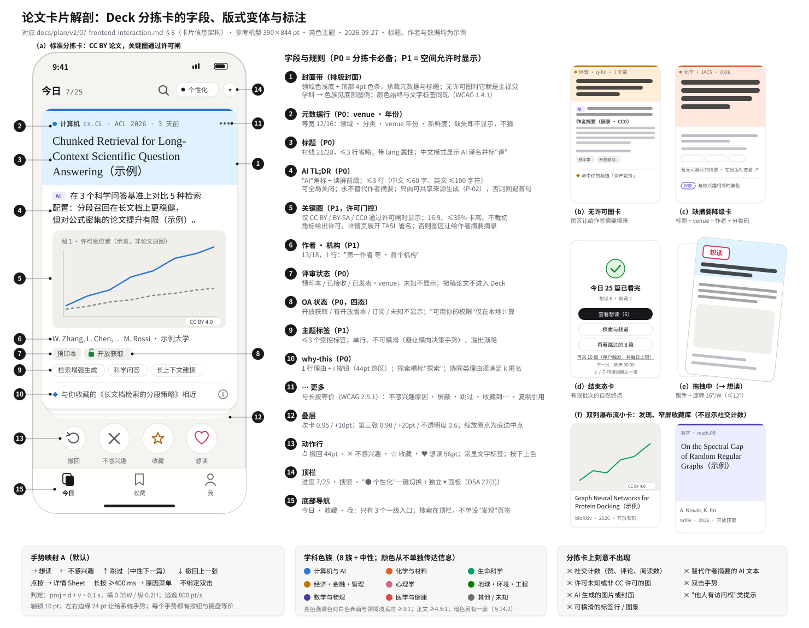

# 07 · 前端交互与视觉

> 本篇回答：论文怎样做成可滑动的卡片，反馈、动效与界面怎样做到简单顺畅。
> 结论：首页是每天一批、看完就结束的卡叠，用手势或按钮做决定；细读用底部面板，回顾用收藏库。AI 内容必标、可关；许可判断全在服务端，前端只负责渲染。

## 要点

- 首页"今日分拣"是有限批次：默认 25 张，可选 15 / 25 / 35，看完即结束，不做无限流。
- 手势：→ 想读，← 不感兴趣，↑ 跳过，↓ 撤回；单击看详情，长按出原因菜单。每个手势都有按钮与键盘等价，撤销不限次。
- 卡面必备 6 项：标题、AI 速读、venue·年份、评审状态、开放获取状态、推荐理由；不显示任何社交计数。
- AI 内容一律标注、可关，永不替代作者摘要；论文图只展示 CC BY、CC BY-SA、CC0 与公有领域许可的图。
- 受限全文只在用户侧取回，页面拿不到凭证；PWA 的自动请求不直接发往第三方主机。
- 动效：所有弹簧显式传参，飞出与下一张升位并行；提交后 ≤100 ms 可操作下一张。
- 技术：Web 优先的 PWA（可安装的网页应用），React 19 + Motion + Base UI，卡叠自研；原生端延到 v2.x。
- 主体落在 V5（前端与公开内测），公开讨论与研究者匹配在 V6。本篇须等 D-041 被接受后才能转 approved。

## 设计原则与"刻意不做"

原则：

- 有限而有终点：每天一批，看完即止。
- 一屏一决策：跳过不计负反馈；← 是弱负反馈，"不感兴趣 + 原因"是强负反馈。
- 按钮是主通道，手势是快捷方式；撤销优于确认，分拣中不弹确认框。
- 诚实标注：AI 必标，缺数据就不显示，"探索"推荐如实标注；作者摘要永远先于 AI 内容。
- 可解释、可控：每卡一行推荐理由，个性化开关一次点击直达。
- 少即是多：只留"分拣 → 细读 → 收藏"所需的元素。

刻意不做：

- 无限滚动推荐流；卡上的点赞数、收藏数等社交计数。
- v2.0 的公开评论与公开评分（放到 V6）；私信、用户之间的关注与粉丝。
- 双击点赞（拖慢单击响应）；卡内可横滑的元素（与决策手势冲突）。
- 游戏化、自动播放、论文短视频、AI 播客、广告、付费撤销。
- 用 AI 替代作者摘要，AI 重绘论文图或生成封面图；平台代取全文。
- 首屏强制登录与长引导；角标、红点、未读计数；分拣中途的弹窗。
- 独立的"稍后读"列表；默认推送（只作可选开启，每日最多 1 条）。

## 信息架构

- 一级入口只有 **今日 / 收藏 / 我** 三个。搜索在顶栏，搜索层的空查询态就是"发现"（双列瀑布流），不设第四个页签。
- 理由：主循环每一步都有一级落点；探索由搜索或批次结束触发，天然有界。
- "我"集中：兴趣与关注、频道、推荐设置、通知、显示、全文取回、导入、数据与隐私、推荐说明。
- 宽屏（≥1024 pt）用左侧导航，右侧常驻详情窗格。
- 关闭详情后停在原卡；URL 不放检索词、曝光 id 或用户标识。
- 搜索层：可编辑的筛选条；本地结果先出，远端结果流式补齐，已看到的条目不跳动；标出未响应的来源；可保存为频道，并用 `@频道` 做并 / 交 / 差组合。检索语义见 [04](04-retrieval-and-routing.md)。
- 接口相关的增量界面不新增一级入口：读者面在"我"中新增"来源"组、把"全文取回"组扩为"全文与连接"，另在详情、搜索等情境入口呈现；运维面是独立的部署方控制台；设计见[连接器 UI](connectors/connector-ui.md)（draft，待评审）。

## 三件套

### 今日分拣 Deck

Deck 即卡叠：顶卡可操作，后面露出两张。

- 顶栏：进度、搜索、推荐方式开关、▾ 面板。
- 动作行 4 个按钮，常显文字：撤回 / 不感兴趣 / 收藏 / 想读。收藏同时前进到下一张。
- 进度分母取服务端的值。候选不足时批次提前结束，不用净负分的论文补满。
- 推荐方式开关一次点击切换个性化与否；▾ 另开面板，选"按时间"或"按来源"。两个控件分开，防误触。
- 切换后 ≤1 s 替换未决定的卡，已决定的卡与撤销记录保留。
- "按时间"在用户显式选择的范围内，按首次公开日期（`first_public`）倒序；"按来源"按来源或 venue 分组。

### 收藏库

- 两个分区：想读（阅读队列）、收藏夹（默认"我的收藏"）。
- 窄屏默认双列瀑布流，宽屏默认紧凑列表，可切换。
- 可批量导出 BibTeX / RIS / CSL-JSON。

### 详情 Sheet

Sheet 是从底部升起的面板。

- 停靠 60% 与 95% 两档；下拉、点遮罩、✕ 或 Esc 关闭。
- 分区顺序：头部（含关注作者、venue 的按钮）→ 作者摘要 → AI 速读（默认折叠）→ 图集（许可允许时）→ 为什么推荐 → 我的评价 → 不感兴趣？→ 讨论（V6）→ 来源与署名。
- 吸底动作栏：阅读 / 想读 / 收藏 / 引用。
- 在详情里做决定，面板关闭，卡片同时飞出。

## 关键流程

1. **首次访问**：不用登录，直接滑 10 张公开样本卡（arXiv 的 CC0 元数据）；登录前不上报个人事件。
2. **登录**：邮箱或 ORCID；中立的年龄声明，门槛 16 岁。Web 界面不收出版商或机构凭证。
3. **引导三步，都可跳过**：选兴趣（26 个学科领域下的子领域）→ 导入种子（ORCID、Zotero、BibTeX、DOI、v1 库）→ 校准卡 10–20 张，至少 5 张右滑、3 张左滑即可结束。目标中位时长 ≤3 分钟（待测试校准）。
4. **手势教学**出现在用户第一次看到的卡组上。首批 3 s 未就绪时，先用非个性化的"热身批次"补位。
5. **强负反馈当次生效**：选"少推…"或"屏蔽"后，本机立即移出已下载的同类卡；撤销时按原顺序放回。
6. **读全文**：详情的"阅读"按顺序选主动作：开放版本 → 本人的出版商 TDM 密钥（通常由本机代理执行）→ 浏览器扩展用本人会话取回 → 在出版社打开。
   - 平台服务器从不代用户访问出版商（见 D-053）。
   - 明确禁止 AI 代理的出版商不提供扩展代取；没有开放版本时只给"在出版社打开"，打开后可用扩展一键保存。
   - 遇到人工验证即停，交给用户在出版社页面继续。
   - 扩展先做 Chromium 系浏览器；没有扩展时兜底为"在出版社打开"。

## 手势映射与判定

默认映射 A：

| 输入 | 动作 | 按钮 / 键盘 |
|---|---|---|
| → 右滑 | 想读 | ♥ / `→` `L` |
| ← 左滑 | 不感兴趣（弱负反馈） | ✕ / `←` `H` |
| ↑ 上滑 | 跳过（中性，不保存） | ⋯ → 跳过 / `↓` `J` `Space` |
| ↓ 下滑 | 撤回上一张 | ↺ / `↑` `K` `Z` |
| 单击 | 打开详情 | `Enter` `O` |
| 长按 ≥400 ms | 原因菜单 | ⋯ / `.` |
| ☆ 按钮 | 收藏并前进 | `S` |

- ↑ 叫"跳过"不叫"稍后"：它不保存任何东西，唯一的待读列表是"想读"。
- 备选映射 B（↑ 为收藏）与 C（纯纵向流）只作按用户分桶的实验。

判定参数（Demo 面板可调，默认值即规格）：

- 投影 `proj = d + v × 0.1 s`（d 为位移，v 为松手速度）。
- 横向阈值 0.35 × 卡宽（参考机型约 125 pt），纵向 0.2 × 卡高（约 110 pt）。
- 逃逸速度 800 pt/s：与位移同向且超过它，未过阈值也提交。
- 位移首次超过 10 pt 时锁定横轴或纵轴；左右边缘 24 pt 留给系统返回手势。
- 松手前静止超过 50 ms，速度按 0 计；按钮与键盘提交按 1400 pt/s 的合成速度飞出。
- 只在位移方向上提交：先右拖再往回甩视为取消。

## 动效要点

- 弹簧写作 stiffness/damping，全部来自 token 并显式传参；禁用 Motion 默认弹簧（超调 16.3%）。
- 跟手 1:1，旋转上限 ±12°。
- 回弹 500/36；次卡升位 600/49；撤回 400/32；详情展开 260/29。
- 飞出保留松手速度，时长 120–280 ms，与升位并行；同时在飞最多 1 张。
- 叠层后两张缩放 0.95、0.90，下沿露出 10、20 pt。
- 回弹与撤回可随时打断，从当前位置继续跟手；新顶卡在升位结束前即可拖动。
- 输入不排队、动画排队；忽略按键的自动重复。
- 撤回的卡从离开方向飞回；结束态卡预先挂在末位，没有空白帧。
- 系统开启"减少动态效果"时，位移、旋转、缩放一律改为 150 ms 淡入淡出；拖拽仍跟手，但不旋转。

## 卡片信息架构

卡面必备 6 项：

- **标题**：衬线，≤3 行，默认显示原文。
- **AI 速读**（TL;DR，一两句话的概要）：带"AI"角标，≤3 行；生成上限为中文 ≤60 字、英文 ≤100 字符。
- **venue · 年份**：venue 指期刊、会议或工作论文系列。
- **评审状态**：预印本 / 已接收 / 已发表，未知不显示；撤稿论文不进 Deck。
- **开放获取状态**：开放获取 / 有开放版本 / 订阅 / 未知不显示。本人有权限时，"订阅"显示为"可用你的权限"；这个判断只在扩展或本机代理里做，不上传。
- **推荐理由**：1 行；右侧 i 按钮（键盘 `I`）是"为什么推荐给我"的唯一入口。探索卡带"探索"胶囊。

其余：

- 次要信息：作者·机构 1 行，≤3 个主题标签。
- 关键图只放 CC BY、CC BY-SA、CC0 与公有领域许可的图；NC、ND 与许可未知的图在任何部署都不放。
- 无图时显示作者摘要摘录：开放许可的最多 4 行，出版方版权的只显示首句。
- 每张卡顶部有领域色"封面带"，含元数据与标题。多数论文没有可展示的图，封面带就是主视觉；不生成任何 AI 图。
- 无摘要也无速读时用降级卡：以标题、作者、venue 与分类码为主，附"在出版社查看"链接。
- 屏幕太矮时依次丢掉：图或摘录 → 标签 → 作者行 → 速读减到 2 行 → 标题减到 2 行。
- AI 标识：角标加读屏前缀；复制时附"（AI 生成）"；导出文件携带服务端下发的 AI 标识；中文标题标"译"（见 D-056）。
- "我 → 显示"可关闭 AI 速读，卡片改显作者摘要摘录。

## 反馈 UI

信号从弱到强：停留 → 跳过 → 不感兴趣 → 想读 → 不感兴趣 + 原因 → 收藏 → 1–5 星 → 私人笔记 → 导出引用。

- 叫"想读"不叫"点赞"：点赞暗示公开计数。
- 分拣只用二元加中性；星级与私人笔记放在详情，仅自己可见，V4–V5 提供。
- 原因菜单单击即完成：少推这个主题 / 作者 / 期刊或会议、读过了、太基础、太深了、质量存疑、其他；另有屏蔽（作者、主题、期刊或会议、来源平台、关键词）与"AI 内容不准确"。"读过了"不算负例。
- toast（底部单行提示，高 ≤32 pt）同时只有 1 条：← 后停 5 s，带"说原因"与"撤销"；选原因或屏蔽后停 4 s；→ 与 ↑ 不弹，只做读屏播报。
- 撤销是追加一条撤销事件，不删历史，当天不限次。
- 确认框只用于删除账号（另有 7 天宽限期）与清除行为数据；重置推荐 24 小时内可撤销，不弹框。
- V6 的公开讨论与评分只在详情"讨论"分区，受 [08](08-compliance-security-privacy.md) 的门禁约束；公开评分至少 5 名合格评分者才显示。
- 双向匹配：读者↔论文就是 Deck；论文→读者体现为新论文进入 Deck 或频道收件箱；研究者↔研究者是默认关闭的实验页，不早于 V6，分项同意，每周至多 3 条建议，只用本人主动公开的画像；双方都点"有兴趣"才互显联系方式，不做私信。

## 结束态与异常状态

- 结束态是一张卡：显示"今日 n 篇已看完"（n 为实际完成数）、想读与收藏数、下一批时间。
- 按钮最多 3 个：查看想读 / 探索与频道 / 再看跳过的 N 篇。
- "再来 10 篇"只作低强调文字链接，由用户点击，每日总上限 60（待验证），从不自动续发。
- 提前结束时注明"今天符合你兴趣的新论文就这些"。
- 满意度一键反馈与"值得读吗"回访只出现在结束态卡上，每天至多其一。
- 加载：超过 300 ms 才显示骨架卡，超过 10 s 转错误态；下一批块未到时显示占位卡，不误显结束态。
- 空：说明原因，给出放宽频道、探索、调整兴趣。
- 错误：有缓存批次就接着用，否则给重试。
- 离线：已下载的卡照常分拣与撤回，联网后补发事件。
- 图片失败静默回退为无图卡；登录过期不打断分拣；新版本只在结束态或"我"里提示。

## 可访问性

- 目标：WCAG 2.2 A/AA 全覆盖，另采纳 AAA 级的"交互动画可关"。
- 每个路径手势都有单指按钮替代与键盘等价；单键快捷键可一键关闭。
- 动作行按钮的读屏名称与可见文字一致；后两张卡对读屏隐藏；每次决定都播报下一篇标题。
- 主按钮 56 pt，其余触控目标 ≥44 pt。
- 不锁定方向；文字放大 200%、320 px 宽时不丢功能。

## 性能预算

- 卡叠 DOM 常驻 3 张卡，任意帧 ≤4 张；只动画 transform 与 opacity。
- 预取后 5 张卡的详情，预解码后 2 张的图。
- 提交到下一张可交互 p95 ≤100 ms；INP（交互到画面更新的延迟）p75 ≤200 ms。
- 下一批接口 p95 ≤300 ms；今日页首屏可交互 ≤2.5 s（4G、中端机）。
- Deck 首包 JS ≤170 KB（gzip），公式与 PDF 库按需加载；卡片图每张 ≤60 KB。
- 低端机降级阶梯 L0–L5：少一张叠层 → 关阴影 → 关旋转 → 降图片 → 全部淡入淡出；连续 2 次动画慢帧超 10% 降一级。
- 首屏、首包与图片数字是设计值，待实测校准。

## 视觉语言

- 基调"纸与墨"：暖白纸面、近黑墨色、克制的动效；暗色独立挑选，不是亮色反转。
- 唯一的强调色是学科色，只用在色条、圆点与小图标上，并且总与文字标签同时出现。
- 学科色 8 族加 1 个中性色，OpenAlex 的 26 个学科领域按此归类；色板经对比度与色觉缺陷分离度校验。
- 文字对比度 ≥4.5:1，图标与焦点环 ≥3:1。
- 默认只用系统字体：标题衬线、界面无衬线、元数据等宽。可选的开源 Web 字体是否启用，由 Demo 对比首屏预算后决定。
- 4 pt 间距网格；卡片圆角与内边距都是 20。
- 颜色、字号、间距与动效参数都做成 token（设计变量），由一份 JSON 生成。

## 前端技术栈

- React 19.3 + Vite，做单页应用加 PWA。
- Motion 13 只用于底层动画，不用默认弹簧与它的拖拽；Base UI 提供 Drawer、Dialog、Toast。
- 卡叠自研，约 200 行：外层管叠层，内层管拖拽与飞出；拖拽不触发 React 重渲染。
- 依赖只用宽松许可，axe-core（MPL-2.0）只作测试依赖（见 D-044）。
- 事件名称与字段以 [06](06-recommendation-and-matching.md) 为准。曝光 id 由服务端生成；事件 id 由客户端生成，用于幂等去重。事件先进 IndexedDB 发件箱，每次上报 ≤50 条；时间按服务端校准，被拒收的事件换 id 重发。
- PWA 当天已下载的批次离线可用；登出时清空本机缓存与本机 PDF 副本。
- PWA 的自动请求只发往平台域名，不直接调用上游 API，以免请求量随用户数放大。
- 原生端（Expo）延到 v2.x，触发条件由 [09](09-roadmap-and-milestones.md) 设定。

## 度量

- 分拣速度只作诊断，不作优化目标。
- 撤销率；方向误判率（提交后 3 s 内撤回并改判为另一方向）。
- 收藏→阅读转化：想读或收藏后 7 天、30 天内打开全文、评 ≥4 星或导出引用的比例。跨用户统计只按学科切片并满足 `k_show`（公开计数的匿名门槛），不按开放获取状态切片；用户侧取回的全文打开不进任何跨用户指标。
- 有价值阅读的分拣成本：分拣活跃分钟 ÷ 有价值阅读数，越低越好。
- "今日已看完"到达率、跳过占比、AI 速读关闭率、个性化关闭率。
- 北极星"有价值阅读"与不含打开全文的严格口径同时报告；样本卡组不计入。目标值待内测基线出来后由 09 设定。

## Demo

- 文件：[demo/paper-feed-demo.html](demo/paper-feed-demo.html)；已发布为 Artifact：<https://claude.ai/artifact/YYZiiZjCVVeTzbESeFxqQr>。
- 单文件自包含，浏览器直接打开，运行时不发网络请求。
- 内容：映射 A / B / C 可切换；评审面板可调全部判定与弹簧参数；事件日志实时列出；视觉案例画廊展示全部版式与状态，含亮暗两套。
- 数据为 24 篇真实 arXiv 论文（CC0 元数据）与 4 篇 Crossref 期刊记录；AI 速读为构建时生成，照常标注；不用任何论文原图。
- 所有按钮都有可走通的流程：反馈与申诉、全文取回、开放版本查找、数据导出（真实下载 JSON）等经页内模拟后端完成（带延迟，状态存本机 localStorage），不连接真实服务。
- 首次进入“今日”时弹出 5 步操作教程（右滑、左滑、上滑、下滑、轻点），每步用练习卡动画演示，可跳过，也可在“我 → 关于推荐 → 操作教程”重看；它代替了卡片四周的手势提示小字，轻推动画保留。
- 独立模式（URL 加 `?app`，或 `<html data-standalone>`）只显示样机：宽屏居中显示手机框，手机上全屏运行。在线版 <https://confluo.fhxgs.cc> 用此模式，并自托管 Inter、Source Serif 4、JetBrains Mono（OFL）作拉丁字母与数字字体，中文沿用系统字体。
- 接口相关增量 UI 另有单独的 demo：[demo/connector-ui-demo.html](demo/connector-ui-demo.html)（用户视图与运维视图，数据为示意），设计见[连接器 UI](connectors/connector-ui.md)。

## 怎么验收

- V0：Demo 按验收清单评审（AC-V0.10）。
- V5 交互与性能（AC-V5.x）：手势判定用例全过；弹簧全部来自 token；纯键盘可完成分拣到导出；提交到可交互 ≤100 ms，INP p75 ≤200 ms；断网分拣后 1,000 条事件 0 丢失、0 重复。
- V5 合规界面：许可误放行为 0；AI 字段 100% 标注；"可用你的权限"出现在发往平台的请求中为 0；自动请求 100% 发往平台域名。
- V5 出口：可用性测试（5–8 人 × 3 学科）阻断级问题清零才进公开内测。
- V6：门禁未满足时，公开讨论与研究者匹配的入口不渲染（AC-V6.1、AC-V6.7）。

## 未决事项

- 默认假设：非商用部署；不面向中国大陆公众运营，但推荐透明与控制照样内建；研究者匹配默认关闭；首个规模档 T1 不配 GPU，AI 解析与 AI 重排默认不出现。
- 批量 25 张与"再来 10 篇"上限 60 对疲劳的影响，待实验校准。
- ↑ 跳过是否要在动作行加独立按钮，看可用性测试。
- iOS 主屏 Web App 能否运行扩展、实际帧率多少，待真机核验。
- Base UI Drawer 未公开关闭阈值；Demo 实测后决定是否自研面板手势。
- 出版方版权摘要的摘录长度、私有"为我翻译"的合法性，待法务。
- 单键快捷键与常用浏览器扩展的冲突未评估；登录前是否允许匿名聚合计数，待 08 定。
- 可用性测试的时点待用户定，建议在 V1 之前。
- 待 06 确认：取回回执"已交给用户"的事件表示；快速键盘分拣会不会触发异常速率复核。

---

完整草稿（含状态机转移表、伪代码、色板与字号全表、事件映射表、理由码模板、WCAG 对照、测试用例、全部验收条目与评审记录）：`git show v2-drafts:docs/plan/v2/07-frontend-interaction.md`
