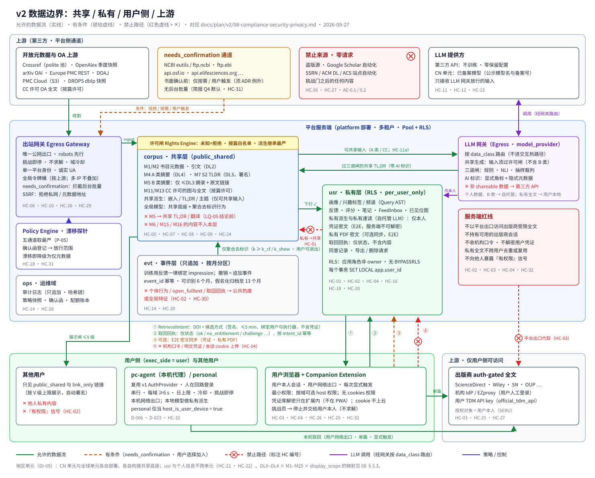

# 08 · 合规、隐私、安全与内容治理

> **定位**：v2 设计阶段文档 08。按 [简报] §9，本文定义 HC 合规硬约束的全库编号与落地规则、许可矩阵（`display_scope` ↔ 展示级别 DL0–DL4（即 [CP] §2.2.4 的 V0–V4，按简报 R2-03 改写，避免与里程碑 V0–V7 混淆） ↔ 权利类别 M1–M25）、robots/ToS 统一政策、受限全文的执行位置与凭证方案、隐私、算法治理、UGC 审核、LLM 与 AI 内容治理、安全威胁模型，以及合规测试与审计。其余设计文档引用本文的 HC 编号与规则，不另行定义。
>
> **上游约束**：[v2 设计决策简报][简报]（B-01…B-06、P-01…P-09、Q1–Q7）。本文按简报的默认假设推进，依赖默认假设之处标"默认假设（Qx）"。对简报的细化与不同意见集中写在 §14。
>
> **证据**：`docs/survey/` 下 14 篇调研（2026-09-26 对抗式核验）及其[综合][SYN]。引用写法沿用综合：`[CP] §2.3.1` 指合规调研 §2.3.1，`[AG] §3-14` 指聚合调研 §3 第 14 条，代号见 §18。除评审时读取一次 PyPI 许可元数据外（§10.6，2026-09-27），本文没有发出新的外部请求。调研中标 ⚠ 或 ◐ 的事实，本文照样标注；"⚠ 设计判断"表示本文的工程取舍，不是法规或条款原文；"占位值"表示等待法务结论的临时参数。
>
> **免责声明**：本文是工程设计，不构成法律意见。§12 列出的法律问题（LQ）须由相应法域执业律师确认后，才能作为公开上线的依据。
>
> **写法约定**：代码块均为"设计伪代码"（Python 风格），不可运行。表名、字段名是逻辑名，物理 DDL 由 [05](05-data-platform.md) 定义。验收编号：红线沿用 `AC-0.x` 系列，其余为 09（路线图）定稿的正式编号 `AC-V<m>.<n>`（新旧对照见 [09](09-roadmap-and-milestones.md) 附录 A），汇总见 §17。
>
> **配图**：[v2-10-data-boundaries.svg][图]，画出共享层、私有层、用户侧与上游之间允许的数据流和禁止路径。



---

## 0. 结论速览

1. **硬约束**：沿用 [CP] §3.1 的 HC-01…HC-28，编号与表述不变。本文新登记四条：
   - HC-29：robots 先行与挑战检测由出口层强制执行；
   - HC-30：小样本隐私门槛（`k_cf` / `k_reason` / `k_show`，简报 R2-04）；
   - HC-31：`needs_confirmation` 通道在书面确认前不做后台批量；
   - HC-32：受限全文只能由用户显式触发、单篇取回。

   每条都写明执行点与验证方式（§2）。
2. **三套分类合一计算**：
   - `rights_class`（M1–M25）说明数据是什么、权利基础是什么；
   - 展示级别（DL0–DL4）说明跨用户最多展示到什么程度；
   - `display_scope` 说明谁能看、数据存在哪一域。

   三者都由 Rights Engine 统一计算。DL4/DL3/DL2 对应 `public_shared`（按级别封顶），DL1 对应 `link_only`，DL0 对应 `per_user_only` 或不入库（§3.3）。
3. **许可闸**：
   - 许可未知即拒绝；
   - 按篇白名单：CC0、PD、CC BY、CC BY-SA 可共享；NC 只在非商业部署下可共享；ND 只能原样使用；
   - 多个证据冲突时取允许操作的交集，实现为许可属性逐项取最严（`meet`），不是"挑权限最少的一条声明"；
   - DL4 展示、共享全文和图都要求一手许可证据；
   - 系统自身的依赖、模型与数据按 B-06 分四级（放行、评审、可选、禁止；简报 R2-01 已采纳，psycopg 3 属评审级并放行），NC 数据依赖（如 MSC2020）作可选插件、任何部署都默认不加载（R2-22，§10.6）；
   - 派生继承最严：任一私有输入使输出成为私有；两个用户的私有数据不得混合；B 类摘要在 LQ-05 有结论前不得作为共享派生的输入（§3.4–§3.7）。
4. **B 类摘要的过渡规则**：
   - 跨用户只展示不超过 200 字符的摘录加原文链接（占位值，待 LQ-01）；
   - 默认纳入内部词法索引与嵌入（不展示，展示上限 DL3），经 `input_rights_max` 可逆重建并设开关，LQ-02 结论为否时关闭并重建（简报 R2-21）；本文从严排除已声明 TDM 或 AI 保留的出版商（"保留感知"，§3.7）；C 类摘要永不进共享层；
   - 为本人即时生成的私有速读允许，但不进入共享缓存（§3.7）。
5. **robots/ToS**：五个通道加上挑战观测，取最严结论。
   - 文档化 API 与主机 robots 冲突、bulk 主机 robots 全禁时，判为 `needs_confirmation`：确认前只做按文档限速的按需或用户触发调用，禁止后台批量。这条按需放行本身就是 robots 例外，须先在 robots ADR（简报 §7-2）附表中登记，登记前平台对该主机零请求（v1 AC-0.5）；
   - 书面确认只放宽它明确覆盖的那项冲突，设有效期，发生漂移即失效；沉默不等于同意；ToS 禁令与 TDM 保留只能由权利人的正式许可放宽（§4）；
   - 漂移分档处置（简报 R2-15）：robots 与 TDM 信号漂移立即降级；ToS 哈希变化给 7 天宽限；元数据通道自身受影响时暂停并切换替补链；
   - "复核逾期"与"条款冲突"分开处理：逾期但探针持续为绿、证据其余字段完整时记 `review_overdue`，宽限 30 天，不直接停掉主干收割（简报 R2-16，§4.4）；
   - 待发函的 P0 对象是 NCBI（eutils 与 ftp 两个主机都全禁）、EMBL-EBI 与 OpenReview（服务账号，简报 R2-20：V0 即发函）。NCBI 确认之前，生命科学的后台主干改由 Europe PMC REST（Crawl-Delay 10）、PMC 允许的通道与 Crossref 承担，`pubmed` 保持 v2-P0 并标 ⚑ROBOTS，确认后启用（简报 R2-13，§4.7）。
6. **受限全文**：只在用户显式触发时单篇取回，执行位置在用户侧（Companion Extension 或 pc-agent）。
   - 未装扩展时，默认动作是"在出版社打开"（`open_in_tab`）；装了扩展时按 `oa_link` > `tdm_api` > `user_fetch` > `open_in_tab` 选择，`user_fetch` 须满足 R16；
   - 扩展不申请 `cookies` 权限，也不申请全站 host 权限，而是按域请求可选授权；
   - 平台只签发取回意图、只接收状态回执（§5.1）。
7. **凭证**：
   - 用户级出版商凭证采用客户端端到端加密。服务端只存密文，代码中没有解密路径；解密只在扩展与 pc-agent 中执行，不在平台下发的 PWA 代码中执行。多设备通过设备密钥封装加恢复码同步；
   - 会话 cookie 与 `storage_state` 属设备绑定凭证，一律不同步；只有 API key 类凭证可做端到端密文同步（简报 R2-29），以免触发 EZproxy 的异地规则；
   - 部署级上游 API key 由 Egress Gateway 独占读取（docker secrets 或 0600 文件，外部 KMS 可选）；用户登录用的 OAuth 客户端密钥（如 ORCID 登录）归认证服务（简报 R2-30）；每个上游只用一个身份（§5.2–§5.5）。
8. **隐私**：
   - 维护数据清单；核定 05 的留存矩阵：行为事件可识别形态保留 6 个月（PG 热存 6 个月），其后假名化归档至第 13 个月（简报 R2-31；满足"日志 ≥6 个月"），安全日志 190 天，影响评估记录至少 3 年；
   - 个性化默认开启，可一键关闭；"参与匿名协同统计"默认开启，可随时退出；研究者匹配须单独同意；作者可行使拒绝权（§6.3）；
   - 导出、删除、注销均可自助完成；
   - 地区单元隔离个人数据；最低年龄 16 岁（§6）。
9. **算法治理**：原理公示页；why-this（协同类理由须满足 `k_reason`）；即时生效的非个性化模式（06 的 `np_time` 与 `np_source`，关闭期间暂停学习）；标签管理与违法关键词过滤；申诉；影响评估发布门禁；可导出的备案材料最小集；DSA 第 27/38 条对照（§7）。
10. **UGC**：
    - U1 私有反馈，随 v2.0 上线；
    - U2 公开聚合信号与 U3 公开评论不早于 V6，并须满足前置清单：实名锚定、审核、通知—处理、DMCA 代理人、反作弊、AI 声明、不得附 PDF（§8）。
11. **LLM**：
    - 输入闸、三道闸、双通道 AI 标识；
    - 按"地区 × 数据类"路由：只有可共享数据（`shareable`）能发往第三方 API（不训练、零保留）；个人数据与 B 类摘要只用自托管模型；私有全文只用用户侧本地模型（与 02 的 INV-04 一致）；
    - 提示注入的防护方式：无工具、结构化输出、源内校验（§9）。
12. **安全**：STRIDE 共 20 项威胁，重点是：
    - RLS 与 IDOR；
    - SSRF：出站网关统一校验并固定 DNS 解析结果；
    - LaTeX 与 UGC 引起的 XSS；
    - 扩展被恶意网页调用；
    - 供应链与许可：SBOM 加许可门禁（§10）。
13. **测试与审计**：AC-0 红线继承 0.1–0.5，新增 0.6–0.18。审计日志只追加并用哈希链防篡改；每月抽检许可闸，每季度复核快变事实（§11、§17）。
14. **异议**：首轮提出的三项异议均已由简报 §10 裁决采纳：私有 PDF 在 platform 部署下只存设备本地或 E2E 密文、服务端私有处理默认关闭（R2-27）；许可门禁采用四级分级、保留 psycopg 3（R2-01）；MSC2020 作可选插件、默认不加载（R2-22）。仍待主 agent 确认的细化见 §14。

---

## 1. 功能说明

### 1.1 本文职责与边界

- **本文定义**：
  - HC 的全库编号与落地规则（§2）；
  - 许可矩阵、许可闸与派生继承（§3）；
  - robots/ToS 统一政策与 `needs_confirmation` 流程（§4）；
  - 受限全文的执行位置与凭证方案（§5）；
  - 隐私（§6）；算法治理（§7）；UGC 审核（§8）；
  - LLM 与 AI 内容（§9）；安全威胁模型（§10）；依赖、模型与数据的许可分级（§10.6）；
  - 合规测试与审计（§11）；法律待决问题（§12）。
- **五要素的位置**：功能说明见 §1；实现方案见 §2–§10；测试方法与测试类型见 §11.1–§11.2；验收标准见 §17。
- **本文引用、不重复定义**（本文只规定这些实现必须满足的合规要求）：
  - SourceSpec 合规字段与 Policy Engine 的实现：[03](03-sources-and-corpus-pipeline.md)；
  - 限速算法、TSRG、联邦执行：[04](04-retrieval-and-routing.md)；
  - DDL、RLS 策略、存储分层：[05](05-data-platform.md)；
  - 事件契约、ValueModel、why-this 理由码、`k_cf`/`k_reason`/`k_show` 初值：[06](06-recommendation-and-matching.md)；
  - 设置页与卡片交互：[07](07-frontend-interaction.md)；
  - 组件拓扑与 API 面：[02](02-architecture.md)；
  - 里程碑、AC 最终编号、ADR 起草：09（路线图）。

### 1.2 合规站位：从"本人工具"到"平台运营者"

v1 的合规基础是"用户本人、个人科研用途、本地存储"。v2 成为多用户平台后，平台变成运营者和被许可方。许多条款的前提因此失效，例如"被许可人本人或其机构授权用户""不得代第三方使用""凭证归个人"（[CP] §0 第 1 条、§2.0）。v1 的红线仍然成立，但不够用。平台还需要回答六件事：许可对象是谁、是否商业化、存储如何隔离、展示如何分级、出口如何治理、生成内容如何治理。本文的设计由此展开：

1. 数据分为共享与私有两域，只能单向流动（HC-01）；
2. 受限内容的取回动作发生在用户侧（HC-03）；
3. 每个上游只用一个平台身份（HC-10）；
4. 字段级权利标注，由统一的闸门执行（HC-07）；
5. 推荐透明与 UGC 治理按最严口径全球统一实现（HC-13、HC-15）。

### 1.3 默认假设

| # | 简报默认 | 对本文的影响 |
|---|---|---|
| Q1 | 非商业，自托管或邀请制 | `platform.commercial=false`：NC 内容可共享，ORCID 公共 API 可用。商用开关按 §3.8 做成架构参数，默认关闭 |
| Q2 | 不面向中国大陆公众运营 | 只部署全球单元，CN 单元关闭。HC-12/21/22 的机制内建，但不启用；透明与控制能力（HC-13）全球统一实现 |
| Q4 | robots 与文档化 API 冲突时从保守 | §4 的 `needs_confirmation` 流程；书面确认之前不做后台批量（HC-31） |
| Q5 | 先做"读者↔论文"与"论文→读者"；"研究者↔研究者"为 opt-in，默认关闭 | 研究者匹配须单独同意（HC-18，§6.3） |
| Q6 | v2.0 只有私有笔记与私有评分，公开评论在 V6 | UGC 三阶段（§8） |
| Q7 | 表示模型待定 | 模型与数据集的许可门禁见 §10 第 12、13 项 |

### 1.4 合规组件与执行点

| 组件 | 职责 | 实现归属 | 本文规定 | 主要 HC |
|---|---|---|---|---|
| Rights Engine（权利引擎，含许可闸） | 为每个可展示字段与资产计算 RightsTag；按"操作"放行或拒绝 | 03（实现）/ 08（规则） | §3 | 01、05、07、08、09、23 |
| Display Gate（展示闸） | 全部 API 出网的唯一序列化点：按 scope 与级别输出，渲染署名与 AI 标识 | 02、07 | §3.9 | 07、08、09、11d、24 |
| Policy Engine 与漂移探针 | 五通道判定、`needs_confirmation` 登记、漂移降级 | 03 | §4 | 28、31 |
| Egress Gateway（出站网关，02 的 P13；R2-08：平台侧唯一对外出口，03 的 PoliteHttp 是其内部客户端库） | 平台唯一公网出口：主机白名单、robots 先行、挑战检测、单一身份、全局令牌桶、SSRF 校验 | 02、04 | §4、§10.3 | 06、10、26、27、29 |
| 用户侧执行器：Companion Extension（02 的 U2）与 pc-agent（本机代理，02 的 U3） | 受限全文单篇取回；用户本人的 TDM API 调用（默认在 pc-agent 中） | 02、07 | §5.1 | 03、04、26、29、32 |
| 客户端凭证库（E2E Vault） | 用户级凭证与私有 PDF 的端到端加密与多设备同步 | 05（`usr.credential_blob`）/ 08（方案） | §5.3–§5.4 | 04、16 |
| LLM 网关（逻辑组件：由 Egress Gateway 的 `model_provider` 路由与 enrich 作业承担，02 INV-04） | 输入闸、按"地区 × 数据类"路由、三道闸、AI 标识 | 02、03、06 | §9 | 11、12、22 |
| Consent 与 DSR 服务 | 同意记录、导出、删除、注销 | 05 | §6 | 18、19、20 |
| 地区单元与特性开关 | 数据驻留、地区功能门禁、商用开关 | 02 | §3.8、§6.5 | 21、22、23 |
| Moderation 服务（V6） | 审核、举报、通知—处理、申诉 | 06 | §8 | 15、16、17 |
| 算法治理面 | 原理公示、why-this、非个性化模式、标签、影响评估、备案包 | 06、07 | §7 | 13、14、30 |
| 审计日志 | 只追加、哈希链、定期锚定 | 05 | §11.3 | 14、28 |

### 1.5 非目标

- 不给出法律意见，不替代法务结论（§12）。
- 不设计中国大陆公开运营的完整合规体系。只内建开关与前置清单，默认假设 Q2 为"否"。
- 不覆盖支付、税务、出口管制与制裁、无障碍法规、商标、应用商店规则。这些同样不在 [CP] §1.1 的范围内；无障碍交互由 07 按 WCAG 2.2 处理。
- 不提供任何公共全文上传、转存或批量导出功能（HC-16，[简报] §2 的"不做"清单）。

### 1.6 建议 01 登记的需求（编号由 01 分配）

- **FR 候选**：
  - 数据导出（BibTeX/RIS/JSON）；账号注销与数据删除；
  - 非个性化模式；兴趣标签的查看与删除；why-this；原理公示页；申诉入口；
  - 研究者匹配的单独同意；Companion Extension 用户侧取回；E2E 凭证多设备同步；
  - 地区开关；AI 内容标识；UGC 举报与通知—处理（V6）。
- **NFR 候选**：
  - `usr` 全表 RLS 覆盖率 100%；许可闸误放行为 0；
  - 出口层 robots 先行；审计日志不可篡改；
  - 日志至少留存 6 个月，影响评估记录至少 3 年；
  - 秘密零泄露；SSRF 防护；依赖许可门禁；扩展最小权限。

---

## 2. HC 合规硬约束登记表

### 2.1 编号与登记规则

- **全库唯一**：全库 HC-01…HC-28 与 [CP] §3.1 的 HC-01…HC-28 一一对应。"规则"列沿用 CP 原表述，只压缩措辞、不改语义。其他文档引用时写 `HC-xx` 即可，无需再注"CP"。
- **新增条目**：HC-29 起由本文登记，每条须给出证据、执行点与验证方式。本文登记 HC-29…HC-32。
- **变更流程**：HC 在设计评审通过后，任何实质改动都走 ADR（[AGENTS.md](../../../AGENTS.md) 的设计权威规则），编号不复用。

### 2.2 登记表

| HC | 规则（沿用 CP 表述） | 理由与出处 | 执行点 | 验证与验收要点 |
|---|---|---|---|---|
| HC-01 | **两层数据域**：平台共享层与用户私域在物理和逻辑上隔离；数据只能从共享层流向私域，私域到共享层的任何路径都禁止，包括索引、嵌入、TL;DR、推荐特征、分享卡片、日志样本 | 出版商条款禁止把用户取得的内容及其派生物提供给第三方（[CP] §2.3.3 E1–E10）；[简报] P-02 | `corpus` 只由 ingest 角色写入，`usr` 启用 RLS（05）；Rights Engine `derive_tag`（§3.6）；共享流水线只读 `corpus`（03）；全局模型训练管道（06）；分享卡服务（07） | 静态依赖规则：共享写路径不得引用 `usr` 读取接口。canary 数据流测试：注入私有标记后，共享产物中检出 0 次（AC-0.6） |
| HC-02 | **不做跨用户复用**：私域文件不做跨用户内容寻址去重；不暴露"他人已取回""他人有权限"一类信号 | [CP] §2.3.3 推论（C51、C55、C60）；[简报] §2 中 `open_fulltext` 的限定 | 私有资产每个文件用随机密钥，服务端不存明文哈希（§5.4）；`evt` 到全局信号的管道排除 `open_fulltext`、取回回执、entitlement（§7.2）；OA 四态中"用你的凭证"只按本人计算（§5.1.6） | 两账号取同一 DOI，服务端对象键与密文哈希都不同。修改 `open_fulltext` 事件不改变任何公共输出（AC-V7.6） |
| HC-03 | **取回在用户侧执行**：auth-gated 取回默认在用户的浏览器扩展或本地 agent 中完成，使用用户自己的会话和网络出口；平台服务器不从平台出口代用户访问出版商 | SERU、EZproxy 规则、图书馆政策（[CP] §2.3.4，C71–C73）；[简报] P-03；LQ-07 | ConnectorFamily 声明 `exec_side=user`（03）；出站网关拒绝访问 `exec_side=user` 源的全文主机与路径（§4、§10）；用户侧执行器（§5.1） | 扫描出口日志，平台访问受限全文路径的次数为 0（AC-0.13）；网络策略测试 |
| HC-04 | **不收集机构口令**：平台不接收、不保存机构 SSO 或 EZproxy 口令明文；用户的 API key 或 token 只供本人使用，存于端侧或端到端加密存储；禁止池化或跨用户使用凭证；沿用 AC-0.3、AC-0.4 | C51、C52、C31、C58、C72；[简报] §6.3-3 | 客户端 E2E 凭证库（§5.3）；服务端只存密文；UI 与 API 中没有第三方口令字段（§5.6）；日志脱敏 | 服务端代码无用户凭证解密路径（AC-0.10）；表单与端点扫描；AC-0.3/0.4 扩展作用域 |
| HC-05 | **逐篇许可白名单**：只有 license 明确为 CC BY、CC BY-SA、CC0 或公有领域的 OA 全文和图，才能进入共享层；NC 须平台为非商业（LQ-03）；ND 只能原样分发；许可不明按不可共享处理 | C5、C14、C23、C41、C42；[PU] §2.2.3 | Rights Engine `license_gate`（§3.5）；写入 `corpus.oa_asset` 前校验；商用开关（§3.8） | 共享层中许可不在白名单的全文或图为 0（AC-0.7）；表驱动测试 |
| HC-06 | **arXiv 专项**：元数据和摘要（CC0）可以缓存并完整展示；平台不得存储或对外提供 e-print（PDF、源文件、抽取图），CC 许可允许的除外；全平台的 arXiv 旧 API 合计不超过每 3 秒 1 次、单连接；批量走 OAI、S3 或 Kaggle；不暗示 arXiv 背书 | C14–C16；致谢语与品牌要求见 [CS] §3-6 | 出站网关为 arXiv API/OAI 主机设单连接、间隔 ≥3 s 的桶；HTML 路径按 `Crawl-delay: 15`（[PU] §2.2.1）；许可闸拒绝非 CC 的 arXiv e-print 入库；展示层渲染致谢语并检查文案 | 出口日志审计（AC-0.8）；`corpus` 中来自 arXiv 的资产许可全部在白名单内 |
| HC-07 | **字段级权利标注**：每个可展示字段都带 `source`、`license`、`rights_class`（M1–M25）、`fetched_at`、`display_level_max`（DL0–DL4）、`shareable`、`commercial_ok`、`attribution_text`；展示层只按这些字段做决定 | [CP] §2.1 判读 1、§2.7 | RightsTag（§3.2），物理存储由 05 定义；展示闸是唯一的出网序列化点（§3.9） | schema 检查：可展示字段 100% 带 RightsTag。API 契约测试：各 `rights_class` 的出网字段与级别上限一致（AC-V2.21） |
| HC-08 | **摘要展示分级**：只有 A 类摘要（CC0 或开放许可）可完整展示（DL4）；B 类最多到 DL3（摘录长度 N 由 LQ-01 确定）；C 类（出版商 API 个人许可）不进入共享层；卡片优先使用 arXiv 版摘要 | C1、C4、C14、C19、C37、C39 | 摘要补齐链写入 `abstract_rights`（03）；展示闸执行 B 类摘录（§3.7）；卡片模板（07） | B 类摘要跨用户展示长度不超过 N 且附链接（AC-V2.21） |
| HC-09 | **图片门控**：只展示 M11 类的图，附 TASL 署名和许可链接；ND 不裁剪、不做 AI 重绘；许可不明不展示 | C41、C42、C16；arXiv 新记录中许可允许展示图的只有 39.5%（[PU] §0、§2.2.3） | 选图只在许可闸放行的论文上运行（03）；图注含第三方许可声明（如 "with permission"、©）的图一律剔除（[PU] §2.2.2）；以排版封面兜底（07） | 图资产按月抽检，误放行为 0；ND 图的变换只允许缩放与格式转换（管线单测） |
| HC-10 | **上游一个平台身份、全局调度**：每个上游只用一个 UA 并附联系邮箱，限速与额度由全局调度器统一管理（按上游计，不按用户计）；禁止多 key 叠加额度、多 IP 或住宅代理轮换、伪装 UA；做请求合并与共享缓存，优先使用快照 | C2、C9、C10、C14、C21、C31、C39、C58；[简报] P-04 | 出站网关的身份注册表：每个上游在每个部署中只有一个凭证主体。令牌桶键为（source, host, 请求类, 凭证主体, 出口 IP），算法由 04 定义（[RT] §9；SI-37）。出口 IP 维度**只收紧、不叠加**：按 IP 计额的上游（Crossref 并发、ORCID、OpenCitations、ROR、Zenodo，[AG] §3-6）按 IP 设子桶，各子桶之和仍受全局桶约束；按身份或"所有机器合计"计额的上游（arXiv、NCBI key）只有一个全局桶，增加出口 IP 不增加额度（与 03 §5.5、02 P13 的"单一出口身份"一致）。配置 schema 拒绝同一上游登记多个 key | 配置 lint；出口日志中同一上游只出现一个凭证主体和一个 UA（AC-V1.4） |
| HC-11 | **LLM TL;DR 治理**：(a) 共享 TL;DR 的输入只能来自共享层（M4、M13；M5 须 LQ-05 放行）；(b) 输入前检查 Content-Signal `ai-input`、TDMRep 与 robots 的 AI 规则，有保留的不输入；(c) IEEE 与 Elsevier API 内容不得输入共享 LLM；(d) 输出带显式标识加隐式元数据标识，并做机器可读标记；(e) 长度上限、不复述原句、不替代原摘要、给出原文链接；(f) 不把生成的论断归到作者或期刊名下 | C47、C48、C52、C58、C84–C86、C92、C43、C44 | LLM 网关：输入闸、三道闸、标识（§9） | AC-0.9；黄金集阈值（AC-V1.34） |
| HC-12 | **中国上线的 LLM 条件**：使用已备案模型，完成地方登记，在显著位置公示模型名称和备案号；签订服务协议；设置投诉入口；输入与使用记录只在合法范围内留存 | C83、C87 | LLM 网关按地区单元路由（§9.4）；CN 单元开关的前置清单（§6.5）。默认假设 Q2：机制内建，不启用 | CN 单元的模型清单全部带备案号；负面测试：调用未登记模型被拒 |
| HC-13 | **推荐透明与可控（全球统一）**：公示基本原理和主要参数；每张卡片提供 why-this；提供不针对个人特征的模式，关闭个性化后立即生效；标签可查看、选择、删除；标签库过滤违法和不良关键词；设置申诉入口 | C76、C78、C90、C99；DSA 第 27(3) 条的"界面直达"是正文义务（[UX] §2.6.5） | 算法治理面（§7）；06 的管线模式开关；07 的设置入口 | AC-0.11；AC-V5.25、AC-V5.26、AC-V4.22、AC-V4.21 |
| HC-14 | **推荐算法合规工程化**：保存算法评估与审核记录；影响评估（PIPL 第 55 条）记录保存 ≥3 年；日志留存 ≥6 个月（网安法第 23 条）；算法备案材料随时可导出（属于舆论属性服务时，须在上线后 10 个工作日内备案） | C76、C78、C80 | 发布门禁要求影响评估记录；曝光日志（P-08）；`filing-pack` 导出（§7.7） | 发布门禁检查；导出演练（AC-V4.32、V?.19） |
| HC-15 | **UGC 分期上线**：阶段 1 只做私有反馈（私有点赞、收藏、评分）；公开评论和公开计数须等以下能力就绪后才能上线：实名（中国）、审核巡查、举报受理、DSA 通知处理与理由说明、DMCA 代理人登记、信用分级、反作弊、AI 内容声明 | C81、C82、C90、C96、C76；[简报] Q6 | UGC 三阶段（§8）；特性开关门禁 | 开关前置清单自动检查（AC-V6.1） |
| HC-16 | **禁止公共全文上传或转存**：评论和个人主页都不允许附 PDF 或全文；图片附件须声明许可；个人上传只进私域（LQ-15） | C75、C70 | 上传只进私有域并做 E2E 加密（§5.4）；评论附件白名单；链接黑名单（§8.6） | 附件与链接拦截率 100%（AC-V6.2） |
| HC-17 | **学术评论规范**：只陈述可核实的事实；提供作者回应和申诉通道；涉及诽谤或不端指控时走通知处理流程并保留记录 | C97、C90、C81；PubPeer 作者回应率 7.5%、匿名评论占 85.6%（[MK] I-13） | 社区规范与审核流程（§8.4–§8.5） | 审核 runbook 演练 |
| HC-18 | **双向匹配须单独同意**：默认关闭；向他人展示个人资料或匹配结果须单独同意（PIPL 第 23、25 条）；可随时撤回；不用敏感个人信息做匹配；基于公开论文生成的作者画像，须尊重作者的拒绝权（PIPL 第 27 条） | C78；[简报] Q5 | 同意服务（§6.3）；06 的匹配器只读取已同意用户的匹配资料；作者拒绝权经 05 的 `author.status = 'suppressed'` 执行（§6.3 末） | 撤回生效时间（AC-V6.7）；作者抑制（AC-V4.23） |
| HC-19 | **最低年龄**：服务条款设最低年龄（建议 ≥16；参考门槛：中国不满 14 周岁须监护人同意，GDPR 默认 16 岁，COPPA 为 13 岁）；中立的年龄声明；实际知悉即删除；不做面向儿童的功能，使 COPPA 保持不适用 | C93、C78、C89 | 注册流程（§6.6） | e2e 注册测试（AC-V3.1） |
| HC-20 | **数据最小化与留存矩阵**：凭证、行为、画像、评论、日志分别设定用途与留存期；既满足日志 ≥6 个月，也保证画像和标签可删除；账号注销时删除私域全文与派生物 | C78、C80 | 数据清单、留存、同意、导出删除注销（§6.1–§6.4）；05 的分区与删除作业 | 留存作业测试；注销取证清单（AC-V3.13） |
| HC-21 | **地域开关**：功能按地区启用。中国大陆的公开评论、LLM 生成和个性化推荐，须在 ICP、等保、安全评估、算法备案和生成式 AI 登记完成后才能开启；欧盟启用前确认 GDPR 第 27 条代表和 DSA 第 13 条代表的需要 | C88、C80、C77、C76、C87、C89、C90 | 地区单元与特性开关前置清单（§6.5） | 开关门禁测试（AC-V3.23） |
| HC-22 | **跨境**：中国用户的个人信息默认境内存储；向境外 LLM 或服务传输个人信息前，先判断是否属于每年不满 10 万人的豁免档，否则须走标准合同等程序 | C78、C79 | 地区单元（§6.5）；LLM 网关路由（§9.4） | 跨单元写入测试（AC-V3.23） |
| HC-23 | **"需许可或禁止商用"来源的门控**：CORE（推荐与检索类产品须取得许可）、ORCID 公共 API（禁止商用）、J-STAGE（商用须申请）、CC BY-NC 内容，都受商用开关控制；平台一旦商业化，未取得许可的来源自动停用 | C34、C31、C42；[简报] Q1、ADR 候选 9 | `platform.commercial`（§3.8）；SourceSpec 的 `commercial_ok`；Rights Engine | 切换演练：开关打开后，共享层 NC 资产为 0，受限来源的连接器全部停用（AC-V1.13） |
| HC-24 | **署名与来源声明自动渲染**：NLM 的"Courtesy of the U.S. National Library of Medicine"与时效声明、NCBI 免责声明、"Semantic Scholar"署名、CORE 致谢、CC 的 TASL，都由 provenance 字段驱动渲染；不暗示任何来源背书 | C18、C20、C9、C34、C41；arXiv 致谢语（[CS] §3-6） | 展示闸渲染署名（§3.9）；07 的卡片与详情组件 | 契约测试：每个有署名义务的来源都渲染出对应文本（AC-V5.42） |
| HC-25 | **出版商 TDM 产出的外发规则**：跨用户可见的 TDM 产出只能是事实性、聚合性结果；片段不超过出版商上限（Elsevier 为 200 字符，附 DOI 链接和规定声明）；不含图；非商业 | C51、C39 | v2.0 不提供跨用户的 TDM 产出（默认关闭）。将来开放时，须经 Rights Engine 的 M18 规则与人工评审 | 静态检查确认没有对应的出网路径（AC-V1.39） |
| HC-26 | **沿用 v1 反对抗红线**：不接盗版源（AC-0.1）；不求解或绕过 CAPTCHA（AC-0.2）；遇挑战页转 BLOCKED，该源降级或下线；不自动化 Google Scholar；不规避技术措施（著作权法第 49 条、17 U.S.C. §1201） | [v1-00] §5；D-006、D-014、D-020；C36、C65、C69 | 出站网关与用户侧执行器共用挑战特征库（沿用 [v1-authfw] §11 的 ChallengeDetector）；CI 静态扫描 | AC-0.1/0.2 的作用域扩展到扩展程序、LLM 网关、UGC 链接 |
| HC-27 | **IEEE、ACS、ACM 专项**：平台层不接 IEEE API；不在平台上自动化获取 ACS 内容；不自动访问 ACM DL 网站（延续 D-020/D-024）；三家的元数据走 Crossref | C58、C57、C59、C60；[ADR] D-020、D-024 | SourceSpec 注册表 lint；出站网关在平台侧拒绝访问这三家的站点主机 | 注册表 lint；出口日志审计（AC-V1.39） |
| HC-28 | **可审计**：所有跨用户可见的内容都能追溯到来源许可；留存 FetchLog 和许可证据；定期做合规审计（PIPL 第 54 条）；监测条款变更 | C78；[CP] RK-02 | RightsTag 的 `evidence`；`ops.audit_log`（§11.3）；漂移探针 | 随机抽取 100 个 `public_shared` 字段，100% 可追溯到证据（AC-V1.40） |
| **HC-29**（新） | **robots 先行与挑战检测由出口层强制**：平台侧与用户侧执行器对任一主机发出请求之前，必须已有有效的 robots 快照判定（路径级，沿用 D-026 的读法），并在响应侧检测挑战页；判定由框架执行，不依赖调用方 | 调研阶段多次出现"先请求、后读 robots"（[SYN] §1.5；[AG] §1.3.4、§3-15；[NS] §1.4.5；[CS] §4-13）；SI-38 | 出站网关（平台侧）；用户侧：扩展按 RetrievalIntent 携带的 robots 判定执行（§5.1.2），pc-agent 在本机请求层判定 | 审计日志顺序检查，违例为 0（AC-0.12） |
| **HC-30**（新） | **小样本隐私门槛**：社会证明、协同类 why-this 与公开计数，只有在不同用户数达到对应门槛时才生成或展示：协同信号入模须 ≥`k_cf`，协同类理由须 ≥`k_reason`，公开计数与社会证明须 ≥`k_show`（简报 R2-04；初值见 06 §14.2，R0 阶段 `k_show` ≥5）；收割兴趣并集中由私有文献库派生的细粒度键（作者、引文邻域）同样须 ≥`k_cf` 个不同用户（R2-19）；仅由私有馆藏（取回、`open_fulltext`、entitlement）产生的共现不进入任何协同信号；解释不得引用他人的私有行为 | [RO] §3.1-8；[SM] §3-14、§4-4；[简报] §2、§6.4-6；SI-49 | 06 候选管线的 Filter 与 Hydrator；`evt` 到全局聚合的管道（§7.2）；"参与匿名协同统计"开关（§6.3） | 属性测试加线上抽样，不足对应门槛时展示为 0（AC-0.17）；退出者的事件不进入聚合（AC-V4.27） |
| **HC-31**（新） | **`needs_confirmation` 通道**：文档化 API 与主机 robots 冲突、bulk 主机 robots 全禁，或条款不清的通道，在取得书面确认前只允许按文档限速的低频、按需或用户触发调用，禁止后台批量收割；确认须登记范围与有效期；沉默不等于同意 | [简报] Q4、P-05、§7-2；[SYN] T8；[AG] §4 Q1；[LS] §4 Q2；[v1-AC] AC-0.5（"记录例外需 ADR"） | Policy Engine（03）；确认登记（§4.4）；出站网关拦截。只作用于条款冲突与条款不清；单纯的复核逾期按 §4.4 的宽限规则处理 | 后台批量任务数为 0（AC-0.14）；宽限与回退（AC-V1.8） |
| **HC-32**（新） | **受限全文只由用户显式触发、单篇取回**：任何部署形态都不预取、不批量取回 auth-gated 全文；用户侧执行器沿用 v1 限速纪律（串行、每域 ≥6 s、单域日上限、遇挑战即停并冷却） | [简报] P-03；[NS] §3-15；[CP] RK-07；[v1-04] §4/§5 | 用户侧执行器（§5.1）；平台 API 不提供批量取回入口 | API 面没有批量取回端点；执行器单测（AC-0.18） |

### 2.3 按主题索引

| 主题 | HC |
|---|---|
| 数据域与派生 | 01、02、30 |
| 许可与展示 | 05、06、07、08、09、23、24、25 |
| 上游访问与取回 | 03、04、10、26、27、29、31、32 |
| LLM 与 AI 内容 | 11、12 |
| 推荐透明与算法合规 | 13、14、30 |
| UGC | 15、16、17 |
| 隐私、地区与跨境 | 18、19、20、21、22 |
| 审计 | 14、28 |

---

## 3. 许可矩阵、许可闸与派生继承

### 3.1 四个维度及其分工

| 维度 | 回答的问题 | 粒度 | 来源 |
|---|---|---|---|
| `rights_class`（M1–M25） | 这是什么数据，权利基础是什么 | 字段 | [CP] §2.7 |
| `display_level_max`（DL0–DL4） | 向取回者以外的用户最多展示到什么程度 | 字段 | [CP] §2.2.4 |
| `display_scope` | 谁能看到，数据存在哪一域 | 字段 | [简报] P-02 |
| `license_code` | 这件作品本身的许可是什么 | 资产或作品版本 | [LS] §3-3 |

这四个维度都不是独立输入。`display_scope` 与 `display_level_max` 由 Rights Engine 根据 `rights_class`、`license_code`、证据等级、机器可读信号和部署上下文（商用开关、地区）计算得出。一篇作品的不同字段可以落在不同的 scope 里，例如标题是 `public_shared`/DL2，B 类摘要是 `public_shared`/DL3，默认许可的 arXiv PDF 是 `link_only`，用户私有取回的出版商 PDF 是 `per_user_only`。

### 3.2 RightsTag（字段级权利标注的逻辑结构）

```python
# 设计伪代码：RightsTag 的逻辑字段；物理存储由 05 定义（可按字段存，也可按"字段组"存）
@dataclass(frozen=True)
class RightsTag:
    source: str                     # 取得该字段的来源 id（HC-07）
    rights_class: str               # "M1".."M25"
    display_scope: str              # "public_shared" | "per_user_only" | "link_only"
    display_level_max: int          # 0..4，对应 DL0..DL4；per_user_only 表示对他人的上限（恒为 0）
    owner_user_id: UUID | None      # per_user_only 时必填
    license_code: str               # 05 的 corpus.license 归一码（§3.4）；事实字段（basis = "fact"）为 "FACT"，不做许可判定
    license_conflict: bool          # 多个证据冲突时为真，进入人工抽检池
    evidence: list[Evidence]        # [{source, url, verified_at, grade: "A"|"B"}]
    evidence_grade: str             # "A" = 一手（arXiv OAI、PMC、JATS、Crossref vor、出版商页许可行）；"B" = 二手聚合
    signals: Signals                # search/ai_input/ai_train 保留、TDMRep 保留、AI UA 敏感
    commercial_ok: bool
    obligations: frozenset[str]     # {"attribution", "indicate_changes", "share_alike", "nlm_currency", "s2_attribution", ...}
    attribution_text: str | None    # 由 provenance 生成，展示闸渲染（HC-24）
    ai_generated: bool
    derived_from: tuple[UUID, ...]  # 派生来源，供级联撤回
    fetched_at: datetime
    policy_version: str             # 许可闸规则版本，规则变更后据此批量重算
    # HC-07 列出的 shareable 字段 = (display_scope == "public_shared")，作为派生别名保留。
    # 05 的 corpus.rights_class.shareable（yes / conditional / no）是类别级默认值，对应 §3.3 表中的 ✓ / ⚠ / ✗
```

### 3.3 映射表

**展示级别（DL）与 `display_scope` 的对应**（DL0–DL4 即 [CP] §2.2.4 的 V0–V4，R2-03）

| 展示级别 | 跨用户展示内容（[CP] §2.2.4） | 对应的 `display_scope` | 说明 |
|---|---|---|---|
| DL4 | 摘要全文；OA 全文阅读；图 | `public_shared`（上限 DL4） | 只限 A 类与 CC 白名单，且须有一手证据 |
| DL3 | 短摘录加原文链接；S2 TLDR（署名）；受控 TL;DR（AI 标识） | `public_shared`（上限 DL3） | B 类摘要的上限 |
| DL2 | 书目元数据 | `public_shared`（上限 DL2） | 事实或 CC0 |
| DL1 | 只显示标识和链接 | `link_only` | 平台不存储、不展示内容，只存链接 |
| DL0 | 不展示 | `per_user_only`，或不入库 | 私有内容对他人恒为 DL0；禁止来源不入库 |

**M1–M25 映射**（✓ 允许；✗ 禁止；⚠ 有条件，见备注；"—"不适用。"共享派生"指 TL;DR、翻译、裁剪、要点等跨用户可见的派生物；"共享 LLM 输入"指作为生成共享内容的输入）

| M | 数据类型（典型来源） | 默认 `display_scope` | 跨用户上限 | 共享索引/嵌入 | 全局特征 | 共享派生 | 共享 LLM 输入 | `commercial=true` 时 | 备注与依据 |
|---|---|---|---|---|---|---|---|---|---|
| M1 | 书目元数据（Crossref、OpenAlex、DBLP、arXiv、PubMed） | `public_shared` | DL2 | ✓ | ✓ | ✓ 题名翻译按书目事实处理 ⚠ | ✓ | 不变 | NLM 来源须注明出处并保持最新（HC-24、LQ-18）；S2 来源须署名 |
| M2 | 引文关系 | `public_shared` | DL2 | ✓ | ✓ | — | ✓ | 不变 | CC0 或事实 |
| M3 | 作者、机构标识（ORCID iD、ROR） | `public_shared`（作为书目的一部分） | DL2 | ✓ | ⚠ 只用于论文排序，不单独展示作者画像 | — | ✓ | ORCID 公共 API 停用，改用 CC0 公共数据文件或会员 API（LQ-09） | 个人信息；作者画像受 PIPL 第 27 条拒绝权约束（HC-18） |
| M4 | A 类摘要（arXiv CC0、CC 许可 OA、DOAJ 按文章许可） | `public_shared` | DL4 | ✓ | ✓ | ✓ CC BY 须注明修改；ND ✗ | ✓ ND ✗ | NC 许可的摘要按 B 类处理（DL3）⚠ | 只有二手证据时，上限降为 DL3（§3.5） |
| M5 | B 类摘要（Crossref、PubMed、Europe PMC、S2 数据集、OpenAlex 倒排索引） | `public_shared`（存储受限） | DL3：摘录 ≤N 字符加链接 | ⚠ "保留感知"默认（§3.7，LQ-02） | ⚠ 同左 | ✗（LQ-05 之前） | ✗；本人私有即时速读 ✓ | 不变 | §3.7 |
| M6 | C 类摘要（SN、Elsevier、IEEE API，个人许可） | `per_user_only`（只在用户侧，用本人 key 取得） | DL0 | ✗ | ✗ | ✗ | ✗ | 不变 | 平台层不接入（HC-27）；IEEE 内容不得进入任何索引（[CS] §3-8） |
| M7 | S2 TLDR | `public_shared` | DL3（署名"Semantic Scholar"并引用 TLDR 论文） | ✓ | ✓ | ✗ 不翻译、不改写 ⚠ | ✗ ⚠ | 须书面确认（LQ-08） | [CP] §2.2.3 |
| M8 | 平台 LLM TL;DR（A 类输入） | `public_shared` | DL3（AI 标识） | ✓ | ✓ | — | — | 输入含 NC 内容的撤下重算 | HC-11 |
| M9 | 平台 LLM TL;DR（B 类输入） | 共享 ✗；即时生成，只给本人 | DL0 | ✗ | ✗ | ✗ | — | 不变 | LQ-05 |
| M10 | 私域 LLM 产物（输入为私有全文） | `per_user_only` | DL0 | ✗ 只进本人私有索引 | ✗ | ✗ | ✗ 只用本地或自托管模型 | TDM 类流程停用（[CP] DI-07） | LQ-06 |
| M11 | 图（CC BY、BY-SA、CC0） | `public_shared` | DL4（TASL） | ✓ | ✓ | ✓ 裁剪须注明；BY-SA 以相同许可发布 | ✓ | 不变 | HC-09；须有一手证据 |
| M12 | 图（其他许可或许可不明） | `per_user_only`（只在私有阅读器中） | DL0 | ✗ | ✗ | ✗ | ✗ | 不变 | 卡片用排版封面兜底 |
| M13 | OA 全文（CC BY、BY-SA、CC0） | `public_shared` | DL4 | ✓ | ✓ | ✓ 须署名 | ✓ | 不变 | 许可逐篇确认，须有一手证据 |
| M14 | OA 全文（NC、ND） | NC：`public_shared`（仅非商业部署）；ND：`public_shared`（仅原样） | DL4（原样） | ✓ | ✓ | NC ✓（非商业）；ND ✗ | NC ✓（非商业）；ND ✗ | NC 改为 `link_only` | LQ-03、LQ-04 |
| M15 | 可读但无再分发许可的全文（arXiv 默认许可、bioRxiv no-reuse、bronze OA） | `link_only` | DL1 | ✗ | ✗ | ✗ | ✗ | 不变 | 用户可自行取回，结果为 `per_user_only` |
| M16 | auth-gated 全文 | `per_user_only`（用户侧） | DL0（他人只见 DL1 链接） | ✗ | ✗ | ✗ | ✗ | 不变 | HC-03、HC-32 |
| M17 | TDM API 语料 | `per_user_only`（本人 key，用户侧） | DL0 | ✗ | ✗ | ✗ | ✗ | 停用（[CP] DI-07） | SN 要求只存到 TDM 项目结束 |
| M18 | TDM 聚合统计 | `per_user_only`（默认） | DL0；外发须满足 HC-25 | ✗ | ✗ | ⚠ | ✗ | 停用 | v2.0 不提供外发 |
| M19 | 用户行为 | `per_user_only`（`evt`） | DL0 | — | ⚠ 只以聚合去标识的形式（HC-30） | — | 个人数据按 §9.4 路由 | 不变 | [CP] §2.7 M19 |
| M20 | 画像与标签 | `per_user_only` | DL0 | — | ✗（个体级） | — | 同上 | 不变 | 可查看、可删除（HC-13） |
| M21 | UGC（评论、评价） | `per_user_only`（默认）；U3 起可设为公开 | 公开时按审核结果展示 | 公开者 ✓ | ⚠ | — | 只作审核分类器的输入 | 不变 | HC-15、HC-16、HC-17 |
| M22 | 公开点赞或评分计数 | U2 起为 `public_shared`（聚合值） | 聚合值 | — | ✓ 聚合 | — | — | 不变 | `k_show`、反作弊、Wilson 下界（06） |
| M23 | 双向匹配资料 | `per_user_only`；只向已同意的匹配对象展示本人选定的字段 | 非匹配对象为 DL0 | ✗ | ✗ | — | ✗ | 不变 | HC-18 |
| M24 | 用户凭证 | 设备端存明文；`usr` 只存密文 | DL0 | ✗ | ✗ | ✗ | ✗ | 不变 | HC-04 |
| M25 | 用户上传的 PDF | `per_user_only`（本地，或 E2E 密文） | DL0 | ✗ | ✗ | ✗ | ✗（不发往第三方 API） | 不变 | LQ-15、LQ-20 |

### 3.4 `license_code` 与许可解析

`license_code` 取 [05](05-data-platform.md) `corpus.license` 参照表的规范码（带版本的 SPDX，非 SPDX 许可加 `x-` 前缀）。下文按许可族讨论，族名为：`PD`、`CC0`、`CC-BY`、`CC-BY-SA`、`CC-BY-NC`、`CC-BY-NC-SA`、`CC-BY-ND`、`CC-BY-NC-ND`、`OTHER-OA`、`ARXIV-NONEXCL`、`FREE-TO-READ`、`NO-REUSE`、`PMC-TDM`、`PUBLISHER-TDM`、`SUBSCRIPTION`、`UNKNOWN`、`FACT`；同族不同版本的规范码属性相同，族名存于 05 的 `license.family` 列。许可闸不按字符串判断，而是读参照表中的属性 `redistributable`、`nc`、`nd`、`sa`、`attribution_required`。本文规定这些属性的取值口径，在 [LS] §3-3 的归一方案上补了公有领域、other-oa、arXiv 非独占、免费可读四类：

| 许可（`license_code`） | `redistributable` | `nc` | `nd` | `sa` | 非商业部署可共享 | 商业部署可共享 | 可做共享派生 |
|---|---|---|---|---|---|---|---|
| `PD`、`CC0` | ✓ | — | — | — | ✓ | ✓ | ✓ |
| `CC-BY` | ✓ | — | — | — | ✓ | ✓ | ✓ 须署名并注明修改 |
| `CC-BY-SA` | ✓ | — | — | ✓ | ✓ | ✓ | ✓ 以相同许可发布 |
| `CC-BY-NC`、`CC-BY-NC-SA` | ✓ | ✓ | — | NC-SA 为 ✓ | ✓ | ✗ | 只在非商业部署下 ✓ |
| `CC-BY-ND` | ✓ | — | ✓ | — | ✓ 仅原样 | ✓ 仅原样 | ✗ |
| `CC-BY-NC-ND` | ✓ | ✓ | ✓ | — | ✓ 仅原样 | ✗ | ✗ |
| `OTHER-OA`（OpenAlex `other-oa` 等不明确的开放许可） | ✗ | — | — | — | ✗（按未知处理） | ✗ | ✗ |
| `ARXIV-NONEXCL`（arXiv 永久非独占分发许可） | ✗ | — | — | — | ✗（`link_only`） | ✗ | ✗ |
| `FREE-TO-READ`（bronze OA 等免费可读但无许可） | ✗ | — | — | — | ✗ | ✗ | ✗ |
| `NO-REUSE`（bioRxiv 等"保留所有权利"） | ✗ | — | — | — | ✗ | ✗ | ✗ |
| `PMC-TDM`（PMC 作者手稿的 TDM 许可） | ✗ | — | — | — | ✗（按私有 TDM 处理；[LS] §4 Q11 待确认） | ✗ | ✗ |
| `PUBLISHER-TDM`（出版商 TDM 许可，如 Crossref `intended-application: text-mining`） | ✗ | — | — | — | ✗ | ✗ | ✗ |
| `SUBSCRIPTION`（订阅内容） | ✗ | — | — | — | ✗ | ✗ | ✗ |
| `UNKNOWN`（没有证据） | ✗ | — | — | — | ✗ | ✗ | ✗ |
| `FACT`（事实字段：书目、引文、标识符） | — | — | — | — | 不做许可判定，由 `rights_class` 规则决定（§3.5 的 `basis = "fact"`） | 同左 | 同左 |

本文的共享判定口径是 `shareable(l, commercial) = l.redistributable AND (NOT l.nc OR NOT commercial)`，再加一条 ND 限制：ND 许可只允许原样使用，不做共享派生（§3.5）。

与 05 的对齐（简报 R2-24 已裁定，05 已按此修正）：NC、ND 许可属可再分发，限制分别由 `nc`、`nd` 标志表达；这也是下文 `meet` 成立的前提。**码形态**：上表按许可族列出属性，族名（`CC-BY`、`ARXIV-NONEXCL` 等）只用于说明与统计；`license_code` 的存储值与跨文档引用一律用 05 `corpus.license` 的规范码（带版本的 SPDX，非 SPDX 许可加 `x-` 前缀，与 03 §11.9 相同），族名经 05 的 `license.family` 列一一对应（一致性审计 2026-09-27 按 05 的 DDL 归属统一）。

**许可解析**：

1. 多源取证：arXiv OAI 的 `license`、Crossref `license[]`（带 `content-version`、`start`、`delay-in-days`）、PMC 的 `license_code`、OpenAlex 的 `best_oa_location.license`、JATS `<license>`、HTML 许可行（[PU] §2.8.2）。
2. 证据只对它声明的版本（vor、am、tdm、预印本 vN）有效，并且只在 `start` 之后生效。
3. 冲突时取允许操作的交集，并标记 `license_conflict`。实现方式是对许可属性取下确界 `meet`：`redistributable` 取与，`nc`、`nd`、`sa`、`attribution_required` 取或，有 ND 时 SA 不再有意义。对上表的许可族，任意部署上下文下都有 `permissions(meet(C), ctx) = ⋂ permissions(c, ctx)`，逐项核对即得（任一声明不可再分发则两边都为空；商用且任一为 NC 则都为空；否则任一为 ND 则都只剩原样操作）。
   - 原稿按"非商业口径下权限集合最小"挑一条声明，不满足这个等式。反例：证据为 {`CC-BY-NC`, `CC-BY-ND`} 时挑中 `CC-BY-ND`（原样操作 4 项少于全部操作）；部署切到商用后，许可闸按 `CC-BY-ND` 放行原样展示，而正确的交集为空，违反 HC-05、HC-23 与 AC-0.7。
4. OpenAlex 的 `license=null` 在语义上是混杂的（[PU] §4 Q6：新文章中许可未知的占 38.4%），因此把 null 当作"弃权"，不当作 CC 证据。

```python
# 设计伪代码：许可解析
def resolve_license(evs: list[Evidence], version: str, today: date) -> tuple[str, str, bool]:
    live = [e for e in evs
            if e.applies_to in (version, "any") and (e.start is None or e.start <= today)]
    claims = [e for e in live if e.code != "UNKNOWN"]       # null / 缺失 = 弃权，不是 CC 证据
    if not claims:
        return "UNKNOWN", "B", False                          # 未知 = 拒绝（共享类操作）
    codes = {e.code for e in claims}
    effective = meet(codes)                                   # 属性逐项取最严 = 允许操作的交集
    conflict = len(codes) > 1                                 # 冲突进入人工抽检池（§11.4）
    grade = "A" if any(e.grade == "A" for e in claims) else "B"
    # A 级表示至少有一条一手许可证据。任何证据都只会让 effective 更严、不会放宽；
    # 一手证据若表明作品不开放，meet 的结果本身就不可共享，A 级不会带来误放行
    return effective, grade, conflict

def meet(codes: set[str]) -> str:
    ls = {c: LICENSES.get(c) for c in codes}                  # 05 的 corpus.license 参照表
    if any(l is None for l in ls.values()):
        return "UNKNOWN"
    closed = sorted(c for c, l in ls.items() if not l.redistributable)
    if closed:
        return closed[0]                                      # 任一声明不可再分发 ⇒ 结果不可共享
    nd = any(l.nd for l in ls.values())
    return LICENSES.canonical(nc=any(l.nc for l in ls.values()), nd=nd,
                              sa=any(l.sa for l in ls.values()) and not nd,
                              attribution=any(l.attribution_required for l in ls.values()))
    # 例：{CC-BY-NC, CC-BY-ND} → CC-BY-NC-ND；{CC0, CC-BY} → CC-BY；{CC-BY-SA, CC-BY-ND} → CC-BY-ND
```

### 3.5 许可闸（按操作判定）

许可闸只回答一个问题：某个字段能否做某个跨用户操作。凡是对他人可见、进入共享物或进入全局模型的操作都要过闸；本人私有域内的操作不过许可闸，只受 RLS 与 §9 的 LLM 规则约束。

```python
# 设计伪代码：许可闸（Rights Engine 的核心判定）
class Op(StrEnum):
    STORE_SHARED = "store_shared"          # 写入 corpus
    DISPLAY = "display"                    # 向取回者以外的用户展示（带目标级别）
    INDEX_SHARED = "index_shared"          # 共享 BM25 词法索引（不展示）
    EMBED_SHARED = "embed_shared"          # 共享向量嵌入与向量索引（不展示）；R10 把它与词法索引分开处理
    GLOBAL_FEATURE = "global_feature"      # 全局模型特征或训练
    DERIVE_SHARED = "derive_shared"        # 共享 TL;DR、翻译、裁剪、要点
    AI_INPUT_SHARED = "ai_input_shared"    # 作为 LLM 输入生成共享内容

ALL_OPS = frozenset(Op)
VERBATIM_OPS = frozenset({Op.STORE_SHARED, Op.DISPLAY, Op.INDEX_SHARED, Op.EMBED_SHARED, Op.GLOBAL_FEATURE})
MINING_OPS = frozenset({Op.INDEX_SHARED, Op.EMBED_SHARED, Op.GLOBAL_FEATURE, Op.DERIVE_SHARED, Op.AI_INPUT_SHARED})

def permissions(code: str, ctx: DeploymentCtx) -> frozenset[Op]:
    lic = LICENSES.get(code)                                # 05 的 corpus.license 参照表
    if lic is None or not lic.redistributable:
        return frozenset()                                  # 未知或不在白名单：空集（未知 = 拒绝）
    if lic.nc and ctx.commercial:
        return frozenset()                                  # HC-23：商用即关闭 NC
    return VERBATIM_OPS if lic.nd else ALL_OPS              # ND 只能原样使用

def license_gate(tag: RightsTag, op: Op, ctx: DeploymentCtx, level: int | None = None) -> Decision:
    if tag.display_scope == "per_user_only":
        return deny("private_scope")                        # HC-01：私有内容不做任何跨用户操作
    if tag.display_scope == "link_only":
        return allow_link() if op is Op.DISPLAY else deny("link_only")
    if op is Op.DISPLAY and level is not None and level > tag.display_level_max:
        return deny("level_cap")                            # HC-08：级别封顶
    rule = RIGHTS_CLASS_RULES[tag.rights_class]             # 例：M5 → 上限 DL3，basis = "policy"
    if op not in rule.allowed_ops(ctx):
        return deny(f"rights_class:{tag.rights_class}")
    match rule.basis:
        case "fact":                                        # M1、M2、M3：事实或 CC0 数据
            pass
        case "license":                                     # M4、M11、M13、M14：按篇许可
            if tag.license_code == "UNKNOWN":
                return deny("unknown_license")              # 未知 = 拒绝
            if op not in permissions(tag.license_code, ctx):  # license_code 已是 meet 结果（§3.4）
                return deny("license")
            if rule.needs_first_party(op, level) and tag.evidence_grade != "A":
                return deny("weak_evidence")                # DL4 展示、共享全文与图要求一手证据
        case "policy":                                      # M5、M7：由政策开关放行（§3.7、LQ-02/05/08）
            if not POLICY.allows(tag.rights_class, op, ctx):
                return deny("policy_flag")
    # 机器可读或政策中明示的保留（§4.2 R9–R11）。信号取自内容的权利方通道，不取自转发方（§3.7）；
    # 用途映射待 LQ-17，这里取保守映射
    s = tag.signals
    if s.tdm_reserved and op in MINING_OPS:
        return deny("tdm_reserved")                         # TDMRep 保留，或政策中明示的 DSM 第 4(3) 条保留
    if s.search_reserved and op in (Op.INDEX_SHARED, Op.EMBED_SHARED):
        return deny("search_reserved")
    if s.ai_input_reserved and op in (Op.EMBED_SHARED, Op.AI_INPUT_SHARED, Op.DERIVE_SHARED):
        return deny("ai_input_reserved")                    # R10：不作 LLM 输入，也不作共享嵌入
    if s.ai_train_reserved and op is Op.GLOBAL_FEATURE:
        return deny("ai_train_reserved")                    # 全局特征包含训练用途，一律按训练处理
    return allow(obligations=tag.obligations)               # 署名、注明修改、SA 由展示闸渲染
```

原稿在这里有两处缺口：`ai-input=no` 的内容只被挡在 LLM 输入与共享派生之外，仍会进入共享向量索引，与 R10"不作共享嵌入"和 §3.7 的"保留感知"规则矛盾；`ai-train` 的判定依赖部署上下文里一个并不存在的"是否训练"属性。现把向量嵌入单列为 `EMBED_SHARED`，并把全局特征一律按训练用途处理。`rule.needs_first_party(op, level)` 在两种情况下为真：`DISPLAY` 且目标级别为 DL4；对全文与图的 `STORE_SHARED`。

`RIGHTS_CLASS_RULES` 用一张配置表表达 §3.3 的映射。它与 `policy_version` 一起版本化；规则变更时，按 `policy_version` 批量重算受影响字段，并级联撤回派生物（§3.6）。

### 3.6 派生继承最严

**规则**（[简报] P-02）：由 `per_user` 内容派生的任何东西，包括嵌入、TL;DR、特征、解释文本，一律属于 `per_user`，不得进入共享索引、全局模型、协同信号或他人可见的解释。

```python
# 设计伪代码：派生继承最严
def derive_tag(inputs: list[RightsTag], op: DerivationOp, ctx: DeploymentCtx) -> RightsTag:
    owners = {t.owner_user_id for t in inputs if t.display_scope == "per_user_only"}
    if len(owners) > 1:
        raise PolicyViolation("cross_user_private_mix")        # 不同用户的私有数据不得混合（HC-01/02）
    if owners:                                                   # 任一私有输入 ⇒ 输出私有，归该用户
        return RightsTag.private(owner=owners.pop(), derived_from=ids(inputs), op=op,
                                 ai_generated=op.is_llm)
    if any(t.display_scope == "link_only" for t in inputs):
        raise PolicyViolation("link_only_has_no_content")        # link_only 不存内容，不能作派生输入
    need = Op.AI_INPUT_SHARED if op.is_llm else Op.DERIVE_SHARED
    for t in inputs:
        d = license_gate(t, need, ctx)
        if not d.allowed:
            raise PolicyViolation(f"input_not_derivable:{t.rights_class}:{d.reason}")
    return RightsTag(
        source="derived",                                        # 派生物的来源记为派生，原始来源见 derived_from
        rights_class=OUTPUT_CLASS[op],                           # 例：TL;DR → M8；裁剪图 → M11
        display_scope="public_shared",
        display_level_max=min(min(t.display_level_max for t in inputs), OP_LEVEL_CAP[op]),
        owner_user_id=None,
        license_code=meet_or_fact(t.license_code for t in inputs),   # 输入全为 FACT 时为 FACT，否则对其余输入取 meet（§3.4）
        license_conflict=any(t.license_conflict for t in inputs),
        evidence=[e for t in inputs for e in t.evidence],
        evidence_grade="A" if all(t.evidence_grade == "A" for t in inputs) else "B",   # 取最弱：任一输入只有二手证据，派生物就不能上 DL4
        commercial_ok=all(t.commercial_ok for t in inputs),
        obligations=union(t.obligations for t in inputs)
                    | {"indicate_changes"} | ({"ai_label"} if op.is_llm else set()),
        attribution_text=merge_attribution(inputs, modified=True),   # TASL 加"已修改"（HC-24）
        signals=union_restrictive(t.signals for t in inputs),
        ai_generated=op.is_llm, derived_from=ids(inputs),
        fetched_at=now(), policy_version=ctx.policy_version,
    )
```

**必须满足的性质**（由属性测试验证，AC-V1.37）：

1. **单调**：输出的严格度不低于任何一个输入。严格度按字典序比较 (`display_scope`，−`display_level_max`，−|允许操作集|)；另外，输出的证据等级不高于任何一个输入，输出的允许操作集是各输入允许操作集的子集。
2. **私有吸收**：输入中只要有一个 `per_user_only`，输出就是 `per_user_only`，且 `owner` 等于该输入的 owner。
3. **不可混合**：两个不同 owner 的私有输入一律拒绝。
4. **可撤回**：输入标签变严时（许可变更、撤稿下架、政策开关翻转、LQ 结论为否），沿 `derived_from` 反向图级联重算或撤下全部派生物，撤回任务在 24 小时内完成（⚠ 设计判断）。

**B 类摘要特例**：在 LQ-05 有结论之前，`RIGHTS_CLASS_RULES["M5"]` 不包含 `DERIVE_SHARED` 与 `AI_INPUT_SHARED`，共享 TL;DR 与翻译都不能以 B 类摘要为输入（[简报] P-02；[SYN] §8 对 P-02 的细化①）。

### 3.7 B 类摘要在 LQ-05 结论前的处理

B 类摘要指版权属于出版方、但公开分发的摘要（M5），例如 Crossref、PubMed、Europe PMC 分发的摘要，以及 S2 数据集中的摘要。在 LQ-01、LQ-02、LQ-05 有结论之前，按下列默认规则处理：

| 用途 | 默认 | 依据与说明 |
|---|---|---|
| 存入 `corpus` | ✓ 存原文，RightsTag 为 M5 / DL3 | 用于检索和生成摘录；标注 `abstract_source` 与 `abstract_rights`（[SS] §3-3） |
| 跨用户展示（卡片、详情） | 只展示摘录，外加原文链接和署名。摘录取第一句，且不超过 `b_excerpt_max_chars = 200` 字符（占位值） | HC-08。200 字符这个数借用了调研中唯一一个公开的片段上限（Elsevier TDM 外发 ≤200 字符，[CP] §2.3.1），不是法务结论，待 LQ-01 替换 |
| 详情页"作者摘要" | 只有 A 类摘要显示全文。B 类显示摘录、"在出版方页面阅读摘要"链接，以及可选的"为我生成速读"按钮 | 对 07 的约束（§14 第 3 条） |
| 共享 TL;DR、翻译、要点 | ✗ | LQ-05；HC-11(a) |
| 为本人即时生成的私有速读或翻译 | ✓：结果归 `per_user_only`，不写入共享缓存，带 AI 标识；输入前检查 `ai-input` 信号 | [PU] §3-23 的"为我生成中文速读"；私有即时生成的合法性仍标 ⚠（[PU] §2.3.3） |
| 共享 BM25 与向量索引、全局特征（不展示） | 简报 R2-21：默认纳入词法索引与嵌入（不展示，展示上限 DL3），设开关。本文在此之上取"保留感知"：允许；但若出版方已声明机器可读的 TDM 保留（TDMRep `tdm-reservation: 1`）或在政策中明示按 DSM 第 4(3) 条保留（如 SN、Elsevier），则不进入任何共享索引与全局特征；出版方通道带 `search` 保留时不进共享词法与向量索引，带 `ai-input` 保留时不进共享向量索引（§3.5）。信号取自出版方自己的通道，即使摘要经 Crossref 转发也照此判定（LQ-02 的保守读法） | [CP] §2.3.5 把这类用途列为"⚠ 可用于内部索引和嵌入（LQ-02）"；SN 的 `tdm-reservation: 1` 见 [NS] §2.3（N32、N33）；Elsevier 的保留声明见 [CP] §2.3.1（C50）。Elsevier 在 Crossref 中的摘要覆盖为 0%（[SYN] §0 第 3 条），Nature 系期刊为 0.10–0.21（[NS] §2.2），因此这条例外对覆盖率的影响预计较小（⚠ 推断） |
| 可撤回性 | 所有由 M5 产生的索引项与向量都带 `rights_class`，并由 05 的 `input_rights_max` 血缘记录输入的最高权利类，可以按类整体删除并重建（R2-21） | LQ-02 结论为否时关闭开关，并在 7 天内清除重建（⚠ 设计判断） |
| 法域参数 | 部署法域为 `cn` 时，内部索引默认关闭，待 LQ-02 与 LQ-16 | 中国著作权法中没有一般性的 TDM 例外（[CP] §2.3.2）；[LS] §4 Q16 建议引入"部署法域 + 用户法域"参数。本文先落实部署法域（地区单元），用户法域用用户所属的地区单元近似（§6.5） |

### 3.8 商用开关（HC-23）

`platform.commercial` 是部署级架构参数（[CP] DI-07；ADR 候选 9），默认 `false`（默认假设 Q1）。

**两类对象分开管理**：
- **作品内容与数据来源**（论文的 CC BY-NC 许可、ORCID 公共 API、CORE、J-STAGE 等限非商业的来源）：由本开关控制。非商业部署下可用，切到商用时停用（HC-05、HC-23；简报 ADR 候选 9）。
- **系统自身的依赖、模型与数据**（软件包、模型权重、分类体系、评测数据集）：由 B-06 控制。NC、AGPL、SSPL、BUSL 类即使在非商业部署下也不进核心链路，只能作可插拔可选项、默认关闭（§10.6）。本开关对它们只起"强制关闭"的作用。

从 `false` 切到 `true` 不是改一个配置值，而是一次受控迁移：

| 受影响对象 | 切换后 | 依据 |
|---|---|---|
| CC BY-NC 与 BY-NC-SA 内容及其共享派生物 | 从共享层撤下，改为 `link_only`，派生物级联撤回 | HC-05、HC-23；[CP] §2.2.2 |
| MSC2020（CC BY-NC-SA）等 NC 标签体系 | 不作 TopicNode 默认叶子，作可选插件，任何部署都默认不加载（简报 R2-22；§10.6）；若非商业部署曾显式开启，切换时强制关闭，内部映射一并停用 | [NS] §3-11；B-06；R2-22 |
| zbMATH（CC BY-SA）派生的共享数据 | 相同方式共享义务与是否商用无关，任何部署都要评估（§10.6）；切换时另行复核 | [NS] §4-10 ⚠ |
| ORCID 公共 API（登录、导入） | 停用，除非改用会员 API（LQ-09） | [CP] §2.1 |
| CORE、J-STAGE | 停用，除非取得许可或获批申请 | [CP] §2.1；[AG] §4 Q3 |
| S2 数据展示（含 TLDR） | 取得书面确认之前停用 | LQ-08；[AG] §2.3.4 |
| 用户私域中的 Elsevier、Wiley、SN、T&F TDM 流程 | 停用，除非另签商业 TDM 许可 | [CP] DI-07 |
| NC 许可的模型与数据集（如 Scholar Inbox 数据集 CC BY-NC-ND） | 按 B-06 本就不进核心链路；若曾作可选插件开启，切换时强制关闭并从评测链路移除 | [SR] §4-4；B-06 |

**切换流程**：
1. 在预演环境运行"商用预检"，列出受影响的资产、字段、连接器和模型；
2. 由两人批准；
3. 执行撤下与重算；
4. 审计日志记录版本与清单；
5. 执行 AC-V1.13 的回归。

### 3.9 展示闸与署名渲染

展示闸是 API 出网的唯一序列化点，所有面向用户的接口（Web、PWA、导出、MCP、分享图）都经过它。它把 HC-07 的"展示层只按标注做决定"落实为代码结构：没有 RightsTag 的字段无法序列化。

```python
# 设计伪代码：展示闸
def render_field(viewer: User | None, fv: FieldValue, ctx: DeploymentCtx) -> Rendered | None:
    tag = fv.rights
    if tag.display_scope == "per_user_only":
        return fv.full() if viewer and viewer.id == tag.owner_user_id else None
    if tag.display_scope == "link_only":
        return Rendered(link=fv.canonical_link)                        # DL1
    if not license_gate(tag, Op.DISPLAY, ctx, level=tag.display_level_max).allowed:
        return Rendered(link=fv.canonical_link)                        # 纵深防御：商用开关或政策翻转后、重算完成前也不越级（AC-0.7）
    if tag.rights_class == "M5":                                        # B 类摘要（§3.7）
        return Rendered(text=excerpt(fv.text, POLICY.b_excerpt_max_chars),
                        link=fv.canonical_link, attribution=attribution(tag))
    out = Rendered(value=fv.at_level(tag.display_level_max), attribution=attribution(tag))
    if tag.ai_generated:
        out.ai_label = ai_label(tag)                                    # HC-11(d)，见 §9.3
    return out
```

署名文本由 provenance 生成（HC-24）：
- NLM："Courtesy of the U.S. National Library of Medicine"，并声明数据时点；
- NCBI 免责声明；
- "Semantic Scholar"；
- CORE 致谢；
- CC 许可的 TASL（标题、作者、来源、许可链接）以及"已修改"标注；
- arXiv 致谢语（[CS] §3-6）。

展示闸同时负责两件事：不输出任何暗示来源背书的文案；导出与分享时保留署名和 AI 标识。

---

## 4. robots / ToS 统一政策（对应简报 Q4 的默认假设）

### 4.1 五个通道加一个观测信号

每条 SourceChannel（来源通道：metadata、latest、fulltext；简报 R2-02）分别评估下列五个判定通道（[简报] P-05；[CS] §3-2 的四类权限模型，加上 TDM/AI 信号），另加运行时的挑战观测，取最严结论：

1. **`api_documented`**：运营方的 API 文档与 API 条款，包括限速、key、并发。
2. **`bulk`**：官方 bulk 渠道（快照、S3、FTP、OAI 全量），由 03 的 ConnectorFamily `bulk_snapshot` 执行（R2-11）。bulk 主机自己的 robots 也要判定。
3. **`robots_paths`**：主机 robots.txt 的路径级判定，含 `Crawl-delay`。它会随时间变化，按快照判定。
4. **`tos_automation`**：取值为 `allowed`、`api_only`、`user_initiated_only` 或 `forbidden`（[SS] §3-9）。
5. **TDM 与 AI 信号**：TDMRep、Content-Signal（`search`、`ai-input`、`ai-train`）、robots 中具名的 AI UA 规则（`ai_bot_sensitivity`），以及出版商政策中以自然语言表达的 TDM 保留。
6. **挑战观测**（运行时）：出站网关或用户侧执行器近期观测到的挑战页，冷却窗口按域计。

**关于自然语言保留**：汉堡高等法院（2025-12-10）认定网站条款中的自然语言保留不满足"机器可读"，但此案已上诉到德国联邦最高法院，且可能提请欧盟法院预先裁决（◐，[CP] §2.3.2）。本设计不依赖这一判例，把自然语言保留同样视为有效保留。

### 4.2 判定表

| # | 情形 | 判定 | 后台收割 | 平台按需调用 | 用户侧执行 | 证据与记录 | 例 |
|---|---|---|---|---|---|---|---|
| R1 | robots 允许，ToS 允许自动化或有文档化 API，且无 TDM/AI 保留 | `ALLOW` / `ALLOW_THROTTLED` | ✓ 按限速与 Crawl-delay | ✓ | ✓ | robots 快照、ToS 哈希、限额证据 | Crossref、OpenAlex |
| R2 | 站点 robots 对该路径 `Disallow`（`*` 组或产品 UA 组） | 对该路径 `FORBIDDEN` | ✗ | ✗ | `user_fetch` ✗；`open_in_tab` ✓ | robots 快照（D-014、AC-0.5） | ScienceDirect `*` 全禁 |
| R3 | robots.txt 不可读（WAF 或挑战拦截、5xx、超时） | 视同全禁 | ✗ | ✗ | 只能 `open_in_tab` | 挑战证据（[NS] §2.5；[LS] §2.9） | ACS、AMS、Cambridge、APA |
| R4 | robots.txt 返回 404 | robots 层无限制，其余按 ToS 与 API 条款 | 按 ToS | 按 ToS | 按 ToS | 404 记录（与 RFC 9309 的读法一致，⚠ 本文未重读原文） | api.biorxiv.org、api.plos.org |
| R5 | 文档化 API 与所在主机的 robots 冲突（`Disallow: /`，或 API 路径被禁） | `needs_confirmation` → `ON_DEMAND_ONLY`。前提：该主机已在 robots ADR（简报 §7-2）附表中登记为"按需例外"；登记前按 R2 处理，平台零请求（v1 AC-0.5"robots 明确禁止的路径不访问，记录例外需 ADR"） | ✗ | ✓ 按文档限速低频调用，或用户触发（登记后） | ✓ 受同样限速（登记后） | 登记 `ops.policy_confirmation`；优先使用 robots 允许的替代通道 | NCBI eutils、pub.orcid.org、api.osf.io、api.elifesciences.org、HAL API、PubChem、export.arxiv.org |
| R6 | bulk 主机 robots 全禁 | `needs_confirmation` | ✗ | ✗（bulk 没有"按需"形态） | — | 同上；首选其他官方 bulk 渠道 | ftp.ncbi、ftp.ebi |
| R7 | 运营方另外提供了 robots 允许的机器通道 | 只走该通道 | ✓ 经该通道 | ✓ 经该通道 | — | [AG] §3-14(b) | dblp → DROPS 快照与 SPARQL；Zenodo → OAI；CiNii → ResourceSync；OSF → Crossref |
| R8 | ToS 禁止自动化，即使 robots 允许 | 元数据经第三方获取，全文 `link_only` | ✗ 不向该站发任何请求 | ✗ | 只能 `open_in_tab`（这是用户浏览，不是自动化） | ToS 摘录加日期（D-020、D-024、D-029） | SSRN、ACM DL、ACS |
| R9 | 机器可读的 TDM 保留，或政策中明示保留 | 非 TDM 访问按 R1；TDM 与 AI 用途 ✗，除非用户用自己的许可在用户侧执行 | 元数据按 R1 | AI 输入 ✗ | 用本人 TDM 许可 ✓ | TDMRep 快照 | SN（`tdm-reservation: 1`） |
| R10 | Content-Signal 保留 | `search=no` → 不进共享索引；`ai-input=no` → 不作 LLM 输入，不作共享嵌入；`ai-train=no` → 不用于任何训练 | 按信号 | 按信号 | — | 信号快照（映射待 LQ-17） | — |
| R11 | robots 具名禁止 AI UA，`*` 组放行 | 平台 UA 属于 `*` 组（诚实的产品 UA，不是 AI 爬虫），可按 `*` 组取元数据；但该主机的内容不作 LLM 输入，全文不自动取回；扩展不代发 `user_fetch`（简报 R2-18，LQ-19 有结论后再议） | 仅元数据 ✓ | 仅元数据 ✓ | `open_in_tab`，外加"打开后一键保存"（`tab_save`：用户在自己标签页中浏览的 PDF，由扩展经 `activeTab` 保存到本人私有空间，R2-18） | `ai_bot_sensitivity=named_ban`（D-014 第 3 条） | CEPR、nature.com、cell.com |
| R12 | 观测到挑战门（Cloudflare、Akamai、Imperva、Radware、Anubis、ALTCHA、reCAPTCHA、hCaptcha） | 立即停止 → BLOCKED（challenge），按域冷却 24 h（D-030 E-1），该通道降级为仅元数据 | ✗ | ✗ | 停止自动取回，转 `open_in_tab` 交给用户本人 | 挑战证据；不求解、不重试、不换 IP 或 UA | — |
| R13 | 有 `Crawl-delay` | 最小间隔取 max(Crawl-delay, 书面限额, 名录保守值) | ✓ | ✓ | ✓ | 快照 | PLOS 30 s、EBI 10 s、arXiv HTML 15 s |
| R14 | 时变禁区 | 按快照判定，禁区到期后重新排队 | 条件 ✓ | 条件 ✓ | — | 快照时间窗（[CS] §4-9） | ISCA 当年卷 |
| R15 | feed | 只用 robots 明确允许的 feed；内容只作新鲜度信号，不展示。例外（简报 R2-17）：在 SourceSpec 中按源登记、robots 允许、ToS 无禁止的官方 WP feed 可作元数据主通道 | ✓ | — | — | [NS] §3-6；[LS] §3-6；[SS] §3-1；R2-17 | APS、nature RSS（信号）；ECB、BIS、JMLR（官方 WP feed，主通道） |
| R16 | 用户侧后台单篇请求（`user_fetch`） | 须同时满足：`tos_automation` 不为 `forbidden`；目标路径 robots 允许（R2、R3 同样适用；判定随 RetrievalIntent 下发）；该主机不是 R11 所列具名禁止 AI UA 的敏感站（D-014 第 3 条：这类站点的全文只引导用户手动获取）；策略包对该出版商允许此方式；不在冷却期；用户已授予该域权限。否则退回 `open_in_tab` | — | — | 条件 ✓ | 保守默认，待 LQ-19 | — |

**判定名与 03 模式全序的对应**：本表的判定名是规则层记法，不是存储或接口的枚举；策略模式的唯一枚举是 03 的五档全序，映射不能一一对应时取更严者（简报 R2-09）。Policy Engine 用 [03](03-sources-and-corpus-pipeline.md) §6.2 的模式全序 `deny < link_only < user_side < on_demand < background` 实现，取最小值即"最严者为准"：
- `ALLOW`、`ALLOW_THROTTLED` → `background`（后者带最小请求间隔）；
- `ON_DEMAND_ONLY` → `on_demand`；
- R16 的条件放行 → `user_side`；
- `METADATA_VIA_THIRD_PARTY`、`LINK_ONLY` 与对路径的 `FORBIDDEN` → `link_only`：平台与用户侧执行器对该主机零自动请求，只剩用户在场的导航；
- 红线 → `deny`，不可被任何确认放宽。

### 4.3 判定算法

```python
# 设计伪代码：五通道取最严（规则由本文定义；判定函数与覆盖记录由 03 §6.3–§6.4 实现，模式全序见 03 §6.2）
class Mode(IntEnum):                    # 数值越小越严；取最小值即"最严者为准"（P-05）
    DENY = 0                            # 红线：完全不接触
    LINK_ONLY = 1                       # 平台与用户侧执行器零自动请求，只剩用户在场的导航
    USER_SIDE = 2                       # 只由用户本人的执行器在显式操作时执行（R16）
    ON_DEMAND = 3                       # 平台只做按需或用户触发的低频调用（needs_confirmation 的放行面）
    BACKGROUND = 4                      # 可后台收割，受 Crawl-delay 与书面限额约束

REQUIRED = {RequestClass.BACKGROUND_BATCH: Mode.BACKGROUND,
            RequestClass.ON_DEMAND: Mode.ON_DEMAND,
            RequestClass.USER_SIDE: Mode.USER_SIDE}
LETTER_RELAXABLE = frozenset({"robots", "api_doc", "bulk"})   # 书面确认（回函）只能放宽这三类冲突
LICENSE_RELAXABLE = frozenset({"tos", "tdm_ai"})              # 只有权利人的正式许可或合同（含 TDMRep 的 obtainConsent）能放宽
# "challenge"、红线、exec_side、商用门控永远不可放宽

def channel_mode(ch: SourceChannel, conf: Confirmation | None, ctx: DeploymentCtx, now: datetime) -> tuple[Mode, bool]:
    caps = {
        "redline":   redline_cap(ch),                              # HC-26：盗版源、CAPTCHA 求解、Google Scholar 自动化 → DENY
        "exec_side": exec_side_cap(ch),                            # exec_side=user → USER_SIDE（P-03、HC-03）
        "commercial": commercial_cap(ch, ctx),                     # HC-23：商用部署下限非商业的来源停用
        "robots":    robots_cap(ch, exceptions=ROBOTS_ADR_ANNEX),  # R2–R4、R13、R14：路径 Disallow 或 robots 不可读 → LINK_ONLY；
                                                                   # R5、R6：文档化 API 或 bulk 主机被 Disallow → ON_DEMAND 并标 needs_confirmation，
                                                                   #   但只在该主机已登记 robots ADR 例外时成立，否则 LINK_ONLY（AC-0.5）
        "api_doc":   api_doc_cap(ch),                              # R1：文档化 API 的书面限额与许可
        "bulk":      bulk_cap(ch),                                 # R6、R7
        "tos":       tos_cap(ch),                                  # R8：forbidden → LINK_ONLY；user_initiated_only → USER_SIDE；
                                                                   #   unknown → ON_DEMAND 并标 needs_confirmation
        "tdm_ai":    tdm_ai_cap(ch),                               # R9–R11：该站全文通道 ≤ USER_SIDE，R11 敏感站 ≤ LINK_ONLY；共享派生另由许可闸拒绝
        "challenge": challenge_cap(ch, now),                       # R12：冷却期内 LINK_ONLY
        "review":    review_cap(ch, now),                          # §4.4：复核逾期的宽限与降级
    }
    if conf is not None and conf.is_valid(now) and conf.channel_id == ch.id:
        # is_valid：confirmed_scoped、未过期、证据哈希与当前 robots/ToS 快照一致，且已登记进 robots ADR 附表
        relaxable = LETTER_RELAXABLE | (LICENSE_RELAXABLE if conf.kind == "license_grant" else frozenset())
        for k in conf.relaxes & relaxable:                         # 只放宽登记过、且允许放宽的类别
            caps[k] = caps[k].raised_to(conf.granted, needs_confirmation=False)
    mode = min(c.mode for c in caps.values())
    needs_conf = any(c.needs_confirmation for c in caps.values())
    return mode, needs_conf

def allowed(ch: SourceChannel, req: RequestClass, conf: Confirmation | None,
            ctx: DeploymentCtx, now: datetime) -> bool:
    mode, needs_conf = channel_mode(ch, conf, ctx, now)
    if req is RequestClass.BACKGROUND_BATCH and needs_conf:
        return False                                              # HC-31：needs_confirmation 通道不跑后台批量
    return mode >= REQUIRED[req]
```

原稿的版本把各通道结论取最大值，而 robots 通道对 `Disallow: /` 的 API 主机直接给出 `FORBIDDEN`，于是 R5 的"按需调用"在任何情况下都走不到，与 R5、§4.6、§4.7 和简报 Q4 的默认假设矛盾；此外"只能放宽 robots、api_doc、bulk"只写在注释里，代码会照单放宽任何登记的类别。现版本让 robots 通道按主机角色给出结论（与 03 §6.2 的 S3 规则一致），并在代码里限定可放宽的类别。

必须满足的性质（与 03 §6.3 相同，属性测试见 AC-V1.6）：
1. **单调**：任一类别变严，模式不会变松；
2. **放宽有界**：确认只抬高登记且允许放宽的类别，越不过挑战冷却、红线、`exec_side` 与商用门控；
3. **HC-31**：只要仍有未被确认消解的 `needs_confirmation`，后台批量一律拒绝。

请求类分为三种：`BACKGROUND_BATCH`（收割、回填、快照下载）、`ON_DEMAND`（平台为用户查询做的补查）、`USER_SIDE`（用户设备上的执行器）。前两类经出站网关执行，共用平台级令牌桶（P-04）；`USER_SIDE` 由 Policy Engine 在签发 RetrievalIntent 时判定，在用户设备上按端侧限速执行，不经平台出口（§5.1.5）。

### 4.4 `needs_confirmation` 流程

```
unassessed ──判定为 R5/R6 或条款不清──▶ needs_confirmation ──发函──▶ awaiting_reply
                                                                       │
          ┌──────────────── 30 天、60 天两次提醒，90 天后标记 no_reply ────┤（仍按 ON_DEMAND_ONLY）
          ▼                                                            ▼
  confirmed_scoped（放宽登记的冲突，限定速率、并发与有效期）        denied（降为 LINK_ONLY 或 FORBIDDEN）
          │
          ├── 有效期到（默认 12 个月）或 robots/ToS 哈希漂移 ──▶ 回到 needs_confirmation（立即收紧）
          └── 登记进 robots 例外清单（由 robots ADR 附表维护，满足 AC-0.5"记录例外需 ADR"）
```

**确认登记**（逻辑字段；物理表由 05 定义）：
- `source_id`、`channel_id`、`host`；
- `conflict_type ∈ {robots_vs_api, bulk_robots, tos_unclear, service_account, license_grant}`。前四类由回函确认，`license_grant` 指权利人的正式许可、合同或 TDMRep 规定的同意（对应 03 PolicyOverride 的 `evidence.type ∈ {written_reply, contract, adr_entry}`）。`tos_unclear` 的回函若明确许可自动化访问，按 `license_grant` 登记，才能放宽 ToS 类别；
- 证据：robots 快照哈希、URL、日期；
- `letter_version`、`sent_at`、`reply_at`；
- 回复摘要与原文存档引用；
- 放宽范围：`relaxes`、`granted` 级别、速率与并发上限、是否允许 bulk、署名要求；
- `valid_until`、审批人、状态。

**纪律**：
1. 沉默不等于同意。
2. 回函确认只放宽它明确覆盖的 robots、API 或 bulk 冲突。ToS 禁令与 TDM/AI 保留只能由权利人的正式许可、合同或 TDMRep 规定的同意（`license_grant`）在授权范围内放宽，例如 SN 的 TDMRep 策略要求挖掘前 `obtainConsent`（[NS] §2.3.4）。挑战停止与红线永远不能放宽。
3. 确认的速率只是上限，仍受响应头驱动的 AIMD 约束（[RT] §9；[简报] P-04）。
4. 漂移按简报 R2-15 分档处理（覆盖简报 §6.1-5 的"发现漂移即降级"措辞；与 03 §6.5 的探针动作一致）：
   - **robots.txt 与 TDM 信号变化**：新快照即时生效（HC-29）。判定变严立即收紧；变松只告警，不自动放宽。
   - **ToS 或 API 条款哈希变化**：开工单并告警，最长宽限 7 天保持现模式，期满仍未复核则上限降为 `on_demand`。例外（从严细化）：依靠书面确认运行的通道，其确认的前提已变，确认在 24 小时内失效并回到 `needs_confirmation`（⚠ 设计判断，§14 第 12 条）。
   - **元数据通道自身受影响**（端点失效、200 空体、归属漂移）：暂停该通道，并切换到同能力替补链（P-09，03 §6.6）。
   - **复核逾期**（超过 `next_review_by`）：仅当漂移探针持续为绿、证据其余字段完整时，记为 `review_overdue`，告警并保持现模式，宽限 30 天；宽限结束或任一探针告警，降为 `on_demand` 并标 `needs_confirmation`（简报 R2-16，⚠ 设计判断，V0 复核）。复核逾期不等于条款冲突，所以宽限期内不触发 HC-31。这回应了 01 §16-12 的"证据时效降级的运营悬崖"：季度复核若有延误，Crossref、arXiv 等主干通道不会同时停收。03 的 `cap_evidence` 与名录 §2.7 第 7 条已按此对齐。

### 4.5 书面确认函模板要点

对外发函用英文，由部署运营者以组织名义发出，不附带任何用户数据。

- **主题行建议**：`Request for written confirmation: programmatic access to <endpoint> under <documented guidelines> (robots.txt conflict)`。
- **身份**：项目名；运营主体；非商业性质（默认假设 Q1）；部署形态（自托管或邀请制）；联系邮箱；产品 UA 串（如 `PaperCrawler/<ver> (+<contact URL>; mailto:<ops email>)`，沿用 D-014 的诚实 UA 原则）。
- **事实陈述**：引用观测到的 robots 行与日期（如 `Disallow: /`，2026-09-26）；引用对方文档中邀请程序化使用的段落与链接。
- **拟议用法**：
  - 用途：论文发现，只使用元数据，或只使用许可允许的内容；
  - 请求量：每日请求数、峰值速率、并发数；时段：离峰时段，NCBI 这类文档本身有离峰要求；
  - 凭证：一个平台 key，不叠加额度（HC-10）；
  - 缓存与展示：存什么、向谁展示、如何署名；
  - 全文：不再分发。
- **承诺**：遵守限速响应头与 `Retry-After`；遇挑战即停，不求解；按要求随时停止；提供事故联络人。
- **请求确认的问题**：
  1. 在对方文档指南范围内的程序化访问，是否不受该主机 robots.txt 约束；
  2. 可接受的速率与并发上限；
  3. 是否允许 bulk 或回填，推荐哪个渠道；
  4. 署名文本；
  5. 商业化场景是否需要另行授权（仅在 Q1 变更时提问）；
  6. 事故联络方式。
- **回复处理**：原文存档，写入确认登记（§4.4），纳入 robots ADR 的例外附表。

### 4.6 待发函对象清单

| # | 对象 | 主机或通道 | 冲突与证据 | 确认前的处置 | 请求确认的要点 | 优先级 |
|---|---|---|---|---|---|---|
| 1 | NCBI（NLM） | eutils.ncbi.nlm.nih.gov（E-utilities）；ftp.ncbi.nlm.nih.gov（PubMed baseline/updatefiles、PMC） | 两个主机的 robots 都是 `Disallow: /`；而 E-utilities 文档规定带 key 10 req/s（跨 IP 合并计算），超过 100 次的批量任务放在美东夜间或周末（[CP] §2.1；[AG] §4 Q1 与核验） | robots ADR 登记为按需例外之后，E-utilities 只做按需或用户触发的调用，不超过文档限速；登记之前零请求。后台主干改用 Europe PMC REST 加 PMC Cloud（§4.7） | E-utilities 与 FTP bulk 下载可否不受 robots 约束；平台单 key 的速率；baseline 的下载频率。PubChem `/rest/pug/` 并入本函 | **P0** |
| 2 | EMBL-EBI（Europe PMC） | ftp.ebi.ac.uk（bulk）；www.ebi.ac.uk 上的 Europe PMC REST | ftp 主机 `Disallow: /`；REST 没有公开数值限速，www.ebi.ac.uk 对通用 UA 设 `Crawl-Delay: 10`（[AG] §2.3.3；[LS] §4 Q3） | REST 按 Crawl-Delay 10 单连接调用；不用 ftp bulk | REST 可接受的速率与并发；bulk 是否允许；署名文本 | **P0** |
| 3 | arXiv | export.arxiv.org（API）；OAI 主机 | export 主机 robots 全禁，而 API ToU 允许在每 3 秒 1 次、单连接的限额内使用（[CS] §2.1、§3-6；[CP] §2.1） | 后台增量走 OAI，其 robots 由出站网关实时判定；export API 只做按需调用；批量走 S3 或 Kaggle | 如何解释这一冲突；中心镜像场景下的速率；商业化时是否须成为 affiliate | P1 |
| 4 | ORCID | pub.orcid.org | robots `Disallow: /`；公共 API 有 ToS 与限额（[SR] §4-2；[AG] §4 Q1） | 只在 OAuth 用户授权范围内按需调用；作者数据优先用年度 CC0 公共数据文件 | 按需读取与 OAuth 流程的许可；商业化条件（LQ-09） | P1 |
| 5 | COS（OSF） | api.osf.io | robots `Disallow: /`（[LS] §2.9；[SS] §4-7） | 经 Crossref 前缀取元数据，不调用 OSF API | 低频读取版本与许可字段是否允许 | P1 |
| 6 | eLife | api.elifesciences.org | robots `Disallow: /`（[LS] §2.9） | API 只做按需调用；评审信号先经 Europe PMC 的评审标记获取 | eLife Assessment 的程序化读取 | P1 |
| 7 | OpenReview | 平台服务账号 | ToS 规定一人一号，平台服务账号是否合规不明（[CS] §4-3；[简报] ADR 候选 12） | 不启用服务账号，平台侧共享收割停用；ICLR、TMLR、COLM 等由 arXiv 版本 + DROPS dblp 快照 + 外链到 OpenReview forum 兜底；用户本人 token 只在用户侧供本人查询，不用于共享收割（HC-04）；用户可用 OIDC 绑定本人 profile（简报 R2-20） | 组织服务账号能否读取公开 note；速率 | **P0**（R2-20：V0 即发函） |
| 8 | HAL（CCSD） | api.archives-ouvertes.fr | 禁止 `/search/`、`/oai/` 等路径，而 hal.science 的 robots 注释鼓励用 API 收割元数据（[AG] §2.2 HAL） | 只做按需调用 | 能否用 API 收割 | P2 |
| 9 | Zenodo | zenodo.org/api | robots 禁 `/api`；OAI 是运营方提供的机器通道（[AG] §3-14） | 走 OAI-PMH，resumptionToken 须在 2 分钟内续拉 | 可选 | P2 |
| 10 | CiNii Research（NII） | cir.nii.ac.jp/opensearch | robots 禁 `/opensearch`，放行 ResourceSync（[AG] §2.2 CiNii） | 走 ResourceSync | 可选 | P2 |
| 11 | dblp（Schloss Dagstuhl） | dblp.org 的三个主机 | robots `Disallow: /`，可能只是 Anubis 的默认文件（[SR] §4-1；[CS] §4-1） | 只用 DROPS 月度快照与 SPARQL `/download` | 多用户平台使用快照是否无异议；robots 的真实意图 | P2 |
| 12 | NBER | data.nber.org | 对非浏览器 UA 返回 403，页面写明"If you have a legitimate need, please contact us"（[SS] §2.1） | JEL 与已发表映射改走 RePEc | 周更元数据文件的授权 | P2 |
| 13 | APS | Harvest 全量授权 | 首页只写"Contact help@aps.org"（[NS] §4-3） | 只用 Harvest 的 OA 集 | 多用户平台的授权条件 | P2 |
| 14 | PMC Help Desk | PMC 作者手稿 | 作者手稿"可商业再利用"是否包括平台内展示（[LS] §4 Q11） | 按私有 TDM 处理，展示时跳转 PMC | 展示范围 | P2 |
| 15 | APA | TDM 政策与 Thesaurus | 政策页无法程序化读取；PsycNet 全站禁止（[LS] §4 Q7） | 只取 Crossref 元数据 | 可选 | P2 |
| 16 | Semantic Scholar | API 与数据集 | 许可没有明示允许商用（[AG] §2.3.4；LQ-08） | 非商业默认可用 | 只在 Q1 变更时发函 | 条件 |
| 17 | CORE、J-STAGE | — | CORE 规定推荐与检索类产品须取得许可；J-STAGE 商用须申请（[CP] §2.1；HC-23） | CORE 默认不接 | 接入时发函 | 条件 |

### 4.7 对 03 的直接影响：生命科学主干

在默认假设 Q4 下，NCBI 的 E-utilities 与 ftp.ncbi 两个主机都属于 `needs_confirmation`。因此 [简报] §6.1-2 所说的"生命科学以 Europe PMC / PubMed 为主干"和"PubMed baseline 作为本地底座"，在 NCBI 书面确认之前无法以后台收割的方式实现。过渡方案：

1. **生命科学后台主干**（简报 R2-13 已按此裁定）：Europe PMC REST（收录 PubMed 来源的记录，摘要沿用来源方的权利状态，[CP] §2.1 EBI 行；按 `Crawl-Delay: 10` 单连接调用），加 PMC Cloud Service（S3，属于 PMC 指定的自动化通道；自 2026-08 起只提供逐篇文件，[AG] §3-2），再加 Crossref。名录中 `pubmed` 保持 v2-P0 并标 ⚑ROBOTS，确认后启用；bioRxiv、medRxiv、PsyArXiv 以 Crossref 为首选、原生 API 为补充。
2. **PubMed E-utilities**：robots ADR（简报 §7-2）把它登记为按需例外之前，平台零请求，PMID 补查走 Europe PMC `SRC:MED`（03 §6.8 的替代通道）；登记之后只做按需或用户触发的查询（如 LOOKUP 意图的补查），速率不超过文档限速。
3. **PubMed baseline**：取得确认后再导入。

这是简报 §7-2 的 robots ADR 本已覆盖的情形，不算异议，但 03 的排期须以此为前提。02 §2.3.13 的出站网关已把 robots 快照作为 Policy Engine 的输入（不再有独立的 `robots.allows()` 拒绝），判定时须读取 robots ADR 例外附表，R5 的按需放行才能在 ADR 通过后生效（§14 第 10 条）。

---

## 5. 执行位置与凭证

### 5.1 `exec_side=user` 的全文取回

#### 5.1.1 执行器与取回方式

**用户侧执行器**（组件编号沿用 02 §2.4；取回规则相同，能力不同）：

- **Companion Extension（U2）**：用户浏览器中的 MV3 扩展，使用用户本人的会话和网络出口，platform 部署默认采用。它只做单篇取回；不做后台批量，不暴露"抓取任意 URL"的接口。
- **pc-agent（本机代理，U3）**：运行在用户本机，复用 v1 认证框架：[v1-07] 的 AuthProvider 四种实现、人在回路登录、`storage_state` 的 AES-GCM 存储、ChallengeDetector。它执行用户本人的 TDM API（Elsevier、Wiley、SN 等）与机构 EZproxy/SSO 流程，也可以用本地模型做 T3 私有派生。IEEE API 取得的内容不做任何 AI 处理，也不进入任何索引，本人私有索引同样不行（[CS] §3-8；LQ-06）。它的 localhost 接口须带令牌鉴权并校验 Host 与 Origin，防止 DNS 重绑定与跨站调用（02 U3）。
- **personal 部署**：只有在部署者声明 `deployment.host_is_user_device=true`（服务运行在用户本人设备上）时，才能在本机执行 `exec_side=user` 通道（02 §2.4、§2.15）。如果它运行在云主机上，出口是数据中心 IP，同样可能触发 WAF 与 EZproxy 规则，这时受限全文仍经扩展在用户浏览器中取回。

**取回方式**：平台按 SourceSpec 给出候选方式及顺序，写入 RetrievalIntent 的 `candidates`。执行器按 §4.2 的 R16 与本地状态选择（02 AD-10）。

| 方式 | 含义 | 执行者 | 适用 |
|---|---|---|---|
| `oa_link` | 开放副本链接：在可见标签页打开；由扩展在后台下载时视同一次自动请求，须满足随意图下发的 robots 判定与端侧限速（HC-29） | 扩展或 PWA | OA 版本存在时。M13 类由平台共享层提供，不向上游发请求；M15 类只外链 |
| `tdm_api` | 用本人 TDM key 调用出版商 API | 持有该 key 的执行器（默认 pc-agent；key 在扩展的 E2E 凭证库中时也可由扩展执行） | Elsevier、Wiley、SN 等（`official_tdm_api`）。Springer Nature OA/Meta API 与 NASA ADS 在条款书面确认前同样按用户级凭证处理，不在平台登记部署级 key；SN Meta API 的摘要按 C 类，只进本人私域（简报 R2-14） |
| `user_fetch` | 扩展以用户会话发出一次后台请求，取回单篇 PDF | 扩展 | 须满足 R16，且策略包对该出版商允许此方式 |
| `open_in_tab` | 在用户可见的标签页打开 landing、DOI 解析或 OpenURL 链接，由用户本人阅读或保存，用户全程在场 | 扩展或 PWA | **兜底**；未装扩展时，platform 部署的默认动作就是"在出版社打开"（[简报] P-03；02 U2） |
| `tab_save`（打开后一键保存） | 用户已在自己的标签页中打开并浏览的 PDF，由用户点击扩展按钮、经 `activeTab` 保存到本人私有空间（设备本地，可选 E2E 同步）；扩展不另发请求 | 扩展 | R11 所列具名禁止 AI UA 的站点只提供"在出版社打开 + 打开后一键保存"，不做扩展代发的 `user_fetch`（简报 R2-18；LQ-19 有结论后再议）；05 记 `private_asset.origin = 'tab_save'` |
| `openurl` | 生成指向用户所在机构链接解析器的链接（OpenURL 或 WAYFless），平台完全不经手。它是 `open_in_tab` 的一种链接形态：用户配置了解析器时，兜底打开的是 OpenURL 链接，不改变 02 AD-10 的方式顺序 | 扩展或 PWA | 用户在设置中配置了本机构的解析器（[CP] DI-02；LQ-07）；链接模板在端侧填充 |

先例：机构登录后一键取全文的产品已经存在，如 R Discovery（GetFTR 加 LibKey）、Read by QxMD 和 Google Scholar 的图书馆链接（[MK] §2.9 G3 的续核验修正）。本设计的不同之处在于：凭证类型不限（cookie、EZproxy、SSO、API key），执行位置在用户侧，并且在多用户平台内做私域隔离。

#### 5.1.2 流程

```
用户在 PWA 点击"获取全文"（显式触发，一次一篇）
  │ ① GET /works/{id}/fulltext-options：只读，给出 OA 可共享 / 仅外链 / 用户侧可行三类选项，不签发意图
  │   （未装扩展：默认"在出版社打开"外链）
  ▼
  │ ② POST /retrieval-intents {work_id}：Policy Engine 给出候选方式，签发 RetrievalIntent
  │    签名，≤5 min 有效，绑定用户与执行器实例，不含任何凭证
  ▼
  │ ③ 只从平台域名经扩展消息通道送达（Chromium 为 externally_connectable；其他浏览器实现期核验 ⚠）
  ▼
扩展校验签名链、来源、时效、绑定与策略包；同一 intent_id 只执行一次
  → 首次访问某域时申请可选 host 权限（浏览器原生授权弹窗）
  │ ④ 按 R16 选择：oa_link > tdm_api > user_fetch > open_in_tab
  ▼
出版商：用户会话，用户 IP，串行，每域 ≥6 s，单域日上限
  │ ⑤ 校验 %PDF 魔数与 ≥10 KB；遇挑战页即停，转 open_in_tab 交给用户本人
  ▼
默认保存在本地；可选：E2E 加密后同步（§5.4）
  │ ⑥ POST /retrieval-intents/{id}/receipt：status ∈ ok / no_entitlement / challenge / handed_to_user / error
  │    （handed_to_user = 已转为可见标签页交给用户本人；回执以 intent_id 幂等，重复提交只记第一条）
  ▼
平台：usr 记录状态，只本人可见；不进入任何公共信号或全局特征（HC-02、HC-30）
```

pc-agent 的路径与此同构：它以出站连接拉取本人待执行的意图（`GET /retrieval-intents?state=pending`），用本人 key 执行 `tdm_api`，同样只回报回执。扩展与 pc-agent 使用作用域为 `fulltext:intent` 的 OAuth 2.1 PKCE 令牌（02 AD-09）。端点均加 `/api/v2` 前缀（02 §2.8.2）。

**两类签名对象的字段**（02 §2.4 给出了结构，并注明"字段以 08 定稿为准"）：
- **RetrievalIntent**：
  - `intent_id`、`work_id`、`doi`；
  - `candidates`：按上述顺序排列。每个候选项携带签发时 Policy Engine 的裁决，包括 robots 判定、`tos_automation` 和 `verified_at`；
  - `provider`：端侧限速键；
  - `session_binding`：签发时平台用户 id 与目标执行器实例 id（扩展安装实例或 pc-agent 实例，入网时登记）的摘要。扩展没有 `cookies` 权限，读不到网页会话，所以用自身 OAuth 令牌的主体与实例 id 校验，防止 A 的意图被交给 B 的执行器重放；
  - `expires_at`：≤5 分钟；
  - `signature`：Ed25519。扩展内置长期根公钥，根私钥离线保管、只签发子密钥证书；意图用短期子密钥签名，子密钥证书随 PolicyBundle 下发。子密钥按季度轮换，不需要重新发布扩展（商店审核有延迟）。
- **PolicyBundle**：`version`、`providers`、`signature`，周期拉取（`GET /ext/policy-bundle`）。它只放端侧常量，逐次裁决放在意图的候选项里。`providers[*]` 至少包含：
  - 状态、端侧速率与日配额；
  - 允许的方式；
  - 挑战特征库版本；
  - `expires_at`：过期后扩展只允许 `open_in_tab`。

robots 判定随意图下发，由平台的漂移探针生成，因此扩展不需要自行抓取 robots.txt。这就是 HC-29 在用户侧的落实方式。

```python
# 设计伪代码：扩展选择取回方式（pc-agent 执行 tdm_api 时使用同样的门禁）
def choose_method(intent: RetrievalIntent, bundle: PolicyBundle, env: UserSideEnv) -> Method:
    verify_intent(intent, executor=env.executor, roots=env.root_keys)   # 签名链、时效、session_binding（用户 × 执行器实例）；不通过即拒绝（AC-V3.16）
    if env.seen(intent.intent_id):
        return Method.none("replayed")                     # 同一意图只执行一次（HC-32 的"一次一篇"）
    env.mark_seen(intent.intent_id)
    rule = bundle.rule_for(intent.provider) if bundle.is_valid(now()) else None
    for cand in intent.candidates:                         # 平台给出的顺序：oa_link > tdm_api > user_fetch > open_in_tab
        if cand.kind == "oa_link":
            if cand.from_shared_corpus:                    # M13：平台共享层已有，不向上游发请求
                return cand
            if cand.verdict.robots_allowed and env.gates_ok(cand.host):
                return cand                                # 后台下载也是自动请求，受 robots 与端侧限速约束（HC-29）
            continue
        if (cand.kind == "tdm_api" and env.vault.has(cand.provider)
                and rule is not None and rule.allows("tdm_api") and env.gates_ok(intent.provider)):
            return cand
        if (cand.kind == "user_fetch" and rule is not None and rule.allows("user_fetch")
                and cand.verdict.tos_automation != "forbidden"            # R16：ToS 不禁止自动化
                and cand.verdict.robots_allowed                            # R16：robots 判定随意图下发（HC-29）
                and not cand.verdict.ai_sensitive                          # R16：不是 R11 敏感站（D-014 第 3 条）
                and env.gates_ok(intent.provider)                          # 串行间隔、日上限、冷却期
                and env.host_permission.granted_or_request(cand.host)):
            return cand
    url = env.resolver.fill(intent) if env.resolver else intent.landing_url   # openurl：配置了机构解析器时打开 OpenURL 链接
    return Method.open_in_tab(url)                         # 兜底：可见标签页，由用户本人完成；回执 handed_to_user
```

原稿有三处缺口：`oa_link` 不经 robots 与限速就直接返回，而后台下载同样是对第三方主机的自动请求；`openurl` 候选（02 §2.4 已列出）没有处理分支；`session_binding` 要求校验"签发时的用户会话"，而扩展不申请 `cookies` 权限，无从读取网页会话。现版本分别补上。

#### 5.1.3 扩展权限最小化

| 项 | 规定 | 理由 |
|---|---|---|
| host 权限 | 不申请 `<all_urls>`。安装时只申请平台域名；出版商域名放在可选 host 权限中，首次对该域取回时由浏览器原生弹窗请求授权（按域授权，可在设置中撤销） | 最小权限；每一次授权都是用户知情的时点 |
| `cookies` 权限 | 不申请。扩展不读取、不导出 cookie；请求由浏览器按其自身会话附带凭证 | HC-04；会话不离开浏览器 |
| `webRequest`（阻塞或修改） | 不申请 | 不改写请求，不做 URL 重写式代理 |
| 内容脚本 | 默认不注入出版商页面与 IdP 页面；只在平台域名注入通信所需的最小脚本；"保存当前 PDF"用 `activeTab`，只在用户点击扩展按钮时生效 | 不接触登录表单，不采集页面内容 |
| 远程代码 | 不加载远程代码；构建可复现；只经商店签名发布 | 供应链（§10 第 12 项） |
| 消息来源 | 只接受平台源发来的消息，且须通过 RetrievalIntent 签名校验；拒绝任意网页的调用 | 防止恶意网页驱动扩展（§10 第 18 项） |
| 存储 | 私有 PDF 存在扩展的私有存储或用户下载目录；设备凭证库用不可导出的设备密钥封装，解密只在扩展内执行，不在 PWA 中执行（§5.3）；用户在扩展选项页录入 key | HC-04、HC-16 |
| 批量入口 | 没有"批量取回"按钮，没有队列，没有后台定时任务 | HC-32；[CP] RK-07 |

#### 5.1.4 平台能看到什么

- **能看到**：`intent_id`、`work_id`、所选方式、结果状态、时间。这些只存在 `usr`，受 RLS 保护，只本人可见。
- **看不到**：PDF 字节、带令牌或会话参数的 URL、cookie、IdP 信息、机构身份。
- **禁止用途**：回执、`open_fulltext`、entitlement 不进入任何公共热度、社会证明、协同信号、全局特征或跨用户统计。北极星统计只取"每人每周有价值阅读数"的去标识聚合值，不按论文拆分（[简报] §2；HC-02、HC-30）。

#### 5.1.5 用户侧限速纪律（沿用 v1）

- 同一出版商域串行，相邻请求至少间隔 6 s。
- 单域单日尝试上限默认 200 次，成败都计入（[v1-04] §4；[v1-authfw] §8.3）。
- 遇挑战页：该域冷却 24 h，键按域粒度计（[v1-04] §5；D-030 E-1）。
- PDF 校验：检查 `%PDF` 魔数，小于 10 KB 视为疑似拦截页，并触发一次健康检查（[v1-04] §4）。
- 取回都是单篇、显式触发，因此 v1 的工作时段窗与批内健康门不再需要。

EZproxy 的默认安全规则会把以下情形判为共享或盗号并封禁：24 小时内访问国家超过 4 个；60 分钟内 IP 变化超过 20 次；每小时传输超过 2 GB（[CP] §2.3.4，C73）。用户侧执行天然不会产生这类异常，这也是会话 cookie 不上云的原因（§5.3）。

#### 5.1.6 "用你的凭证"状态的计算

OA 四态中的"用你的凭证"一态只按用户本人私有计算，数据来源限于两项：用户自报的机构或出版商订阅配置，以及本人历史回执。**禁止为计算这一状态而批量探测出版商站点**，那等同于系统性访问。该状态只存在本人的 `usr` 或客户端（[UX] §3-14；HC-02）。

### 5.2 用户级凭证：两种方案的对比与结论

[SYN] §8 在核对简报 §6.3-3 时要求比较两种信任模型：

| 维度 | A. 服务端 KMS 封装 | B. 客户端端到端加密（采用） |
|---|---|---|
| 服务端能否解密 | 能：调用一次 KMS 即可 | 不能：服务端只有密文与封装后的密钥 |
| 与 HC-03、HC-04、简报 §6.3-3 | 冲突：平台持有可用凭证，等于具备"代取"能力 | 一致 |
| 泄露面 | 服务端被攻破、内部人员越权或 KMS 误授权，会泄露全部用户凭证 | 服务端被攻破只泄露密文，风险收敛到单台设备。前提是解密代码不由平台在运行时下发：解密只在扩展与 pc-agent 中执行，PWA 不接触明文（§5.3）；否则被攻破的服务端可以下发恶意脚本，在浏览器里直接调用设备密钥解密 |
| 出版商与图书馆条款 | "不得共享凭证""不得使用他人凭证"（C51、C52、C72）：平台可解密即构成潜在的第三方持有 | 平台不可用，不构成持有 |
| 多设备 | 简单 | 需要设备入网与恢复码 |
| 恢复 | 平台可以恢复 | 恢复码丢失且设备全失时不可恢复。凭证可以重新申请或重新登录，损失有限 |
| 服务端作业 | 可以，但这恰恰是 P-03 禁止的能力 | 不可以，与 P-03 一致 |
| 实现复杂度 | 低 | 中：WebCrypto 与设备管理 |

**结论**：用户级出版商凭证一律采用方案 B。服务端可解密的秘密管理（方案 A 的做法）只用于部署级凭证（§5.5）。服务端代码中不存在用户凭证的解密路径，由静态检查保证（AC-0.10）。先例：local-deep-research 为每个用户建独立的 SQLCipher（AES-256）库，密钥由口令派生且不落盘（[OSS] §2）。

### 5.3 端到端凭证库与多设备同步

**什么进入凭证库**：
- 可同步：出版商 TDM API key 与 token（Elsevier `api_key`/`insttoken`、Wiley TDM token、SN `api_key`、ADS token、机构 IEEE key）；EZproxy 基址与机构解析器配置（非秘密，但一并加密）。
- **不同步**：会话 cookie 与 `storage_state`。它们本就是设备绑定的凭证，只留在浏览器或 pc-agent 的 v1 AES-GCM 存储中（D-023）。跨设备同步会话会制造"多地同时使用"的形态，触犯 EZproxy 规则（§5.1.5）。

```python
# 设计伪代码：客户端凭证库的密钥层次
VK = random_bytes(32)                                  # Vault Key：只出现在设备内存和设备封装中
for dev in user.devices:                               # 每台设备一对不可导出的密钥（WebCrypto 或 OS keychain）
    dev.wrapped_vk = ecdh_hkdf_wrap(VK, dev.public_key, info=f"pc-vault-v1|{user.id}|{dev.id}")
recovery_blob = aes_gcm_seal(key=argon2id(recovery_code, salt=user.salt),
                             plaintext=VK, aad=f"{user.id}|recovery")
item_ct = aes_gcm_seal(key=VK, nonce=random_bytes(12), plaintext=secret,
                       aad=f"{user.id}|{item.id}|{item.version}")   # 沿用 D-023：每次加密用新的随机 12 字节 nonce，AAD 绑定条目
server.put(user.id, item.id, item.version, item_ct,
           {d.id: d.wrapped_vk for d in user.devices}, recovery_blob)  # 服务端只见密文
```

**协议要点**：
- **首台设备**：生成 VK 和设备密钥对，再生成恢复码（熵 ≥128 位，只展示一次，要求用户确认已保存）。
- **新设备入网**：两种方式。其一，在已入网设备上核对短验证码后，由旧设备把 VK 封装给新设备公钥；其二，用恢复码解封。
- **撤销设备**：删除该设备的封装。设备丢失或疑似泄露时**必须**轮换 VK：生成新 VK，重新加密全部条目，只封装给剩余设备，并生成新的恢复码，旧恢复码随旧 VK 作废。只删封装不够，因为丢失的设备上仍存有它自己的封装与设备密钥。
- **解密的位置**：VK 的解封与条目解密只在 Companion Extension 与 pc-agent 中执行。它们的代码经商店签名发布或在本机安装，不由平台在运行时下发。PWA 是平台下发的网页代码，不持有 VK，只显示条目名与状态；用户在扩展选项页或 pc-agent 中录入 key。否则平台一旦被攻破或出现 XSS，下发的脚本就能在浏览器里直接调用"不可导出"的设备密钥完成解密，端到端加密形同虚设（§10.2 第 5 项）。这与 02 INV-07"凭证库只打包在用户侧"的实现方式一致。
- **与平台账号解耦**：平台账号的口令重置不影响 VK，避免平台借"重置"获得访问能力。
- **冲突处理**：条目带 `version`，采用"最后写入者胜出"，并保留上一个版本。
- **加密参数**：AES-256-GCM（D-023）；设备封装用 WebCrypto 支持的 ECDH（P-256 或 X25519，按浏览器支持选择，⚠ 实现期核验）加 HKDF-SHA256；恢复码 KDF 用 Argon2id，参数在实现期按基准测试确定（⚠）。

### 5.4 私有全文的存储

| 部署 | 默认 | 可选 | 服务端私有处理（T3 派生） |
|---|---|---|---|
| platform | 存在用户设备本地（扩展存储或下载目录） | E2E 同步（`features.private_pdf_sync`，默认关闭）：每个文件用随机密钥加密，文件密钥由 VK 封装，服务端只存密文、不可解密 | **默认关闭**（LQ-06、LQ-20）；私有派生由 pc-agent 或本地模型在用户侧生成 |
| personal，且 `deployment.host_is_user_device=true` | 存在用户本机的服务端磁盘；可用 05 的 `server_envelope`/`dek_ref` 托管模式 | — | 允许（含 05 `processor='api:<vendor>'` 的第三方调用，仍受 §9 数据类闸约束），因为服务端就是用户本人的设备 |
| personal，运行在云主机等非本人设备（`host_is_user_device=false`，默认） | 同 platform | 同 platform | 同 platform（默认关闭） |

简报 R2-27、R2-28 已按上表裁定：`server_envelope`、`dek_ref`、`processor='api:<vendor>'` 只在 personal 部署且 `host_is_user_device=true` 时可用；personal 部署跑在云主机上时不视为用户本机。

- 服务端只存密文、大小和时间，**不存明文哈希**。明文哈希可以跨用户比对，会泄露"谁有什么"并成为去重的入口（HC-02）。如需在本人范围内去重，由端侧计算按用户密钥加盐的 `content_hmac`（05 INV-D7），服务端无法用它跨用户比对。`%PDF` 魔数与大小校验在端侧完成（02 §2.4）。
- 由于每个文件的密钥随机，不同用户取回同一篇 PDF，得到的密文也不同。
- 密文按大小分桶填充后再上传（如 Padmé 一类的对数分桶方案，开销上限在实现期核验 ⚠），服务端记录的是填充后的大小。AES-GCM 的密文长度等于明文长度加固定的认证标签，而精确字节数足以区分绝大多数 PDF（⚠ 设计判断）；不填充时，服务端仍能按大小关联"谁有同一篇"，绕开了不存哈希的本意（HC-02）。
- 删除时同时删除密文与封装，即"加密粉碎"；备份中的残留随备份滚动淘汰（§6.2）。

### 5.5 部署级凭证

与 02 §2.14（Z4）一致，并经简报 R2-30 裁定：面向学术上游与模型提供方的部署级 API key，**由 Egress Gateway 独占读取并注入**。存放方式为 docker secrets 或权限 0600 的文件，外部 KMS 可选。用户登录用的 OAuth 客户端密钥（如 ORCID 登录）归认证服务。其余服务不持有这些密钥；它们的出站请求经网关代为附加凭证（02 AD-01、INV-03）。

| 凭证 | 存放与注入点 | 规则 |
|---|---|---|
| NCBI `api_key` 与 `tool`/`email` | Egress 注入 | 每账号只有 1 个 key，不叠加（HC-10）；确认前只做按需调用（§4.6） |
| Crossref 联系邮箱（polite 池）；Metadata Plus key（如购买） | Egress 注入 | 联系邮箱由部署方配置，不硬编码（[NS] §3-7） |
| OpenAlex key | Egress 注入，带美元预算桶 | 单一组织账号，不注册多个免费账号（LQ-13） |
| S2 key | Egress 注入 | 不下发客户端，"Do not share your key"（[CP] §2.4） |
| OpenReview 服务账号 | — | 取得书面确认前不启用（§4.6 第 7 项） |
| HF token | Egress 注入 | 条款待核（[CS] §4-6 ⚠） |
| LLM 与嵌入 API key | Egress 注入，按地区单元分开 | 只配置不训练、零保留的端点（[CP] DI-05）；只接收 `data_class = shareable` 的请求（§9.1） |
| ORCID OAuth client secret | 认证服务的秘密存储 | 公共 API 只限非商业（HC-23） |
| 数据库口令、对象存储密钥 | 各服务各自的秘密存储，按角色分开 | 应用角色不是表 owner，也没有 BYPASSRLS（§10.4） |
| 会话签名、意图签名（Ed25519）、审计锚定密钥 | 认证、意图、审计服务各自的秘密存储；意图签名的根私钥离线保管 | 季度轮换，新旧双密钥过渡。扩展内置意图签名的根公钥，子密钥证书随 PolicyBundle 下发（§5.1.2），轮换不需重新发布扩展 |
| personal 部署 | config-home `.paper-crawler/`（D-032）加 keyring（D-023） | 单租户，部署级凭证属于用户本人；沿用 v1 的 D-025 敏感边界 |

**共同规则**：
- 秘密不进仓库（AC-0.3）、不进客户端包、不进日志与错误追踪（AC-0.4）。
- 运行时注入，访问留审计。
- 联邦查询受每用户日配额与全局美元预算约束（02 AD-12；§10 第 10 项）。
- 仅供应急的特权通道须两人批准并留审计。
- 秘密管理产品按 B-06 与 §10.6 的许可分级选型：BUSL 类组件不进入核心链路，MPL 等弱 copyleft 走评审。

### 5.6 平台不收机构密码

- UI 与 API 中不存在接收第三方（机构 SSO、EZproxy、出版商账号）口令的字段。静态扫描端点与表单 schema 可验证。
- 登录一律在出版商或 IdP 自己的页面上，由用户本人在浏览器中完成，包括 MFA（D-006 人在回路）。
- 扩展不在 IdP 与出版商登录页注入脚本，不采集键盘输入与表单。
- 平台自有账号的口令只保存 Argon2id 哈希；支持通行密钥（passkey）与 TOTP（§10 第 1 项）。

---

## 6. 隐私

### 6.1 数据清单与最小化

| 类别 | 主要字段（示例） | 目的 | 拟用合法性基础（⚠ 法务确认） | 域 | 他人可见 | 留存（§6.2） | 导出 | 删除 |
|---|---|---|---|---|---|---|---|---|
| 账号 | 邮箱、平台口令哈希、OAuth 标识（ORCID iD） | 登录、安全通知 | 履行合同 | `usr` | 否 | 账号存续期 | ✓ | 注销 |
| 身份锚定（V6） | 验证方式、验证时间、机构邮箱域名 | 公开评论实名锚定 | 单独同意（公开个人信息，PIPL 第 25 条） | `usr` | 显示名与徽章 | 存续期 | ✓ | ✓ |
| 画像与标签 | TopicNode 长短期权重、用户自填标签 | 个性化推荐 | 履行合同；按地区开关可改为同意 | `usr` | 否 | 存续期 | ✓ | 随时 |
| 频道与偏好 | Query AST、推送偏好、屏蔽词、免打扰 | 订阅与推送 | 履行合同 | `usr` | 否 | 存续期 | ✓ | ✓ |
| 反馈与行为事件 | `impression`、`swipe_right`/`swipe_left`、`skip_up`、`save`、`rate`、`not_interested` 及原因、`dwell` 等（事件名与字段以 06 §5.3–§5.4 为准，简报 R2-06） | 推荐学习与评测；去标识后进入协同统计（可退出，§6.3） | 履行合同或正当利益 ⚠ | `evt` | 否 | 可识别形态 6 个月（PG 热存），假名化归档至第 13 个月（R2-31） | ✓ | ✓（删除后重训本人线性头） |
| 检索历史 | 规范化查询、所用来源、成本 | 本人检索历史与结果复用 | 履行合同 | `usr`（`search_history`）、`evt`（`search_log`） | 否 | `usr` 12 个月；`evt` 同行为事件 | ✓ | ✓ |
| 文献库与笔记 | 条目状态、标签、笔记、私有评分 | 用户功能 | 履行合同 | `usr` | 否（公开列表除外） | 存续期 | ✓ | ✓ |
| 私有全文与派生物 | PDF（本地或 E2E 密文）、私有摘要与嵌入 | 本人阅读 | 用户自主 | 用户侧；`usr` 只存密文 | 否 | 由用户控制 | ✓ | ✓ |
| 凭证 | TDM key 与 token（E2E 密文）；会话 cookie 只在设备 | 本人取回 | 用户自主 | 设备；`usr` 只存密文 | 否 | 存续期 | 只能在设备上查看或导出 | ✓ |
| 取回回执 | `intent_id`、状态、时间 | 本人 OA 状态、排障 | 履行合同 | `usr` | 否 | 90 天 | ✓ | ✓ |
| 同意记录 | 目的、文本版本、时间、渠道 | 证明合规 | 法定义务 | `usr` | 否 | 见 §6.2 | ✓ | 撤回留痕 |
| 匹配资料（opt-in） | 研究方向、可见字段选择 | 研究者匹配 | 单独同意 | `usr` | 仅匹配对象 | 撤回后 ≤1 min 停止展示，≤24 h 删除（06 §11.4） | ✓ | ✓ |
| UGC（V6） | 评论、公开评分 | 学术交流 | 履行合同加单独同意（公开） | `usr`（visibility） | 公开时可见 | 存续期 | ✓ | ✓（保留占位以维持讨论结构） |
| 安全日志 | IP、UA、登录与权限事件 | 安全、审计、法定留存 | 正当利益或法定义务 | `ops` | 否 | 190 天 | 摘要 | 到期删除 |
| 设备 | 设备公钥、设备名 | E2E 同步 | 履行合同 | `usr` | 否 | 撤销即删 | ✓ | ✓ |
| 支持工单 | 往来记录 | 客服 | 履行合同 | `ops` | 否 | 结案后 12 个月 | ✓ | ✓ |

**最小化规则**：

1. **不收集**：出生日期（只存"年龄声明通过"及其时间）；精确位置；通讯录；PIPL 意义上的敏感个人信息。不接入广告与第三方追踪 SDK，不做设备指纹。
2. **IP**：只用于安全日志和地区单元路由。分析用途截断到 IPv4 /24、IPv6 /48（⚠ 设计判断）。
3. **阅读轨迹按高敏感对待**（[SYN] T15）：不对外，不用于匹配展示，不进入他人可见的解释。
4. **分析与评测**使用假名化 ID，按季度轮换（⚠ 设计判断）。全局模型只使用聚合去标识数据（[CP] DI-03）。
5. **不做交叉汇编**：不从外部来源汇编用户的个人信息。ORCID 只读取用户经 OAuth 授权的范围（[CP] §2.1）。

### 6.2 留存矩阵

[05](05-data-platform.md) §5.3 给出了按保留类执行的留存矩阵与设计值，并注明"终值由 08 核定"（05 §5.3–§5.4 负责作业执行与校验）。本文核定：沿用 05 的设计值，只补充 05 未列的几类（标"本文"）。所有取值都不短于法定下限：网络日志 ≥6 个月（网安法第 23 条，C80），影响评估与处理记录 ≥3 年（PIPL 第 55、56 条，C78）。

> 评审修订注：原稿自称"沿用 05"，实际有五行与 05 不同；首轮评审曾把行为事件一行改回"可识别热存 90 天、假名化至 12 个月"。此后简报 R2-31 裁定：事件可识别形态 6 个月、假名化 13 个月，PG 热存 6 个月，冷数据归档为 Parquet，1,000 DAU 目标档不引入 ClickHouse；05 §5.2 与 02 §2.11 已按此改写，本表随之更新（一致性审计 2026-09-27）。

| 数据 | 核定留存 | 删除方式 | 依据 |
|---|---|---|---|
| 账号、资料、画像、模型、频道、文献库、笔记、UGC（`usr.*`） | 账号存续期；注销后 7 天冷静期（可撤销），自注销申请起合计 ≤30 天完成删除 | 级联删除；私有全文先加密粉碎 | PIPL 第 47 条；05 §5.3；01 NFR-25 |
| 收件箱（FeedInbox）/ 已见集合 / 批次 | 14 天 / 24 个月 / 90 天 | 删除 | 05 §5.3 |
| 检索历史（`usr.search_history`） | 12 个月 | 删除 | 05 §5.3 |
| 行为事件、曝光与检索日志（`evt.event`、`evt.impression`、`evt.search_log`，含打分分量与倾向分，P-08） | 可识别形态在 PG 热存 6 个月（按月分区）；其后假名化归档为 Parquet，至第 13 个月 | 热存分区到期删除；归档先粉碎主体键，30 天内完成物理压实 | 简报 R2-31；05 §5.2–§5.3；02 §2.11；满足 HC-14 的日志 ≥6 个月 |
| k 匿名聚合（`evt.agg_*`） | 长期；只含满足 k 门槛、不含主体键的聚合值 | 不涉及个人 | 05 §5.3；[CP] DI-03。前提是 k 门槛与分桶足以使其不再指向个人（§16 第 1 条） |
| 训练抽取物 | ≤90 天 | 销毁主体键 | 数据最小化；06 §14.4 |
| 安全日志（`ops.security_log`） | 190 天 | 到期删除；法定期内即使注销也保留，主体键假名化 | 网安法第 23 条（≥6 个月，最长的 6 个自然月为 184 天） |
| 决策日志：策略与许可闸判定、LLM 调用元数据（`ops.decision_log`） | 12 个月；锚点永久 | 到期删除 | HC-28；不含个人内容 |
| 审计日志：管理访问与应急特权通道、DSR 执行、确认函、配置变更、个性化开关与同意等用户控制（`ops.audit_log`） | 3 年；锚点永久 | 到期删除，保留哈希锚点 | HC-14、HC-28；06 事件表的 `personalization_toggle` 审计 ≥3 年 |
| 平台侧请求审计（`ops.fetch_log`） | 热存 12 个月，归档至 3 年 | 不含用户身份 | HC-28 |
| 影响评估、算法备案材料（`ops.compliance_record`） | ≥3 年，不自动删除 | — | HC-14 |
| 同意与 DSR 台账（`ops.consent_ledger`、`ops.dsr_ledger`） | 3 年，以假名化主体键保留 | 到期删除 | 证明合规 |
| 取回回执（`usr.fetch_intent`） | 90 天 | 到期删除 | 数据最小化；只供本人 OA 状态与排障 |
| 凭证密文、私有 PDF 密文 | 由用户控制；设备撤销或注销即删 | 加密粉碎 | HC-04、HC-20 |
| 审核案件与通知—处理记录（V6） | 结案后默认 24 个月，法定保全时延长；CN 单元启用前由法务确定期限（⚠，跟帖评论规定只要求"处置并保存记录"） | 删除 UGC 正文，保留处置记录 | HC-15、HC-17；DSA 第 17 条；05 §5.3 |
| 提供无标识 AI 内容的日志（本文；仅当提供该功能时） | ≥6 个月（设计值 7 个月） | 到期删除 | 标识办法（C85）；本文默认不提供该功能（§9.3） |
| 导出文件（本文） | 生成后 7 天 | 自动删除 | 数据最小化 |
| 限流与反滥用计数 | 30 天 | 到期删除 | 安全；05 §5.3 |
| 支持工单（本文） | 结案后 12 个月 | 到期删除 | 数据最小化 |
| 备份与擦除账本 | 备份 35 天（PITR 14 天加 5 周全量）；擦除账本 65 天，恢复后重放；异地备份默认拉取式（简报 R2-37） | 自然过期 | 05 §5.3、§9 |

删除权与法定留存冲突时，只有法律明确要求留存的记录（安全日志、处理记录、审核处置记录）在法定期内保留，主体键尽量假名化；个人内容与画像立即删除（与 02 §2.6.5、05 §5.4 一致）。

### 6.3 同意

05 的 `usr.consent.purpose` 注明"清单由 08 定"，本表即该清单（括号内为 `purpose` 取值）：

| 同意项 | 默认 | 形式 | 撤回效果 | 依据 |
|---|---|---|---|---|
| 服务条款与隐私政策（`terms`、`privacy`） | 注册时 | 显著告知加勾选 | 注销 | PIPL 第 13、17 条 |
| 个性化推荐（`personalization`） | 开启，但有显著告知，且随时一键关闭（非个性化模式） | 告知加随时关闭 | 立即停止个性化；画像保留到用户删除 | 算法规定第 16、17 条，PIPL 第 24 条（C76、C78）；按地区开关可改为选择加入 ⚠ |
| 参与匿名协同统计（`anon_aggregation`）：本人行为以去标识、满足 k 门槛的形式进入协同信号、同簇热门与公开聚合计数 | 开启，注册时与原理公示页告知 | 告知加随时关闭 | 下一个聚合周期起本人事件 `agg_eligible = false`；已聚合的去标识数据无法单独剔除，须事先告知 | [SR] §4-11 建议协同与人际推荐须有同意、可见性设置与聚合门槛；06 §14.5；HC-30 |
| 研究者↔研究者匹配（`match:profile`、`match:show`、`match:compute`） | 关闭 | 单独同意，分三项授予（建立公开研究画像、向其他已加入者展示、参与匹配计算），逐项选择对外可见的字段；须年满 18 岁 ⚠（06 §11.4；简报 R2-46） | 撤回任一项：1 分钟内移出匹配池，已展示的匹配卡对对方不可见；24 小时内删除匹配资料与待展示建议 | PIPL 第 23、25、27 条；HC-18 |
| 公开评论与公开评分（`public_ugc`，V6） | 关闭 | 单独同意（公开个人信息） | 删除内容，或改为匿名占位 | PIPL 第 25 条 |
| 公开列表（`public_lists`） | 关闭，逐个列表显式公开 | 显式操作 | 立即转为私有 | §8.1 |
| ORCID 导入（`orcid_import`） | 关闭 | OAuth 授权 | 撤销令牌；可选择删除已导入的种子 | C31 |
| 私有 PDF 云同步（`private_pdf_sync`） | 关闭 | 显式开启并确认恢复码 | 删除密文 | LQ-15、LQ-20 |
| 私有 LLM 处理（`llm_private_processing`）：用自托管模型为本人生成速读或翻译；personal 部署且 `host_is_user_device=true` 时，也覆盖用户选定的第三方 API（简报 R2-27，§9.5） | 关闭；首次点击"为我生成速读"时告知并确认 | 显式开启 | 停止生成；已生成的私有结果可一并删除 | §3.7、§9.1 |
| 推送与邮件（`push_email`） | 关闭（账号安全通知除外） | 显式开启 | 立即生效 | — |
| 跨境提供（`cross_border`，仅 CN 单元启用时） | — | 按 PIPL 规定的程序 | — | HC-22 ⚠ |

同意记录追加写入，不覆盖：目的、文本版本（哈希）、时间、渠道。撤回与授予同样便捷。任何同意项都不设为使用基础服务的前提。

**唯一事实来源**（回应 06 附录 X-4）：同意状态以 05 的 `usr.consent`（只追加）为准。`usr.profile.anon_agg_opt_out` 这类开关列是在同一事务中写入的派生投影，供聚合作业低成本读取；两者不一致时以 `usr.consent_current` 为准，并由日审计查询告警（AC-V4.27）。

**作者拒绝权**（HC-18 末句；05 §3.1.4 把"署名是否随拒绝权隐藏"留给本文裁定）：
- **适用对象**：论文作者，无论是否注册。06 §11.4 已规定研究者匹配从不为未加入者生成画像；本条约束其余以作者为粒度的用途。
- **提出方式**：经 ORCID 认领的作者在设置中一键提出；未注册的作者经申诉入口（§7.5）提出，按作者身份核验流程处理。
- **生效范围**（05 的 `author.status = 'suppressed'`）：不生成作者页或作者聚合资料；不以作者为粒度做推荐特征或探索臂；why-this 不出现以该作者为理由的文案；不向他人推荐"关注此作者"。
- **不受影响**：论文署名是书目事实（M1），照常展示；隐藏署名会造成错误归属，而 PIPL 第 27 条允许在合理范围内处理已公开的个人信息（[CP] §2.5.1）。用户本人建立的"关注某作者"频道仍可使用，因为那是用户对公开书目的查询，不是平台为作者建画像。
- **时效**：提出后下一次批处理生效（≤24 h），撤回同样生效（⚠ 设计判断）；记录写入审计日志（AC-V4.23）。

### 6.4 导出、删除与注销

- **导出**：
  - 用户自助发起，异步生成，目标 24 小时内完成（⚠ 设计目标）；
  - 内容：文献库（BibTeX、RIS、JSON）；画像与兴趣标签（含权重）；频道（Query AST）；反馈历史；私有评分与笔记；同意记录；设备清单；私有派生物的元数据；
  - 不含：他人的数据；共享层中超出书目元数据的内容；
  - 私有 PDF 从设备导出。已同步的 E2E 密文可以连同封装一并导出，在设备上解密；
  - 下载链接只对已登录会话有效，一次性，7 天后过期（[MK] I-16；[简报] P-06）。
- **细粒度删除**：
  - 删除单个标签：下一批块生效；该节点 90 天内不再被推断，对打分先验、探索臂与理由的贡献归零，避免刚删就被学回来（06 §6.6、§13.6）；
  - 删除单条反馈，或"清除最近 N 天的行为"：重训本人的线性头，下一批次生效；
  - 删除文献库条目。
- **注销**：
  1. 7 天宽限期，可撤销；宽限期计入"自注销申请起 ≤30 天完成删除"的总时限（01 NFR-25、05 §5.3）；
  2. 删除 `usr` 中的全部行、`evt` 中该用户的行（归档中的行先粉碎主体键，随即不可关联；物理压实按擦除账本在 30 天内完成）、私有资产密文、凭证密文与设备封装；
  3. 公开的 UGC 按用户选择删除，或替换为"内容已随账号注销删除"的占位；
  4. 本人线性头随之删除；
  5. 全局模型本来只用聚合去标识数据，在下一个训练周期后不再包含该用户的贡献。这一点在原理公示页说明，不承诺"机器遗忘"；
  6. 缓存（如 Valkey）、`usr` 域索引与分析副本同步清除；
  7. 备份随 35 天滚动淘汰。
- **删除证明**：DSR 记录只含请求类型、时间、范围与完成证明，不含数据内容，留存 3 年。
- GDPR 的访问、删除、可携等数据主体权利，以及答复时限，本文没有经调研逐条核验，条号与时限待法务确认（⚠）。

### 6.5 跨境与地区开关

**地区单元**（[CP] DI-09）：`region ∈ {global, cn}`。每个单元独立部署 PG（`corpus`、`usr`、`evt`、`ops`）、对象存储与 LLM 路由；共享底座在各单元内分别用开放来源构建；`usr` 与个人信息不跨单元。用户在注册时确定所属单元，依据是本人声明加 IP 提示；迁移须由用户申请，并具备合法依据。

**特性开关与前置清单**：

开关名沿用 02 §2.15 的架构参数；本文首轮提出的 `features.public_lists` 与 `features.private_pdf_sync` 均已列入 02 §2.15。

| 开关或功能 | 默认 | 全球单元前置 | CN 单元前置（HC-21） |
|---|---|---|---|
| 个性化推荐（无独立开关） | 开，可一键关闭 | §7 的透明与控制能力就绪 | 算法备案（上线后 10 个工作日内）；安全评估（具备舆论属性时）；原理公示；非个性化选项与标签删除（C76、C99）。完成前强制非个性化（§7.3） |
| `llm.providers` | 空，即 LLM 功能关闭 | §9 的输入闸、三道闸与标识就绪；第三方端点为不训练、零保留配置 | 生成式 AI 登记；公示模型名称与备案号；服务协议；投诉入口（C83、C87）；境内路由 |
| `features.public_ugc`（公开评论与评分，U2/U3） | false | §8.2 的 U3 前置清单；DMCA 代理人登记 | ICP；等保；上线新功能前的安全评估；后台实名；审核队伍；信用分级；日志 ≥6 个月；IP 属地展示（C77、C80–C82、C88） |
| `features.public_lists` | false | 标题过关键词过滤并带举报按钮（§8.1） | 同上一行 |
| `features.r2r_matching`（研究者↔研究者匹配） | false | 单独同意流程（§6.3） | 同左，再加安全评估 ⚠ |
| `features.private_pdf_sync` | false（简报 R2-27：platform 默认只存设备本地，开启同步时服务端只存 E2E 密文） | LQ-15、LQ-20 有结论，或经运营者书面接受风险；DMCA 代理人登记（§16 第 6 条） | 同左 |
| `features.private_enrich_platform`（02 AD-13） | false（简报 R2-27：服务端私有处理默认关闭；服务端托管模式 `server_envelope` 只在 personal 且 `host_is_user_device=true` 时可用） | LQ-06、LQ-20 有结论，并且有出版商白名单 | 同左 |
| `features.oa_shared_cache`（02 §2.15，许可白名单内 OA 全文与图的共享缓存） | true | 许可闸（§3.5）与 `meet` 解析上线，AC-0.7 的月度抽检机制就绪；否则保持关闭 | 同左 |

- **欧盟**：
  - 按 LQ-11 确认是否需要 GDPR 第 27 条代表与 DSA 第 13 条代表；
  - 联络点（DSA 第 11、12 条）；在服务条款中说明审核政策（第 14 条）；
  - 通知—处理（第 16 条）；理由说明（第 17 条）；
  - 推荐透明（第 27 条）：即使小微企业可按第 19 条豁免，也照样实现（[CP] §2.5.2）。
- **美国**：开放 UGC 或私有上传之前，先登记 DMCA 指定代理人（每次 $6，3 年续期，C96）；以最低年龄与中性声明保持 COPPA 不适用。
- **默认假设 Q2**：只部署全球单元，CN 单元的开关全部关闭。任何开关的开启都须由两人批准：机器检查前置清单中可自动核对的项（如备案号字段非空），其余由合规负责人签署。

### 6.6 最低年龄

- 服务条款设最低年龄 16 岁（HC-19 建议 ≥16；GDPR 第 8(1) 条默认 16 岁；PIPL 规定不满 14 周岁须监护人同意；COPPA 为 13 岁，C89、C78、C93）。
- 注册时做中性年龄声明：不提示门槛，也不引导用户选择。只存"通过"及其时间，不存出生日期。
- 实际知悉用户未达最低年龄时，删除该账号。
- 不做面向儿童的功能。地区可配置更高门槛（LQ-12）。
- 研究者↔研究者匹配另设 ≥18 岁的准入（06 §11.4 ⚠），因为它会向他人展示联系方式；开启匹配时再做一次中性年龄声明，只存"通过"及其时间。

---

## 7. 算法治理

### 7.1 原理公示页

- **内容**：
  - 推荐的基本原理与主要运行机制：Candidate Pipeline 的召回源、打分、重排、探索槽比例（10–20%，卡片标注"探索"）；
  - 使用的信号与不使用的信号：不使用敏感信息；不使用他人私有行为；不使用私有全文训练全局模型；分拣卡不显示社交计数；
  - ValueModel 的行为类别与版本；
  - 用户控制项：兴趣标签、非个性化模式、why-this、不感兴趣与原因、重置画像；
  - 实验说明、变更日志、申诉入口。
- **来源**：页面由 ValueModel 与管线配置生成（CI 校验两者一致，AC-V5.26），避免文档与实现漂移。
- **可达性**：从 Deck 最多两次点击可达（简报 R2-50；07 §4.4-7 的顶栏 ▾ 面板 → 推荐说明）；设置入口从信息流界面直达（DSA 第 27(3) 条，[UX] §2.6.5）。
- **依据**：算法规定第 16 条要求"以显著方式告知并公示基本原理、目的意图和主要运行机制"（C76）；DSA 第 27(1)(2) 条要求在条款中说明主要参数与修改选项（C90）。

### 7.2 why-this 治理与 k 匿名门槛（`k_cf` / `k_reason` / `k_show`）

- 每张卡带理由码（由 06 定义），理由只能引用**本人数据**或**开放数据**（[SYN] T16）。
- 协同类理由（如"与你相似的研究者也收藏了"）、社会证明与公开计数须满足 HC-30：

```python
# 设计伪代码：小样本隐私门槛（HC-30）
PUBLIC_SIGNAL_TYPES = {"save", "like", "rate_public"}     # 不含 open_fulltext、取回回执、entitlement、私有馆藏共现
def social_signal_visible(work_id: WorkId, signal: str) -> bool:
    assert signal in PUBLIC_SIGNAL_TYPES
    users = distinct_users(work_id, types={signal}, exclude=author_ids(work_id),
                           only_agg_eligible=True)           # 作者本人不计；退出"参与匿名协同统计"者不计（§6.3）
    return len(users) >= K_SHOW                              # 06：k_show（公开计数分桶展示）
def collaborative_reason_allowed(viewer: User, work_id: WorkId, basis: CoOccurrence) -> bool:
    return (basis.support_users_excluding(viewer.id) >= K_REASON   # 支持者不含查看者本人
            and basis.cohort_size >= COHORT_MIN                  # 06：k_reason，cohort ≥30
            and not basis.includes_private_holdings)
```

k 门槛只防单次查看时的小样本反推，挡不住差分攻击：同一计数在某人收藏前后从 9 变为 10，关注这篇论文的人就能推知一次收藏的发生。因此公开计数只以分桶形式展示（10+、50+ 等，06 §14.2），分桶边界附近是否加噪留待 §16 第 1 条。

- HC-30 的门槛按用途分为三个参数（简报 R2-04 统一命名；本文早先的统称 `k_min` 废止），初值由 06 给出（[简报] §6.4-6）：`k_cf=5`（协同信号）、`k_reason=5` 且 cohort ≥30（协同类理由）、`k_show=10`（公开计数分桶展示）⚠（06 §0 第 10 条）。R2-04 规定 R0 下限 `k_show` ≥5；本文另要求三者在 R0 阶段（≤1,000 活跃用户）都不低于 5（⚠ 设计判断，不是法规要求）；取值变更须经隐私评审并写入审计日志。06 已规定私有库、导入种子、笔记与全文事件不进入协同信号，与 HC-30 一致。是否引入差分隐私是 [SM] §4-4 留下的开放问题；06 计划在 V6 公开计数上线前评估，本文列为待决（§16）。
- 私有派生的理由只对本人可见。解释文本默认用模板（[SYN] SI-47）；由 LLM 生成的解释须满足 §9 并带 AI 标识。

### 7.3 非个性化模式（即时生效）

- **定义**：不使用任何推断出的个人特征，包括画像、本人线性头、兴趣树探索、协同信号与 LLM。管线只保留可见性过滤，理由码统一为 `NON_PERSONALIZED`。提供两种排序（06 §13.5）：
  - `np_time`：在用户**显式选择**的学科、频道或关注范围内，按首见时间倒序（取值按简报 R2-05 统一；排序时间口径见 04 §20 第 28 项，待 06 定）；
  - `np_source`：按来源或 venue 分组。

  这参照了 TikTok 在欧盟关闭个性化后的做法：推荐流改为展示地区与全球热门，关注流改为时间序（[SM] §2.1，T4）。显式订阅和筛选是用户的指令，不属于推断的个人特征。
- **即时生效**：切换后下一批块立即生效（≤1 s，06 §13.5），当前 Deck 被替换。开关跨设备同步。入口在 Deck 顶部，一次点击可达（DSA 第 27(3) 条，[UX] §2.6.5）。切换本身作为 `personalization_toggle` 事件留痕（06 事件表）。
- **关闭期间**：行为事件仍然记录，供文献库功能与法定留存使用，但标记 `train_eligible=false`，训练管道排除这些事件，即"关闭后立即停止"。重新开启时沿用原模型，用户也可以选择"重置推荐"。
- **地区开关**：CN 单元在备案与登记完成之前强制为非个性化模式（HC-21；06 §13.5）。
- **检索**：非个性化模式下，检索按相关度排序（BM25 加语义），不做个性化重排。
- **依据**：算法规定第 17 条规定"用户选择关闭算法推荐服务的，应当立即停止提供相关服务"；PIPL 第 24 条；网络数据安全管理条例第 42 条（C76、C78、C99）；DSA 第 38 条只约束超大平台，本设计全球统一提供（[CP] §2.5.4）。

### 7.4 标签管理与违法关键词过滤

- **查看**：以 TopicNode 路径展示兴趣标签，权重分三档显示（高、中、低），不暴露内部数值。
- **删除**：立即从画像中移除；若用户选择"不再推荐此主题"，则写入显式负约束。
- **选择与添加**：从受控词表添加，即 OpenAlex Topics 骨架加原生分类叶子（[简报] §5 TopicNode）。
- **自由文本标签**：写入画像之前先过关键词过滤库。自由文本标签只在本人范围内使用，不进入任何共享结构。
- **过滤库**：`ops.keyword_blocklist`，按地区单元版本化。算法规定第 10 条规定"不得将违法和不良信息关键词记入用户兴趣点或者作为用户标签"（[SM] §2.12，G1）。过滤作用于四处：标签写入、公开列表标题（U1）、UGC（U3）、LLM 输出（§9.2 规则闸）。用户的检索查询本身不做过滤。
- 私有全文派生的特征如果影响本人画像，相应标签注明"来自你的私有文献"。platform 部署默认不在服务端处理私有全文（§5.4），因此这种情况只出现在用户侧。

### 7.5 申诉与纠错

- **入口**：
  - "为什么推荐给我"以卡片上常驻的 i 按钮（键盘 `I`）为唯一入口，长按菜单中不重复（简报 R2-50；07 §8.7、§10.3）；
  - 每张卡的长按菜单："内容不准确""不感兴趣及原因"；
  - 设置页的"申诉与反馈"；
  - 作者入口：通过 ORCID 认领的作者可以申请更正论文元数据、撤下 AI TL;DR、反馈错误归属（HC-11(f)）。
- **类别**：推荐问题；AI 内容错误；元数据错误；账号处置；UGC 处置（V6）。
- **流程**：受理后确认；人工复核；答复并说明理由（UGC 处置遵循 DSA 第 17 条）；可再申诉一次；全程写入 `ops` 的申诉记录。首次响应目标 72 小时内（⚠ 设计目标）。
- **"内容不准确"反馈**：直接进入 TL;DR 审计队列。同一条 TL;DR 被 3 个以上不同用户标记时自动下线，改为显示原文首句（⚠ 设计判断；[PU] §2.1.4 第 5 条）。

### 7.6 影响评估与日志留存

- **触发**：
  - R0→R1→R2 的阶段升级；
  - ValueModel 的 V 值或行为类别变更；
  - 新增召回源或新信号；
  - 新增 LLM 用途；
  - 研究者匹配上线；
  - 地区单元开关变更。
- **模板**：
  - 目的与场景；使用的数据及其域；
  - 风险：信息茧房、马太效应、新作者曝光、隐私推断、错误归属、许可越界；
  - 缓解：DPP、配额、探索槽、k 匿名门槛（`k_cf`/`k_reason`/`k_show`）、许可闸；
  - 离线与在线评测结果；
  - 残余风险；签署人。
- **发布门禁**：没有对应评估记录的变更不能发布（AC-V4.32）。记录留存 ≥3 年（PIPL 第 55、56 条，C78）。
- **日志**：曝光日志记录位置、候选源、打分分量、实验桶、倾向分、模式（个性化或非个性化）与模型版本（P-08），可识别形态热存 6 个月、假名化归档至第 13 个月（§6.2，简报 R2-31），满足"日志 ≥6 个月"。算法配置变更与个性化开关记录进审计日志，留存 3 年。

### 7.7 备案材料导出（默认假设 Q2 为"否"时的最小集）

平台不在中国大陆公开运营时不需要备案，但仍维护一份可随时导出的最小材料包：命令 `compliance filing-pack`，输出带版本与哈希的归档，哈希写入审计日志。内容按 [CP] §2.5.1 所列义务推导，⚠ 没有对照备案系统的实际表单：

1. 算法基本原理、目的意图、主要运行机制，与公示页同源生成；
2. 算法类型与应用场景：个性化推送、排序精选、检索过滤、生成合成；
3. 数据来源与特征清单，按 `corpus`、`usr`、`evt` 分域，并列出不使用的数据；
4. 用户权益保护机制：非个性化模式、标签管理、why-this、申诉、最低年龄；
5. 影响评估与算法安全自评估记录；
6. 日志留存与审计机制；
7. 模型与版本清单：ValueModel 版本、召回源、LLM 模型、提供方与地区路由；
8. 违法和不良信息特征库与关键词过滤机制；
9. 负责人与联系渠道。

### 7.8 DSA 对照（第 27、38 条及相关条款）

| 条款 | 要求（[CP] §2.5.2；[UX] §2.6.5） | 适用性（默认假设） | v2 实现 | 验证 |
|---|---|---|---|---|
| 第 27(1)(2) 条 | 在条款中用通俗语言说明推荐系统的主要参数，包括最重要的标准及其权重理由，以及修改选项 | 在线平台适用；第 19 条对小微企业豁免（VLOP 除外） | 原理公示页（§7.1）加 why-this；不依赖豁免 | 文档检查；公示页与配置一致（CI） |
| 第 27(3) 条 | 有多个选项时，在排序呈现的界面区域提供可直接、便捷切换的功能 | 同上 | Deck 顶部一次点击切换非个性化模式（§7.3，07） | UI 测试：≤1 次点击（AC-V5.25） |
| 第 38 条 | 超大平台（欧盟月活 ≥4,500 万）至少提供一个不基于画像的推荐选项 | 不适用（规模） | 全球统一提供非个性化模式 | 同上 |
| 第 14 条 | 在条款中说明内容审核政策 | 全部中介服务 | 服务条款与社区规范（U1 起） | 文档检查 |
| 第 16、17 条 | 通知—处理；处置时说明理由 | 托管服务 | 统一的通知受理队列与理由说明模板（§8.4） | e2e |
| 第 20 条 | 内部申诉 | 在线平台（小微企业豁免） | 轻量申诉通道（§7.5） | e2e |
| 第 25 条 | 界面设计不得欺骗或操纵 | 在线平台 | 有限批次与"今日已刷完"、撤销免费、不用暗黑模式（07） | 设计评审 |
| 第 28 条 | 未成年人保护 | 在线平台（小微企业豁免） | 最低年龄 16 岁（§6.6） | e2e |
| 第 11–13 条 | 联络点；非欧盟提供者须有法律代表 | 视 LQ-11 | 地区开关前置清单（§6.5） | 清单检查 |

---

## 8. UGC 分阶段与审核

### 8.1 三个阶段

| 阶段 | 内容 | 时间（默认假设 Q6） | 开启条件 |
|---|---|---|---|
| U1 私有反馈 | 私有点赞、收藏、1–5 星私有评分、私有笔记、不感兴趣及原因；可选的"公开列表"（只含论文清单与受控长度的标题，没有自由描述；默认私有，逐个显式公开，可随时撤回；开关 `features.public_lists` 默认关闭） | v2.0 | 反馈绑定 impression（06）；公开列表的标题要过关键词过滤并带举报按钮 |
| U2 公开聚合信号 | 收藏数、公开评分（Wilson 下界加最少评分数，作者本人互动不计） | 不早于 V6 | 反作弊（算法规定第 14 条禁止虚假点赞与操纵榜单，[CP] §2.6）；`k_show`（HC-30）；分拣卡上不显示（[简报] §6.5-4）；U1 的私有收藏计入公开计数之前，须在隐私告知与原理公示页说明，已退出"参与匿名协同统计"（§6.3）者不计入 |
| U3 公开评论 | 评论、回复、作者回应 | 不早于 V6 | §8.2 的全部前置条件 |

在中国大陆，私有点赞是否属于"发表信息"待 LQ-10；公开点赞属于跟帖评论服务（C81）。默认假设 Q2 下，CN 单元不开启任何 U 阶段。

### 8.2 U3 前置条件清单（HC-15；特性开关门禁自动检查）

1. 实名锚定：后台完成验证（§8.3）。
2. 审核队列：包括先审与后审策略、审核人员与值班安排。
3. 举报受理，以及统一的通知—处理队列（DSA 第 16 条；信息网络传播权保护条例第 14–17 条）。
4. 处置理由说明模板（DSA 第 17 条）与申诉（§7.5）。
5. DMCA 指定代理人已登记，并设续期提醒（C96）。
6. 反作弊：限流、马甲检测、刷赞检测。
7. 信用分级与黑名单（中国单元必需；全球单元以"信任等级"实现，⚠ 设计判断）。
8. AI 内容声明：评论框提供"含 AI 生成内容"声明项，平台做检测并提示（标识办法第 6 条，[CP] §2.6）。
9. 附件与链接规则（§8.6）。
10. 社区规范与学术评论规范已发布（§8.5）。
11. 作者回应通道与作者通知（opt-in）。
12. 审核与通知—处理记录的留存策略（§6.2）。
13. 日志 ≥6 个月；中国单元另需展示 IP 属地（C82）。

### 8.3 实名锚定

- **全球单元**：以 ORCID（OAuth 验证）或机构邮箱（验证码）二选一作为后台锚定（[简报] §6.3-2）。前台默认显示真实姓名加"已验证"徽章。U3 初期不开放假名评论，因为 PubPeer 的经验是 85.6% 的评论匿名并曾引发诽谤诉讼（[MK] I-13）。机构邮箱域名白名单的来源待定（⚠）。
- **CN 单元**：跟帖评论须"后台实名、前台自愿"，基于手机号或证件号认证（C81）。ORCID 或机构邮箱不一定满足（[SYN] §8 对 §6.3-2 的细化）。
- 锚定信息只用于问责与防滥用，不用于推荐，不对外展示机构邮箱本身。

### 8.4 审核与通知—处理流程

```
提交 → 自动检查（关键词库、垃圾与刷量、附件与链接规则、AI 声明、盗版域名）
      ├─ 新用户或低信任等级 → 先审队列
      └─ 可信用户 → 发布后抽检
发布 → 举报或通知（版权、诽谤或不端指控、违法内容）→ 分诊（版权走 DMCA 与信息网络传播权条例；诽谤走 HC-17 流程）
      → 处置（删除、限制、加注）→ 通知作者并说明理由 → 申诉 → 终审 → 写入审核记录（§6.2 留存）
```

- 版权通知要求提供可识别的作品、位置与权利声明，并支持反通知。重复侵权者按政策处置。
- 涉及学术不端的指控，引导到期刊、机构等正式渠道。平台只处理可核实事实与规范问题，不做学术裁判。
- 每季度统计处置数量与响应时间，作为透明度数据的基础；DSA 第 15 条的年度报告对小微企业豁免，但仍然统计。

### 8.5 学术评论规范与作者回应

- **规范**（HC-17）：
  - 只陈述可以公开核实的事实，并附证据（DOI、图表编号、数据链接）；
  - 不做人身攻击；
  - 不公开指控不端；指控须走通知流程并保留记录（依据 PubPeer 自 2016 年起的规则与 Sarkar 案，C97）。
- **作者回应**：通过 ORCID 认领的作者在自己论文的评论区有置顶回应位，可选择接收新评论通知。作者对自己论文的互动不计入公开评分（[简报] §6.4-6）。
- **预期管理**：学术评论天然稀疏。PubPeer 上只有 31.5% 的被评论论文收到超过 3 条评论（[MK] I-13），因此多数卡片不会有评论，UI 不为评论预留空位。

### 8.6 附件与链接

- 不接受 PDF、全文或压缩包附件（HC-16）。图片附件须声明许可；许可不明的只对发布者本人可见。
- 链接白名单：出版商、预印本服务器、仓储、DOI 解析器。链接黑名单：盗版源域名（AC-0.1 的作用域扩展到 UGC）。
- 渲染安全：只支持 Markdown 子集，过滤后渲染（§10 第 7 项）。

---

## 9. LLM 与 AI 内容

### 9.1 输入闸

调用任何 LLM 之前，网关依据输入的 RightsTag 做两项检查。

**第一项：推出数据类 `data_class`**

| 数据类 | 含义 | 允许的后端 | 输出去向 |
|---|---|---|---|
| `shareable` | 可共享输入（A 类摘要、CC 全文；许可闸对 `AI_INPUT_SHARED` 放行） | 第三方 API（不训练、零保留）或自托管模型 | 生成物可进 `corpus` |
| `restricted_public` | 公开分发、但不可做共享派生的内容，主要是 B 类摘要（M5），用于本人即时速读 | 只用自托管模型 | `per_user_only` |
| `personal` | 查询文本、画像、笔记等个人数据 | 只用自托管模型 | `per_user_only` |
| `private_fulltext` | M10、M16、M17、M25 及其派生 | platform 部署：只用用户侧本地模型；personal 部署且 `host_is_user_device=true`：可用本机模型，经用户显式同意（`llm_private_processing`）也可按简报 R2-27 调用第三方 API（05 `processor='api:<vendor>'`） | `per_user_only` |

无法判定时按 `private_fulltext` 处理（最严）。这与 02 的 INV-04 一致：只有 `data_class = shareable` 的请求能经 Egress Gateway 的 `model_provider` 路由发往第三方端点（02 §2.3.13）；唯一例外是简报 R2-27 允许的 personal 本机部署（`host_is_user_device=true`）经用户同意处理本人私有全文（§9.5）。`llm.providers` 为空时，LLM 功能整体关闭（02 §2.15）；部署了自托管模型才提供"为我生成速读"这类私有生成功能。

**第二项：否决条件**

- 来源通道带 `ai-input` 保留、TDMRep 保留，或 `ai_bot_sensitivity=named_ban`（HC-11(b)，§4.2 R9–R11）；
- 输入包含 IEEE 或 Elsevier API 内容（HC-11(c)）；
- 共享生成的输入中包含 M5（HC-11(a)，LQ-05）。

### 9.2 三道闸（生成即校验）

依据 [PU] §2.1.4、§3-5、§3-21 与 [SYN] SI-61：

1. **规则闸**（零成本，必做）：
   - 输出中的数字必须全部出现在源文本中；大写缩写、方法名、数据集名必须全部出现在源文本中；
   - 源文本带限定语（人群、物种、条件）时，TL;DR 必须保留对应限定；
   - 检查长度与语言；LaTeX 片段须与源一致；
   - 不逐字复制：与源文本的最长公共片段不超过阈值（占位：连续 8 个词，⚠ 待 LQ-05 的量化结论）；
   - 输出中不得出现源文本之外的 URL 或邮箱；
   - 输出须通过违法关键词库。
2. **NLI 闸**（低成本，必做）：用 MiniCheck-FT5（MIT）或 HHEM-2.1-Open（Apache-2.0）对每个分句做蕴含判定，低于阈值即降级。
3. **抽样裁判加人工审计**（持续）：每日抽样 1–5%，由 LLM 裁判加人工复核。LLM 裁判经人工校准后，才能部分替代抽检。

**上线门槛**：600 篇双语黄金集上，忠实错误 ≤2%，过度概括 ≤5%，许可误放行为 0（[PU] §3-21；AC-V1.34）。不过闸时降级为原文首句（只限 A 类摘要），绝不"带病上卡"。

**模型选择**：摘要类任务优先选低幻觉的非推理小模型，温度设为 0。依据：HHEM 榜（2026-09-22 更新）上 gpt-5.4-nano 为 3.1%，gemini-2.5-flash-lite 为 3.3%，推理型的 o4-mini 与 o3-pro 为 18.6% 与 23.3%；科学摘要的过度概括率为 26–73%（[PU] §0、§2.1.4）。两点限定：该榜是混合领域榜单，不是科学摘要专项，最终以本文的黄金集分学科评测为准（[PU] §4 Q9）；gpt-5.4-nano 本身支持推理，"非推理"指以默认或最低推理档调用（[PU] §0 的核验注）。

### 9.3 AI 标识（显式与机器可读）

- **显式标识**：
  - 每个 AI 字段（TL;DR、翻译、要点、LLM 生成的解释）都带"AI 生成"角标，可一键展开原文；
  - 复制、导出和分享时，文本中保留"（AI 生成）"字样；分享图上有可见标识（标识办法第 4 条：提供下载、复制、导出时须保留显式标识，[CP] §2.2.3，C85）。
- **隐式标识**：
  - API、导出文件和分享图的元数据写入 `ai_label`，字段包括 `generated`、`provider`（服务提供者名称或编码）、`content_id`、`model`、`created_at`（标识办法第 5 条要求元数据含属性、服务提供者和内容编号，C85）；
  - HTML 带 `data-ai-generated` 属性；分享图写入图片元数据（XMP 或 PNG 文本块）；
  - 同时满足 EU AI Act 第 50(2) 条的机器可读标记（自 2026-08-02 起适用；2026-08-02 之前已上市的系统宽限到 2026-12-02，◐，C92）。
- **第三方生成的内容**：S2 TLDR 标注"AI 生成 · 来自 Semantic Scholar"，并按要求引用 TLDR 论文（M7）。
- **待补**：GB 45438—2025 的具体标识格式，本文没有读到标准正文（⚠，[CP] §4.3；[PU] §4 Q12），实现前补读，并纳入 ADR 候选 11。
- **不做**：不向用户提供"去标识"的导出。如将来提供，按标识办法留存日志 ≥6 个月（C85）。

### 9.4 路由：地区 × 数据类

```python
# 设计伪代码：LLM 网关路由
ROUTES = {
    ("global", "shareable"):         ["third_party_zero_retention", "self_hosted"],  # 02 INV-04：唯一可出网的数据类
    ("global", "restricted_public"): ["self_hosted"],
    ("global", "personal"):          ["self_hosted"],
    ("global", "private_fulltext"):  ["user_local"],                  # 只能由用户侧执行器发起；personal 且 host_is_user_device 另加 "host_local"，经同意再加 "third_party_zero_retention"（R2-27）
    ("cn", "shareable"):             ["cn_registered", "self_hosted_cn"],   # HC-12：公示模型名称与备案号
    ("cn", "restricted_public"):     ["self_hosted_cn"],
    ("cn", "personal"):              ["self_hosted_cn"],              # HC-22：个人信息不出境
    ("cn", "private_fulltext"):      ["user_local"],
}

def route(call: LLMCall) -> Backend:
    dc = classify(call.inputs)                         # 由输入的 RightsTag 推出；无法判定 → "private_fulltext"
    backend = first_available(ROUTES[(call.region, dc)], task=call.task)
    if backend is None or (backend.kind == "user_local" and call.origin == "platform"):
        raise NoCompliantBackend(dc)                   # 宁可不生成，不降级到不合规端点；私有全文不在平台侧处理（02 AD-13、INV-04）
    audit.log("llm_call", region=call.region, data_class=dc, backend=backend.id,
              model=backend.model, input_rights=[t.rights_class for t in call.inputs])  # 只记元数据，不记内容
    return backend
```

- **部署档位（简报 R2-45）**：T1 默认不配 GPU。涉及用户画像的 LLM 任务（画像摘要、带画像的 listwise 重排，以及查询解析、懒生成解释等 `personal` 数据类任务）只允许自托管模型，T1 默认关闭并回退到非 LLM 路径（模板理由、规则快路径）；只处理开放内容的论文侧预处理（`shareable`）可用第三方 API，须为零保留条款、非中国境内路由（`region=global`）。
- personal 部署且 `deployment.host_is_user_device=true` 时，`private_fulltext` 可以路由到本机自托管模型（[PU] §3-4 候选：Qwen3-8B，Apache-2.0；R2-27、R2-28）；用户显式同意 `llm_private_processing` 后，也可路由到零保留条款的第三方 API（05 `processor='api:<vendor>'`，§9.5 的唯一例外）。运行在云主机上的 personal 部署按 platform 处理。
- platform 部署中的"密封的每用户作业"（在服务端内存中临时解密、处理后即弃）作为备选（§14 第 1 条），默认不启用，待 LQ-06、LQ-20。
- 境外 LLM 端点只在全球单元配置。CN 单元的模型清单须带备案号，否则拒绝（AC-V1.14）。

### 9.5 私有全文与个人数据不发第三方 API

- 网关对 `private_fulltext` 只允许 `user_local`（platform 部署）或本机模型（personal 部署）；对 `personal` 与 `restricted_public` 只允许自托管模型。凡 `data_class ≠ shareable` 的请求发往第三方 API，都在网关层被拒绝并记审计（AC-0.16）。唯一例外来自简报 R2-27：personal 部署且 `deployment.host_is_user_device=true` 时（服务端就是用户本人设备，运营者即用户），用户可显式开启 `llm_private_processing` 并选择第三方 API 处理本人私有全文（05 `processor='api:<vendor>'`），仍须满足来源的 `license_policy.derivation.private_llm`（IEEE 为 `forbidden`，Elsevier 为 `needs_confirmation`，03 §12.7）与零保留条款；法律风险见 LQ-06。
- 依据：
  - Elsevier 的 AI 条款只允许在"为授权用户个人服务的封闭托管环境"中使用；
  - IEEE 禁止把内容用于任何 AI、ML、LLM 派生用途；
  - CUP 的非商业 TDM 许可不授权把订阅内容上传到第三方 AI 服务（◐）；
  - 见 [CP] §2.2.3、§2.3.1，[PU] §4 Q11。
- 用户侧扩展本身不调用任何 LLM。pc-agent 可以调用本机模型，但 IEEE API 取得的内容在任何域、任何模型上都不做 AI 处理，本机模型也不例外，并且不进入任何索引（[CS] §3-8；LQ-06 的过渡默认）。

### 9.6 提示注入防护

不可信文本来源包括：论文摘要与全文（可能含"忽略以上指令"一类字符串）、UGC、用户查询。控制措施如下：

1. **无工具**：生成类任务都是纯文本变换，LLM 没有工具、不能联网、不能触发任何动作。LLM 的输出永远不参与授权决策。
2. **结构化输出**：按 JSON schema 约束输出，校验失败即丢弃。查询解析只能产出白名单字段的 Query AST；实体只链接到库内 ID（[RT] §4.3；SI-24）；不能触发超出预算的联邦调用。
3. **输入隔离**：系统指令与不可信输入分开传递，不可信输入加定界并转义；输入中的 HTML 与 Markdown 控制结构先剥离。
4. **源内校验**：规则闸与 NLI 闸天然会拦截"源中没有的内容"，包括注入导致的离题输出、URL 和指令回显。
5. **渲染**：LLM 输出一律按纯文本渲染，经过展示闸，不渲染 HTML。
6. **红队集**：维护不少于 100 条注入载荷，分别嵌入摘要、评论和查询，作为回归测试（AC-V1.35）。
7. **监控**：输出中出现源外 URL、邮箱或指令性语句时告警，并进入审计队列。

---

## 10. 安全威胁模型（STRIDE）

### 10.1 资产与信任边界

**资产**：
- 用户账号与会话；
- `usr` 数据（偏好、阅读轨迹、笔记）；
- E2E 密文与设备封装；
- 私有 PDF 密文；
- 部署级秘密；
- 共享语料的完整性；
- 平台在各上游的信誉，滥用会导致平台身份被封；
- LLM 预算；
- 扩展程序的完整性；
- 审计日志。

**信任边界**：
- 浏览器与扩展 ↔ 平台 API；
- 平台 ↔ 上游（出站网关）；
- 平台 ↔ LLM 提供方（网关）；
- 服务 ↔ 数据库（RLS）；
- 运维与管理员 ↔ 生产环境；
- pc-agent ↔ 出版商；
- 地区单元之间。

### 10.2 威胁、控制与测试

| # | 威胁 | STRIDE | 资产或边界 | 控制措施 | 测试 |
|---|---|---|---|---|---|
| 1 | 账号接管（撞库、钓鱼、弱口令） | S | 账号 | 口令哈希用 Argon2id；泄露口令检查（用本地离线库，或只发送哈希前缀的区间查询并经出站网关，不外发口令或完整哈希）；按账号与 IP 限速，失败后指数退避；支持通行密钥与 TOTP，管理员和审核员强制 MFA；修改邮箱须重新认证并通知旧邮箱；新设备登录通知 | 撞库与限速集成测试；管理员 MFA 覆盖率 100%（AC-V3.2） |
| 2 | 会话劫持或固定 | S/E | 会话 | Cookie 设 `HttpOnly; Secure; SameSite=Lax`；登录时轮换会话；短期访问令牌加刷新令牌重用检测；OAuth 使用 PKCE、`state` 与精确匹配的 redirect URI | 会话固定测试；OAuth 重定向篡改测试 |
| 3 | RLS 绕过 | E/I | `usr` | 见 §10.4 | pgTAP 类测试，覆盖越权读、越权写、公开可见性；schema lint（AC-0.15） |
| 4 | IDOR（按 ID 访问他人对象） | I/E | `usr` 对象 | 服务层做对象级授权，作为 RLS 之外的纵深防御；对外 ID 使用 UUIDv7，但授权不依赖 ID 不可猜 | 属性测试：随机两个用户，A 的令牌访问 B 的对象一律返回 404（AC-0.15） |
| 5 | 用户凭证泄露，包括服务端被攻破后下发恶意前端代码窃取明文 | I | E2E 密文 | 服务端无解密路径；解密只在扩展与 pc-agent 中执行，PWA 不持有 VK（§5.3）；AAD 绑定；设备密钥不可导出；日志不记录；设备丢失时强制轮换 VK | 静态检查：服务端代码与 PWA 构建产物都不含凭证解密模块；在数据库与对象存储中扫描明文模式，结果为 0（AC-0.10、AC-V3.15） |
| 6 | 部署级秘密泄露 | I | 秘密存储（Egress 注入点与各服务） | §5.5；秘密扫描；最小权限；轮换；日志与错误追踪脱敏（沿用并扩展 [v1-authfw] §5 的 `_SENSITIVE_KEYS`） | git 全历史与构建产物秘密扫描命中 0（AC-0.3、AC-V0.13）；季度轮换演练 |
| 7 | XSS（标题、摘要中的 LaTeX 与 HTML，UGC，LLM 输出） | T/E | 浏览器 | React 默认转义，禁止未经过滤的 HTML 注入；KaTeX 以受信模式关闭方式渲染，禁用 `\href`、`\url`、`\includegraphics`、`\htmlClass` 等（按 KaTeX 版本核验 ⚠），并限制宏展开；UGC 只支持 Markdown 子集并过滤；强制 CSP（`script-src 'self'` 加 nonce，`object-src 'none'`，`base-uri 'none'`，`frame-ancestors 'none'`）；Trusted Types | 恶意载荷集覆盖标题、摘要、评论、LLM 输出，执行次数为 0；CSP 为强制模式（AC-V5.43）。arXiv 摘要中 29% 含 LaTeX（[PU] §2.3.1），属于常见输入 |
| 8 | CSRF | T | 状态变更端点 | SameSite Cookie 加 CSRF 令牌，或从 Header 携带 Bearer；CORS 白名单；校验 Origin | 缺少 CSRF 凭据时 100% 拒绝（AC-V3.3） |
| 9 | 平台 API 被爬、语料被批量导出，平台沦为再分发渠道 | I/D | `corpus`、上游许可 | 多数端点要求认证；分页上限；按用户与 IP 限速；不提供语料批量导出，导出只限本人文献库的元数据；B 类摘要不以全文形式出网；MCP 只读，与 UI 同一展示闸，并有预算限制（SI-70） | 爬取模拟：超限后被限流；契约测试：MCP 与导出不输出超出级别的内容 |
| 10 | 借平台放大对上游的请求 | D | 上游信誉（P-04） | 平台级令牌桶按上游计；每用户的联邦查询配额；不对同一第三方主机发对冲请求；联邦只在本地覆盖不足时触发（P-01） | 负载测试：用户数增长时，对上游的请求量不线性增长（AC-V2.38） |
| 11 | SSRF（连接器抓取任意 URL、OA 链接、导入 URL） | E/I | 内网与云元数据 | 见 §10.3；平台侧不抓取用户提交的任意 URL（受限全文走用户侧）；"提议新来源"走人工审核，不立即抓取 | SSRF 载荷集拦截率 100%（AC-V3.4） |
| 12 | 供应链：依赖、模型、扩展 | T/E | 构建与运行 | 锁定版本（uv 与 npm lockfile）；每次构建生成 SBOM（CycloneDX 或 SPDX）；漏洞扫描；新依赖须经许可与安全评审；扩展可复现构建、商店签名、不加载远程代码；模型与数据集许可登记表 | 构建必须产出 SBOM；漏洞门槛；许可门禁（第 13 项） |
| 13 | 许可污染（AGPL、SSPL、BUSL、NC 组件或数据进入核心链路） | 合规 | 核心链路（B-06） | 按 §10.6 的四级许可分级执行：放行级直接登记，评审级（如 LGPL、MPL、CC BY-SA 数据）须有评审记录，可选级（AGPL、SSPL、BUSL、NC）只作默认关闭的插件，禁止级（无 LICENSE 的仓库、许可不明的权重）不得进入；模型与数据单独审（如 Scholar Inbox 数据集为 CC BY-NC-ND，Hunyuan-MT 的许可排除欧盟、英国、韩国，[SR] §4-4、[PU] §2.3.2） | 出现可选级或禁止级许可时构建失败；登记表覆盖率 100%（AC-V0.13） |
| 14 | 提示注入 | T/E | LLM 网关 | §9.6 | 红队集（AC-V1.35） |
| 15 | 语料投毒与恶意元数据 | T | `corpus`、推荐 | 入库时规范化与转义；字段长度与字符集校验；各源可信度矩阵（[AG] §3-19）；异常检测（如同一作者短时间出现大量新作）；排序对流行度特征设上限 | 投毒样本回归测试 |
| 16 | 审计日志篡改与抵赖 | R | `ops.audit_log` | 只追加；哈希链；每日锚点导出到只读存储；写入角色与读取角色分离 | 篡改任意一行后校验失败（AC-V1.41） |
| 17 | 内部人员越权访问 | E/I | `usr` | 生产数据库不直连；管理工具只输出脱敏视图；访问用户数据须有工单授权，并经仅供应急的特权通道；全部操作留审计 | 权限审计；演练 |
| 18 | 恶意网页调用扩展或 pc-agent | S/E | 扩展、pc-agent | 扩展只接受平台源的消息；RetrievalIntent 签名、有时效、绑定会话；首次访问某域时浏览器原生授权；不暴露通用"抓取任意 URL"的接口。pc-agent 的 localhost 接口带令牌鉴权，并校验 Host 与 Origin，防止 DNS 重绑定与跨站调用（02 U3） | 伪造意图、过期意图、他人会话的意图 100% 被拒；跨站请求与 Host 头伪造访问 pc-agent 100% 被拒（AC-V3.16） |
| 19 | 拒绝服务（交互 API、联邦查询、LLM 预算） | D | 可用性、预算 | 舱壁（交互、收割、enrich 分开，[简报] §6.2-5）；截止时间；LLM 预算桶；按用户配额 | 负载测试与降级测试（P-09） |
| 20 | 隐私推断（通过聚合值、解释或时序反推个人） | I | 阅读轨迹 | `k_cf`/`k_reason`/`k_show`（HC-30）；聚合值加噪或分桶待定（§16）；why-this 不引用他人私有行为；取回回执不进入统计 | 属性测试：不足对应门槛时展示为 0（AC-0.17） |

### 10.3 SSRF 细则

```python
# 设计伪代码：出站网关的 SSRF 检查（每一跳重定向都重复执行）
def check_egress(url: URL, purpose: Purpose) -> Resolved:
    if url.scheme not in {"https", "http"} or url.port not in {None, 80, 443} or url.userinfo:
        raise EgressDenied("scheme_port_or_userinfo")
    host = idna_normalize(url.host)                        # 规范化：统一大小写、去除尾点；拒绝十进制、十六进制、八进制与简写的 IP 写法
    if purpose.requires_registered_host and host not in REGISTRY.hosts_for(purpose.source_id):
        raise EgressDenied("host_not_registered")          # 连接器只访问 SourceSpec 登记的主机
    addrs = resolve(host)                                  # 解析一次并固定，连接时使用该结果，防止 DNS 重绑定
    for a in addrs:
        for x in {a, *embedded_ipv4(a)}:                   # 展开 IPv4 映射（::ffff:0:0/96）、NAT64（64:ff9b::/96）、6to4（2002::/16）中内嵌的 IPv4
            if not x.is_global or x.is_multicast:          # 允许名单：只放行全球可路由的单播地址
                raise EgressDenied("non_public_address")
    return Resolved(url=url, pinned=addrs, max_bytes=purpose.max_bytes, timeout=purpose.timeout)
# 重定向最多 5 跳，每一跳重新 check_egress；响应做大小与内容类型校验
```

原稿用手写的拒绝名单，漏了 NAT64 与 6to4 两类可把请求导向内网 IPv4 的 IPv6 前缀，也漏了未指定地址 `::/128` 与各类保留网段。改用允许名单后，私网、回环、链路本地（含云元数据地址 169.254.169.254）、唯一本地地址 `fc00::/7`、CGNAT 共享地址 `100.64.0.0/10`、文档与基准测试网段都因"非全球可路由"而被拒绝。`is_global` 的具体口径以实现语言的 IANA 特殊用途地址表为准，实现期逐项核对 ⚠。

- **OA 全文主机**：OpenAlex 的 OA 位置可能指向任意仓储，而出站网关只放行 registry 中登记的主机（02 §2.3.13 的主机白名单）。因此 OA 主机须先登记：由 03 的流水线在该主机通过 robots 先行判定与 SSRF 检查后，把它自动登记为 `oa_host` 类来源，并分配保守限速桶（沿用 [v1-authfw] §8.1 的"OA 域保守桶"思路）。只取许可闸放行的 M13 类全文。
- **网络隔离**：worker 所在网络不能访问云元数据端点与内部服务，数据库和队列除外；出站流量只能经由出站网关。

### 10.4 RLS 与 IDOR 细则（物理策略由 05 定义）

1. `usr` 的每张表都启用并 `FORCE ROW LEVEL SECURITY`，且都有策略。没有策略即默认拒绝（[RT] §10.3）。
2. 应用连接用的角色不是表 owner，也没有 `BYPASSRLS`；超级用户不用于应用连接。
3. 用户上下文在每个事务内用 `SET LOCAL app.user_id` 设置。策略读取上下文时，把缺失或空值变为 NULL，从而不返回任何行，而不是报错。PgBouncer 事务池不支持会话级 `SET`，`SET LOCAL` 在事务池下的行为须实测（[RT] §10.3 ⚠）。
4. 跨用户写入的后台作业（如 Percolator 写 FeedInbox）使用专用角色：不带 `BYPASSRLS`；以列级 `GRANT INSERT (…)` 限定可写的列，以 RLS 的 INSERT 策略（`WITH CHECK`）限定可写的行；尽量不授予 SELECT。原稿写"以策略限定可写的列"，但 RLS 策略只作用于行，列要靠列级授权。幂等写入（如 `ON CONFLICT`）若需要读权限，只授予冲突键所在的列，由 05 实测确认（⚠）。
5. `SECURITY DEFINER` 函数须审计；视图使用 `security_invoker` 或 `security_barrier`。
6. 连接池泄漏测试：连续事务之间，用户上下文不得串用。

### 10.5 扩展与客户端

- 扩展的权限、消息与存储规则见 §5.1.3。
- PWA 本地存储（IndexedDB、Cache Storage）不存放凭证明文。E2E 密钥封装在不可导出的密钥中。
- 退出登录时清除本地会话与缓存的个人数据；私有 PDF 按用户选择保留或清除。
- 浏览器与扩展的 e2e 测试与 v1 的 `PC_BROWSER_TESTS` 同样放在显式开关之后，默认测试集保持离线（AGENTS.md）。

### 10.6 依赖、模型与数据的许可分级（B-06 落地）

B-06 规定核心链路"只用 Apache/MIT/BSD/PostgreSQL 许可"，NC、AGPL、SSPL、BUSL 组件只能作可插拔可选项、默认关闭。按字面执行会卡住两类情形：其他宽松许可（ISC、PSF 等，Python 运行时本身就是 PSF 许可），以及弱 copyleft 软件与相同方式共享的数据。本文把门禁落实为四级，已由简报 R2-01 采纳（放行级即宽松许可族；弱 copyleft 在"不修改、以库形式动态导入"时列评审级并放行；未修改的 OFL 字体作静态资源放行；AGPL/SSPL/BUSL/NC 只作可选项、默认关闭）：

| 级别 | 软件许可 | 数据与模型许可 | 核心链路 | 处理 |
|---|---|---|---|---|
| 放行 | Apache-2.0、MIT、BSD-2/3-Clause、ISC、PostgreSQL、PSF-2.0、Blue Oak Model License 1.0.0、Unlicense、CC0（代码）、Zlib（R2-01 的宽松许可族）；字体 SIL OFL-1.1（未修改、作静态资源分发） | CC0、PDDL、CC BY、ODC-BY（只许可数据库权，其中内容的版权另判）；Apache-2.0 或 MIT 的模型权重 | ✓ | 登记即可 |
| 评审 | LGPL-2.1/3.0、MPL-2.0（不修改、以库形式动态导入时评审后放行，R2-01）；EPL-2.0（本文补列，条件同上） | CC BY-SA、ODbL（相同方式共享）；带地域或用途限制的模型许可；修改过的 OFL 字体 | 评审登记后 ✓ | 评审记录写入许可登记表；相同方式共享的数据须评估对外提供的派生物是否触发同许可发布 |
| 可选 | AGPL、SSPL、BUSL | NC、NC-SA、NC-ND 数据与模型 | ✗（B-06：可插拔、默认关闭） | 只作可选插件；非商业部署可由运营者显式开启；`platform.commercial=true` 时强制关闭（§3.8） |
| 禁止 | 没有 LICENSE 的仓库（只借思路，不复制代码，SI-67）；来源不明的代码 | 许可不明的数据与权重；来自盗版源的数据 | ✗ | CI 失败 |

已知需要处理的条目：
- **psycopg 3**（B-05 选定的 PostgreSQL 驱动）：PyPI 元数据为 `license_expression = "LGPL-3.0-only"`（3.3.6 版，2026-09-27 读取 https://pypi.org/pypi/psycopg/json ，本文唯一一次新增的外部读取）。按本表属评审级：以未修改的独立包动态使用时，LGPL 一般不要求公开调用方代码（⚠ 以法务意见为准）。简报 R2-01 已裁定：列评审级并放行，保留 psycopg 3（procrastinate 依赖它）。
- **MSC2020**（CC BY-NC-SA 4.0，[NS] §3-11）：属可选级，不作 TopicNode 默认叶子，作可选插件，任何部署（含非商业）都默认不加载（简报 R2-22）。数学方向的主题叶子用 arXiv 数学分类（CC0 元数据）与 OpenAlex Topics。
- **zbMATH Open 数据**（CC BY-SA 4.0，[NS] §4-10、[AG] §2.3.4）：属评审级，重点评估由它派生、对外提供的主题标签与推荐理由是否触发相同方式共享 ⚠。
- **Scholar Inbox 评分数据集**（CC BY-NC-ND 4.0，[SR] §4-4）：属可选级，只用于非商业离线研究，不作内部回归基准（[SR] §4-4 的建议）。
- **Hunyuan-MT / HY-MT**（许可地域条款排除欧盟、英国、韩国，[PU] §2.3.2）：属评审级，面向这三地的部署不可用。
- **SPECTER2**：`specter2_base` 为 Apache-2.0，属放行级；proximity adapter 的许可 ⚠ 待核（[简报] Q7），核清之前按禁止级处理。
- **S2 数据集**（ODC-BY）：数据库权属放行级；其中摘要等内容的版权另按 M5 判定（[CP] §2.1）。
- **其他分类词表**（JEL、MeSH、ACM CCS 等 TopicNode 叶子）：调研没有逐一核验许可 ⚠，接入前登记并按本表定级。

作用域：门禁作用于运行时核心链路的依赖、模型与数据，包括容器镜像内的系统包与前端打包进产物的库。开发与测试工具单独登记，不进入发行物即可；AGPL 工具不得以网络服务形式向用户提供。

---

## 11. 合规测试与审计

### 11.1 测试方法

| 方法 | 覆盖 | 工具或形态 |
|---|---|---|
| 表驱动单元测试 | 许可闸：`license_code` × 商用开关 × 操作 × 证据等级 → 期望判定；robots/ToS 判定表的每一行 | pytest 参数化；规则配置即测试数据 |
| 属性测试 | 派生继承的单调、吸收、不可混合（§3.6）；许可 `meet` 等于允许操作的交集（§3.4）；判定函数的单调、放宽有界与 HC-31（§4.3）；k 匿名门槛；健全放宽不影响合规判定 | Hypothesis（开发工具，按 §10.6 单独登记许可） |
| 契约测试 | 展示闸在各 `rights_class` 下的出网字段；扩展消息 schema（不含 URL 参数、cookie、字节）；导出与 MCP 的输出；AI 标识字段 | JSON schema 断言 |
| 数据流 canary 测试 | 私域→共享零路径：在 `usr` 注入带标记的文本与向量，跑完全部共享流水线后在共享产物中扫描 | 集成测试，离线 |
| 静态分析 | 依赖方向（共享写路径不得导入 `usr` 读取接口；服务端不得导入凭证解密模块；私有处理模块不得导入第三方 LLM 客户端）；盗版域名与 CAPTCHA 求解器字符串；扩展 manifest lint；第三方口令字段扫描 | import 规则检查器、模式扫描 |
| RLS 测试 | 越权读、越权写、公开可见性、缺失上下文、连接池泄漏 | pgTAP 类数据库测试 |
| mock 上游集成测试 | robots 允许、禁止、404、5xx；挑战页；伪 200；限速响应头；TDMRep 与 Content-Signal | 复用 v1 的 mock IdP 与 fixture 方法（[v1-authfw] §9、§11） |
| 安全测试 | SSRF、XSS、CSRF、IDOR 载荷集；DAST；上线前渗透测试 | 载荷集回归加外部评估 |
| LLM 评测 | 600 篇双语黄金集；注入红队集 | 离线评测流水线 |
| 手工 runbook | 扩展首次授权流程；E2E 新设备入网与恢复码；DSR 端到端；商用开关切换；确认函登记 | `docs/testing/records/` 留痕 |
| 桌面演练 | 凭证泄露、下架通知、出版商投诉、上游漂移 | 每年至少一次 |

### 11.2 测试类型

- **默认离线**（`make check` 门禁）：单元、属性、契约、静态分析、数据流 canary、mock 上游集成、RLS 测试（本地 PG 容器）。
- **显式开关**：浏览器与扩展 e2e（同 `PC_BROWSER_TESTS` 的做法）；在线冒烟（`make smoke`，须设 `PAPER_CRAWLER_CONTACT_EMAIL`），报告中写明跳过项。
- **周期性**：月度许可闸抽检；季度快变事实复核；年度渗透测试与隐私审计。
- **线上监测**：出口日志违例告警；LLM 输出异常告警；k 匿名门槛违例告警；漂移探针。

### 11.3 审计日志

- **记录的事件**：
  - Policy Engine 与许可闸的判定（规则 ID、证据版本、结果）、共享发布（哪个字段以何种规则成为 `public_shared`）、LLM 调用的元数据（地区、数据类、后端、模型、输入权利类别；不含内容）：这三类量大，写入 `ops.decision_log`（留存 12 个月，§6.2），结构同样是只追加加哈希链；以下各类写入 `ops.audit_log`（留存 3 年）；
  - 管理访问与仅供应急的特权通道；
  - DSR；审核处置；
  - 配置变更：商用开关、地区开关、k 匿名参数（`k_cf`/`k_reason`/`k_show`）、政策开关；
  - 确认函登记与回退；
  - 出站网关违例。
- **结构**：

```python
# 设计伪代码：只追加的哈希链（单写者串行）
with advisory_lock("audit_chain"):                     # 或由单一审计写入队列串行写入；并发写会让链分叉
    last = chain_tail()
    row.seq = last.seq + 1
    row.subject_ref = hmac(subject_key(row.user_id), row.user_id) if row.user_id else None
                                                        # 行内只写主体假名；subject_key 按用户存于 ops.pseudonym_key（05 §5.4）
    row.prev_hash = last.hash
    row.hash = sha256(row.prev_hash + canonical_json({"seq": row.seq, "ts": row.ts,
                                                      "subject_ref": row.subject_ref, **row.fields}))
daily_anchor = sha256(b"".join(r.hash for r in rows_of_day))   # 签名后导出到只读或离线存储
```

- **裁决**：主体用 HMAC 假名 `subject_ref`、哈希链、单写者串行，已由简报 R2-36 采纳；05 §3.4 ⑤ 以"暂存表 + 单例链接器"实现单写者，不在业务事务内持全局锁。
- **主体假名**：原稿把用户标识直接写进哈希覆盖的字段。注销或法定期满后若要把这些行"假名化"，就得改写行内容，哈希链随之断裂。现在行内从一开始就只存 `subject_ref`；删除对应用户的 `subject_key` 即可解除关联，行内容与哈希都不变。何时删除由 §6.2 决定：法定留存期内保留该键，以备依法查询；期满即删。
- **留存**：见 §6.2；锚点永久保存。按留存期删除旧行后，链从最早仍保留的锚点开始校验。

### 11.4 定期审计与复核节奏

| 频率 | 事项 | 依据 |
|---|---|---|
| 每日 | 漂移探针报告；出口日志违例；审计日志锚定 | HC-28、HC-29 |
| 每周 | robots、ToS 与 TDMRep 的哈希比对 | [CS] §3-1 建议周级漂移监测 |
| 每月 | 许可闸人工抽检（≥200 条 `public_shared` 内容字段，目标误放行为 0）；TL;DR 抽检；k 匿名门槛与协同理由抽检 | [SYN] §7.2 R-03；[PU] §3-21 |
| 每季度 | 快变事实复核（[survey README](../../survey/README.md) §6）；SBOM 与许可审计；密钥轮换演练；确认函到期检查；删除与留存作业审计 | [SYN] G-16 |
| 每年 | 隐私合规审计（在 PIPL 第 54 条适用时）；渗透测试；影响评估复核；桌面演练 | HC-14、HC-28 |

---

## 12. 法律待决问题（LQ）

LQ-01…LQ-18 引自 [CP] §4.1；LQ-19、LQ-20 是本文提出的新问题。优先级分三档：**P0** 阻塞核心体验或核心架构；**P1** 阻塞某个功能；**P2** 条件触发。

| LQ | 问题（摘要） | 优先级 | 阻塞的功能或开关 | 过渡默认（本文） | 建议的处理路径 | 触发重评的条件 |
|---|---|---|---|---|---|---|
| LQ-01 | 受版权保护的摘要能否展示全文或摘录，摘录上限 N 是多少 | **P0** | B 类摘要的跨用户展示、详情页 | N 取 200 字符摘录加原文链接（§3.7） | 请美、欧、中法务分别出意见；评估出版商集体许可或逐家许可，先从 I4OA 成员谈起 | 法务结论，或取得出版商许可 |
| LQ-02 | B 类摘要能否进入内部索引与嵌入（不展示） | **P0** | 共享检索与推荐的覆盖面 | "保留感知"默认，可整体撤回（§3.7） | 同上；对已声明保留的 SN、Elsevier 单独评估 | 结论为否时关闭开关，7 天内清除 |
| LQ-03 | 何为"商业" | P1（Q1 变更时升为 P0） | 商用开关（§3.8） | 默认假设 Q1：非商业 | 在引入任何收费、广告或机构版之前取得意见 | Q1 变更 |
| LQ-04 | 对 ND 作品做摘要或裁剪图，是否构成演绎 | P1 | ND 图、ND 摘要的 TL;DR | ND 只原样使用：不裁剪、不做 TL;DR | 法务意见，对照 CC FAQ | 结论 |
| LQ-05 | LLM 基于受版权保护的摘要生成 TL;DR 并跨用户展示，门槛是什么 | **P0** | 社科、心理与期刊论文的共享 TL;DR | B 类不作共享派生的输入；允许本人私有即时速读 | 请法务给出可量化的阈值（长度、n-gram 重合、语义相似度）；跟踪 Cohere 案与 Ross 案 | 结论或判例 |
| LQ-06 | 在私域中用 LLM 处理 Elsevier 或 IEEE 内容 | P1 | 私有派生（T3） | platform 部署只在用户侧本地处理；IEEE 内容不做任何 AI 处理 | 合同法务意见，加出版商书面确认 | 结论 |
| LQ-07 | 服务端代取、用户侧代理、OpenURL 三种取回架构的取舍 | **P0** | Companion Extension 上线 | 用户侧执行加 `open_in_tab` 兜底；平台不代取 | 法务意见；与 1–2 所机构图书馆沟通 OpenURL 与 WAYFless | 结论 |
| LQ-08 | 收费平台展示 S2 数据是否构成"出售" | P2（Q1 变更时升为 P0） | S2 TLDR 与嵌入 | 非商业默认可用，须署名 | 向 S2 书面确认 | Q1 变更 |
| LQ-09 | ORCID、CORE、J-STAGE 的准入条件 | P2 | ORCID 登录与导入、CORE、J-STAGE | ORCID 公共 API 按非商业使用；CORE 默认不接；J-STAGE 列 P2 | 分别联系 | 接入需要或 Q1 变更 |
| LQ-10 | 中国：私有点赞是否属于"发表信息" | P2（Q2 变更时升为 P0） | CN 单元 U1 | 默认假设 Q2：否 | 境内法务 | Q2 变更 |
| LQ-11 | 欧盟义务清单（GDPR 第 22、27、35 条；DSA 第 13 条；是否属于在线平台） | P1 | 面向欧盟用户 | 按 DSA 第 27 条的精神实现，不依赖小微豁免 | 欧盟法务 | 欧盟用户占比显著，或评论上线 |
| LQ-12 | 最低年龄的口径 | P1 | 注册 | 16 岁，中性声明 | 法务 | 结论 |
| LQ-13 | OpenAlex 多 key 的边界 | P2 | — | 单 key；不注册多个免费账号 | 需要扩容时直接询价 Member | 扩容需求 |
| LQ-14 | 美国：LLM 内容与 §230；错误归属 | P2 | 面向美国公众的 AI TL;DR | HC-11(f) 不归属作者；举报与更正通道 | 美国法务 | 面向美国公众上线之前 |
| LQ-15 | 用户私有 PDF 上传 | P1 | 私有上传与同步 | 默认本地保存；同步只允许 E2E（LQ-20） | 法务意见；参照 ResearchGate 和解后的"私存"模式 | 结论 |
| LQ-16 | 境外部署的服务面向境内用户时的适用范围 | P2（Q2 变更时升为 P0） | — | 默认假设 Q2：否 | 境内法务 | Q2 变更 |
| LQ-17 | 机器可读信号与用途的映射（嵌入、排序对应 `search`、`ai-input` 还是 `ai-train`） | P1 | 索引、嵌入与 LLM 输入过滤 | 保守映射（§4.2 R10） | 法务意见；跟踪 IETF aipref（2026-09-14 为 -08 草案，仍非 RFC，C49） | aipref 成为 RFC，或出现判例 |
| LQ-18 | NLM"保持最新或声明非最新"的口径 | P1 | PubMed 来源的展示 | 显示数据时点，月度刷新 ⚠ | 向 NLM 确认 | 结论 |
| **LQ-19**（新） | 用户侧扩展在用户显式点击后代为发出的单篇后台请求，是否属于 robots.txt 与"禁止脚本或自动下载"条款所指的自动化访问 | P1 | `user_fetch` | 保守：扩展同样遵守 robots；ToS 禁止自动化的站点只允许 `open_in_tab`（R16） | 法务意见，加代表性出版商书面确认；参考 ScienceDirect robots 显式放行 `Claude-User` 这类"用户触发代理"（[LS] §2.9） | 结论 |
| **LQ-20**（新） | 私有全文以平台无法解密的 E2E 密文存于平台，是否满足 SN"无第三方访问的内部服务器"、Elsevier"封闭环境"、CUP"不上传第三方服务"的要求 | P1 | 私有 PDF 云同步；服务端私有处理 | 同步默认关闭，开启时只存 E2E 密文；服务端私有处理关闭 | 合同法务意见（[CP] §2.3.1 各条款） | 结论 |

**建议的处理顺序**：LQ-07 → LQ-01 → LQ-02 → LQ-05 → LQ-19 → LQ-20 → LQ-06 → LQ-17。前四项与 [SYN] §7.3 G-02 的建议一致，其余按功能上线顺序排列。

---

## 13. 与 v1 的关系与迁移

| v1 资产 | v2 去向 | 说明 |
|---|---|---|
| [v1-00] §5 第 1–5 条红线 | 保留，并映射到 HC-26（绕付费墙、对抗风控）、HC-01/05/16（再分发）、SourceSpec 注册表加出站网关主机白名单（全网采集，§10.3）、HC-26（Google Scholar） | 第 6 条"多用户为非目标"由 ADR 候选 1 修订；第 3 条的实质内容保留，并细化为 HC-01、HC-05、HC-16（[CP] DI-11） |
| [v1-AC] AC-0.1–0.5 | 继承；作用域扩展到扩展程序、LLM 网关、UGC 与出站网关 | §17 |
| D-006 人在回路登录 | 保留：登录由用户本人在 IdP 或出版商页面完成 | 执行位置从 CLI 移到扩展与 pc-agent |
| D-014 诚实 UA 与 robots/Content-Signal | 保留（UA 由 `src/paper_crawler/useragent.py` 的 `build_user_agent` 生成，迁入出站网关），并由 robots ADR（ADR 候选 2）补充：文档化 API 与 bulk 主机的冲突规则、`needs_confirmation`、确认登记与例外附表 | §4 |
| v1 的 robots 遵守方式：没有集中模块，各 adapter 在代码与设计文档中自行声明允许路径（如 `adapters/dblp/adapter.py` 的合规红线注释） | v2 新建出口层 robots 先行闸（HC-29，SI-38）；各 adapter 原有的路径声明只作 SourceSpec 的证据，不再是执行点 | [AG] §3-15 |
| D-020、D-024 ACM 出列 | 保留（HC-27） | — |
| D-023 AES-GCM 凭证库（`src/paper_crawler/auth/store.py` 的 `CredentialStore`） | 扩展为客户端端到端凭证库，支持多设备；服务端 CredentialStore 在 platform 部署下不使用；personal 部署与 pc-agent 沿用 | 建议新 ADR（§13 末尾的候选 14） |
| D-025、D-032 config-home 与敏感边界 | personal 部署与 pc-agent 沿用；platform 部署的部署级秘密改为只在 Egress Gateway 注入（docker secrets 或 0600 文件，外部 KMS 可选） | §5.5；02 §2.14 |
| D-026 robots 路径级读法 | 用于出站网关与用户侧执行器的 robots 判定 | HC-29 |
| D-029、D-030（SSRN 浏览器 opt-in；Browser-Fetch 横切件） | SSRN 模式 B 删除（ADR 候选 4）；服务端浏览器取回在 platform 部署下不使用（ADR 候选 10）；CF-403 挑战判定契约（S-c）与域级冷却（E-1）沿用到出站网关和扩展 | [v1-11] 的 `browserfetch` 只在 pc-agent 中复用，平台镜像不含（02 INV-02），只用于允许自动化的源 |
| D-037 dblp 出列 | 延续；改用 DROPS 快照与 SPARQL（ADR 候选 3） | §4.2 R7 |
| [v1-07] 认证与会话 | AuthProvider 四种实现（`src/paper_crawler/auth/providers/` 下的 `cookie_session`、`ezproxy`、`sso_flow`、`api_key`）迁入 pc-agent 与 personal 部署；§7 的威胁模型由本文 §10 取代并扩展 | — |
| [v1-authfw] §5 脱敏键（`src/paper_crawler/sensitive.py` 的 `REDACT_KEY_PATTERN`，`obslog.py` 的 `_SENSITIVE_KEYS` 引用它） | 沿用；扩展到扩展日志、LLM 网关与错误追踪 | AC-0.4 |
| [v1-authfw] §8 健康门、日配额、冷却 | 迁到用户侧执行器；批内健康门与工作时段窗在"单篇显式触发"下不再需要 | §5.1.5 |
| [v1-authfw] §11 ChallengeDetector（`src/paper_crawler/auth/challenge.py`；CF-403 判定在 `http.py`，D-030 S-c） | 特征库由出站网关（平台侧）与扩展（用户侧）共用；扩展是 TypeScript，特征库以数据文件形式随 PolicyBundle 下发，不共享代码 | HC-26、HC-29 |
| [v1-04] §4/§5 限速纪律 | 成为用户侧默认值；pc-agent 复用 `ratelimit.py` 的 `RateLimiter`、`pipeline/cooldown.py` 的域级冷却与 `pipeline/fetchio.py` 的 `%PDF` 校验 | HC-32 |
| v1 批量拉取 auth-gated venue（如 `pull <venue>`） | **v2 不提供**。所有部署对 auth-gated 全文都只允许单篇显式取回；唯一例外是 personal 部署可批量取回许可允许的 OA 全文到本人私有空间（Could，简报 R2-48；01 FR-87），它不涉及受限全文，HC-32 不变；v1 CLI 进入维护冻结（B-03），保留其原有规则 | HC-32；[简报] P-03、R2-48 |
| v1 obslog 与 FetchLog | 演进为 `ops.fetch_log`（每个出站请求一条）、`ops.decision_log` 与 `ops.audit_log`（§6.2、§11.3） | HC-28 |

**本文为 09 起草的 ADR 提供的内容**（ADR 由 09 起草、主 agent 定稿）：
- 简报 §7 的候选：1（需求修订）、2（robots 统一规则）、6（三域与派生继承）、9（许可闸与商用开关）、10（受限全文的执行位置）、11（LLM 路由、AI 标识与数据出境）、12（OpenReview 服务账号）。
- 本文建议新增的两项候选：
  - 候选 14：用户级凭证与私有全文采用端到端加密，并支持多设备同步。扩展 D-023，落实 HC-04 与 HC-16，并记录 §14 第 1 条细化。
  - 候选 15：地区单元与特性开关前置清单，落实 HC-21、HC-22 与 [CP] DI-09。

---

## 14. 异议与备选

1. **细化简报 §6.3-3（私有 PDF 的存放）**：
   - 简报原文：用户取回后选择上传的私有 PDF，存对象存储的按用户命名空间。
   - 本文细化：在 platform 部署下，这些 PDF 只以端到端加密密文存放（服务端不可解密），服务端对私有全文的处理（T3 私有派生）默认关闭，私有派生改在用户侧生成。
   - 证据：
     - [CP] §2.3.1：SN 要求存放在"无第三方访问的内部服务器"；Elsevier 要求"为授权用户个人服务的封闭托管环境"；CUP 的非商业 TDM 许可不授权把订阅内容上传到第三方 AI 服务（◐）；
     - [CP] DI-02 建议结果写入"本地，或用户持有密钥的 E2E 加密云存储"；
     - LQ-06、LQ-15、[PU] §4 Q11 均未决。
   - 同批文档的现状：02 §2.4 的私有全文存放已按本细化写成"默认只在用户设备、多设备同步只传端到端密文、服务端不存明文哈希"，并把平台的私有增益道默认关闭（02 AD-13）；05 以按用户加盐的 `content_hmac` 落实 INV-D7。因此需要主 agent 裁定的只剩简报原文本身。
   - 备选：服务端可解密的按用户加密存储（KMS 封装），外加"密封的每用户作业"来支持服务端 T3。这个方案体验更好，但在 LQ-06 与 LQ-20 有结论之前，它就是"平台持有可用的订阅内容"。
   - **状态**：已由简报 R2-27 采纳（覆盖简报 §6.3-3 第三项），并由 R2-28 补充 `deployment.host_is_user_device` 的前提（§5.4）。
2. **后果提示，不是异议（简报 §6.1-2 的生命科学主干）**：默认假设 Q4 使 PubMed 的 E-utilities 与 baseline 在 NCBI 确认前都不能用于后台收割。过渡方案见 §4.7。简报的 §7-2 已经覆盖这一情形，须 03 据此排期。
3. **对 07 的约束，不是异议**：详情页"作者摘要（全文）"（[UX] §2.6 的 L1 详情层）只对 A 类摘要显示全文。B 类摘要按 DL3 显示摘录、出版方链接与可选的私有速读（§3.7）。
4. **细化简报 §6.3-3（凭证同步）**：简报说"只同步端到端加密的密文"。本文补充一点：会话 cookie 与 `storage_state` 属于设备绑定的凭证，一律不同步（§5.3，EZproxy 规则）。
5. **细化简报 §2（北极星指标中的 `open_fulltext`）**：`open_fulltext` 只进入本人模型和去标识的北极星聚合，不按论文拆分统计，也不进入任何排序特征（§5.1.4，HC-02）。
6. **B-06 许可白名单按字面过窄（异议；已由简报 R2-01 裁定采纳四级分级、保留 psycopg 3）**：
   - 简报原文：核心链路"只用 Apache/MIT/BSD/PostgreSQL 许可"。
   - 问题：B-05 选定的 psycopg 3 为 `LGPL-3.0-only`（PyPI 元数据，2026-09-27 读取），Python 运行时本身是 PSF 许可，ISC、Zlib 等常见宽松许可也不在名单内；字面执行会否决简报自己选定的技术栈。
   - 本文建议：采纳 §10.6 的四级分级，把 LGPL、MPL 等弱 copyleft 以"未修改、独立包动态使用"为条件列入评审级。
   - 备选：维持字面白名单，把 psycopg 3 换成其他许可的驱动。代价是偏离 B-05，且须评估替代驱动的成熟度（⚠ 本文未调研）。
7. **MSC2020 等 NC 数据依赖的默认状态（张力；已由简报 R2-22 裁定：作可选插件，任何部署默认不加载，02 §2.15 已随之改写）**：简报 §5 把 MSC2020 列为 TopicNode 的叶子之一，而 MSC2020 为 CC BY-NC-SA 4.0（[NS] §3-11），B-06 要求 NC 数据"只能作可插拔可选项，默认关闭"，[SYN] §8 对 B-06 的核对也点名 MSC2020 受门禁约束。本文按 B-06 处理：默认关闭，非商业部署可显式开启（§3.8、§10.6）。02 §2.15 把 `platform.commercial` 的第 ④ 项写成"`commercial_ok=false` 的模型与数据不得加载"，隐含非商业部署下默认加载，须按 B-06 改为"默认不加载、可选开启"。
8. **与 05 的对齐（不是异议；R2-24 已裁定，05 已修改）**：
   - 许可码：存储与跨文档引用一律用 05 `corpus.license` 的规范码（带版本的 SPDX 加 `x-` 前缀）；本文 §3.4 的大写族名只用于说明，对应 05 的 `license.family` 列（一致性审计 2026-09-27 统一，回应 05 §16 第 1 项）。
   - `redistributable` 的口径：05 的列注释与 `oa_asset` 触发器把 NC、ND 写成不可再分发，会把 `CC-BY-ND` 的 OA 资产拒之门外，须按 §3.4 改为"NC、ND 也可再分发，限制由 `nc`、`nd` 表达"。
   - 留存矩阵：本文 §6.2 已按简报 R2-31 更新（事件可识别 6 个月、假名化 13 个月），与 05 §5.2–§5.3 一致。
9. **HC-31 的适用范围（细化，回应 01 §16-12；已由简报 R2-16 采纳 `review_overdue` 与 30 天宽限，03 与名录已对齐）**：[SYN] §3.5 第 2 条与名录 §2.7 第 7 条规定"证据超过 90 天未复核即转 `needs_confirmation`"，03 的 `cap_evidence` 照此把逾期通道降为 `on_demand`。结合 HC-31，一次季度复核延误就会让 Crossref、arXiv 等主干同时停收。本文把"复核逾期但探针无漂移"单列为 `review_overdue`，给 30 天宽限（§4.4，⚠ 设计判断）。须 03 与名录对齐，宽限长度由主 agent 定。
10. **R5 的按需放行以 robots ADR 登记为前提（细化，不是异议）**：v1 AC-0.5 规定"robots 明确禁止的路径不访问，记录例外需 ADR"。简报 Q4 的"低频或用户触发调用"对 `Disallow: /` 的 API 主机而言本身就是例外，所以在 robots ADR（简报 §7-2）把该主机登记进例外附表之前，平台对它零请求（§4.2 R5、§4.7）。02 §2.3.13 已把 robots 快照作为策略输入、不再单独拒绝；03 §6.2 的 S3 行与名录的 ⚑ROBOTS 闸门须读取例外附表（"登记后生效"），仍请主 agent 在 robots ADR 中确认这一前提。
11. **考虑过但不采纳的备选**：

   | 备选 | 不采纳的理由 |
   |---|---|
   | 用户触发的单篇请求只按 ToS 判断、不按 robots 判断（[NS] §4-1 的建议） | 保守默认下仍遵守 robots，因为 `open_in_tab` 兜底可以保全用户能力；待 LQ-19 |
   | 用户级凭证采用服务端 KMS 封装 | 理由见 §5.2 |
   | 只提供 OpenURL 与 WAYFless、不做扩展 | 保留为并行方式，但它依赖各机构解析器的配置，覆盖不全 |
   | 对聚合计数加差分隐私 | 暂缓，列入待决（§16） |
   | 对本站注册使用 CAPTCHA | 邀请制下不需要；若开放注册，改用限速与邀请码 |

12. **ToS 哈希漂移对书面确认通道从严（细化，须主 agent 确认）**：简报 R2-15 规定 ToS 哈希变化给 7 天宽限。本文与 03 §6.5 对"依靠书面确认（PolicyOverride）运行的通道"从严处理：确认的前提已变，24 小时内失效并回到 `needs_confirmation`（§4.4）；其余通道按 R2-15 宽限 7 天。理由：书面确认只对当时的条款文本有效（§4.5 的确认函引用具体条款与日期），条款变化后继续按确认放宽属于无依据放宽。

---

## 15. 术语（新增共享术语，供 01 汇总）

| 术语 | 含义 |
|---|---|
| **Rights Engine / 许可闸** | 计算 RightsTag，并按"操作"放行或拒绝跨用户用途的组件（§3.5） |
| **RightsTag** | 字段级权利标注，包括 `rights_class`、`display_scope`、`display_level_max`、`license_code`、证据、信号、义务、`derived_from`（§3.2） |
| **`rights_class`（M1–M25）/ 展示级别（DL0–DL4）** | 分别沿用 [CP] §2.7 的权利类别与 §2.2.4 的展示级别；[CP] 写作 V0–V4，v2 文档按简报 R2-03 一律写作 DL0–DL4 |
| **`license_code`** | 资产级许可的归一值（§3.4） |
| **证据等级（A/B）** | A 为一手许可证据，B 为二手聚合证据；DL4 展示与共享全文、图要求 A 级 |
| **Display Gate（展示闸）** | API 出网的唯一序列化点（§3.9） |
| **Egress Gateway（出站网关）** | 平台唯一公网出口（02 P13）：主机白名单、robots 先行、挑战检测、单一身份、令牌桶、SSRF 校验；`model_provider` 路由执行 `data_class` 闸 |
| **`needs_confirmation`** | 五通道判定的一种状态：确认之前只允许按需或用户触发的低频调用（§4.4） |
| **确认登记（PolicyConfirmation）** | 书面确认的范围、速率、有效期与证据记录（§4.4） |
| **用户侧执行器** | Companion Extension 或 pc-agent，在用户侧完成受限取回（§5.1） |
| **RetrievalIntent（取回意图）** | 平台签发的"待取一篇"指令：签名、≤5 min 有效、绑定会话、不含凭证；候选项携带签发时的策略裁决（§5.1.2；02 §2.4 同名） |
| **PolicyBundle（策略包）** | 平台签名、扩展周期拉取的端侧常量：各出版商的状态、端侧速率与日配额、允许的方式、挑战特征库版本、有效期（§5.1.2） |
| **pc-agent（本机代理）** | 运行在用户本机、复用 v1 认证框架的用户侧执行器；执行用户本人的 TDM API 与机构会话取回（02 U3） |
| **`open_in_tab` / `user_fetch` / `tdm_api` / `oa_link` / `openurl`** | 用户侧的五种取回方式（§5.1.1） |
| **E2E Vault（端到端凭证库）/ VK / 设备密钥 / 恢复码** | 用户级凭证的客户端加密与多设备同步方案（§5.3） |
| **地区单元（Region Cell）** | 按法域划分的独立部署单元，个人信息不跨单元（§6.5） |
| **DSR** | 数据主体请求：导出、删除、注销（§6.4） |
| **非个性化模式** | 不使用推断个人特征的推荐视图，即时生效（§7.3） |
| **`k_cf` / `k_reason` / `k_show`** | HC-30 的三个 k 匿名门槛：协同信号入模 / 协同类解释 / 公开计数与社会证明的最少不同用户数（简报 R2-04；初值由 06 §14.2 给出）。早先的统称 `k_min` 已废止 |
| **`data_class`** | LLM 网关的输入数据类：`shareable`、`restricted_public`、`personal`、`private_fulltext`（§9.1）；只有 `shareable` 可发往第三方端点（02 INV-04），唯一例外是简报 R2-27 的 personal 本机部署经同意处理本人私有全文（§9.5） |
| **AI 标识（显式与隐式）** | 界面角标与导出文本中的标识，以及元数据中的 `ai_label`（§9.3） |
| **U1 / U2 / U3** | UGC 三阶段：私有反馈、公开聚合信号、公开评论（§8.1） |
| **filing-pack（备案材料包）** | 算法备案最小集的可导出归档（§7.7） |
| **商用开关（`platform.commercial`）** | 控制 NC 内容与限商用来源的部署级架构参数（§3.8） |
| **许可下确界（`meet`）** | 多条许可证据冲突时，对许可属性逐项取最严得到的归一码，等价于各声明允许操作的交集（§3.4） |
| **robots ADR 例外附表** | robots 统一 ADR（简报 §7-2）所附的逐主机例外清单；R5 的按需放行与书面确认的放宽都须先登记于此（§4.2、§4.4） |
| **`review_overdue`（复核逾期）** | 通道证据超过 `next_review_by` 但探针未见变化的状态，有宽限期，不等同于 `needs_confirmation`（§4.4） |
| **`license_grant`** | 权利人的正式许可、合同或 TDMRep 规定的同意；只有它能放宽 ToS 禁令与 TDM/AI 保留（§4.4） |
| **参与匿名协同统计（`anon_aggregation`）** | 用户可退出的同意项：本人行为以去标识、满足 k 门槛的形式进入协同信号与公开聚合（§6.3） |
| **作者抑制（`author.status = 'suppressed'`）** | 作者行使拒绝权后的状态：不生成作者画像与作者页，署名照常展示（§6.3） |
| **许可分级（放行 / 评审 / 可选 / 禁止）** | B-06 的落地规则，作用于系统自身的依赖、模型与数据（§10.6） |

---

## 16. 待决问题（设计层面；法律问题见 §12）

1. **k 匿名参数（`k_cf`/`k_reason`/`k_show`）的终值与差分隐私**：06 已给出初值 `k_cf=5`、`k_reason=5`（cohort ≥30）、`k_show=10` ⚠，本文要求 R0 阶段都不低于 5。是否对公开计数加噪（差分隐私），06 计划在 V6 公开计数上线前评估（06 §0 第 10 条；[SM] §4-4）。
2. **B 类摘录上限 N**：200 字符只是占位值（LQ-01）。中英双语卡片上的中文摘录没有定义，因为 B 类摘要的翻译属于共享派生，在 LQ-05 之前是禁止的。
3. **扩展覆盖的浏览器**：Chromium 系与 Firefox 的可选 host 权限和外部消息机制须在实现期核验；Safari 需要原生壳。归属 02 与 07。另一个可行性风险：扩展不申请 `cookies` 权限时，它在后台发出的 `user_fetch` 请求能否带上用户在出版商站点的会话 Cookie，取决于各浏览器的 SameSite 与第三方 Cookie 策略（⚠ 实现期核验）。若带不上，`user_fetch` 会普遍失败并退回 `open_in_tab`，功能仍可用，但体验退化。
4. **个性化的默认**：全球单元默认开启并可一键关闭；某些法域是否须改为选择加入（⚠），留待 LQ-11 与地区开关一并决定。
5. **行为事件留存**：可识别 6 个月加假名化归档至第 13 个月（R2-31 已定），是否足以支撑推荐栈 R1 与 R2 的训练和季节性评估（05 的每用户持久训练集 `usr.interaction_label` 与事件保留期解耦，05 §5.3）。若要延长可识别期或归档期，须做新的影响评估。
6. **DMCA 代理人登记时点**：私有 PDF 同步（用户指示下的存储）是否已构成需要登记的情形。建议在开启 `features.private_pdf_sync` 之前登记。
7. **确认函的发函主体与联系邮箱**：由部署运营者决定；personal 部署不发函，改用本人的低频调用。
8. **机构邮箱验证的域名来源**：ROR 或自建白名单均待定（⚠）；如何验证学生与访问学者身份也待定。
9. **GB 45438—2025 的标识格式**，以及 EU AI Act 第 50(2) 条在本平台（部署者还是提供者）上的适用范围（⚠）。
10. **公开列表（U1 可选）是否构成"信息分享"**，从而在 CN 单元触发安全评估（[CP] §2.5.1）。默认假设 Q2 下暂不影响。
11. **SBOM 格式与工具选型**：实现期决定，须通过 B-06 许可门禁（§10.6）。
12. **撤回级联的时限**：24 小时是否可行，取决于 03 与 04 的重算成本。
13. **许可分级方案与 psycopg 3 的去留**：已由简报 R2-01 裁定（采纳四级分级，psycopg 3 评审级放行）；剩余工作是实现期的许可扫描与登记表。
14. **复核逾期的宽限长度**：简报 R2-16 采纳 30 天（⚠ 设计判断，V0 复核），V0 时结合季度复核的实际节奏复核。

---

## 17. 验收标准汇总（编号已由 09 定稿）

### 17.1 AC-0 红线（继承与新增；任何一条违反即整体不通过）

保留 AC-0 系列，以延续 v1"贯穿所有阶段、任何违反即整体不通过"的语义（[v1-AC] AC-0）。

| AC | 判据（可度量） | 测试类型 | HC |
|---|---|---|---|
| AC-0.1（继承，扩展） | 代码库、运行路径、UGC 链接白名单与扩展中不存在盗版源集成点；UGC 中盗版域名链接的拦截率为 100% | 静态扫描加契约测试 | 26 |
| AC-0.2（继承，扩展） | 平台、扩展与 pc-agent 中没有 CAPTCHA 求解或绕过代码；挑战页一律转 BLOCKED，或交给用户本人 | 静态扫描加 mock 集成 | 26、29 |
| AC-0.3（继承，扩展） | 凭证、会话、PDF 不出现在 git 历史与构建产物中；服务端数据库与对象存储中没有用户凭证明文 | 全历史扫描加存储扫描 | 04 |
| AC-0.4（继承，扩展） | 日志、报告、错误追踪、扩展日志与 LLM 网关日志中没有未脱敏的 cookie、token 或 key | 正则扫描断言 | 04 |
| AC-0.5（继承，扩展） | 各源的默认限速不超过站点要求；robots 禁止的路径不访问，例外须在 robots ADR 附表中登记。R5 的按需放行同样是例外：出口日志中对 `Disallow` 路径的请求，100% 能对应到附表中已生效的条目 | 出口日志审计加附表比对 | 10、29、31 |
| AC-0.6 | 私域到共享零路径：静态依赖规则违例为 0；canary 注入后，在 `corpus`、共享索引、全局特征导出与分享卡中检出为 0 | 静态分析加数据流测试 | 01 |
| AC-0.7 | 共享层中许可不在白名单（按当前商用开关计算）的全文或图为 0；月度人工抽检 ≥200 条，误放行为 0 | 全量 SQL 审计加抽检 | 05、09 |
| AC-0.8 | 7 日窗口内，全平台对 arXiv API/OAI 主机的相邻请求间隔 ≥3 s、并发为 1，违例为 0 | 出口日志审计 | 06 |
| AC-0.9 | AI 字段 100% 带显式标识；导出、分享与 API 抽检 100% 带隐式元数据 | UI 快照加契约测试 | 11 |
| AC-0.10 | 不存在跨用户复用凭证的代码路径；服务端不导入用户凭证解密模块；凭证表只有密文列 | 静态分析加 schema 检查 | 04 |
| AC-0.11 | 推荐页提供非个性化模式；切换后的下一批次中个性化特征参与为 0（曝光日志审计）；删除标签后，下一批次不再出现以该标签为理由的 why-this | 集成测试加日志审计 | 13 |
| AC-0.12 | 平台侧与用户侧执行器对任一主机发出 `/robots.txt` 以外的请求之前，必有有效的 robots 判定记录，违例为 0 | 审计日志顺序检查 | 29 |
| AC-0.13 | 平台出口访问 `exec_side=user` 源全文主机与路径的次数为 0 | 出口日志模式扫描 | 03 |
| AC-0.14 | `needs_confirmation` 状态通道上的后台批量任务为 0 | 队列与出口日志审计 | 31 |
| AC-0.15 | `usr` 表 100% 启用并 FORCE RLS，且有策略；应用角色不是 owner、没有 BYPASSRLS；越权读写与 IDOR 测试集 100% 通过 | RLS 测试加属性测试 | 01、02 |
| AC-0.16 | `data_class ≠ shareable` 的请求（含 `private_fulltext`、`personal`、`restricted_public`）发往第三方 LLM API 的次数为 0；唯一例外是 personal 部署且 `host_is_user_device=true`、用户显式同意、来源派生门允许时的私有全文处理（简报 R2-27，§9.5） | 网关审计加负面测试 | 11 |
| AC-0.17 | 不同用户数不足对应门槛（`k_show`、`k_reason`；协同信号入模为 `k_cf`）时，社会证明、协同理由与公开计数的展示为 0，协同信号入模为 0 | 属性测试加线上抽样 | 30 |
| AC-0.18 | 所有部署都没有批量取回 auth-gated 全文的入口；用户侧执行器串行，且每域间隔 ≥6 s | API 面检查加执行器单测 | 32 |

### 17.2 功能与质量验收（正式编号）

| AC | 条目 | 判据（可度量） | 测试类型 | HC |
|---|---|---|---|---|
| AC-V1.36 | 许可闸精度 | 在 ≥1,000 条多源许可样本（含冲突、缺失、embargo）上误放行为 0；报告误拒率。其中至少 50 组相互冲突的声明（如 {`CC-BY-NC`, `CC-BY-ND`}），在商用与非商业两种上下文下的判定都等于各声明允许操作的交集（性质测试覆盖全部许可码两两组合） | 表驱动、属性测试加标注集 | 05 |
| AC-V1.37 | 派生继承性质 | 随机 10⁴ 组输入满足单调、吸收、不可混合，通过率 100%；撤回级联在 24 h 内完成 | 属性测试加集成测试 | 01 |
| AC-V2.21 | 展示闸与 B 类摘要 | 各 `rights_class` 的出网字段与级别上限一致；B 类摘要跨用户展示长度 ≤ `b_excerpt_max_chars` 且附链接，100% | 契约测试 | 07、08 |
| AC-V1.13 | 商用开关演练 | 预演环境切换后，共享层 NC 资产为 0，受限来源连接器停用率 100%；审计记录完整 | runbook 加集成测试 | 23 |
| AC-V1.6 | robots/ToS 判定表 | R1–R16 每行至少 1 个 fixture 用例，全部通过；§4.3 的三条性质（单调、放宽有界、HC-31）属性测试通过；R5 主机在例外附表登记前后的判定分别为 `link_only` 与 `on_demand` | mock 集成加属性测试 | 29、31 |
| AC-V1.7 | 确认登记 | 确认只放宽登记过的冲突与速率；到期或漂移后 ≤24 h 自动回退 | 集成测试 | 31 |
| AC-V7.6 | 不跨用户复用 | 两账号取同一 DOI，服务端对象键与密文哈希都不同；`open_fulltext` 与回执的变化不改变任何公共输出 | 集成测试 | 02 |
| AC-V3.16 | 意图签名与本机接口 | 未签名、签名链无效、过期、绑定到其他用户或其他执行器实例、已执行过的 RetrievalIntent，被扩展与 pc-agent 100% 拒绝；同一意图的回执重复提交只记一次；跨站请求与 Host 头伪造访问 pc-agent 的 localhost 接口 100% 被拒 | 扩展与 pc-agent 单测（开关门） | 03、32 |
| AC-V3.15 | E2E 存储 | 数据库与对象存储中凭证和私有 PDF 的明文模式为 0；PWA 构建产物不含凭证解密模块；新设备须旧设备批准或恢复码才能入网；撤销丢失设备后 VK 已轮换、旧封装与旧恢复码失效；会话 cookie 不能进入同步通道；私有 PDF 密文大小落在分桶边界上 | 集成测试、构建产物扫描加 runbook | 04、16、02 |
| AC-V3.20 | 扩展权限 | manifest 不含 `<all_urls>`、`cookies`、阻塞式 `webRequest`；可选 host 权限只在首次对该域取回时申请 | manifest lint 加 runbook | 03、04 |
| AC-V3.12 | 数据导出 | 发起后 ≤24 h 生成导出包，包含 §6.4 列出的全部类别；链接一次性，7 天过期 | e2e | 20 |
| AC-V3.13 | 删除与注销 | 单项删除下一批次生效；自注销申请起 ≤30 天（含 7 天宽限期）完成 `usr`、`evt`、对象存储的删除；抽查残留为 0 | e2e 加取证清单 | 20 |
| AC-V6.7 | 匹配同意 | 研究者匹配默认关闭，三项同意齐备且年龄声明 ≥18 才能加入；撤回任一项后 ≤1 min 移出匹配池、对方不可见，≤24 h 删除匹配资料与待展示建议 | 集成测试 | 18 |
| AC-V5.25 | 非个性化模式可达性 | 从 Deck 一次点击可切换；下一批块 ≤1 s 生效（06 §13.5）；状态跨设备同步 | UI 测试 | 13 |
| AC-V5.26 | 原理公示页 | 从 Deck ≤2 次点击可达；内容与 ValueModel 及管线配置一致（CI 生成与比对） | CI 检查加 UI 测试 | 13 |
| AC-V4.22 | why-this 覆盖 | 每张卡 100% 带理由码；私有派生理由只对本人可见（多账号测试） | 契约测试 | 13、30 |
| AC-V4.21 | 标签过滤 | 关键词库命中的标签写入为 0 | 单测加抽样 | 13 |
| AC-V4.32 | 影响评估门禁 | 每个 §7.6 列出的变更都有对应评估记录，缺失时发布被阻断；记录留存 ≥3 年 | 发布流水线检查 | 14 |
| AC-V5.45 | 备案材料包 | `filing-pack` 导出 §7.7 的 9 项，耗时 <5 min，哈希写入审计日志 | 集成测试 | 14 |
| AC-V6.1 | UGC 开关门禁 | U3 前置清单（§8.2）未全部满足时，`features.public_ugc` 无法开启 | 特性开关测试 | 15 |
| AC-V6.2 | 附件与链接 | PDF、全文与压缩包附件拦截率 100%；盗版域名链接拦截率 100% | 契约测试 | 16 |
| AC-V1.34 | LLM 三道闸 | 黄金集上忠实错误 ≤2%、过度概括 ≤5%、许可误放行为 0；不过闸即降级，100% | 离线评测 | 11 |
| AC-V5.14 | AI 标识留存 | 复制与导出的文本含显式标识；导出文件元数据含 `ai_label` 的全部字段，100% | 契约测试 | 11 |
| AC-V1.14 | 地区路由 | CN 单元只调用登记清单中的模型（清单带备案号）；各单元只调用 `llm.providers` 中登记的端点，第三方端点须为不训练、零保留配置 | 配置审计加负面测试 | 12、22 |
| AC-V1.35 | 提示注入 | 红队集（≥100 条载荷）中，执行注入指令的迹象为 0，输出含源外 URL 的为 0 | 离线评测 | 11 |
| AC-V3.4 | SSRF | 载荷集（私网 IPv4/IPv6、元数据地址、DNS 重绑定、重定向到内网、非常规 IP 写法、IPv4 映射与 NAT64/6to4 内嵌的内网地址、URL 中的 userinfo）拦截率 100% | 安全回归 | — |
| AC-V5.43 | XSS 与 CSP | 恶意 LaTeX、HTML、Markdown 载荷的执行次数为 0；CSP 为强制模式 | 安全回归 | — |
| AC-V3.3 | CSRF | 缺少 CSRF 凭据或来源不符的状态变更请求 100% 被拒 | 安全回归 | — |
| AC-V3.2 | 账号安全 | 登录限速与退避生效；管理员与审核员 MFA 覆盖率 100% | 集成测试 | — |
| AC-V2.38 | 上游放大 | （a）任何负载下对各上游的请求速率不超过书面限额与令牌桶上限，违例为 0；（b）兴趣分布固定（WatchKey 集合不变）时，用户数增长 10 倍，后台收割请求量增长 ≤10%；（c）联邦请求量受全局美元预算与每用户日配额封顶，封顶后降级为只返回本地结果 | 负载测试 | 10 |
| AC-V0.13 | 供应链与许可 | 每次构建产出 SBOM；核心链路出现可选级或禁止级许可（§10.6）时构建失败，评审级须有评审记录；模型与数据许可登记覆盖率 100%；秘密扫描命中为 0 | CI 门禁 | 06、23 |
| AC-V1.41 | 审计日志完整性 | 哈希链校验通过；篡改任意一行后校验失败；每日锚点存在；并发写入压测下链不分叉；审计行只含主体假名，删除主体键后行哈希不变、链校验仍通过 | 集成测试 | 28 |
| AC-V1.40 | 可追溯 | 随机抽取 100 个 `public_shared` 字段，100% 可追溯到许可证据与规则版本 | 抽检 | 28 |
| AC-V3.23 | 地区隔离 | CN 单元的个人信息写入全球单元的次数为 0；开关前置清单未满足时无法开启 | 集成测试 | 21、22 |
| AC-V3.1 | 最低年龄 | 注册流程含中性年龄声明，未通过者无法注册；不存储出生日期 | e2e | 19 |
| AC-V1.4 | 单一平台身份 | 配置 lint 拒绝同一上游登记多个凭证主体；7 日出口日志中每个上游只出现 1 个凭证主体与 1 个 UA；按身份或"所有机器合计"计额的上游（arXiv、NCBI key）的全局速率不因出口 IP 增加而增加 | 配置 lint 加出口日志审计 | 10 |
| AC-V5.42 | 署名渲染 | 每个有署名义务的来源（NLM、NCBI、S2、CORE、CC 的 TASL、arXiv 致谢语）在卡片、详情、导出与分享图中都渲染出对应文本，100%；不出现暗示背书的文案 | 契约测试加 UI 快照 | 24 |
| AC-V1.39 | 专项来源与 TDM 外发 | 平台出口对 IEEE API、ACS 与 ACM DL 站点主机的请求为 0；跨用户可见的接口中不存在 TDM 产出（M18）的出网路径 | 出口日志审计加静态检查 | 25、27 |
| AC-V4.27 | 匿名协同统计开关 | 关闭"参与匿名协同统计"后，从下一个聚合周期起该用户事件进入 `evt.agg_*` 的次数为 0；`usr.consent_current` 与 `profile.anon_agg_opt_out` 不一致时，日审计告警 | 集成测试加审计查询 | 30 |
| AC-V4.23 | 作者拒绝权 | 作者抑制生效（≤24 h）后，作者页、作者粒度特征、作者理由与"关注此作者"推荐中该作者的出现次数为 0；署名照常展示 | 集成测试 | 18 |
| AC-V1.8 | 复核逾期与漂移回退 | 复核逾期且无哈希漂移的通道在宽限期内保持原模式、期满降为 `on_demand`；以书面确认运行的通道遇 ToS 哈希漂移 ≤24 h 回退；robots 变严立即生效 | 集成测试（假时钟） | 31 |

---

## 18. 参考

**上游与综合**
- [v2 设计决策简报][简报]：B-01…B-06、P-01…P-09、§6 子系统裁决、§7 ADR 候选、§8 Q1–Q7、§9 分工。
- [调研综合][SYN]：§1.5（调研阶段的请求纪律偏差）、§5 T1–T18、§6.1 SI、§6.2 HC 摘要、§7 风险与缺口、§8 与简报的一致性核对。

**调研文档**（均于 2026-09-26 经对抗式核验；代号与综合一致）
- [CP] 多用户合规：§0、§2.0–§2.7（元数据许可、摘要与图、TL;DR、展示级别 V0–V4（本文写作 DL0–DL4）、TDM 与法定例外、每用户私有的证据链、EZproxy、共享缓存边界、礼貌性、中欧美监管、UGC、M1–M25 矩阵）、§3.1 HC、§3.2 DI、§4.1 LQ、§4.2 RK、§5 参考来源（C1–C100）。
- [AG] 聚合与仓储：§2.3.3 限速、§2.3.4 许可、§3-2、§3-5、§3-6（按 IP 与按 key 计额）、§3-14、§3-15、§4 Q1–Q3（Q1 建议"ADR 之前只用 robots 放行的通道"）、§1.3.4。
- [NS] 理科：§2.2（iop、pubchem、springer 行）、§2.3.4（SN 与 nature.com 的 TDMRep）、§2.5、§3-3、§3-7、§3-11、§3-15、§4-1、§4-3、§4-10、§1.4.5。
- [LS] 生命科学与心理学：§2.9 robots/WAF 矩阵、§3-3、§3-4、§3-13、§3-14、§4 Q2、Q3、Q7、Q11、Q16。
- [SS] 经管社科：§2.1、§3-2、§3-3、§3-4、§3-7、§3-9、§4-7、§4-16。
- [CS] 计算机与 AI：§2.1、§2.7、§3-1、§3-2、§3-6、§3-8、§3-9、§3-11、§4-1、§4-3、§4-6、§4-9、§4-13。
- [PU] 论文理解与卡片内容：§0、§2.1.4、§2.2.2、§2.2.3、§2.3.3、§2.8、§3-2、§3-4、§3-5、§3-19、§3-21、§3-23、§4 Q1、Q6、Q11、Q12、Q14。
- [UX] 卡片流交互：§2.6.5（why-this、DSA 第 27(3) 条界面直达）、§3-14。
- [SM] 社媒推荐算法：§2.1（TikTok 欧盟非个性化，T4）、§2.12（算法规定第 10、12、16、17 条与 DSA）、§3-14、§4-4。
- [RO] 推荐开源：§3.1-7、§3.1-8。
- [SR] 学术推荐与匹配：§4-1、§4-2、§4-4、§4-11（协同与人际推荐须有同意与聚合门槛）、§4-14。
- [RT] 检索、路由与数据平台：§9、§10.2–§10.4、§4.3。
- [MK] 市场与初创：§2.9 G3（续核验修正）、I-12、I-13、I-16。
- [OSS] 获取与检索开源：§2（local-deep-research 行）、§3-5、§3-6、§3-7。
- 调研目录说明：[survey README](../../survey/README.md) §6 快变事实复核清单。

**仓库内 v1 文档**
- [00-requirements][v1-00] §5 红线；[acceptance-criteria][v1-AC] AC-0。
- [04-auth-gated-module][v1-04] §4/§5；[07-auth-session][v1-07]；[auth-framework][v1-authfw] §3、§5、§8、§9、§11；[11-browser-fetch][v1-11]。
- [decision-log][ADR]：D-006、D-014、D-020、D-023、D-024、D-025、D-026、D-029、D-030、D-032、D-037。

**同批 v2 设计文档**（引用接口，不重复定义）
- [01](01-vision-and-requirements.md)、[02](02-architecture.md)、[03](03-sources-and-corpus-pipeline.md)、[04](04-retrieval-and-routing.md)、[05](05-data-platform.md)、[06](06-recommendation-and-matching.md)、[07](07-frontend-interaction.md)；09（路线图）的文件名待定。本文与 02 对齐的接口：Egress Gateway（P13）、`exec_side` 双宿主与 INV-01…09、RetrievalIntent 与 PolicyBundle、`data_class` 闸（INV-04）、架构参数（§2.15）、容量估算（§2.11）；与 03 对齐：模式全序与判定函数（§6.2–§6.3）、PolicyOverride（§6.4）、漂移探针（§6.5）、冲突与待确认清单（§6.8）、令牌桶出口 IP 维度（§5.5）；与 05 对齐：`corpus.license` 归一码、`corpus.rights_class`、`usr.consent`、`usr.credential_blob`、`author.status`、留存矩阵（§5.3）、INV-D5/INV-D7；与 06 对齐：k 参数、"参与匿名协同统计"（§14.5）、研究者匹配（§11.4）、非个性化模式（§13.5）、标签删除（§13.6）。

**一手来源**：除下面一条外，本文不直接引用新的一手来源，全部经上列调研转引。承重来源及其核验日期见 [CP] §5 与 [SYN] §9.2。
- PyPI，psycopg 包元数据（`license_expression = "LGPL-3.0-only"`，版本 3.3.6）：https://pypi.org/pypi/psycopg/json ，2026-09-27 读取（§10.6）。

[简报]: 00-design-brief.md
[SYN]: ../../survey/00-survey-synthesis.md
[CP]: ../../survey/compliance/multi-user-platform-compliance.md
[NS]: ../../survey/sources/natural-sciences.md
[LS]: ../../survey/sources/life-sciences-psychology.md
[SS]: ../../survey/sources/social-sciences-econ-fin-mgmt.md
[CS]: ../../survey/sources/cs-ai.md
[AG]: ../../survey/sources/aggregators-repositories.md
[OSS]: ../../survey/oss/paper-acquisition-and-search-oss.md
[RO]: ../../survey/oss/recommendation-oss.md
[MK]: ../../survey/market/startups-and-products.md
[SM]: ../../survey/algorithms/social-media-recsys.md
[SR]: ../../survey/algorithms/scholarly-recommendation-and-matching.md
[RT]: ../../survey/algorithms/retrieval-routing-indexing.md
[UX]: ../../survey/ux/card-feed-interaction.md
[PU]: ../../survey/algorithms/paper-understanding-and-card-content.md
[ADR]: ../decision-log.md
[v1-00]: ../../archive-v1.md#docs-design-00-requirements-md
[v1-04]: ../../archive-v1.md#docs-design-04-auth-gated-module-md
[v1-07]: ../../archive-v1.md#docs-design-07-auth-session-md
[v1-11]: ../../archive-v1.md#docs-design-11-browser-fetch-md
[v1-authfw]: ../../archive-v1.md#docs-design-auth-framework-md
[v1-AC]: ../../archive-v1.md#docs-testing-acceptance-criteria-md
[图]: ../../diagrams/v2-10-data-boundaries.svg

---

## 评审记录

| 轮次 | 视角 | 问题 | 严重度 | 处理 |
|---|---|---|---|---|
| 1 | FEAS | §4.3 判定伪代码对各通道取最大值，robots 通道对 `Disallow: /` 的 API 主机恒给 `FORBIDDEN`，R5 的"按需调用"永远走不到；"只能放宽 robots/api_doc/bulk"只写在注释里，代码会放宽任何登记类别 | 高 | 已修：按 03 §6.2 模式全序重写，robots 通道按主机角色判定，代码限定可放宽类别，补三条性质（AC-V1.6） |
| 1 | FEAS | §3.4 `resolve_license` 按"非商业口径下权限集合最小"挑一条声明：{CC-BY-NC, CC-BY-ND} 挑中 CC-BY-ND，切到商用后误放行原样展示（违反 HC-05、HC-23、AC-0.7）；§0 所称"取交集"并未实现 | 高 | 已修：改为许可属性下确界 `meet`，给出等于交集的论证与反例；AC-V1.36 加冲突组合与属性测试 |
| 1 | EVID | R5 的按需放行未以 robots ADR 例外登记为前提，与继承的 v1 AC-0.5"robots 明确禁止的路径不访问，记录例外需 ADR"冲突（[AG] §4 Q1 也建议 ADR 前只用 robots 放行的通道） | 高 | 已修（§4.2 R5、§4.3、§4.6、§4.7、AC-0.5、AC-V1.6）；02 出口网关 `robots.allows()`、03 S3 行与名录 ⚑ROBOTS 的对齐转主 agent（§14 第 10 条） |
| 1 | FEAS | E2E 凭证库未规定解密位置；若在 PWA（平台运行时下发的代码）中解密，服务端被攻破或 XSS 即可调用"不可导出"的设备密钥解密，§5.2 所称"服务端被攻破只泄露密文"不成立 | 高 | 已修：解密只在扩展与 pc-agent，PWA 不持 VK，key 在扩展选项页录入（§5.2、§5.3、§5.1.3、§10.2-5、AC-V3.15） |
| 1 | EVID | §6.2 自称"沿用 05 的设计值"，实际五行与 05 §5.3 不同；行为事件"可识别 6 个月"还与 02 §2.11 容量估算的 90 天热存冲突 | 中 | 已修：回到 05 取值（同样满足法定下限，可识别期更短）；§0、§6.1、§7.6、§16、图同步 |
| 1 | EVID | §3.4 称许可码"与 05 一致（带版本 SPDX 与 `x-` 前缀）"并引用 05 中不存在的判定式；05 的 `redistributable` 口径会拒收 CC-BY-ND 的 OA 资产 | 中 | 本文已改用 05 归一码并写明口径；05 列注释与 `oa_asset` 触发器须修改，转主 agent（§14 第 8 条） |
| 1 | FEAS | 许可闸对 `ai-input=no` 只挡 LLM 输入与共享派生，不挡共享向量嵌入，与 R10、§3.7 矛盾；`ai-train` 判定依赖并不存在的 `ctx.is_training_use` | 中 | 已修：新增 `EMBED_SHARED`，按保留类型重写信号规则 |
| 1 | FEAS | `derive_tag` 构造的 RightsTag 缺 `evidence_grade` 等必填字段，派生图能否上 V4 无定义 | 中 | 已修：补全字段，证据等级取最弱，许可取 `meet` |
| 1 | FEAS | `choose_method`：`oa_link` 后台下载不经 robots 与限速；`openurl`（02 §2.4 已列）无分支；`session_binding` 要求校验网页会话，而扩展无 `cookies` 权限无从读取；意图可重放、回执无幂等 | 中 | 已修：§5.1.1、§5.1.2、AC-V3.16 |
| 1 | FEAS | HC-10 令牌桶键含出口 IP，却未规定"只收紧不叠加"，可被读成按 IP 分桶叠加额度（违反 arXiv"所有机器合计"、NCBI key 跨 IP 合并） | 中 | 已修：与 03 §5.5 一致；新增 AC-V1.4 |
| 1 | 合规 | HC-18 末句"作者拒绝权"没有机制；05 §3.1.4 把"署名是否随拒绝权隐藏"留给 08 裁定 | 中 | 已修：§6.3 作者拒绝权（署名照常展示）；AC-V4.23 |
| 1 | 合规 | 同意清单缺 05/06 已使用的 `anon_aggregation`、匹配三项同意与 ≥18 岁准入；06 X-4 的事实来源待 08 裁定；U2 把私有收藏计入公开计数缺告知与退出 | 中 | 已修：§6.3 同意清单与唯一事实来源裁定、§6.6、§7.2、§8.1；AC-V4.27 |
| 1 | 合规（B-06） | B-06 字面白名单过窄：B-05 选定的 psycopg 3 为 `LGPL-3.0-only`（PyPI，2026-09-27）；MSC2020（NC-SA）作为核心数据按 B-06 应默认关闭，原稿按商用开关默认开启 | 中 | 本文新增 §10.6 四级分级与 §3.8 两类对象分治；分级是否采纳、psycopg 去留、简报 §5 与 02 §2.15 的表述转主 agent（§14 第 6、7 条） |
| 1 | FEAS | 审计哈希链未规定单写者，并发写会分叉；用户标识写进哈希覆盖字段，注销后若要假名化就得改行，链随之断裂 | 中 | 已修：单写者、`seq`、主体假名 `subject_ref`；决策日志与审计日志按 05 分表；AC-V1.41 |
| 1 | FEAS | SSRF 手写拒绝名单漏 NAT64、6to4、`::/128`，未拒绝 URL 中的 userinfo | 中 | 已修：改为允许名单加内嵌 IPv4 展开；AC-V3.4 |
| 1 | FEAS | 复核逾期即转 `needs_confirmation`，叠加 HC-31 会让主干同时停收（01 §16-12）；原稿"ToS 漂移 24 h 回退"与 03 §6.5 的 7 天宽限冲突；"确认永不能放宽 ToS 与 TDM 保留"与 TDMRep 的 obtainConsent 机制矛盾 | 中 | 已修（§4.4 三类漂移、`review_overdue` 30 天 ⚠、`license_grant`；AC-V1.8）；03 `cap_evidence` 与名录的对齐、宽限长度转主 agent（§14 第 9 条） |
| 1 | FEAS | AC-V2.38"用户数 ×10 时请求量 ≤+10%"按架构不成立（新用户带来新兴趣与即席查询），无法判定；HC-10、HC-24、HC-25/27 没有对应 AC | 中 | 已修：重写 AC-V2.38；新增 AC-V1.4、AC-V5.42、AC-V1.39、AC-V4.27、AC-V4.23、AC-V1.8 |
| 1 | 安全 | 私有 PDF 密文大小即指纹，服务端仍可按大小跨用户关联 | 低 | 已修：分桶填充（§5.4，方案实现期核验 ⚠） |
| 1 | 安全 | 设备丢失时只"建议"轮换 VK，与威胁表不一致；只删封装不足以撤销丢失设备 | 低 | 已修：强制轮换 VK 并换恢复码 |
| 1 | FEAS | 意图签名公钥"随扩展发布、季度轮换"，每次轮换都要过商店审核 | 低 | 已修：根公钥加子密钥证书，随 PolicyBundle 下发 |
| 1 | EVID | §9.2 的 HHEM 数字未注明混合领域榜与推理档口径（[PU] §0 核验注、§4 Q9） | 低 | 已修 |
| 1 | EVID | [LS] §4 Q16 建议的是"部署法域 + 用户法域"，原稿只写部署法域 | 低 | 已修 |
| 1 | FEAS | §10.4 第 4 条"以策略限定可写的列"：RLS 策略只作用于行 | 低 | 已修：列级授权加 `WITH CHECK`；`ON CONFLICT` 权限由 05 实测 ⚠ |
| 1 | FEAS | §13 未落到 v1 模块；"全网采集 → HC-27"映射有误 | 低 | 已修：落到 `auth/store.py`、`auth/challenge.py`、`sensitive.py`、`useragent.py` 等模块，补 v1 无集中 robots 模块的事实 |
| 1 | 合规 | IEEE API 内容在私域本地模型与私有索引中的限制未写入执行器规则 | 低 | 已修：§5.1.1、§9.5 |
| 1 | FEAS | LLM `route()` 可能为平台调用返回无法调用的 `user_local` 后端 | 低 | 已修 |
| 1 | FEAS | 注销"7 天冷静期后 30 天内删除"最长 37 天，与 01 NFR-25、05 的"≤30 天"不一致；匹配撤回未写 06 的 24 h 删除；`features.oa_shared_cache`（02 默认 true）无前置条件 | 低 | 已修：合计 ≤30 天；§6.1、§6.3、AC-V6.7；§6.5 加前置 |
| 1 | FEAS | 扩展无 `cookies` 权限时，后台 `user_fetch` 能否带上出版商会话 Cookie 取决于浏览器策略 | 低 | 保留：列入 §16 第 3 条，实现期核验；最坏情况退回 `open_in_tab`，不影响合规 |
| 1 | 五要素 | "实现方案"没有显式标注 | 低 | 已修：§1.1 标注五要素位置 |
| 1 | 合规 | k 门槛挡不住差分攻击（计数跨越门槛即暴露一次行为），原稿未说明；协同理由的支持者未排除查看者本人；`social_signal_visible` 的 `signal` 参数未被使用 | 低 | 已修：§7.2 伪代码与说明，加噪仍列 §16 第 1 条 |
| 1 | 安全 | "泄露口令检查"未规定数据流向，可能把口令哈希发给第三方 | 低 | 已修：本地离线库或只发哈希前缀的区间查询 |
| 审计 | 一致性（2026-09-27） | 与简报 §10 不一致：展示级别 V0–V4、统称 `k_min`、"出口网关"、部署级凭证"KMS 管理"、事件留存 90 天/12 个月、四级许可待裁定、MSC2020、`review_overdue` 条件、漂移分档、R11 缺"打开后一键保存"、长按菜单含"为什么推荐给我"、R15 缺 WP feed 例外、许可码形态与 05 不一致、§4.7 引用 02 的过时伪代码 | 中 | 已修：按 R2-01/02/03/04/05/06/08/09/11/13/14/15/16/17/18/19/20/21/22/24/27/28/29/30/31/36/37/45/46/48/50 改写；§14 新增第 12 条（ToS 漂移对确认通道从严）；§14、§16 标注裁决状态（清单见 01 §一致性审计记录） |
