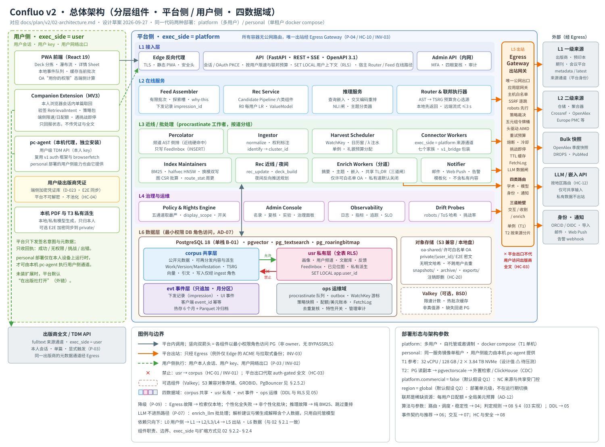

# Confluo v2 方案总览

> 只读一篇的话，读这篇：v2 做什么、怎么做、分几步做，以及需要你拍板的事。各分篇是同一方案的展开，全部为 draft，等你评审。

## 产品定义

面向研究者的跨学科（含经管金融工作论文）论文发现平台：从合法来源持续收割论文，用可解释、持续学习的个性化推荐，把"今天值得看的论文"做成一叠有限的卡片（默认 25 张），用户靠滑动分拣；用户自己的机构权限只用于本人在用户侧取回全文。不做 AI 综述/问答主战场（集成开放服务即可），不做社交化的时长竞争，也不做任何形式的全文再分发。北极星指标是每周每个活跃用户的"有价值阅读数"（收藏、4 星以上评分、导出引用、打开全文，四者去重计数），时长与日活只作护栏。

## 五项需求怎么落地

| 你的需求 | 方案要点 | 详见 |
|---|---|---|
| 来源对接与支持名录 | 来源按七类分层（M1、M2、L1a–L1c、L2a–L2b），Source 与 Venue 分离；每个来源声明元数据、最新论文、全文三条通道及合规证据；连接器分九族，多数期刊经 Crossref 零代码接入；名录 187 条，首批 P0 36 条 | [03](03-sources-and-corpus-pipeline.md)、[名录](../../catalog/source-directory.md) |
| 检索、路由与多用户数据库 | 先收割、后联邦；统一 Query AST 支持五种意图；主题-来源路由图 TSRG 同时管路由、收割调度、兴趣挂点和反向推送；PostgreSQL 18 四个数据域，私有层全表 RLS | [04](04-retrieval-and-routing.md)、[05](05-data-platform.md) |
| 推荐、反馈与双向匹配 | 行为价值模型打分，北极星是有价值阅读而非时长；R0 用每用户逻辑回归，反馈 2 秒内生效；新论文分级曝光；三层双向匹配，研究者匹配默认关闭 | [06](06-recommendation-and-matching.md) |
| 卡片流前端 | 今日分拣卡叠、收藏库、详情面板三件套，一级入口只有今日、收藏、我；→ 想读、← 不感兴趣、↑ 跳过、↓ 撤回；每日默认 25 张，看完即止 | [07](07-frontend-interaction.md)、[demo](demo/paper-feed-demo.html) |
| 开源与初创调研 | 14 个主题并行调研、逐篇对抗核验，结论逐条进入设计 | [调研结论](../../survey/README.md) |

需求的完整清单（FR-17…FR-87、NFR-9…NFR-27）与成功指标见 [01](01-vision-and-requirements.md)，合规硬约束 HC-01…HC-32 见 [08](08-compliance-security-privacy.md)。

## 架构

- 模块化单体加工作者池，一套代码两种部署（platform 与 personal）。
- 数据分共享语料、用户私有、事件、运维四域，只能从共享层流向私有层；由私有内容派生的一切都留在私有层。
- 平台访问公网只经出站网关：robots 先行、全局限速、配额与逐请求审计都在这里执行。
- 受限全文只在用户侧取回：由浏览器扩展或本机代理 pc-agent 执行，用户显式触发、单篇。
- 详见 [02](02-architecture.md)。

## 部署形态

- **platform**：多用户，自托管或邀请制。受限全文（需要机构权限才能看的全文）的默认动作是"在出版社打开"外链；也可由用户浏览器里的配套扩展（先做 Chromium 系）在本人会话中取回。
- **personal**：同一套代码按单租户部署（`docker compose`），承接 v1 的个人使用场景。只有跑在用户本机（`deployment.host_is_user_device=true`，默认 false）才算"用户侧"：可在本机取回受限全文，也可把许可允许的 OA 全文批量取回到本人私有空间。跑在云主机上时，受限全文仍只能走扩展，OA 批量取回改由共享层承接，且只收许可允许再分发的全文。
- **单栈**：服务端只支持 PostgreSQL 18（含 pgvector），不做 SQLite/PG 双后端。后端 Python 3.12+（FastAPI），任务队列用 PG 原生队列；前端 TypeScript + React 19 PWA，原生 App 延后到 v2.x。
- **v1 去向**：v1 CLI 与 SQLite 维护冻结，只修缺陷；提供一次性 v1→v2 ETL；v1 adapter 经包装层迁入 v2 复用，不重写。
- **许可门禁**：核心链路的依赖、模型、数据按"可能商用"的最严口径选，分放行、评审、可选、禁止四级。宽松许可（Apache-2.0、MIT、BSD、PostgreSQL 等）放行；LGPL 等弱 copyleft 以不修改的库形式使用时经评审放行（保留 psycopg 3）；AGPL、SSPL、BUSL 与非商业（NC）许可的组件只作可选项，默认关闭。
- **规模档位 T1**（首个目标档）：≤1,000 活跃用户，容量按 1 万设计；语料 ≤1,000 万篇，起步约 100–300 万篇（全体用户兴趣并集的子集）；日新增收割 1–3 万篇。默认不配 GPU，不引入 ClickHouse。
- **性能目标**（T1 设计值，实现期压测校准）：下一批卡片 p95 ≤300 ms；本地检索端到端 p95 ≤800 ms；联邦检索总截止 3 s，超时先返回本地结果再流式补齐；滑动提交到下一张可交互 ≤100 ms。

## 核心原则

全部设计文档共同遵守：

- **先收割、后联邦**：订阅、最新论文和卡片流只读本地语料；即席查询先查本地，覆盖不足时才在查询时并行转发给远端来源（联邦检索）。
- **数据分域，派生从严**：共享层只放公开元数据和许可允许再分发的内容；偏好、反馈、凭证、私有全文放用户私有层（行级安全隔离）；事件层只追加；另设运维域。每个可展示字段标明展示范围，每个资产标明许可。凡由私有内容派生的东西（嵌入、TL;DR、特征、解释文本）一律私有，不进共享索引、全局模型、协同信号或他人可见的解释。
- **凭证归用户，取回在用户侧**：凭证、配额、订阅全文按用户隔离，不池化、不共享、不预取；受限全文只在用户点击后单篇取回，在用户的浏览器扩展或用户本机上执行；平台不代用户访问出版商，也解不开用户的出版商凭证；取回的 PDF 默认只存设备本地，开启同步时服务端只存端到端密文。
- **全局礼貌**：对上游的请求量不随用户数线性放大。平台所有对外请求只经出站网关（Egress Gateway），按"来源、主机、请求类、凭证、出口 IP"共享令牌桶，按响应头自适应调速，以书面限额为上限；不用多 key、多 IP 规避限额，遇验证挑战即停，不求解。
- **多通道取最严**：每个来源同时评估官方 API 文档、批量快照、robots、ToS 自动化条款和 TDM 保留声明（tdmrep），冲突时取最严；冲突或未确认的条款标 `needs_confirmation`。
- **可解释、可控、可导出**：每张卡带"为什么推荐"的理由；兴趣标签可查看、可删除；一键切到非个性化视图；个人数据可导出（BibTeX/RIS/JSON）、可删除。
- **LLM 不进交互热路径**：LLM 只做离线或近线任务（论文侧预处理、每日批量重排、懒生成解释等），滑动时不同步调用；AI 生成内容一律标注，共享版本只用可共享的开放内容生成；私有全文默认不发给第三方 LLM；涉及用户画像的 LLM 任务只许用自托管模型。
- **评测先行**：从第一天起记录曝光日志（位置、候选来源、打分分量、实验分桶、倾向分），每个算法模块自带离线基准和在线指标。
- **可降级**：关键能力（DOI 元数据查找、最新论文收割、OA 定位、标题精确匹配）至少有两级替补；任一上游失败时退回"仅本地/仅元数据"，不整体失败。

## 路线图

| 里程碑 | 做什么 | 人日 | 对外形态 |
|---|---|---|---|
| V0 | 设计定稿与工程底座：ADR 裁决、书面确认发函、PG 骨架、策略引擎与出站网关骨架 | 62 | 无 |
| V1 | 语料底座与 P0 来源 | 125 | 无（staging 持续收割） |
| V2 | 检索与路由 | 78 | 无 |
| V3 | 多用户平台（与 V2 并行） | 89 | 邀请制内部封测 |
| V4 | 推荐 R0 与 Feed API | 77 | dogfood |
| V5 | 前端 PWA 与可用性 | 83 | **v2.0 公开内测** |
| V6 | 社交、双向匹配与推荐 R1 | 48 | v2.1 |
| V7 | 规模化与加固 | 37 | v2.2 稳定版 |

合计 113 张任务卡、约 599 人日、243 条正式验收；3 条泳道并行时约 30 周到 v2.0（±50%）。节奏主要由书面确认、法务意见等外部等待决定。详见 [09](09-roadmap-and-milestones.md)。

## 待你拍板

设计已按下列默认假设推进：

- **是否商业化 / SaaS 化**：默认否，非商业，自托管或邀请制。改为商用时，`platform.commercial=true` 会自动关闭限非商业的来源与共享（如 CORE、ORCID 公共 API、J-STAGE、CC BY-NC 内容）。
- **是否面向中国大陆公众运营**：默认否。非个性化开关、兴趣标签管理、推荐原理公示已按最严口径内建，备案类义务留到上线决策。若改为是，LLM 须用已备案模型并完成属地登记与公示，公开评论须改为后台实名。
- **是否购买付费数据档**（OpenAlex Member/Member+、Crossref Metadata Plus）：默认不买，用免费季度快照加增量 API；付费档作为扩大规模的手段写进路线图。
- **robots 与官方 API 文档冲突时怎么办**：默认保守，这类 API 只按文档限速做低频或用户触发的调用，标 `needs_confirmation`，拿到书面确认前不做后台批量收割。已细化为 robots ADR 草案 D-049：接受前 NCBI E-utilities 连按需调用也不做，接受后只允许附表登记的按需单篇调用。
- **双向匹配先做哪层**：默认先做读者↔论文与论文→读者；研究者↔研究者做成默认关闭的实验功能，双方都选择加入才启用，只用本人主动公开的画像。
- **评论与评分是否公开**：默认 v2.0 只有私有笔记和私有评分；公开评论与公开评分放到 V6，前提是实名锚定（ORCID 或机构邮箱）和审核能力就绪。
- **表示模型（把论文转成向量的嵌入模型）选哪个**：默认在 V1 做分学科评测（每学科 ≥200 条金标）后再定；候选 gte-large（MIT）、Qwen3-Embedding-0.6B（Apache-2.0，多语）、SPECTER2（基础模型 Apache-2.0，proximity adapter 许可待核）。
- **T1 是否配 GPU 与自托管 LLM**：默认不配；画像摘要、LLM 重排、个性化解释等四项 LLM 功能关闭，回退到非 LLM 路径。
- **用户之声调研与 demo 可用性测试（5–8 人 × 3 个学科）何时做**：建议在 V1 之前。
- **社科是否扩展到社会学、政治学、教育学**：默认 v2.0 不含，只覆盖经济、金融、商业、管理；列为补充调研缺口，将来走同一接入机制。
- **评级标签怎么用**：默认把公开名单（CCF、ICORE、UTD24、Nature Index、科协 T 级、卓越、CSSCI 等）内置为 venue 的展示与过滤标签；ABDC、FT50、VHB 在许可确认前只接受用户导入，AJG、JCR、中科院分区表只接受用户自带；评级不进默认排序。见[评级体系](../../catalog/venue-rankings.md)。
- **34 条 ADR 草案**（D-040…D-073）：逐条确认是 V0 的第一项工作，见 [ADR 登记](../decision-log.md)。D-072（来源七类分层）是 2026-09-27 新增的，见[来源分层](../../catalog/source-taxonomy.md)；D-073（支持分级）是 2026-09-29 新增的，见[来源分层](../../catalog/source-taxonomy.md#支持分级)与 [venue 名录](../../catalog/venues/README.md#支持分级)。

## 待法务与外部确认

设计已按最严口径处理，结论出来后可逆调整。

- **法务 P0**：受限全文的取回架构（当前为用户侧执行、平台不代取）；B 类摘要（版权属出版方、但公开分发）可展示的摘录长度，以及能否进内部索引与嵌入；LLM 据这类摘要生成 TL;DR 并跨用户展示的门槛；Content-Signal/TDMRep 等机器可读信号对应哪些用途。
- **法务其他**：在本人私域中用 LLM 处理 Elsevier、IEEE 等出版商内容；私有 PDF 上传与端到端密文同步是否符合出版商条款；扩展在用户点击后代发的单篇请求算不算自动化访问；匿名协同统计（`anon_aggregation`）的合法性基础；k 匿名门槛（至少 k 个不同用户才计入或展示）的终值，以及差分隐私（在 V6 公开计数前决定）。
- **书面确认 P0（V0 即发函）**：NCBI（E-utilities 与 FTP）、EMBL-EBI（FTP 与 Europe PMC 用量）、OpenReview 服务账号。NCBI 确认前，生命科学主干由 Europe PMC、PMC 允许通道与 Crossref 承担；与 EBI 约定用量前，Europe PMC 只作后台收割，生命科学的交互检索靠本地语料与 OpenAlex；OpenReview 确认前停止平台共享收割，ICLR、TMLR、COLM 等靠 arXiv 版本、dblp 快照和 OpenReview 外链兜底。
- **书面确认 P1**：ORCID、OSF、eLife、HAL、PubChem、CiNii、IACR、arXiv export 等。
- **数据许可**：CORE、NBER 周更元数据、APS Harvest、Semantic Scholar 商用边界、Springer Nature 与 NASA ADS 的平台级用途、HF Papers 与 alphaXiv、央行工作论文、venue 名录体系、SSRN 的 CC 许可论文。取得许可前不启用或只外链；Springer Nature 与 ADS 暂按用户级凭证处理。

## 文档导航

| 文档 | 内容 |
|---|---|
| [01 愿景与需求](01-vision-and-requirements.md) | 用户、场景、需求分组、红线、北极星与护栏 |
| [02 总体架构](02-architecture.md) | 组件、部署、数据流、出站网关、用户侧取回、API |
| [03 来源接入与语料流水线](03-sources-and-corpus-pipeline.md) | 来源模型、连接器九族、策略引擎、各学科接入、身份与流水线 |
| [04 检索、路由与 TSRG](04-retrieval-and-routing.md) | Query AST、TSRG、选源算法、联邦执行、本地混合检索 |
| [05 多用户数据平台](05-data-platform.md) | 四个数据域、RLS、留存、数据权利、备份与 ETL |
| [06 推荐与双向匹配](06-recommendation-and-matching.md) | 价值模型、事件契约、在线学习、分级曝光、三层匹配 |
| [07 前端交互与视觉](07-frontend-interaction.md) | 三件套、手势、卡片信息、动效、可访问性、性能 |
| [08 合规、隐私与安全](08-compliance-security-privacy.md) | HC-01…HC-32、许可闸、robots 政策、隐私、LLM、威胁 |
| [09 路线图与里程碑](09-roadmap-and-milestones.md) | V0–V7、决策门、风险、组织方式、v1 迁移 |
| [交互 demo](demo/paper-feed-demo.html) | 可操作的卡片流与视觉案例；在线版 <https://claude.ai/artifact/YYZiiZjCVVeTzbESeFxqQr> |

来源与期刊会议的查阅文档：[来源分层与收集现状](../../catalog/source-taxonomy.md)、[支持名录](../../catalog/source-directory.md)、[venue 名录](../../catalog/venues/README.md)、[评级体系](../../catalog/venue-rankings.md)。

完整长稿（设计简报与三轮裁决、DDL、算法推导、任务卡与全部验收条目）在标签 `v2-drafts`，例如 `git show v2-drafts:docs/plan/v2/00-design-brief.md`；读法见[归档说明](../../archive.md)。
